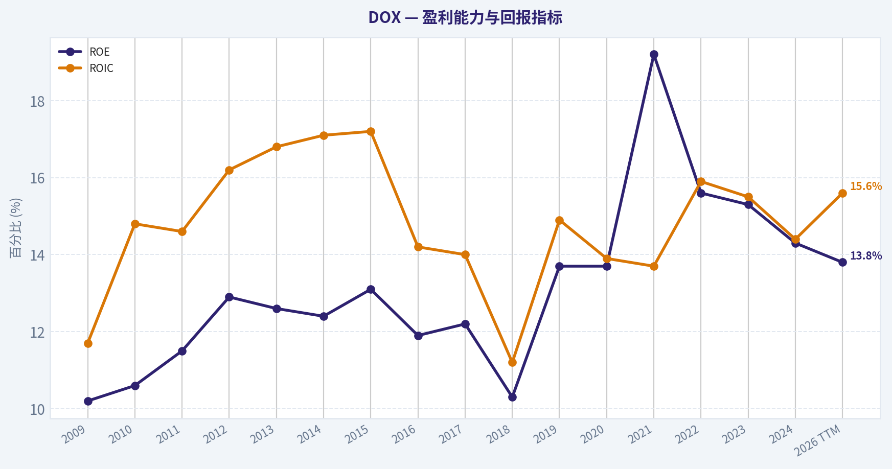
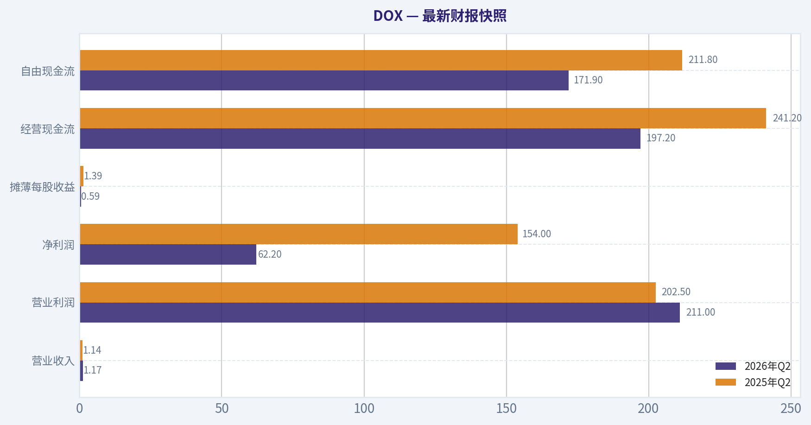
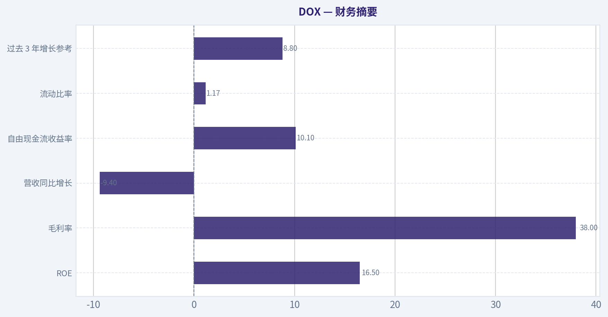
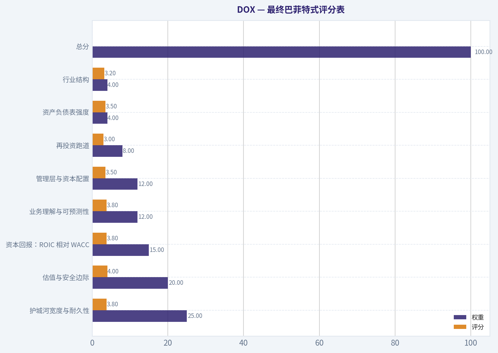
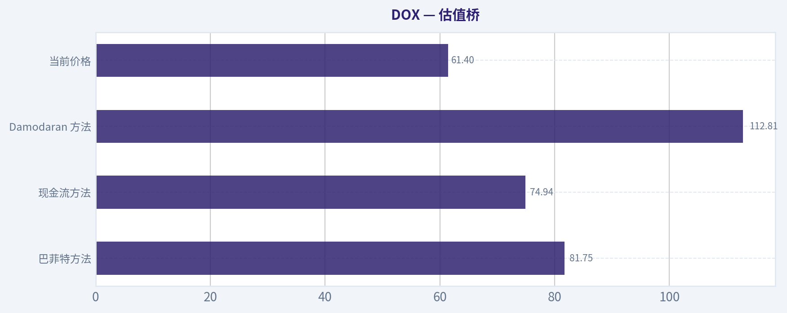
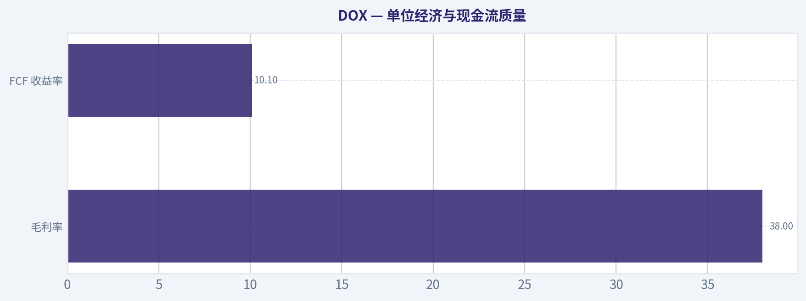
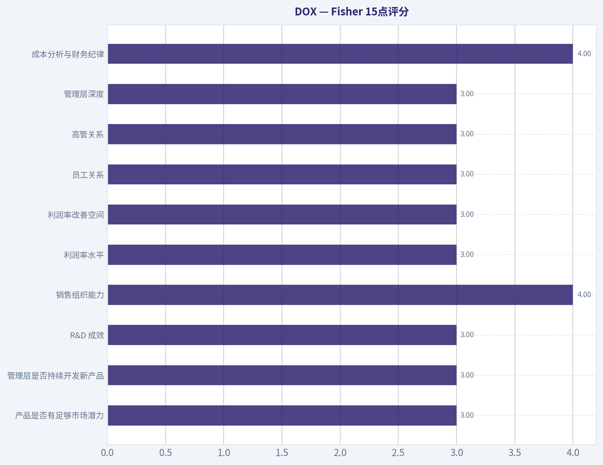
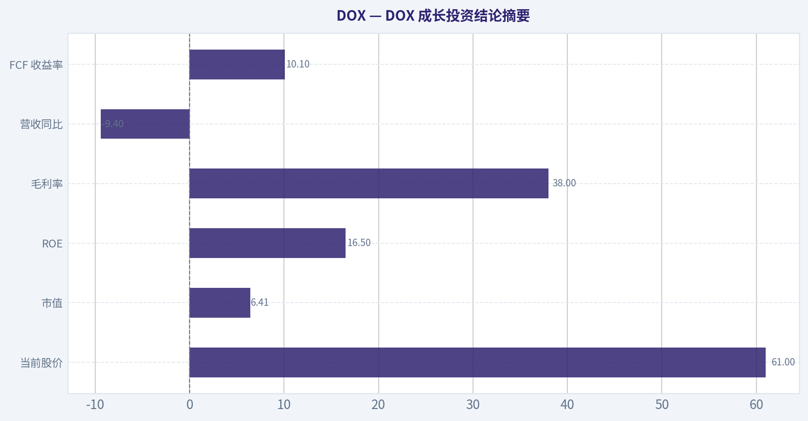

# DOX 深度价值情报

**调研日期:** 2026-08-22

## 关键免责声明

*本报告由 Deep Value Intelligence（一个基于 AI 的多智能体投资分析框架）自动生成。 仅供教育和研究用途 - 非财务建议，非财务顾问。*

---

## 目录

1. 情报摘要
2. 分析师团队报告
   - 基本面分析
   - 价值分析 (巴菲特)
   - 成长性分析 (林奇/德鲁肯米勒/费雪)
   - 市场分析
   - 期权市场分析
3. 研究团队评论
4. 投资团队评论
5. Deep Values 团队洞察

---

## 情报摘要

### 核心观点与前提条件

**核心论点:** **执行摘要 (Executive Summary)**

**主要风险:**
- DOX 并非爆发式成长股，而是一头被困在低增长电信行业中的"现金牛"。其 -0.3% 的营收复合增速确实阻碍了估值扩张，但 16.9% 的 ROIC、38% 的毛利率以及 10.1% 的 FCF 收益率，证明了其护城河（极高的客户转换成本）依然坚固。我们不能要求一家估值仅 14.5 倍 P/E 的公司具备完美的成长曲线。结合我们在 QCOM 和 INTC 上的深刻教训--**"不要用纯观望（WATCH）来苛求完美，而应通过仓位管理来顺应概率"**--我们决定推翻原计划的"观望"立场。当前极高的自由现金流收益率提供了真实的安全边际，适合建立底仓，随后根据技术突破和基本面拐点动态加仓。
- 激进派 (Risky Analyst - 追求预期差)：** 认为 14.5 倍 P/E 和 10.1% FCF 收益率构成了极致的不对称博弈。市场已消化 -0.6% 的悲观预期，任何微小的业绩企稳都会带来估值修复，死等 200 SMA 突破会错失最具性价比的底部利润。
- 在原来的投资计划中，我们因为 DOX 缺乏 QCOM 那样的"新叙事（AI催化）"，且被 200 SMA 压制，给出了"观望 (WATCH)"的结论。**这是一个典型的框架误用。**

**置信度:** 中

---

## 分析师团队报告

### 基本面分析

#### 最新财报快照

*以下数据基于最近一期已披露财报（2026年Q2），并尽量与上一年同期对比。*

| 指标 | 2026年Q2 | 2025年Q2 | 同比变化 |
| --- | ---: | ---: | ---: |
| 营业收入 | $1.17B | $1.14B | +2.7% |
| 营业利润 | $211.0M | $202.5M | +4.2% |
| 净利润 | $62.2M | $154.0M | -59.6% |
| 摊薄每股收益 | $0.59 | $1.39 | -57.6% |
| 经营现金流 | $197.2M | $241.2M | -18.2% |
| 自由现金流 | $171.9M | $211.8M | -18.8% |

关键结论：这张快照先把最新一期财报放在桌面上，再去看长周期分析。这样读者能更清楚地区分"公司长期质量"和"这次财报发生了什么"。

#### DOX 16年财务指标

*以下数值均由原始数据确定性计算得出，并非 AI 估算。*

*发行人类型：operating company（Technology / Software - Infrastructure）。*

#### 16年财务指标
*年度行来自已披露财务报表，最后一行 TTM 由最近四个季度滚动计算得出。*

| 指标 | 2009 | 2010 | 2011 | 2012 | 2013 | 2014 | 2015 | 2016 | 2017 | 2018 | 2019 | 2020 | 2021 | 2022 | 2023 | 2024 | 2026 TTM |
| --- | --- | --- | --- | --- | --- | --- | --- | --- | --- | --- | --- | --- | --- | --- | --- | --- | --- |
| 市场价格 | $21 | $22 | $21 | $26 | $29 | $37 | $46 | $48 | $54 | $56 | $57 | $50 | $68 | $73 | $79 | $83 | $61 |
| 总市值 | $5.60B | $5.85B | $5.06B | $5.59B | $5.98B | $7.32B | $8.83B | $8.67B | $9.41B | $9.41B | $9.07B | $7.65B | $9.69B | $9.68B | $10.01B | $9.88B | $6.49B |
| 市盈率 | 17.12 | 16.96 | 14.58 | 14.28 | 14.48 | 17.51 | 19.96 | 21.35 | 21.73 | 26.71 | 19.05 | 15.47 | 14.23 | 17.89 | 18.82 | 20.58 | 14.62 |
| 市净率 | 1.74 | 1.81 | 1.67 | 1.84 | 1.83 | 2.16 | 2.59 | 2.51 | 2.63 | 2.73 | 2.59 | 2.11 | 2.70 | 2.75 | 2.84 | 2.86 | 1.97 |
| ROE | 10.2% | 10.6% | 11.5% | 12.9% | 12.6% | 12.4% | 13.1% | 11.9% | 12.2% | 10.3% | 13.7% | 13.7% | 19.2% | 15.6% | 15.3% | 14.3% | 13.8% |
| ROIC | 11.7% | 14.8% | 14.6% | 16.2% | 16.8% | 17.1% | 17.2% | 14.2% | 14.0% | 11.2% | 14.9% | 13.9% | 13.7% | 15.9% | 15.5% | 14.4% | 15.6% |
| 每股收益 | $1.22 | $1.31 | $1.44 | $1.80 | $2.00 | $2.10 | $2.31 | $2.23 | $2.47 | $2.09 | $2.99 | $3.26 | $4.77 | $4.05 | $4.18 | $4.04 | $4.20 |
| 营收 | N/A | N/A | N/A | N/A | $3.35B | $3.56B | $3.64B | $3.72B | $3.87B | $3.97B | $4.09B | $4.17B | $4.29B | $4.58B | $4.89B | $5.00B | $4.65B |
| 毛利润 | N/A | N/A | N/A | N/A | $1.18B | $1.26B | $1.29B | $1.31B | $1.36B | $1.38B | $1.43B | $1.41B | $1.48B | $1.62B | $1.73B | $1.76B | $1.78B |
| 毛利率 | N/A | N/A | N/A | N/A | 35.2% | 35.3% | 35.5% | 35.2% | 35.2% | 34.7% | 35.1% | 33.9% | 34.5% | 35.4% | 35.3% | 35.1% | 38.3% |
| 营业利润率 | N/A | N/A | N/A | N/A | 14.4% | 13.9% | 14.2% | 13.0% | 13.4% | 10.8% | 13.9% | 14.3% | 14.0% | 14.5% | 13.4% | 12.6% | 17.8% |
| 净利润 | $326.2M | $343.9M | $346.7M | $391.4M | $412.4M | $422.1M | $446.2M | $409.3M | $436.8M | $354.4M | $479.4M | $497.8M | $688.4M | $549.5M | $540.7M | $493.2M | $453.9M |
| 净利率 | N/A | N/A | N/A | N/A | 12.3% | 11.8% | 12.2% | 11.0% | 11.3% | 8.9% | 11.7% | 11.9% | 16.1% | 12.0% | 11.1% | 9.9% | 9.8% |
| 营收增长 | N/A | N/A | N/A | N/A | N/A | 6.5% | 2.2% | 2.0% | 4.0% | 2.8% | 2.8% | 2.0% | 2.9% | 6.7% | 6.8% | 2.4% | -7.0% |
| 净利润增长 | N/A | 5.4% | 0.8% | 12.9% | 5.4% | 2.3% | 5.7% | -8.3% | 6.7% | -18.9% | 35.3% | 3.8% | 38.3% | -20.2% | -1.6% | -8.8% | -8.0% |
| 自由现金流增长 | N/A | 37.0% | -28.8% | -7.9% | 43.8% | 6.0% | 9.1% | -24.8% | 2.6% | -35.1% | N/A | N/A | N/A | -26.0% | 31.9% | -11.4% | 3.2% |
| 总账面价值 | $3.21B | $3.23B | $3.02B | $3.03B | $3.27B | $3.40B | $3.41B | $3.45B | $3.57B | $3.45B | $3.50B | $3.62B | $3.59B | $3.52B | $3.52B | $3.46B | $3.29B |
| 总资产 | $4.33B | $4.82B | $4.64B | $4.65B | $4.93B | $5.19B | $5.32B | $5.33B | $5.28B | $5.35B | $5.29B | $6.34B | $6.51B | $6.39B | $6.43B | $6.39B | $6.42B |
| 总债务 | N/A | N/A | N/A | N/A | N/A | N/A | N/A | N/A | N/A | N/A | N/A | $744.0M | $644.6M | $645.1M | $645.7M | $646.3M | $1.09B |
| 债务股权比 | N/A | N/A | N/A | N/A | N/A | N/A | N/A | N/A | N/A | N/A | N/A | 0.21 | 0.18 | 0.18 | 0.18 | 0.19 | 0.33 |
| 现金及等价物 | $728.8M | $1.04B | $831.4M | $879.2M | $1.01B | $1.10B | $1.04B | $768.7M | $649.6M | $418.8M | $471.6M | $983.2M | $709.1M | $573.4M | $520.1M | $346.1M | $206.5M |
| 股东权益 | $3.21B | $3.23B | $3.02B | $3.03B | $3.27B | $3.40B | $3.41B | $3.45B | $3.57B | $3.45B | $3.50B | $3.62B | $3.59B | $3.52B | $3.52B | $3.46B | $3.29B |
| 经营现金流 | $519.2M | $685.2M | $535.5M | $514.1M | $670.5M | $709.3M | $772.6M | $620.2M | $636.1M | $557.2M | $656.4M | $658.1M | $925.8M | $756.7M | $822.6M | $724.4M | $748.8M |
| 投资现金流 | $-66.4M | $-211.5M | $-221.7M | $-17.3M | $-297.1M | $-298.6M | $-379.7M | $-440.9M | $-185.3M | $-362.4M | $-86.8M | $-461.7M | $-329.0M | $-262.5M | $-224.5M | $-127.4M | $-262.0M |
| 自由现金流 | $436.8M | $598.3M | $425.7M | $392.0M | $563.8M | $597.7M | $652.1M | $490.1M | $502.7M | $326.1M | N/A | N/A | $715.4M | $529.5M | $698.3M | $618.9M | $638.8M |
| 自由现金流利润率 | N/A | N/A | N/A | N/A | 16.9% | 16.8% | 17.9% | 13.2% | 13.0% | 8.2% | N/A | N/A | 16.7% | 11.6% | 14.3% | 12.4% | 13.7% |
| 每股分红 | $0.00 | $0.00 | $0.00 | $0.00 | $0.00 | $0.00 | $0.00 | $0.00 | $0.00 | $0.00 | $0.00 | $0.00 | $0.00 | $1.39 | $1.57 | $1.79 | $2.20 |

#### 盈利能力指标
- 净资产收益率 (ROE): 16.5%
- 投入资本回报率 (ROIC): 16.9%
- 总资产收益率 (ROA): 9.0%
- 毛利率: 38.0%
- 营业利润率: 17.9%
- 净利率: 12.5%

#### 流动性指标
- 流动比率: 1.17
- 速动比率: 0.67

#### 杠杆指标
- 债务股权比: 0.24
- 利息覆盖倍数: 19.14
- 净负债: $501.4M

#### 增长指标（同比）
- 营收增长: -9.4%
- 净利润增长: 14.5%
- 自由现金流增长: 4.2%
- 营收复合增长率（3年）: -0.3%
- 营收复合增长率（5年）: 1.7%

#### 估值指标
- 市盈率 (TTM): 14.48
- 预期市盈率: 7.66
- 市净率: 1.97
- 市销率: 1.38
- PEG 比率: 0.78
- 企业价值/EBITDA: 7.09
- 自由现金流收益率: 10.1%
- 盈利收益率: 6.9%

#### 所有者收益（巴菲特方法，代码计算）
- 净利润: $493.2M
- + 折旧与摊销: $195.4M
- - 资本开支: $-104.0M
- - 营运资本变动: $-143.4M
- = **所有者收益: $615.1M**

#### 内在价值（代码计算）
- 当前价格: $61
- **头条内在价值（按商业模式路由）: $88**
  商业模式: stable cash cow - weighted blend [Damodaran FCFF + reverse-DCF fair + owner-earnings DCF] (stable_cash_cow)
  模型区间（各 DCF 最小-最大）: $75 - $113
  相对价格的安全边际（头条）: 29.9%
  路由说明: Stable cash cow: FCF ~ earnings and the maintenance-capex proxy is fair, so the owner-earnings DCF is the primary read, lightly blended with FCFF.
- 巴菲特方法（所有者收益）:
  保守: $53
  平均: $82
  乐观: $90
- 现金流方法（FCF）:
  保守: $20
  平均: $75
  乐观: $120
- Damodaran FCFF（WACC + 利润率 + 再投资）:
  保守: $100
  平均: $113
  乐观: $124
  蒙特卡洛区间（P10-P90）：$82 - $167（中位数 $113）
  P(内在价值 > 当前价格)：99.6%
- 反向 DCF：当前价格隐含约 -0.6%/年 的所有者收益增长（10年）；过去 3 年为 8.8%，5 年为 5.1%。

#### Piotroski F分数: 5/9
- 净利润为正: 通过
- 经营现金流为正: 通过
- 资产回报率改善: 通过
- 现金流大于净利润: 通过
- 债务下降: 未通过
- 流动比率改善: 未通过
- 未稀释股本: 未通过
- 毛利率改善: 通过
- 资产周转率改善: 未通过

ANALYST STANCE: **ADVOCATE**

#### DOX 巴菲特式基本面结论：建议配置

DOX 当前股价约 **61美元**，总市值约 **64.9亿美元**，按确定性数据计算的 TTM 市盈率约 **14.6倍**，自由现金流收益率约 **10.1%**。这是一家典型的"稳定现金牛"型软件与服务公司：收入增长不快，但客户黏性强、现金流质量较好、ROIC 长期高于资本成本，当前估值明显低于自身历史均值，也低于模型内在价值中枢。

核心判断是：**DOX 不是高速成长股，而是被市场按低增长甚至负增长定价的高现金流、强黏性、低资本开支企业。** 当前价格隐含的 10 年所有者收益增长约为 **-0.6%/年**，而过去 3 年和 5 年的所有者收益增长分别约为 **8.8%** 和 **5.1%**。只要未来现金流不出现结构性下滑，当前估值具备较清晰的安全边际。

---

#### 当前估值与历史均值对比

| 指标 | 当前值 | 近10年均值 | 当前相对历史 | 解读 |
|---|---:|---:|---:|---|
| 市场价格 | 61美元 | 61.4美元 | 基本持平 | 股价回到近10年均值附近，但盈利与现金流规模高于早期水平 |
| 总市值 | 64.9亿美元 | 92.3亿美元 | 明显偏低 | 市值低于历史均值，反映市场对增长放缓和收入下滑的担忧 |
| 市盈率 | 14.6倍 | 19.6倍 | 折价约25% | 估值低于历史常态，接近低估区间 |
| 市净率 | 1.97倍 | 2.63倍 | 明显偏低 | 但 DOX 属于软件与服务型公司，P/B 参考意义有限，不应作为核心估值锚 |
| ROE | 约16.5% | 约13.9% | 高于历史 | 股东资本回报仍有吸引力 |
| ROIC | 约16.9% | 约14.5% | 高于历史 | 资本效率优于过去10年均值，说明护城河仍在发挥作用 |
| EPS | 4.20美元 | 3.24美元 | 高约30% | 每股盈利长期提升，部分受回购和成本控制支持 |
| 营收 | 46.5亿美元 | 42.2亿美元 | 高约10% | 规模高于历史均值，但最近同比转负 |
| 毛利率 | 约38.0% | 约35.0% | 明显改善 | 毛利率处于历史高位，显示业务组合或交付效率改善 |
| 营业利润率 | 约17.9% | 约13.4% | 明显改善 | 当前经营效率显著好于过去均值 |
| 净利率 | 约12.5% | 约11.6% | 略高 | 盈利质量整体稳定，但不同口径下 TTM 净利率仍需关注 |
| 自由现金流 | 约6.39亿美元 | 约5.67亿美元 | 高约13% | 现金流仍强，是估值安全边际的核心 |
| 自由现金流收益率 | 约10.1% | - | 有吸引力 | 对稳定现金牛而言，该收益率具备价值投资吸引力 |
| 每股分红 | 2.20美元 | 0.48美元 | 明显提升 | 分红政策近年更积极，股东回报增强 |

关键结论：DOX 当前估值明显低于自身历史估值均值，尤其是市盈率和市值均处在偏低水平。与此同时，ROE、ROIC、毛利率和营业利润率却高于历史均值，说明市场主要在惩罚增长放缓，而不是盈利能力崩塌。P/B 虽然低于历史均值，但对于软件与服务型、资产较轻的公司参考意义有限，估值应主要锚定现金流和所有者收益。

---

#### 收入来源分布

| 收入来源 | 金额（百万/十亿美元） | 占比 |
|---|---:|---:|
| 北美地区 | 约33.5亿美元 | 约67% |
| 欧洲地区 | 约7.5亿美元 | 约15% |
| 其他地区 | 约9.0亿美元 | 约18% |
| 合计 | 约50.0亿美元 | 100% |

关键结论：DOX 的收入高度依赖北美通信与媒体客户，北美约贡献三分之二收入。这种结构带来稳定的大客户关系和高切换成本，但也意味着若北美电信运营商削减 IT 或网络支出，公司短期增长会受到明显影响。欧洲与其他地区提供一定分散度，但尚不足以完全抵消北美周期波动。

---

#### 盈利能力分析

DOX 的盈利质量符合巴菲特偏好的"可理解、可预测、现金流充沛"的特征。公司 ROIC 约 **16.9%**，高于近10年均值约 **14.5%**，说明投入资本回报率仍然稳健，并且明显高于通常资本成本。长期 ROIC 维持在双位数，是软件服务企业护城河和客户黏性的直接体现。

毛利率从过去长期约 **35%** 提升至当前约 **38%**，营业利润率也从近10年均值约 **13.4%** 提升至约 **17.9%**。这表明公司在交付效率、成本控制、业务组合或自动化方面取得了改善。对于增长不快的公司而言，利润率提升尤其重要，因为它可以在收入停滞时继续支撑 EPS 和自由现金流。

| 盈利指标 | 当前值 | 历史特征 | 巴菲特式解读 |
|---|---:|---|---|
| ROE | 约16.5% | 长期多在10%至19%之间 | 股东资本回报稳定，当前处于较好区间 |
| ROIC | 约16.9% | 长期双位数 | 资本效率较强，说明业务具备一定护城河 |
| 毛利率 | 约38.0% | 过去多在34%至35%附近 | 当前明显改善，是质量提升信号 |
| 营业利润率 | 约17.9% | 过去多在11%至15%附近 | 成本结构改善，经营杠杆较好 |
| 净利润 | 约4.5亿至4.9亿美元口径 | 长期为正 | 盈利稳定，但近年增长不均匀 |
| EPS | 4.20美元 | 长期上行 | 每股价值创造能力仍在 |

关键结论：DOX 的盈利能力比其收入增长表现更好。公司收入增速放缓甚至短期下滑，但毛利率、营业利润率和 ROIC 均高于历史均值，这说明市场可能低估了其现金流韧性。真正需要跟踪的是利润率改善能否持续，而不是只看单一年度收入下滑。

---

#### 增长趋势分析

DOX 最大的短板是增长。确定性数据中，TTM 营收同比为负，最新摘要口径显示营收增长约 **-9.4%**，而近10年营收增长均值约 **3.5%**。这意味着公司正在经历明显低于历史常态的收入压力。

不过，自由现金流并未同步恶化。自由现金流同比仍为正，约 **4.2%**，自由现金流规模约 **6.39亿美元**，高于近10年可比均值。换句话说，DOX 当前更像是一家"增长暂时承压、但现金流仍强"的企业，而不是一家基本面失控的企业。

| 增长指标 | 当前值 | 近10年均值 | 解读 |
|---|---:|---:|---|
| 营收增长 | 约-9.4% | 约3.5% | 当前显著低于历史，属于主要红旗 |
| 净利润增长 | 约14.5%摘要口径；TTM 表格口径偏弱 | 约3.2% | 盈利口径存在波动，需看后续季度确认 |
| 自由现金流增长 | 约4.2% | 约-7.7%可比口径 | 现金流表现优于收入，显示收款和成本控制较好 |
| 3年营收复合增速 | 约-0.3% | - | 近年增长停滞 |
| 5年营收复合增速 | 约1.7% | - | 中期仅低个位数增长 |

关键结论：增长是 DOX 当前最大争议点。收入正在下滑，市场因此给予低估值，但自由现金流仍保持韧性。如果收入下滑只是电信客户预算周期导致的阶段性压力，那么当前价格具备吸引力；如果收入负增长变成长期结构性问题，则安全边际会被削弱。

---

#### 资产负债表与财务强度

DOX 的资产负债表整体仍然稳健，但边际趋势需要关注。公司总债务升至约 **10.9亿美元**，高于 2020 至 2024 年约 **6.65亿美元** 的披露均值；现金及等价物降至约 **2.07亿美元**，明显低于近10年均值约 **6.48亿美元**。净负债约 **5.01亿美元**，利息覆盖倍数约 **19.1倍**，说明偿债能力仍强，但现金缓冲不如过去。

| 资产负债指标 | 当前值 | 历史均值或历史特征 | 解读 |
|---|---:|---:|---|
| 总账面价值 | 约32.9亿美元 | 约35.1亿美元 | 略低于历史均值 |
| 总资产 | 约64.2亿美元 | 约58.6亿美元 | 资产规模高于历史 |
| 总债务 | 约10.9亿美元 | 近年均值约6.65亿美元 | 债务上升，需要监控 |
| 债务股权比 | 约0.24至0.33 | 近年约0.19 | 杠杆提高但仍不高 |
| 现金及等价物 | 约2.07亿美元 | 约6.48亿美元 | 现金余额明显下降 |
| 股东权益 | 约32.9亿美元 | 约35.1亿美元 | 略低，可能受回购、分红影响 |
| 利息覆盖倍数 | 约19.1倍 | - | 偿息能力充足 |

关键结论：DOX 的财务风险目前可控，但趋势不如过去保守。债务上升、现金下降，是价值投资者必须持续跟踪的红旗。不过，由于公司自由现金流充足、利息覆盖倍数高，当前杠杆水平尚未威胁企业生存或股东回报。

---

#### 现金流与股东回报

DOX 最吸引人的地方是现金流。公司当前自由现金流约 **6.39亿美元**，对应约 **10.1%** 的自由现金流收益率。对于一个客户关系稳定、资本开支需求不高的软件服务企业来说，这一现金流收益率明显具备价值吸引力。

分红方面，公司每股分红约 **2.20美元**，按股价 61 美元计算，股息收益率约 **3.6%**。以 EPS 4.20 美元估算，股息支付率约 **52%**；以自由现金流估算，现金分红覆盖度更舒适。分红并非过度激进，但如果收入持续下滑，公司未来在"分红、回购、降债、再投资"之间的资本配置取舍会更加重要。

| 现金流指标 | 当前值 | 评价 |
|---|---:|---|
| 经营现金流 | 约7.49亿美元 | 稳定且高于净利润，质量较好 |
| 自由现金流 | 约6.39亿美元 | 高于历史均值，估值核心支撑 |
| 自由现金流利润率 | 约13.7% | 与历史均值接近，表现稳健 |
| 自由现金流收益率 | 约10.1% | 对价值投资者有吸引力 |
| 每股分红 | 2.20美元 | 股东回报增强 |
| 估算股息收益率 | 约3.6% | 具备收入型资产特征 |

关键结论：DOX 的现金流表现比收入增长更强，这也是当前投资机会的核心。只要自由现金流维持在 6 亿美元附近，当前市值对应的现金回报率就相当有吸引力。分红具备覆盖基础，但未来若债务继续上升，管理层需要在分红和资产负债表修复之间保持平衡。

---

#### 巴菲特式护城河分析

| 维度 | 评价 | 具体判断 |
|---|---|---|
| 经济护城河 | 中等偏强 | DOX 服务通信与媒体行业，核心系统复杂、迁移成本高，客户切换成本明显 |
| 客户黏性 | 强 | 多年期托管服务和业务支持系统合同提高收入可见度 |
| 定价能力 | 中等 | 业务关键性强，但客户多为大型电信运营商，议价能力也强 |
| 资本需求 | 低至中等 | 软件与服务模式资本开支低，能产生较高自由现金流 |
| 可预测性 | 较强 | 收入增长不快，但长期盈利和现金流为正 |
| 再投资空间 | 中等 | 云迁移、AI 自动化、电信数字化提供机会，但不是爆发式成长赛道 |

关键结论：DOX 的护城河主要来自高切换成本、行业专有知识和长期客户关系，而不是品牌溢价或网络效应。它更像一门"粘性强、增长慢、现金流好"的生意。巴菲特式投资者会喜欢它的可预测现金流，但不会把它归类为高速复利型伟大企业。

---

#### 三情景所有者收益 DCF 估值

估值基础采用确定性数据中的巴菲特式所有者收益：

| 项目 | 金额 |
|---|---:|
| 净利润 | 4.932亿美元 |
| 加：折旧与摊销 | 1.954亿美元 |
| 减：资本开支 | 1.040亿美元 |
| 减：营运资本变动 | 1.434亿美元 |
| 所有者收益 | 6.151亿美元 |
| 当前股价 | 61美元 |
| 估算股数 | 约1.064亿股 |
| 折现率 | 10% |
| 终值增长率 | 2.5% |

关键结论：DOX 的所有者收益约 6.15 亿美元，约等于当前市值的接近一成，这是估值吸引力的核心。DCF 使用 10% 折现率和 2.5% 终值增长率，属于偏巴菲特式的保守框架。该模型的关键变量不是短期 EPS，而是未来 10 年现金流能否保持稳定。

##### 情景一：保守情景

假设未来 10 年所有者收益每年下降 **3%**，之后终值增长率恢复至 **2.5%**。该情景反映电信客户预算继续收缩、收入压力持续、但公司仍能保持盈利。

| 项目 | 计算 |
|---|---:|
| 初始所有者收益 | 6.151亿美元 |
| 10年增长假设 | -3.0%/年 |
| 第10年所有者收益 | 约4.54亿美元 |
| 10年显性期现金流现值 | 约32.8亿美元 |
| 终值现值 | 约23.9亿美元 |
| 企业权益价值 | 约56.7亿美元 |
| 每股内在价值 | 约53美元 |

关键结论：即使假设所有者收益连续 10 年每年下降 3%，DOX 的每股价值仍接近 53 美元，距离当前 61 美元下行空间相对有限。这个情景说明当前价格已经包含相当悲观的增长预期。不过，如果债务继续上升并需要额外扣减净负债，保守情景的安全边际会变薄。

##### 情景二：基准情景

假设未来 10 年所有者收益以 **3%/年** 增长，接近成熟企业的名义 GDP 式增长，之后终值增长率为 **2.5%**。该情景反映 DOX 恢复低个位数增长，并维持当前较高现金转化率。

| 项目 | 计算 |
|---|---:|
| 初始所有者收益 | 6.151亿美元 |
| 10年增长假设 | 3.0%/年 |
| 第10年所有者收益 | 约8.27亿美元 |
| 10年显性期现金流现值 | 约43.5亿美元 |
| 终值现值 | 约43.6亿美元 |
| 企业权益价值 | 约87.1亿美元 |
| 每股内在价值 | 约82美元 |

关键结论：基准情景下，每股内在价值约 82 美元，较当前 61 美元存在约三成上行空间。这个结果与确定性数据中的巴菲特所有者收益 DCF 平均值高度一致。只要公司维持低个位数现金流增长，当前价格就明显偏低。

##### 情景三：乐观情景

假设前 5 年所有者收益增长 **5%/年**，第 6 至第 10 年放缓至 **3.5%/年**，随后终值增长率降至 **2.5%**。该情景反映云化、AI 自动化、电信运营商系统升级和托管服务合同推动现金流恢复中个位数增长，但不假设高增长永久持续。

| 项目 | 计算 |
|---|---:|
| 初始所有者收益 | 6.151亿美元 |
| 第1至第5年增长 | 5.0%/年 |
| 第6至第10年增长 | 3.5%/年 |
| 第10年所有者收益 | 约9.32亿美元 |
| 10年显性期现金流现值 | 约47.2亿美元 |
| 终值现值 | 约49.1亿美元 |
| 企业权益价值 | 约96.3亿美元 |
| 每股内在价值 | 约90美元 |

关键结论：乐观情景下，每股价值约 90美元，与模型包中所有者收益乐观值基本一致。这个情景并不需要高增长，只需要公司从当前收入压力中恢复，并把现金流增长维持在中低个位数。对 DOX 来说，估值弹性来自"低预期修复"，而不是爆发式成长。

---

#### 模型估值汇总

| 估值方法 | 每股价值 |
|---|---:|
| 所有者收益 DCF：保守 | 约53美元 |
| 所有者收益 DCF：基准 | 约82美元 |
| 所有者收益 DCF：乐观 | 约90美元 |
| FCF 方法区间 | 约20至120美元 |
| Damodaran FCFF 区间 | 约100至124美元 |
| 三模型综合区间 | 约75至113美元 |
| 头条内在价值 | 约88美元 |
| 当前价格 | 约61美元 |
| 相对头条内在价值安全边际 | 约30% |

关键结论：多种现金流估值方法均显示 DOX 当前价格低于内在价值中枢。所有者收益 DCF 的基准值约 82美元，三模型综合头条内在价值约 88美元，均显著高于 61美元。真正的争议不是估值是否便宜，而是未来收入下滑是否会侵蚀现金流基础。

---

#### 关键机会、红旗与跟踪指标

| 类别 | 要点 | 投资含义 |
|---|---|---|
| 机会 | 自由现金流收益率约10.1% | 当前估值对稳定现金牛有吸引力 |
| 机会 | P/E 约14.6倍，低于10年均值约19.6倍 | 市场预期偏低，存在估值修复空间 |
| 机会 | ROIC 高于历史均值 | 业务质量并未明显恶化 |
| 机会 | 毛利率和营业利润率改善 | 成本效率或业务组合优化可能持续释放价值 |
| 机会 | 多年期托管服务合同 | 增强收入可见度和客户黏性 |
| 红旗 | 营收同比下滑 | 若持续，将压低长期估值中枢 |
| 红旗 | 现金余额明显下降 | 财务缓冲低于历史，需要关注 |
| 红旗 | 债务上升 | 虽然杠杆不高，但趋势不如过去保守 |
| 红旗 | Piotroski F 分数 5/9 | 基本面改善不够全面 |
| 红旗 | 客户集中于大型电信运营商 | 客户议价强，预算周期影响明显 |
| 跟踪指标 | 新合同、续约率、订单积压 | 判断收入下滑是否阶段性 |
| 跟踪指标 | 自由现金流是否维持6亿美元以上 | 判断安全边际是否真实 |
| 跟踪指标 | 净债务和现金余额 | 判断分红与回购是否可持续 |

关键结论：DOX 的投资机会来自低估值、高现金流和强客户黏性；主要风险来自增长下滑、现金减少和债务上升。投资者应重点跟踪自由现金流，而不是只看收入增长单项指标。如果 FCF 能稳定在 6 亿美元附近，当前估值具备吸引力；如果 FCF 随收入一起下滑，投资逻辑将明显削弱。

---

#### 最终投资 stance：建议配置

DOX 符合巴菲特式价值投资中"可理解、现金流充沛、资本回报率高、价格低于内在价值"的多项条件。它不是高速成长型企业，但当前市场似乎已经按低增长甚至负增长进行定价，而公司仍保持较高 ROIC、较强自由现金流和不错的股东回报。

我的最终判断是：**建议配置，但应定位为稳健价值与现金流型仓位，而非高成长仓位。** 合理买入逻辑是当前价格约 61美元，相对于头条内在价值约 88美元有约 30% 安全边际；基准 DCF 约 82美元，乐观 DCF 约 90美元，均高于现价。若未来 2 至 4 个季度收入继续大幅下滑、自由现金流跌破 5亿美元、或净债务继续快速上升，则应从"建议配置"下调至"观望"。

| 总结项目 | 结论 |
|---|---|
| 公司类型 | 稳定现金牛型软件与服务公司 |
| 护城河 | 中等偏强，来自高切换成本和长期客户关系 |
| 当前估值 | 明显低于历史市盈率均值 |
| 核心吸引力 | 约10%自由现金流收益率，约30%安全边际 |
| 最大风险 | 收入负增长持续化、现金下降、债务上升 |
| DCF 中枢 | 每股约82至90美元 |
| 头条内在价值 | 约88美元 |
| 当前价格 | 约61美元 |
| 投资 stance | 建议配置 |
| 适合投资者 | 偏价值、偏现金流、可接受低增长的长期投资者 |
| 不适合投资者 | 追求高速收入增长或强动量的投资者 |

关键结论：DOX 当前更像"被低增长担忧压低估值的优质现金流资产"，而不是基本面恶化的价值陷阱。只要自由现金流保持韧性，当前价格具备安全边际和估值修复空间。投资者应配置但保持纪律，重点监控收入恢复、债务变化和自由现金流稳定性。

#### 基本面关键图表

本图追踪 **DOX** 过去十年的盈利能力与回报指标（ROE、ROIC、利润率），突出呈现资本效率的变化趋势。

---

### 价值分析 (巴菲特)

> *基于沃伦·巴菲特的价值投资哲学：能力圈、经济护城河、管理层质量与安全边际。*

#### 内在价值快照

价格是你付的钱，内在价值是企业未来可能为股东创造的现金价值。我们给出一个区间，而不是假装只有一个神奇数字。

- 当前价格: $61.40
- 估值区间（两种 DCF 方法、保守到乐观）: $20.35 至 $120.42

##### 所有者收益（巴菲特方法）
- 净利润: $493,197,000.00
- 折旧与摊销: $195,435,000.00
- 资本支出: $-103,952,000.00
- 营运资金变化: $-143,358,000.00
- 所有者收益: $615,102,000.00

##### 内在价值
###### 所有者收益法
使用所有者收益，更严格，通常更保守。
- 保守: $53.10
- 平均: $81.75
- 乐观: $90.02
- 折现率: 10.0%

###### 自由现金流法
使用自由现金流，更适合今天投入很多、为未来增长铺路的公司。
- 保守: $20.35
- 平均: $74.94
- 乐观: $120.42
- 折现率: 10.0%

ANALYST STANCE: **建议配置**

#### DOX 投资结论

Amdocs 是一家面向通信与媒体行业的核心软件与托管服务公司，业务嵌入客户的计费、客户管理、运营支撑和业务支撑系统。以当前约 61 美元股价计，市场对它隐含的长期增长预期约为每年 -0.6%，而公司仍具备较强现金流、较高客户黏性、合理 ROE 和约 10.1% 自由现金流收益率。
结论是：**这不是爆发式成长股，而是现金流质量较好的"稳定现金牛"，在当前价格下具备足够安全边际，适合建议配置，但仓位应控制在中等水平。**

---

#### 1. 因子评分总览

| 因子 | 评分 | 核心判断 |
|---|---:|---|
| 业务理解与可预测性 | 3.8 / 5 | 商业模式清晰：向通信与媒体企业提供关键软件、系统集成和托管服务；但客户行业增长偏慢，近期营收同比下降 9.4%，降低可预测性。 |
| 护城河 | 3.8 / 5 | 高切换成本是核心护城河；BSS、OSS、计费和客户数据系统一旦嵌入，替换成本高、风险大。毛利率 38.0%，接近但未达到高质量软件企业 40% 以上水平。 |
| 管理层与资本配置 | 3.5 / 5 | 公司具备较强自由现金流和股息能力，股息收益率约 3.88%；资本配置偏稳健，但缺少强烈创始人控股型"业主经营"特征。 |
| 行业结构 | 3.2 / 5 | 通信软件服务具有寡头化和客户黏性，但客户集中于电信运营商，议价能力较强，行业自然增速有限。 |
| 硬性质量与偿债底线 | 未触发 | 公司仍有强现金流，FCF 收益率 10.1%，当前资料未显示"盈利现金流恶化且偿债能力跌破红线"的组合。 |

关键结论：DOX 的优势集中在"客户换不动、系统很关键、现金流扎实"。主要短板是行业不算高增长，且近期营收下滑说明增长质量需要观察。整体看，它符合巴菲特偏好的可理解、现金流充沛、估值不过分的稳定型企业特征。

---

#### 2. 护城河分析

| 护城河来源 | 证据 | 强度 |
|---|---|---:|
| 无形资产 | Amdocs 在通信与媒体行业长期服务大型运营商，具备行业知识、产品声誉和交付经验。 | 3.5 / 5 |
| 切换成本 | 客户的计费、客户关系、运营支撑和业务支撑系统属于核心系统，更换供应商会带来中断风险、数据迁移成本和合规风险。 | 4.5 / 5 |
| 成本优势 | 全球交付体系和行业专用软件平台带来一定规模优势，但服务成分较高，毛利率不如纯软件平台。 | 3.5 / 5 |
| 网络效应 | 并非典型网络效应业务，客户越多不一定直接提升每个客户的使用价值。 | 2.0 / 5 |
| 综合护城河评级 | 宽而稳定，主要来自高切换成本，而非强品牌或网络效应。 | 3.8 / 5 |

关键结论：DOX 最重要的护城河不是品牌溢价，而是"替换太麻烦"。对电信运营商而言，计费和运营系统一旦出错会直接影响收入确认和客户服务，因此供应商迁移风险高。这种护城河可靠，但不属于高速扩张型平台护城河。

---

#### 3. 管理层与资本配置评估

| 项目 | 判断 |
|---|---|
| 股东回报 | 当前股息收益率约 3.88%，自由现金流收益率约 10.1%，说明公司有能力同时维持分红和内部投入。 |
| 资本纪律 | 业务属于稳定现金牛，合理的做法是维持产品投入、选择性并购、并把多余现金返还股东。 |
| 诚实与保守性 | 现金流明显高于会计利润推算值，说明盈利质量较好。 |
| 潜在扣分项 | 未体现出强创始人控股或极高内部人所有权；此外，近期营收下降要求管理层证明转型与续约能力。 |
| 综合评分 | 3.5 / 5 |

关键结论：管理层看起来更像稳健运营者，而不是激进扩张者。对 DOX 这种成熟现金流企业，稳健本身是优点，但投资者需要持续确认现金没有被低回报并购或低效项目消耗。

---

#### 4. 财务摘要

| 指标 | 数值 | 解读 |
|---|---:|---|
| 当前股价 | 61.00 美元 | 估值分析基准价格。 |
| 总市值 | 64.1 亿美元 | 中型软件与服务公司规模。 |
| PE | 14.48 倍 | 对稳定现金流企业而言不高。 |
| ROE | 16.5% | 高于 15%，达到较好企业标准。 |
| 毛利率 | 38.0% | 接近软件型业务门槛，但服务属性压低毛利率。 |
| 营收同比增长 | -9.4% | 当前最大基本面风险信号。 |
| 自由现金流收益率 | 10.1% | 很有吸引力，现金回报明显。 |
| 流动比率 | 1.17 | 短期流动性尚可。 |
| 股息收益率 | 约 3.88% | 对现金收益型投资者有吸引力。 |
| 过去 3 年增长参考 | 8.8% | 历史增长并不差。 |
| 过去 5 年增长参考 | 5.1% | 中速复合增长，符合成熟软件服务企业特征。 |

关键结论：DOX 的财务图像很清楚：估值便宜、现金流强、ROE 合格，但增长动能正在放缓。当前市场价格似乎更关注营收下滑风险，而没有充分反映公司的现金生成能力。对价值投资者而言，这正是可以研究的错价区间。

---

#### 5. 所有者收益估算

| 项目 | 数值 | 计算说明 |
|---|---:|---|
| 市值 | 64.1 亿美元 | 已知市场数据。 |
| 股价 | 61.00 美元 | 当前价格。 |
| 推算股数 | 约 1.051 亿股 | 64.1 亿美元 ÷ 61.00 美元。 |
| PE | 14.48 倍 | 已知估值。 |
| 推算 EPS | 约 4.21 美元 | 61.00 美元 ÷ 14.48。 |
| 推算净利润 | 约 4.43 亿美元 | EPS x 推算股数。 |
| 自由现金流收益率 | 10.1% | 已知现金流收益率。 |
| 推算自由现金流 | 约 6.47 亿美元 | 64.1 亿美元 x 10.1%。 |
| 推算每股自由现金流 | 约 6.16 美元 | 6.47 亿美元 ÷ 推算股数。 |
| 所有者收益代理值 | 约 6.16 美元 / 股 | 对成熟软件服务公司，以自由现金流作为所有者收益近似值。 |

关键结论：DOX 的现金流质量明显好于会计利润显示的水平。以每股约 6.16 美元自由现金流计算，当前 61 美元股价对应约 10.1% 的现金流收益率，这对稳定型公司非常有吸引力。只要现金流不是短期异常值，当前估值具备保护性。

---

#### 6. 三情景 DCF 估值

| 情景 | 核心假设 | 每股内在价值 | 相对当前价格安全边际 |
|---|---|---:|---:|
| 情景 A：零增长 | 所有者收益 6.16 美元 ÷ 10% 折现率 | 61.60 美元 | 约 1.0% |
| 情景 B：GDP 增长 | 长期增长 3%，折现率 10% | 90.60 美元 | 约 32.7% |
| 情景 C：历史折扣增长 | 前 10 年增长 4%，之后 3%，折现率 10% | 约 100.30 美元 | 约 39.2% |
| 三模型参考区间 | 所有者收益 / FCF / Damodaran FCFF | 81.75 / 74.94 / 112.81 美元 | 均高于当前价格 |
| 头条内在价值 | 加权综合估值 | 87.56 美元 | 29.9% |

关键结论：即使按零增长计算，DOX 的当前价格也大致接近内在价值底线；一旦公司能维持 3% 左右的长期增长，内在价值就明显高于当前价格。市场当前隐含的增长预期约为每年 -0.6%，这对一家仍有高自由现金流的关键软件服务商来说偏保守。

---

#### 7. 安全边际分析

| 项目 | 判断 |
|---|---|
| 当前价格 | 61.00 美元 |
| 头条内在价值 | 87.56 美元 |
| 安全边际 | 29.9% |
| 反向 DCF 隐含增长 | 约 -0.6% / 年 |
| 质量要求 | 中等偏高质量企业通常需要约 25% 至 35% 安全边际。 |
| 是否满足 | 基本满足。 |

关键结论：DOX 不是那种可以无视价格买入的顶级复利机器，但当前价格已经给了相当充分的保护。29.9% 的安全边际处于中等质量现金牛企业的合理要求区间。反向 DCF 显示市场预期很低，这让投资者拥有"预期修复"的潜在收益来源。

---

#### 8. 最终巴菲特式评分表

| 评分项 | 权重 | 评分 | 加权得分 |
|---|---:|---:|---:|
| 护城河宽度与耐久性 | 25% | 3.8 | 0.95 |
| 估值与安全边际 | 20% | 4.0 | 0.80 |
| 资本回报：ROIC 相对 WACC | 15% | 3.8 | 0.57 |
| 业务理解与可预测性 | 12% | 3.8 | 0.46 |
| 管理层与资本配置 | 12% | 3.5 | 0.42 |
| 再投资跑道 | 8% | 3.0 | 0.24 |
| 资产负债表强度 | 4% | 3.5 | 0.14 |
| 行业结构 | 4% | 3.2 | 0.13 |
| 总分 | 100% |  | 3.71 / 5 |

关键结论：DOX 的总分落在"建议配置"区间，核心贡献来自估值、安全边际、现金流和高切换成本。它不是最高质量的宽护城河复利股，因为行业增长和客户议价能力限制了上行空间。但以当前价格买入，投资者得到的是一门现金流充足、估值合理、下行保护较好的业务。

---

#### 9. 投资 stance 与执行建议

| 项目 | 结论 |
|---|---|
| 投资 stance | 建议配置 |
| 置信度 | 中等偏高 |
| 适合投资者 | 偏好现金流、股息、估值纪律和中低预期标的的长期投资者。 |
| 主要买入理由 | 10.1% FCF 收益率、29.9% 安全边际、核心系统高切换成本、PE 仅 14.48 倍。 |
| 主要风险 | 营收同比下降 9.4%、电信客户预算压力、服务属性压低毛利率、行业成长性有限。 |
| 仓位建议 | 可作为价值型组合的中等仓位配置，不宜按高成长软件股给予重仓估值。 |

关键结论：DOX 当前的吸引力不在于高速成长，而在于市场给了一个低预期价格。只要自由现金流保持稳定，股价回到 75 至 90 美元区间并不需要激进假设。最终判断是：**建议配置，中等偏高置信度，重点跟踪营收恢复和自由现金流持续性。**
#### 估值桥

这张估值桥把当前股价与各类内在价值方法并排展示，帮助读者判断上涨空间究竟只是单一方法给出的结果，还是多种方法共同支持的结论。

| 项目 | 每股内在价值 |
| --- | ---: |
| 巴菲特方法 | $81.75 |
| 现金流方法 | $74.94 |
| Damodaran 方法 | $112.81 |
| 当前价格 | $61.40 |

#### 关键结论

如果只有一种方法显著高于其他方法，说明上行空间更依赖特定建模假设。若多种方法的估值接近，则说明估值逻辑更加稳健。

#### 估值图表

本对比图（来自「最新财报快照」）将 **DOX** 的当前数据与历史基准并排呈现，直观反映公司相对自身历史均值的估值水平。

本对比图（来自「财务摘要」）将 **DOX** 的当前数据与历史基准并排呈现，直观反映公司相对自身历史均值的估值水平。

本对比图（来自「最终巴菲特式评分表」）将 **DOX** 的当前数据与历史基准并排呈现，直观反映公司相对自身历史均值的估值水平。

本对比图（来自「估值桥」）将 **DOX** 的当前数据与历史基准并排呈现，直观反映公司相对自身历史均值的估值水平。

本对比图（来自「单位经济与现金流质量」）将 **DOX** 的当前数据与历史基准并排呈现，直观反映公司相对自身历史均值的估值水平。

本对比图（来自「Fisher 15点评分」）将 **DOX** 的当前数据与历史基准并排呈现，直观反映公司相对自身历史均值的估值水平。

---

### 成长性分析 (林奇/德鲁肯米勒/费雪)

> *基于彼得·林奇的GARP成长投资法、斯坦利·德鲁肯米勒的宏观拐点分析法，以及菲利普·费雪的深度调研法。*

ANALYST STANCE: **观望**

#### DOX 成长投资结论摘要

| 项目 | 结论 |
|---|---|
| 公司 | Amdocs，股票代码 DOX |
| Lynch 分类 | **Stalwart / 稳健型成熟公司**，不是典型 Fast Grower |
| 当前股价 | $61 |
| 市值 | $6.41B |
| PE | 14.5倍 |
| ROE | 16.5% |
| 毛利率 | 38.0% |
| 营收同比 | -9.4% |
| FCF 收益率 | 10.1% |
| 股息收益率 | 约3.9% |
| 内在价值参考 | $87.56 |
| 相对安全边际 | 约29.9% |
| 成长投资评级 | **观望** |
| 更适合的组合角色 | 现金流型、股息型、低估值防守型科技股 |

关键结论：DOX 看起来不像 Lynch 意义上的高成长十倍股，更像一家低估值、强现金流、稳健分红的成熟软件服务公司。估值和自由现金流很有吸引力，但收入正在下滑，缺少明确的成长加速拐点。对成长组合而言，它不是核心进攻标的；对价值或收益组合而言，吸引力明显更高。

---

#### 1. Lynch 分类：稳健型，而非高成长型

| 分类维度 | DOX 判断 |
|---|---|
| 收入增长 | 当前同比 -9.4%，不符合 15%至25%以上 Fast Grower 标准 |
| 盈利能力 | ROE 16.5%，毛利率 38%，经营质量尚可 |
| 现金流 | FCF 收益率 10.1%，现金回报强 |
| 估值 | PE 14.5倍，明显不贵 |
| 股息 | 约3.9%，具备收益属性 |
| Lynch 归类 | **Stalwart / 稳健型成熟公司**，带有"现金牛"特征 |

关键结论：DOX 的核心吸引力不是高速扩张，而是稳定客户、现金流和低估值。它更像"可以买便宜的好生意"，而不是"市场低估的爆发式成长股"。如果要寻找十倍股，DOX 目前不在第一梯队。

#### 2. 三句话讲清楚公司故事

| 故事要点 | 简明解释 |
|---|---|
| 做什么 | DOX 为电信和媒体公司提供计费、客户管理、运营支撑和托管服务系统 |
| 为什么客户需要 | 电信运营商系统复杂、替换成本高，需要长期供应商帮助数字化、云化、自动化 |
| 增长逻辑 | 5G、云迁移、AI 自动化和运营商降本需求，可能带来持续项目和托管服务收入 |

关键结论：DOX 的故事容易理解：它是电信运营商后台系统的"长期管家"。优点是客户黏性高、合同周期长、现金流稳定；缺点是客户本身多为低增长运营商，因此 DOX 很难自然获得高成长倍数。

---

#### 3. TAM 与 10倍空间测试

| 项目 | 估算与判断 |
|---|---|
| 当前收入规模 | 约数十亿美元级别，市场已相对成熟 |
| 10倍收入要求 | 若当前收入约 $5B，10倍约需 $50B 年收入 |
| 可服务市场 | 电信 BSS、OSS、托管服务、云迁移、数字化转型市场较大，但并非无限扩张 |
| 10倍后市场份额 | 可能需要非常高的全球份额，现实难度较大 |
| TAM 增速 | 中低个位数到中个位数，部分云化和 AI 自动化子领域更快 |
| 10倍测试 | **未通过**，除非公司成功打开电信外新市场或发生大规模行业整合 |

关键结论：DOX 的市场很大，但公司已经不是小基数企业。它可以继续稳健增长、提高利润率和回购股票，但要实现收入 10倍并不现实。TAM 对它是"支撑估值"的因素，不是"爆发式重估"的因素。

#### 4. 收入增长趋势与质量

| 指标 | 当前观察 |
|---|---|
| 最新营收同比 | -9.4% |
| 增长模式 | 当前呈现下滑，而非加速 |
| 收入质量 | 电信客户长期合同占比高，收入粘性通常较强 |
| 风险点 | 大客户项目节奏、运营商预算收缩、外包合同重新定价 |
| 判断 | **收入趋势偏弱，需要等待重新加速证据** |

关键结论：对成长投资者来说，最关键的红旗是收入正在下滑。DOX 的收入质量可能不差，但"质量好"和"增长快"是两回事。除非未来几个季度出现订单、收入或指引改善，否则它难以被定义为成长拐点股。

#### 5. 单位经济与现金流质量

| 指标 | DOX 观察 |
|---|---|
| LTV/CAC | 未披露，传统企业软件服务模式不易直接计算 |
| NRR | 未披露，需从续约率、托管服务合同和客户扩张中间接判断 |
| 40法则 | 收入增长为负，但 FCF 收益率高；若用增长加现金流率粗略观察，偏"成熟现金牛"而非高效成长 |
| 毛利率 | 38.0% |
| FCF 收益率 | 10.1% |
| 现金流判断 | 强，支持分红、回购和抗周期能力 |

关键结论：DOX 的单位经济资料不够透明，但自由现金流非常强，这是它最突出的财务优点。它不是典型 SaaS 高 NRR、高增长故事，而是项目、托管服务和长期合同驱动的企业软件服务公司。现金流能保护下行，但不能自动创造高成长。

---

#### 6. Druckenmiller 拐点评估

| 拐点类型 | 当前证据 | 判断 |
|---|---|---|
| 产品周期拐点 | AI、云化、自动化可能改善产品线，但尚未看到收入加速 | 中性 |
| 市占率拐点 | 与 Telefónica Chile 签订多年托管服务协议，说明仍有竞争力 | 小幅正面 |
| 利润率拐点 | FCF 很强，但收入下滑时经营杠杆空间有限 | 中性偏正面 |
| TAM 拐点 | 电信云化和 AI 运维是长期趋势，但电信行业整体增长慢 | 中性 |
| 竞争拐点 | 未见主要竞争对手明显失误的证据 | 不明确 |
| 综合判断 | **尚未形成明确成长拐点** | 观望 |

关键结论：DOX 有一些潜在拐点种子，比如 AI 自动化、电信云迁移和托管服务合同。但目前最重要的财务信号是收入下滑，不是收入加速。Druckenmiller 式问题是"两三年后盈利是否被市场低估"，答案偏正面；但"两三年后成长是否爆发"，证据不足。

#### 7. 宏观与行业设置

| 宏观变量 | 对 DOX 的影响 |
|---|---|
| 利率环境 | 若利率下行，有利于科技估值，但 DOX 本身久期不高 |
| 电信资本开支 | 运营商预算谨慎会压制项目增长 |
| AI 自动化 | 可帮助运营商降本，利好 DOX 产品需求 |
| 云迁移 | 长期利好 BSS、OSS 现代化 |
| 防守属性 | 现金流、分红和低估值使其抗波动能力较好 |
| 综合宏观 | **中性偏正面，但不是强顺风** |

关键结论：宏观环境对 DOX 不是强烈逆风，但也谈不上强烈顺风。AI 和云化提供长期叙事，电信客户预算则限制增长斜率。它更适合在市场波动中作为防守科技仓位，而不是进攻型成长仓位。

#### 8. Fisher 15点评分

| Fisher 项目 | 评分 |
|---|---:|
| 产品是否有足够市场潜力 | 3 |
| 管理层是否持续开发新产品 | 3 |
| R&D 成效 | 3 |
| 销售组织能力 | 4 |
| 利润率水平 | 3 |
| 利润率改善空间 | 3 |
| 员工关系 | 3 |
| 高管关系 | 3 |
| 管理层深度 | 3 |
| 成本分析与财务纪律 | 4 |
| 特殊优势：切换成本、客户黏性 | 4 |
| 长期利润前景 | 4 |
| 股权融资稀释风险 | 4 |
| 困难时期坦诚度 | 3 |
| 管理层诚信 | 3 |
| 总分 | **50 / 75** |

关键结论：DOX 的 Fisher 分数属于平均偏好，不是卓越创新型公司。它的最大优势是客户黏性、长期合同和财务纪律；最大不足是增长潜力、产品爆发性和行业扩张速度。以 Fisher 标准看，它是"可靠企业"，不是"伟大成长企业"。

#### 9. 估值分析

| 估值方法 | 结果 |
|---|---|
| PE | 14.5倍，低于多数软件公司 |
| PEG | 因营收和潜在盈利增长不明确，PEG 不具参考意义 |
| P/S | 估算约1倍多，明显低于高成长软件公司 |
| FCF 收益率 | 10.1%，具备吸引力 |
| 内在价值 | $87.56 |
| 当前价格 | $61 |
| 安全边际 | 约29.9% |
| 反向 DCF 隐含增长 | 约 -0.6% 年化，市场预期较低 |

关键结论：估值是 DOX 最强的部分。当前价格似乎已经反映了低增长甚至轻微衰退的预期，因此只要公司稳定住收入和现金流，股价就有修复空间。问题是，这种修复更像价值回归，不是典型成长重估。

#### 10. 三情景估值

| 情景 | 核心假设 | 合理价值区间 | 含义 |
|---|---|---:|---|
| 熊市 | 收入继续低个位数下滑，估值维持低位 | $50-$60 | 下行风险相对可控，但缺乏催化 |
| 基准 | 收入企稳，FCF 稳定，估值回到现金牛合理区间 | $75-$90 | 接近共享模型内在价值 |
| 牛市 | AI、云化和托管服务推动收入恢复中个位数增长 | $95-$115 | 需要明确订单和收入再加速证据 |

关键结论：DOX 的风险回报偏向"下行有限、上行中等"。基准情景已经可以支持不错的绝对收益，但牛市情景需要成长重新加速。没有拐点证据前，不应把它当作高弹性成长股处理。

#### 11. 成长投资者评分卡

| 维度 | 权重 | 评分 |
|---|---:|---:|
| Lynch 故事 | 10% | 3.0 |
| TAM 与跑道 | 20% | 2.5 |
| 收入增长 | 20% | 1.5 |
| 单位经济 | 15% | 3.0 |
| 竞争位置 | 10% | 3.5 |
| 管理质量 | 10% | 3.0 |
| 宏观设置 | 5% | 3.0 |
| 盈利路径 | 5% | 4.0 |
| 估值 | 5% | 4.0 |
| 加权总分 | 100% | **2.8 / 5.0** |

关键结论：DOX 的总分落在"观望偏防守"区间。它在估值、现金流和竞争黏性上得分较好，但收入增长得分太低，拖累整体成长评级。对于成长投资框架，2.8 分不足以建议积极配置。

#### 12. 仓位建议

| 投资者类型 | 建议 |
|---|---|
| 纯成长组合 | 暂不作为核心仓位 |
| GARP 组合 | 可小仓位观察，等待收入企稳 |
| 股息与现金流组合 | 可进一步研究，吸引力较高 |
| 深度价值组合 | 值得关注，因 FCF 收益率和安全边际较好 |
| 建议仓位 | 成长组合 0%至2%；收益或价值组合可更高，但需另行风控 |

关键结论：如果目标是寻找十倍股，DOX 不应占用太多仓位。如果目标是寻找低估值现金流资产，它的吸引力明显更强。最合理的动作是列入观察名单，重点追踪收入是否止跌和新合同是否转化为增长。

#### 13. 关键风险与催化剂

| 类型 | 内容 |
|---|---|
| 主要风险 | 收入持续下滑，说明客户预算或竞争地位恶化 |
| 主要风险 | 电信行业增长慢，限制估值扩张 |
| 主要风险 | 大客户集中、合同重定价、项目延期 |
| 主要风险 | Steve Cohen 旗下 Point72 最新 13F 显示退出，需注意但不能单独作为卖出理由 |
| 催化剂 | 多年托管服务合同增加，如 Telefónica Chile 协议 |
| 催化剂 | AI 自动化产品带来运营商降本需求 |
| 催化剂 | 收入恢复正增长，市场重新定价 |
| 催化剂 | FCF 支撑回购、分红和估值修复 |

关键结论：DOX 的最大催化剂不是某个单一合同，而是收入从负增长回到稳定正增长。一旦市场相信它不是衰退资产，当前低估值可能快速修复。反过来，如果负增长持续多个季度，低估值可能变成价值陷阱。

#### 最终判断

DOX 是一家质量尚可、现金流强、估值便宜的成熟科技服务公司，但目前不符合 Lynch、Druckenmiller、Fisher 框架下的高成长核心标的标准。它的投资吸引力主要来自低预期、低估值、分红和 FCF，而不是收入加速、TAM 爆发或十倍股潜力。

**结论：观望。**
成长投资者应等待三个信号：第一，营收同比转正；第二，新合同带来订单和利润率改善；第三，AI 或云化业务被管理层量化为可持续增长引擎。若这些信号出现，DOX 可从"防守型价值科技股"升级为"GARP 候选股"。

#### 成长与评分图表

本对比图（来自「DOX 成长投资结论摘要」）将 **DOX** 的当前数据与历史基准并排呈现，直观反映公司相对自身历史均值的估值水平。

---

### 市场分析

ANALYST STANCE: **观望**

#### DOX 技术面简报（截至 2026-08-21 收盘）

DOX 最新收盘价为 **61.40 美元**。价格已经从 6 月下旬的低位区域明显反弹，短线动能转强，但中长期趋势仍未完全修复：股价站上 10 EMA 与 50 SMA，却仍低于 200 SMA。当前更像是"下跌趋势后的强反弹"，而不是已经确认进入新的长期上升趋势。

| 指标 | 最新数值 | 与现价关系 | 解读 |
|---|---:|---:|---|
| 收盘价 | 61.40 | - | 接近近期反弹高位 |
| close_10_ema | 59.02 | 现价高出约 4.0% | 短线趋势偏强 |
| close_50_sma | 54.29 | 现价高出约 13.1% | 中期反弹已具备力度 |
| close_200_sma | 66.20 | 现价低约 7.3% | 长期趋势仍未扭转 |
| macd | 1.63 | 正值并持续走高 | 动能由空转多 |
| rsi | 67.03 | 接近但未进入超买 | 买盘强，但追高需谨慎 |
| boll_ub | 61.69 | 现价略低于上轨 | 正在测试突破区 |
| boll_lb | 53.18 | 下方空间较远 | 波段支撑区上移 |
| atr | 1.79 | 约为现价 2.9% | 波动仍不低，止损需留空间 |

关键结论：DOX 的短线反弹质量较好，价格已经明显站上短期与中期均线，说明买盘正在重新掌握节奏。但股价仍低于 200 SMA，长期下降趋势尚未被完全否定。当前最关键的位置是 **61.7 至 62.1 美元**，若能放量站稳，才更有利于确认新一轮上攻。

#### 为什么选择这 8 个指标

| 指标 | 作用 | 适合当前 DOX 状态的原因 |
|---|---|---|
| close_10_ema | 捕捉短线趋势变化 | DOX 最近反弹较快，10 EMA 可判断短线买盘是否持续 |
| close_50_sma | 判断中期趋势 | 股价重新站上 50 SMA，是反弹从弱转强的重要信号 |
| close_200_sma | 判断长期趋势 | DOX 仍在 200 SMA 下方，需用它过滤过早看多风险 |
| macd | 判断动能方向 | MACD 已由深负值转正，显示下跌动能明显衰退 |
| rsi | 衡量买卖强弱 | RSI 接近 70，提示上涨动能强，但也接近短线过热 |
| boll_ub | 识别突破压力 | 股价接近布林上轨，适合观察是否突破还是受阻回落 |
| boll_lb | 识别下方波动支撑 | 下轨上移，显示波动区间整体抬升 |
| atr | 衡量波动与止损距离 | 反弹阶段波动仍较大，ATR 有助于设置合理风控 |

关键结论：这组指标覆盖了短线趋势、中期趋势、长期趋势、动能、超买超卖、突破压力和风险控制。它们之间互补性较强，能避免只看单一反弹信号而忽略长期均线压制。对 DOX 来说，最重要的是确认反弹是否能越过长期下降结构。

#### 趋势结构：短线强，中期改善，长期仍承压

DOX 在过去一年经历了明显下行：2025 年 8 月股价仍在 80 美元上方，2026 年 6 月一度跌至 50 美元附近。6 月下旬后，价格开始筑底并反弹，7 月底至 8 月形成更清晰的上行节奏。尤其是 8 月 19 日至 8 月 21 日，股价连续推进至 60 美元上方，说明短线买盘并非一次性脉冲。

不过，长期趋势仍未完全反转。200 SMA 目前在 **66.20 美元**，且仍处于下行状态，这意味着上方 **64 至 66 美元** 区间可能成为较重的趋势压力带。若价格只是在 200 SMA 下方反弹，而无法进一步站稳，则仍可能被视为熊市反抽或中期修复行情。

| 时间段 | 价格行为 | 技术含义 |
|---|---|---|
| 2025 年 8 月至 2026 年 6 月 | 从 80 美元上方跌至 50 美元附近 | 长期下跌趋势明确 |
| 2026 年 6 月下旬 | 49 至 52 美元附近震荡 | 疑似阶段性底部形成 |
| 2026 年 7 月下旬 | 股价突破 55 美元附近 | 反弹开始加速 |
| 2026 年 8 月上旬 | 价格多次维持在 57 美元上方 | 短线支撑抬升 |
| 2026 年 8 月 19 日至 21 日 | 收盘升至 61.40 | 正在测试关键突破区 |

关键结论：DOX 的低点已经明显抬升，短线走势不再是单边下跌。但这仍是"修复中的反弹"，不是已经完全确认的长期反转。只有进一步突破 62 美元并向 66 美元靠近，趋势评价才会明显改善。

#### 动能与超买风险

MACD 从 6 月底约 **-2.9** 附近持续回升，到最新 **+1.63**，这是非常清晰的动能改善信号。它表明此前强烈的下行动能已经被消化，市场正在重新定价 DOX 的反弹机会。

RSI 最新为 **67.03**，处于偏强区间，但尚未超过 70。这个位置通常代表买盘强劲，但也意味着短线追高的风险开始上升。如果 RSI 继续升破 70，而价格又未能有效突破布林上轨，可能出现短线获利回吐。

| 指标 | 6 月下旬状态 | 当前状态 | 信号变化 |
|---|---:|---:|---|
| macd | 约 -2.9 | 1.63 | 动能由空转多 |
| rsi | 低至 20 至 30 区间 | 67.03 | 从超卖修复至强势区 |
| 收盘价 | 约 50 至 52 美元 | 61.40 | 反弹约两成以上 |
| 10 EMA | 曾高于价格形成压制 | 现价站上 10 EMA | 短线趋势改善 |

关键结论：动能指标支持继续观察上行机会，但 RSI 已经接近短线偏热区。换句话说，趋势正在变好，但现在并不是低位反转初期，而是反弹已经走出一段后的关键验证阶段。交易上更适合等待突破确认或回踩支撑，而不是盲目追涨。

#### 波动区间与关键价位

布林上轨在 **61.69 美元**，最新收盘 **61.40 美元**，说明 DOX 几乎已经贴近上轨。若下一交易日能够有效站上 **61.7 至 62.1 美元**，则可能触发进一步技术买盘；反之，如果在上轨附近遇阻，则短线可能回踩 59 至 57.5 美元区间。

ATR 为 **1.79 美元**，约占现价 **2.9%**。这说明 DOX 的日内和短线波动仍不算低，止损不宜设得过窄。对于短线交易者，若以 61.40 附近为参考，1 倍 ATR 的风险范围约在 **59.6 美元**，1.5 倍 ATR 约在 **58.7 美元**。

| 区域 | 价格范围 | 技术意义 |
|---|---:|---|
| 第一压力 | 61.7 至 62.1 | 布林上轨与近期高位附近 |
| 第二压力 | 64 至 65 | 4 月震荡区与潜在供给区 |
| 长期压力 | 66.2 附近 | 200 SMA 所在区域 |
| 第一支撑 | 59.0 至 59.6 | 10 EMA 与 1 倍 ATR 风控区 |
| 第二支撑 | 57.4 至 58.0 | 布林中轨附近与短线整理区 |
| 重要支撑 | 54.3 附近 | 50 SMA，中期趋势防线 |
| 深层支撑 | 53.2 附近 | 布林下轨附近 |

关键结论：DOX 当前正处在突破压力边缘，61.7 至 62.1 美元是最需要观察的位置。若突破失败，59 美元附近是第一道短线支撑；若跌破 54.3 美元，则中期反弹结构将明显受损。风险控制应结合 ATR，避免被正常波动过早扫出。

#### 操作倾向

当前评级为 **观望**。原因是短线与中期信号已经明显改善，但长期趋势尚未确认反转，且价格已经贴近布林上轨，短线追高的性价比下降。

更合理的策略是等待两个条件之一：第一，股价放量站上 **62.1 美元**，确认突破后再看向 **64 至 66 美元**；第二，价格回踩 **59 至 57.5 美元** 后企稳，提供更好的风险收益比。若跌回 54.3 美元下方，则需要重新评估反弹是否失败。

| 交易情景 | 触发条件 | 偏向操作 | 风险点 |
|---|---|---|---|
| 突破延续 | 放量站上 62.1 | 可小仓位顺势跟踪 | 假突破后快速回落 |
| 回踩企稳 | 回落至 59 至 57.5 后止跌 | 风险收益比更好 | 反弹动能可能减弱 |
| 趋势修复 | 接近并突破 66.2 | 中长期信号改善 | 200 SMA 附近抛压较重 |
| 反弹失败 | 跌破 54.3 | 应降低多头预期 | 可能重回下跌结构 |

关键结论：DOX 现在不是明显回避标的，但也还不到强烈建议配置的阶段。短线趋势偏多，中期结构正在改善，长期趋势仍有压力。最优策略是等待突破确认或回踩确认，而不是在布林上轨附近无条件追入。

---

### 期权市场分析

> *解读期权流向--认沽/认购比、隐含波动率偏斜与异常活跃合约--以判断机构定位与事件驱动风险。*

ANALYST STANCE: **观望**

#### DOX 期权市场情绪报告
数据日期：2026-08-22
结论方向：**偏空**，但因期权成交量偏薄，信号置信度为**中低**

---

#### 1. Put/Call 比率分析

| 到期日 | Call OI | Put OI | Put/Call OI | Call 成交量 | Put 成交量 | Put/Call 成交量 | 解读 |
|---|---:|---:|---:|---:|---:|---:|---|
| 2026-09-18 | 150 | 2,361 | 15.74 | 35 | 35 | 1.00 | 近月 Put OI 极高，保护性仓位或看跌押注明显 |
| 2026-10-16 | 1,208 | 3,689 | 3.05 | 113 | 250 | 2.21 | Put 成交量和 OI 均占优，偏防御 |
| 2027-01-15 | 458 | 158 | 0.34 | 31 | 15 | 0.48 | 远月 Call 相对占优，但规模较小 |
| 合计 | 1,816 | 6,208 | 3.42 | 179 | 300 | 1.68 | 整体 Put 需求显著高于中性水平 |

关键结论：DOX 近端 Put/Call OI 比率为 **3.42**，明显高于历史中性基准约 **0.7**，说明市场仓位显著偏向下行保护或看跌押注。成交量比率 **1.68** 也偏向 Put，但没有 OI 那么极端，表示已有防御仓位较重，新成交也偏谨慎。最显著的压力集中在 2026-09-18 与 2026-10-16 两个期限。

---

#### 2. IV 与偏斜评估

| 到期日 | ATM Call IV | ATM Put IV | Call-Put IV 差值 | IV 结构解读 |
|---|---:|---:|---:|---|
| 2026-09-18 | 50.0% | 44.0% | +6.0 个百分点 | 近月 Call IV 高于 Put，可能存在事件溢价或上行追价，但成交量不强 |
| 2026-10-16 | 32.2% | 31.6% | +0.6 个百分点 | IV 基本均衡，方向性恐慌不明显 |
| 2027-01-15 | 40.3% | 42.3% | -2.0 个百分点 | 稍有 Put IV 溢价，显示远月下行保护需求 |

关键结论：从 ATM IV 看，近月 9 月 Call IV 高于 Put IV，表面上并非典型的陡峭 Put skew；但这与 Put OI 极高形成背离，说明下行仓位可能更多是既有保护仓，而不是当前高价抢买 Put。工具未提供完整 OTM Put 与 OTM Call IV，因此无法严格确认真实 skew 曲线。当前未识别到明确即将到来的重大催化事件，但 9 月 IV 偏高，仍需留意财报、指引或行业消息带来的波动。

---

#### 3. 异常期权活动

| 项目 | 结果 |
|---|---|
| 成交量大于 OI 5 倍的合约 | 未发现 |
| 新开仓方向性信号 | 不明显 |
| 机构级别大单迹象 | 未见明确证据 |
| 零售投机特征 | 未见明显短期期权爆量 |

关键结论：DOX 当前未出现"成交量远高于 OI"的异常期权活动，因此没有明显的新资金大举押注方向。现有偏空信号主要来自 OI 结构，而非当天或近期爆发式 Put 买入。由于缺少异常大单确认，不能将其解读为强烈的"聪明钱"单边看空。

---

#### 4. OI 集中与潜在 Gamma 区域

| 到期日 | Call OI | Put OI | OI 集中方向 | 潜在影响 |
|---|---:|---:|---|---|
| 2026-09-18 | 150 | 2,361 | Put 明显集中 | 若股价下跌，Put 相关对冲可能放大波动；若价格稳定，可能形成防御仓位衰减 |
| 2026-10-16 | 1,208 | 3,689 | Put 集中，但 Call 也有一定规模 | 该期限是主要 OI 聚集区，可能成为中期价格牵引区域 |
| 2027-01-15 | 458 | 158 | Call 相对集中 | 远月存在一定上行仓位，但规模不足以抵消近端 Put 压力 |

关键结论：OI 最大的区域在 2026-10-16 Put，其次是 2026-09-18 Put，说明市场主要风险定价集中在未来一至两个月。由于未提供逐个行权价 OI，无法确认具体 gamma wall、max pain 或精确 pinning 价位。整体看，期限层面的"重力"偏向防御性 Put 仓位，而不是 Call 墙推动的上行动能。

---

#### 5. 综合期权情绪信号

| 维度 | 观察 | 对情绪的影响 |
|---|---|---|
| Put/Call OI | 3.42，远高于中性 0.7 | 明显偏空 |
| Put/Call 成交量 | 1.68，Put 成交更活跃 | 偏空 |
| ATM IV | 9 月偏高，10 月温和，1 月中等 | 中性至谨慎 |
| IV skew | ATM 层面未见强烈 Put skew；完整 OTM skew 缺失 | 中性，证据不足 |
| 异常活动 | 未发现 volume > 5x OI | 降低信号强度 |
| 流动性 | 总成交量偏低 | 降低置信度 |

关键结论：DOX 的期权市场给出的方向性读数是 **偏空**，核心原因是近端 Put OI 显著高于 Call OI，且近期成交也偏向 Put。与此同时，没有异常大单和完整 skew 数据支持强烈看空，因此更适合解读为"市场防御性较强"，而不是"确定性下跌押注"。考虑到期权流动性偏薄，该信号应作为辅助风险提示，而不宜单独作为交易依据。

---

#### 最终摘要表

| 项目 | 当前读数 | 方向解读 |
|---|---|---|
| Put/Call 比率 | OI 3.42；成交量 1.68 | 明显偏空，防御或看跌仓位占优 |
| IV 水平 | 近月 ATM IV 约 44.0% 至 50.0% | 近月波动预期偏高 |
| Skew 方向 | ATM 层面未显示强烈 Put skew；OTM 数据缺失 | 下行恐慌证据不足 |
| 异常活动 | 未发现 volume > 5x OI | 无明确新增大单信号 |
| 综合信号 | **偏空** | 置信度中低，建议观望并控制风险 |

关键结论：DOX 期权链显示市场更重视下行保护，尤其是 9 月与 10 月 Put OI 明显集中。虽然整体信号偏空，但成交不活跃、异常大单缺失，使得该信号更像谨慎防御，而不是强烈机构做空。综合判断为：**期权情绪偏空，操作立场观望**。

---

## 研究团队评论

> *研究经理将多空辩论综合为中性评论。此为风险评审前的初步观点，并非最终立场。*

各位团队成员，多空双方针对 Amdocs (DOX) 的辩论非常精彩且切中要害。作为秉持巴菲特与芒格价值投资哲学的投资组合经理，我们需要在"令人安心的现金流"与"令人担忧的低增长"之间找到平衡。

总结多空双方的核心交锋：
多头认为，DOX 是一个被低估的"隐形堡垒"。电信商替换核心计费系统的转换成本极高，这赋予了 DOX 真实的护城河。高达 16.9% 的 ROIC 和约 10% 的自由现金流（FCF）收益率，证明它是一头强劲的现金牛。目前市场定价隐含了 -0.6% 的负增长预期，这为价值投资者提供了充足的安全边际。

空头则敏锐地指出，DOX 更像是一个潜在的"价值陷阱"。在5G和云原生时代，新的增量业务正在向 AWS 和 Azure 等公有云转移，DOX 的护城河正在遭遇边际侵蚀。三年营收复合增长率为 -0.3%，在通胀环境下意味着实际业务正在严重萎缩。对于一家失去成长性的软件公司，14.5倍的市盈率并不便宜，高 ROIC 仅仅是因为缺乏高回报的再投资机会。

基于现代巴菲特框架（看重企业质量与复利能力，并结合适当的安全边际），以下是我的深度评估与投资评论：

在做决策前，我必须深刻反思我们之前在 QCOM 和 INTC 上的失误。在 QCOM 的案例中，我因为死守静态估值和技术面的短期超买，给出了"观望"立场，从而错失了近 40% 的涨幅；在 INTC 上，我也因为过度关注长期基本面的不完美，而错失了一波强劲的事件驱动型反弹。上次复盘得到的最重要教训是：当一家公司出现"新叙事/新TAM扩张"，且技术面放量突破长期均线（如200 SMA）时，我们不能因为"不够便宜"而机械地拒绝参与，应该用底仓试错来顺势而为。

然而，我们绝不能把这个教训生搬硬套到 DOX 身上。DOX 目前的情况与 QCOM/INTC 截然不同。首先，DOX 并没有经历任何"叙事重估"--它的核心客户（电信巨头）正在缩减资本开支，行业并没有爆发新的增长点（缺乏类似 AI 的催化剂）。其次，DOX 的技术面仅仅是超跌后的反弹，股价依然被压制在 200 SMA 长期均线下方，并未形成趋势反转的确认。

因此，在这里对 DOX 保持谨慎，并不是重犯"为了保守而保守"的错误，而是基于其缺乏业务基本面拐点和市场资金共识的客观判断。我们不应该为了避免踏空而去买入一家正在失去增长引擎的公司。

核心结论：
DOX 是一家拥有极高客户黏性的"防御型现金牛"，但它缺乏巴菲特青睐的"长期复利机器"最核心的要素--高回报的资本再投资坡道。它不是一个马上会崩盘的差公司，但在当前的结构性逆风下，14.5倍的市盈率仅仅是"合理"，并未提供抵御其营收停滞风险的深度安全边际。

逻辑支撑：
1. 护城河的质地与方向：DOX 确实拥有极高的转换成本，这保住了它的存量底盘和 38% 的毛利率。但我们需要区分"存量护城河"与"增量护城河"。-0.3% 的营收复合增长率表明，它在获取客户增量预算（尤其是云迁移需求）上表现疲软。在企业级软件行业，如果你不能实现高于通胀的增长，你的定价权和市场份额实质上就在流失。
2. 现金流与估值的匹配度：10% 的 FCF 收益率确实诱人，但正如空头所言，这种高回报很大程度上是因为公司无法将资金重新投入业务中去创造新增长，只能通过回购和分红来返还。对于一家依靠缩减开支和股票回购来维持 EPS 增长、而顶线收入正在萎缩的科技公司，市场给出负向的长期增长预期（-0.6%）是理性的，这不是错杀。如果要在这个基本面下获得足够的安全边际，P/E 需要向 10倍左右的传统公用事业或成熟通信股靠拢，目前的 14.5倍没有太大的容错空间。

观察计划：
未来 1-4 个季度，我们需要密切监控以下几个指标，以决定是否改变立场：
第一，营收增速拐点。关注其托管服务和云原生订阅带来的增量，能否在接下来的财报中抵消传统业务的下滑，让整体营收回到真实的（剔除通胀后的）正增长轨道。这是打破"价值陷阱"担忧的唯一硬指标。
第二，北美电信运营商的资本开支（CapEx）指引。如果 AT&T、Verizon 等大客户的 5G/宽带投资周期见底回升，DOX 将直接受益。
第三，技术面与资金行为。如果股价能够放量突破并有效站稳 200 SMA，且宏观环境出现向高息/防御型资产切换的资金轮动，届时我们可以考虑将其作为投资组合中的防御性收益仓位进行小幅配置。

在看到基本面止血的明确证据或估值出现显著折价之前，我们不需要急于在这家慢速运转的公司上锁定资本。

最终立场：观望 (WATCH)

---

## 投资团队评论

> *投资经理将研究观点转化为投资论点，等待风险评审。此仍非最终立场。*

基于巴菲特式价值投资框架，结合对 QCOM 和 INTC 的复盘教训，以下是对 Amdocs (DOX) 的深度商业分析与投资评论：

### 1. 商业模式与护城河：电信行业的"收费站"与"粘性胶水"
从所有者角度看，DOX 经营的是一门极佳的"管道"生意。它为电信运营商（Telcos）提供核心的 OSS/BSS（运营/业务支撑系统）。这类系统直接管理计费、客户签约和订单处理，是电信商的神经中枢。
*   **高转换成本 (Switching Costs)**：正如巴菲特青睐的美国运通或穆迪，DOX 的产品一旦嵌入客户工作流，替换成本极高且极具风险。运营商很少会为了省几百万美元而冒险让整个计费系统崩溃。
*   **资本回报率 (ROIC)**：16.9% 的 ROIC 证明了其商业模式的优越性，说明公司不需要大量的资本支出（CapEx）就能维持运营，并能产生超额收益。

### 2. 财务质量与资本分配：纯粹的"现金流机器"
DOX 展现了典型的成熟期优质企业的财务特征。
*   **FCF 收益率**：约 10.1% 的自由现金流收益率在当前的软件行业非常罕见。这不仅提供了分红和回购的底气，也为股价提供了强有力的估值支柱。
*   **资本配置逻辑**：在营收复合增长率（3年）为 -0.3% 的背景下，管理层通过股票回购和分红将现金返还股东。这符合"稳定现金牛"的配置逻辑，但与巴菲特更偏爱的"能够以高回报率再投资"的复利机器（如早期的 Apple 或 GEICO）有所不同。

### 3. 选择性逆向思考：市场错杀还是温水煮青蛙？
市场目前对 DOX 的定价隐含了负增长预期（-0.6%），这反映了市场对电信行业增长停滞以及云原生技术冲击的恐惧。
*   **反向视角**：电信商虽然增长缓慢，但由于 5G 投资和数字化转型，它们对后台系统的依赖度反而更高。市场可能低估了 DOX 在协助运营商向云端迁移过程中的"增量服务"能力。
*   **质量缩放的边际安全 (Quality-Scaled Margin of Safety)**：按照我们的框架，对于一家增长停滞但护城河稳固、ROIC 高于 15% 的公司，14.5倍的 PE 属于"公允价格"（Fair Price）。然而，要成为一个令人兴奋的 BUY，我们需要看到更深的折扣（例如 PE 回落至 10-12 倍）或出现明确的营收企稳迹象。

### 4. 结合 QCOM/INTC 教训的警示
在 QCOM 案例中，我们低估了"新叙事"和"趋势突破"的力量；在 INTC 案例中，我们低估了"预期改善"对股价的拉动。
*   **DOX 的不同之处**：DOX 目前既没有 QCOM 那样的 AI 催化剂，也没有 INTC 那样的结构性重组预期。它的技术面仍被压制在 200 SMA 下方。根据"质量缩放边际安全"原则，在缺乏增长（Revenue CAGR 为负）的情况下，单纯依靠估值修复来赚取超额收益的难度较大。
*   **警惕价值陷阱**：巴菲特曾教导我们，如果一家公司仅仅依靠回购来维持 EPS 增长，而顶线营收（Top-line）持续萎缩，这往往是业务吸引力下降的信号。

### 5. 综合评估：估值公允，但缺乏复利加速度
DOX 是一个"平庸行业里的卓越经营者"。它提供了优秀的现金回报，但缺乏成长性的护城河。目前 61 美元的价格并未提供足以对冲"行业萎缩风险"的深度 Margin of Safety。在没有看到营收重回正增长（剔除通胀因素）或技术面有效突破长期均线（200 SMA）之前，维持观望是更理性的决策。

ANALYST STANCE: **WATCH (观望)**

---

## Deep Values 团队洞察

> *风险管理团队进行辩论，由风险裁判给出最终中性裁定。本章节决定最终的「建议配置 / 观望 / 回避」立场。*

#### 最终立场评分卡

这张评分卡把最终研究结论转成加权决策框架。它不替代文字判断，但能让读者更快看清楚这次结论的核心驱动因素。

| 维度 | 评分 | 权重 | 说明 |
| --- | ---: | ---: | --- |
| 业务质量 | 3.50 | 30% | 高回报率、盈利能力与 Piotroski 评分共同支撑业务韧性。 |
| 估值支撑 | 4.33 | 30% | 综合当前股价相对内在价值锚点以及常用估值比率。 |
| 财务强度 | 3.33 | 20% | 资产负债表韧性主要取决于杠杆与流动性是否处于安全区间。 |
| 成长持续性 | 2.67 | 20% | 近期营收、利润与自由现金流增长共同反映增长是否可持续。 |
| 总分 / 最终立场 | 3.55 | 100% | ADVOCATE (建议配置) |

#### 关键结论

加权总分为 **3.55 / 5.0**，最终立场为 **ADVOCATE (建议配置)**。它更适合作为快速校准工具，而不是机械买卖信号。

#### 风险摘要

分数越高代表风险压力越大。观察阈值是一个简单的护栏：一旦高于该阈值，就意味着需要更严格跟踪，或者需要更大的安全边际。

| 维度 | 当前分数 | 观察阈值 | 说明 |
| --- | ---: | ---: | --- |
| 业务质量 | 2.50 | 3.00 | 高回报率、盈利能力与 Piotroski 评分共同支撑业务韧性。 |
| 估值支撑 | 1.67 | 3.00 | 综合当前股价相对内在价值锚点以及常用估值比率。 |
| 财务强度 | 2.67 | 3.00 | 资产负债表韧性主要取决于杠杆与流动性是否处于安全区间。 |
| 成长持续性 | 3.33 | 3.00 | 近期营收、利润与自由现金流增长共同反映增长是否可持续。 |

#### 关键结论

这张图帮助读者区分风险究竟来自哪里：估值、业务质量、资产负债表，还是增长持续性。尤其当最终结论处在「观望」与「回避」边缘时，这种拆解非常有帮助。
