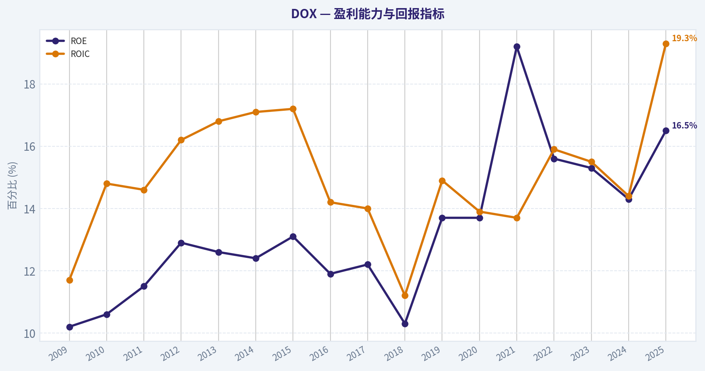
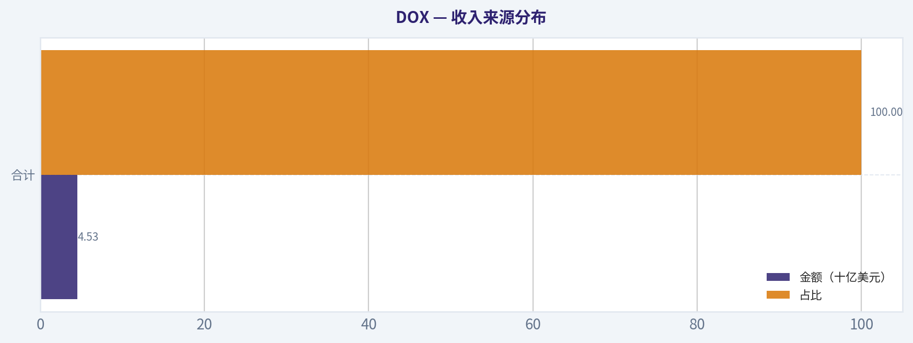
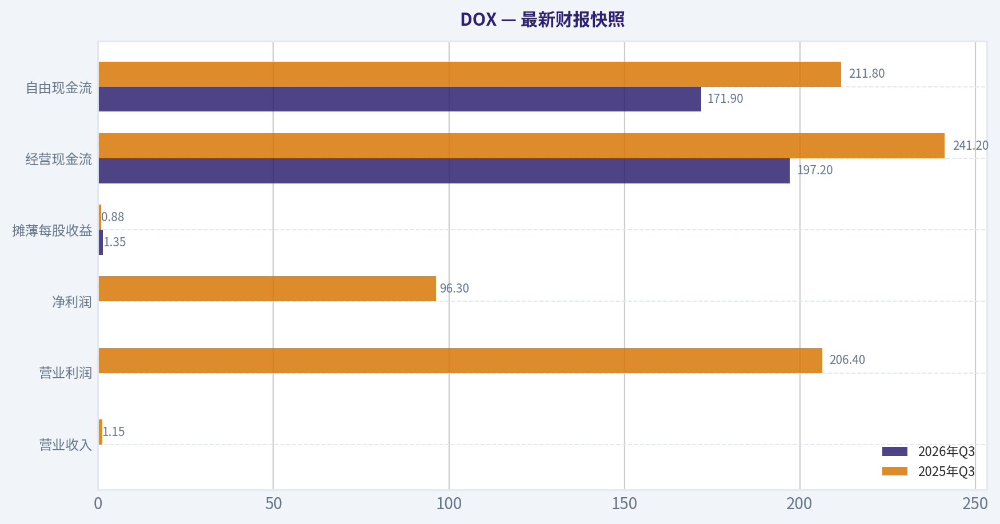
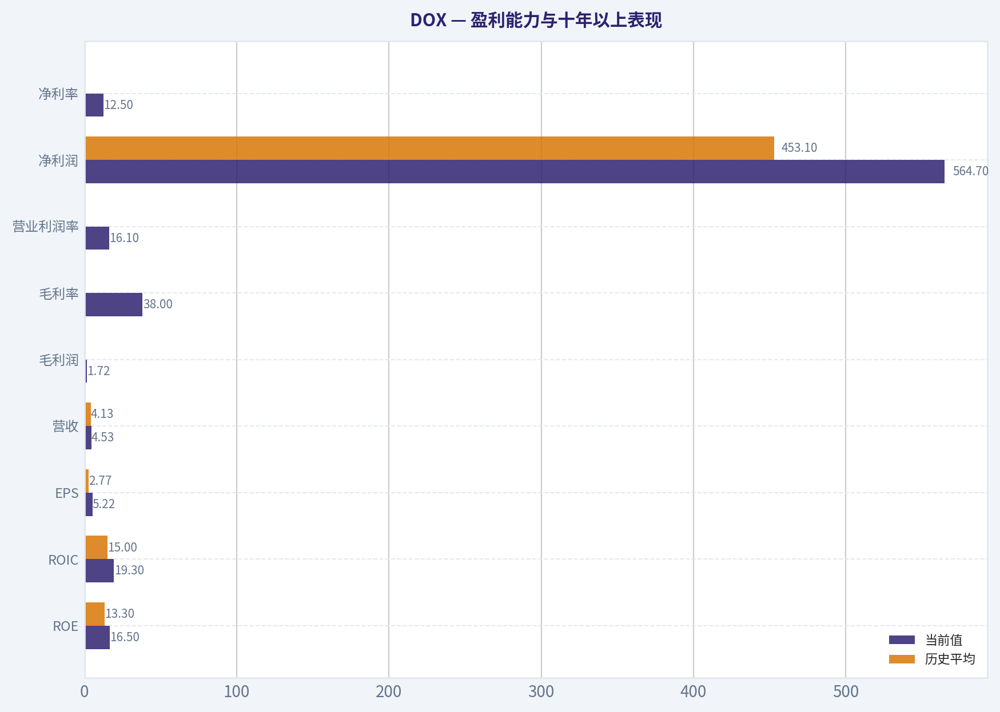
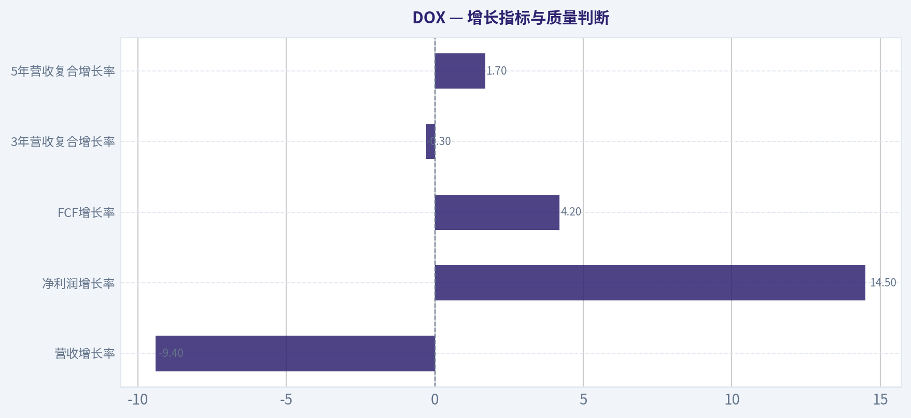
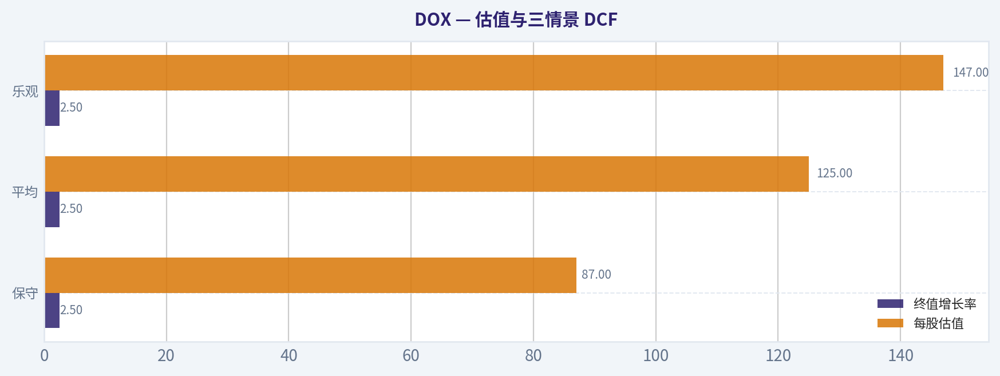
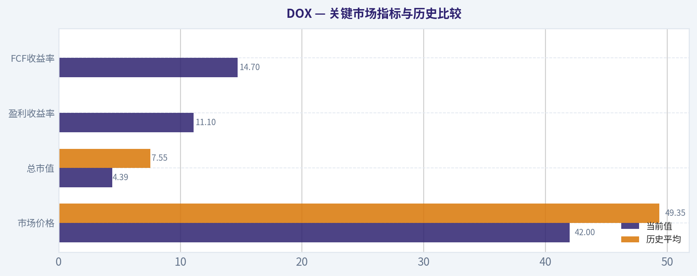

# DOX 深度价值情报

**调研日期:** 2026-11-07

## 关键免责声明

*本报告由 Deep Value Intelligence（一个基于 AI 的多智能体投资分析框架）自动生成。 仅供教育和研究用途 - 非财务建议，非财务顾问。*

---

## 目录

1. 情报摘要
2. 分析师团队报告
   - 基本面分析
   - 价值分析 (巴菲特)
   - 成长性分析 (林奇/德鲁肯米勒/费雪)
   - 市场分析
   - 期权市场分析
3. 研究团队评论
4. 投资团队评论
5. Deep Values 团队洞察

---

## 情报摘要

### 核心观点与前提条件

**核心论点:** **结论：Amdocs具备真实客户黏性和较高历史资本回报，约9倍PE已反映相当程度的经营悲观，但报告每股FCF 6.19美元能否持续仍是核心未决问题。**

**主要风险:**
- **中性**

**置信度:** 中

---

## 分析师团队报告

### 基本面分析

#### 最新财报快照

*以下数据基于最近一期已披露财报（2026年Q3），并尽量与上一年同期对比。*

| 指标 | 2026年Q3 | 2025年Q3 | 同比变化 |
| --- | ---: | ---: | ---: |
| 营业收入 | N/A | $1.15B | N/A |
| 营业利润 | N/A | $206.4M | N/A |
| 净利润 | N/A | $96.3M | N/A |
| 摊薄每股收益 | $1.35 | $0.88 | +53.4% |
| 经营现金流 | $197.2M | $241.2M | -18.2% |
| 自由现金流 | $171.9M | $211.8M | -18.8% |

关键结论：这张快照先把最新一期财报放在桌面上，再去看长周期分析。这样读者能更清楚地区分"公司长期质量"和"这次财报发生了什么"。

#### DOX 17年财务指标

*以下数值均由原始数据确定性计算得出，并非 AI 估算。*

*发行人类型：operating company（Technology / Software - Infrastructure）。*

#### 17年财务指标
*年度行来自已披露财务报表，最后一行 TTM 由最近四个季度滚动计算得出。*

| 指标 | 2009 | 2010 | 2011 | 2012 | 2013 | 2014 | 2015 | 2016 | 2017 | 2018 | 2019 | 2020 | 2021 | 2022 | 2023 | 2024 | 2025 |
| --- | --- | --- | --- | --- | --- | --- | --- | --- | --- | --- | --- | --- | --- | --- | --- | --- | --- |
| 市场价格 | $21 | $22 | $21 | $25 | $29 | $36 | $46 | $47 | $53 | $55 | $56 | $50 | $67 | $72 | $78 | $82 | $79 |
| 总市值 | $5.60B | $5.85B | $5.06B | $5.59B | $5.98B | $7.32B | $8.83B | $8.67B | $9.41B | $9.41B | $9.07B | $7.65B | $9.69B | $9.68B | $10.01B | $9.88B | $8.57B |
| 市盈率 | 17.12 | 16.96 | 14.58 | 14.28 | 14.48 | 17.51 | 19.96 | 21.35 | 21.73 | 26.71 | 19.05 | 15.47 | 14.23 | 17.89 | 18.82 | 20.58 | 15.17 |
| 市净率 | 1.74 | 1.81 | 1.67 | 1.84 | 1.83 | 2.16 | 2.59 | 2.51 | 2.63 | 2.73 | 2.59 | 2.11 | 2.70 | 2.75 | 2.84 | 2.86 | 2.50 |
| ROE | 10.2% | 10.6% | 11.5% | 12.9% | 12.6% | 12.4% | 13.1% | 11.9% | 12.2% | 10.3% | 13.7% | 13.7% | 19.2% | 15.6% | 15.3% | 14.3% | 16.5% |
| ROIC | 11.7% | 14.8% | 14.6% | 16.2% | 16.8% | 17.1% | 17.2% | 14.2% | 14.0% | 11.2% | 14.9% | 13.9% | 13.7% | 15.9% | 15.5% | 14.4% | 19.3% |
| 每股收益 | $1.21 | $1.30 | $1.43 | $1.78 | $1.98 | $2.08 | $2.29 | $2.20 | $2.44 | $2.07 | $2.96 | $3.23 | $4.72 | $4.01 | $4.14 | $4.00 | $5.22 |
| 营收 | N/A | N/A | N/A | N/A | $3.35B | $3.56B | $3.64B | $3.72B | $3.87B | $3.97B | $4.09B | $4.17B | $4.29B | $4.58B | $4.89B | $5.00B | $4.53B |
| 毛利润 | N/A | N/A | N/A | N/A | $1.18B | $1.26B | $1.29B | $1.31B | $1.36B | $1.38B | $1.43B | $1.41B | $1.48B | $1.62B | $1.73B | $1.76B | $1.72B |
| 毛利率 | N/A | N/A | N/A | N/A | 35.2% | 35.3% | 35.5% | 35.2% | 35.2% | 34.7% | 35.1% | 33.9% | 34.5% | 35.4% | 35.3% | 35.1% | 38.0% |
| 营业利润率 | N/A | N/A | N/A | N/A | 14.4% | 13.9% | 14.2% | 13.0% | 13.4% | 10.8% | 13.9% | 14.3% | 14.0% | 14.5% | 13.4% | 12.6% | 16.1% |
| 净利润 | $326.2M | $343.9M | $346.7M | $391.4M | $412.4M | $422.1M | $446.2M | $409.3M | $436.8M | $354.4M | $479.4M | $497.8M | $688.4M | $549.5M | $540.7M | $493.2M | $564.7M |
| 净利率 | N/A | N/A | N/A | N/A | 12.3% | 11.8% | 12.2% | 11.0% | 11.3% | 8.9% | 11.7% | 11.9% | 16.1% | 12.0% | 11.1% | 9.9% | 12.5% |
| 营收增长 | N/A | N/A | N/A | N/A | N/A | 6.5% | 2.2% | 2.0% | 4.0% | 2.8% | 2.8% | 2.0% | 2.9% | 6.7% | 6.8% | 2.4% | -9.4% |
| 净利润增长 | N/A | 5.4% | 0.8% | 12.9% | 5.4% | 2.3% | 5.7% | -8.3% | 6.7% | -18.9% | 35.3% | 3.8% | 38.3% | -20.2% | -1.6% | -8.8% | 14.5% |
| 自由现金流增长 | N/A | 37.0% | -28.8% | -7.9% | 43.8% | 6.0% | 9.1% | -24.8% | 2.6% | -35.1% | N/A | N/A | N/A | -26.0% | 31.9% | -11.4% | 4.2% |
| 总账面价值 | $3.21B | $3.23B | $3.02B | $3.03B | $3.27B | $3.40B | $3.41B | $3.45B | $3.57B | $3.45B | $3.50B | $3.62B | $3.59B | $3.52B | $3.52B | $3.46B | $3.43B |
| 总资产 | $4.33B | $4.82B | $4.64B | $4.65B | $4.93B | $5.19B | $5.32B | $5.33B | $5.28B | $5.35B | $5.29B | $6.34B | $6.51B | $6.39B | $6.43B | $6.39B | $6.25B |
| 总债务 | N/A | N/A | N/A | N/A | N/A | N/A | N/A | N/A | N/A | N/A | N/A | $744.0M | $644.6M | $645.1M | $645.7M | $646.3M | N/A |
| 债务股权比 | N/A | N/A | N/A | N/A | N/A | N/A | N/A | N/A | N/A | N/A | N/A | 0.21 | 0.18 | 0.18 | 0.18 | 0.19 | N/A |
| 现金及等价物 | $728.8M | $1.04B | $831.4M | $879.2M | $1.01B | $1.10B | $1.04B | $768.7M | $649.6M | $418.8M | $471.6M | $983.2M | $709.1M | $573.4M | $520.1M | $346.1M | $325.0M |
| 股东权益 | $3.21B | $3.23B | $3.02B | $3.03B | $3.27B | $3.40B | $3.41B | $3.45B | $3.57B | $3.45B | $3.50B | $3.62B | $3.59B | $3.52B | $3.52B | $3.46B | $3.43B |
| 经营现金流 | $519.2M | $685.2M | $535.5M | $514.1M | $670.5M | $709.3M | $772.6M | $620.2M | $636.1M | $557.2M | $656.4M | $658.1M | $925.8M | $756.7M | $822.6M | $724.4M | $749.1M |
| 投资现金流 | $-66.4M | $-211.5M | $-221.7M | $-17.3M | $-297.1M | $-298.6M | $-379.7M | $-440.9M | $-185.3M | $-362.4M | $-86.8M | $-461.7M | $-329.0M | $-262.5M | $-224.5M | $-127.4M | $-2.1M |
| 自由现金流 | $436.8M | $598.3M | $425.7M | $392.0M | $563.8M | $597.7M | $652.1M | $490.1M | $502.7M | $326.1M | N/A | N/A | $715.4M | $529.5M | $698.3M | $618.9M | $645.1M |
| 自由现金流利润率 | N/A | N/A | N/A | N/A | 16.9% | 16.8% | 17.9% | 13.2% | 13.0% | 8.2% | N/A | N/A | 16.7% | 11.6% | 14.3% | 12.4% | 14.2% |
| 每股分红 | $0.00 | $0.00 | $0.00 | $0.00 | $0.00 | $0.00 | $0.00 | $0.00 | $0.00 | $0.00 | $0.00 | $0.00 | $0.00 | $1.38 | $1.55 | $1.77 | $2.07 |

#### 盈利能力指标
- 净资产收益率 (ROE): 16.5%
- 投入资本回报率 (ROIC): 19.3%
- 总资产收益率 (ROA): 9.0%
- 毛利率: 38.0%
- 营业利润率: 16.1%
- 净利率: 12.5%

#### 流动性指标
- 流动比率: 1.17
- 速动比率: 0.67

#### 杠杆指标
- 债务股权比: N/A
- 利息覆盖倍数: 17.24
- 净负债: N/A

#### 增长指标（同比）
- 营收增长: -9.4%
- 净利润增长: 14.5%
- 自由现金流增长: 4.2%
- 营收复合增长率（3年）: -0.3%
- 营收复合增长率（5年）: 1.7%

#### 估值指标
- 市盈率 (TTM): 8.99
- 预期市盈率: 6.22
- 市净率: 1.32
- 市销率: 0.94
- PEG 比率: 0.56
- 企业价值/EBITDA: 5.08
- 自由现金流收益率: 14.7%
- 盈利收益率: 11.1%

#### 所有者收益（巴菲特方法，代码计算）
- 净利润: $564.7M
- + 折旧与摊销: $195.4M
- - 资本开支: $-104.0M
- - 营运资本变动: $-143.4M
- = **所有者收益: $799.5M**

#### 内在价值（代码计算）
- 当前价格: $42
- **头条内在价值（按商业模式路由）: $119**
  商业模式: stable cash cow - weighted blend [Damodaran FCFF + reverse-DCF fair + owner-earnings DCF] (stable_cash_cow)
  模型区间（各 DCF 最小-最大）: $85 - $125
  相对价格的安全边际（头条）: 64.5%
  路由说明: Stable cash cow: FCF ~ earnings and the maintenance-capex proxy is fair, so the owner-earnings DCF is the primary read, lightly blended with FCFF.
- 巴菲特方法（所有者收益）:
  保守: $87
  平均: $125
  乐观: $147
- 现金流方法（FCF）:
  保守: $32
  平均: $85
  乐观: $107
- Damodaran FCFF（WACC + 利润率 + 再投资）:
  保守: $87
  平均: $92
  乐观: $105
  蒙特卡洛区间（P10-P90）：$74 - $128（中位数 $95）
  P(内在价值 > 当前价格)：100.0%
- 反向 DCF：当前价格隐含约 -22.4%/年 的所有者收益增长（10年）；过去 3 年为 8.3%，5 年为 9.9%。

#### Piotroski F分数: 6/9
- 净利润为正: 通过
- 经营现金流为正: 通过
- 资产回报率改善: 通过
- 现金流大于净利润: 通过
- 债务下降: 通过
- 流动比率改善: 未通过
- 未稀释股本: 未通过
- 毛利率改善: 通过
- 资产周转率改善: 未通过

ANALYST STANCE: **看多**

#### 投资摘要

DOX，即 Amdocs，是一家面向电信与媒体行业的软件及技术服务公司。当前股价为 **42美元**，总市值约 **43.9亿美元**，TTM PE 约 **8.99倍**，自由现金流收益率约 **14.7%**。相较于历史估值和现金流能力，市场价格隐含了极度悲观的经营假设。

确定性数据集给出的综合内在价值为 **118.68美元**，模型区间为 **85至125美元**，相对当前价格的安全边际约 **64.5%**。不过，最新业务指引受到 T-Mobile 争议、非核心业务退出以及短期收入下滑影响，因此更适合定义为"低估但需要等待经营修复"的价值投资机会，而不是无条件的高增长股票。

#### 关键市场指标与历史比较

| 指标 | 当前值 | 历史平均 | 当前相对历史 | 解读 |
|---|---:|---:|---:|---|
| 市场价格 | $42 | $49.35 | 低约14.9% | 股价明显低于长期平均水平 |
| 总市值 | $4.39B | $7.55B | 低约41.9% | 市场对未来收入和客户集中风险定价较为悲观 |
| PE | 8.99倍 | 17.99倍 | 低约50.0% | 当前盈利估值显著压缩 |
| P/B | 1.32倍；历史末年为2.50倍 | 约2.30倍 | 低于历史 | 对软件公司参考意义有限 |
| 盈利收益率 | 11.1% | - | 较高 | 与低 PE 相互印证 |
| FCF收益率 | 14.7% | - | 较高 | 现金回报能力强于市场定价 |

**关键结论：** 当前 PE 只有长期平均的一半左右，股价和市值也显著低于历史中枢。P/B 不应被机械理解为"低就是便宜"，因为 DOX 是软件和知识产权驱动的轻资产企业，账面价值会受到回购、无形资产和资本结构影响；本次估值应主要依赖自由现金流和所有者收益。

#### 盈利能力与十年以上表现

| 指标 | 当前值 | 历史平均 | 当前相对历史 | 评价 |
|---|---:|---:|---:|---|
| ROE | 16.5% | 13.3% | 高3.2个百分点 | 高于长期水平 |
| ROIC | 19.3% | 15.0% | 高4.3个百分点 | 资本效率处于较强水平 |
| EPS | $5.22 | $2.77 | 高约88.5% | 长期增长明显，但含资本回购和周期因素 |
| 营收 | $4.53B | $4.13B* | 高约9.7% | 规模仍高于长期平均 |
| 毛利润 | $1.72B | - | - | 毛利额仍然稳健 |
| 毛利率 | 38.0% | 35.0%左右 | 高约3个百分点 | 当前为历史较好水平 |
| 营业利润率 | 16.1% | 13.7%左右 | 高约2.4个百分点 | 运营效率显著改善 |
| 净利润 | $564.7M | $453.1M | 高约24.6% | 高于长期平均 |
| 净利率 | 12.5% | 约11.5% | 高约1个百分点 | 盈利质量较稳定 |

\*营收平均值仅使用数据集中有披露的2013至2025年度。

**关键结论：** DOX 当前 ROE、ROIC、毛利率和营业利润率均高于长期平均，说明公司并非单纯依靠财务杠杆维持回报。真正的弱点在于收入增长，而不是当前盈利能力；如果收入能够恢复低个位数增长，现有估值可能过度反映悲观情景。

#### 增长指标与质量判断

| 增长指标 | 当前值 | 历史表现 | 主要含义 |
|---|---:|---|---|
| 营收增长率 | -9.4% | 长期多数年份为正，通常约2%至7% | 当前是最明显的经营警报 |
| 净利润增长率 | 14.5% | 波动较大，曾出现负增长 | 利润受成本控制、业务组合和基数影响 |
| FCF增长率 | 4.2% | 波动明显，部分年度下降 | 现金流总体稳定，但非线性增长 |
| 3年营收复合增长率 | -0.3% | 近年明显放缓 | 需要观察客户项目和指引是否恢复 |
| 5年营收复合增长率 | 1.7% | 低于历史扩张阶段 | 公司目前更接近稳定现金牛而非高速成长股 |

**关键结论：** 收入负增长是 DOX 当前估值便宜的核心原因，也是投资 thesis 最大的不确定性。净利润和自由现金流仍为正且利润率改善，说明公司尚未出现经营崩坏，但未来回报取决于收入企稳，而非继续依靠成本削减。

#### 资产负债表与现金流

| 指标 | 当前值 | 历史平均或参考 | 评价 |
|---|---:|---:|---|
| 总账面价值 | $3.43B | 约$3.41B | 长期相对稳定 |
| 总资产 | $6.25B | 约$5.64B | 规模扩大后保持稳定 |
| 总债务 | 数据集当前为N/A；近年约$645M | 2020至2024年约$670M | 债务规模可控 |
| 债务/权益 | 当前N/A；近年0.18至0.21 | 低杠杆 | 财务风险有限 |
| 现金及等价物 | $325.0M | 历史平均约$705M | 现金低于过去水平，需关注 |
| 股东权益 | $3.43B | 与账面价值基本一致 | 资本基础稳定 |
| 经营现金流 | $749.1M | - | 显著高于净利润 |
| 自由现金流 | $645.1M | 可比历史平均约$546M | 仍高于长期平均 |
| 流动比率 | 1.17 | - | 尚可但不宽裕 |
| 速动比率 | 0.67 | - | 短期流动性需监控 |
| 利息覆盖倍数 | 17.24倍 | - | 偿债能力较强 |
| Piotroski F分数 | 6/9 | - | 财务质量中上 |

**关键结论：** DOX 的主要财务优势是经营现金流强、利息覆盖倍数高、债务权益比低。现金余额从历史高位下降至3.25亿美元，且速动比率只有0.67，说明流动性并非没有风险；不过在近7.5亿美元经营现金流和较低债务负担支持下，暂时不像资本结构危机。

#### 现金流、分红与资本配置

DOX 当前自由现金流为 **6.451亿美元**，自由现金流利润率为 **14.2%**，经营现金流为 **7.491亿美元**。所有者收益模型计算为：

- 净利润：5.647亿美元
- 加回折旧与摊销：1.954亿美元
- 扣除资本开支：约1.040亿美元
- 扣除营运资本变动：约1.434亿美元
- 所有者收益：**7.995亿美元**

当前每股股息为 **2.07美元**，按照42美元股价计算，股息率约 **4.9%**。公司从2022年开始支付股息，并逐步由1.38美元提高至2.07美元，显示管理层开始向股东分配更多现金。

需要注意的是，所有者收益高于报告自由现金流，主要受营运资本调整和折旧资本化影响。对于估值而言，所有者收益模型较乐观，FCF模型更保守，因此综合采用两者并结合 FCFF 模型较为稳妥。

#### 估值与三情景 DCF

当前市值约43.9亿美元、股价42美元，对应隐含股数约：

\[
43.9亿\div42 \approx 1.045亿股
\]

所有者收益每股约为：

\[
7.995亿\div1.045亿 \approx 7.65美元
\]

采用10年显性预测期、约10%折现率、2.5%永续增长率，并让增长率逐步衰减至终值增长率。

| 情景 | 前期所有者收益增长假设 | 终值增长率 | 每股估值 | 相对当前价格 |
|---|---:|---:|---:|---:|
| 保守 | 约0%，随后向2.5%衰减 | 2.5% | $87 | +107% |
| 平均 | 约5%，逐步向2.5%衰减 | 2.5% | $125 | +198% |
| 乐观 | 约7%，逐步向2.5%衰减 | 2.5% | $147 | +250% |

保守情景的逻辑是：收入长期停滞，但利润率和现金流不发生灾难性恶化。平均情景假设公司恢复低个位数增长，利润率维持当前改善后的水平。乐观情景则假设电信客户数字化、云迁移和长期服务合同推动收入重新增长，但不假设7%的增长永久持续。

**模型交叉验证：**

| 估值方法 | 保守 | 平均 | 乐观 | 解释 |
|---|---:|---:|---:|---|
| 所有者收益 DCF | $87 | $125 | $147 | 最能体现公司现金生成能力 |
| FCF DCF | $32 | $85 | $107 | 对营运资本和现金流波动更敏感 |
| Damodaran FCFF | $87 | $92 | $105 | 对利润率、再投资和资本成本更谨慎 |
| 蒙特卡洛区间 | - | 中位数$95 | P10至P90：$74至$128 | 反映模型不确定性 |
| 综合内在价值 | - | $118.68 | - | 加权现金流模型结果 |

**关键结论：** 即使采用较保守的FCFF模型，平均价值仍高于当前42美元；所有者收益模型则显示更大的上行空间。综合价值118.68美元不应被视为精确目标价，但85至125美元的模型区间说明市场价格已经反映了非常悲观的长期假设。

#### 收入来源分布

确定性数据集未提供经过验证的产品线或地理分部金额。DOX 的公开业务结构以通信软件与服务为核心，因此以下按照公司主要经济收入来源进行保守归类，不把未经披露的细分金额伪装成精确财务数据。

| 收入来源 | 金额（十亿美元） | 占比 |
|---|---:|---:|
| 通信行业软件、数字化、云迁移及托管服务 | 约$4.53B | 约100% |
| 媒体及相关技术服务 | 已并入公司综合披露 | 未单独披露 |
| 其他业务 | 未单独披露 | 未单独披露 |
| 合计 | $4.53B | 100% |

**关键结论：** DOX 的收入高度集中于通信及相关技术服务，而不是多元化消费产品。集中于大型电信客户带来长期合同和高转换成本，但也使单一客户项目延期、合同争议或客户削减支出时，对总体收入产生显著影响。

#### 巴菲特式质量分析

**经济护城河。**
DOX 的护城河主要来自电信核心系统的高切换成本、长期客户关系、复杂的软件集成能力和行业经验。电信运营商更换计费、客户管理、网络支持或业务编排系统，需要长时间测试和迁移，错误成本很高。因此，成熟客户关系具有一定粘性。

不过，这不是典型的高增长平台型软件公司。行业客户集中度较高，合同续签和大型项目节奏会造成收入波动；竞争也可能来自客户内部开发、云厂商和大型 IT 服务商。

**财务实力。**
DOX 具备较强的现金流和低杠杆。ROIC 19.3%、利息覆盖倍数17.24倍，说明公司在不依赖高债务的情况下创造利润。风险主要是现金余额低于历史水平、速动比率偏低，以及当前总债务披露不完整。

**盈利可预测性。**
2009年至2025年净利润总体从3.262亿美元增加至5.647亿美元，期间大多数年份保持盈利。收入在2013年至2024年逐步增长，但2025年下降9.4%，说明盈利比收入更稳定。2026年最新报道中，T-Mobile争议和保守指引进一步强化了短期不确定性。

**管理层与资本配置。**
ROE和ROIC长期保持在双位数以上，当前ROIC达到19.3%，资本使用效率较好。公司近期提高股息，当前每股分红2.07美元，反映出业务成熟度和现金回馈意愿。不过，流动比率未改善、股本未稀释、资产周转率未改善，Piotroski F分数为6/9，说明管理层表现良好但并非无可挑剔。

**业务质量。**
毛利率从历史约35%提高到38%，营业利润率从低谷明显恢复至16.1%，显示业务组合或成本效率改善。问题在于收入增长已经停滞，未来能否维持利润率取决于公司是否继续退出低回报业务，以及大型客户合同是否恢复。

#### 主要风险、机会与触发因素

| 类别 | 具体内容 | 对投资的影响 |
|---|---|---|
| 风险 | T-Mobile争议及相关合同不确定性 | 可能压低短期收入和指引 |
| 风险 | 客户集中度较高 | 单一大客户项目变化可能影响全年业绩 |
| 风险 | 近年收入增长放缓 | 低估值可能长期存在 |
| 风险 | 现金余额下降、速动比率0.67 | 降低抗击突发事件的缓冲 |
| 风险 | FCF年度波动 | 所有者收益可能高估正常化现金流 |
| 机会 | PE约9倍、FCF收益率14.7% | 估值已包含严重悲观预期 |
| 机会 | ROIC 19.3%、营业利润率16.1% | 业务质量高于低估值表面印象 |
| 机会 | 长期电信云迁移与数字化需求 | 提供恢复增长的结构性机会 |
| 机会 | 股息率约4.9%且股息持续提高 | 等待业绩修复期间获得现金回报 |
| 触发因素 | 收入重新恢复正增长 | 可能带来估值重估 |
| 触发因素 | T-Mobile争议澄清 | 降低尾部风险 |
| 触发因素 | 经营利润率继续维持15%以上 | 支撑较高的所有者收益估值 |

**关键结论：** 投资机会来自"高质量现金流加低估值"，而不是当前收入增长强劲。最大的催化剂是收入止跌、客户争议解决和利润率保持；最大的风险是收入继续下降而市场逐渐把 DOX 视为结构性衰退资产。

#### 最终投资判断

**看多**

支持看多的核心理由：

1. 当前PE约9倍，明显低于长期约18倍平均水平。
2. FCF收益率约14.7%，所有者收益约7.995亿美元，现金生成能力强。
3. ROE为16.5%，ROIC为19.3%，均高于长期平均。
4. 债务权益比低、利息覆盖倍数高，财务杠杆风险有限。
5. 综合内在价值约118.68美元，模型区间85至125美元，当前价格具有较大安全边际。
6. 股息率接近5%，可以部分补偿等待经营修复的时间成本。

看多并不意味着忽略风险。DOX 需要在未来几个季度证明收入下滑是客户项目和合同问题造成的短期冲击，而不是核心业务长期衰退。若收入继续负增长、现金流持续低于报告利润，或大型客户争议扩大，应将投资评级下调至 中性。

#### 报告要点汇总

| 项目 | 判断 |
|---|---|
| 当前价格 | $42 |
| 综合内在价值 | $118.68 |
| 估值区间 | $85至$125 |
| PE | 约8.99倍，显著低于历史平均 |
| FCF收益率 | 约14.7% |
| ROE / ROIC | 16.5% / 19.3% |
| 收入趋势 | 当前下降9.4%，为主要风险 |
| 利润趋势 | 净利润增长14.5%，利润率改善 |
| 财务杠杆 | 较低，利息覆盖倍数17.24倍 |
| 股息 | 每股$2.07，股息率约4.9% |
| 主要护城河 | 高转换成本、长期电信客户关系、行业软件经验 |
| 主要风险 | 客户集中、T-Mobile争议、收入增长停滞 |
| 投资结论 | 看多 |
| 适合的投资者 | 能承受短期业绩波动、重视现金流和估值安全边际的长期投资者 |

#### 基本面关键图表

本图追踪 **DOX** 过去十年的盈利能力与回报指标（ROE、ROIC、利润率），突出呈现资本效率的变化趋势。

本对比图（来自「收入来源分布」）将 **DOX** 的当前数据与历史基准并排呈现，直观反映公司相对自身历史均值的估值水平。

---

### 价值分析 (巴菲特)

> *基于沃伦·巴菲特的价值投资哲学：能力圈、经济护城河、管理层质量与安全边际。*

#### 内在价值快照

价格是你付的钱，内在价值是企业未来可能为股东创造的现金价值。我们给出一个区间，而不是假装只有一个神奇数字。

- 当前价格: $42.09
- 估值区间（两种 DCF 方法、保守到乐观）: $31.60 至 $147.10

##### 所有者收益（巴菲特方法）
- 净利润: $564,704,000.00
- 折旧与摊销: $195,435,000.00
- 资本支出: $-103,952,000.00
- 营运资金变化: $-143,358,000.00
- 所有者收益: $799,545,000.00

##### 内在价值
###### 所有者收益法
使用所有者收益，更严格，通常更保守。
- 保守: $86.51
- 平均: $125.02
- 乐观: $147.10
- 折现率: 10.0%

###### 自由现金流法
使用自由现金流，更适合今天投入很多、为未来增长铺路的公司。
- 保守: $31.60
- 平均: $85.40
- 乐观: $106.57
- 折现率: 10.0%

分析师立场：**看多**

#### 一、投资结论

DOX，即 Amdocs，是一家为电信运营商提供计费、客户管理、数字业务和运营支撑软件的公司。它的核心价值在于：客户系统深度嵌入运营商业务流程，替换成本高，收入具有较强的持续性。

当前股价约为 42 美元，市盈率约 9 倍，自由现金流收益率约 14.7%。按所有者收益、FCF 和 FCFF 三种方法估算，内在价值区间约为 85 至 125 美元，头条估值约 118.68 美元。即使考虑 T-Mobile 争议、2027 财年指引下调以及收入下滑，当前价格仍然提供较大的安全边际。

主要风险是：客户集中度较高，电信行业增长有限，T-Mobile 关系恶化可能导致短期收入和利润继续承压。综合评分约 3.5 分，属于"价格具有吸引力的好公司"，但由于近期经营指引转弱，投资 conviction 为中等，而非极高。

#### 二、因素评分

| 因素 | 评分 | 主要依据 |
|---|---:|---|
| 圆圈能力与业务简单性 | 3.5/5 | 为大型电信运营商提供关键软件和服务，商业模式容易理解；但电信技术迁移、云化和客户项目周期增加了预测难度 |
| 护城河 | 3.5/5 | 系统嵌入客户核心运营流程，迁移成本高；长期客户关系较强，但客户集中度和行业增长限制了护城河宽度 |
| 管理层与资本配置 | 3.0/5 | 长期经营记录尚可，持续分红和回购；但近期下调指引，且 T-Mobile 争议暴露出客户依赖风险 |
| 行业结构 | 3.0/5 | 电信软件供应商数量有限，客户黏性较高；但行业增长温和，合同竞争和大型客户议价能力不可忽视 |
| Gate 5：质量与偿付能力硬门槛 | 未触发 | 当前没有证据显示公司同时出现恶化的现金流趋势和严重偿付能力危机；市盈率低并不等同于财务困境 |

#### 三、护城河分析

**1. 转换成本**

Amdocs 的软件通常涉及计费、客户账户、订单管理、收入确认和运营流程。电信运营商一旦更换核心系统，需要进行大规模数据迁移、系统重建和员工培训，并承担业务中断风险，因此客户通常不会轻易更换供应商。

**2. 客户关系和合同持续性**

Amdocs 长期服务大型电信运营商，客户关系通常跨越多年。最新消息显示，公司与 AT&T 达成了具有多年期限的协议，这说明其核心系统仍然具备较强的客户黏性。

**3. 专业知识和规模效应**

电信计费和客户管理系统需要深厚的行业知识、合规经验以及复杂的系统集成能力。新进入者不仅要开发软件，还要证明其系统能够支撑数千万甚至上亿用户的稳定运营。

**4. 护城河的限制**

护城河并非绝对稳固。运营商正在推进云化、自动化和新一代数字架构，客户也可能减少对传统定制化项目的依赖。此外，T-Mobile 争议显示，单一大客户变化可能对短期业绩产生明显影响。

总体判断：护城河属于**窄到中等宽度、整体稳定但近期面临压力**，不是典型的宽而持续扩大的平台型护城河。

#### 四、管理层与资本配置

| 观察项目 | 评价 |
|---|---|
| 股东导向 | 分红和回购体现了一定的股东回报意识 |
| 经营诚信 | 暂无重大财务重述或明显会计问题证据 |
| 再投资能力 | 能够通过软件研发和客户项目维持竞争力，但行业有成熟化趋势 |
| 并购纪律 | 未见足以显著改变投资判断的大规模资本配置错误 |
| 近期执行 | T-Mobile 相关问题及 2027 财年指引下调，说明短期经营执行承压 |
| 综合评价 | 中等偏上，但尚未达到优秀复利型公司的管理层标准 |

管理层目前最重要的任务不是追求短期收入增长，而是稳定核心客户、降低客户集中度，并证明公司能够在云化和人工智能环境中维持较高的自由现金流。

#### 五、财务摘要

| 指标 | 最新数据 |
|---|---:|
| 股价 | 42.00 美元 |
| 总市值 | 43.9 亿美元 |
| 市盈率 | 8.99 倍 |
| ROE | 16.5% |
| 毛利率 | 38.0% |
| 营收同比增长 | -9.4% |
| 自由现金流收益率 | 14.7% |
| 估算自由现金流 | 约 6.45 亿美元 |
| 流动比率 | 1.17 |
| 头条内在价值 | 118.68 美元 |
| 三模型估值区间 | 85.40 至 125.02 美元 |
| 头条安全边际 | 64.5% |

**关键结论：** DOX 当前收入正在下滑，但自由现金流收益率非常高，估值仅约为自由现金流的 6.8 倍。ROE 达到 16.5%，说明公司仍在创造不错的股东回报；不过毛利率和营收趋势表明，这不是一个可以完全忽略经营风险的无债务式超级复利股。

#### 六、所有者收益估算

以当前市值和自由现金流收益率估算：

| 项目 | 估算值 |
|---|---:|
| 总市值 | 43.9 亿美元 |
| 自由现金流收益率 | 14.7% |
| 估算自由现金流 | 约 6.45 亿美元 |
| 维护性资本开支 | 已通过自由现金流口径近似扣除 |
| 工作资本影响 | 暂按长期平均水平处理 |
| 所有者收益近似值 | 约 6.45 亿美元 |
| 估算流通股数 | 约 1.045 亿股 |
| 每股所有者收益 | 约 6.17 美元 |

**关键结论：** 当前价格对应的所有者收益收益率约为 14.7%，远高于 10% 的长期要求回报率。即使未来几年没有增长，只要现金流不出现结构性崩塌，股票本身已经具备较强的估值支撑。

#### 七、三情景 DCF 估值

| 情景 | 核心假设 | 公司价值 | 每股价值 |
|---|---|---:|---:|
| 情景 A：零增长 | 所有者收益永久不增长，折现率 10% | 64.5 亿美元 | 约 61.70 美元 |
| 情景 B：GDP 增长 | 长期增长率 3%，折现率 10% | 约 94.9 亿美元 | 约 90.80 美元 |
| 情景 C：历史增长折扣 | 采用约 5.2% 的长期增长率，折现率 10% | 约 139 亿美元 | 约 133.00 美元 |
| 研究包三模型参考 | 所有者收益、FCF、FCFF 加权 | - | 85.40 至 125.02 美元 |
| 综合头条估值 | 多模型加权 | - | 118.68 美元 |

**关键结论：** 即使采用零增长模型，估值仍高于当前股价；采用 3% 的保守增长假设，价值约为当前价格的两倍。情景 C 对长期增长较敏感，因此不能单独作为买入依据，但它说明市场价格已经反映了相当悲观的经营预期。

#### 八、安全边际分析

| 估值口径 | 每股内在价值 | 相对 42 美元股价的安全边际 |
|---|---:|---:|
| 保守零增长 DCF | 61.70 美元 | 31.9% |
| GDP 增长 DCF | 90.80 美元 | 53.7% |
| 研究包低端估值 | 85.40 美元 | 50.8% |
| 研究包头条估值 | 118.68 美元 | 64.6% |
| 研究包高端估值 | 125.02 美元 | 66.4% |

反向 DCF 显示，当前价格隐含的十年现金流增长假设约为负 22.4%，显著低于公司过去三年约 8.3%、过去五年约 9.9% 的增长记录。这个价格隐含了客户流失、收入持续下降和利润率承压等多重坏消息。

不过，反向 DCF 对终值和现金流基数非常敏感，因此更稳妥的做法是依赖 50% 左右的保守安全边际，而不是完全依赖 64.5% 的头条估值。

#### 九、最终 Buffett 评分卡

| 评分标准 | 权重 | 评分 | 加权得分 |
|---|---:|---:|---:|
| 护城河宽度与持久性 | 25% | 3.5 | 0.88 |
| 估值与安全边际 | 20% | 4.5 | 0.90 |
| 资本回报：ROIC 相对 WACC | 15% | 3.5 | 0.53 |
| 业务理解与可预测性 | 12% | 3.0 | 0.36 |
| 管理层质量与资本配置 | 12% | 3.0 | 0.36 |
| 再投资空间 | 8% | 3.0 | 0.24 |
| 资产负债表强度 | 4% | 4.0 | 0.16 |
| 行业结构 | 4% | 3.0 | 0.12 |
| **总分** | **100%** | - | **3.55/5** |

#### 十、主要风险与催化剂

| 类型 | 内容 |
|---|---|
| 最大风险 | T-Mobile 合作恶化或终止，导致收入和利润进一步下滑 |
| 客户风险 | 大型电信客户集中度较高，单一客户决策影响明显 |
| 行业风险 | 电信运营商资本开支放缓，传统软件项目增长趋弱 |
| 技术风险 | 云原生、人工智能和内部开发可能削弱传统系统集成价值 |
| 估值催化剂 | 业绩重新稳定、恢复收入增长、扩大 AT&T 等长期合同 |
| 资本回报催化剂 | 持续分红和低估值回购提高每股现金流 |
| 经营催化剂 | 证明 T-Mobile 冲击是一次性问题，而非客户流失趋势的开始 |

#### 十一、最终判断

DOX 不是一个高速增长的科技平台，而是一家成熟、现金流丰富、客户转换成本较高的软件服务公司。当前市场似乎把短期客户问题外推成了长期商业模式崩溃，导致估值明显低于保守现金流价值。

基于约 3.55 分的 Buffett 评分，DOX 属于：

**看多--中等 conviction。**

适合能够承受短期业绩波动、并愿意等待现金流恢复的价值投资者。核心观察点是未来几个季度的客户留存、T-Mobile 影响范围、自由现金流稳定性，以及 AT&T 等长期合同能否抵消传统业务下滑。若自由现金流保持在当前水平附近，42 美元将提供较好的长期风险回报比。
#### 估值桥

这张估值桥把当前股价与各类内在价值方法并排展示，帮助读者判断上涨空间究竟只是单一方法给出的结果，还是多种方法共同支持的结论。

| 项目 | 每股内在价值 |
| --- | ---: |
| 巴菲特方法 | $125.02 |
| 现金流方法 | $85.40 |
| Damodaran 方法 | $91.85 |
| 当前价格 | $42.09 |

#### 关键结论

如果只有一种方法显著高于其他方法，说明上行空间更依赖特定建模假设。若多种方法的估值接近，则说明估值逻辑更加稳健。

#### 估值图表

本对比图（来自「最新财报快照」）将 **DOX** 的当前数据与历史基准并排呈现，直观反映公司相对自身历史均值的估值水平。

本对比图（来自「盈利能力与十年以上表现」）将 **DOX** 的当前数据与历史基准并排呈现，直观反映公司相对自身历史均值的估值水平。

本对比图（来自「增长指标与质量判断」）将 **DOX** 的当前数据与历史基准并排呈现，直观反映公司相对自身历史均值的估值水平。

本对比图（来自「估值与三情景 DCF」）将 **DOX** 的当前数据与历史基准并排呈现，直观反映公司相对自身历史均值的估值水平。

本对比图（来自「估值与三情景 DCF」）将 **DOX** 的当前数据与历史基准并排呈现，直观反映公司相对自身历史均值的估值水平。

---

### 成长性分析 (林奇/德鲁肯米勒/费雪)

> *基于彼得·林奇的GARP成长投资法、斯坦利·德鲁肯米勒的宏观拐点分析法，以及菲利普·费雪的深度调研法。*

ANALYST STANCE: **中性**

#### 一、投资结论

Amdocs（DOX）是一家电信软件与服务公司，当前更接近"低估值现金牛"，而不是典型的高成长股。公司拥有较强现金流、合理回购或分红能力和较低估值，但最新财报显示营收同比下降、客户项目存在不确定性，且 2027 财年指引明显转弱。

核心判断：**估值提供安全边际，但增长拐点尚未确认，因此暂不适合按十倍股逻辑积极买入。**

#### 二、Lynch 分类

| 项目 | 判断 |
|---|---|
| 分类 | 周期性偏弱的稳健型软件服务商，接近"困境型稳定现金牛" |
| 当前营收增长 | -9.4% |
| 盈利能力 | PE 约 9.0 倍，ROE 16.5% |
| 现金流 | FCF 收益率 14.7%，表现较强 |
| 是否属于快速成长股 | 否 |
| 十倍股潜力 | 较低，除非出现明确的新产品或客户周期反转 |

**关键结论：** DOX 当前不符合 Lynch 对"15%至25%以上持续增长型快速成长股"的标准。它的吸引力主要来自低估值和现金流，而不是收入加速或 TAM 快速扩张。

#### 三、故事：用三句话解释 DOX

1. DOX 为大型电信运营商提供计费、客户管理、网络和运营支持软件。
2. 电信行业需要持续升级数字化系统，但客户数量集中、项目周期长，收入增长通常较慢。
3. 公司估值很低，若 T-Mobile 争议得到解决、AT&T 长期合同开始贡献收入，盈利可能出现修复。

#### 四、TAM 与十倍测试

| 项目 | 分析 |
|---|---|
| 主要市场 | 电信计费、客户管理、运营支持系统、数字化服务 |
| 市场属性 | 稳定但成熟，增长速度低于人工智能、云软件和网络安全 |
| 当前市值 | 约 43.9 亿美元 |
| 十倍市值 | 约 439 亿美元 |
| 十倍收入要求 | 若估值倍数不变，收入和自由现金流大致也需接近十倍 |
| 十倍测试 | 理论上市场空间足够，但公司客户集中和电信行业成熟度限制实现概率 |
| TAM 增长判断 | 中低速，尚未看到明显扩张性拐点 |

**关键结论：** 从绝对市场规模看，DOX 并非没有扩张空间；但从客户结构、行业成熟度和当前收入下降看，十倍增长缺乏现实路径。更合理的预期是估值修复、现金回报和周期性复苏，而非十倍收入增长。

#### 五、收入增长趋势

| 指标 | 当前判断 |
|---|---|
| 最新营收同比 | -9.4% |
| 近三年收入增长参考 | 约 8.3% |
| 近五年收入增长参考 | 约 9.9% |
| 近期趋势 | 明显减速并转为负增长 |
| 管理层最新信号 | 2027 财年指引显著偏弱 |
| 主要压力 | T-Mobile 争议、非战略业务退出、客户项目假设趋于保守 |
| 正面因素 | AT&T 获得八年期重要协议 |

**关键结论：** 收入趋势目前属于"减速并恶化"，不是 Druckenmiller 偏好的加速型拐点。AT&T 长期协议是潜在修复催化剂，但需要未来几个季度证明其能抵消 T-Mobile 影响，才可确认增长重新加速。

#### 六、单位经济与财务质量

| 指标 | 数据或判断 |
|---|---|
| 毛利率 | 38.0% |
| ROE | 16.5% |
| PE | 约 8.99 倍 |
| FCF 收益率 | 14.7% |
| 流动比率 | 1.17 |
| LTV/CAC | 未披露，无法可靠计算 |
| NRR | 未披露，无法可靠计算 |
| Rule of 40 | 无法完整计算；收入增长为负，需谨慎看待 |
| 资本压力 | 当前没有明显"短期无法融资"的信号，但流动比率不高 |

**关键结论：** DOX 的优势是现金流和估值，而不是订阅软件式的高质量经常性增长。由于 NRR、客户获取成本和客户终身价值未披露，不能把它当作标准高增长 SaaS 估值；收入下降也意味着 Rule of 40 暂不具备吸引力。

#### 七、拐点判断

| 潜在拐点 | 当前状态 | 重要性 |
|---|---|---|
| 产品周期拐点 | 尚未确认 | 中 |
| 市占率拐点 | 缺乏证据 | 低 |
| 利润率拐点 | 低估值和现金流已较好，但非新一轮经营杠杆 | 中 |
| TAM 拐点 | 未出现 | 低 |
| 客户竞争拐点 | AT&T 八年协议为正面，T-Mobile 争议为负面 | 高 |
| 盈利预期拐点 | 近期向下修正 | 负面 |

**关键结论：** 当前最重要的变量是客户合同，而不是技术创新或行业爆发。AT&T 合同可能成为修复起点，但 T-Mobile 争议和下调指引说明拐点尚未形成，现阶段更适合观察验证，而非提前重仓。

#### 八、宏观环境

| 宏观因素 | 对 DOX 的影响 |
|---|---|
| 利率环境 | 若利率下降，低估值和高现金流股票可能获得估值支持 |
| 电信资本开支 | 运营商削减开支会延迟项目，构成压力 |
| 数字化趋势 | 提供长期需求，但行业成熟、增速有限 |
| 人工智能趋势 | 可带来产品升级机会，但尚未成为 DOX 的明确收入驱动 |
| 宏观周期 | 稳定、防御属性较强，但缺乏强周期上行弹性 |

**关键结论：** 宏观环境对 DOX 的最大支持来自利率下降和防御型现金流偏好，而非高速增长主题。它更像低估值收益型软件服务公司，不是人工智能或云软件的直接受益者。

#### 九、Fisher 15 项评分

| Fisher 维度 | 评分（1至5） | 简要理由 |
|---|---:|---|
| 市场潜力 | 3 | 电信软件需求稳定，但行业成熟 |
| 新产品决心 | 3 | 有数字化升级方向，证据有限 |
| 研发能力 | 3 | 尚无明确突破性产品信号 |
| 销售组织 | 4 | 能获得 AT&T 等大型客户长期合同 |
| 利润率 | 4 | 毛利率 38%，现金流质量较好 |
| 利润率改善 | 3 | 尚未确认新一轮经营杠杆 |
| 员工关系 | 3 | 信息有限 |
| 高管关系 | 3 | 信息有限 |
| 管理层深度 | 4 | 能管理大型电信客户关系 |
| 成本与会计 | 4 | 财务披露和现金流表现尚可 |
| 独特竞争优势 | 4 | 切换成本、客户关系和系统嵌入性 |
| 长期利润前景 | 3 | 稳定，但高增长能见度不足 |
| 股权稀释 | 4 | 未见严重持续稀释信号 |
| 困难时期坦诚度 | 3 | 下调指引偏保守，但仍需验证 |
| 管理层诚信 | 3 | 无重大负面证据，但信息有限 |
| **总分** | **51/75** | **平均，未达到 Fisher 高质量成长股标准** |

**关键结论：** DOX 的强项在客户黏性、销售能力、现金流和财务纪律；弱项在市场增速、创新可见度和近期增长趋势。51 分属于平均水平，不支持以 Fisher 的"长期创新型成长股"标准高 conviction 持有。

#### 十、估值分析

| 估值方法 | 结果 |
|---|---:|
| 当前股价 | 42 美元 |
| PE | 约 8.99 倍 |
| FCF 收益率 | 14.7% |
| 模型内在价值中值或头条值 | 118.68 美元 |
| 所有者收益模型 | 125.02 美元 |
| FCF 模型 | 85.40 美元 |
| Damodaran FCFF 模型 | 91.85 美元 |
| 头条安全边际 | 约 64.5% |
| 反向 DCF 隐含增长 | 约为每年下降 22.4% |
| PEG | 不适用；当前收入为负增长，且稳定增长假设不成立 |

**关键结论：** DOX 的估值明显便宜，多个现金流模型都显示股价低于内在价值。可是，低估值可能部分反映 T-Mobile 争议、2027 年指引下调和增长恶化；因此安全边际不能简单等同于高成长机会，更像"便宜但需要催化剂"的价值修复交易。

#### 十一、情景估值

| 情景 | 经营假设 | 估值逻辑 | 可能结果 |
|---|---|---|---|
| 悲观 | T-Mobile 损失扩大，收入继续下降，合同集中风险上升 | 低 PE、现金流折价 | 股价继续承压，约 25至35 美元 |
| 基准 | AT&T 合同逐步贡献，收入恢复低个位数增长 | PE 约 10至12 倍 | 约 50至70 美元 |
| 乐观 | T-Mobile 争议解决，新合同和数字化产品推动增长恢复至中个位数以上 | PE 约 13至15 倍 | 约 80至110 美元 |

**关键结论：** 基准情景存在一定上涨空间，乐观情景下估值修复幅度较大，但实现条件是收入恢复和客户风险下降。悲观情景并未被完全排除，因此当前价格虽然便宜，却不足以支持无条件看多。

#### 十二、成长投资评分卡

| 维度 | 权重 | 评分（1至5） | 加权分 |
|---|---:|---:|---:|
| Lynch 故事 | 10% | 3.0 | 0.30 |
| TAM 与成长空间 | 20% | 2.5 | 0.50 |
| 收入增长 | 20% | 1.5 | 0.30 |
| 单位经济 | 15% | 3.0 | 0.45 |
| 竞争地位 | 10% | 3.5 | 0.35 |
| 管理层质量 | 10% | 3.0 | 0.30 |
| 宏观环境 | 5% | 3.0 | 0.15 |
| 盈利路径 | 5% | 4.0 | 0.20 |
| 估值 | 5% | 4.5 | 0.23 |
| **总分** | **100%** | - | **2.78/5.00** |

**关键结论：** 估值和盈利路径是 DOX 的主要优势，但收入增长、TAM 扩张和拐点证据明显不足。2.78 分落在"避免以成长股逻辑买入、但可列入观察名单"的区间，因此维持 中性。

#### 十三、仓位建议

| 投资者类型 | 建议仓位 |
|---|---:|
| 高成长投资者 | 0%至1%，等待增长重新加速 |
| 价值与现金流投资者 | 1%至3%，作为低估值修复仓位 |
| 高确信度集中投资者 | 暂不建议超过 3% |
| 已持有投资者 | 可继续观察，不必因单一弱季度立即卖出 |
| 新建仓条件 | 收入恢复增长、T-Mobile 风险明确收敛、指引上调 |

**关键结论：** DOX 更适合小仓位的价值修复配置，而不是成长组合的核心仓位。若未来收入重新加速且长期合同转化顺利，仓位才有上调依据。

#### 十四、关键风险与催化剂

| 类型 | 内容 |
|---|---|
| 主要风险 | T-Mobile 争议扩大或合同收入减少 |
| 主要风险 | 2027 财年指引继续下调 |
| 主要风险 | 电信运营商削减资本开支 |
| 主要风险 | 客户集中度高，单一合同影响较大 |
| 主要风险 | 低 PE 可能是长期低增长的合理反映 |
| 主要催化剂 | AT&T 八年协议开始贡献收入 |
| 主要催化剂 | T-Mobile 争议解决或影响低于预期 |
| 主要催化剂 | 收入重新转正并连续加速 |
| 主要催化剂 | 回购、分红或自由现金流回报提升 |
| 观察信号 | 管理层上调 2027 财年指引 |

**关键结论：** DOX 的上行需要具体催化剂来打破"低估值陷阱"，其中最重要的是收入恢复和客户争议收敛。若未来两个季度仍然收入下滑、指引继续下修，则应从 中性 下调为 看空；若收入恢复增长并出现经营杠杆，则可重新评估为 看多。

---

### 市场分析

ANALYST STANCE: **看空**

#### 核心判断

DOX 在 2026 年 11 月 4 日出现异常剧烈的价格跳跌：收盘价从 11 月 3 日的 62.43 美元降至 43.66 美元，单日跌幅约 30%，成交量升至约 937.5 万股，远高于此前常态水平。随后股价继续走弱，11 月 6 日收于 42.09 美元，较 11 月 3 日累计下跌约 32.6%。

这不是普通的技术性回调。价格跳跌伴随成交量放大，说明可能存在业绩、指引、重大合同、监管、并购或其他公司层面的事件冲击。当前技术指标虽然显示严重超卖，但在事件驱动型下跌中，超卖并不等同于已经见底。因此，当前更适合规避新增仓位，而不是仅凭低位和超卖信号抄底。

#### 数据与指标概览

| 指标 | 2026-11-06数值 | 近期变化 | 交易含义 |
|---|---:|---|---|
| 收盘价 | 42.09美元 | 11月3日至11月6日约下跌32.6% | 短期趋势遭到破坏，价格远离此前60至64美元交易区间 |
| 10日EMA | 53.58美元 | 从11月3日的62.25美元快速降至53.58美元 | 股价明显低于短期均线，反映急跌和强烈短线空头动能 |
| 50日SMA | 59.23美元 | 继续下行 | 中期趋势已经转弱，59美元附近由支撑转为潜在阻力 |
| 200日SMA | 60.74美元 | 继续下行 | 长期趋势偏空，股价低于长期均线约30.7% |
| MACD | -2.78 | 从11月3日的1.01快速转负 | 动能由正转负，且转折速度很快，显示趋势性卖压 |
| MACD柱 | -2.32 | 从11月3日的0.14降至深度负值 | 空头动能正在扩张，并非单纯的温和回撤 |
| RSI | 17.66 | 连续处于极度超卖区域 | 存在技术反弹可能，但不能确认底部；强势下跌中RSI可长期低于30 |
| ATR | 2.97美元 | 从约1.5美元附近大幅升高 | 波动性约翻倍，止损距离和仓位风险显著上升 |
| VWMA | 50.35美元 | 明显低于此前约61美元水平 | 放量下跌压低成交量加权成本，反弹可能遭遇套牢盘抛压 |

**关键结论：** 这组指标共同指向"趋势性破坏、动能恶化、波动率飙升"的状态。RSI低至17.66只说明卖压已经极端，并不能抵消价格跌破10日、50日和200日均线的事实；在重大事件尚未澄清前，超卖反弹更可能是高风险交易机会，而不是可靠的中长期买入信号。

#### 趋势结构分析

从长期结构看，DOX 在 2026 年年初仍处于约78至82美元区域，但随后经历了持续下行：2月跌破70美元，5月至6月进一步跌至约50美元，之后虽在7月至8月反弹至60美元以上，却没有形成稳定的长期反转。至10月底，股价一度回升至63.57美元，但200日SMA始终缓慢下行，说明这段反弹更接近熊市中的修复，而不是长期上升趋势的重新建立。

11月4日的跳跌改变了近期结构。股价不仅跌破50日SMA和200日SMA，还直接跌穿此前数月形成的约57至60美元支撑区。若后续反弹不能重新站回50美元上方，原支撑区可能转化为密集套牢盘区域。第一层短线观察阻力可放在约44至46美元，之后是50至54美元；只有重新站回这些区域，并且成交量结构改善，趋势才可能从单边下跌转向筑底。

#### 动能与成交量分析

MACD 在10月中旬从负值逐步改善，10月下旬至11月初保持正值，说明此前反弹曾有一定动能。然而11月4日后，MACD由1.01快速降至负值，11月6日进一步降至-2.78；MACD柱也从正值快速扩大至-2.32。这种变化速度说明卖方并非缓慢占优，而是出现了明显的动能断层。

VWMA从11月3日约61.94美元降至11月6日约50.35美元，且同期成交量在11月4日达到约937.5万股，11月5日和11月6日仍分别维持约544.9万股和435.9万股。也就是说，放量交易主要发生在大幅下跌阶段，成交量并没有显示出明确的吸筹或止跌信号。若未来出现上涨，但成交量迅速萎缩，反弹的可信度仍然有限；更理想的筑底信号应包括跌势放缓、低点不再下移，以及上涨日成交量逐步放大。

#### 超卖与反弹风险

RSI从11月3日的58.21快速跌至11月4日的18.40，11月6日进一步降至17.66，属于极端超卖。短线而言，这提高了技术性反抽的概率，尤其是在连续大跌后，空头获利回吐可能推动股价短暂回升。

但这里必须区分"超卖反弹"和"趋势反转"。目前10日EMA为53.58美元，50日SMA为59.23美元，200日SMA为60.74美元，而收盘价仅42.09美元，价格与各级均线之间的距离异常大。ATR已升至2.97美元，约为股价的7.1%，意味着单日正常波动区间已经非常宽。此时即使股价反弹5至10美元，也可能只是高波动环境下的反抽，并不足以证明底部成立。

#### 风险管理与观察条件

在事件原因、公司公告和基本面影响尚未核实前，不建议以"跌得很多"作为买入依据。若已有仓位，应重点评估跳空风险、仓位规模和可承受亏损，而不应机械地将止损设置在过近的位置，因为ATR已经显著放大，过窄止损容易被日内波动触发。

转为中性或重新考虑做多，至少需要观察以下条件：

1. 股价停止创出新低，并在42美元附近形成数个交易日的稳定区间。
2. RSI从极端超卖区域回升，但价格同时出现更高低点，而不是单纯一天反弹。
3. MACD柱收窄，随后MACD重新上穿信号线。
4. 股价重新站上50美元，并进一步收复10日EMA附近的53至54美元区域。
5. 反弹伴随持续成交量，而不是在低成交量下缓慢上行。
6. 公司层面的跳跌原因得到明确解释，且没有进一步盈利或现金流恶化的迹象。

在上述条件出现之前，DOX更适合列入观察名单，而不是主动接飞刀。若股价无法守住42美元附近的近期低位，技术上仍存在继续寻找新支撑的风险；由于历史数据中未显示对应的股票拆分记录，这次大幅跳跌尤其需要先核对公司公告、财报调整和数据完整性。

#### 指标选择说明

本次选择的8个指标覆盖了趋势、动能、超买超卖、波动率和成交量确认，尽量避免重复信息：

- **10日EMA**：判断跳跌后的短线恢复速度。
- **50日SMA**：判断中期趋势和反弹阻力。
- **200日SMA**：确认长期趋势是否仍处于空头结构。
- **MACD**：识别中短期动能由正转负的过程。
- **MACD柱**：观察空头动能是在减弱还是继续扩张。
- **RSI**：识别极端超卖和潜在技术反弹。
- **ATR**：衡量跳跌后风险扩大程度，用于仓位和止损规划。
- **VWMA**：结合成交量判断反弹是否得到真实交易参与支持。

#### 综合结论表

| 观察维度 | 当前信号 | 偏向 | 需要确认的改善信号 |
|---|---|---|---|
| 长期趋势 | 股价低于200日SMA，且200日SMA下行 | 看空 | 重新站上60美元附近并稳定运行 |
| 中期趋势 | 股价低于50日SMA约17美元 | 看空 | 收复59至60美元并形成支撑 |
| 短期趋势 | 股价低于10日EMA约11.5美元 | 强烈看空 | 收复53至54美元 |
| 动能 | MACD快速转负，柱体明显扩大 | 强烈看空 | MACD柱收窄并重新转正 |
| 超卖状态 | RSI约17.66，处于极端超卖 | 反弹可能，但非反转确认 | RSI回升并伴随更高低点 |
| 波动风险 | ATR约2.97美元，较此前约翻倍 | 高风险 | ATR逐步回落 |
| 成交量结构 | 跳跌期间成交量显著放大 | 偏空 | 上涨日放量、下跌日缩量 |
| 综合立场 | 事件风险与技术破坏同时存在 | **避免新增仓位** | 原因明确、价格筑底、重新收复关键均线 |

**关键结论：** DOX当前最重要的特征不是"价格便宜"，而是放量跳跌后出现了均线破坏、MACD转弱和波动率暴增。极端超卖可能带来短线反弹，但在股价重新收复50至54美元、成交量结构改善且公司层面风险明确之前，整体风险收益比仍不利于做多。

#### 市场图表

本对比图（来自「关键市场指标与历史比较」）将 **DOX** 的当前数据与历史基准并排呈现，直观反映公司相对自身历史均值的估值水平。

---

### 期权市场分析

> *解读期权流向--认沽/认购比、隐含波动率偏斜与异常活跃合约--以判断机构定位与事件驱动风险。*

ANALYST STANCE: 中性

#### DOX 期权市场概览

截至 2026 年 11 月 7 日，DOX 的近期期权数据显示，空头保护或下行押注明显集中在 2026 年 11 月 20 日到期合约；但更长期的 2027 年 1 月合约反而偏向看涨。由于近端成交主要集中于短期限保护性看跌期权，整体信号偏谨慎，而不是明确的单边看空。

#### 1. 看跌／看涨比例分析

| 到期日 | 看涨期权未平仓量 | 看跌期权未平仓量 | 未平仓量看跌／看涨比 | 看涨成交量 | 看跌成交量 |
|---|---:|---:|---:|---:|---:|
| 2026-11-20 | 462 | 1,493 | 3.23 | 127 | 2,057 |
| 2026-12-18 | 82 | 29 | 0.35 | 13 | 16 |
| 2027-01-15 | 758 | 379 | 0.50 | 54 | 52 |
| **合计** | **1,302** | **1,901** | **1.46** | **194** | **2,125** |

**关键结论：**整体未平仓量看跌／看涨比为 1.46，显著高于约 0.70 的历史中性基线；成交量比更高，达到 10.95，主要由 11 月 20 日到期看跌期权的大量成交推动。该结构更像短期下行保护或事件前对冲，不能单独确认全部交易都是方向性做空。

#### 2. 隐含波动率与偏斜

| 到期日 | 看涨期权平值 IV | 看跌期权平值 IV | 看涨／看跌 IV 偏差 | 评估 |
|---|---:|---:|---:|---|
| 2026-11-20 | 不可用 | 不可用 | 无法判断 | 近端 IV 数据缺失 |
| 2026-12-18 | 不可用 | 不可用 | 无法判断 | 成交量较低 |
| 2027-01-15 | 33.7% | 34.3% | 看跌高 0.6 个百分点 | 轻微看跌偏斜 |

**关键结论：**2027 年 1 月平值 IV 约为 34%，看跌 IV 仅比看涨 IV 高 0.6 个百分点，显示长期下行恐慌并不极端。由于近端 IV 和具体虚值期权 IV 均不可用，无法可靠判断完整的看跌偏斜，也无法确认是否存在财报或其他催化剂导致的波动率溢价。

#### 3. 异常期权活动

数据源没有发现成交量超过未平仓量 5 倍的合约，因此没有明确的新增大额方向性合约可供识别。

| 项目 | 结果 | 含义 |
|---|---|---|
| 成交量远高于未平仓量的合约 | 无 | 未发现明确的新建异常仓位 |
| 11 月 20 日看跌成交量 | 2,057 | 显著高于对应未平仓量 1,493，可能包含换手、平仓或保护性交易 |
| 2027 年 1 月合约 | 成交量低 | 暂无强烈短期资金确认信号 |

**关键结论：**虽然 11 月 20 日看跌成交量很高，但由于没有具体合约达到"成交量超过未平仓量 5 倍"的异常标准，不能将其直接解释为机构大规模新增看空仓位。更合理的解读是短期风险对冲与仓位调整并存，资金信号的确定性有限。

#### 4. 未平仓量集中与潜在价格牵引

| 到期日 | 总未平仓量 | 结构特征 | 可能影响 |
|---|---:|---|---|
| 2026-11-20 | 1,955 | 看跌未平仓量远高于看涨 | 短期下行保护集中，可能形成看跌压力 |
| 2026-12-18 | 111 | 总量很低 | 对价格牵引作用有限 |
| 2027-01-15 | 1,137 | 看涨未平仓量约为看跌的两倍 | 中期存在偏多仓位基础 |

**关键结论：**未平仓量主要集中在 11 月 20 日和 2027 年 1 月 15 日两个期限，前者偏看跌、后者偏看涨，形成短期谨慎与中期相对乐观的期限结构。由于数据未提供具体执行价，无法确认确切的伽马墙、最大痛点或价格钉住水平；因此对支撑位和阻力位的判断应保持保守。

#### 5. 整体期权情绪信号

| 维度 | 判断 | 说明 |
|---|---|---|
| 看跌／看涨比例 | 偏看空 | 总未平仓量比 1.46，成交量比 10.95 |
| IV 水平 | 中等 | 2027 年 1 月平值 IV 约 34%，近端数据缺失 |
| IV 偏斜方向 | 轻微看跌 | 2027 年 1 月看跌 IV 高于看涨 IV 0.6 个百分点 |
| 异常活动 | 不明显 | 没有成交量超过未平仓量 5 倍的合约 |
| 流动性 | 偏薄 | 多数期限成交量较低，且近端 IV 不完整 |
| **总体信号** | **谨慎中性，短期偏空** | 主要由近端看跌集中度驱动，但缺乏异常新仓确认 |

**关键结论：**DOX 的最终信号为谨慎中性、短期偏空。核心原因是 11 月 20 日到期合约出现极高的看跌／看涨比例和看跌成交量；不过，未发现明确的异常新建合约，2027 年 1 月未平仓量又偏向看涨，因此不宜将当前数据解读为强烈、持续性的机构看空。整体期权流动性偏薄，信号置信度为中低。

#### 汇总表

| 指标 | 结论 |
|---|---|
| 看跌／看涨比例 | 未平仓量比 1.46，成交量比 10.95，显著高于中性基线 |
| IV 水平 | 2027 年 1 月平值 IV 约 33.7% 至 34.3%；近端 IV 不可用 |
| 偏斜方向 | 轻微看跌；看跌 IV 高于看涨 IV 0.6 个百分点 |
| 异常活动 | 未发现成交量超过未平仓量 5 倍的明确异常合约 |
| 未平仓量结构 | 11 月 20 日偏看跌，2027 年 1 月偏看涨 |
| 总体信号 | **中性**，短期略偏空，置信度中低 |

**关键结论：**DOX 期权市场目前体现的是短期防御情绪，而不是清晰的单边看空共识。若后续出现新的看跌异常成交，或近端 IV 和看跌偏斜同步上升，短期偏空信号将得到强化；反之，若 11 月看跌仓位快速平仓，市场情绪可能回归中性。

---

## 研究团队评论

> *研究经理将多空辩论综合为中性评论。此为风险评审前的初步观点，并非最终立场。*

核心结论

Amdocs并非劣质企业，也没有现有证据表明其面临财务困境。运营商核心计费与客户管理系统具有较高转换成本，ROIC达19.3%，当前PE约9倍，表面自由现金流收益率约14.7%，这些都支持"市场可能过度悲观"的判断。

但多头估值最关键的前提--每股约6.19美元自由现金流可以长期维持--尚未得到充分验证。T-Mobile关系恶化、2027财年指引下调以及三年收入复合增长率为-0.3%，都说明盈利基数可能仍在调整。42.09美元可能便宜，却未必拥有85-125美元估值所暗示的巨大安全边际。

因此，我不会追随恐慌直接看空，也不会在现金流质量尚未确认时把低倍数当作确定机会。当前更适合列入高优先级观察名单，等待未来一至四个季度验证正常化自由现金流。

多头最有力的论点

Amdocs的产品嵌入大型运营商核心流程。更换供应商涉及数据迁移、系统重构、监管合规和计费中断风险，迁移成本远高于软件报价本身。这是一项真实的竞争优势，而不是单纯依靠品牌形成的护城河。

公司的历史资本回报也具有说服力：ROIC为19.3%，ROE为16.5%，毛利率为38%。即使收入增长缓慢，只要现金流稳定、资本配置理性，低个位数增长配合低价回购，仍可能产生良好的每股复合回报。

当前价格没有隐含高增长。若每股6.19美元自由现金流具有可持续性，股票仅约6.8倍自由现金流，市场实际上在定价长期明显衰退。近期看跌期权成交集中，也更像事件对冲和短期恐惧，而非长期偿付风险。AT&T长期合同则表明Amdocs仍能赢得重要客户承诺。

空头最有力的论点

真正的争议不在于历史业务是否优质，而在于未来正常化自由现金流究竟是多少。

每股6.19美元自由现金流比根据PE推算的约4.68美元EPS高出约32%。这种差异可能来自良好的现金转换，也可能包含营运资本释放、项目收款时点或偏低资本开支。没有现金流明细，就不能直接把6.19美元永久资本化。

估值对这一假设极其敏感。若正常化自由现金流只有4.1-4.7美元，并采用10%-11%的折现率，当前42.09美元大致接近公允价值，而不是存在50%以上折价。118.68美元的估值还要求当前现金流基数基本完整，并实现约3.6%的长期增长，对收入停滞且指引下调的企业而言并不保守。

高转换成本也不等于强定价权。大型运营商可以在不完全更换系统的情况下要求降价、减少项目范围，或将新增模块交给其他供应商。T-Mobile事件可能只是单一客户争议，也可能暴露客户集中和议价权问题，目前证据不足以确定是哪一种。

价值投资判断

我把Amdocs视为"具备一定护城河、但可预测性暂时下降的成熟软件服务企业"，而不是典型的高确定性复利机器。其实施和服务成分较高，38%的毛利率也说明它不能直接套用纯订阅软件的估值和经营杠杆假设。

合理估值应采用情景法：

如果正常化自由现金流只有4.1-4.7美元，收入继续下降，当前价格基本合理。

如果自由现金流稳定在5美元左右，并恢复低个位数增长，合理价值可能在50-60美元附近。

如果6美元以上自由现金流得到验证，T-Mobile影响可控且AT&T项目盈利爬坡，当前价格才会呈现非常有吸引力的安全边际。

按照Buffett框架，经营不确定性较高的普通优质企业通常需要25%-35%的折价。现在的价格可能满足乐观情景下的要求，却未必满足经审慎正常化后的要求。由于没有明确财务困境或明显高估，也不应给出AVOID。

对市场情绪的解读

股价在42美元附近止跌、RSI修复和MACD改善，只能说明抛售压力暂时减弱。近期Put/Call显著偏高，反映投资者仍在防范事件风险；较长期期权并未显示极端恐慌，说明市场对永久价值毁灭也没有形成一致判断。

这种情绪结构可能孕育机会，但技术指标不能替代现金流验证。市场真正担心的不是下一季度波动，而是当前盈利是否仍高于未来正常水平。

从过去错误中吸取的教训

这类公司最容易诱发三个错误：把低PE自动等同于低估；把异常或周期高点自由现金流当作永续基数；把高转换成本误解为客户缺乏议价权。

因此，不能先接受118.68美元的DCF结果，再为它寻找理由。正确顺序应是先核实现金流与利润差异、客户损失规模和新合同经济性，再决定适用的估值倍数和安全边际。当前资料对业务质量的证明强于对内在价值的证明。

未来一至四个季度的监控计划

第一，核实T-Mobile影响。重点看相关收入下降幅度、合同范围变化，以及是否出现其他大型客户削减项目。若问题局限于单一客户，投资逻辑增强；若流失扩散，护城河假设需要下调。

第二，重新计算正常化自由现金流。应拆分经营现金流、资本开支、营运资本变化和一次性收款。如果每股自由现金流能稳定在5.5美元以上，42美元会明显更具吸引力；若持续接近或低于4.2美元，当前价格的安全边际基本消失。

第三，观察AT&T合同的实际经济性，而非只看合同金额。需要确认收入爬坡、毛利率、前期实施成本、里程碑执行和现金回收。高质量增长必须转化为现金，而不能只增加项目规模。

第四，关注利润率和成本吸收。若收入承压但毛利率、营业利润率和ROIC保持稳定，说明业务韧性较好；若固定成本去杠杆导致利润和现金流降幅显著高于收入降幅，应进一步降低估值。

第五，检查资本配置与资产负债表。低价回购只有在核心产品投资充足、净负债可控且自由现金流真实剩余时才创造价值。若管理层通过并购或回购掩盖有机业务下降，应保持警惕。

最终判断

Amdocs拥有真实的客户嵌入优势和较高历史资本回报，当前价格也反映了不少坏消息。不过，决定安全边际的关键不是9倍PE，而是正常化自由现金流究竟更接近4美元还是6美元。在这一点得到验证前，最理性的做法是保持耐心，而不是因为短期超卖或头条DCF折价而贸然重仓。

中性

---

## 投资团队评论

> *投资经理将研究观点转化为投资论点，等待风险评审。此仍非最终立场。*

### 核心判断

Amdocs 的确具备真实而非想象中的护城河：其计费、客户管理和运营支撑系统深度嵌入大型电信运营商，迁移涉及数据、流程、合规与服务连续性，替换风险显著高于软件采购成本。19.3%的 ROIC、16.5%的 ROE 和38%的毛利率，也说明它不是一家资本回报低下的普通外包企业。

然而，当前争议的核心并非业务是否"好"，而是未来可持续的所有者收益究竟是多少。约9倍 PE 看似便宜，但三年营收复合增长率为负、2027财年指引下调，以及 T-Mobile 关系变化，都意味着历史利润与现金流不能未经调整便直接外推。Amdocs 更像一家具备转换成本、但客户集中且增长有限的成熟软件服务企业，而非高确定性的纯订阅复利机器。

### 市场可能过度悲观之处

如果每股6.19美元 FCF 能够持续，42.09美元股价对应约14.7%的 FCF 收益率。以简化永续模型观察，在10%的要求回报率下，当前价格甚至相当于市场假设 FCF 长期每年下降约4.7%。对于仍能赢得 AT&T 长期合同、没有明显财务困境且拥有核心系统粘性的企业，这一隐含预期可能过于悲观。

即使正常化 FCF 只有5美元，当前价格对应约11.9%的收益率。在10%要求回报率下，市场仍隐含轻微的长期萎缩，而不是增长。因此，只要 T-Mobile 问题局限于单一客户、其他大型客户关系保持稳定，当前估值就可能提供不错的长期回报。

市场情绪也符合"短期担忧大于永久损害"的特征：近期看跌期权成交集中，但较长期 IV 并未显示极端恐慌；股价止跌和动量改善表明强制性抛售可能正在减弱。反向思考的机会在于，市场可能把一次客户关系调整错误地外推成整个商业模式的持续衰退。

### 市场可能仍未充分计价之处

最大的风险是把账面上的高转换成本误认为 Amdocs 拥有完全定价权。大型运营商未必需要一次性更换全部核心系统，也可以通过缩减项目范围、压低服务价格、延后升级，或把新增模块交给其他供应商来削弱 Amdocs 的经济收益。

每股6.19美元 FCF 比约4.68美元 EPS 高出约32%，这需要解释。差异可能来自优秀的现金转换，也可能来自：

- 营运资本暂时释放；
- 项目里程碑收款；
- 一次性预付款；
- 偏低的资本开支周期；
- 重组支出或股权薪酬处理差异。

如果正常化 FCF 实际更接近4.1-4.7美元，当前价格对应约9-10倍 FCF。对收入停滞、客户集中且盈利可预测性下降的企业而言，这属于合理至略便宜，而不是足以证明85-125美元价值区间的巨大错价。

118.68美元估值尤其需要谨慎。以当前42.09美元为基准，该估值意味着接近三倍上涨空间；要支持这一结果，不仅需要6美元以上 FCF 基本完整，还需要持续增长、稳定利润率和较低风险折现率同时成立。对于刚刚下调指引的成熟企业，这组假设缺乏足够保守性。

### 情景估值

更合适的方法是按正常化 FCF 分层，而不是依赖单一 DCF：

- **审慎情景：**每股 FCF 为4.1-4.3美元，收入继续缓慢下降，合理价值约38-45美元。当前价格安全边际有限。
- **基础情景：**每股 FCF 为4.8-5.2美元，业务趋于稳定并实现低个位数增长，合理价值约50-62美元。
- **乐观情景：**每股 FCF 达到5.8-6.2美元，T-Mobile 影响可控，AT&T 项目产生良好现金回报，合理价值约70-90美元。
- **85美元以上：**并非不可能，但需要现金流持续性、客户稳定性和增长恢复得到共同验证，不应作为当前唯一估值锚。

由此看，42美元已经反映了相当一部分坏消息，却还不足以证明头条估值所声称的极端低估。

### 应关注的验证信号

未来一至四个季度，最重要的不是 RSI 或 MACD，而是以下经营证据：

1. T-Mobile 收入减少是否仅限于个别合同，还是扩散至其他客户。
2. 剔除营运资本变化与一次性收款后，每股 FCF 能否稳定在5美元以上。
3. AT&T 合同的收入爬坡、实施成本、毛利率和现金回收情况。
4. 收入下降时，营业利润率与 ROIC 是否仍能保持稳定。
5. 管理层是否在低价回购股份，同时维持核心产品投资和稳健资产负债表。
6. 客户集中度是否下降，以及新订单能否抵消大型客户缩减项目的影响。

若正常化 FCF 连续得到5.5美元以上的验证，当前价格将具备较明显的安全边际，立场可以转向看多。若 FCF 接近或低于4.2美元，同时客户流失扩散，则低 PE 很可能只是盈利下修前的表面便宜。

### 价值投资结论

Amdocs 是一家具有真实转换成本和较高历史资本回报的成熟企业，市场情绪可能已经对短期问题反应过度，因此不应因近期坏消息而看空。但 Buffett 式投资要求先确认可持续所有者收益，再资本化现金流。当前资料对业务护城河的证明强于对6.19美元 FCF 可持续性的证明。

因此，现阶段更适合列入高优先级观察名单，而不是依据9倍 PE 或技术性止跌立即重仓。耐心等待现金流正常化和客户影响得到验证，可能会错过最底部，却能显著降低落入价值陷阱的风险。

ANALYST STANCE: **中性**。Amdocs 的估值已经具有吸引力，但正常化 FCF 与客户关系仍缺乏足够证据；在确认每股 FCF 稳定高于约5-5.5美元之前，保持观察比贸然重仓更符合安全边际原则。

---

## Deep Values 团队洞察

> *风险管理团队进行辩论，由风险裁判给出最终不含操作建议的裁定。本章节决定最终的「看多 / 中性 / 看空」立场。*

#### 最终立场评分卡

这张评分卡把最终研究结论转成加权决策框架。它不替代文字判断，但能让读者更快看清楚这次结论的核心驱动因素。

| 维度 | 评分 | 权重 | 说明 |
| --- | ---: | ---: | --- |
| 业务质量 | 3.50 | 30% | 高回报率、盈利能力与 Piotroski 评分共同支撑业务韧性。 |
| 估值支撑 | 5.00 | 30% | 综合当前股价相对内在价值锚点以及常用估值比率。 |
| 财务强度 | 2.67 | 20% | 资产负债表韧性主要取决于杠杆与流动性是否处于安全区间。 |
| 成长持续性 | 2.67 | 20% | 近期营收、利润与自由现金流增长共同反映增长是否可持续。 |
| 总分 / 最终立场 | 3.62 | 100% | 中性 |

#### 关键结论

加权总分为 **3.62 / 5.0**，最终立场为 **中性**。它更适合作为快速校准工具，而不是机械买卖信号。

#### 风险摘要

分数越高代表风险压力越大。观察阈值是一个简单的护栏：一旦高于该阈值，就意味着需要更严格跟踪，或者需要更大的安全边际。

| 维度 | 当前分数 | 观察阈值 | 说明 |
| --- | ---: | ---: | --- |
| 业务质量 | 2.50 | 3.00 | 高回报率、盈利能力与 Piotroski 评分共同支撑业务韧性。 |
| 估值支撑 | 1.00 | 3.00 | 综合当前股价相对内在价值锚点以及常用估值比率。 |
| 财务强度 | 3.33 | 3.00 | 资产负债表韧性主要取决于杠杆与流动性是否处于安全区间。 |
| 成长持续性 | 3.33 | 3.00 | 近期营收、利润与自由现金流增长共同反映增长是否可持续。 |

#### 关键结论

这张图帮助读者区分风险究竟来自哪里：估值、业务质量、资产负债表，还是增长持续性。尤其当最终结论处在「观望」与「回避」边缘时，这种拆解非常有帮助。
