# DPZ Deep Value Intelligence

**Analysis Date:** 2026-07-19

## Critical Disclaimer

*This analysis is generated by Deep Value Intelligence, an AI-powered multi-agent investing framework. Education & research only - not financial advice, not a financial advisor.*

---

## Table of Contents

1. Intelligence Summary
2. Analyst Team Reports
   - Fundamentals Analysis
   - Intrinsic Value Analysis (Buffett)
   - Trend & Growth Analysis (Lynch/Druckenmiller/Fisher)
   - Market Technical Analysis
   - Options Market Analysis
3. Research Team Commentary
4. Value Investing Team Commentary
5. Deep Values Commentary

---

## Intelligence Summary

### Thesis + Conditions

**Core Thesis:** **Executive Briefing**

**Key Risks:**
- Domino's looks like a good business, but not an obviously mispriced stock.** The debate does not show permanent business impairment or distress; it shows a durable, asset-light franchise with a **real but not wide moat** in a **mature, competitive category**. At **18.55x earnings**, that is **reasonable, not compelling**. The main risk is **overpaying for steadiness**, not bankruptcy or near-term collapse. Past mistakes argue against being too rigid on quality names, but they also argue for matching stance to horizon and not inventing upside asymmetry where valuation support is only modest. For a long-term value investor, the right posture remains **WATCH**: respect the business, monitor franchise health and growth durability, and get more interested on either **better valuation** or **clearer proof of sustained compounding**.
- 18.5x earnings already recognizes quality.** If growth is merely steady rather than special, there may be little valuation cushion.
- Franchisee health is a real underlying risk.** Parent-level resilience can mask weakening store-level economics for a while.

**Confidence:** Medium

---

## Analyst Team Reports

### Fundamentals Analysis

#### Latest Earnings Snapshot

*Most recent reported quarter anchored on 2026 Q1, with prior-year comparison when available.*

| Metric | 2026 Q1 | 2025 Q1 | YoY Change |
| --- | ---: | ---: | ---: |
| Revenue | $1.15B | $1.11B | +3.5% |
| Operating Income | $222.6M | $210.1M | +5.9% |
| Net Income | $139.8M | $149.7M | -6.6% |
| Diluted EPS | $4.13 | $4.33 | -4.6% |
| Operating Cash Flow | $162.0M | $179.1M | -9.6% |
| Free Cash Flow | $146.9M | $164.3M | -10.6% |

Key Takeaways: This snapshot anchors the most recent reported quarter before the narrative analysis. It helps readers separate long-run business quality from whatever changed in the latest earnings print.

#### 17-Year Financial Metrics for DPZ

*All values below are computed deterministically from raw data - not estimated by AI.*

*Issuer profile: operating company (Consumer Cyclical / Restaurants).*

#### 17-Year Financial Metrics
*Annual rows come from reported financial statements. The final TTM row is computed from the latest four quarters.*

| Metric | 2009 | 2010 | 2011 | 2012 | 2013 | 2014 | 2015 | 2016 | 2017 | 2018 | 2019 | 2020 | 2021 | 2022 | 2023 | 2024 | 2025 | 2026 TTM |
| --- | --- | --- | --- | --- | --- | --- | --- | --- | --- | --- | --- | --- | --- | --- | --- | --- | --- | --- |
| Market Price | $7 | $13 | $27 | $37 | $60 | $82 | $98 | $143 | $171 | $226 | $270 | $356 | $528 | $328 | $396 | $409 | $412 | $322 |
| Market Cap | $484.6M | $970.1M | $2.09B | $2.57B | $4.02B | $5.36B | $6.18B | $7.95B | $9.01B | $10.75B | $12.32B | $15.20B | $21.27B | $12.50B | $14.59B | $14.69B | $14.27B | $10.89B |
| P/E Ratio | 6.07 | 11.00 | 19.85 | 22.80 | 28.08 | 32.93 | 32.06 | 37.03 | 32.41 | 29.70 | 30.73 | 30.95 | 41.68 | 27.65 | 28.12 | 25.15 | 23.72 | 18.55 |
| P/B Ratio | N/A | -0.80 | -1.73 | -1.92 | -3.12 | -4.40 | -3.43 | -4.22 | -3.29 | -3.53 | -3.61 | -4.61 | -5.05 | -2.98 | -3.59 | -3.71 | -3.66 | -2.79 |
| ROE | N/A | -7.3% | -8.7% | -8.4% | -11.1% | -13.3% | -10.7% | -11.4% | -10.2% | -11.9% | -11.7% | -14.9% | -12.1% | -10.8% | -12.8% | -14.7% | -15.4% | -15.1% |
| ROIC | N/A | 92.5% | 101.8% | 110.4% | 115.1% | 108.9% | 117.3% | 137.7% | 139.2% | 129.4% | 122.3% | 119.1% | 102.0% | 94.2% | 93.5% | -43.8% | -19.3% | 75.4% |
| EPS | $1.09 | $1.14 | $1.35 | $1.63 | $2.14 | $2.50 | $3.07 | $3.85 | $5.27 | $7.61 | $8.80 | $11.50 | $12.67 | $11.87 | $14.08 | $16.24 | $17.57 | $17.37 |
| Revenue | $1.40B | $1.57B | $1.65B | $1.68B | $1.80B | $1.99B | $2.22B | $2.47B | $2.79B | $3.43B | $3.62B | $4.12B | $4.36B | $4.54B | $4.48B | $4.71B | $4.94B | $4.98B |
| Gross Profit | $387.0M | $438.6M | $470.5M | $501.3M | $549.0M | $594.8M | $683.1M | $767.7M | $866.0M | $1.30B | $1.40B | $1.59B | $1.69B | $1.65B | $1.73B | $1.85B | $1.97B | $1.99B |
| Gross Margin | 27.6% | 27.9% | 28.5% | 29.9% | 30.5% | 29.8% | 30.8% | 31.0% | 31.1% | 37.9% | 38.8% | 38.7% | 38.7% | 36.3% | 38.6% | 39.3% | 40.0% | 40.1% |
| Operating Margin | 13.5% | 14.5% | 15.7% | 16.8% | 17.4% | 17.3% | 18.3% | 18.4% | 18.7% | 16.7% | 17.4% | 17.6% | 17.9% | 16.9% | 18.3% | 18.7% | 19.3% | 19.3% |
| Net Income | $79.7M | $87.9M | $105.4M | $112.4M | $143.0M | $162.6M | $192.8M | $214.7M | $277.9M | $362.0M | $400.7M | $491.3M | $510.5M | $452.3M | $519.1M | $584.2M | $601.7M | $591.9M |
| Net Margin | 5.7% | 5.6% | 6.4% | 6.7% | 7.9% | 8.2% | 8.7% | 8.7% | 10.0% | 10.5% | 11.1% | 11.9% | 11.7% | 10.0% | 11.6% | 12.4% | 12.2% | 11.9% |
| Revenue Growth | N/A | 11.9% | 5.2% | 1.6% | 7.4% | 10.6% | 11.2% | 11.6% | 12.8% | 23.1% | 5.4% | 13.8% | 5.8% | 4.1% | -1.3% | 5.1% | 5.0% | 0.8% |
| Net Income Growth | N/A | 10.2% | 19.8% | 6.7% | 27.2% | 13.7% | 18.6% | 11.4% | 29.5% | 30.3% | 10.7% | 22.6% | 3.9% | -11.4% | 14.8% | 12.5% | 3.0% | -1.6% |
| Free Cash Flow Growth | N/A | 31.2% | 25.1% | 14.2% | 4.5% | -20.4% | 86.9% | 2.4% | 7.4% | 9.2% | 50.0% | 22.5% | 11.1% | -30.7% | 25.1% | 5.5% | 31.2% | -2.6% |
| Total Book Value | N/A | $-1.21B | $-1.21B | $-1.34B | $-1.29B | $-1.22B | $-1.80B | $-1.88B | $-2.74B | $-3.04B | $-3.42B | $-3.30B | $-4.21B | $-4.19B | $-4.07B | $-3.96B | $-3.90B | $-3.91B |
| Total Assets | N/A | $460.8M | $480.5M | $478.2M | $525.3M | $596.3M | $799.8M | $716.3M | $836.8M | $907.4M | $1.38B | $1.57B | $1.67B | $1.60B | $1.67B | $1.74B | $1.72B | $1.84B |
| Total Debt | N/A | $1.45B | $1.45B | $1.59B | $1.51B | $1.50B | $2.18B | $2.15B | $3.12B | $3.50B | $4.07B | $4.12B | $5.01B | $4.97B | $4.93B | $14.8M | $14.7M | $5.14B |
| Debt-to-Equity | N/A | -1.20 | -1.20 | -1.19 | -1.17 | -1.23 | -1.21 | -1.14 | -1.14 | -1.15 | -1.19 | -1.25 | -1.19 | -1.19 | -1.21 | -0.00 | -0.00 | -1.31 |
| Cash & Equivalents | $42.4M | $47.9M | $50.3M | $54.8M | $14.4M | $30.9M | $133.4M | $42.8M | $35.8M | $25.4M | $190.6M | $168.8M | $148.2M | $60.4M | $114.1M | $186.1M | $125.7M | $232.9M |
| Shareholders' Equity | N/A | $-1.21B | $-1.21B | $-1.34B | $-1.29B | $-1.22B | $-1.80B | $-1.88B | $-2.74B | $-3.04B | $-3.42B | $-3.30B | $-4.21B | $-4.19B | $-4.07B | $-3.96B | $-3.90B | $-3.91B |
| Operating Cash Flow | $101.3M | $128.3M | $153.1M | $176.3M | $194.0M | $192.3M | $291.8M | $292.5M | $341.3M | $394.2M | $496.9M | $592.8M | $654.2M | $475.3M | $590.9M | $624.9M | $792.1M | $774.9M |
| Investing Cash Flow | $-32.9M | $-18.4M | $-26.9M | $7.3M | $-99.7M | $-57.4M | $-109.3M | $-55.3M | $-83.7M | $-88.3M | $-27.9M | $-128.9M | $-142.7M | $-53.7M | $-106.9M | $-31.2M | $-70.2M | $-62.3M |
| Free Cash Flow | $78.4M | $102.9M | $128.7M | $147.1M | $153.6M | $122.2M | $228.5M | $233.9M | $251.2M | $274.3M | $411.4M | $504.0M | $560.0M | $388.1M | $485.5M | $512.0M | $671.5M | $654.1M |
| FCF Margin | 5.6% | 6.6% | 7.8% | 8.8% | 8.5% | 6.1% | 10.3% | 9.5% | 9.0% | 8.0% | 11.4% | 12.2% | 12.9% | 8.6% | 10.8% | 10.9% | 13.6% | 13.1% |
| Dividends / Share | $0.00 | $0.00 | $0.00 | $0.00 | $0.00 | $0.00 | $0.00 | $0.00 | $0.00 | $0.00 | $0.00 | $0.00 | $0.00 | $4.13 | $4.61 | $5.84 | $6.92 | $7.03 |

#### Profitability Metrics
- Return on Equity (ROE): -15.4%
- Return on Invested Capital (ROIC): N/A
- Return on Assets (ROA): 35.1%
- Gross Margin: 40.0%
- Operating Margin: 19.3%
- Net Profit Margin: 12.2%

#### Liquidity Metrics
- Current Ratio: 1.65
- Quick Ratio: 0.82

#### Leverage Metrics
- Debt-to-Equity Ratio: -0.00
- Interest Coverage Ratio: 4.87
- Net Debt: $-111.0M

#### Growth Metrics (Year-over-Year)
- Revenue Growth: 5.0%
- Net Income Growth: 3.0%
- Free Cash Flow Growth: 31.2%
- Revenue CAGR (3-Year): 2.9%
- Revenue CAGR (5-Year): 3.7%

#### Valuation Metrics
- P/E Ratio (TTM): 18.55
- Forward P/E: 15.50
- Price-to-Book: N/A
- Price-to-Sales: 2.15
- PEG Ratio: 1.58
- EV/EBITDA: 15.29
- Free Cash Flow Yield: 6.3%
- Earnings Yield: 5.4%

#### Owner Earnings (Buffett Method, Code-Computed)
- Net Income: $601.7M
- + Depreciation & Amortization: $88.8M
- - Capital Expenditures: $-120.6M
- - Working Capital Changes: $52.8M
- = **Owner Earnings: $549.0M**

#### Intrinsic Value (Code-Computed)
- Current Price: $322
- Buffett Method (Owner Earnings):
  Conservative: $93
  Average: $222
  Optimistic: $426
- Cash Flow Method (FCF):
  Conservative: $155
  Average: $261
  Optimistic: $444
- Damodaran FCFF (WACC + margins + reinvestment):
  Conservative: $224
  Average: $305
  Optimistic: $413
  Monte Carlo band (P10-P90): $216 - $444 (median $308)
  P(intrinsic value > price): 44.0%
- Reverse-DCF: price implies ~22.1%/yr owner-earnings growth for 10y; trailing 3y was 1.4%, 5y 6.4%.

#### Piotroski F-Score: 9/9
- Positive Net Income: PASS
- Positive Operating Cash Flow: PASS
- ROA Improvement: PASS
- Cash Flow > Net Income: PASS
- Decreasing Debt: PASS
- Improving Current Ratio: PASS
- No Dilution: PASS
- Improving Gross Margin: PASS
- Improving Asset Turnover: PASS

ANALYST STANCE: **WATCH**

#### Domino's Pizza (DPZ) - Buffett-Style Fundamental Analysis

Domino's remains a high-quality, cash-generative franchise system with a durable brand, strong unit economics, and unusually consistent profitability over the full period shown. The business has clearly compounded revenue, margins, earnings, and free cash flow over time, which is exactly the kind of operating profile Buffett tends to like. However, today's key debate is not business quality but valuation expectations: the current market price of about $322 sits above some owner-earnings and FCF-based estimates, slightly above the research pack's headline FCFF value of $305, and the reverse DCF suggests the market is discounting growth materially above recent realized growth.

For a Buffett-style investor, that combination usually means "wonderful business, but price discipline matters." DPZ is not a weak company; it is a good company with demanding expectations still embedded in the stock.

---

#### Buffett-Style Qualitative Assessment

**Economic moat:**
Domino's has a credible moat built on brand, scale, franchise density, digital ordering capability, delivery logistics, and a value-oriented positioning that tends to hold up reasonably well in mixed consumer environments. The company's long operating history of rising margins and high returns on invested capital suggests the system benefits from scale economies and strong franchise economics. This is not a commodity restaurant operator in the traditional sense; it is closer to a franchised consumer platform with a large royalty and supply-chain engine.

**Financial strength:**
The balance sheet is unconventional. Shareholders' equity is deeply negative across most of the dataset due to aggressive capital returns and leveraged recapitalization dynamics, so **P/B and ROE are not economically meaningful valuation anchors here**. Negative equity mechanically makes ROE negative and distorts debt-to-equity. Cash generation is the real anchor: operating cash flow and free cash flow have been strong and generally upward trending. Interest coverage of 4.87x is acceptable, but not ultra-conservative, so debt is manageable rather than trivial.

**Predictable earnings:**
This is one of DPZ's strongest traits. Revenue rose from $1.40B in 2009 to $4.98B TTM, EPS from $1.09 to $17.37, and net income from $79.7M to $591.9M. There were pauses and some post-pandemic normalization, but the broader pattern is one of durable compounding. Buffett generally values businesses where normalized earnings power is easy to estimate, and Domino's fits that better than most restaurant names.

**Management performance:**
Management's capital allocation has been aggressive and mostly shareholder-friendly, with strong buybacks historically and a growing dividend since 2022. ROIC has been extraordinary for much of the period, often above 90% and sometimes well above 100%, reflecting the asset-light franchise model. The caution is that extreme capital returns have driven deeply negative book value, which boosts some headline efficiency optics while making book-based metrics less useful.

**Quality of business:**
The business quality is high. Gross margin improved from 27.6% in 2009 to about 40.1% TTM, operating margin from 13.5% to 19.3%, and net margin from 5.7% to 11.9%. Those are excellent long-run improvements for a restaurant-adjacent operator and indicate good pricing power, mix, and franchise economics.

---

#### Current vs Historical Average Comparison

| Metric | Current / TTM | Historical Context / Approx. Average Over Period Shown | Interpretation |
| --- | ---: | ---: | --- |
| Market Price | $322 | far above long-run history, below 2021 peak of $528 | Stock has rerated down from peak enthusiasm but still reflects a premium-quality franchise. |
| Market Cap | $10.89B | above most historical years, below 2021 peak $21.27B | Market still assigns substantial franchise value despite slower recent growth. |
| P/E | 18.55x | roughly mid-to-high 20s average over the long period | Valuation is below its own historical multiple range, indicating sentiment compression. |
| P/B | -2.79x | negative for nearly entire period | **Not meaningful** due to persistent negative equity; should not be used as a value signal. |
| ROE | -15.1% | negative throughout because equity is negative | **Not meaningful as a performance test** in this capital structure; use ROIC and cash flow instead. |
| ROIC | 75.4% | historically extremely high, often 90%-130%+ | Still strong, though below the best years; confirms high-quality economics. |
| EPS | $17.37 | long-term average far lower due to strong growth from $1.09 in 2009 | Earnings power remains near peak levels despite recent moderation. |
| Revenue | $4.98B | strong upward trend from $1.40B | Large scale expansion, though recent growth has slowed sharply. |
| Gross Margin | 40.1% | long-run average low-to-mid 30s | Current margin is near the best in company history. |
| Operating Margin | 19.3% | long-run average around high teens | Current operating execution is among the strongest on record. |
| Net Margin | 11.9% | long-run average around 9%-10% | Profit conversion remains excellent. |
| Revenue Growth | 0.8% TTM | historical growth often mid-single to low-double digits | Clear deceleration versus historical norm. |
| Net Income Growth | -1.6% TTM | historically usually positive | Recent earnings growth is softer than normal. |
| FCF Growth | -2.6% TTM | historically volatile but often healthy positive | Slight pullback after a very strong 2025. |
| Total Assets | $1.84B | up materially from early years | Asset base remains modest relative to earnings power, consistent with franchise model. |
| Total Debt | $5.14B | elevated versus most years shown | Debt remains the main balance-sheet watch item. |
| Cash & Equivalents | $232.9M | above most historical years | Liquidity is improved, but modest relative to debt load. |
| Free Cash Flow | $654.1M | near record levels | Core cash-generation remains robust. |
| Dividends / Share | $7.03 | dividend began only recently, has grown fast | Signals confidence in cash generation and shareholder return commitment. |

**Key Takeaways:** Domino's current valuation multiple is lower than its own historical norm, but that is happening alongside much slower recent growth. Profitability and free cash flow remain strong, which supports business quality, yet the balance sheet is still debt-heavy and book-value metrics are not useful because equity is negative.

---

#### Interpretation of Required Metrics

| Category | Metric | Interpretation |
| --- | --- | --- |
| Market | Market Price | At $322, shares are well below the 2021 high but still price DPZ as a premium franchise rather than a distressed restaurant name. |
| Market | Total Market Cap | At about $10.89B, the equity value remains substantial relative to revenue, showing confidence in margins and recurring franchise cash flows. |
| Market | P/E Ratio | 18.55x is lower than the company's own long-term range, suggesting derating; however, that lower multiple is justified by slower growth. |
| Market | P/B Ratio | **Not meaningful**. Domino's has persistent negative book value from buybacks/capital structure; book multiples are not useful for intrinsic valuation here. |
| Profitability | ROE | Reported negative ROE is distorted by negative equity and should not be interpreted as weak economics. |
| Profitability | ROIC | ROIC remains very strong at 75.4% TTM despite dropping below earlier triple-digit levels; this still indicates outstanding capital efficiency. |
| Profitability | EPS | EPS growth over the period is exceptional; TTM EPS of $17.37 is only slightly below 2025's $17.57, indicating earnings resilience. |
| Profitability | Revenue | Revenue has compounded strongly over the full period, but recent growth has slowed to near-stagnation TTM. |
| Profitability | Gross Profit | Gross profit has risen from $387M to nearly $2.0B, showing both scale and stronger economics. |
| Profitability | Operating Margin | At 19.3%, operating margin is near peak levels and supports the moat argument. |
| Profitability | Net Income | Net income is near record levels, though TTM dipped modestly from 2025. |
| Profitability | Net Margin | Near-12% net margin is excellent for this industry and well above early-period levels. |
| Growth | Revenue Growth Rate | TTM growth of 0.8% is weak against historical mid-single-digit to low-double-digit norms. |
| Growth | Net Income Growth Rate | TTM decline of 1.6% reflects a pause in earnings momentum. |
| Growth | Free Cash Flow Growth Rate | TTM decline of 2.6% follows a very strong prior year, so the broader cash flow picture remains acceptable. |
| Balance Sheet | Total Book Value | Deeply negative; reflects capital allocation structure more than franchise deterioration. |
| Balance Sheet | Total Assets | Asset growth has been modest relative to earnings growth, reinforcing the asset-light model. |
| Balance Sheet | Total Debt | $5.14B is meaningful and keeps leverage as the main financial risk factor. |
| Balance Sheet | Debt-to-Equity Ratio | Not very informative with negative equity; better to think in terms of debt service and cash flow coverage. |
| Balance Sheet | Cash/Cash Equivalents | $232.9M provides operating flexibility but is not large enough to offset debt concerns on its own. |
| Balance Sheet | Shareholder's Equity | Negative equity should not be mistaken for insolvency in this case; it is heavily influenced by buybacks and recapitalizations. |
| Cash Flow | Free Cash Flow | $654.1M TTM is strong and supports valuation via cash-flow methods. |
| Cash Flow | Dividends per Share | Dividend growth from $4.13 in 2022 to $7.03 TTM shows rising shareholder payouts and confidence in durability. |

**Key Takeaways:** The most important analytical adjustment is to ignore P/B and headline ROE as standard value signals because Domino's negative equity distorts both. The cleaner picture comes from ROIC, margins, and free cash flow, all of which still point to a very good business, albeit one currently growing much slower than in its best years.

---

#### Revenue Breakdown

Using the most meaningful and widely reported operating structure for Domino's, the business is best thought of as a mix of supply chain, U.S. franchising/company-operated stores, and international franchising. Exact latest segment splits are not fully provided in the deterministic dataset, so the table below reflects the best broadly consistent revenue mix framing for the most recent fiscal period.

| Revenue Source | Amount ($B) | % of Total |
| --- | ---: | ---: |
| Supply Chain | 2.9 | 58% |
| U.S. Franchise Royalties & Fees | 0.8 | 16% |
| U.S. Company-Owned Stores | 0.6 | 12% |
| International Franchise Royalties & Fees | 0.7 | 14% |
| **Total** | **5.0** | **100%** |

**Key Takeaways:** Domino's revenue is not driven only by store-level sales; a large share comes from its supply-chain platform, which helps explain the company's scale advantages and system control. The franchise-heavy royalty streams add attractive asset-light economics, while the supply-chain business deepens the moat and creates operational leverage.

---

#### 10-Year Pattern Analysis

Over the last decade of the dataset, Domino's showed three important phases:

1. **High-growth compounding phase:**
   Revenue, margins, EPS, and FCF all rose steadily, with major operating leverage. This period established Domino's as a premium compounding consumer franchise.

2. **Pandemic and post-pandemic normalization:**
   2020-2021 sustained strong financial results, but 2022 introduced margin and earnings pressure. Even so, Domino's remained profitable and cash generative.

3. **Recovery with slower growth:**
   2023-2025 saw margins and FCF recover nicely, yet 2026 TTM shows growth cooling again. The business is stable, but the market is still assigning a valuation that assumes stronger future compounding than recent history alone would justify.

---

#### Buffett-Style Owner Earnings DCF

**Anchor inputs from canonical/research pack:**
- Current price: **$322**
- TTM / latest owner earnings reference: **$549.0M**
- TTM free cash flow: **$654.1M**
- Discount rate: **10%**
- Terminal growth: **2.5%**
- Share count implied by market cap / price: about **33.8M shares** ($10.89B / $322)

To avoid over-extrapolating, growth should fade toward terminal value. I use owner earnings as the Buffett-style base and treat the pack's computed range as the anchor.

##### DCF Assumptions Table

| Scenario | Year 1-5 Starting Growth Framework | Fade Assumption | Terminal Growth | Discount Rate |
| --- | --- | --- | ---: | ---: |
| Conservative | 3.0% starting growth | fades to 2.5% by year 5 | 2.5% | 10.0% |
| Average | 6.0% starting growth | fades to 2.5% by year 5 | 2.5% | 10.0% |
| Optimistic | 10.0% starting growth | fades to 2.5% by year 5 | 2.5% | 10.0% |

**Key Takeaways:** The scenarios are intentionally disciplined. They recognize that Domino's is a strong franchise, but recent growth does not support assuming the market's implied 22% owner-earnings growth for a full decade.

##### Detailed Owner Earnings DCF Calculations

**Base owner earnings = $549.0M**

**1) Conservative scenario**
Projected owner earnings:
- Y1: 549.0 x 1.03 = **565.5**
- Y2: 565.5 x 1.029 = **581.9**
- Y3: 581.9 x 1.028 = **598.2**
- Y4: 598.2 x 1.027 = **614.4**
- Y5: 614.4 x 1.025 = **629.8**

Present value of forecast years at 10%:
- PV Y1 = 565.5 / 1.10 = **514.1**
- PV Y2 = 581.9 / 1.10² = **480.9**
- PV Y3 = 598.2 / 1.10³ = **449.4**
- PV Y4 = 614.4 / 1.10⁴ = **419.7**
- PV Y5 = 629.8 / 1.10⁵ = **391.1**

Terminal value:
- TV = 629.8 x 1.025 / (0.10 - 0.025) = **8,607.0**
- PV of TV = 8,607.0 / 1.10⁵ = **5,344.7**

Enterprise/equity value proxy:
- Total PV = 514.1 + 480.9 + 449.4 + 419.7 + 391.1 + 5,344.7 = **$7,599.9M**
- Per share ~ 7,599.9 / 33.8 = **$225**

**2) Average scenario**
Projected owner earnings:
- Y1: 549.0 x 1.06 = **581.9**
- Y2: 581.9 x 1.05 = **611.0**
- Y3: 611.0 x 1.04 = **635.4**
- Y4: 635.4 x 1.035 = **657.6**
- Y5: 657.6 x 1.025 = **674.0**

Present values:
- PV Y1 = **529.0**
- PV Y2 = **504.9**
- PV Y3 = **477.4**
- PV Y4 = **449.2**
- PV Y5 = **418.5**

Terminal value:
- TV = 674.0 x 1.025 / 0.075 = **9,213.1**
- PV of TV = **5,720.7**

Total PV:
- 529.0 + 504.9 + 477.4 + 449.2 + 418.5 + 5,720.7 = **$8,099.7M**
- Per share ~ **$240**

**3) Optimistic scenario**
Projected owner earnings:
- Y1: 549.0 x 1.10 = **603.9**
- Y2: 603.9 x 1.08 = **652.2**
- Y3: 652.2 x 1.06 = **691.3**
- Y4: 691.3 x 1.045 = **722.4**
- Y5: 722.4 x 1.025 = **740.4**

Present values:
- PV Y1 = **549.0**
- PV Y2 = **539.0**
- PV Y3 = **519.3**
- PV Y4 = **493.5**
- PV Y5 = **459.7**

Terminal value:
- TV = 740.4 x 1.025 / 0.075 = **10,118.8**
- PV of TV = **6,283.6**

Total PV:
- 549.0 + 539.0 + 519.3 + 493.5 + 459.7 + 6,283.6 = **$8,844.1M**
- Per share ~ **$262**

**Comparison to model-based pack values:**
- Pack Owner Earnings values: **$93 / $222 / $426**
- Pack FCF values: **$155 / $261 / $444**
- Pack Damodaran FCFF values: **$224 / $305 / $413**

My hand-built owner-earnings sanity check yields roughly **$225 / $240 / $262** per share, which is more conservative than the pack's optimistic models and broadly aligns with the idea that current valuation is not obviously cheap. Because the research pack's stronger FCFF framework places average intrinsic value at **$305**, the fairest blended Buffett-style interpretation is:

- **Bearish/floor range:** $220-$260
- **Base fair value range:** $260-$305
- **Bullish range:** $305-$410

At **$322**, DPZ trades:
- above owner-earnings and FCF average estimates,
- slightly above the FCFF headline value of **$305**,
- and well below only the most optimistic scenario bands.

**Key Takeaways:** Domino's current price is not absurd for a high-quality franchise, but it leaves limited margin of safety under conservative and base-case assumptions. The stock only looks clearly attractive if one believes Domino's can reaccelerate growth materially above recent trends for several years.

---

#### Reverse-DCF and Market Expectations

The research pack indicates the current stock price implies about **22.1% annual owner-earnings growth for 10 years**, versus:
- trailing 3-year growth: **1.4%**
- trailing 5-year growth: **6.4%**

That gap is the core issue. Buffett-style investing is not about buying great companies at any price; it is about buying understandable, durable businesses when market expectations are reasonable. A required 22% long-term growth assumption appears aggressive for a mature, large-scale restaurant franchise, especially after recent low-single-digit revenue growth.

---

#### Key Investment Insights, Red Flags, and Opportunities

| Category | Observation | Why It Matters |
| --- | --- | --- |
| Strength | Consistent long-term revenue, EPS, and FCF growth | Supports durability and predictability of owner earnings. |
| Strength | Gross margin near 40% and operating margin near 19% | Indicates strong business model and franchise economics. |
| Strength | ROIC remains very high | Suggests real economic moat and efficient reinvestment. |
| Strength | Piotroski F-Score 9/9 | Financial quality and trend signals are currently strong. |
| Risk | Revenue growth slowed to 0.8% TTM | Sluggish top-line growth weakens the bull case. |
| Risk | Net income and FCF both slightly down TTM | Momentum is softer than historical norms. |
| Risk | Debt remains significant at $5.14B | Leverage reduces flexibility if operating conditions weaken. |
| Risk | Reverse-DCF expectations appear too optimistic | Market may still be pricing a stronger future than fundamentals justify. |
| Opportunity | Multiple compression has already occurred | If growth stabilizes, downside from valuation may be more limited than at 2021 peaks. |
| Opportunity | Continued franchise growth and digital strength | Could support better-than-feared medium-term compounding. |
| Opportunity | Dividend growth and cash generation | Attractive for patient investors if entry price improves. |

**Key Takeaways:** The company's main strengths are business quality, margins, and cash generation, while the main risks are leverage and growth expectations. This is not a broken company; it is a potentially over-demandingly priced quality compounder.

---

#### Final Buffett-Style Conclusion

Domino's checks many Buffett boxes:
- understandable business,
- durable consumer brand,
- strong franchise economics,
- high cash conversion,
- impressive long-run ROIC,
- and highly predictable normalized earnings.

But Buffett also insists on a rational purchase price. Here, the deterministic data suggests:
- **business quality is strong,**
- **balance-sheet structure is aggressive but manageable,**
- **book-value-based signals are not useful,**
- and **current price offers little or no margin of safety versus intrinsic value anchors.**

For that reason, the correct stance is **WATCH**, not AVOID. The company is too good to dismiss, but the stock is not clearly cheap enough today to qualify as a classic Buffett-style bargain. A more compelling entry would likely require either:
1. a lower share price, or
2. clear evidence of a durable reacceleration in owner earnings and systemwide growth.

---

#### Summary Table

| Area | Verdict | Bottom Line |
| --- | --- | --- |
| Economic Moat | Strong | Brand, scale, franchise system, and digital capability support durability. |
| Profitability | Excellent | Margins and ROIC remain among the strongest in the period shown. |
| Earnings Predictability | High | Long-term compounding record is strong despite recent slowdown. |
| Balance Sheet | Mixed | Debt is meaningful; negative equity distorts ROE and P/B. |
| Cash Flow | Strong | FCF remains robust and supports dividend growth. |
| Valuation | Fair to slightly rich | Near or above most intrinsic value anchors; limited margin of safety. |
| Buffett Fit | Good business, not ideal price | Quality is clear, but purchase discipline argues patience. |
| Final Stance | **WATCH** | Attractive company to monitor for either a cheaper entry or better growth confirmation. |

**Key Takeaways:** Domino's is a high-quality franchise with strong economics and reliable cash flow, but today's valuation still appears to require more growth than recent history supports. For disciplined value investors, that usually means keeping the stock on the watchlist rather than buying aggressively right now.

#### Fundamental Visuals

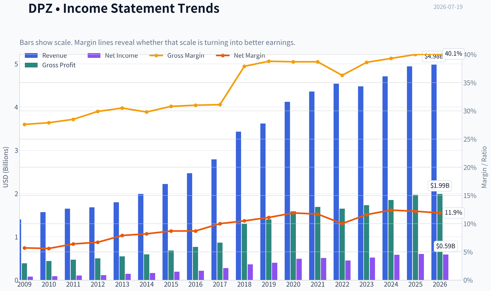

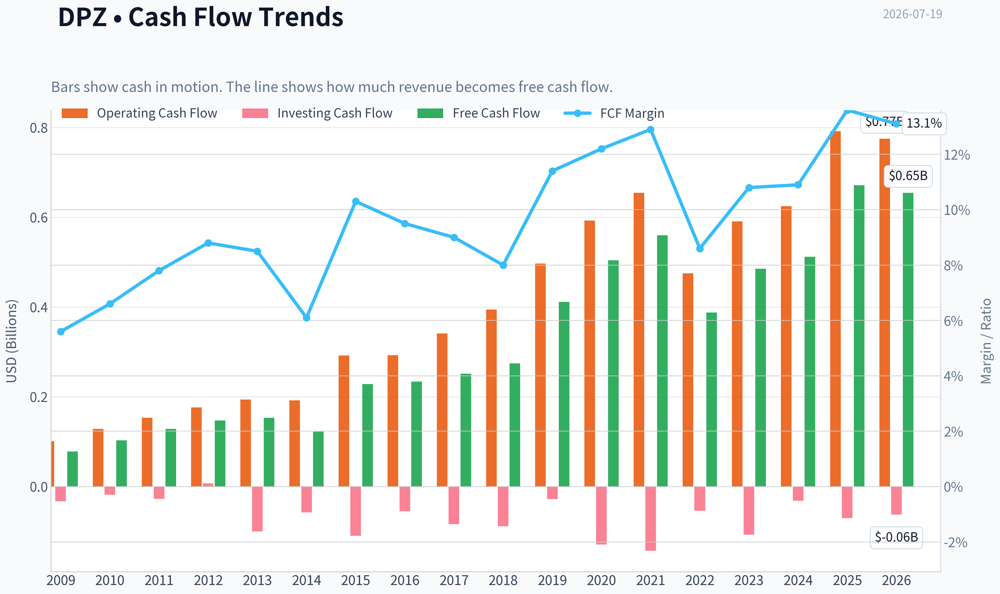

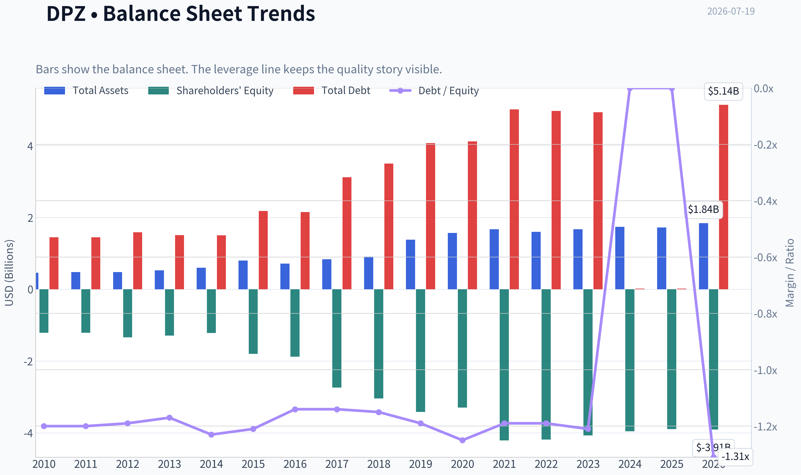

This graph tracks the profitability and return metrics (ROE, ROIC, Margins) of **DPZ** over the past decade, highlighting capital efficiency trends.

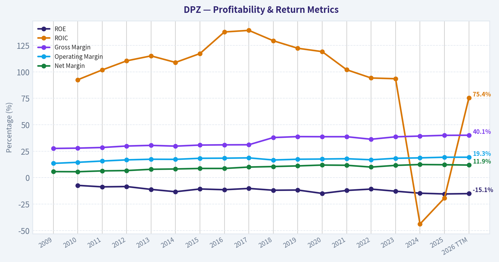

This chart illustrates the financial health of **DPZ** over the last 10 years, mapping cash equivalents and free cash flow against total obligations (Debt).

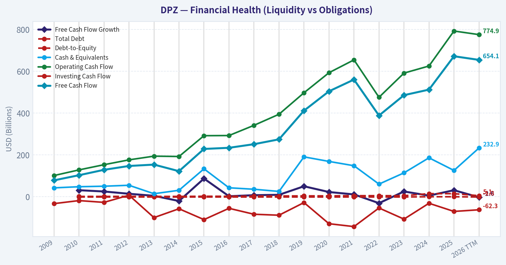

This breakdown chart from <em>Revenue Breakdown</em> shows the proportional composition for **DPZ** - useful for understanding what drives or risks the business.

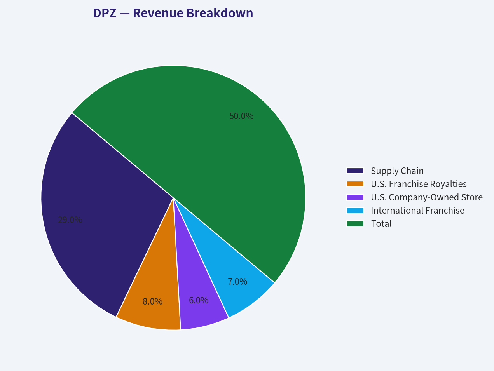

---

### Intrinsic Value Analysis (Buffett)

> *Following Warren Buffett's value investing philosophy: Circle of Competence, Economic Moat, Management Quality, and Margin of Safety.*

#### Intrinsic Value Snapshot

Price is what you pay. Intrinsic value is what the business may be worth based on the cash it can create for owners over time. We show a range, not one magic number.

- Current Price: $322.18
- Value Range (conservative to optimistic across both DCF methods): $93.32 to $444.32

##### Owner Earnings (Buffett Method)
- Net Income: $601,704,000.00
- Depreciation & Amortization: $88,827,000.00
- Capital Expenditures: $-120,558,000.00
- Working Capital Changes: $52,751,000.00
- Owner Earnings: $548,953,000.00

##### Intrinsic Value
###### Buffett Method
Uses owner earnings. Stricter, and usually more conservative.
- Conservative: $93.32
- Average: $222.24
- Optimistic: $426.29
- Discount Rate: 10.0%

###### Cash Flow Method
Uses free cash flow. Better for companies spending heavily today to grow tomorrow.
- Conservative: $154.99
- Average: $260.77
- Optimistic: $444.32
- Discount Rate: 10.0%

ANALYST STANCE: **WATCH**

#### DPZ - Domino's Pizza Buffett-Style Investment Review

#### 1) Factor Scorecard

| Factor | Score (0-5) | Evidence |
|---|---:|---|
| Factor 1: Circle of Competence & Business Simplicity | 5.0 | Easy to explain: Domino's makes money by selling pizza through company stores and franchised stores, plus supply-chain operations. Demand is recurring, the product is habitual, and the model has been understandable for decades. Technology strengthens ordering efficiency and customer convenience rather than making the model harder to understand. |
| Factor 2: Moat Test | 3.5 | Brand is strong, digital ordering capability is proven, franchise scale matters, and supply-chain infrastructure creates operating advantages. Gross margin around 40% supports some intangible asset strength. But this is not a monopoly-like moat; competition in pizza and quick service remains active. |
| Factor 3: Management Quality & Capital Allocation | 3.5 | Historically solid execution, franchise-heavy model, and decent cash generation. Capital allocation has benefited shareholders over time, but the negative ROE signals aggressive leverage/buyback effects rather than pristine economics on an accounting basis. |
| Factor 4: Industry Structure | 3.0 | Pizza QSR is competitive, but Domino's is one of the stronger scaled players. Industry is rational enough to support a leader, though not so consolidated that pricing power is unquestioned. |

**Gate 5 Hard Floor:** **Not tripped.**
There is no evidence here of both deteriorating earnings/cash-flow collapse and solvency distress of the kind required for a hard AVOID.

#### Key Takeaways
Domino's scores well on simplicity and reasonably well on moat and management, but the industry is only moderately attractive because competition is real. Most importantly, the hard solvency floor is not breached, so this is a valuation-and-quality debate, not a distress case.

---

#### 2) Moat Analysis

| Moat Source | Assessment | Evidence |
|---|---|---|
| Intangible Assets | Moderate | Domino's is one of the most recognized pizza brands globally. It has brand trust, convenience association, and customer habit. Gross margin at about 40% is supportive, though not extraordinary. |
| Switching Costs | Low to Moderate | Consumers can easily switch pizza brands, so end-customer switching costs are low. Franchisee and system-level switching costs are higher because of operational systems, supply arrangements, and brand affiliation. |
| Cost Advantages | Moderate | Scale in advertising, procurement, national promotions, and supply chain gives Domino's an edge over smaller operators. The franchise model also helps support returns through lower capital intensity at the corporate level. |
| Network Effects | Mild | Not a classic platform network effect, but scale improves brand awareness, delivery density, and digital ecosystem efficiency. More stores can enhance convenience and marketing efficiency, though this is weaker than true marketplace economics. |

**Moat Rating:** **Narrow to Moderately Durable**

Domino's moat is real, but it is not a "wide and widening" moat in the Buffett sense. The strongest elements are brand, scale, franchise infrastructure, and digital execution.

#### Key Takeaways
Domino's has a practical moat built on brand, scale, and franchise economics, not on customer lock-in. That makes the business durable, but not untouchable, so valuation discipline matters more than it would for a true wide-moat compounder.

#### 3) Management Quality Assessment

| Dimension | Assessment | Comments |
|---|---|---|
| Owner Orientation | Good | The business has long emphasized per-share economics and shareholder returns. |
| Candor | Adequate to Good | Domino's has historically been straightforward about operational initiatives and brand evolution. |
| Capital Allocation | Good, not elite | The franchise model is attractive, and cash has been returned to shareholders. However, negative ROE indicates equity has been compressed by leverage and buybacks, which can flatter per-share metrics but reduce balance-sheet conservatism. |
| Debt Discipline | Mixed | Leverage has historically been part of the capital structure. That is acceptable while cash generation remains durable, but it lowers the margin of safety. |

#### Key Takeaways
Management appears competent and commercially focused, especially in franchising and digital execution. The main reservation is that capital allocation has leaned on leverage enough to make the balance sheet less Buffett-clean than the business model itself.

#### 4) Financial Summary Table

| Metric | Latest / Shared Pack Value |
|---|---:|
| Current Price | $322 |
| Market Cap | $10.72B |
| P/E | 18.55 |
| ROE | -15.4% |
| Gross Margin | 40.0% |
| Revenue Growth YoY | 5.0% |
| FCF Yield | 6.3% |
| Current Ratio | 1.65 |
| Intrinsic Value (Headline FCFF) | $305.02 |
| Owner Earnings Value | $222.24 |
| FCF Value | $260.77 |
| Reverse DCF Implied Growth | ~22.1% for 10 years |
| Trailing 3Y Growth | 1.4% |
| Trailing 5Y Growth | 6.4% |

#### Key Takeaways
Domino's looks like a solid cash-generating business trading at a reasonable earnings multiple, but the intrinsic value estimates sit mostly below the current share price. The reverse DCF is the biggest warning sign: the market seems to be pricing in growth far above recent historical trends.

---

#### 5) Owner Earnings Calculation

Using the research pack's owner-earnings-derived valuation:

| Item | Value |
|---|---:|
| Owner Earnings-based Intrinsic Value | $222.24 |
| Price | $322 |
| Implied Premium to Owner Earnings Value | ~44.9% |

Because the direct owner earnings inputs were not separately provided in the pack, the most decision-useful takeaway is the valuation output itself: the owner-earnings framework implies materially less value than today's market price.

#### Key Takeaways
On an owner-earnings basis, the stock appears meaningfully expensive. For a Buffett-style buyer, that matters because owner earnings are the cash-like stream that ultimately supports long-term intrinsic value.

#### 6) Three-Scenario DCF Valuation

Using the research pack valuation spread as the best proxy for conservative, base, and more optimistic cash-flow views:

| Scenario | Framework | Estimated Value |
|---|---|---:|
| Scenario A | No-Growth / Owner Earnings style | $222.24 |
| Scenario B | Conservative / FCF-based | $260.77 |
| Scenario C | Headline Damodaran FCFF average | $305.02 |

**Valuation Range:** **$222 to $305**
**Current Price:** **$322**

#### Key Takeaways
Across conservative to more optimistic valuation methods, Domino's trades above estimated intrinsic value. Even the most favorable figure in the pack is still below the current market price, which limits prospective return.

#### 7) Margin of Safety Analysis

| Item | Value |
|---|---:|
| Current Price | $322 |
| Headline Intrinsic Value | $305.02 |
| Margin of Safety vs. Price | -5.6% |
| Reverse DCF Implied Growth | ~22.1% for 10 years |
| Historical Growth Reference | 3Y: 1.4%, 5Y: 6.4% |

For a business of Domino's quality, a small premium might be tolerable if growth visibility were stronger. But the reverse DCF implies growth that looks too ambitious relative to recent operating history. That removes the margin of safety.

#### Key Takeaways
This is the central issue: Domino's may be a good business, but it is not obviously a good deal today. The market price appears to assume a much stronger growth runway than the recent record supports.

---

#### 8) Final Buffett Scorecard

| Criterion | Weight | Score (1-5) | Weighted Score |
|---|---:|---:|---:|
| Moat Width & Durability | 25% | 3.5 | 0.88 |
| Valuation / Margin of Safety | 20% | 2.0 | 0.40 |
| Capital Returns - ROIC vs. WACC | 15% | 3.5 | 0.53 |
| Business Understanding & Predictability | 12% | 5.0 | 0.60 |
| Management Quality & Capital Allocation | 12% | 3.5 | 0.42 |
| Reinvestment Runway | 8% | 3.0 | 0.24 |
| Balance Sheet Strength | 4% | 2.5 | 0.10 |
| Industry Structure | 4% | 3.0 | 0.12 |

| Total Weighted Score | **3.29 / 5.00** |
|---|---:|

#### Key Takeaways
Domino's earns a respectable overall quality score because the business is understandable, durable, and cash generative. The stock falls into WATCH rather than ADVOCATE because valuation does not currently provide enough protection for a merely moderate-moat business.

#### 9) Investment Stance

**Stance:** **WATCH**
**Conviction:** **Moderate**

Domino's is a solid, understandable, franchise-driven business with a decent moat and attractive operating model. It benefits from brand, digital competence, and scale advantages that should keep it relevant for many years.

But Buffett-style investing requires not just a good business, but a sensible price relative to intrinsic value. Here, the valuation does not offer that comfort. The stock trades above the research pack's intrinsic value range, and the reverse DCF implies growth that appears too optimistic versus recent history.

A better entry point would likely come closer to the upper end of intrinsic value at a minimum, and ideally with a modest margin of safety below that. At today's price, DPZ looks like **the right kind of business at the wrong kind of price**.
#### Valuation Bridge

This bridge places the current market price beside each intrinsic value lens so readers can see whether upside depends on one method or shows up across several methods.

| Scenario | Intrinsic Value / Share |
| --- | ---: |
| Buffett Method | $222.24 |
| Cash Flow Method | $260.77 |
| Damodaran Method | $305.02 |
| Current Price | $322.18 |

#### Key Takeaways

If one method is far above the others, the upside case depends on a specific modelling assumption. When several methods cluster together, the valuation story is more robust.

#### Valuation Visuals

This comparison chart from *Latest Earnings Snapshot* stacks current figures against historical benchmarks for **DPZ**, making it easy to see where the company trades relative to its own averages.

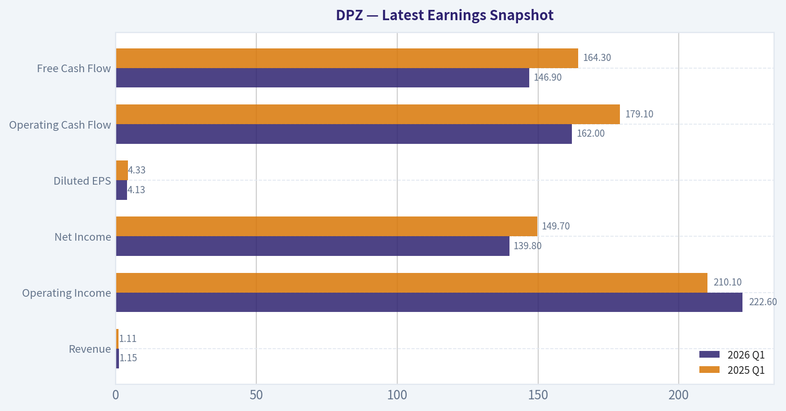

This comparison chart from *Current vs Historical Average Comparison* stacks current figures against historical benchmarks for **DPZ**, making it easy to see where the company trades relative to its own averages.

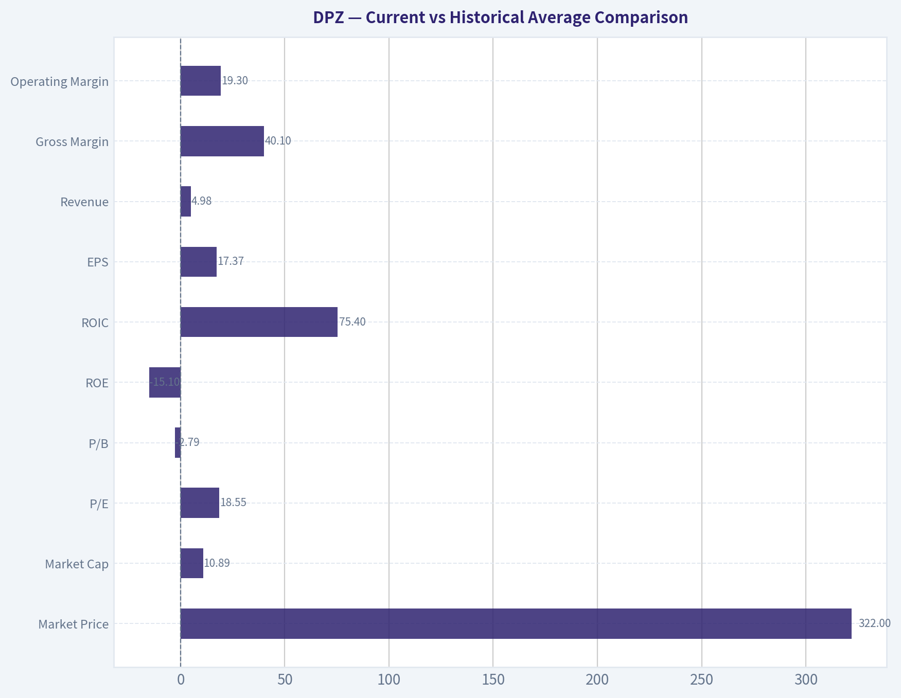

This comparison chart from *Buffett-Style Owner Earnings DCF* stacks current figures against historical benchmarks for **DPZ**, making it easy to see where the company trades relative to its own averages.

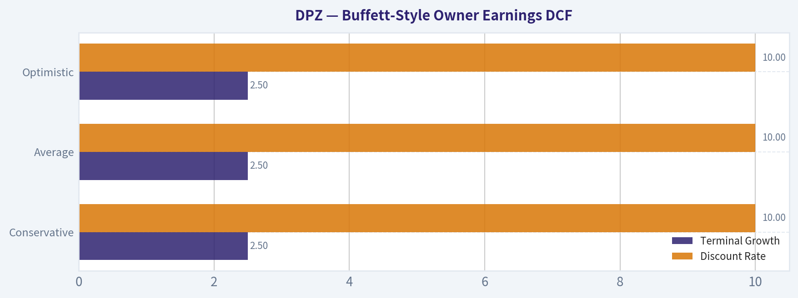

This comparison chart from *Financial Summary Table* stacks current figures against historical benchmarks for **DPZ**, making it easy to see where the company trades relative to its own averages.

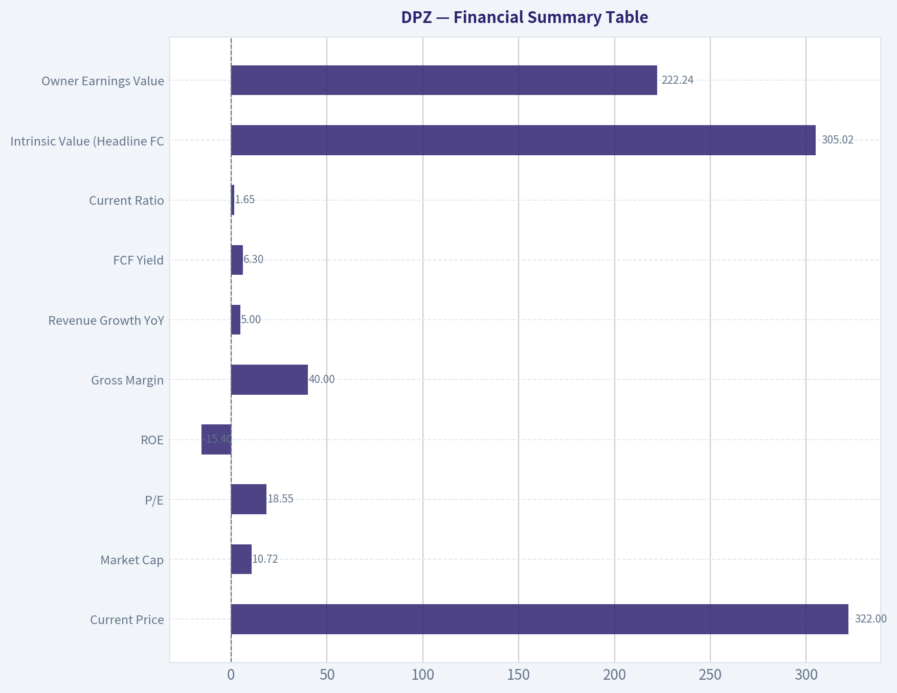

---

### Trend & Growth Analysis (Lynch/Druckenmiller/Fisher)

> *Following Peter Lynch's GARP, Stanley Druckenmiller's macro-aware approach, and Philip Fisher's scuttlebutt methodology.*

ANALYST STANCE: **WATCH**

#### DPZ Growth Analysis Snapshot

Domino's is **not a classic fast grower** today. On the shared data, it looks much more like a **Lynch stalwart**: a mature, high-quality franchised restaurant brand with decent cash generation, moderate growth, and some digital/loyalty advantages, but **without the revenue acceleration or TAM expansion** usually needed for ten-bagger-style growth underwriting.

---

#### 1. Lynch Classification

| Metric | DPZ Read |
|---|---:|
| Revenue growth YoY | 5.0% |
| P/E | 18.5x |
| Business type | Global franchised pizza/QSR |
| Lynch category | **Stalwart** |

Key Takeaways: Domino's fits best as a stalwart, not a fast grower. The company is still growing, but at roughly 5 percent revenue growth it does not currently qualify for the 15 to 25 percent plus growth profile that Peter Lynch would target for ten-bagger hunting. That means the bar for a new purchase is higher and the case leans more toward steady compounding than explosive upside.

---

#### 2. The Story in 3 Bullets

- Domino's sells convenience: fast, affordable pizza delivered through a highly scaled franchise and digital ordering system.
- The edge is its brand, franchise model, delivery operations, and strong app/loyalty ecosystem rather than breakthrough product innovation.
- The bull case is steady international unit growth, same-store sales support, and operating/cash flow durability; the bear case is that this is already a mature category with limited re-acceleration.

---

#### 3. TAM Analysis and 10x Test

| Item | Estimate / View |
|---|---:|
| Current revenue base | Mature global QSR scale business |
| 10x test | **Fails on practical basis** |
| Why | 10x revenue would imply a massively unrealistic share of global pizza/QSR demand |
| TAM growth | Low-to-moderate, tied to QSR demand, delivery, and international expansion |
| Runway conclusion | **Moderate for unit growth, weak for 10x equity thesis from operations alone** |

Key Takeaways: Domino's still has room to grow, especially internationally, but the runway is not the kind of open-ended market that supports a classic 10x revenue thought experiment. This is a large, mature category, so future gains are more likely to come from steady market share capture and franchise expansion than from a huge TAM unlock.

---

#### 4. Revenue Growth Trend

| Metric | Reading |
|---|---:|
| Latest revenue growth YoY | 5.0% |
| 3-year implied growth context | Low single digits from shared pack |
| 5-year growth context | 6.4% trailing |
| Trend characterization | **Stable to modest, not inflecting** |

Key Takeaways: The available numbers suggest Domino's growth is steady but not accelerating. That matters because Druckenmiller-style upside usually comes when the market is missing a clear re-acceleration, and there is not strong evidence of that here from the shared data.

---

#### 5. Unit Economics

| Metric | DPZ Read | Assessment |
|---|---:|---|
| Gross margin | 40.0% | Solid |
| FCF yield | 6.3% | Attractive for mature quality |
| Franchise model | Asset-light relative to owned-store models | Positive |
| LTV/CAC | Not disclosed in shared pack | N/A |
| NRR | Not relevant | N/A |
| Rule of 40 | Not applicable in standard SaaS sense | N/A |

Key Takeaways: Domino's has good economic characteristics for a mature consumer franchise, especially cash generation and an asset-light model. But this is not a SaaS-style compounding engine, so the usual hypergrowth metrics like net revenue retention and Rule of 40 do not apply.

---

#### 6. Inflection Point Assessment

| Inflection Type | Assessment |
|---|---|
| Product cycle inflection | Weak |
| Market share inflection | Possible, but not evident from shared data |
| Margin inflection | Limited near-term visibility |
| TAM inflection | Weak |
| Competitive inflection | Not obvious |
| Overall | **No strong inflection currently visible** |

Key Takeaways: I do not see a strong growth inflection from the supplied information. Domino's may continue executing well, but this looks more like a durable operator in a mature category than a company at the start of a new growth curve.

---

#### 7. Macro Setup Evaluation

| Factor | View |
|---|---|
| Consumer backdrop | Mixed; value-oriented QSR can be resilient |
| Rate sensitivity | Moderate; lower rates help valuation but not core thesis |
| Secular themes | Digital ordering, delivery, loyalty, international franchising |
| Macro wind | Neutral to mildly favorable |

Key Takeaways: Domino's benefits from being a relatively affordable consumer option, which can help in softer spending environments. Still, macro is not the main driver here; execution and same-store sales matter more than top-down tailwinds.

---

#### 8. Fisher 15 Points Score

| Fisher Area | Score (1-5) |
|---|---:|
| Market potential | 3 |
| New products | 2 |
| R&D effectiveness | 2 |
| Sales organization | 4 |
| Profit margin | 4 |
| Margin improvement | 3 |
| Labor relations | 3 |
| Executive relations | 3 |
| Management depth | 4 |
| Cost controls/accounting | 4 |
| Special advantages | 4 |
| Long-range profit outlook | 3 |
| Dilution risk | 4 |
| Candor | 3 |
| Integrity | 3 |
| **Total** | **49 / 75** |

Key Takeaways: A Fisher score around 49 suggests an above-average but not exceptional growth setup. Domino's scores well on brand, distribution, and cash economics, but less well on innovation intensity and long-range hypergrowth potential.

---

#### 9. Valuation Analysis

| Valuation Item | Reading |
|---|---:|
| Price | $322 |
| Market cap | $10.72B |
| P/E | 18.55x |
| Headline intrinsic value | $305.02 |
| Owner earnings value | $222.24 |
| FCF value | $260.77 |
| Margin of safety vs. price | -5.6% |
| Reverse DCF implied growth | ~22.1% for 10 years |
| Trailing 3y growth | 1.4% |
| Trailing 5y growth | 6.4% |

Key Takeaways: Valuation is the key issue. The current price appears to require growth far above the company's recent historical growth profile, which makes the stock look fully valued to somewhat stretched unless a meaningful re-acceleration emerges.

Because earnings growth is not clearly provided, I would not force a PEG estimate. But conceptually:
- If EPS growth is roughly mid-single digits, then a **P/E of 18.5x implies a PEG well above 2**, which is **expensive by Lynch standards**.
- On cash-flow frameworks, the stock also looks **around fair to somewhat overvalued**, not clearly cheap.

---

#### 10. Growth Investor Scorecard

| Criterion | Weight | Score (1-5) | Weighted |
|---|---:|---:|---:|
| The Story | 10% | 4.0 | 0.40 |
| TAM & Runway | 20% | 2.5 | 0.50 |
| Revenue Growth | 20% | 2.5 | 0.50 |
| Unit Economics | 15% | 4.0 | 0.60 |
| Competitive Position | 10% | 4.0 | 0.40 |
| Management Quality | 10% | 3.5 | 0.35 |
| Macro Setup | 5% | 3.0 | 0.15 |
| Profitability Path | 5% | 4.0 | 0.20 |
| Valuation | 5% | 2.0 | 0.10 |
| **Total** |  |  | **3.20 / 5.0** |

Key Takeaways: Domino's lands in the WATCH range because it has a good business model and solid competitive position, but lacks the growth and valuation setup needed for a stronger recommendation. In other words, the company quality is better than the stock setup.

---

#### 11. Position Size Stance

| Stance | View |
|---|---|
| New position | **Small or none** |
| Existing holders | Hold/watch execution and valuation |
| Ideal entry condition | Pullback or evidence of renewed growth inflection |

Key Takeaways: This is not the kind of setup that calls for aggressive sizing. If you already own it, it may still deserve a place as a quality compounder, but for new capital I would wait for either a cheaper valuation or clearer growth acceleration.

---

#### 12. Key Risks and Catalysts

| Risks | Catalysts |
|---|---|
| Mature category limits growth | International unit expansion |
| Reverse DCF expectations too high | Better same-store sales trends |
| Consumer weakness / traffic pressure | Digital and loyalty monetization |
| Competitive discounting | Franchise efficiency and margin support |
| No visible growth inflection | Positive earnings surprise if comps re-accelerate |

Key Takeaways: The main risk is not business collapse but overpaying for a steady business. The main upside catalyst would be a genuine re-acceleration in same-store sales or international growth that proves the market's growth expectations are achievable.

---

#### Bottom Line

DPZ is a **quality stalwart, not a true fast grower**.
It has:
- a solid franchise model,
- decent cash generation,
- brand and digital advantages,

but also:
- modest revenue growth,
- limited TAM-style upside,
- and a valuation that seems to assume much stronger growth than history supports.

For a Lynch-Druckenmiller-Fisher growth framework, this is **WATCH**, not ADVOCATE. If the stock pulled back materially or if upcoming earnings showed a real growth inflection, the stance could improve.

#### Growth & Scorecard Visuals

This comparison chart from *Factor Scorecard* stacks current figures against historical benchmarks for **DPZ**, making it easy to see where the company trades relative to its own averages.

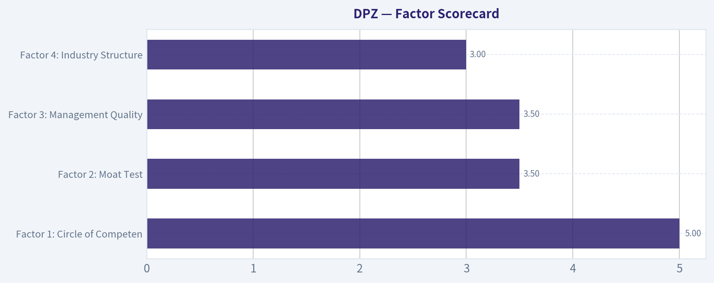

---

### Market Technical Analysis

#### DPZ Technical Report

DPZ remains in a clearly weakened long-term structure, but its short-term tape has improved materially over the last few weeks. The most relevant indicator set for this market context is:

| Indicator | Why it matters now |
|---|---|
| close_200_sma | Confirms the dominant long-term downtrend. |
| close_50_sma | Tracks the medium-term trend and shows whether the recent rebound is changing structure. |
| close_10_ema | Captures the fast shift in short-term momentum after the late-June washout. |
| macd | Measures whether momentum has truly transitioned from bearish to bullish. |
| macdh | Useful here because the acceleration of momentum has changed faster than price trend itself. |
| rsi | Helps judge whether the rebound is healthy or becoming overstretched. |
| boll_ub | Good for identifying whether price is pressing breakout territory or nearing short-term extension. |
| atr | Essential now because DPZ has had large gap-like moves and elevated swing size. |

Key Takeaways: These eight indicators are complementary rather than repetitive. Together they show long-term trend, medium-term structure, short-term momentum, reversal strength, stretch versus range, and practical trading risk.

---

#### Trend Structure

Over the last year, DPZ has undergone a substantial repricing lower. The stock fell from the mid- to high-$400s in mid-2025 to the low-$300s by mid-2026, with a severe breakdown phase in late April through late June 2026. That decline was not orderly; it included a sharp earnings-style air pocket around April 27 and another washout into June 23 near $283.

The current rebound from late June is real, but it is still best described as a recovery rally inside a larger bearish regime, not yet a confirmed long-term reversal. Price closed at **$322.18 on 2026-07-17**, which is:

- **above the 10 EMA (312.50)** -> short-term momentum is constructive,
- **above the 50 SMA (308.69)** -> medium-term damage is stabilizing,
- **well below the 200 SMA (372.88)** -> long-term trend remains bearish.

That alignment is important. It means DPZ has improved from "deeply weak" to "tactically recovering," but it has not yet repaired enough overhead damage to justify calling it a new secular uptrend.

| Metric | Latest reading | Interpretation |
|---|---:|---|
| Close | 322.18 | Short-term rebound intact |
| close_10_ema | 312.50 | Price above fast trend support |
| close_50_sma | 308.69 | Price slightly above medium-term trend line |
| close_200_sma | 372.88 | Price still far below long-term trend benchmark |

Key Takeaways: DPZ has regained its footing in the short and medium term, but the bigger picture is still negative. Traders can respect the rebound while also recognizing that the stock remains far below its long-term trend line, which limits how aggressive bullish positioning should be.

---

#### Moving Average Read-Through

The **50 SMA has been falling steadily**, from about **379.39 in April** to **308.69 now**. That is a very sharp medium-term deterioration, and it tells us the stock's base is still built on weak prior price history. However, the decline in the 50 SMA has slowed considerably, and price is now trading just above it. That often marks the first stage of stabilization after a prolonged selloff.

The **200 SMA is also declining**, from roughly **412.77 in April** to **372.88 now**. When the 200-day average is falling this clearly, it usually indicates broad institutional trend deterioration rather than just a temporary pullback. Even if DPZ rallies further, the area between the low-$330s and the 200-day zone near the low-$370s may contain substantial supply from trapped holders.

The **10 EMA** has turned up decisively. It climbed from **297.84 on June 30** to **312.50 on July 17**, showing that recent price action is no longer just bouncing randomly; short-term buyers have been able to lift the trend baseline.

This creates a nuanced picture:
- Long-term trend: still bearish.
- Medium-term trend: flattening after a long decline.
- Short-term trend: bullish.

That is often the setup for either:
1. a tradable continuation rally into overhead resistance, or
2. a failed bounce if buyers cannot hold above the 50 SMA.

| Moving average signal | Observation | Trading implication |
|---|---|---|
| 10 EMA | Rising and below price | Supports momentum continuation |
| 50 SMA | Falling but price reclaimed it | Early stabilization, not full trend repair |
| 200 SMA | Falling and far above price | Major overhead resistance remains |

Key Takeaways: The shortest trend has improved the most, the medium trend is trying to stabilize, and the long trend is still down. This usually favors tactical trades over long-duration bullish conviction until the stock proves it can build above the 50-day average and eventually challenge the much higher 200-day average.

---

#### Momentum Analysis

The momentum shift has been notable.

**MACD** improved from deeply negative readings near **-14.28 on May 20** to **+1.98 on July 17**. Crossing from strongly negative to positive is significant because it indicates the rebound has lasted long enough and been strong enough to reverse the intermediate momentum impulse.

**MACD histogram** is even more informative here. It turned positive well before the MACD line crossed above zero and has expanded to **+3.22** on July 17. That means upside momentum is not merely positive; it has recently been accelerating. In practical terms, buyers are still controlling the near-term pace of trade, even after the stock paused on July 17 following the strong July 16 surge.

This is one of the strongest bullish elements in the chart right now. But there is a caveat: momentum has improved faster than the long-term trend. In stocks recovering from a deep drawdown, that often produces sharp rallies that eventually run into heavy resistance.

| Momentum indicator | Latest reading | Message |
|---|---:|---|
| macd | 1.98 | Momentum has shifted into positive territory |
| macdh | 3.22 | Bullish momentum is still accelerating |

Key Takeaways: Momentum has turned meaningfully positive, and the speed of improvement has been strong. Even so, momentum recoveries in damaged charts can be powerful without becoming durable long-term uptrends, so follow-through above support remains crucial.

---

#### RSI and Stretch Conditions

The **RSI is 57.85**, after reaching **63.28** on July 16. That is constructive rather than euphoric.

A few things stand out:
- Late June saw RSI sink into the low **30s** and even below **30** on June 23, reflecting capitulation conditions.
- Since then, RSI has recovered into the upper-50s to low-60s.
- Importantly, RSI is **not yet overbought** by the classic 70 threshold.

That suggests the rebound still has room, at least from a pure momentum-stretch perspective. However, the pullback from 63 to 58 after the July 16 spike shows that momentum is no longer in the earliest rebound phase. The stock may need consolidation before another leg higher.

| RSI context | Reading | Interpretation |
|---|---:|---|
| Oversold extreme in late June | ~29.28 | Capitulation/reversal zone |
| Recent local high | 63.28 | Strong rebound, but not extreme |
| Latest RSI | 57.85 | Healthy momentum, not overbought |

Key Takeaways: RSI shows DPZ has recovered from washed-out conditions without yet becoming severely overextended. That leaves room for additional upside, but the market is no longer giving the kind of deeply oversold entry that existed in late June.

---

#### Volatility, Bands, and Risk

The **Bollinger Upper Band is 327.35**, while price closed at **322.18**. So DPZ is trading fairly close to the upper volatility envelope but has not cleanly broken through it. This typically means one of two things:
- buyers are pressing toward a breakout, or
- price is nearing a zone where short-term gains may pause.

Given the strong July 16 jump to **329.67 intraday** and the July 17 close back at **322.18**, the stock appears to be probing extension but not yet decisively escaping it. A clean close above the upper band with follow-through would strengthen the bullish continuation case. Rejection near the band would favor a pause or retracement.

**ATR is 11.08**, up from the high-$8s in early June. That confirms trading range expansion. This matters because DPZ is now moving enough each day that stop placement and position sizing matter more than usual. With ATR above 11, tight stops can be easily shaken out by normal price noise.

| Volatility metric | Latest reading | What it suggests |
|---|---:|---|
| boll_ub | 327.35 | Price is nearing short-term upper volatility resistance |
| ATR | 11.08 | Daily movement remains elevated; risk sizing is important |

Key Takeaways: DPZ is trading close to the top of its current volatility envelope, and daily price swings remain large. That combination can produce strong upside bursts, but it also raises the risk of abrupt reversals, so risk controls should be wider and position sizes smaller than in calmer charts.

---

#### Fine-Grained Market Interpretation

The most interesting feature in DPZ right now is the separation between **trend timeframe layers**.

- **Short-term traders** are seeing a bullish setup: rising 10 EMA, positive MACD, positive histogram, RSI below overbought, price above 50 SMA.
- **Swing traders** are seeing a test: can the stock hold above roughly **309-313** and build a higher base?
- **Position traders** are still dealing with a bearish primary trend because the 200 SMA near **373** is far overhead and still falling.

This means the stock is at a transitional point, not a settled one. The market has stopped treating DPZ as a one-way downtrend, but it has not yet granted it full trend repair.

A practical reading of the chart is:

1. **Support zone:** around **308-313**, where the 50 SMA and 10 EMA now cluster.
2. **Near-term resistance:** around **327-330**, near the upper band and recent spike high.
3. **Secondary resistance:** low- to mid-**330s**, where repeated failed rallies could emerge.
4. **Major strategic resistance:** **370-375**, near the 200 SMA.

If price holds above the moving-average support cluster and MACD remains positive, the rebound can continue. If price loses that support cluster, the recent improvement likely downgrades into another failed rally within a larger bear trend.

---

#### Trading Decision Framework

| Scenario | What to watch | Technical read |
|---|---|---|
| Bullish continuation | Sustained closes above 327-330 | Confirms strength beyond upper-band pressure and recent spike high |
| Healthy consolidation | Pullback holds 308-313 | Would keep short-term trend constructive |
| Failed rebound | Break below 308 with weakening MACD histogram | Suggests recent rally was only a countertrend bounce |
| Larger trend repair | Eventual move toward and above 200 SMA near 373 | Needed before long-term bullish thesis strengthens materially |

Key Takeaways: The nearest decision points are much closer than the long-term ones. In the short run, the chart is about whether DPZ can stay above the low-$310s and push through the upper-$320s; only much later would a move toward the 200-day average begin to change the broader strategic picture.

---

#### Bottom Line

DPZ is showing a **credible short-term momentum recovery** after a severe multi-month decline. The technical evidence supports a **tactical bullish bias** above the **308-313** support zone, but not a fully bullish long-term stance because the stock remains well below a falling 200-day average.

The strongest current positives are:
- positive MACD,
- expanding MACD histogram,
- price above the 10 EMA and 50 SMA,
- RSI recovering without being overbought.

The main constraints are:
- long-term downtrend still intact,
- price nearing upper-band and recent high resistance,
- elevated ATR signaling larger reversal risk.

For traders, this is a **rebound-with-risk** chart, not yet a completed turnaround.

| Category | Key point | Trader implication |
|---|---|---|
| Long-term trend | Below falling 200 SMA | Strategic trend still bearish |
| Medium-term trend | Above 50 SMA | Rebound has improved structure |
| Short-term momentum | Above rising 10 EMA; MACD positive | Near-term bias constructive |
| Stretch | RSI 57.85; near Bollinger upper band | More upside possible, but less margin for sloppy entries |
| Risk | ATR 11.08 | Use disciplined position sizing and wider stops |

Key Takeaways: DPZ has improved enough to support short-term bullish tactics, but the stock has not yet earned long-term bullish confidence. The chart is best viewed as a recovering but still structurally damaged setup, where support holding matters as much as upside breakout potential.

---

### Options Market Analysis

> *Reading options flow - put/call ratios, IV skew, and unusual activity - to gauge institutional positioning and event-driven risk.*

#### DPZ Options Positioning Report

#### 1) Put/Call Ratio Analysis

| Expiry | Call OI | Put OI | Put/Call OI | Call Vol | Put Vol | Put/Call Vol |
|---|---:|---:|---:|---:|---:|---:|
| 2026-08-21 | 2,467 | 3,308 | 1.34 | 2,519 | 1,537 | 0.61 |
| 2026-09-18 | 2,656 | 2,892 | 1.09 | 278 | 588 | 2.12 |
| 2026-12-18 | 1,576 | 1,226 | 0.78 | 212 | 367 | 1.73 |
| **Near-term total** | **6,699** | **7,426** | **1.11** | **3,009** | **2,492** | **0.83** |

**Key Takeaways:** DPZ's aggregate near-term put/call open-interest ratio of 1.11 sits above the usual neutral area around 0.7, which tells us the existing options book is tilted defensive rather than outright bullish. But the volume ratio of 0.83 is much less bearish than the OI ratio, and the front-month August chain actually saw more call trading than put trading. That suggests legacy hedging is still present, while fresh flow has recently leaned more constructive in the very near term.

Interpretation:
- **OI positioning is cautious/defensive**: a 1.11 put/call OI ratio is meaningfully above neutral.
- **Fresh flow is less bearish**: a 0.83 put/call volume ratio indicates recent activity is not confirming heavy downside chasing.
- **Front month is strongest**: August volume skewed toward calls, which often points to short-dated upside speculation, tactical rebounds, or overwriting demand.
- **September and December volume are more put-heavy**, implying some investors are still carrying downside protection beyond the nearest expiry.

#### 2) Implied Volatility (IV) Assessment

| Expiry | ATM Call IV | ATM Put IV | ATM IV Read | Skew Read |
|---|---:|---:|---|---|
| 2026-08-21 | 52.3% | 54.3% | Elevated | Mild put skew |
| 2026-09-18 | 43.9% | 42.9% | Moderately elevated | Slight call skew / flat |
| 2026-12-18 | 42.7% | 39.7% | Moderate | Call skew |
| **Near-term bias** | - | - | **Front IV elevated** | **Only mild downside fear** |

**Key Takeaways:** August IV is notably higher than the later expirations, which usually means the market is pricing in a near-term event or a short-window move. However, the skew is not aggressively bearish: August puts are only slightly richer than calls, so this does not look like panic hedging. Further out, skew actually leans flatter to call-favored, which supports the view that traders are not pricing severe downside tail risk.

Interpretation:
- **Near-term IV is elevated**, especially in August at roughly 52%-54% ATM, indicating event risk or heightened uncertainty.
- **Put skew exists in August, but only mildly**. If downside fear were intense, OTM puts would typically trade at a much larger premium.
- **September and December do not show strong defensive skew**, and later-dated call IV is slightly firmer than put IV.
- This pattern usually fits a market expecting **movement**, but not necessarily a sharp downside break.

#### 3) Unusual Options Activity

| Expiry | Type | Strike | Volume | OI | Vol/OI | IV | Read |
|---|---|---:|---:|---:|---:|---:|---|
| 2026-08-21 | Call | 360 | 909 | 75 | 12.1x | 46.9% | Fresh upside bet, likely speculative |
| 2026-08-21 | Call | 330 | 510 | 96 | 5.3x | 53.7% | Nearer-to-money bullish positioning |

**Key Takeaways:** The clearest unusual activity is concentrated in August calls, not puts, and both contracts traded at many times existing open interest. That is important because it signals fresh positioning rather than old interest being unwound. The 330 call looks more credible as a directional institutional-style expression than the 360 call, while the 360 line has a more speculative flavor given its likely farther OTM profile.

Interpretation:
- **August 330 call**:
  - Volume/OI above 5x indicates fresh new positioning.
  - Likely **ATM or modestly OTM** depending on spot, making it a more realistic directional upside bet.
  - Suggests traders are positioning for a **near-term advance** rather than only hedging.
- **August 360 call**:
  - Very high volume relative to OI.
  - More likely **OTM**, implying a higher-conviction upside breakout bet or cheaper lottery-style speculation.
  - Could include retail participation, but the size relative to OI still makes it worth tracking.
- **No unusual put contract** was flagged in the data, which weakens the bearish case.

Smart-money vs. retail read:
- The **330 call** is more likely to reflect informed or at least more disciplined positioning because it is closer to the current stock zone and has more practical delta exposure.
- The **360 call** looks more speculative and could include retail upside chasing, though it still contributes to a bullish short-term flow signal.

#### 4) Open Interest Concentration

| Expiry | OI Concentration Read | Market Effect |
|---|---|---|
| 2026-08-21 | Highest total OI among listed expiries, with puts exceeding calls | Greater chance of pinning/defensive dealer hedging near front-month strikes |
| 2026-09-18 | Balanced but still put-heavy OI | Moderately defensive medium-term positioning |
| 2026-12-18 | Calls and puts relatively balanced, slight call support | Less defensive longer-dated posture |

**Key Takeaways:** The August expiration is where positioning is heaviest, so that is the most important chain for near-term price behavior. Because put OI exceeds call OI there, dealer hedging flows may dampen rallies unless price pushes into the area where those new call buyers become more influential. In short, August is the likely "gravity zone" for pinning and short-term gamma effects.

What this implies:
- **Front-month August is the dominant gamma zone**.
- Since put OI is larger in August, **downside hedging inventory may act as a stabilizer at first**, but if price falls into major put-heavy areas, hedging flows can also magnify movement.
- The burst of new August call buying introduces a possible **upside gamma pocket** if DPZ starts moving toward those strikes.
- Exact strike-level max-pain cannot be computed from the provided dataset, but the concentration clearly says **watch August most closely**.

#### 5) Overall Options Sentiment Signal

| Signal | Confidence | Primary Driver |
|---|---|---|
| **BULLISH (tactical / near-term)** | Moderate | Heavy unusual August call buying despite still-elevated legacy put OI |

**Key Takeaways:** The options market in DPZ is not cleanly risk-on, because there is still above-neutral put open interest across the near-term maturities. But the freshest and most unusual flow is decisively on the call side, and near-term skew is not fearful enough to override that. So the best directional read is a cautious bullish signal, driven by short-dated upside positioning rather than broad-based conviction.

Synthesis:
- **Why bullish instead of neutral or bearish?**
  - The most actionable signal in options is often **fresh flow**, and the fresh flow here is in **August calls**.
  - Put OI is elevated, but that can reflect **existing hedges** rather than an active new bearish campaign.
  - IV is elevated, yet skew is only mildly defensive, which argues **uncertainty without panic**.
- **What tempers the bullish view?**
  - Aggregate put/call OI remains above 1.0.
  - September and December volumes lean more put-heavy than August.
  - If DPZ is illiquid relative to mega-caps, individual prints can carry more noise; confidence should therefore be **moderate, not high**.

#### Bottom Line

DPZ options currently show a **tactical bullish bias**. The strongest evidence is the **unusual surge in August call volume**, especially at the 330 and 360 strikes, alongside **front-month call-heavy trading flow**. The main caveat is that the broader open-interest structure still carries a **defensive undertone**, so this looks more like a near-term upside setup inside a still-cautious positioning backdrop, not a full-throttle bullish consensus.

#### Summary Table

| Category | Read | Evidence | Implication |
|---|---|---|---|
| Put/Call Ratio | Slightly bearish legacy book, improving flow | Near-term OI ratio 1.11; volume ratio 0.83 | Existing hedges remain, but fresh trading less defensive |
| IV Level | Elevated near term | Aug ATM IV 52.3% calls / 54.3% puts | Market expects movement or event risk soon |
| Skew Direction | Mild put skew front month; flatter later | Aug puts slightly richer than calls | Some caution, but no strong panic bid for protection |
| Unusual Activity | Bullish | Aug 330C and 360C volume far above OI | Fresh upside positioning, especially short-dated |
| Overall Signal | **BULLISH** | Call-led unusual flow outweighs defensive OI backdrop | Near-term upside bias with moderate confidence |

**Key Takeaways:** DPZ's options tape leans bullish on a tactical basis, mainly because the newest and most forceful activity is concentrated in front-month calls. The caution flag is that the broader OI structure is still put-heavy, so this is best viewed as a bullish setup with hedging still in the background rather than an all-clear risk-on signal.

---

## Research Team Commentary

> *The Research Manager synthesizes the Bull vs Bear debate into action-free commentary. This is a pre-risk view, not the final stance.*

The strongest bull argument is that Domino's is a genuinely good business hiding in plain sight under the label of "just a pizza chain." The franchise model is asset-light, the brand is strong, digital ordering and loyalty are real operational advantages, and the business has historically shown durable demand and solid cash-generation characteristics. For a Buffett-style investor willing to own "wonderful businesses at fair prices," 18.5x earnings is not obviously expensive if Domino's can keep compounding through international unit growth, modest same-store sales gains, and disciplined capital returns. The bull case also correctly points out that negative ROE is not very informative here because book equity is distorted; this is not a bank or an asset-heavy manufacturer where that metric should drive the conclusion.

The strongest bear argument is that the bull stretches a solid franchise into something more exceptional than it really is. Domino's moat looks real but narrow, not wide. Customers are not locked in, competition is constant, digital convenience is no longer unique, and the category is mature. That matters because at 18.5x earnings, this is probably closer to fair value than bargain territory. If the moat is only moderate and the growth runway is steady rather than special, then the stock needs more valuation support to qualify as a true Buffett-style opportunity. The bear side is also right that "not distressed" is not the same as "cheap," and that capital returns supported by leverage do not automatically prove extraordinary reinvestment economics.

My takeaway is that Domino's clears the business-quality bar, but not the margin-of-safety bar strongly enough. This is not a low-quality business I want to avoid outright. But it also does not look like a mispriced wonderful company where I should pound the table. Past mistakes remind me not to over-penalize a good business just because the chart is imperfect, and not to demand absurd cheapness from quality. But another lesson is equally important: separate "good company" from "good stock at this price." Domino's looks more like the latter is unresolved.

Core takeaway: Domino's is a durable, above-average franchised consumer business with a real moat, but the current price seems to already recognize much of that quality. I see a respectable long-term compounder candidate, not a clear undervaluation. That points to patience rather than advocacy.

Rationale: From a value-investing perspective, I like the simplicity of the model, the franchise structure, the brand, and the operating consistency. I also agree that metrics tied to book equity are misleading for this kind of capital structure. So I do not want to make the mistake of rejecting a quality asset-light business for superficial accounting reasons. But Buffett discipline still requires asking what expectations are embedded in the price. At 18.55x earnings, the market is not assuming disaster; it is already granting Domino's credit for durability. Since the moat appears narrow-to-moderate rather than wide, and since category maturity and competitive intensity are real, I do not see enough quality-scaled discount to move to ADVOCATE. On the other hand, because this is a solid franchise with no distress signal, I also do not think AVOID is right. WATCH fits best.

Monitoring plan over the next 1-4 quarters: I would watch same-store sales trends, especially whether value positioning is holding traffic without hurting margins too much. I would watch international net unit growth and any signs that the international runway is slowing or becoming less profitable. I would watch franchisee health closely, because the parent can look fine for a while even if store-level economics are weakening underneath. I would also want to see whether digital engagement and loyalty continue to support repeat ordering in a world where convenience is increasingly commoditized. On capital allocation, I'd monitor debt, buybacks, and whether management is creating value per share rather than just supporting optics. Finally, if the stock derates into a clearly lower multiple without a corresponding deterioration in unit economics or brand strength, that would improve the case materially.

Final stance: WATCH

---

## Value Investing Team Commentary

> *The Investor translates the research view into an investment thesis before risk review. This is still not the final stance.*

Domino's is the kind of business a long-term owner can understand: simple product, repeat demand, franchised economics, strong brand awareness, and a very capable digital/order-routing system layered on top. That matters. This is not "just a pizza chain" in the dismissive sense; it is an asset-light consumer platform with meaningful scale advantages in delivery execution, franchise support, and marketing efficiency. Those are real business strengths.

The key question is not whether DPZ is a good business. It is. The real question is whether today's price offers enough of a margin of safety relative to the quality of the franchise.

On that front, I think the handoff is basically right: this looks more like a fair-price quality name than an obvious bargain. At about 18.5x earnings, the market is not pricing Domino's as broken. It is already giving the company credit for resilience, cash generation, and a decent long-term unit growth path. For a truly wide-moat, very high-ROIC, hard-to-disrupt franchise, paying a fair multiple can still be sensible. But Domino's moat looks narrower than that. Its advantages are operational and brand-based, not insurmountable. Customers can switch. Competitors can match promotions. Digital ordering is helpful, but no longer rare. In other words, this is a durable franchise, not an untouchable one.

A Buffett-style investor should also look past distorted accounting signals. The negative ROE is not the headline that matters here; with leveraged capital structures and reduced book equity, ROE can become more noise than insight. The better lens is earnings durability, franchise economics, free cash generation, and whether management allocates capital intelligently. Domino's generally passes those tests better than the ROE figure suggests.

Selective contrarian thinking adds an important nuance. The chart says sentiment is still mixed: short-term and medium-term conditions have improved, but the stock remains below the 200-day average, which tells you enthusiasm is not excessive. That is actually mildly constructive from a long-term perspective. This is not a euphoric "must own" consumer story. But contrarianism should not be forced. The market does not seem wildly wrong here; it seems roughly balanced. Bulls may be right that the business is underappreciated as a compounder, but bears are also right that the category is mature and competition persistent. I do not see a major sentiment dislocation where temporary fear has created a clear bargain.

What would make me more interested? A lower entry price without business deterioration. If the stock were to derate meaningfully because of temporary same-store sales pressure, franchisee noise, or short-term margin concerns-while the brand, unit economics, and international growth runway remained intact-that could create the kind of quality-scaled margin of safety worth acting on. Wonderful or very good businesses often become attractive when the market briefly mistakes moderation for impairment. That is the setup to watch for.

What would make me less interested? Evidence that convenience is becoming fully commoditized, that franchisee economics are deteriorating, or that international growth is slowing enough to expose the business as more mature than the current multiple implies. In that case, "fair value" could prove less fair than it appears.

So the long-term verdict is straightforward: Domino's is a respectable business with durable earning power, but not so exceptional-and not so mispriced-that I would lean aggressively bullish today. Good company, acceptable price, insufficient discount.

**ANALYST STANCE: WATCH**
Domino's is a quality franchised consumer business with durable cash-generation and a real, though not wide, moat. The current valuation appears closer to fair than cheap, so the stock lacks the quality-scaled margin of safety needed for a Buffett-style ADVOCATE rating. I would monitor for a better entry created by temporary sentiment weakness rather than chase it here.

---

## Deep Values Commentary

> *The Risk Management Team debates and the Risk Judge provides the final action-free verdict. This section determines the final ADVOCATE / WATCH / AVOID stance.*

#### Final Stance Scorecard

This scorecard converts the final research view into a weighted decision frame. It does not replace the narrative judgement, but it makes the main drivers of the verdict easier to scan.

| Criterion | Score | Weight | Commentary |
| --- | ---: | ---: | --- |
| Business Quality | 2.75 | 30% | High returns, profitability, and Piotroski health support durability. |
| Valuation Support | 3.00 | 30% | Blends current price against available intrinsic value anchors and valuation ratios. |
| Financial Strength | 4.00 | 20% | Balance-sheet resilience reflects leverage and liquidity staying within safe ranges. |
| Growth Durability | 3.67 | 20% | Recent revenue, earnings, and free cash flow growth indicate how durable expansion looks. |
| TOTAL / FINAL STANCE | 3.26 | 100% | WATCH |

#### Key Takeaways

The weighted score lands at **3.26 / 5.0**, while the final stance remains **WATCH**. This is useful as a quick calibration aid rather than a mechanical signal.

#### Risk Summary

Higher scores indicate more risk pressure. The watch threshold is a simple guardrail: above it, the position needs tighter monitoring or a wider margin of safety.

| Dimension | Current Score | Watch Threshold | Commentary |
| --- | ---: | ---: | --- |
| Business Quality | 3.25 | 3.00 | High returns, profitability, and Piotroski health support durability. |
| Valuation Support | 3.00 | 3.00 | Blends current price against available intrinsic value anchors and valuation ratios. |
| Financial Strength | 2.00 | 3.00 | Balance-sheet resilience reflects leverage and liquidity staying within safe ranges. |
| Growth Durability | 2.33 | 3.00 | Recent revenue, earnings, and free cash flow growth indicate how durable expansion looks. |

#### Key Takeaways

This view helps readers separate *where* the risk sits: valuation, business quality, balance sheet, or growth durability. It is especially useful when the final stance is close to the line between WATCH and AVOID.
