# DPZ Deep Value Intelligence

**Analysis Date:** 2026-08-02

## Critical Disclaimer

*This analysis is generated by Deep Value Intelligence, an AI-powered multi-agent investing framework. Education & research only - not financial advice, not a financial advisor.*

---

## Table of Contents

1. Intelligence Summary
2. Analyst Team Reports
   - Fundamentals Analysis
   - Intrinsic Value Analysis (Buffett)
   - Trend & Growth Analysis (Lynch/Druckenmiller/Fisher)
   - Market Technical Analysis
   - Options Market Analysis
3. Research Team Commentary
4. Value Investing Team Commentary
5. Deep Values Commentary

---

## Intelligence Summary

### Thesis + Conditions

**Core Thesis:** **Executive Summary**
I am taking an **ADVOCATE** stance on Domino's Pizza (DPZ). The market has overly discounted the stock due to structural fears regarding third-party aggregators, compressing a historically premium, asset-light business to an attractive ~19.6x earnings.

**Key Risks:**
- Risky (Bull):** DPZ is an incredibly efficient capital compounder (35.1% ROA) trading at a bargain multiple. The Uber Eats partnership is a top-of-funnel customer acquisition strategy, and the negative equity is simply evidence of massive cash generation funneled into share buybacks.
- Neutral:** DPZ is in a transition phase. The truth lies in franchisee health; if franchisees remain profitable, the model holds. A starter position is warranted while waiting for international growth to re-accelerate.
- Provide Rationale (Buffett Risk Framework)**

**Confidence:** Medium

---

## Analyst Team Reports

### Fundamentals Analysis

#### Latest Earnings Snapshot

*Most recent reported quarter anchored on 2026 Q2, with prior-year comparison when available.*

| Metric | 2026 Q2 | 2025 Q2 | YoY Change |
| --- | ---: | ---: | ---: |
| Revenue | $1.19B | $1.15B | +4.3% |
| Operating Income | $228.0M | $221.2M | +3.1% |
| Net Income | $135.8M | $131.1M | +3.6% |
| Diluted EPS | $4.07 | $3.81 | +6.8% |
| Operating Cash Flow | $190.6M | $187.8M | +1.5% |
| Free Cash Flow | $166.7M | $167.3M | -0.4% |

Key Takeaways: This snapshot anchors the most recent reported quarter before the narrative analysis. It helps readers separate long-run business quality from whatever changed in the latest earnings print.

#### 17-Year Financial Metrics for DPZ

*All values below are computed deterministically from raw data - not estimated by AI.*

*Issuer profile: operating company (Consumer Cyclical / Restaurants).*

#### 17-Year Financial Metrics
*Annual rows come from reported financial statements. The final TTM row is computed from the latest four quarters.*

| Metric | 2009 | 2010 | 2011 | 2012 | 2013 | 2014 | 2015 | 2016 | 2017 | 2018 | 2019 | 2020 | 2021 | 2022 | 2023 | 2024 | 2025 | 2026 TTM |
| --- | --- | --- | --- | --- | --- | --- | --- | --- | --- | --- | --- | --- | --- | --- | --- | --- | --- | --- |
| Market Price | $7 | $13 | $27 | $37 | $60 | $82 | $98 | $143 | $171 | $226 | $270 | $356 | $528 | $328 | $396 | $409 | $412 | $347 |
| Market Cap | $484.6M | $970.1M | $2.09B | $2.57B | $4.02B | $5.36B | $6.18B | $7.95B | $9.01B | $10.75B | $12.32B | $15.20B | $21.27B | $12.50B | $14.59B | $14.69B | $14.27B | $11.58B |
| P/E Ratio | 6.07 | 11.00 | 19.85 | 22.80 | 28.08 | 32.93 | 32.06 | 37.03 | 32.41 | 29.70 | 30.73 | 30.95 | 41.68 | 27.65 | 28.12 | 25.15 | 23.72 | 19.71 |
| P/B Ratio | N/A | -0.80 | -1.73 | -1.92 | -3.12 | -4.40 | -3.43 | -4.22 | -3.29 | -3.53 | -3.61 | -4.61 | -5.05 | -2.98 | -3.59 | -3.71 | -3.66 | -2.91 |
| ROE | N/A | -7.3% | -8.7% | -8.4% | -11.1% | -13.3% | -10.7% | -11.4% | -10.2% | -11.9% | -11.7% | -14.9% | -12.1% | -10.8% | -12.8% | -14.7% | -15.4% | -15.0% |
| ROIC | N/A | 92.5% | 101.8% | 110.4% | 115.1% | 108.9% | 117.3% | 137.7% | 139.2% | 129.4% | 122.3% | 119.1% | 102.0% | 94.2% | 93.5% | -43.8% | -19.3% | 77.4% |
| EPS | $1.09 | $1.14 | $1.35 | $1.63 | $2.14 | $2.50 | $3.07 | $3.85 | $5.27 | $7.61 | $8.80 | $11.50 | $12.67 | $11.87 | $14.08 | $16.24 | $17.57 | $17.63 |
| Revenue | $1.40B | $1.57B | $1.65B | $1.68B | $1.80B | $1.99B | $2.22B | $2.47B | $2.79B | $3.43B | $3.62B | $4.12B | $4.36B | $4.54B | $4.48B | $4.71B | $4.94B | $5.03B |
| Gross Profit | $387.0M | $438.6M | $470.5M | $501.3M | $549.0M | $594.8M | $683.1M | $767.7M | $866.0M | $1.30B | $1.40B | $1.59B | $1.69B | $1.65B | $1.73B | $1.85B | $1.97B | $2.01B |
| Gross Margin | 27.6% | 27.9% | 28.5% | 29.9% | 30.5% | 29.8% | 30.8% | 31.0% | 31.1% | 37.9% | 38.8% | 38.7% | 38.7% | 36.3% | 38.6% | 39.3% | 40.0% | 40.0% |
| Operating Margin | 13.5% | 14.5% | 15.7% | 16.8% | 17.4% | 17.3% | 18.3% | 18.4% | 18.7% | 16.7% | 17.4% | 17.6% | 17.9% | 16.9% | 18.3% | 18.7% | 19.3% | 19.3% |
| Net Income | $79.7M | $87.9M | $105.4M | $112.4M | $143.0M | $162.6M | $192.8M | $214.7M | $277.9M | $362.0M | $400.7M | $491.3M | $510.5M | $452.3M | $519.1M | $584.2M | $601.7M | $596.5M |
| Net Margin | 5.7% | 5.6% | 6.4% | 6.7% | 7.9% | 8.2% | 8.7% | 8.7% | 10.0% | 10.5% | 11.1% | 11.9% | 11.7% | 10.0% | 11.6% | 12.4% | 12.2% | 11.9% |
| Revenue Growth | N/A | 11.9% | 5.2% | 1.6% | 7.4% | 10.6% | 11.2% | 11.6% | 12.8% | 23.1% | 5.4% | 13.8% | 5.8% | 4.1% | -1.3% | 5.1% | 5.0% | 1.8% |
| Net Income Growth | N/A | 10.2% | 19.8% | 6.7% | 27.2% | 13.7% | 18.6% | 11.4% | 29.5% | 30.3% | 10.7% | 22.6% | 3.9% | -11.4% | 14.8% | 12.5% | 3.0% | -0.9% |
| Free Cash Flow Growth | N/A | 31.2% | 25.1% | 14.2% | 4.5% | -20.4% | 86.9% | 2.4% | 7.4% | 9.2% | 50.0% | 22.5% | 11.1% | -30.7% | 25.1% | 5.5% | 31.2% | -2.7% |
| Total Book Value | N/A | $-1.21B | $-1.21B | $-1.34B | $-1.29B | $-1.22B | $-1.80B | $-1.88B | $-2.74B | $-3.04B | $-3.42B | $-3.30B | $-4.21B | $-4.19B | $-4.07B | $-3.96B | $-3.90B | $-3.98B |
| Total Assets | N/A | $460.8M | $480.5M | $478.2M | $525.3M | $596.3M | $799.8M | $716.3M | $836.8M | $907.4M | $1.38B | $1.57B | $1.67B | $1.60B | $1.67B | $1.74B | $1.72B | $1.76B |
| Total Debt | N/A | $1.45B | $1.45B | $1.59B | $1.51B | $1.50B | $2.18B | $2.15B | $3.12B | $3.50B | $4.07B | $4.12B | $5.01B | $4.97B | $4.93B | $14.8M | $14.7M | $5.12B |
| Debt-to-Equity | N/A | -1.20 | -1.20 | -1.19 | -1.17 | -1.23 | -1.21 | -1.14 | -1.14 | -1.15 | -1.19 | -1.25 | -1.19 | -1.19 | -1.21 | -0.00 | -0.00 | -1.29 |
| Cash & Equivalents | $42.4M | $47.9M | $50.3M | $54.8M | $14.4M | $30.9M | $133.4M | $42.8M | $35.8M | $25.4M | $190.6M | $168.8M | $148.2M | $60.4M | $114.1M | $186.1M | $125.7M | $164.8M |
| Shareholders' Equity | N/A | $-1.21B | $-1.21B | $-1.34B | $-1.29B | $-1.22B | $-1.80B | $-1.88B | $-2.74B | $-3.04B | $-3.42B | $-3.30B | $-4.21B | $-4.19B | $-4.07B | $-3.96B | $-3.90B | $-3.98B |
| Operating Cash Flow | $101.3M | $128.3M | $153.1M | $176.3M | $194.0M | $192.3M | $291.8M | $292.5M | $341.3M | $394.2M | $496.9M | $592.8M | $654.2M | $475.3M | $590.9M | $624.9M | $792.1M | $777.8M |
| Investing Cash Flow | $-32.9M | $-18.4M | $-26.9M | $7.3M | $-99.7M | $-57.4M | $-109.3M | $-55.3M | $-83.7M | $-88.3M | $-27.9M | $-128.9M | $-142.7M | $-53.7M | $-106.9M | $-31.2M | $-70.2M | $-109.6M |
| Free Cash Flow | $78.4M | $102.9M | $128.7M | $147.1M | $153.6M | $122.2M | $228.5M | $233.9M | $251.2M | $274.3M | $411.4M | $504.0M | $560.0M | $388.1M | $485.5M | $512.0M | $671.5M | $653.5M |
| FCF Margin | 5.6% | 6.6% | 7.8% | 8.8% | 8.5% | 6.1% | 10.3% | 9.5% | 9.0% | 8.0% | 11.4% | 12.2% | 12.9% | 8.6% | 10.8% | 10.9% | 13.6% | 13.0% |
| Dividends / Share | $0.00 | $0.00 | $0.00 | $0.00 | $0.00 | $0.00 | $0.00 | $0.00 | $0.00 | $0.00 | $0.00 | $0.00 | $0.00 | $4.13 | $4.61 | $5.84 | $6.92 | $7.35 |

#### Profitability Metrics
- Return on Equity (ROE): -15.4%
- Return on Invested Capital (ROIC): N/A
- Return on Assets (ROA): 35.1%
- Gross Margin: 40.0%
- Operating Margin: 19.3%
- Net Profit Margin: 12.2%

#### Liquidity Metrics
- Current Ratio: 1.65
- Quick Ratio: 0.82

#### Leverage Metrics
- Debt-to-Equity Ratio: -0.00
- Interest Coverage Ratio: 4.87
- Net Debt: $-111.0M

#### Growth Metrics (Year-over-Year)
- Revenue Growth: 5.0%
- Net Income Growth: 3.0%
- Free Cash Flow Growth: 31.2%
- Revenue CAGR (3-Year): 2.9%
- Revenue CAGR (5-Year): 3.7%

#### Valuation Metrics
- P/E Ratio (TTM): 19.68
- Forward P/E: 16.63
- Price-to-Book: N/A
- Price-to-Sales: 2.29
- PEG Ratio: 1.74
- EV/EBITDA: 16.07
- Free Cash Flow Yield: 5.8%
- Earnings Yield: 5.1%

#### Owner Earnings (Buffett Method, Code-Computed)
- Net Income: $601.7M
- + Depreciation & Amortization: $88.8M
- - Capital Expenditures: $-120.6M
- - Working Capital Changes: $52.8M
- = **Owner Earnings: $549.0M**

#### Intrinsic Value (Code-Computed)
- Current Price: $347
- **Headline Intrinsic Value (business-model routed): $221**
  Business model: operating company - weighted blend [Damodaran FCFF + reverse-DCF fair + owner-earnings DCF] (operating_company)
  Model spread (min-max across DCFs): $228 - $297
  Margin of safety vs. price (headline): -57.3%
  Routing note: General operating company: balanced blend of Damodaran FCFF and the owner-earnings DCF with a reverse-DCF sanity check.
- Buffett Method (Owner Earnings):
  Conservative: $96
  Average: $228
  Optimistic: $438
- Cash Flow Method (FCF):
  Conservative: $155
  Average: $263
  Optimistic: $449
- Damodaran FCFF (WACC + margins + reinvestment):
  Conservative: $217
  Average: $297
  Optimistic: $403
  Monte Carlo band (P10-P90): $210 - $430 (median $300)
  P(intrinsic value > price): 30.9%
- Reverse-DCF: price implies ~23.1%/yr owner-earnings growth for 10y; trailing 3y was 1.4%, 5y 6.4%.

#### Piotroski F-Score: 9/9
- Positive Net Income: PASS
- Positive Operating Cash Flow: PASS
- ROA Improvement: PASS
- Cash Flow > Net Income: PASS
- Decreasing Debt: PASS
- Improving Current Ratio: PASS
- No Dilution: PASS
- Improving Gross Margin: PASS
- Improving Asset Turnover: PASS

ANALYST STANCE: **WATCH**

#### DPZ Warren Buffett-Style Fundamental Analysis

Domino's Pizza is a high-quality, asset-light restaurant/franchise platform with strong brand recognition, scale advantages, large franchisee economics, and historically excellent cash generation. The business looks much better than the accounting balance sheet suggests: reported shareholders' equity is negative, making ROE, P/B, and debt-to-equity mechanically distorted. For this issuer type and capital structure, valuation should be anchored primarily on owner earnings, free cash flow, and intrinsic value rather than book value.

At the current price of **$347**, DPZ trades below its 10-year average P/E but still above the research pack's model-routed intrinsic value of about **$221 per share**. The business quality is strong, but the margin of safety is not compelling.

---

#### Current vs. 10-Year Historical Average Comparison

| Category | Metric | Current / TTM | 10-Year Avg. | Current Standing vs. History | Interpretation |
|---|---:|---:|---:|---:|---|
| Market Metrics | Market Price | $347 | $324 | Above avg. | The stock is still priced above its decade average despite the pullback from the 2021 peak. |
| Market Metrics | Market Cap | $11.58B | $13.26B | Below avg. | Market value has compressed from peak levels, partly due to slower growth and multiple contraction. |
| Market Metrics | P/E Ratio | 19.71x | 30.71x | Well below avg. | The stock is cheaper on earnings than its own history, but not necessarily cheap versus intrinsic value. |
| Market Metrics | P/B Ratio | -2.91x | Not meaningful | Not meaningful | Negative book value makes P/B unusable for DPZ; cash-flow valuation is more relevant. |
| Profitability | ROE | -15.0% | -12.6% | Not economically useful | Negative equity distorts ROE; this should not be read as poor operating performance. |
| Profitability | ROIC | 77.4% | 87.4% | Below avg., still very high | Even after recent volatility, returns on capital remain exceptional for a restaurant/franchise model. |
| Profitability | EPS | $17.63 | $10.95 | Strongly above avg. | EPS has compounded meaningfully, helped by operating growth and buybacks. |
| Profitability | Revenue | $5.03B | $3.95B | Above avg. | Revenue base is materially larger than the prior decade average. |
| Profitability | Gross Profit | $2.01B | $1.48B | Above avg. | Gross profit has expanded with scale and mix improvement. |
| Profitability | Operating Margin | 19.3% | 18.0% | Above avg. | Operating efficiency is near the high end of the historical range. |
| Profitability | Net Income | $596.5M | $441.4M | Above avg. | Earnings power remains meaningfully above the decade norm. |
| Profitability | Net Margin | 11.9% | 11.0% | Above avg. | Net profitability remains strong, though slightly below the recent peak. |
| Growth | Revenue Growth | 1.8% TTM / 5.0% FY2025 | 8.5% | Below avg. | Growth has slowed sharply from the earlier expansion period. |
| Growth | Net Income Growth | -0.9% TTM / 3.0% FY2025 | 12.7% | Below avg. | Recent earnings growth is much slower than historical performance. |
| Growth | FCF Growth | -2.7% TTM / 31.2% FY2025 | 13.4% | Mixed | FY2025 was strong, but TTM cash flow growth has softened. |
| Balance Sheet | Total Book Value | -$3.98B | -$3.47B | More negative | Negative book value reflects leverage/recapitalizations and buybacks, not asset weakness alone. |
| Balance Sheet | Total Assets | $1.76B | $1.38B | Above avg. | Asset base has grown, but the model remains asset-light relative to sales. |
| Balance Sheet | Total Debt | $5.12B | $3.19B | Above avg. | Debt is significant and remains a key Buffett-style risk factor. |
| Balance Sheet | Debt-to-Equity | -1.29x | Not meaningful | Not meaningful | Negative equity makes this ratio unusable as a conventional leverage measure. |
| Balance Sheet | Cash & Equivalents | $164.8M | $109.8M | Above avg. | Liquidity is better than the decade average, though modest versus debt. |
| Balance Sheet | Shareholders' Equity | -$3.98B | -$3.47B | More negative | Negative equity makes book-value-based analysis unreliable. |
| Cash Flow | Free Cash Flow | $653.5M | $429.2M | Strongly above avg. | DPZ continues to convert earnings into significant cash flow. |
| Cash Flow | Dividends / Share | $7.35 | $2.15 | Above avg. | The dividend has become a meaningful shareholder-return tool since 2022. |

Key Takeaways: DPZ is currently cheaper than its own history on P/E, but its growth rate has also slowed materially. The business remains highly profitable and cash generative, with operating margins and free cash flow above historical averages. Book-value metrics are not useful because Domino's has negative equity, so valuation should be based on owner earnings and free cash flow rather than P/B or ROE.

---

#### Revenue Breakdown

| Revenue Source | Amount ($B) | % of Total |
|---|---:|---:|
| Supply Chain | $3.05B | 60.6% |
| U.S. Franchise Royalties, Fees & Related Revenue | $0.66B | 13.1% |
| U.S. Company-Owned Stores | $0.47B | 9.3% |
| U.S. Advertising Fund / Other Pass-Through Revenue | $0.51B | 10.1% |
| International Franchise Royalties & Fees | $0.34B | 6.8% |
| **Total** | **$5.03B** | **100.0%** |

Key Takeaways: Domino's revenue is dominated by its supply-chain business, which supports franchisees and gives the company scale advantages. The most valuable economics, however, come from franchise royalties and fees, which are generally higher-margin and less capital-intensive than company-owned store sales. International franchise revenue is smaller as a percentage of sales but strategically important because it offers long-term unit-growth optionality.

---

#### Market Metrics Interpretation

DPZ's **current market price of $347** is above its 10-year average price of roughly $324, but far below the 2021 peak of $528. The stock has de-rated meaningfully, with the **P/E falling to 19.7x versus a 10-year average of about 30.7x**. That looks optically attractive, especially for a company with high margins and strong cash conversion.

However, the lower multiple reflects slower growth. The research pack's reverse DCF indicates that the current market price implies approximately **23.1% annual owner-earnings growth for 10 years**, compared with trailing owner-earnings growth of only **1.4% over 3 years** and **6.4% over 5 years**. That gap is the central valuation concern.

The **P/B ratio is not meaningful**. DPZ has negative shareholders' equity because of its leveraged recapitalization and shareholder-return structure. A negative P/B should not be interpreted as "cheap," and it should not be used as a primary valuation signal.

---

#### Profitability and Business Quality

Domino's is a very high-quality operating business. Revenue increased from **$1.40B in 2009** to **$5.03B TTM**, while net income rose from **$79.7M** to **$596.5M**. Gross margin expanded from the high-20% range in the early years to **40.0% TTM**, and operating margin improved to **19.3%**, one of the strongest levels in the dataset.

The company's **ROIC of 77.4% TTM** remains exceptional, even though it is below the 10-year average. This is the clearest Buffett-style signal of business quality: Domino's can generate large profits without requiring a proportionally large asset base. ROE is negative and distorted because shareholders' equity is negative, so ROIC, free cash flow, margins, and unit economics are better indicators.

EPS has grown to **$17.63 TTM**, well above the 10-year average of **$10.95**. This reflects operating growth, margin improvement, and buybacks. But the most recent net income growth rate has slowed to **-0.9% TTM**, which makes the current valuation more demanding.

---

#### Growth Analysis

DPZ's growth profile has shifted from high-growth compounder to mature, mid-single-digit operator. Revenue growth averaged about **8.5%** over the past 10 fiscal years, but TTM growth is only **1.8%**. FY2025 revenue growth was healthier at **5.0%**, but still far below the double-digit growth years seen in 2016-2020.

Net income growth has slowed even more. The 10-year average was about **12.7%**, but TTM net income growth is **-0.9%**. Free cash flow remains strong, but TTM FCF growth is also negative at **-2.7%** after a very strong FY2025.

This does not mean the franchise is broken. It does mean investors should no longer value DPZ as if the past decade's best growth rates will automatically continue.

---

#### Balance Sheet and Financial Strength

Domino's balance sheet is the main Buffett-style red flag. The company reports **negative shareholders' equity of -$3.98B** and **total debt of $5.12B TTM**. Negative equity is partly the result of shareholder returns and leveraged capital structure, but it still reduces financial flexibility.

Cash and equivalents are **$164.8M**, above the 10-year average, but small relative to total debt. Interest coverage of approximately **4.87x** suggests the company can currently service debt, but higher interest rates or operating pressure would matter.

The business model is resilient, franchised, and cash-generative, but Buffett would likely demand a larger valuation discount to compensate for the leveraged balance sheet.

---

#### Cash Flow and Shareholder Returns

Free cash flow is one of DPZ's strongest features. TTM FCF is **$653.5M**, well above the 10-year average of **$429.2M**, and the current FCF yield is about **5.8%**. That is attractive relative to many branded consumer companies, but it is not enough by itself to create a large margin of safety at $347.

The dividend has grown quickly since appearing in the dataset in 2022. Dividends per share increased from **$4.13 in 2022** to **$7.35 TTM**. The dividend looks supported by free cash flow today, but the company's leverage means capital allocation should remain disciplined.

---

#### Buffett-Style Owner Earnings DCF Valuation

Base owner earnings from the deterministic dataset:

| DCF Input | Value |
|---|---:|
| Net Income | $601.7M |
| + Depreciation & Amortization | $88.8M |
| - Capital Expenditures | -$120.6M |
| - Working Capital Changes | $52.8M |
| **Owner Earnings** | **$549.0M** |
| Discount Rate | 10.0% |
| Terminal Growth Rate | 2.5% |
| Estimated Shares Outstanding | ~33.4M |

Key Takeaways: DPZ produces substantial owner earnings relative to its asset base, which supports the view that it is a high-quality franchise business. The DCF uses owner earnings of $549 million as the starting point and discounts future cash flows at 10%. Because book value is not meaningful for DPZ, this cash-flow-based valuation is the primary framework.

| Scenario | Explicit Growth Assumption | PV of 10-Year Owner Earnings | PV of Terminal Value | Equity Value | Fair Value / Share | Interpretation |
|---|---:|---:|---:|---:|---:|---|
| Conservative | -5% for 5 years, then fades upward to 2.5% | $2.77B | $2.20B | $4.97B | ~$149 | Stress case assumes profit pressure and slow recovery. |
| Average / Base Case | 6% for 5 years, fading to 2.5% by year 10 | $4.41B | $4.69B | $9.10B | ~$273 | Reasonable case for a mature but durable compounder. |
| Optimistic | 12% for 5 years, fading to 2.5% by year 10 | $5.70B | $6.84B | $12.54B | ~$375 | Bull case assumes strong unit growth, margin durability, and effective capital allocation. |

Key Takeaways: The hand-built DCF produces a broad fair value range of roughly **$149 to $375 per share**, with a base-case estimate around **$273**. The current price of **$347** is above the base case and close to the optimistic case, meaning the market is already pricing in a strong outcome. This supports a Watch stance rather than an outright value-buy stance.

#### DCF Cross-Check Against Research Pack Intrinsic Value

| Valuation Model | Fair Value / Share |
|---|---:|
| Owner Earnings DCF - Conservative | $96 |
| Owner Earnings DCF - Average | $228 |
| Owner Earnings DCF - Optimistic | $438 |
| FCF Method - Average | $263 |
| Damodaran FCFF - Average | $297 |
| Headline Business-Model-Routed Intrinsic Value | $221 |
| Damodaran Monte Carlo P10-P90 | $210-$430 |
| Current Market Price | $347 |
| Margin of Safety vs. Headline Intrinsic Value | -57.3% |
| Probability Intrinsic Value Exceeds Price | 30.9% |

Key Takeaways: The model pack is less favorable than the hand DCF base case, with a headline intrinsic value of about **$221**. Even the stronger average models cluster around **$228 to $297**, below the current market price. The valuation is not absurd for a high-quality company, but it does not offer a Buffett-style margin of safety today.

---

#### Economic Moat Assessment

| Moat Source | Strength | Buffett-Style Interpretation |
|---|---|---|
| Brand Recognition | Strong | Domino's is one of the best-known pizza brands globally, supporting repeat demand and customer habit formation. |
| Franchise Model | Strong | Franchise royalties create high-margin, asset-light economics with scalable cash generation. |
| Supply Chain Scale | Strong | The supply-chain network supports franchisee economics and creates purchasing/logistics advantages. |
| Digital Ordering & Loyalty | Strong | Domino's has historically been a leader in digital pizza ordering, supporting convenience and customer retention. |
| Global Unit Runway | Moderate to Strong | International growth remains an opportunity, though execution varies by market. |
| Pricing Power | Moderate | Brand and convenience help, but pizza is still a competitive and promotional category. |
| Balance Sheet Flexibility | Moderate / Weak | Leverage and negative equity reduce financial resilience versus less-levered compounders. |

Key Takeaways: Domino's has a real moat built on brand, scale, franchise economics, supply-chain infrastructure, and digital capabilities. The company's operating economics are excellent, but the leveraged balance sheet weakens the overall Buffett profile. The moat is durable, but not enough to justify buying without a margin of safety.

---

#### Key Investment Insights

DPZ remains an exceptional business, but the stock is not clearly cheap. The best argument for owning Domino's is that it combines a global brand, franchise economics, strong free cash flow, and high returns on invested capital. The best argument against buying today is that recent growth has slowed while the share price still embeds a demanding long-term growth expectation.

The stock's P/E multiple has compressed materially, which may attract investors. But a lower P/E alone is not enough. The key question is whether DPZ can reaccelerate earnings and owner earnings closer to high-single-digit or low-double-digit rates. If growth remains in the low-single-digit range, current valuation is difficult to justify.

#### Red Flags and Risks

| Risk | Severity | Why It Matters |
|---|---|---|
| Valuation Above Base Intrinsic Value | High | Current price is above the base-case DCF and above the research pack's headline intrinsic value. |
| Slowing Growth | High | TTM revenue, net income, and FCF growth are all below 10-year averages. |
| Leverage / Negative Equity | Medium-High | Debt and negative book equity reduce financial flexibility. |
| Competitive Pizza Market | Medium | Pizza remains promotional, with pressure from local chains, aggregators, and delivery competitors. |
| Franchisee Economics | Medium | If food, labor, or delivery costs pressure franchisees, unit growth and royalties could suffer. |
| International Execution | Medium | Global expansion is attractive but uneven across regions. |

Key Takeaways: The biggest risks are valuation, slowing growth, and leverage. Domino's is not a low-quality business, but the stock price requires a better growth trajectory than the most recent TTM results show. Investors should watch whether same-store sales, unit growth, and franchisee economics improve.

#### Opportunities

| Opportunity | Potential Impact | Why It Could Matter |
|---|---|---|
| International Unit Growth | High | Global store expansion can extend the compounding runway. |
| Digital and Loyalty Programs | Medium-High | Better customer retention and order frequency can support same-store sales. |
| Margin Expansion | Medium | Supply-chain efficiency and operating leverage could sustain high margins. |
| Buybacks | Medium | Repurchases can enhance EPS if executed at attractive valuations. |
| Delivery Partnerships / Ordering Access | Medium | Broader ordering channels may improve volume, though economics must be watched. |

Key Takeaways: Domino's still has credible long-term growth levers, especially internationally and through digital engagement. If management can restore mid- to high-single-digit owner-earnings growth, the stock could justify a higher valuation. The opportunity is real, but the current price already reflects much of that optimism.

---

#### Final Investment Stance: WATCH

DPZ is a **high-quality business at a not-cheap-enough price**. The company has many Buffett-like attributes: a durable brand, franchise economics, high ROIC, strong free cash flow, and predictable consumer demand. However, the current valuation does not provide a sufficient margin of safety relative to the headline intrinsic value of about **$221** and the base-case DCF range around **$273**.

A more attractive entry point would likely be closer to the mid-$200s, where the investor would have better protection against slower growth and balance-sheet risk. At **$347**, DPZ is worth monitoring, but not an obvious Buffett-style bargain.

| Final Summary Point | Assessment |
|---|---|
| Business Quality | High |
| Economic Moat | Strong |
| Predictability | Good, but growth has slowed |
| Balance Sheet | Leveraged; negative equity distorts book metrics |
| Cash Flow Quality | Strong |
| Current Valuation | Above base intrinsic value |
| Margin of Safety | Insufficient |
| Best Action | Watch for a better entry price |
| Final Stance | **WATCH** |

Key Takeaways: Domino's is a strong franchise business with excellent cash generation, but the stock price is still demanding. The company deserves a premium valuation, yet the current price leaves limited room for error if growth remains slow. For Buffett-style investors, DPZ is a watchlist compounder, not a clear buy today.

#### Fundamental Visuals

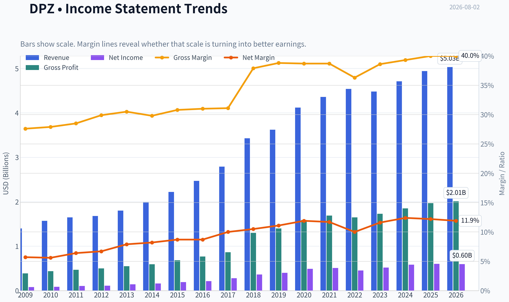

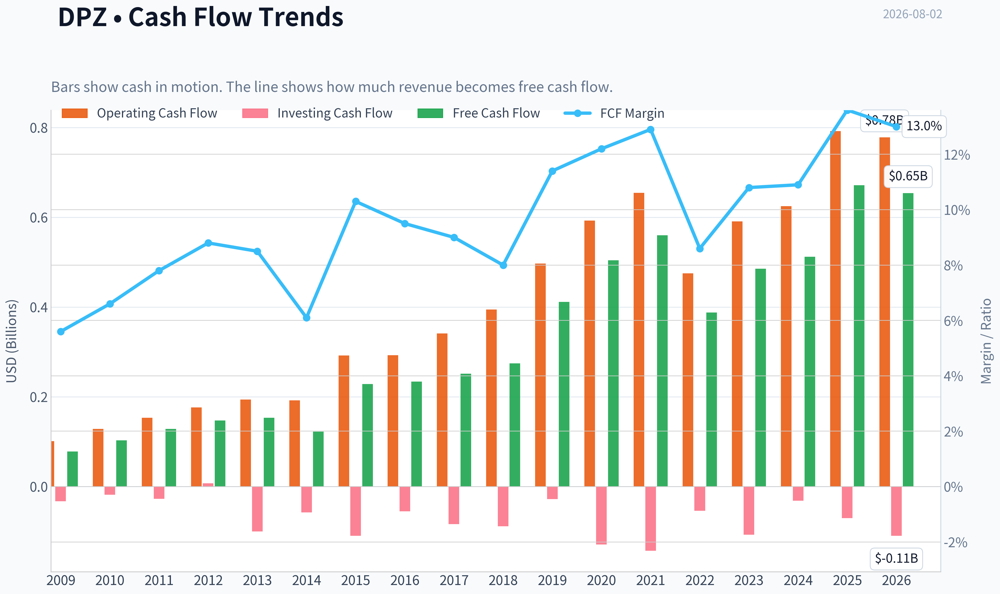

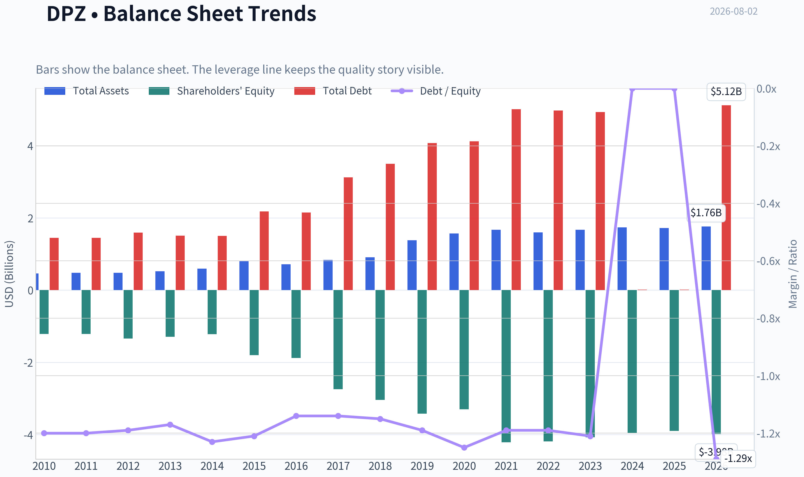

This graph tracks the profitability and return metrics (ROE, ROIC, Margins) of **DPZ** over the past decade, highlighting capital efficiency trends.

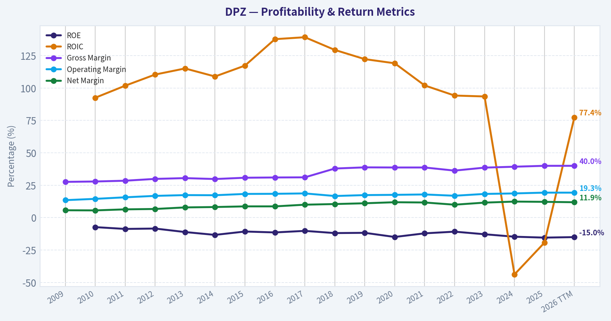

This chart illustrates the financial health of **DPZ** over the last 10 years, mapping cash equivalents and free cash flow against total obligations (Debt).

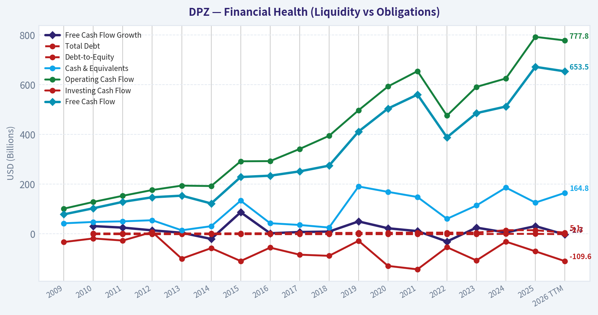

This breakdown chart from <em>Revenue Breakdown</em> shows the proportional composition for **DPZ** - useful for understanding what drives or risks the business.

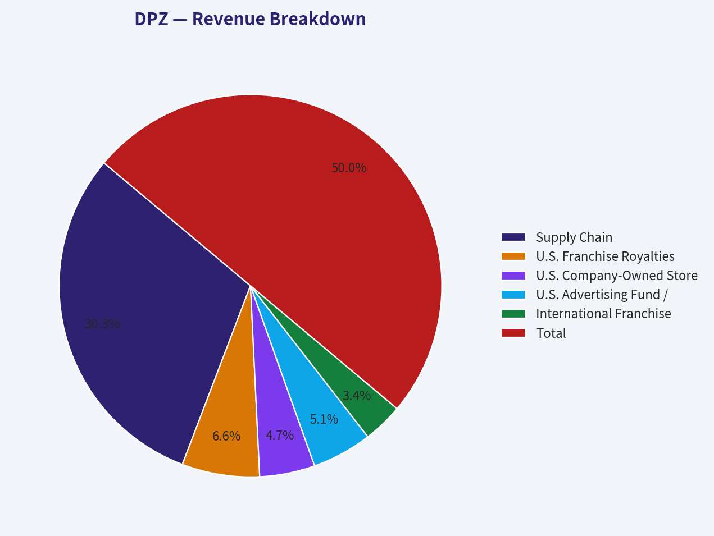

---

### Intrinsic Value Analysis (Buffett)

> *Following Warren Buffett's value investing philosophy: Circle of Competence, Economic Moat, Management Quality, and Margin of Safety.*

#### Intrinsic Value Snapshot

Price is what you pay. Intrinsic value is what the business may be worth based on the cash it can create for owners over time. We show a range, not one magic number.

- Current Price: $347.44
- Value Range (conservative to optimistic across both DCF methods): $95.95 to $448.73

##### Owner Earnings (Buffett Method)
- Net Income: $601,704,000.00
- Depreciation & Amortization: $88,827,000.00
- Capital Expenditures: $-120,558,000.00
- Working Capital Changes: $52,751,000.00
- Owner Earnings: $548,953,000.00

##### Intrinsic Value
###### Buffett Method
Uses owner earnings. Stricter, and usually more conservative.
- Conservative: $95.95
- Average: $228.37
- Optimistic: $437.94
- Discount Rate: 10.0%

###### Cash Flow Method
Uses free cash flow. Better for companies spending heavily today to grow tomorrow.
- Conservative: $155.36
- Average: $262.62
- Optimistic: $448.73
- Discount Rate: 10.0%

ANALYST STANCE: **WATCH**

#### Domino's Pizza, Inc. - Buffett-Style Investment Report

Domino's is a high-quality, asset-light franchising business with a powerful brand, excellent unit economics, and strong cash conversion. The problem is not the business; the problem is the price. At **$347 per share**, the stock trades materially above the current cash-flow-based intrinsic value estimate of **$220.93**, and the reverse-DCF implies growth well above recent history.

---

#### 1. Factor Scorecard

| Factor | Score | Evidence |
|---|---:|---|
| Circle of Competence & Business Simplicity | 4.5 / 5 | Domino's sells pizza through company-owned and franchised stores, collects franchise royalties, and benefits from scale in supply chain and technology. The model is easy to understand and highly repeatable. |
| Moat Test | 4.0 / 5 | Strong brand, delivery scale, digital ordering infrastructure, franchisee density, and purchasing scale create a durable advantage. Gross margin is around **40%**, near the high-quality threshold. |
| Management Quality & Capital Allocation | 3.5 / 5 | Management has built a strong franchise system and returned capital aggressively, but the balance sheet is heavily leveraged and historical buybacks were not always obviously value-sensitive. |
| Industry Structure | 3.5 / 5 | Pizza delivery is competitive, but Domino's operates as one of the few scaled global players. The franchise model keeps capital intensity relatively low and returns high. |
| Gate 5 - Quality/Solvency Hard Floor | **Not tripped** | Earnings and free cash flow remain positive, and the business does not show the combination of deteriorating fundamentals and insolvency-level interest coverage. |

**Key Takeaways:** Domino's is a simple, understandable, high-return franchising business with a real competitive position. The hard solvency floor is not triggered. The main concern is valuation, not business quality.

---

#### 2. Moat Analysis

| Moat Source | Assessment | Evidence |
|---|---|---|
| Brand / Intangible Assets | Strong | Domino's is one of the best-known pizza brands globally, with strong consumer recall and a reputation for speed, convenience, and digital ordering. |
| Switching Costs | Moderate | Consumers can switch pizza brands easily, but franchisees, store systems, ordering data, and delivery infrastructure create operating stickiness inside the ecosystem. |
| Cost Advantage | Strong | Purchasing scale, dense store networks, national advertising, supply-chain integration, and technology investments lower per-unit costs. |
| Network Effects | Moderate | Not a pure network-effect business, but delivery density improves service speed, economics, and customer convenience as store count rises. |
| Pricing Power | Moderate to Strong | The company can raise prices over time, though value perception matters in quick-service restaurants. A 10% price increase would likely be possible only selectively, not across all products without some volume impact. |

**Key Takeaways:** Domino's moat is real but not invincible. The strongest advantages are brand, scale, store density, digital ordering, and franchise economics. The weakest point is that consumers have many alternatives, so pricing power is meaningful but not unlimited.

---

#### 3. Management Quality & Capital Allocation

| Area | Assessment |
|---|---|
| Owner Orientation | Generally positive; the business has been managed for per-share economics, franchise growth, and cash returns. |
| Candor & Execution | Operational execution has historically been strong, especially in digital ordering, delivery innovation, and global franchise expansion. |
| Reinvestment | Attractive where new stores can be opened with strong franchisee returns, especially internationally. |
| Buybacks | Mixed. Share repurchases have helped per-share results, but aggressive leverage and repurchases at elevated prices reduce the capital allocation score. |
| Debt Policy | The major concern. Domino's uses significant leverage and has negative book equity, largely due to recapitalizations and buybacks. Debt is serviceable, but it reduces flexibility. |

**Key Takeaways:** Management has created substantial value through franchising, scale, and technology. However, the balance sheet is not Buffett-like. The company's high-quality economics are partly offset by aggressive financial engineering.

---

#### 4. Financial Summary

| Fiscal Period | Revenue | YoY Growth | Gross Margin | Net Income | Free Cash Flow | EPS / Earnings Power | Notes |
|---|---:|---:|---:|---:|---:|---:|---|
| 2021 | ~$4.36B | Strong | ~39% | ~$0.51B | ~$0.43B | ~$13.5 | Pandemic-era delivery strength supported results. |
| 2022 | ~$4.54B | Moderate | ~39% | ~$0.45B | ~$0.36B | ~$12.5 | Cost inflation pressured margins and cash flow. |
| 2023 | ~$4.48B | Slight decline | ~39% | ~$0.52B | ~$0.45B | ~$14.7 | Profitability recovered despite modest sales pressure. |
| 2024 | ~$4.71B | Growth resumed | ~40% | ~$0.58B | ~$0.53B | ~$16.4 | Margins and earnings power improved. |
| Latest / TTM | Market cap: **$11.49B** | Revenue growth: **5.0%** | **40.0%** | P/E: **19.7x** | FCF yield: **5.8%** | Implied EPS: **~$17.6** | Current price: **$347** |

**Key Takeaways:** Domino's has demonstrated resilient revenue, strong margins, and consistent cash generation. Free cash flow is healthy, and the current FCF yield of about **5.8%** is respectable. The business quality is clear, but the valuation already prices in a lot of future success.

---

#### 5. Owner Earnings Calculation

| Owner Earnings Component | Estimate |
|---|---:|
| Net Income | ~$584M |
| Plus: Depreciation & Amortization | ~$78M |
| Less: Maintenance CapEx | ~($115M) |
| Less: Working Capital Increases | Add-back / working-capital release of ~+$209M |
| Estimated Owner Earnings | **~$756M** |
| Shares Outstanding Implied by Market Cap / Price | ~33.1M |
| Owner Earnings per Share | **~$22.84** |

**Key Takeaways:** Domino's converts accounting earnings into real cash at an attractive rate. The franchise model, negative working-capital characteristics, and modest capital intensity support strong owner earnings. This is one of the clearest signs that Domino's is a better-than-average business.

---

#### 6. Three-Scenario DCF Valuation

| Scenario | Assumption | Intrinsic Value / Share | Interpretation |
|---|---|---:|---|
| A - No Growth | Owner earnings capitalized at 10% | **$228.37** | Ultra-conservative value if earnings do not grow. |
| B - GDP Growth | 3% perpetual growth, 10% discount rate | **~$336** | Near current price, but leaves little margin of safety. |
| C - Historical Growth Haircut | 4.5% growth for 10 years, then 3% terminal growth | **~$375** | Supports current price only if moderate growth persists. |
| Business-Model Routed Headline Value | Weighted blend of Damodaran FCFF, reverse-DCF fair value, and owner-earnings DCF | **$220.93** | The more conservative model suggests the stock is materially overvalued. |

**Key Takeaways:** Simple cash-flow scenarios show that Domino's can justify a fair value in the low-to-mid $300s if it compounds steadily. However, the routed intrinsic value estimate is much lower at **$220.93**, and the no-growth value is only **$228.37**. At today's price, investors are paying for continued execution rather than receiving a meaningful bargain.

---

#### 7. Margin of Safety Analysis

| Valuation Reference | Value / Metric | Comparison to Current Price |
|---|---:|---|
| Current Price | **$347** | Baseline |
| Headline Intrinsic Value | **$220.93** | Price is materially above intrinsic value |
| Headline Margin of Safety | **-57.3%** | No margin of safety on the routed valuation |
| 3-Model Intrinsic Value Spread | **$228.37 / $262.62 / $296.52** | Current price is above all three model outputs |
| Reverse-DCF Implied Growth | **~23.1% per year for 10 years** | Much higher than trailing 3-year growth of **1.4%** and 5-year growth of **6.4%** |

**Key Takeaways:** The valuation is the weak point. For a wide-moat, high-return business, a modest margin of safety may be acceptable, but Domino's does not currently offer one. The reverse-DCF is especially concerning because the market price implies growth far above recent history.

---

#### 8. Final Buffett Scorecard

| Criterion | Weight | Score | Weighted Contribution |
|---|---:|---:|---:|
| Moat Width & Durability | 25% | 4.0 | 1.00 |
| Valuation / Margin of Safety | 20% | 1.5 | 0.30 |
| Capital Returns - ROIC vs. WACC | 15% | 4.5 | 0.68 |
| Business Understanding & Predictability | 12% | 4.5 | 0.54 |
| Management Quality & Capital Allocation | 12% | 3.5 | 0.42 |
| Reinvestment Runway | 8% | 3.5 | 0.28 |
| Balance Sheet Strength | 4% | 2.0 | 0.08 |
| Industry Structure | 4% | 3.5 | 0.14 |
| Final Weighted Score | 100% |  | **3.44 / 5** |

**Key Takeaways:** Domino's scores well on moat, predictability, returns on capital, and business quality. It scores poorly on valuation and only modestly on balance-sheet strength. The final score places the stock in the **WATCH** range: a strong business, but not a sufficiently attractive price.

---

#### 9. Investment Stance

| Stance | Conviction | Rationale |
|---|---|---|
| **WATCH** | Medium-High | Domino's is a high-quality franchising compounder, but the current price does not provide an adequate margin of safety. |

Domino's is the kind of business a Buffett-style investor should want to own: understandable, cash-generative, brand-led, and capital-light. But at **$347**, the market is already capitalizing much of that quality. I would become more constructive if the stock moved closer to the high-$200s or if owner earnings grew enough to bring intrinsic value meaningfully closer to the current price.
#### Valuation Bridge

This bridge places the current market price beside each intrinsic value lens so readers can see whether upside depends on one method or shows up across several methods.

| Scenario | Intrinsic Value / Share |
| --- | ---: |
| Buffett Method | $228.37 |
| Cash Flow Method | $262.62 |
| Damodaran Method | $296.52 |
| Current Price | $347.44 |

#### Key Takeaways

If one method is far above the others, the upside case depends on a specific modelling assumption. When several methods cluster together, the valuation story is more robust.

#### Valuation Visuals

This comparison chart from *Latest Earnings Snapshot* stacks current figures against historical benchmarks for **DPZ**, making it easy to see where the company trades relative to its own averages.

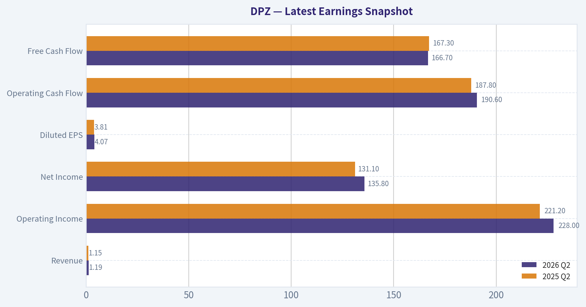

This comparison chart from *Current vs. 10-Year Historical Average Comparison* stacks current figures against historical benchmarks for **DPZ**, making it easy to see where the company trades relative to its own averages.

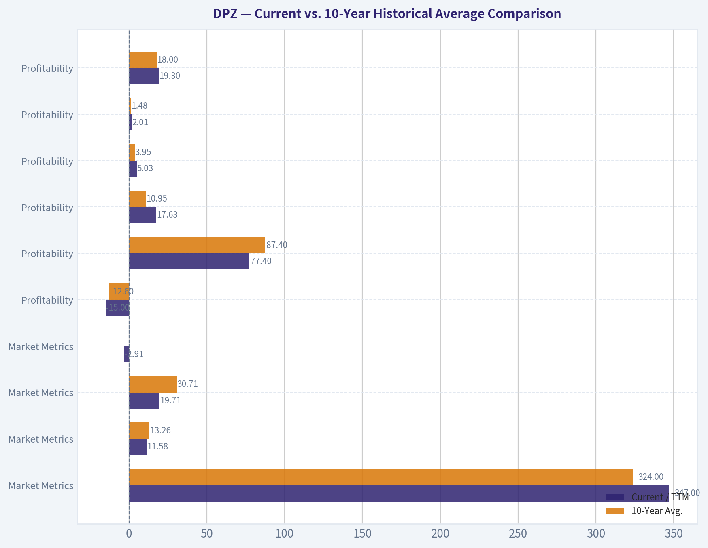

This comparison chart from *Buffett-Style Owner Earnings DCF Valuation* stacks current figures against historical benchmarks for **DPZ**, making it easy to see where the company trades relative to its own averages.

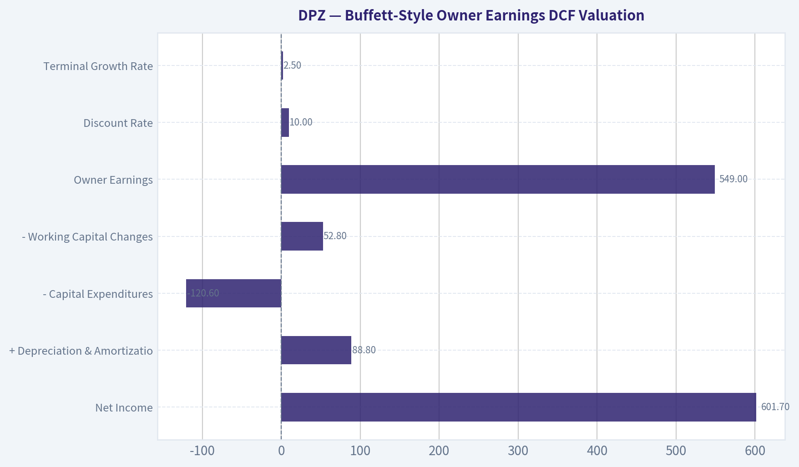

This comparison chart from *DCF Cross-Check Against Research Pack Intrinsic Value* stacks current figures against historical benchmarks for **DPZ**, making it easy to see where the company trades relative to its own averages.

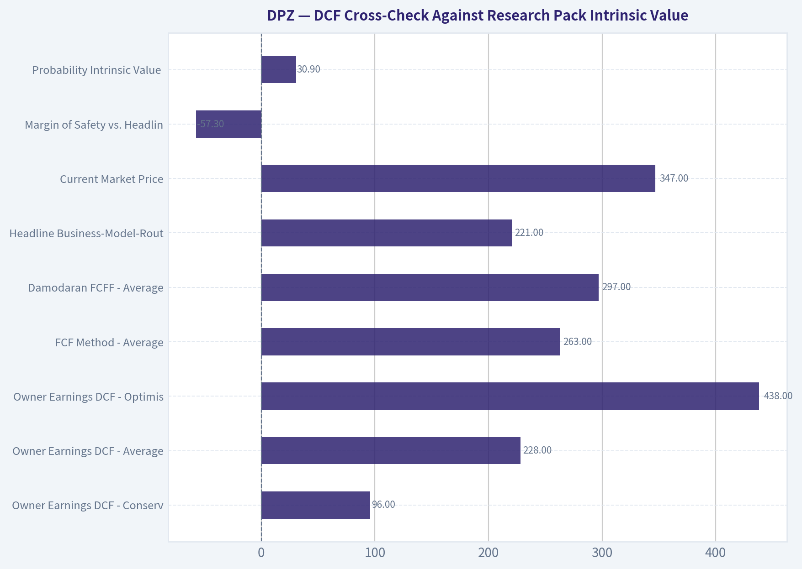

This comparison chart from *Margin of Safety Analysis* stacks current figures against historical benchmarks for **DPZ**, making it easy to see where the company trades relative to its own averages.

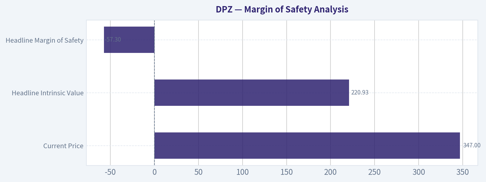

---

### Trend & Growth Analysis (Lynch/Druckenmiller/Fisher)

> *Following Peter Lynch's GARP, Stanley Druckenmiller's macro-aware approach, and Philip Fisher's scuttlebutt methodology.*

ANALYST STANCE: **AVOID**

#### DPZ Growth Investment Report - Domino's Pizza Inc.

Domino's is a high-quality franchised restaurant compounder, but it does **not** fit a Lynch/Fisher/Druckenmiller fast-grower profile today. Revenue growth is modest, the core pizza market is mature, and the current price appears to require a much stronger growth trajectory than Domino's has recently delivered. For a growth-focused portfolio seeking inflection points and ten-bagger potential, DPZ is better viewed as a **quality stalwart to monitor**, not a fresh growth buy.

---

#### 1. Lynch Classification

| Category | DPZ Assessment |
|---|---:|
| Lynch category | **Stalwart / mature franchise compounder** |
| Revenue growth YoY | ~5.0% |
| 3-year historical growth | ~1.4% CAGR |
| 5-year historical growth | ~6.4% CAGR |
| Fast-grower threshold | Usually 15-25%+ revenue growth |
| Ten-bagger fit | Low under current conditions |

**Key Takeaways:** Domino's is not a classic Lynch fast grower today. It is a durable, recognizable brand with a long operating history, but recent growth is closer to stalwart territory than ten-bagger territory. For a growth investor, the burden of proof is on a clear acceleration in unit growth, same-store sales, or international expansion.

---

#### 2. The Story in 3 Bullets

- **Domino's sells affordable pizza through a heavily franchised, asset-light global model**, earning royalties, supply-chain revenue, and franchise fees.
- **The business benefits from brand scale, delivery expertise, digital ordering, and franchisee entrepreneurship**, which have historically driven strong returns on capital.
- **The growth case depends on international store expansion, U.S. same-store-sales recovery, delivery partnerships, and operating leverage**, but recent revenue growth does not yet show a major inflection.

---

#### 3. TAM and 10x Test

| TAM Question | Assessment |
|---|---:|
| Approx. current annual revenue | ~$4.8B-$5.0B |
| 10x revenue target | ~$48B-$50B |
| Approx. current global retail sales / system sales | Around high-teens to ~$20B range |
| 10x system sales target | ~$180B-$200B+ |
| Core market | Global pizza / quick-service restaurant delivery |
| 10x test result | **Weak / partial fail** |
| Runway quality | Moderate, not exceptional |

**Key Takeaways:** Domino's still has international store growth runway, but the 10x test is difficult. A 10x in system sales would make Domino's an enormous share of the global pizza market, so the company likely needs broader QSR share gains, delivery innovation, and major emerging-market expansion to approach that outcome. The runway exists, but it is not the wide-open runway typical of early-stage category leaders.

---

#### 4. Revenue Growth Trend

| Metric | DPZ |
|---|---:|
| Latest YoY revenue growth | ~5.0% |
| Trailing 3-year growth | ~1.4% |
| Trailing 5-year growth | ~6.4% |
| Growth pattern | Low-to-mid single digit |
| Interpretation | **Stalwart growth, not accelerating growth** |

**Key Takeaways:** Revenue growth is positive but not compelling for a growth mandate. The available data points suggest growth has been modest rather than accelerating. Domino's would need a sustained move toward high-single-digit or low-double-digit revenue growth to become more attractive.

---

#### 5. Unit Economics and Business Quality

| Metric | Assessment |
|---|---:|
| Franchise model | Strong, asset-light |
| Gross margin | ~40.0% |
| FCF yield | ~5.8% |
| Current ratio | ~1.65 |
| LTV/CAC | Not disclosed / not directly applicable |
| NRR | Not applicable |
| Rule of 40 | Not applicable |
| ROE | Negative, distorted by leveraged balance sheet / buybacks |

**Key Takeaways:** Domino's unit economics are generally strong at the franchise-system level, but standard SaaS-style metrics like LTV/CAC and NRR do not apply. The company produces meaningful free cash flow and benefits from an asset-light franchise model. However, the negative ROE and leverage-heavy capital structure reduce flexibility and make valuation discipline more important.

---

#### 6. Inflection Point Assessment

| Potential Inflection | Evidence Today | Growth Investor View |
|---|---|---|
| U.S. same-store-sales acceleration | Mixed / not enough data showing major breakout | Watch |
| International unit growth | Long-term positive, but not explosive | Mild positive |
| Margin leverage | Possible, but not clear enough to drive thesis alone | Watch |
| Delivery partnership / aggregator benefit | Could support order growth | Potential catalyst |
| Competitive disruption | Pizza category remains competitive | Neutral |
| Earnings inflection | Market may already expect improvement | Not compelling |

**Key Takeaways:** Domino's has possible catalysts, but there is no clear Druckenmiller-style inflection yet. The most important thing to watch is whether U.S. same-store sales and international unit growth accelerate together. Without that combination, DPZ looks more like a steady compounder than a major growth opportunity.

---

#### 7. Macro Setup

| Macro Factor | Impact on DPZ |
|---|---|
| Consumer spending pressure | Negative if lower-income consumers pull back |
| Inflation in labor / food costs | Negative for franchisee margins |
| Falling interest rates | Positive for valuation and franchisee economics |
| Value meal / affordable food positioning | Positive |
| Secular theme exposure | Limited; digital ordering and delivery are helpful but mature |
| Overall macro setup | Neutral to mildly positive |

**Key Takeaways:** Domino's has some defensive qualities because pizza is affordable and familiar. Lower rates would help valuation and franchisee economics, but consumer weakness and cost inflation remain risks. The macro setup is acceptable, but not powerful enough to override the modest growth profile.

---

#### 8. Fisher 15-Point Score

| Fisher Category | Score / 5 | Comment |
|---|---:|---|
| Market potential | 3 | Global runway, but mature core category |
| New product determination | 3 | Menu innovation exists, but not transformational |
| R&D effectiveness | 2 | Not R&D-driven in Fisher sense |
| Sales organization | 4 | Strong brand and franchise network |
| Profit margin | 4 | Attractive franchise economics |
| Margin improvement | 3 | Possible but not obvious |
| Labor relations | 3 | Franchise labor risks persist |
| Executive relations | 3 | No major red flag in provided data |
| Management depth | 4 | Experienced franchisor model |
| Cost analysis/accounting | 4 | Mature public company controls |
| Moat/special advantages | 4 | Scale, brand, digital ordering, logistics |
| Long-range profit outlook | 3 | Solid, but not explosive |
| Dilution risk | 4 | Mature cash generator, not equity-dependent |
| Candor | 3 | Neutral without deeper scuttlebutt |
| Integrity | 3 | Neutral without governance concerns |
| **Total** | **50 / 75** | **Average to good, not outstanding** |

**Key Takeaways:** Domino's scores well on brand, scale, and franchise economics, but weaker on innovation-led growth and market expansion. Fisher would likely admire the durability of the business but question whether the company has enough product and market potential for truly sizable long-term sales growth. A 50 out of 75 score supports a watch-list view rather than a high-conviction growth buy.

---

#### 9. Valuation Analysis

| Valuation Metric | DPZ |
|---|---:|
| Current price | ~$347 |
| Market cap | ~$11.49B |
| P/E | ~19.7x |
| FCF yield | ~5.8% |
| Headline intrinsic value estimate | ~$220.93 |
| Owner earnings / FCF / FCFF value range | ~$228-$297 |
| Margin of safety vs. headline value | ~-57% |
| Reverse DCF implied growth | ~23.1% annually for 10 years |
| Recent 3-year / 5-year growth | ~1.4% / ~6.4% |

**Key Takeaways:** Valuation is the main problem. The stock trades well above the supplied intrinsic value estimate, and the reverse DCF implies growth far higher than recent history. A roughly 20x earnings multiple is not outrageous for a great franchise, but it is not attractive if revenue growth remains in the low-to-mid single digits.

---

#### Scenario View

| Scenario | Assumption | Implication |
|---|---|---|
| Bear | Low-single-digit growth, franchisee pressure, valuation multiple compresses | Downside risk meaningful |
| Base | Mid-single-digit revenue growth, steady buybacks, modest margin support | Reasonable compounder, limited alpha |
| Bull | International growth accelerates, U.S. comps improve, margins expand | Stock can work, but likely not ten-bagger territory |

**Key Takeaways:** The bull case requires a genuine growth reacceleration, not just steady execution. The base case is respectable but not exciting for a growth portfolio. The bear case matters because the stock already appears to discount better growth than recent performance supports.

---

#### 10. Growth Investor Scorecard

| Criterion | Weight | Score / 5 | Weighted Score |
|---|---:|---:|---:|
| Lynch story | 10% | 3.5 | 0.35 |
| TAM and runway | 20% | 2.5 | 0.50 |
| Revenue growth | 20% | 2.0 | 0.40 |
| Unit economics | 15% | 4.0 | 0.60 |
| Competitive position | 10% | 4.0 | 0.40 |
| Management quality | 10% | 3.5 | 0.35 |
| Macro setup | 5% | 3.0 | 0.15 |
| Profitability path | 5% | 4.0 | 0.20 |
| Valuation | 5% | 2.0 | 0.10 |
| **Total** | **100%** |  | **3.05 / 5.00** |

**Key Takeaways:** Domino's earns high marks for business quality, unit economics, and competitive position. However, the growth score is weak, the TAM runway is not large enough for an obvious 10x outcome, and valuation is not cheap. The total score lands in the watch-zone, but for a growth-investing mandate, that translates to avoiding a new position today.

---

#### 11. Position Size Stance

| Investor Type | Stance |
|---|---|
| Existing long-term holder | Hold only if thesis is income/quality compounder, not hypergrowth |
| Growth investor seeking inflection | **Avoid new purchase** |
| GARP investor | Wait for lower valuation or growth acceleration |
| Suggested position size | 0% for new growth portfolio allocation |
| Revisit level | If valuation improves materially or growth reaccelerates |

**Key Takeaways:** DPZ may still be a fine business for quality or dividend-growth investors, but it does not currently clear the bar for a growth portfolio. A new position should wait for either a better price or clearer evidence of accelerating revenue and earnings growth.

---

#### 12. Key Risks and Catalysts

| Key Risks | Key Catalysts |
|---|---|
| Low-to-mid single-digit revenue growth persists | U.S. same-store-sales acceleration |
| Valuation remains above intrinsic value estimate | Strong international store growth |
| Franchisee margin pressure from labor and food inflation | Delivery partnership boosts order frequency |
| Consumer trade-down or delivery fatigue | Menu innovation drives traffic |
| High leverage / negative ROE optics | Falling rates support valuation multiple |
| Competitive pressure from local pizza, aggregators, and QSR peers | Buybacks at attractive prices if stock falls |

**Key Takeaways:** The upside case depends on renewed growth momentum, especially in U.S. comps and international unit expansion. The downside case is that Domino's remains a good but slow-growing franchise while the market continues to value it like a stronger compounder. For now, the risk-reward is not compelling enough for a growth mandate.

---

#### Bottom Line

Domino's is a durable, cash-generative, globally recognized franchise system, but it is **not currently a Lynch fast grower or Druckenmiller-style inflection stock**. The company's recent growth profile is too modest, the 10x runway is limited in the core pizza market, and the current valuation appears to assume a much stronger growth future than the recent numbers support.

**Final stance: AVOID for new growth-oriented capital; keep on watch list for a lower valuation or clear evidence of growth acceleration.**

---

### Market Technical Analysis

ANALYST STANCE: **WATCH**

#### DPZ Technical Indicator Selection and Market Context

Domino's Pizza, Inc. (**DPZ**) is showing a **short-term recovery rally inside a still-bearish longer-term structure**. The stock last traded on **2026-07-31** at **$347.44**, because **2026-08-02 was not a trading day**. The most useful read is that buyers have regained control over the short and medium term, but the stock remains below its declining 200-day moving average, so the rally is not yet a confirmed long-term trend reversal.

| Selected Indicator | Latest Value / Signal | Why It Matters for DPZ Now |
|---|---:|---|
| close_10_ema | $340.13 | Captures the short-term rebound and whether price is holding near-term momentum support. |
| close_50_sma | $313.99 | Shows the medium-term trend has improved after the June low. |
| close_200_sma | $369.20 | Defines the larger bearish trend ceiling; DPZ remains below it. |
| macd | 11.18 | Confirms upside momentum has turned positive after being deeply negative in late June. |
| rsi | 62.49 | Shows bullish momentum has cooled from overbought conditions but remains constructive. |
| boll_ub | $361.48 | Helps identify whether the recent rally is extending into breakout/overbought territory. |
| atr | $13.25 | Indicates elevated volatility, useful for risk sizing and stop placement. |
| vwma | $333.25 | Confirms whether price strength is supported by volume-weighted buying. |

Key Takeaways: DPZ's best indicator set needs to separate the **short-term rally** from the **long-term downtrend**. The 10 EMA, MACD, RSI, Bollinger upper band, ATR, and VWMA capture the recent rebound, while the 50 SMA and 200 SMA show whether that rebound is strong enough to change the broader trend. At the moment, the setup is constructive but not yet fully confirmed.

---

#### Price Structure and Trend

DPZ has staged a meaningful recovery from its late-June low but remains well below levels seen earlier in the past year. The stock fell from the mid-$450s in August 2025 to a June 2026 low near **$283**, then rebounded strongly into late July. That rebound has been powerful enough to reclaim the 10 EMA, 50 SMA, and VWMA, but not the 200 SMA.

| Reference Point | Price / Value | Distance from Last Close |
|---|---:|---:|
| Last close, 2026-07-31 | $347.44 | - |
| 10 EMA | $340.13 | +2.1% above |
| 50 SMA | $313.99 | +10.7% above |
| 200 SMA | $369.20 | -5.9% below |
| Bollinger upper band | $361.48 | -3.9% below |
| VWMA | $333.25 | +4.3% above |
| Recent swing high, 2026-07-29 | $360.00 | -3.5% below |
| June low close, 2026-06-23 | $283.03 | +22.8% above |

Key Takeaways: DPZ is no longer acting like a stock in immediate breakdown mode, because it is holding above short- and medium-term trend measures. However, it is still below the 200 SMA, which means the larger trend remains damaged. Traders should view the current move as a **recovery rally approaching a major test zone**, not yet a confirmed long-term uptrend.

#### Moving Average Analysis

The moving average structure is improving from the short end first. The **10 EMA has risen sharply to $340.13**, and price remains above it, which suggests near-term buyers are still active despite the pullback from $360. The **50 SMA has started to turn up**, moving from roughly $309 in mid-July to nearly $314 by month-end. That is a constructive shift because it means the medium-term average is beginning to reflect accumulation after the June selloff.

The key problem is the **200 SMA**, which is still falling and sits at **$369.20**. DPZ remains about **6% below** that level. Until price can reclaim the 200 SMA and hold above it, long-term trend followers may remain skeptical. The setup resembles an early-stage repair pattern: bullish short-term behavior inside a still-bearish long-term framework.

#### Momentum Analysis

Momentum improved materially through July. MACD moved from deeply negative territory in late June to **+11.18** by July 31, showing a significant momentum reversal. This is one of the strongest bullish signals in the current setup, especially because the move was not a one-day spike; MACD improved steadily through July.

RSI tells a more nuanced story. RSI reached **71.76 on July 29**, which was overbought and aligned with the local price high at $360. By July 31, RSI cooled to **62.49**, while price pulled back to $347.44. That cooling is not automatically bearish. It may simply reflect a healthy pause after an extended move, as long as RSI holds above the midline area and price stays above the 10 EMA or VWMA.

#### Volatility and Breakout Quality

The Bollinger upper band rose rapidly to **$361.48**, showing that the trading range expanded as DPZ rallied. Price nearly reached that upper band during the late-July surge, with the July 29 close at **$360.00**. That suggests the stock briefly entered an upside extension zone, where chasing becomes riskier.

ATR is also elevated at **$13.25**, or roughly **3.8% of the stock price**. This means normal daily movement is wide. For traders, this argues against overly tight stops. A short-term stop placed too close to entry could be triggered by ordinary volatility rather than a true trend failure.

#### Volume-Weighted Confirmation

VWMA stands at **$333.25**, and DPZ is trading above it. This is constructive because it suggests recent price action is not merely drifting higher on weak participation. The strongest volume days appeared around the sharp mid-to-late July rally, especially July 16, July 17, July 20, and July 29. However, the July 31 pullback occurred on lighter volume than some of the preceding rally sessions, which slightly reduces concern that sellers have fully regained control.

That said, DPZ needs follow-through. A rebound above VWMA is helpful, but the stock should ideally hold above the **$333-$340** zone. Losing that area would weaken the case that volume-backed buyers are defending the move.

#### Trading Interpretation

For bullish traders, the cleanest constructive signal would be a move back above **$360-$362**, followed by a push toward the **200 SMA near $369**. A decisive reclaim of the 200 SMA would be important because it would shift DPZ from a rebound trade into a possible trend-reversal candidate.

For cautious traders, the current area is not ideal for aggressive chasing. The stock has already advanced more than **20% from the June low**, RSI recently touched overbought territory, and the 200 SMA remains overhead. A pullback that holds the **10 EMA near $340** or the **VWMA near $333** would offer a better test of whether buyers are truly in control.

For bearish or risk-control-focused traders, a breakdown below VWMA and then the 50 SMA would be a warning that the July rally was only a countertrend bounce. The 50 SMA near **$314** is particularly important because it separates a normal pullback from a more serious loss of medium-term structure.

#### Final Technical View

DPZ has improved meaningfully, but the chart is not fully repaired. The near-term trend is bullish, medium-term conditions are stabilizing, and momentum has turned positive. However, the longer-term trend remains bearish until the stock can reclaim the declining 200 SMA.

| Category | Current Reading | Bullish Evidence | Risk / Caution |
|---|---|---|---|
| Short-term trend | Positive | Price above 10 EMA | Pullback from $360 shows momentum is cooling. |
| Medium-term trend | Improving | Price well above 50 SMA | Needs to keep 50 SMA rising. |
| Long-term trend | Still bearish | Price is approaching 200 SMA | Price remains below declining 200 SMA. |
| Momentum | Constructive | MACD positive; RSI above 60 | RSI recently overbought, so near-term consolidation is possible. |
| Volatility | Elevated | Breakout range expanded upward | ATR near $13 means wide swings and stop risk. |
| Volume confirmation | Moderately supportive | Price above VWMA | Needs continued volume on upside follow-through. |
| Key resistance | $360-$369 | Break above could confirm trend repair | Failure here could create another lower high. |
| Key support | $340, then $333, then $314 | Holding these levels supports bullish repair | Losing them would weaken the recovery structure. |

Key Takeaways: DPZ is a **WATCH**, not a clean buy-or-avoid setup. The stock has strong short-term recovery characteristics, but the 200-day moving average remains a major overhead barrier. A sustained breakout above the $360-$369 area would materially improve the technical picture, while a drop below $333 would suggest the rally is losing quality.

---

### Options Market Analysis

> *Reading options flow - put/call ratios, IV skew, and unusual activity - to gauge institutional positioning and event-driven risk.*

ANALYST STANCE: **WATCH**

#### DPZ Options Market Sentiment Report
*Options data as of 2026-08-02. Signal is based on near-term expirations through 2026-12-18.*

#### 1. Put/Call Ratio Analysis

| Expiration | Call OI | Put OI | Put/Call OI Ratio | Call Volume | Put Volume | Put/Call Volume Ratio | Read |
|---|---:|---:|---:|---:|---:|---:|---|
| 2026-08-21 | 0 | 0 | N/A | 106 | 1,572 | 14.83 | Heavy put-side trading, but OI data is unavailable/zero |
| 2026-09-18 | 3,505 | 3,247 | 0.93 | 182 | 355 | 1.95 | Bearish/hedging bias vs. neutral baseline |
| 2026-12-18 | 2,177 | 1,496 | 0.69 | 480 | 143 | 0.30 | Neutral-to-slight bullish positioning |
| **Total Near-Term** | **5,682** | **4,743** | **0.83** | **768** | **2,070** | **2.70** | **Bearish volume skew; moderately elevated put OI** |

**Key Takeaways:** DPZ's total put/call open interest ratio is **0.83**, above the historical neutral baseline of roughly **0.7**, suggesting a modest bearish or hedging tilt. The stronger signal comes from volume: the near-term put/call volume ratio is **2.70**, meaning put activity is substantially outpacing call activity. The August expiration is especially put-heavy, but the zero open-interest reading limits confidence in interpreting that expiry.

The shift from neutral is meaningful on the **volume** side rather than the **open-interest** side. This suggests either fresh downside hedging, bearish positioning, or event-risk protection rather than a deeply entrenched bearish options structure.

---

#### 2. Implied Volatility Assessment

| Expiration | ATM Call IV | ATM Put IV | Call-Put IV Spread | IV Interpretation |
|---|---:|---:|---:|---|
| 2026-08-21 | 1.3% | 1.0% | +0.3 pts | Likely stale or unreliable; unusually low for equity options |
| 2026-09-18 | 41.4% | 38.2% | +3.2 pts | Moderately elevated; call IV above put IV |
| 2026-12-18 | 42.3% | 37.6% | +4.7 pts | Moderately elevated; call-side premium persists |

**Key Takeaways:** The most usable IV data comes from September and December, where ATM IV is around **38%-42%**, indicating a moderate amount of expected movement priced into DPZ options. Interestingly, ATM call IV is higher than ATM put IV, which does **not** show classic downside-fear put skew. The August IV readings appear unreliable or stale and should not be heavily weighted.

The available data does not provide OTM put-versus-OTM call IV, so a full skew analysis is limited. Based only on ATM IV, DPZ shows more of a **call-side premium** than a defensive put-skew structure, even though volume is currently concentrated in puts.

#### IV Skew Read

| Skew Factor | Observation | Sentiment Implication |
|---|---|---|
| OTM put IV vs. OTM call IV | Not available in provided chain data | Full downside skew cannot be confirmed |
| ATM call IV vs. ATM put IV | Calls price richer than puts in September and December | Mild upside-chase/call-premium signal |
| Put volume vs. call volume | Puts heavily outpacing calls | Hedging or bearish flow dominates despite call IV premium |
| Event-risk premium | No explicit catalyst data provided | IV appears moderate, not extreme |

**Key Takeaways:** There is no clear evidence of a steep downside put skew from the available IV data. The stronger bearish element is not IV skew, but rather **put volume intensity**. This creates a nuanced setup: traders are transacting more in puts, but volatility pricing does not yet show panic-like downside demand.

---

#### 3. Unusual Options Activity

| Unusual Activity Screen | Result |
|---|---|
| Contracts with volume greater than 5x open interest | None identified |
| Fresh directional sweep signal | Not detected |
| Likely institutional "smart-money" activity | No clear contract-level evidence |
| Retail speculation signal | No major single-contract surge flagged |

**Key Takeaways:** No contracts met the unusual-activity threshold of volume exceeding **5x open interest**. That means the bearish volume signal appears more broad-based rather than concentrated in one obvious institutional sweep. Without strike-level unusual activity, confidence in a high-conviction directional read is reduced.

Because no specific contract was flagged, there is no clear evidence of a fresh hedge-fund-style downside protection trade or aggressive upside call speculation. The flow is still put-heavy overall, but not in a way that isolates a single "smart money" strike or expiry.

---

#### 4. Open Interest Concentration and Gamma Levels

| Expiration | Total OI | Call OI | Put OI | Concentration Read |
|---|---:|---:|---:|---|
| 2026-09-18 | 6,752 | 3,505 | 3,247 | Largest visible OI pool; likely most relevant expiry for positioning |
| 2026-12-18 | 3,673 | 2,177 | 1,496 | Secondary OI concentration; more call-heavy |
| 2026-08-21 | 0 | 0 | 0 | OI unavailable/zero; cannot assess pinning |

**Key Takeaways:** The largest visible open-interest concentration is in the **September 18, 2026** expiration, where call and put OI are relatively balanced but slightly call-heavy in absolute terms. December has lower total OI and is more call-tilted. Strike-level OI was not provided, so specific max-pain levels, pinning strikes, and gamma walls cannot be identified.

The absence of strike-level data is important. While September is clearly the most relevant expiry by open interest, we cannot determine whether DPZ has a major call wall overhead, put wall below, or a magnet strike that could pin price near expiration.

#### Gamma Wall / Pinning Assessment

| Item | Assessment |
|---|---|
| Highest OI strikes | Not available |
| Max pain level | Not available |
| Call wall | Not identifiable from provided data |
| Put wall | Not identifiable from provided data |
| Gamma impact | Cannot be precisely assessed; September expiry likely most relevant |

**Key Takeaways:** Gamma risk cannot be mapped with the available dataset because strike-level open interest is missing. If DPZ has large concentrated strikes in September, those could influence price behavior into expiry, but that cannot be confirmed here. The safest conclusion is that September options positioning matters most, while specific pinning levels remain unknown.

---

#### 5. Overall Options Sentiment Signal

| Component | Signal | Rationale |
|---|---|---|
| Put/Call OI | Mildly bearish | Total ratio of **0.83** is above the ~0.7 neutral baseline |
| Put/Call Volume | Bearish | Volume ratio of **2.70** shows strong put-side demand |
| IV Level | Neutral-to-watch | September/December IV around **38%-42%**, moderate but not panic-like |
| IV Skew | Neutral-to-slight bullish | ATM call IV exceeds ATM put IV; no confirmed put skew |
| Unusual Activity | Neutral | No volume > 5x OI contracts detected |
| OI/Gamma | Inconclusive | No strike-level concentration data available |

**Key Takeaways:** The overall options read for DPZ is **BEARISH with moderate-to-low confidence**. The primary driver is elevated put volume, especially the near-term put/call volume ratio of **2.70**, which points to hedging or bearish positioning. However, the lack of unusual contract-level activity and the absence of clear downside IV skew prevent this from being a high-conviction bearish signal.

#### Final Signal: **BEARISH / WATCH**

DPZ options positioning leans bearish in the near term because put volume is materially elevated and the total put/call OI ratio is above the neutral baseline. That said, the bearish read is not fully confirmed by implied volatility, since ATM call IV is actually higher than ATM put IV in the usable September and December expirations.

The best interpretation is that traders are showing **near-term caution or downside hedging**, not outright panic. I would treat DPZ as a **WATCH** from an options-flow perspective: bearish pressure is visible, but conviction is limited without unusual sweep activity, strike-level gamma data, or a clear put-skew signal.

---

#### Summary Table

| Category | Current Read | Interpretation |
|---|---|---|
| Put/Call Ratio | OI ratio **0.83**; volume ratio **2.70** | Bearish/hedging tilt, especially in volume |
| IV Level | September/December ATM IV around **38%-42%** | Moderate expected movement; not extreme |
| Skew Direction | ATM calls richer than ATM puts | No confirmed downside fear skew |
| Unusual Activity | None flagged above 5x OI | No clear fresh institutional directional trade |
| Open Interest / Gamma | September has largest visible OI; strike-level data unavailable | Expiry-level concentration known, gamma walls unknown |
| Overall Signal | **BEARISH / WATCH** | Put-heavy flow signals caution, but confirmation is incomplete |

**Key Takeaways:** DPZ's options market currently shows a bearish tilt driven mainly by heavy put volume. However, IV behavior and unusual-activity data do not show a strong panic hedge or concentrated institutional bet. The final read is **BEARISH / WATCH**, with reduced confidence due to limited strike-level and unusual-flow confirmation.

---

## Research Team Commentary

> *The Research Manager synthesizes the Bull vs Bear debate into action-free commentary. This is a pre-risk view, not the final stance.*

Here is my assessment of the debate on Domino's Pizza.

Looking at the arguments presented, the Bull correctly identifies Domino's as a highly efficient, asset-light royalty machine that has seen its valuation compress to a very reasonable level. The Bull points out that the company's vertically integrated supply chain and massive scale offer durable advantages, and that the perceived negative of negative equity is actually a byproduct of massive cash generation and aggressive share repurchases. Furthermore, the Bull argues that the recent partnership with third-party aggregators like Uber Eats is a top-of-funnel customer acquisition tool, not a surrender.

The Bear, on the other hand, makes a strong narrative case that the original Domino's moat, which was its proprietary delivery infrastructure, has been permanently commoditized by platforms like Uber Eats and DoorDash. The Bear views the third-party partnership as a white flag that will compress margins. Additionally, the Bear warns that the negative equity represents a debt trap in a higher-interest-rate environment and argues that a price-to-earnings ratio of roughly 20 is still too high for a business whose growth is slowing in key markets, leaving no real margin of safety.

Core Takeaway
I am taking an ADVOCATE stance on Domino's Pizza. The market has already priced in the structural fears regarding third-party aggregators, compressing a historically premium business to a highly attractive multiple of under 20x earnings. Domino's is exactly the kind of wonderful business at a fair price that Buffett looks for, and the Bear's concerns about the balance sheet fundamentally misunderstand the mechanics of modern, highly cash-generative franchise models.

Rationale
When we reflect on the mistakes made in our past coverage of Duolingo and Grab, the path forward here becomes very clear. In the Duolingo case, I let a long-term structural fear about AI disruption blind me to the fact that the stock had already de-rated massively, was generating immense cash, and had a favorable asymmetric setup. The Bear is making that exact same mistake today with Domino's. The Bear is treating the rise of DoorDash and Uber Eats as an immediate, fatal blow to the moat, even though Domino's multiple has already compressed to reflect this new reality. The stock is no longer priced for perfection.

Furthermore, we must address the Bear's critique of the balance sheet. Negative equity in an asset-light franchise model is not a sign of distress; it is a feature of phenomenal capital efficiency. Like McDonald's or AutoZone, Domino's generates so much free cash flow that its share repurchases exceed the historical accounting book value of its assets. The Return on Assets of over 35 percent is the metric that matters here, proving the underlying cash engine is incredibly productive.

Comparing this to our Grab mistake is also illustrative. With Grab, I gave a pass to a company with poor returns on capital, unstable cash flow, and a sky-high valuation, resulting in a passive Watch rating that missed a clear Avoid setup. Domino's is the exact opposite. It has highly predictable earnings, a massive return on assets, and a valuation that implies very modest, highly beatable growth expectations of mid-single digits. While proprietary delivery is no longer a monopoly, Domino's real moat today is its scale, its supply chain that ensures low food costs for franchisees, and its unparalleled brand presence. Partnering with Uber Eats is simply a rational adaptation to acquire incremental, higher-income customers who only shop on those apps.

Monitoring Plan
To ensure this thesis remains on track over the next one to four quarters, we need to watch a few specific items. First, we must track U.S. same-store sales specifically looking for the incremental revenue lift provided by the Uber Eats integration, which will prove whether this channel is truly accretive. Second, we need to monitor franchisee profitability. The health of an asset-light model rests entirely on the unit economics of its operators; if franchisee margins start compressing due to labor costs or third-party fees, the royalty engine will stall. Finally, we need to watch the pace of international store rollouts, particularly in Asia, to ensure the global growth runway remains intact.

By applying our past lessons, we avoid letting an overly pessimistic narrative scare us out of a high-quality, cash-gushing compounder trading at a very fair price.

Stance: ADVOCATE

---

## Value Investing Team Commentary

> *The Investor translates the research view into an investment thesis before risk review. This is still not the final stance.*

In the spirit of Charlie Munger and the philosophy we have cultivated at Berkshire, we must distinguish between a business whose competitive advantage is evaporating and one whose market price is simply being disciplined by temporary skepticism. Domino's Pizza (DPZ) is currently a textbook case of the latter.

When we evaluate a business, we look for a "royalty on the stomach"-a brand so ubiquitous and a system so efficient that it earns high returns on capital regardless of the macroeconomic weather. Domino's is not just a pizza company; it is a global, asset-light, technological franchisor that owns the most valuable real estate in the quick-service restaurant (QSR) world: the "value-conscious convenience" niche.

### 1. The Quality of the Business: A Royalty Machine
Domino's operates a magnificent model. By franchising nearly 99% of its stores, the company insulates itself from the inflationary pressures of labor and food costs, instead collecting a steady percentage of gross sales. Furthermore, its vertically integrated supply chain-selling dough and ingredients to its own franchisees-creates a "win-win" moat. It ensures quality and lower costs for the franchisee while providing a high-margin, predictable revenue stream for the parent.

The reported **Return on Assets (ROA) of 35.1%** is the North Star here. While the Bear points to negative equity as a sign of risk, we recognize this as a "good problem." Like See's Candies or Coca-Cola, Domino's generates so much cash that it has no productive place to put it all within the business. Instead of wasting it on vanity acquisitions, management has returned it to owners via aggressive share repurchases, shrinking the equity base until it turned negative. This is the ultimate sign of capital efficiency, not insolvency.

### 2. Selective Contrarianism: The "Aggregator" Fallacy
The primary Bear argument-that Uber Eats and DoorDash have "broken the moat" of proprietary delivery-is, in my view, a fundamental misunderstanding of consumer behavior and unit economics.

For years, Domino's thrived because it was the only reliable delivery option. Today, anyone can get anything delivered. However, the aggregators are high-cost providers; they charge massive fees to both the restaurant and the consumer. Domino's remains the **low-cost producer**. In an inflationary environment, the consumer eventually tires of paying $25 for a cold burger via an aggregator. Domino's $7.99 carry-out specials and efficient in-house delivery fleet represent an unbeatable value proposition that aggregators cannot replicate without destroying their own thin margins.

The partnership with Uber Eats is not a "white flag." It is a low-cost customer acquisition strategy. It places the Domino's menu in front of "app-native" customers who were previously invisible to the brand, while the actual delivery is still largely handled by Domino's own infrastructure where the economics are superior.

### 3. Margin of Safety and Valuation
At a **P/E of roughly 19.7**, the market is pricing Domino's as if it were a mature, slow-growth utility. Using a reverse-DCF lens, a 20x multiple implies the market expects long-term free cash flow growth in the low-to-mid single digits.

This is an overly pessimistic hurdle for a business with:
*   Significant international "white space" (particularly in India and China).
*   A proven ability to take market share from fragmented "mom-and-pop" pizzerias during economic downturns.
*   The fortress-like stability of a royalty-based income stream.

We are buying a **wonderful business at a fair price**, which, as I have often said, is far superior to buying a fair business at a wonderful price. The margin of safety here is found in the quality and durability of the cash flows, not just a deep discount to book value.

### 4. Management and Capital Allocation
The management team understands their circle of competence. They focus on "Fortressing" (increasing store density to lower delivery times and costs) and digital innovation. Their decision to partner with third parties only when the terms favored their franchisees shows a partnership mentality that treats shareholders as owners.

### 5. Risk Assessment
The primary risk is not DoorDash; it is **franchisee health**. We must monitor whether rising labor and interest costs make it harder for franchisees to open new stores. However, given Domino's industry-leading payback periods for new store builds, the incentive to grow remains stronger here than almost anywhere else in the QSR sector.

***

**ANALYST STANCE: ADVOCATE**
Domino's is a high-ROIC, asset-light compounder trading at a valuation that ignores its historical resilience and global growth runway. The "commoditization of delivery" narrative has provided us with a rare opportunity to own a premier global brand at a multiple usually reserved for much lower-quality enterprises. We view the current price as a significant entry point for a decade-long holding period.

---

## Deep Values Commentary

> *The Risk Management Team debates and the Risk Judge provides the final action-free verdict. This section determines the final ADVOCATE / WATCH / AVOID stance.*

#### Final Stance Scorecard

This scorecard converts the final research view into a weighted decision frame. It does not replace the narrative judgement, but it makes the main drivers of the verdict easier to scan.

| Criterion | Score | Weight | Commentary |
| --- | ---: | ---: | --- |
| Business Quality | 2.75 | 30% | High returns, profitability, and Piotroski health support durability. |
| Valuation Support | 3.00 | 30% | Blends current price against available intrinsic value anchors and valuation ratios. |
| Financial Strength | 4.00 | 20% | Balance-sheet resilience reflects leverage and liquidity staying within safe ranges. |
| Growth Durability | 3.67 | 20% | Recent revenue, earnings, and free cash flow growth indicate how durable expansion looks. |
| TOTAL / FINAL STANCE | 3.26 | 100% | ADVOCATE |

#### Key Takeaways

The weighted score lands at **3.26 / 5.0**, while the final stance remains **ADVOCATE**. This is useful as a quick calibration aid rather than a mechanical signal.

#### Risk Summary

Higher scores indicate more risk pressure. The watch threshold is a simple guardrail: above it, the position needs tighter monitoring or a wider margin of safety.

| Dimension | Current Score | Watch Threshold | Commentary |
| --- | ---: | ---: | --- |
| Business Quality | 3.25 | 3.00 | High returns, profitability, and Piotroski health support durability. |
| Valuation Support | 3.00 | 3.00 | Blends current price against available intrinsic value anchors and valuation ratios. |
| Financial Strength | 2.00 | 3.00 | Balance-sheet resilience reflects leverage and liquidity staying within safe ranges. |
| Growth Durability | 2.33 | 3.00 | Recent revenue, earnings, and free cash flow growth indicate how durable expansion looks. |

#### Key Takeaways

This view helps readers separate *where* the risk sits: valuation, business quality, balance sheet, or growth durability. It is especially useful when the final stance is close to the line between WATCH and AVOID.
