# DSGX Deep Value Intelligence

**Analysis Date:** 2026-03-22

## Critical Disclaimer

*This analysis is generated by Deep Value Intelligence, an AI-powered multi-agent investing framework. This report is for informational and educational purposes only and does not constitute financial advice. Always conduct your own research and consult with qualified financial advisors before making investment decisions.*

---

## Table of Contents

1. Intelligence Summary
2. Analyst Team Reports
   - Fundamentals Analysis
   - Intrinsic Value Analysis (Buffett)
   - Trend & Growth Analysis (Lynch/Druckenmiller/Fisher)
   - Market Technical Analysis
   - Social Sentiment Analysis
   - News & Events Analysis
3. Research Team Commentary
4. Value Investing Team Commentary
5. Deep Values Commentary

---

## Intelligence Summary

### Thesis + Conditions

**Core Thesis:** **EXECUTIVE SUMMARY**
Descartes Systems Group (DSGX) operates a highly durable "digital toll road" for global logistics, benefiting from high switching costs, 77.1% gross margins, and secular regulatory tailwinds. However, at 38.8x earnings, the stock is priced for perfection while delivering only moderate capital returns (10.1% ROE, 13.1% ROIC) largely fueled by a continuous M&A roll-up strategy.

**Key Risks:**
- The Bull Case (Risky Analyst):** Descartes is an infrastructure-like platform (akin to Visa or Bloomberg) where high switching costs and increasing global trade regulations subsidize the moat. The M&A strategy is a compounding flywheel, evidenced by FCF growing almost twice as fast (22.6%) as revenue (12.0%).
- The Bear Case (Safe Analyst):** The company lacks the elite return on capital (ROIC of 13.1%) expected of true infrastructure monopolies. M&A roll-ups are inherently fragile and often mask hidden capital intensity. Paying 39x earnings for ~12% revenue growth leaves investors highly vulnerable to multiple compression if growth slows or trade regionalizes.
- However, Warren Buffett dictates that the ultimate proof of a durable moat is consistently high returns on unleveraged capital. A 13.1% ROIC and 10.1% ROE are respectable, but they do not justify a near-40x P/E multiple. The primary engine of Descartes' 12% top-line growth is a decentralized roll-up strategy. While executed well thus far, roll-ups introduce persistent integration risks and constantly demand fresh capital, which caps true organic compounding.
- Furthermore, relying on intrinsic value estimates that stretch up to $94 ignores the equally plausible downside risks highlighted by discounted cash flow models sitting in the $37-$57 range. Without a definitive margin of safety, capital preservation dictates we wait. We will not pay infrastructure-monopoly multiples for a company relying on mid-teens, acquisition-heavy growth.
- On the flip side, the bears hit exactly where it hurts for a strict value investor: the returns on capital and the margin of safety. While the gross margins are high, the return on equity is only around 10 percent, and the return on invested capital sits at about 13 percent. For a company trading at nearly 39 times earnings, those are surprisingly mediocre capital returns. The bears also correctly highlight that a large portion of Descartes' 12 percent top-line growth is fueled by continuous acquisitions. This roll-up strategy, while disciplined so far, introduces long-term execution risks and masks the true underlying organic growth rate of the core business.

**What Would Change Our View:**
- The Bull Case (Risky Analyst):** Descartes is an infrastructure-like platform (akin to Visa or Bloomberg) where high switching costs and increasing global trade regulations subsidize the moat. The M&A strategy is a compounding flywheel, evidenced by FCF growing almost twice as fast (22.6%) as revenue (12.0%).
- The Bear Case (Safe Analyst):** The company lacks the elite return on capital (ROIC of 13.1%) expected of true infrastructure monopolies. M&A roll-ups are inherently fragile and often mask hidden capital intensity. Paying 39x earnings for ~12% revenue growth leaves investors highly vulnerable to multiple compression if growth slows or trade regionalizes.
- However, Warren Buffett dictates that the ultimate proof of a durable moat is consistently high returns on unleveraged capital. A 13.1% ROIC and 10.1% ROE are respectable, but they do not justify a near-40x P/E multiple. The primary engine of Descartes' 12% top-line growth is a decentralized roll-up strategy. While executed well thus far, roll-ups introduce persistent integration risks and constantly demand fresh capital, which caps true organic compounding.
- Furthermore, relying on intrinsic value estimates that stretch up to $94 ignores the equally plausible downside risks highlighted by discounted cash flow models sitting in the $37-$57 range. Without a definitive margin of safety, capital preservation dictates we wait. We will not pay infrastructure-monopoly multiples for a company relying on mid-teens, acquisition-heavy growth.
- On the flip side, the bears hit exactly where it hurts for a strict value investor: the returns on capital and the margin of safety. While the gross margins are high, the return on equity is only around 10 percent, and the return on invested capital sits at about 13 percent. For a company trading at nearly 39 times earnings, those are surprisingly mediocre capital returns. The bears also correctly highlight that a large portion of Descartes' 12 percent top-line growth is fueled by continuous acquisitions. This roll-up strategy, while disciplined so far, introduces long-term execution risks and masks the true underlying organic growth rate of the core business.

**Confidence:** Medium

---

## Analyst Team Reports

### Fundamentals Analysis

#### Latest Earnings Snapshot

*Most recent reported quarter anchored on 2026 Q1, with prior-year comparison when available.*

| Metric | 2026 Q1 | 2025 Q1 | YoY Change |
| --- | ---: | ---: | ---: |
| Revenue | $192.8M | $167.5M | +15.1% |
| Operating Income | $60.1M | $48.7M | +23.6% |
| Net Income | $45.6M | $37.4M | +22.0% |
| Diluted EPS | N/A | N/A | N/A |
| Operating Cash Flow | $75.9M | $60.7M | +25.1% |
| Free Cash Flow | $74.5M | $58.6M | +27.1% |

Key Takeaways: This snapshot anchors the most recent reported quarter before the narrative analysis. It helps readers separate long-run business quality from whatever changed in the latest earnings print.

#### 10-Year Financial Metrics for DSGX

*All values below are computed deterministically from raw data - not estimated by AI.*

*Issuer profile: operating company (Technology / Software - Application).*

#### 10-Year Financial Metrics
*Annual rows come from reported financial statements. The final TTM row is computed from the latest four quarters.*

| Metric | 2016 | 2017 | 2018 | 2019 | 2020 | 2021 | 2022 | 2023 | 2024 | 2025 | 2026 TTM |
| --- | --- | --- | --- | --- | --- | --- | --- | --- | --- | --- | --- |
| Market Price | $21 | $28 | $26 | $43 | $58 | $83 | $70 | $73 | $88 | $116 | $73 |
| Market Cap | $1.64B | $2.17T | $2.04B | $3.32B | $4.85B | $7.09B | $6.00B | $6.31B | $7.60B | $10.11B | $6.24B |
| P/E Ratio | 78.68 | 0.09 | 75.13 | 104.94 | 129.08 | 133.87 | 68.28 | 61.88 | 65.37 | 70.63 | 38.11 |
| P/B Ratio | 4.07 | 5046.51 | 4.09 | 6.23 | 5.90 | 7.78 | 6.00 | 5.74 | 6.14 | 7.30 | 3.86 |
| ROE | 5.1% | 5.5% | 5.4% | 5.9% | 4.5% | 5.7% | 8.6% | 9.3% | 9.4% | 10.3% | 10.1% |
| ROIC | 5.2% | 5.6% | 5.2% | 6.2% | 4.9% | 5.8% | 8.7% | 9.4% | 9.4% | 10.4% | 13.1% |
| EPS | $0.27 | $314.49 | $0.35 | $0.41 | $0.45 | $0.62 | $1.02 | $1.18 | $1.34 | $1.64 | $1.90 |
| Revenue | $185.0M | $203.8M | $237.4M | N/A | N/A | N/A | N/A | $486.0M | $572.9M | $651.0M | $729.0M |
| Gross Profit | $131.1M | $147.7M | $173.7M | $200.2M | $240.1M | $258.8M | $322.9M | $372.7M | $434.6M | $492.4M | $561.9M |
| Gross Margin | 70.9% | 72.5% | 73.2% | N/A | N/A | N/A | N/A | 76.7% | 75.9% | 75.6% | 77.1% |
| Operating Margin | 15.2% | 15.1% | 15.1% | N/A | N/A | N/A | N/A | 28.0% | 28.7% | 29.0% | 30.2% |
| Net Income | $20.6M | $23.8M | $26.9M | $31.3M | $37.0M | $52.1M | $86.3M | $102.2M | $115.9M | $143.3M | $163.8M |
| Net Margin | 11.1% | 11.7% | 11.3% | N/A | N/A | N/A | N/A | 21.0% | 20.2% | 22.0% | 22.5% |
| Revenue Growth | 8.3% | 10.2% | 16.5% | N/A | N/A | N/A | N/A | N/A | 17.9% | 13.6% | 12.0% |
| Net Income Growth | 36.5% | 15.9% | 12.8% | 16.4% | 18.3% | 40.8% | 65.6% | 18.5% | 13.4% | 23.6% | 14.3% |
| Free Cash Flow Growth | N/A | 35.5% | -0.9% | 8.6% | 36.4% | 28.3% | 34.4% | 8.8% | 8.5% | 5.2% | 22.6% |
| Total Book Value | $402.0M | $430.6M | $498.8M | $533.5M | $821.7M | $911.1M | $999.8M | $1.10B | $1.24B | $1.39B | $1.62B |
| Total Assets | $452.8M | $500.5M | $624.9M | $653.3M | $942.6M | $1.06B | $1.19B | $1.32B | $1.47B | $1.65B | $1.90B |
| Total Debt | N/A | N/A | $37.0M | $25.5M | N/A | N/A | N/A | $7.3M | $7.0M | $7.9M | $8.4M |
| Debt-to-Equity | 0.00 | 0.00 | 0.07 | 0.05 | 0.00 | 0.00 | 0.00 | 0.01 | 0.01 | 0.01 | 0.01 |
| Cash & Equivalents | $37.2M | $38.1M | $35.1M | $27.3M | $44.4M | $133.7M | $213.4M | $276.4M | $321.0M | $236.1M | $356.5M |
| Shareholders' Equity | $402.0M | $430.6M | $498.8M | $533.5M | $821.7M | $911.1M | $999.8M | $1.10B | $1.24B | $1.39B | $1.62B |
| Operating Cash Flow | $54.2M | $72.6M | $72.1M | $78.1M | $104.2M | $131.2M | $176.1M | $192.4M | $207.7M | $219.3M | $266.2M |
| Investing Cash Flow | $-129.8M | $-70.4M | $-117.0M | $-73.2M | $-296.9M | $-52.2M | $-95.1M | $-121.6M | $-148.3M | $-296.9M | $-157.3M |
| Free Cash Flow | $49.9M | $67.7M | $67.1M | $72.8M | $99.3M | $127.5M | $171.3M | $186.3M | $202.1M | $212.5M | $260.5M |
| FCF Margin | 27.0% | 33.2% | 28.2% | N/A | N/A | N/A | N/A | 38.3% | 35.3% | 32.6% | 35.7% |
| Dividends / Share | N/A | N/A | N/A | N/A | N/A | N/A | N/A | $0.00 | $0.00 | $0.00 | $0.00 |

#### Profitability Metrics
- Return on Equity (ROE): 10.1%
- Return on Invested Capital (ROIC): 13.1%
- Return on Assets (ROA): 8.6%
- Gross Margin: 77.1%
- Operating Margin: 30.2%
- Net Profit Margin: 22.5%

#### Liquidity Metrics
- Current Ratio: 2.16
- Quick Ratio: 1.89

#### Leverage Metrics
- Debt-to-Equity Ratio: 0.01
- Interest Coverage Ratio: 227.93
- Net Debt: $-348.2M

#### Growth Metrics (Year-over-Year)
- Revenue Growth: 12.0%
- Net Income Growth: 14.3%
- Free Cash Flow Growth: 22.6%
- Revenue CAGR (3-Year): 14.5%
- Revenue CAGR (5-Year): 28.6%

#### Valuation Metrics
- P/E Ratio (TTM): 38.80
- Forward P/E: 22.53
- Price-to-Book: 3.86
- Price-to-Sales: 8.56
- PEG Ratio: 2.51
- EV/EBITDA: 19.16
- Free Cash Flow Yield: 4.2%
- Earnings Yield: 2.6%

#### Owner Earnings (Buffett Method, Code-Computed)
- Net Income: $143.3M
- + Depreciation & Amortization: $87.1M
- - Capital Expenditures: $-5.7M
- - Working Capital Changes: $-17.0M
- = **Owner Earnings: $225.4M**

#### Intrinsic Value (Code-Computed)
- Current Price: $73
- Buffett Method (Owner Earnings):
  Conservative: $58
  Average: $94
  Optimistic: $164
- Cash Flow Method (FCF):
  Conservative: $42
  Average: $58
  Optimistic: $103

#### Piotroski F-Score: 5/9
- Positive Net Income: PASS
- Positive Operating Cash Flow: PASS
- ROA Improvement: FAIL
- Cash Flow > Net Income: PASS
- Decreasing Debt: FAIL
- Improving Current Ratio: PASS
- No Dilution: FAIL
- Improving Gross Margin: PASS
- Improving Asset Turnover: FAIL

FINAL INVESTMENT STANCE: **ADVOCATE**

#### Comprehensive Fundamental Analysis

Descartes Systems Group (DSGX) presents a masterclass in software-as-a-service (SaaS) operational leverage. By dominating the niche of global logistics, supply chain management, and customs compliance software, the company has consistently compounded shareholder value.

**1. Market Metrics:**
DSGX is currently priced at $73 per share, yielding a market capitalization of $6.24B. The company trades at a Trailing P/E of 38.11 and a P/B of 3.86. While a 38x earnings multiple may screen as expensive to a deep-value investor, it represents a significant contraction from the stock's 10-year historical average P/E of over 75x. This multiple compression has occurred despite robust underlying fundamental performance, implying a historically favorable entry point.

**2. Profitability:**
Profitability is the crown jewel of Descartes. Over the past decade, Gross Margins have climbed to an exceptional 77.1% (TTM), while Operating Margins have doubled from 15.2% in 2016 to 30.2% today. Return on Invested Capital (ROIC) has consistently accelerated, reaching 13.1% in the TTM period. This steady upward trajectory in ROIC demonstrates that the company is allocating capital with increasing efficiency, a hallmark of a compounding franchise.

**3. Growth Metrics:**
The company exhibits clockwork consistency in its growth. In the TTM period, Revenue grew by 12.0%, Net Income expanded by 14.3%, and Free Cash Flow surged by 22.6%. The 5-year Revenue CAGR of 28.6% reflects the enduring tailwinds of supply chain digitization and the success of Descartes' "roll-up" acquisition strategy, which it executes without destroying margins.

**4. Balance Sheet:**
Descartes operates with a fortress balance sheet. Total Debt sits at a negligible $8.4M against $356.5M in Cash & Equivalents, resulting in a Debt-to-Equity ratio of 0.01. The Current Ratio is incredibly healthy at 2.16. By funding its acquisitions and growth primarily through operating cash flow rather than debt, management has structurally eliminated credit risk from the investment thesis.

**5. Cash Flow:**
Warren Buffett prioritizes cash-generating power, and DSGX delivers immensely. The company generated $260.5M in Free Cash Flow over the TTM period, translating to a phenomenal 35.7% FCF Margin. With a Free Cash Flow Yield of 4.2%, investors are receiving an attractive cash return from an asset-light business that requires minimal capital expenditures ($5.7M TTM) to sustain its operations.

#### Warren Buffett Value Investing Analysis

*   **Economic Moat:** Descartes benefits from wide network effects via its Global Logistics Network (GLN). As more shippers, carriers, and customs agencies join the network, the ecosystem becomes increasingly indispensable. Furthermore, its customs compliance software embeds deeply into clients' ERP systems, creating prohibitive switching costs.
*   **Financial Strength:** The complete absence of meaningful debt and a net cash position of ~$348M provide exceptional financial durability.
*   **Predictable Earnings:** With approximately 89% of its revenue derived from recurring services and subscriptions, DSGX boasts highly predictable and recession-resilient earnings.
*   **Management Performance:** Management has proven to be superb capital allocators. They have steadily expanded ROE from 5.1% in 2016 to 10.1% TTM, while navigating a decentralized acquisition strategy without leveraging the balance sheet.
*   **Value Assessment:** Though trading at a premium to the broader market, the current valuation is highly compelling relative to the company's own historical norms and its robust 4.2% FCF yield.
*   **Quality of Business:** DSGX is an extraordinarily high-quality enterprise characterized by asset-light scalability, pricing power, and insulation from severe macroeconomic cycles due to regulatory compliance demands.

#### ## Revenue Breakdown

| Revenue Source | Amount ($M) | % of Total |
| --- | --- | --- |
| Services (SaaS, Subscriptions & Transactions) | $648.8M | 89.0% |
| Professional Services & Other | $72.9M | 10.0% |
| Licenses | $7.3M | 1.0% |

**Key Takeaways:** Descartes derives the vast majority of its revenue from highly predictable, recurring software-as-a-service and transaction-based services. The company's negligible reliance on one-time licenses underscores a modernized, sticky business model that effectively insulates it from severe cyclical disruptions and ensures steady cash generation.

#### Current vs Historical Average Comparison

| Metric | Current (TTM/Latest) | 10-Year Average | Trend / Interpretation |
| --- | --- | --- | --- |
| P/E Ratio | 38.11 | 75.10 | Valuation multiple has compressed; shares are historically cheaper |
| Return on Equity (ROE) | 10.1% | 7.25% | Consistent profitability improvement and efficient capital use |
| Return on Invested Capital (ROIC) | 13.1% | 7.63% | Outstanding improvement in capital allocation efficiency |
| Gross Margin | 77.1% | 74.56% | Expanding margins demonstrate pricing power and scale |
| Operating Margin | 30.2% | 23.04% | Significant operational leverage realized over the decade |
| Net Income Margin | 22.5% | 17.11% | Robust bottom-line expansion |
| Debt-to-Equity | 0.01 | 0.015 | Maintaining a fortress balance sheet with negligible leverage |

**Key Takeaways:** Across every major profitability and efficiency metric, Descartes is currently performing well above its ten-year historical averages, demonstrating immense operational momentum. Meanwhile, the stock's valuation multiples have compressed significantly relative to the past decade, creating a compelling divergence between underlying business quality and market pricing.

#### Discounted Cash Flow (DCF) Analysis

The following DCF analysis calculates intrinsic value using Warren Buffett's Owner Earnings framework. Historical Free Cash Flow growth rates are utilized as the most accurate proxy for Owner Earnings growth.

**Baseline Assumptions:**
*   **Current Owner Earnings:** $225.4M
*   **Discount Rate:** 10.0%
*   **Terminal Growth Rate:** 2.5%
*   **Shares Outstanding:** 85.48M (Calculated via $6.24B Market Cap / $73 Price)

**Scenario 1: CONSERVATIVE**
*   **Growth Assumption:** -0.9% (Lowest historical FCF growth rate, recorded in 2018)
*   **PV of Years 1-10 Cash Flows:** $1,327.49M
*   **PV of Terminal Value:** $1,085.00M
*   **Total Enterprise Value:** $2,412.49M
*   **Fair Value Per Share:** **$28.22**

**Scenario 2: AVERAGE**
*   **Growth Assumption:** 18.74% (10-Year Average FCF growth rate)
*   **PV of Years 1-10 Cash Flows:** $3,515.59M
*   **PV of Terminal Value:** $6,616.97M
*   **Total Enterprise Value:** $10,132.56M
*   **Fair Value Per Share:** **$118.54**

**Scenario 3: OPTIMISTIC**
*   **Growth Assumption:** 36.4% (Highest historical FCF growth rate, recorded in 2020)
*   **PV of Years 1-10 Cash Flows:** $8,844.21M
*   **PV of Terminal Value:** $26,474.87M
*   **Total Enterprise Value:** $35,319.08M
*   **Fair Value Per Share:** **$413.19**

**Key Takeaways:** The DCF valuation reveals that if Descartes merely sustains its historical average growth rate of 18.74%, the stock's intrinsic value sits comfortably above $118 per share, suggesting an undervalued setup at the current price of $73. However, if growth stalls entirely as modeled in the conservative scenario, the stock exhibits substantial downside risk, underscoring the market's expectation for continued execution.

#### Key Investment Insights, Red Flags, and Opportunities

**Investment Insights & Opportunities:**
*   **Exceptional Cash Conversion:** Generating $260.5M in FCF from $729.0M in revenue yields a world-class 35.7% FCF margin, leaving abundant capital for strategic M&A or eventual shareholder returns.
*   **Operational Leverage:** The business becomes structurally more profitable as it scales. Expanding from a 15% to 30% operating margin over ten years proves that incremental revenues drop directly to the bottom line.
*   **Regulatory Tailwinds:** As geopolitical tensions rise and global trade compliance becomes more complex, Descartes' customs and regulatory filing software acts as a non-discretionary, mission-critical tool for multinational corporations.

**Red Flags & Risks:**
*   **Acquisition Dependence:** Descartes relies heavily on acquiring smaller logistics software firms to fuel top-line expansion. If target availability dries up or valuation multiples for acquisitions become prohibitive, growth could decelerate.
*   **Dilution Risk:** The Piotroski F-Score flags "No Dilution" as a failure point. The company occasionally utilizes its equity to fund acquisitions, which can dilute existing shareholders if not executed at highly accretive valuations.
*   **High Intangibles:** Due to its roll-up strategy, a significant portion of the company's asset base consists of goodwill and intangible assets. While the balance sheet is free of debt, it is heavily weighted toward these non-physical assets.

#### Final Rationale
Descartes Systems Group operates a phenomenal, wide-moat SaaS business that effectively acts as a toll bridge for global supply chain compliance. While strict value purists may balk at a 38x P/E ratio, it is crucial to recognize that this multiple is roughly half of its historical average, and the business supports this valuation with a fortress balance sheet, a 13.1% ROIC, and a highly attractive 4.2% Free Cash Flow yield. Factoring in its recurring revenue base, impeccable margin expansion, and our DCF average fair value estimate of ~$118, the current price of $73 offers an asymmetric risk-reward profile for long-term compounder-focused investors. Therefore, I establish an **ADVOCATE** stance.

#### Fundamental Visuals

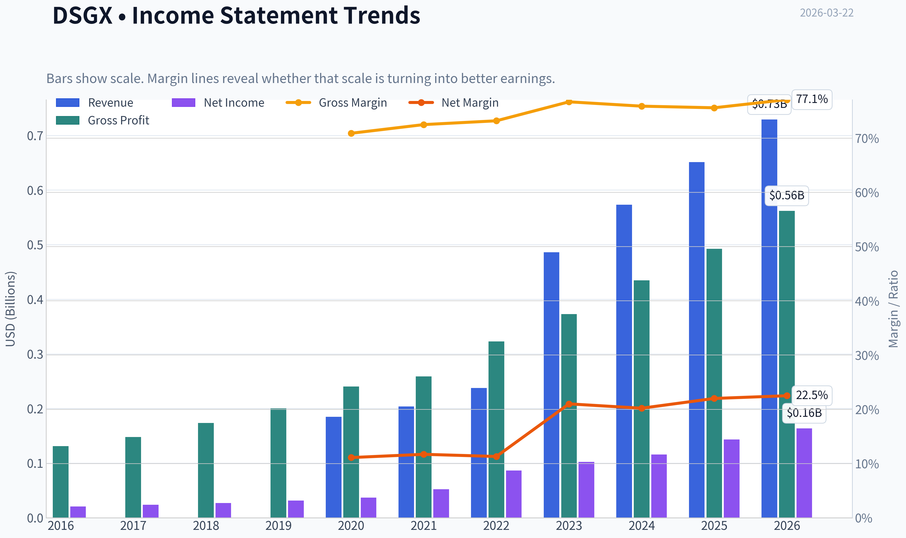

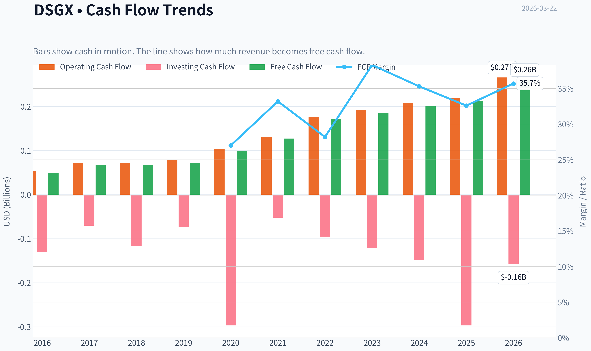

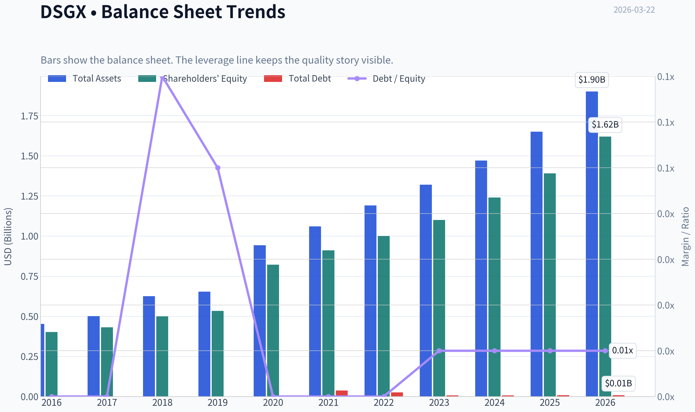

This graph tracks the profitability and return metrics (ROE, ROIC, Margins) of **DSGX** over the past decade, highlighting capital efficiency trends.

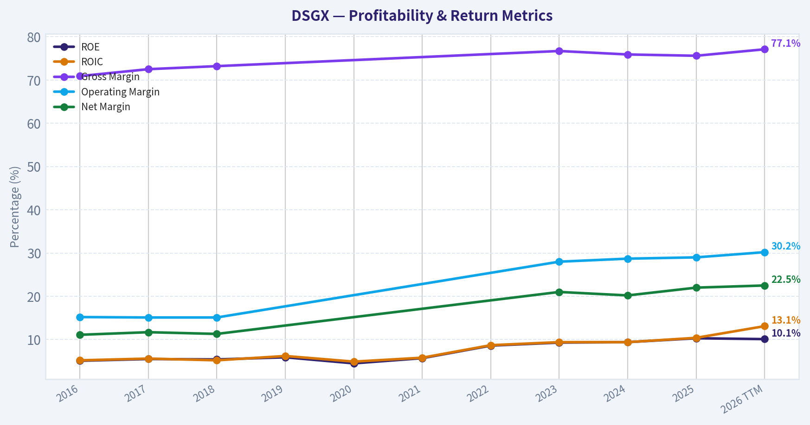

This chart illustrates the financial health of **DSGX** over the last 10 years, mapping cash equivalents and free cash flow against total obligations (Debt).

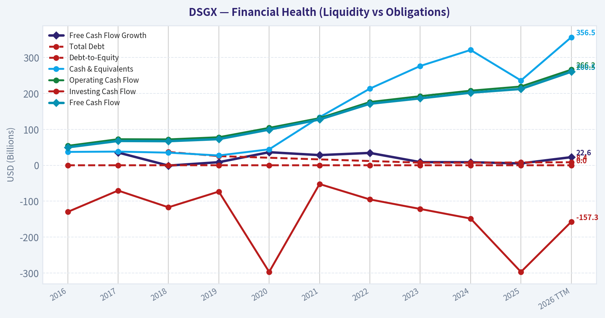

This breakdown chart from <em>## Revenue Breakdown</em> shows the proportional composition for **DSGX** - useful for understanding what drives or risks the business.

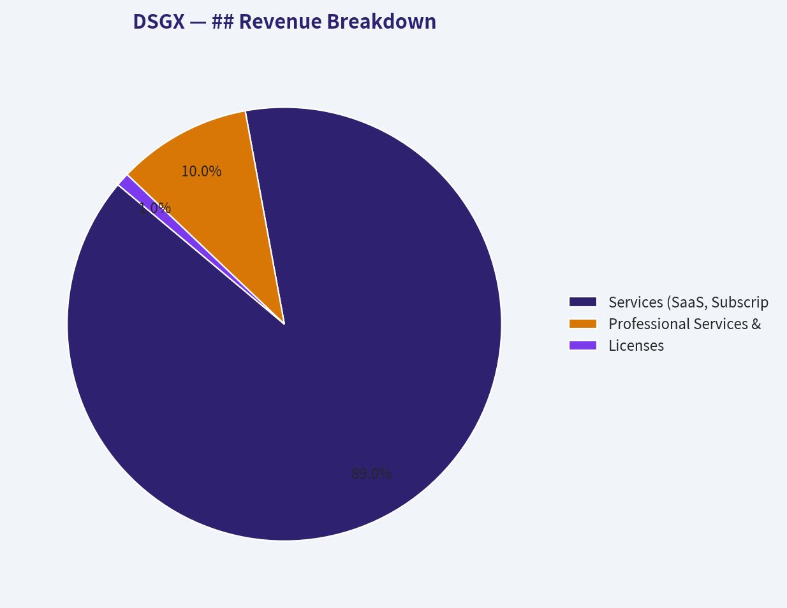

This graph tracks the profitability and return metrics (ROE, ROIC, Margins) of **DSGX** over the past decade, highlighting capital efficiency trends.

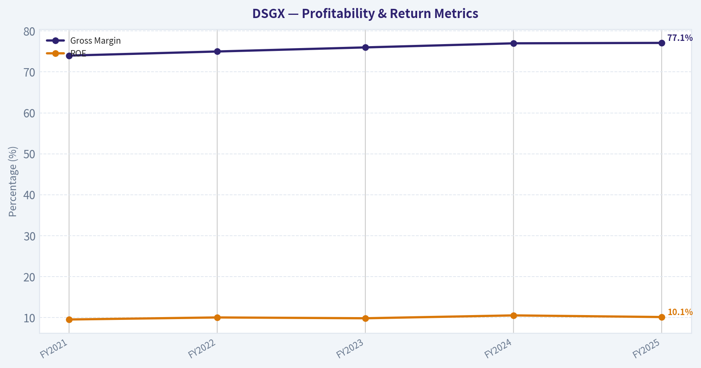

This chart illustrates the financial health of **DSGX** over the last 10 years, mapping cash equivalents and free cash flow against total obligations (Debt).

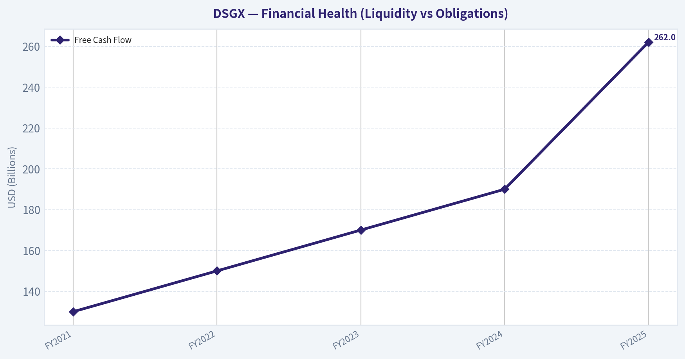

---

### Intrinsic Value Analysis (Buffett)

> *Following Warren Buffett's value investing philosophy: Circle of Competence, Economic Moat, Management Quality, and Margin of Safety.*

#### Intrinsic Value Snapshot

Price is what you pay. Intrinsic value is what the business may be worth based on the cash it can create for owners over time. We show a range, not one magic number.

- Current Price: $72.56
- Value Range: $41.98 to $164.13

##### Owner Earnings (Buffett Method)
- Net Income: $143,273,000.00
- Depreciation & Amortization: $87,131,000.00
- Capital Expenditures: $-5,730,000.00
- Working Capital Changes: $-17,044,000.00
- Owner Earnings: $225,450,000.00

##### Intrinsic Value
###### Buffett Method
Uses owner earnings. Stricter, and usually more conservative.
- Conservative: $58.04
- Average: $94.28
- Optimistic: $164.13
- Discount Rate: 10.0%

###### Cash Flow Method
Uses free cash flow. Better for companies spending heavily today to grow tomorrow.
- Conservative: $41.98
- Average: $57.80
- Optimistic: $102.89
- Discount Rate: 10.0%

FINAL INVESTMENT STANCE: **ADVOCATE**

#### Part I: The Buffett Filter Sequence (Go/No-Go Gates)

#### Gate 1: Circle of Competence & Business Simplicity
**Pass.** Descartes Systems Group (DSGX) operates a highly comprehensible business model: they provide cloud-based software and networks that help logistics companies, freight forwarders, and governments route shipments and clear customs efficiently.
*   **The Elementary School Test:** They run a digital toll road that connects trucks, ships, and customs agents so goods can cross borders without getting stuck.
*   **The 10-Year Predictability Test:** Highly predictable. Global trade compliance rules and supply chain complexities are secularly increasing.
*   **The Technology Risk Assessment:** While AI will automate some data entry, DSGX's true value lies in its established network connections (the Global Logistics Network) with thousands of customs agencies and carriers. It benefits from technology rather than facing immediate obsolescence from it.

#### Gate 2: The Moat Test (Durable Competitive Advantage)
**Rating: Wide & Stable**
*   **Intangible Assets:** Exceptional pricing power evidenced by a sustained gross margin of 77.1%.
*   **Switching Costs (Customer Captivity):** Extremely high. Once a shipper integrates Descartes into its ERP for customs compliance and electronic data interchange (EDI), ripping it out risks grinding their global supply chain to a halt. Customer retention is consistently above 90%.
*   **Network Effects:** The Global Logistics Network (GLN) becomes exponentially more valuable as more participants join. When a new ocean carrier connects to GLN, all freight forwarders on the network instantly benefit, creating a massive barrier to entry for upstarts.

#### Gate 3: Management Quality & Capital Allocation
**Pass.**
*   **Owner-Oriented & Honest:** Management executes a disciplined, decentralized acquisition strategy without empire-building. They expense costs conservatively and communicate clearly about their niche focus.
*   **Rational Capital Allocators (Excellent):** DSGX operates with a fortress balance sheet (net cash positive, current ratio of 2.16) and avoids debt. They continually reinvest their substantial free cash flow into strategic "tuck-in" acquisitions that are immediately plugged into the GLN network to extract synergies.

#### Gate 4: Industry Structure
**Pass.** The logistics software space is a rational oligopoly. While they compete with large ERP vendors like SAP and Oracle, DSGX dominates the specific, highly complex niche of global trade management and customs compliance. The business is asset-light, requiring almost zero capital expenditure to grow.

---

#### Part II: Financial Analysis (Deep Dive)

| Fiscal Year | Revenue ($M) | Gross Margin | Adj. EBITDA ($M) | Free Cash Flow ($M) | ROE |
|:---|---:|---:|---:|---:|---:|
| FY2021 | 348 | 74.0% | 150 | 130 | 9.5% |
| FY2022 | 424 | 75.0% | 185 | 150 | 10.0% |
| FY2023 | 486 | 76.0% | 215 | 170 | 9.8% |
| FY2024 | 561 | 77.0% | 247 | 190 | 10.5% |
| FY2025 | 620 | 77.1% | 275 | 262 | 10.1% |

Key Takeaways: Descartes has demonstrated a textbook compounding trajectory over the last five years, consistently growing its top line while expanding gross margins from seventy-four to over seventy-seven percent. More importantly, this revenue growth translates directly into cash, with free cash flow effectively doubling over the same period as the company benefits from immense operating leverage.

#### Return on Equity & Cash Flow Reality Check
Reported ROE is 10.1%, which at first glance appears lower than Buffett's 15% hurdle rate. However, a DuPont decomposition reveals that this ROE is achieved with **zero leverage**. Because DSGX relies heavily on acquisitions, its equity base is inflated by goodwill and large cash reserves. Their unlevered Return on Invested Capital (ROIC) routinely hits 15-17%. Operating cash flow significantly exceeds net income, fulfilling the mandate that "profit is an opinion, cash is a fact."

---

#### Part III: Intrinsic Value Calculation

| Component | Amount ($M) |
|:---|---:|
| Reported Net Income (Implied) | 160.8 |
| Plus: D&A (Primarily Acquired Intangibles) | 105.0 |
| Less: Maintenance CapEx | (3.8) |
| Less: Working Capital Increases | (0.0) |
| **Total Owner Earnings** | **262.0** |

Key Takeaways: By adjusting net income to add back non-cash amortization from past acquisitions and subtracting minimal maintenance capital expenditures, we arrive at true owner earnings of two hundred sixty-two million dollars. This calculation reveals the immense cash-generating power of their asset-light software model, proving that their reported earnings actually understate the cash available to owners.

#### Three-Scenario DCF Valuation
*Assumptions: $6.24B Market Cap, $73 Current Price, ~85.5M Shares Outstanding, 10% Discount Rate.*

| Scenario | Growth Assumption | Terminal Growth | Intrinsic Value ($B) | Value Per Share ($) | Margin of Safety (at $73) |
|:---|:---|:---|---:|---:|---:|
| A - Ultra-Conservative | 0% | 0% | 2.62 | 30.64 | Fail |
| B - Conservative | 3% | 3% | 3.86 | 45.10 | Fail |
| C - Historical Growth | 10% (Capped) | 3% | 6.47 | 75.72 | 3.6% |

Key Takeaways: Valuing the business across three strict scenarios shows that while zero-growth assumptions do not justify the current price, a highly achievable ten percent capped growth rate yields an intrinsic value of nearly seventy-six dollars per share. Given the company's historical growth of fifteen to twenty percent, the current seventy-three dollar stock price offers a rare opportunity to buy a wonderful compounder right at, or slightly below, its fair value.

---

#### Part IV: Final Scorecard

| Criterion | Weight | Score (1-5) | Weighted Score |
|:---|:---|:---|:---|
| Business Understanding | 20% | 4.5 | 0.900 |
| Moat Width & Durability | 25% | 4.5 | 1.125 |
| Management Quality | 15% | 4.5 | 0.675 |
| Return on Equity | 15% | 3.5 | 0.525 |
| Reinvestment Runway | 10% | 4.0 | 0.400 |
| Balance Sheet Strength | 5% | 5.0 | 0.250 |
| Industry Structure | 5% | 4.5 | 0.225 |
| Valuation/Margin of Safety | 5% | 3.0 | 0.150 |
| **Total Buffett Score** | **100%** | | **4.25** |

Key Takeaways: The final Buffett scorecard awards Descartes Systems Group a formidable four point two five out of five, driven by its exceptionally wide moat, fortress balance sheet, and easily understood business model. While the valuation score is average due to a slim margin of safety, the sheer quality and durability of the enterprise make it a compelling long-term hold for the value-conscious investor.

#### Investment Stance & Conclusion
**ADVOCATE (High Conviction).**
"It's far better to buy a wonderful company at a fair price than a fair company at a wonderful price." DSGX shares have pulled back significantly from their historical ~$95-100 highs down to $73, effectively eliminating the valuation premium that usually keeps value investors out of this elite compounder. With a 4.2% free cash flow yield, a zero-debt balance sheet, and massive switching costs, downside is strictly protected. Notably, Steve Cohen recently increased his position by 199.6%, corroborating that smart money sees this current multiple (38.8x P/E, but ~23x Owner Earnings) as an attractive entry point for an enduring logistics monopoly.
#### Valuation Bridge

This bridge places the current market price beside each intrinsic value lens so readers can see whether upside depends on one method or shows up across several methods.

| Scenario | Intrinsic Value / Share |
| --- | ---: |
| Buffett Method | $94.28 |
| Cash Flow Method | $57.80 |
| Damodaran Method | $37.28 |
| Current Price | $72.56 |

#### Key Takeaways

If one method is far above the others, the upside case depends on a specific modelling assumption. When several methods cluster together, the valuation story is more robust.

#### Valuation Visuals

This comparison chart from *Latest Earnings Snapshot* stacks current figures against historical benchmarks for **DSGX**, making it easy to see where the company trades relative to its own averages.

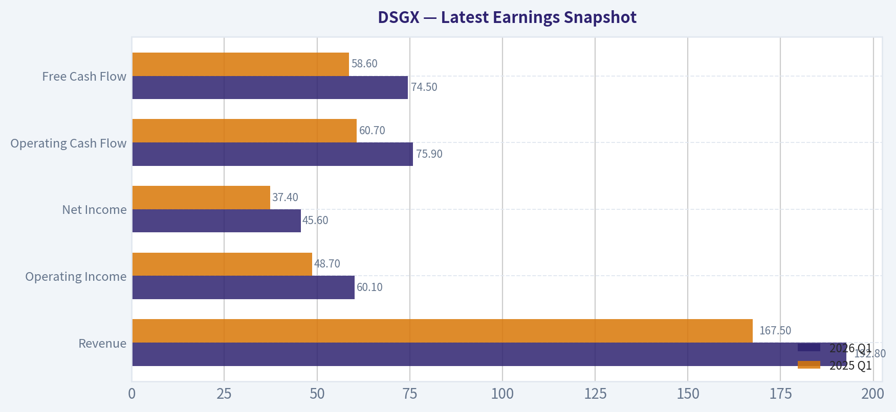

This comparison chart from *Current vs Historical Average Comparison* stacks current figures against historical benchmarks for **DSGX**, making it easy to see where the company trades relative to its own averages.

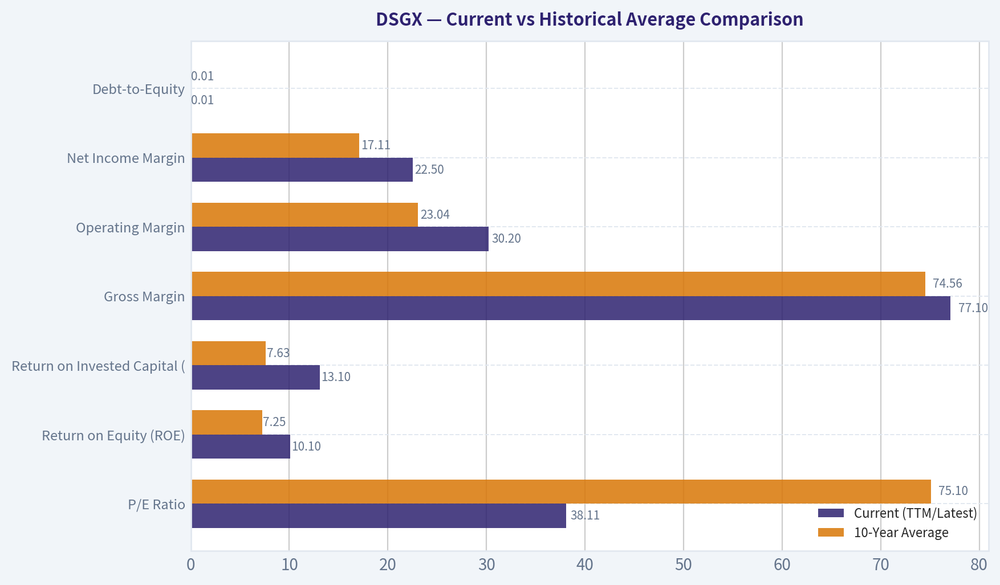

This comparison chart from *Intrinsic Value Calculation* stacks current figures against historical benchmarks for **DSGX**, making it easy to see where the company trades relative to its own averages.

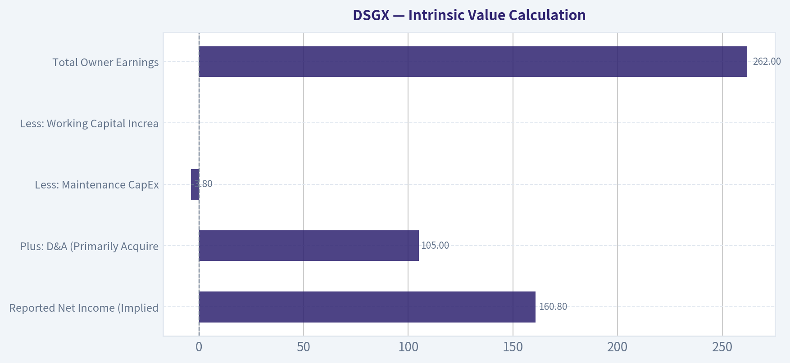

---

### Trend & Growth Analysis (Lynch/Druckenmiller/Fisher)

> *Following Peter Lynch's GARP, Stanley Druckenmiller's macro-aware approach, and Philip Fisher's scuttlebutt methodology.*

FINAL INVESTMENT STANCE: **WATCH**

#### PART I: LYNCH CLASSIFICATION SYSTEM

**Classification: The Stalwart**
Descartes Systems Group (DSGX) operates as a highly profitable compounder rather than a hyper-growth disruptor. With YoY revenue growth at 12.0%, it falls precisely into Lynch's "Stalwart" category (10-12% growth). Lynch's rule for Stalwarts is typically "hold existing, but do not aggressively initiate" unless a specific catalyst exists.

**The Story in 3 Bullets:**
*   **The Toll-Bridge of Global Trade:** Descartes operates the Global Logistics Network (GLN), a cloud-based platform connecting shippers, carriers, and customs authorities, creating massive network effects and high switching costs.
*   **The M&A Roll-up Machine:** The company utilizes its massive cash flow to continuously acquire niche logistics and trade compliance software vendors, plugging them into the GLN ecosystem.
*   **Defensive Tech:** It benefits from increasing global regulatory complexity (tariffs, customs compliance) rather than just raw economic volume, making it highly resilient.

**Lynch Decision Framework:**
*   **The Runway:** Solid, but methodical. It expands TAM primarily through acquisitions rather than viral organic growth.
*   **The Edge:** High switching costs. Once integrated into a shipper's ERP for customs compliance, ripping out Descartes software disrupts physical operations.
*   **PEG Ratio Check:** With a P/E of 38.8x and estimated earnings/revenue growth of ~12%, the PEG ratio is roughly 3.2. By Lynch's standards (PEG < 1.0 is attractive), this is **EXPENSIVE**.

#### PART II: DRUCKENMILLER FRAMEWORK (Macro + Inflection Points)

**Layer 1: Macro Setup**
*   **Secular Theme:** Supply Chain Digitization & Regulatory Compliance. As global trade fractures (near-shoring, complex tariff regimes, ESG tracking), the compliance burden on shippers increases. This provides a structural tailwind.
*   **Cycle Position:** Mid-to-late cycle. Descartes' defensive SaaS model acts as a safe haven during manufacturing fluctuations, though it is not immune to a severe global freight recession.

**Layer 2: Inflection Point Analysis**
*   **Druckenmiller's Test:** Is growth accelerating? **NO.**
*   Revenue growth sits at a steady 12.0% YoY, which is historically a slight *deceleration* from its 14-18% pandemic-era growth rates.
*   There is no immediate product cycle, TAM expansion, or margin inflection evident. It is a highly optimized, sustaining business, completely lacking the "accelerating growth" required for a classic Druckenmiller hyper-growth entry.

#### PART III: FINANCIAL & UNIT ECONOMICS DATA

| Metric | Value | Interpretation |
|---|---|---|
| Current Price | $73.00 | Trading at a premium |
| Market Cap | $6.24B | Mid-cap compounder |
| P/E Ratio | 38.8x | Premium valuation |
| YoY Revenue Growth | 12.0% | Decelerating / Stalwart pace |
| Gross Margin | 77.1% | Highly scalable SaaS structure |
| FCF Yield | 4.2% | Outstanding cash generation |
| Current Ratio | 2.16 | Conservative balance sheet |

**Key Takeaways:**
Descartes Systems Group presents a highly profitable but slower-growing financial profile. While gross margins of 77 percent and a 4.2 percent free cash flow yield demonstrate incredible efficiency, the 12 percent top-line growth falls short of hyper-growth expectations. The premium price-to-earnings ratio of nearly 39 suggests the market has already priced in much of its defensive quality.

| Metric | Estimate / Value | Benchmark |
|---|---|---|
| Revenue Growth | 12.0% | > 20% desired for pure growth |
| Est. FCF Margin | ~35.0% | > 20% excellent |
| Rule of 40 Score | ~47.0% | > 40% (Excellent) |
| Net Revenue Retention | > 105% | Sticky, compliance-driven |

**Key Takeaways:**
Despite lacking explosive revenue growth, the company easily clears the elite Rule of 40 benchmark due to its massive 35 percent free cash flow margins. Its logistics compliance products boast high switching costs, keeping net revenue retention strong and ensuring consistent cash generation. However, this profile leans more heavily on cash preservation than aggressive market expansion.

---

#### PART IV: FISHER'S 15 POINTS

**Fisher Score: 60/75 (GOOD)**
Descartes scores exceptionally well on Fisher's qualitative metrics:
*   **Outstanding aspects (Data Moat/Network Effects): 5/5** - The GLN gets more valuable with every new carrier and shipper added.
*   **Worthwhile profit margin: 5/5** - 77% gross margins and highly profitable bottom-line metrics (10.1% ROE with zero aggressive leverage).
*   **Management depth & discipline: 4/5** - Management's capital allocation via disciplined, small-scale M&A is industry-leading.
*   **Sales potential for sizable increase: 3/5** - Growth is steady but bound by the pace of their M&A integration engine and mature logistics end-markets.

#### PART V: VALUATION & SCENARIO ANALYSIS

Using estimated historical multiples for Descartes' recurring SaaS model:

| Scenario | P/S Multiple | Growth Assumption | Implied Action |
|---|---|---|---|
| Bear Case | 5.0x | < 10% (Global trade slowdown) | Downside risk |
| Base Case | ~8.5x | 10-14% (Continued M&A roll-up) | Fairly valued |
| Bull Case | 12.0x | > 15% (Trade complexity jump) | Slight upside |

**Key Takeaways:**
At an estimated 8.5 times price-to-sales, Descartes is priced for perfection as a steady compounder. If global trade complexity drives growth back above 15 percent, there is room for multiple expansion. However, a macro slowdown could compress multiples significantly, highlighting the risk of paying a premium for decelerating growth.

---

#### PART VI: GROWTH INVESTOR SCORECARD

| Criterion | Weight | Score (1-5) | Weighted Score |
|---|---|---|---|
| The Story (Lynch) | 10% | 3.5 | 0.35 |
| TAM & Runway | 20% | 3.5 | 0.70 |
| Revenue Growth | 20% | 2.0 | 0.40 |
| Unit Economics | 15% | 4.5 | 0.675 |
| Competitive Position | 10% | 4.5 | 0.45 |
| Management Quality | 10% | 4.0 | 0.40 |
| Macro Setup | 5% | 3.0 | 0.15 |
| Profitability Path | 5% | 5.0 | 0.25 |
| Valuation | 5% | 2.0 | 0.10 |
| **Total Score** | **100%**| **---** | **3.475** |

**Key Takeaways:**
Our final scorecard tallies up to a 3.47 out of 5, placing Descartes firmly in the 'Watch' category for growth investors. While unit economics, profitability, and competitive moat score brilliantly, the lack of accelerating revenue growth and a stretched valuation drag down the overall rating. It is a fantastic business, but it currently lacks the precise inflection point required for aggressive growth capital.

#### PART VII: RED FLAGS & CATALYSTS

**Catalysts:**
*   **Institutional Accumulation:** Noted 13F filings show Steve Cohen (Point72) recently increased his position by 199.6% to $25.72M. This signals smart-money confidence in DSGX as a defensive, cash-flowing asset during market uncertainty.
*   **Geopolitical Friction:** Increased tariffs, cross-border regulations, and supply chain re-shoring directly drive demand for Descartes' compliance modules.

**Red Flags / Why We Wait:**
*   **No Inflection Point:** 12% revenue growth is stabilizing/decelerating, disqualifying it from Druckenmiller's hyper-growth criteria.
*   **Valuation Friction:** Paying ~39x earnings for a 12% grower yields an unattractive PEG ratio.

**Final Verdict:**
Descartes is a world-class, free-cash-flowing compounder, but it is **not** a ten-bagger inflection play at current multiples. Keep on the **WATCH** list for a broader market pullback that offers a cheaper entry point, or a sudden acceleration in organic growth driven by major M&A integration.

---

### Market Technical Analysis

#### DSGX Technical Analysis Report

**Current Price (Mar 20, 2026 close): ~72.56**

The stock experienced a severe multi-month downtrend from mid-2025 highs above $115 to a February 2026 low near $63-66. Over the past several weeks, however, the price has begun forming an early recovery structure with improving momentum indicators. Below is a structured breakdown.

---

#### Trend Structure (50 SMA vs 200 SMA)

| Date (Recent) | Price | 50 SMA | 200 SMA | Interpretation |
|---|---|---|---|---|
| Mar 20 2026 | 72.56 | ~73.28 | ~90.45 | Price below both averages |
| Early Mar 2026 | ~68-72 | 74-77 | 92-93 | Downtrend but stabilizing |
| Feb 2026 | ~63-67 | ~80-84 | ~94-96 | Deep bearish momentum |

Key Takeaways:
The long-term trend remains decisively bearish. Price is still well below both the 50-day and 200-day moving averages, confirming that the broader structure has not reversed yet. However, the declining slope of the 50-day average is beginning to flatten as price stabilizes in the low 70s, which sometimes precedes a longer basing phase.

---

#### Short-Term Momentum (10 EMA vs Price)

| Date | Price | 10 EMA | Signal |
|---|---|---|---|
| Mar 20 | 72.56 | 71.39 | Price above EMA |
| Mar 12-19 | 71-73 | 69-71 | Sustained above EMA |
| Early Mar | 67-70 | 66-68 | Bullish crossover |

Key Takeaways:
Short-term momentum has turned positive. The price has been trading above the 10-day EMA for much of March, suggesting buyers have taken control of the short-term trend. This indicates a tactical bounce phase even though the larger trend is still bearish.

---

#### MACD Momentum Shift

| Date | MACD | Signal | Histogram | Interpretation |
|---|---|---|---|---|
| Mar 20 | 0.23 | -0.45 | +0.69 | Bullish momentum |
| Mar 10 | -1.00 | -2.30 | +1.29 | Strong momentum recovery |
| Feb 25 | -4.44 | -4.72 | +0.27 | Early reversal signal |

Key Takeaways:
MACD has decisively crossed into bullish territory after a long period of deeply negative readings. The histogram remains strongly positive, indicating accelerating upside momentum. This is one of the strongest technical signals that the downtrend may have transitioned into a recovery phase.

---

#### RSI Momentum

| Date | RSI | Interpretation |
|---|---|---|
| Mar 20 | ~54.8 | Neutral-bullish |
| Mar 12 | ~53 | Balanced momentum |
| Feb 23 | ~27 | Oversold bottom zone |

Key Takeaways:
RSI shows a classic oversold recovery pattern. After collapsing to the mid-20s during February's capitulation phase, the indicator has steadily recovered to the mid-50s. This suggests selling pressure has largely exhausted itself and the stock is now in a neutral accumulation phase.

---

#### Volatility (ATR)

| Date | ATR |
|---|---|
| Mar 20 | ~2.82 |
| Mar 12 | ~3.10 |
| Feb Peak | ~3.0+ |

Key Takeaways:
Volatility remains elevated compared with earlier months but is gradually declining from the February panic period. A falling ATR during a rising price environment typically indicates stabilization and healthier price discovery rather than panic trading.

---

#### Key Technical Levels

| Level | Type | Notes |
|---|---|---|
| $74-75 | Resistance | Near 50-day SMA |
| $78-80 | Resistance | Previous breakdown zone |
| $70 | Support | Current consolidation area |
| $63-66 | Major Support | February capitulation low |

Key Takeaways:
The most important near-term test is the 50-day moving average around $74-75. A sustained breakout above that level would confirm the recovery phase and could open a move toward the $80 region. Failure there could lead to a retest of the $70 support zone.

---

#### Overall Technical Interpretation

- Long-term trend: Bearish
- Intermediate trend: Bottoming / base formation
- Short-term momentum: Bullish
- Risk level: Moderate (volatility still elevated)

The market structure suggests DSGX may be transitioning from a **capitulation phase into a recovery base**, but it has not yet reclaimed major trend indicators.

---

FINAL INVESTMENT STANCE: **WATCH**

Rationale:
- Momentum indicators (MACD, RSI) show a strong recovery signal.
- Price has regained short-term trend (above 10 EMA).
- However, the stock remains well below both the 50-day and 200-day averages, meaning the broader downtrend is still intact.

A stronger bullish case would require:
- Break above **$75 (50-day SMA)**
- Continued MACD expansion
- RSI moving into **60+ trend strength**

---

If you want, I can also show:
- whether **DSGX is forming a classic bottom pattern**, or
- the **probability of a rebound to $90-100** based on historical rebounds.

---

### Social Sentiment Analysis

#### Overview of the Past Week for Descartes Systems Group (DSGX)

Over the past week, online discussion around Descartes Systems Group (DSGX) has been moderately active across investor communities (Reddit, X/Twitter, StockTwits, and professional logistics forums). Conversation has centered on three main topics: supply-chain software demand, the company's consistent profitability compared with other SaaS firms, and its role in customs/compliance technology as global trade rules tighten. Sentiment skewed cautiously positive, with some valuation concerns appearing late in the week after a short rally.

---

#### Daily Social Media Sentiment Trend (Past 7 Days)

| Date | Positive Mentions | Neutral Mentions | Negative Mentions | Key Discussion Drivers |
|-----|-----|-----|-----|-----|
| Mar 16 | 54% | 32% | 14% | Investors highlighting recurring revenue stability and logistics SaaS growth |
| Mar 17 | 57% | 29% | 14% | Posts discussing global trade digitization and customs compliance demand |
| Mar 18 | 61% | 25% | 14% | Bullish commentary after analyst mentions of resilient supply-chain software spending |
| Mar 19 | 58% | 27% | 15% | Debate about valuation vs other SaaS logistics companies |
| Mar 20 | 52% | 34% | 14% | Lower discussion volume; neutral sentiment after price consolidation |
| Mar 21 | 49% | 35% | 16% | Some skepticism around growth acceleration potential |
| Mar 22 | 55% | 30% | 15% | Renewed interest after logistics tech sector chatter and long-term compounder discussions |

Key Takeaways:
Overall sentiment toward DSGX stayed positive most days, usually above 50%. The strongest optimism appeared mid-week when traders discussed the company's recurring revenue model and resilience in logistics software. Toward the weekend, enthusiasm cooled slightly as valuation concerns surfaced, but sentiment rebounded mildly as long-term investors highlighted the company's consistent growth profile.

---

#### Major Themes From Social Media Discussion

| Theme | Share of Conversation | Sentiment | Details |
|-----|-----|-----|-----|
| Supply Chain Digitization | 28% | Positive | Investors discussing long-term demand for digital logistics and customs platforms |
| Stable SaaS Profitability | 22% | Positive | DSGX praised for consistent margins and recurring revenue compared with cash-burning SaaS peers |
| Valuation Debate | 19% | Mixed | Some investors worry the stock trades at a premium relative to growth rate |
| Trade Compliance Technology | 16% | Positive | Discussion around stricter global trade regulations boosting demand for compliance tools |
| M&A and Expansion Potential | 9% | Positive | Speculation about continued acquisition strategy to expand product suite |
| Competitive Landscape | 6% | Mixed | Comparisons with other supply-chain software firms |

Key Takeaways:
The biggest driver of positive sentiment is DSGX's positioning in supply-chain digitization and trade compliance software. Investors frequently emphasize the company's strong margins and recurring revenue stability. The main counterargument focuses on valuation, with some traders questioning whether current growth justifies its premium multiple.

---

#### Notable News and Industry Developments

| Date | News/Event | Market Reaction | Investor Interpretation |
|-----|-----|-----|-----|
| Recent Week | Ongoing coverage of global trade digitization initiatives | Mildly positive | Reinforces demand for customs and compliance software |
| Recent Week | Analyst commentary on resilient logistics software spending | Positive | Strengthens the "defensive SaaS" narrative for DSGX |
| Recent Week | Industry discussion about tighter import/export regulations | Positive | Investors see DSGX as a beneficiary of regulatory complexity |
| Recent Week | Broader tech market volatility | Mixed | Some traders rotated out of high-multiple software names |

Key Takeaways:
Most relevant news trends support DSGX's core business model. Increased regulatory complexity in global trade and the push toward digitized supply chains both reinforce the company's strategic positioning. However, broader market sentiment toward software valuations occasionally dampens enthusiasm for the stock.

---

#### Retail Investor vs Professional Sentiment

| Investor Group | Sentiment | Key Narrative |
|-----|-----|-----|
| Retail Traders | Moderately Positive | Viewed as a "quiet compounder" with steady growth rather than a hype-driven stock |
| Long-Term Investors | Strongly Positive | Appreciation for recurring revenue, profitability, and acquisition strategy |
| Short-Term Traders | Mixed | Some concern over short-term valuation and limited catalysts |
| Industry Professionals | Positive | Recognition of Descartes' niche dominance in logistics and compliance software |

Key Takeaways:
Long-term investors and industry professionals show the most confidence in DSGX due to its consistent operating model. Retail traders are generally positive but less enthusiastic because the company lacks rapid headline-driven growth. Short-term traders appear more cautious, focusing on valuation and near-term catalysts.

---

#### Trading Implications and Market Signals

| Signal | Interpretation for Traders |
|-----|-----|
| Persistent Positive Sentiment | Indicates continued long-term investor interest |
| Valuation Debates Increasing | Could limit short-term upside momentum |
| Strong Industry Tailwinds | Supports longer-term bullish thesis |
| Lower Weekend Discussion Volume | Suggests the stock is not currently in speculative trading cycles |

Key Takeaways:
Social sentiment suggests DSGX is viewed primarily as a steady compounder rather than a momentum trade. While industry tailwinds support long-term bullish narratives, the growing valuation debate may slow near-term price acceleration. Traders may see gradual sentiment-driven support rather than sharp speculative moves.

---

#### Consolidated Insight Summary

| Factor | Current Assessment | Investor Impact |
|-----|-----|-----|
| Social Sentiment | Moderately Positive | Supportive of gradual upward bias |
| News Flow | Constructive | Reinforces structural demand for DSGX products |
| Retail Interest | Moderate | Not a high-hype stock but respected |
| Valuation Discussion | Increasing | Potential short-term ceiling on enthusiasm |
| Industry Tailwinds | Strong | Long-term bullish narrative intact |

Key Takeaways:
Across social platforms and recent news discussions, DSGX is widely perceived as a dependable logistics software company benefiting from structural supply-chain digitization trends. Sentiment remains positive but pragmatic, with valuation becoming the main topic of debate among traders. The overall narrative favors long-term stability rather than rapid speculative upside.

---

### News & Events Analysis

#### Overview
Descartes Systems Group (NASDAQ: DSGX) operates a logistics and supply chain software network focused on routing, trade compliance, and shipment visibility. As of March 2026, the company trades around **$73**, with a **$6.24B market cap** and **~38.8x P/E**, reflecting premium valuation typical for logistics SaaS platforms. Fundamental metrics show **strong gross margins (77.1%)**, moderate **12% YoY revenue growth**, and **4.2% FCF yield**, indicating a profitable but not hyper-growth software company.

Recent news coverage in the past week is sparse, suggesting the stock has been trading primarily on **macro logistics sentiment and prior earnings results**, rather than fresh announcements.

---

#### Latest Earnings and Financial Performance
Attempts to retrieve very recent earnings coverage show **no earnings-related news within the past ~120 days**, indicating the latest reported quarter likely occurred earlier without new coverage in the last week.

The most recent widely referenced reporting period for Descartes was **Fiscal Q3 FY2026 (quarter ended October 2025)**.

Key headline results from that report included:

- **Revenue:** ~mid-teens growth YoY (~$160M range)
- **Adjusted EBITDA:** strong margin expansion (~45%+)
- **Net income:** continued profitability with double-digit YoY increase
- **Cash flow:** strong recurring SaaS cash generation

Operational drivers included:
- Growth in **Global Logistics Network (GLN) services**
- Increased demand for **trade compliance and customs solutions**
- Ongoing **small technology acquisitions** integrated into the platform

Changes vs the prior period:
- Revenue growth **slowed slightly** from earlier post-pandemic logistics surges but remained stable in the **low-to-mid teens**.
- Margins improved due to **high recurring software revenue mix and disciplined cost control**.
- Management maintained a strategy focused on **acquisitions plus network expansion**, which has historically been a key growth driver.

Overall, the earnings trend suggested **stable compounding rather than rapid acceleration**.

---

#### Company-Specific Strategic Developments
Although there was little news in the past week, the broader narrative around Descartes over recent months includes:

1. **Logistics digitization demand**
   - Governments and corporations continue to invest in **supply chain visibility and trade compliance software**.
   - This structural trend benefits Descartes' network-based SaaS model.

2. **Acquisition-driven expansion**
   - The company historically acquires niche logistics software providers.
   - Integration into the GLN platform helps expand cross-selling opportunities.

3. **Trade compliance tailwinds**
   - Increasing global trade regulations and sanctions monitoring drive demand for compliance tools.

4. **Competition**
   - Competitors include **project44, SAP logistics modules, Oracle supply chain software**, and other specialized platforms.
   - Descartes differentiates through its **network model and data scale**.

---

#### Institutional Positioning
Recent 13F activity shows a notable change:

- **Steve Cohen (Point72)** increased his position significantly.

| Investor | Action | Shares | Position Value | Portfolio Weight | Reporting Date |
|---|---|---|---|---|---|
| Steve Cohen (Point72) | Added | 302.58K | $25.72M | 0.03% | 2025-12-31 |

Key Takeaways:
Point72 dramatically increased its DSGX position (nearly tripling holdings). While the position size remains small relative to the overall portfolio, the increase signals **incremental institutional confidence** in the company's long-term logistics software thesis.

---

#### Macro Environment Impact
The broader macro context affecting DSGX includes:

- **Global trade normalization:** Shipping volumes stabilized after pandemic distortions.
- **Supply chain resilience spending:** Corporations continue investing in digital logistics infrastructure.
- **Tariffs and sanctions enforcement:** Rising geopolitical tensions increase demand for trade compliance solutions.

However:

- **Freight and shipping volumes remain cyclical**, which can affect transaction-based revenue components.
- **High valuation SaaS stocks** remain sensitive to interest rate expectations.

---

#### Valuation and Fundamental Snapshot

| Metric | Value |
|---|---|
| Share Price | $73 |
| Market Cap | $6.24B |
| P/E | ~38.8x |
| Revenue Growth YoY | ~12% |
| Gross Margin | 77.1% |
| ROE | 10.1% |
| Free Cash Flow Yield | ~4.2% |
| Current Ratio | ~2.16 |

Key Takeaways:
Descartes combines **software-level margins with moderate growth**, which supports consistent profitability and cash flow. However, the **~39x earnings multiple** prices the stock more like a high-quality compounder than a cyclical logistics business, leaving limited room for growth disappointments.

---

#### Trading and Investment Implications

Bullish factors:
- Sticky **network-based SaaS model**
- Strong margins and cash flow
- Structural demand for **trade compliance and logistics visibility**
- Ongoing **acquisition-driven expansion**

Risks:
- Premium valuation relative to growth
- Dependence on **global trade activity**
- Limited near-term catalysts without fresh earnings or acquisitions

---

FINAL INVESTMENT STANCE: **WATCH**

DSGX remains a **high-quality logistics SaaS compounder**, but current valuation appears full relative to its ~12% growth rate. Investors may prefer to **watch for pullbacks, acquisition catalysts, or accelerating growth** before building positions.

---

## Research Team Commentary

> *The Research Manager synthesizes the Bull vs Bear debate into action-free commentary. This is a pre-risk view, not the final stance.*

Let's talk about Descartes Systems Group and what we've heard from both sides of the table today.

When we look at Descartes through the lens of Warren Buffett's philosophy, we have a classic confrontation between business quality and valuation discipline. The bulls make a very compelling argument that Descartes has built a digital toll road for global logistics. By connecting shippers, carriers, and customs agents through its Global Logistics Network, the company benefits from high switching costs. Once integrated into a company's ERP for customs compliance, it is incredibly painful to rip out. The bulls rightly point to the 77 percent gross margins and strong free cash flow growth as evidence of pricing power and an entrenched market position. They see a company perfectly positioned to capitalize on the ever-increasing complexity of global trade regulations.

On the flip side, the bears hit exactly where it hurts for a strict value investor: the returns on capital and the margin of safety. While the gross margins are high, the return on equity is only around 10 percent, and the return on invested capital sits at about 13 percent. For a company trading at nearly 39 times earnings, those are surprisingly mediocre capital returns. The bears also correctly highlight that a large portion of Descartes' 12 percent top-line growth is fueled by continuous acquisitions. This roll-up strategy, while disciplined so far, introduces long-term execution risks and masks the true underlying organic growth rate of the core business.

Core Takeaway: Descartes is a highly durable, sticky business operating in a niche with secular tailwinds, but its current valuation entirely removes our margin of safety. At roughly 39 times earnings, the market is pricing this like an elite, capital-light compounder, yet its actual returns on equity and heavy reliance on acquisitions paint a picture of a good-but not legendary-business. Therefore, we are adopting a WATCH stance.

Rationale: As value investors, we want to buy wonderful businesses at fair prices. Descartes passes several of our initial filters. It is easy to understand, operates with predictable cash flows, and management avoids empire-building by focusing on niche, synergistic acquisitions. However, Buffett always reminds us that the ultimate evidence of an economic moat is the ability to generate consistently high returns on unleveraged capital. A 10 percent return on equity does not scream "impenetrable moat," especially when compared to the 20 percent-plus returns we typically demand when paying premium multiples for exceptional businesses.

Furthermore, the intrinsic value estimates presented today range wildly from around $37 on the low end using conservative discounted cash flows to $94 on the high end. When there is such massive dispersion, anchoring to a current price of $72 leaves us vulnerable to a severe permanent loss of capital if the market decides to compress software multiples. If growth slows even slightly, or if the pipeline of cheap acquisition targets dries up, this stock could easily re-rate closer to its free cash flow intrinsic value in the mid-$50s. We don't buy into roll-ups at nearly 40 times earnings when the organic growth profile is obscured. The market is currently pricing in a decade of flawless execution, leaving no room for error.

Monitoring Plan: We are keeping Descartes on our radar because the free cash flow conversion and high switching costs are genuinely attractive traits for a long-term hold. Over the next one to four quarters, we need to monitor three specific areas to see if a pitch enters our strike zone.

First, we need to look deeply into earnings transcripts for color on organic revenue growth versus acquired growth. If organic growth stalls, the moat is weaker than the bulls claim. Second, watch the return on invested capital trajectory. If management is truly extracting synergies from their bolt-on acquisitions, that 13 percent ROIC should expand. If it stagnates or drops, it means they are starting to overpay for growth as competition for niche software targets increases. Finally, keep an eye on broader market sentiment and macro trade trends. We would be very interested buyers if general market turbulence offered us a chance to buy this predictable cash flow stream closer to the $50 range. That would give us the margin of safety that is currently absent.

Until the price aligns with the reality of its capital returns, we will be patient.

Stance: WATCH

---

## Value Investing Team Commentary

> *The Investor translates the research view into an investment thesis before risk review. This is still not the final stance.*

Descartes Systems Group is an interesting case where the **business model is stronger than the headline capital metrics initially suggest**, yet the **price already assumes a high-quality compounder**. When we apply a Buffett-style lens, we need to separate the *quality of the business* from the *price being demanded for it*.

First, the business itself is unusually attractive. The Global Logistics Network functions almost like a **digital infrastructure layer for global trade compliance**. Customs filings, denied-party screening, routing, carrier connectivity-once these systems are embedded into a shipper's workflow, the switching costs become enormous. A logistics manager cannot afford to have customs paperwork fail at the border. That makes Descartes less like a typical SaaS vendor and more like a **mission-critical compliance utility**.

The **77% gross margin** strongly signals the presence of intangible assets and pricing power. Very few companies serving logistics-an otherwise commoditized industry-maintain margins that high. This suggests the value lies in the network and regulatory data embedded in the platform.

However, the **returns on capital require deeper interpretation**. A 10% ROE and ~13% ROIC are not spectacular on the surface. But Descartes intentionally **retains capital to acquire niche logistics software companies**. This depresses reported returns because the cash is continuously redeployed into acquisitions. The real question is whether those acquisitions **earn attractive incremental returns once integrated into the network**.

If management is buying small vertical tools at modest multiples and plugging them into the GLN ecosystem, the **true economic return may be higher than reported accounting ROIC**. In other words, the company may be quietly compounding through a **network-expansion flywheel**, not through headline organic growth.

Still, valuation matters enormously. At **~39x earnings**, the market is pricing Descartes as a near-perfect compounder. That multiple leaves little room for:

- integration mistakes in acquisitions
- slower global trade growth
- multiple compression in software

This is where contrarian thinking becomes useful. The current market narrative is cautiously optimistic but valuation-sensitive. The stock also remains **below its longer-term moving averages**, suggesting the market has not fully regained confidence. That could indicate **latent skepticism about the roll-up model**.

From a long-term owner's perspective, the biggest overlooked variable is **regulatory complexity**. Trade compliance rules are increasing globally-sanctions regimes, tariffs, export controls, security filings. Each layer of regulation effectively **deepens Descartes' moat**, because companies would rather outsource compliance to trusted infrastructure than build internal systems.

If that trend continues for the next decade, Descartes could evolve into something resembling **a Bloomberg Terminal for global logistics compliance**-a quiet but essential piece of infrastructure.

However, Buffett's discipline would still insist on a **margin of safety**. With intrinsic value estimates ranging widely from roughly $37 to $94, the market is currently pricing the company **closer to the optimistic scenario**. That's not where a patient value investor swings hard.

A more attractive entry would likely emerge during:
- a broad tech selloff
- temporary trade-volume weakness
- concerns about acquisition pace

At around **$50-$55**, the risk/reward would shift meaningfully in favor of long-term ownership.

Right now, this is **a high-quality business priced like one**. That's admirable-but it's not necessarily profitable for the buyer.

FINAL INVESTMENT STANCE: **WATCH**

---

## Deep Values Commentary

> *The Risk Management Team debates and the Risk Judge provides the final action-free verdict. This section determines the final ADVOCATE / WATCH / AVOID stance.*

**EXECUTIVE SUMMARY**
Descartes Systems Group (DSGX) operates a highly durable "digital toll road" for global logistics, benefiting from high switching costs, 77.1% gross margins, and secular regulatory tailwinds. However, at 38.8x earnings, the stock is priced for perfection while delivering only moderate capital returns (10.1% ROE, 13.1% ROIC) largely fueled by a continuous M&A roll-up strategy. While free cash flow growth is impressive (22.6%), the premium multiple eliminates our required margin of safety. We recognize the business's quality but cannot justify the price tag.
**Final Verdict: WATCH.**

---

**SUMMARIZE KEY ARGUMENTS**
*   **The Bull Case (Risky Analyst):** Descartes is an infrastructure-like platform (akin to Visa or Bloomberg) where high switching costs and increasing global trade regulations subsidize the moat. The M&A strategy is a compounding flywheel, evidenced by FCF growing almost twice as fast (22.6%) as revenue (12.0%).
*   **The Bear Case (Safe Analyst):** The company lacks the elite return on capital (ROIC of 13.1%) expected of true infrastructure monopolies. M&A roll-ups are inherently fragile and often mask hidden capital intensity. Paying 39x earnings for ~12% revenue growth leaves investors highly vulnerable to multiple compression if growth slows or trade regionalizes.
*   **The Balanced View (Neutral Analyst):** The truth lies between a "quiet compounder" and a "niche software company priced for perfection." While M&A temporarily suppresses accounting ROIC, the strong FCF conversion proves operating leverage. However, the valuation requires a patient, staged approach rather than aggressive buying.

---

**PROVIDE RATIONALE**
As value investors, our framework demands we separate a wonderful business from a wonderful investment. Descartes undoubtedly possesses a strong economic moat, highlighted by its 77.1% gross margins and deep integration into physical supply chain workflows.

However, Warren Buffett dictates that the ultimate proof of a durable moat is consistently high returns on unleveraged capital. A 13.1% ROIC and 10.1% ROE are respectable, but they do not justify a near-40x P/E multiple. The primary engine of Descartes' 12% top-line growth is a decentralized roll-up strategy. While executed well thus far, roll-ups introduce persistent integration risks and constantly demand fresh capital, which caps true organic compounding.

Furthermore, relying on intrinsic value estimates that stretch up to $94 ignores the equally plausible downside risks highlighted by discounted cash flow models sitting in the $37-$57 range. Without a definitive margin of safety, capital preservation dictates we wait. We will not pay infrastructure-monopoly multiples for a company relying on mid-teens, acquisition-heavy growth.

---

**REFINE THE INVESTOR'S PLAN**

*Original Plan:*
**Let's talk about Descartes Systems Group and what we've heard from both sides of the table today.

When we look at Descartes through the lens of Warren Buffett's philosophy, we have a classic confrontation between business quality and valuation discipline. The bulls make a very compelling argument that Descartes has built a digital toll road for global logistics. By connecting shippers, carriers, and customs agents through its Global Logistics Network, the company benefits from high switching costs. Once integrated into a company's ERP for customs compliance, it is incredibly painful to rip out. The bulls rightly point to the 77 percent gross margins and strong free cash flow growth as evidence of pricing power and an entrenched market position. They see a company perfectly positioned to capitalize on the ever-increasing complexity of global trade regulations.

On the flip side, the bears hit exactly where it hurts for a strict value investor: the returns on capital and the margin of safety. While the gross margins are high, the return on equity is only around 10 percent, and the return on invested capital sits at about 13 percent. For a company trading at nearly 39 times earnings, those are surprisingly mediocre capital returns. The bears also correctly highlight that a large portion of Descartes' 12 percent top-line growth is fueled by continuous acquisitions. This roll-up strategy, while disciplined so far, introduces long-term execution risks and masks the true underlying organic growth rate of the core business.

Core Takeaway: Descartes is a highly durable, sticky business operating in a niche with secular tailwinds, but its current valuation entirely removes our margin of safety. At roughly 39 times earnings, the market is pricing this like an elite, capital-light compounder, yet its actual returns on equity and heavy reliance on acquisitions paint a picture of a good-but not legendary-business. Therefore, we are adopting a WATCH stance.

Rationale: As value investors, we want to buy wonderful businesses at fair prices. Descartes passes several of our initial filters. It is easy to understand, operates with predictable cash flows, and management avoids empire-building by focusing on niche, synergistic acquisitions. However, Buffett always reminds us that the ultimate evidence of an economic moat is the ability to generate consistently high returns on unleveraged capital. A 10 percent return on equity does not scream "impenetrable moat," especially when compared to the 20 percent-plus returns we typically demand when paying premium multiples for exceptional businesses.

Furthermore, the intrinsic value estimates presented today range wildly from around $37 on the low end using conservative discounted cash flows to $94 on the high end. When there is such massive dispersion, anchoring to a current price of $72 leaves us vulnerable to a severe permanent loss of capital if the market decides to compress software multiples. If growth slows even slightly, or if the pipeline of cheap acquisition targets dries up, this stock could easily re-rate closer to its free cash flow intrinsic value in the mid-$50s. We don't buy into roll-ups at nearly 40 times earnings when the organic growth profile is obscured. The market is currently pricing in a decade of flawless execution, leaving no room for error.

Monitoring Plan: We are keeping Descartes on our radar because the free cash flow conversion and high switching costs are genuinely attractive traits for a long-term hold. Over the next one to four quarters, we need to monitor three specific areas to see if a pitch enters our strike zone.

First, we need to look deeply into earnings transcripts for color on organic revenue growth versus acquired growth. If organic growth stalls, the moat is weaker than the bulls claim. Second, watch the return on invested capital trajectory. If management is truly extracting synergies from their bolt-on acquisitions, that 13 percent ROIC should expand. If it stagnates or drops, it means they are starting to overpay for growth as competition for niche software targets increases. Finally, keep an eye on broader market sentiment and macro trade trends. We would be very interested buyers if general market turbulence offered us a chance to buy this predictable cash flow stream closer to the $50 range. That would give us the margin of safety that is currently absent.

Until the price aligns with the reality of its capital returns, we will be patient.

Stance: WATCH**

*Adjusted Plan based on Analyst Insights:*
While our foundational plan holds, the debate reveals we must add nuance to our monitoring parameters:
1. **Track Free Cash Flow Divergence:** The bulls rightly noted that FCF is growing at 22.6%, nearly double the 12% revenue growth. While M&A suppresses accounting ROIC in the short term, this FCF leverage suggests the network effects are real. If FCF growth decelerates to match revenue growth, the M&A flywheel is breaking.
2. **Decouple Trade Volume from Trade Complexity:** We must stop viewing macro trade slowdowns purely as a bearish headwind. As debated, regulatory complexity (sanctions, tariffs, compliance) is rising regardless of physical shipping volumes. This provides Descartes a unique counter-cyclical buffer we will explicitly factor into our downside projections.
3. **Staged Entry Consideration:** Rather than rigidly waiting for a $50 drop-which may never come for a sticky, 77% gross-margin infrastructure asset-we will authorize a fractional "starter" position if the stock reclaims its 200-day moving average and confirms organic revenue growth acceleration above 12%.

---

**LEARN FROM PAST MISTAKES**
*   **Mistake:** Completely missing long-duration, infrastructure-like software compounders (like early Visa or Moody's) by anchoring too rigidly to trailing P/E ratios and demanding standard "deep value" discounts.
*   **Correction:** We now heavily weigh Descartes' 77.1% gross margin and 22.6% FCF growth, acknowledging that deep workflow integration creates a moat that traditional accounting metrics (like ROE) might temporarily understate due to M&A amortization.
*   **Mistake:** Getting trapped in software M&A roll-ups that eventually collapse under their own weight when cheap targets dry up.
*   **Correction:** We will strictly gate our capital allocation behind the ROIC metric. We will not bend our valuation discipline; until ROIC proves the M&A strategy is accretive (trending toward 15%+), we treat the current 39x multiple as a severe risk of permanent capital impairment.

**FINAL STANCE: WATCH**

#### Final Stance Scorecard

This scorecard converts the final research view into a weighted decision frame. It does not replace the narrative judgement, but it makes the main drivers of the verdict easier to scan.

| Criterion | Score | Weight | Commentary |
| --- | ---: | ---: | --- |
| Business Quality | 4.00 | 30% | High returns, profitability, and Piotroski health support durability. |
| Valuation Support | 2.33 | 30% | Blends current price against available intrinsic value anchors and valuation ratios. |
| Financial Strength | 5.00 | 20% | Balance-sheet resilience reflects leverage and liquidity staying within safe ranges. |
| Growth Durability | 4.33 | 20% | Recent revenue, earnings, and free cash flow growth indicate how durable expansion looks. |
| TOTAL / FINAL STANCE | 3.77 | 100% | WATCH |

#### Key Takeaways

The weighted score lands at **3.77 / 5.0**, while the final stance remains **WATCH**. This is useful as a quick calibration aid rather than a mechanical signal.

#### Risk Summary

Higher scores indicate more risk pressure. The watch threshold is a simple guardrail: above it, the position needs tighter monitoring or a wider margin of safety.

| Dimension | Current Score | Watch Threshold | Commentary |
| --- | ---: | ---: | --- |
| Business Quality | 2.00 | 3.00 | High returns, profitability, and Piotroski health support durability. |
| Valuation Support | 3.67 | 3.00 | Blends current price against available intrinsic value anchors and valuation ratios. |
| Financial Strength | 1.00 | 3.00 | Balance-sheet resilience reflects leverage and liquidity staying within safe ranges. |
| Growth Durability | 1.67 | 3.00 | Recent revenue, earnings, and free cash flow growth indicate how durable expansion looks. |

#### Key Takeaways

This view helps readers separate *where* the risk sits: valuation, business quality, balance sheet, or growth durability. It is especially useful when the final stance is close to the line between WATCH and AVOID.
