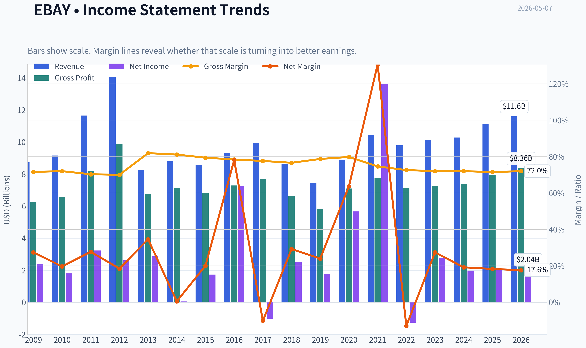
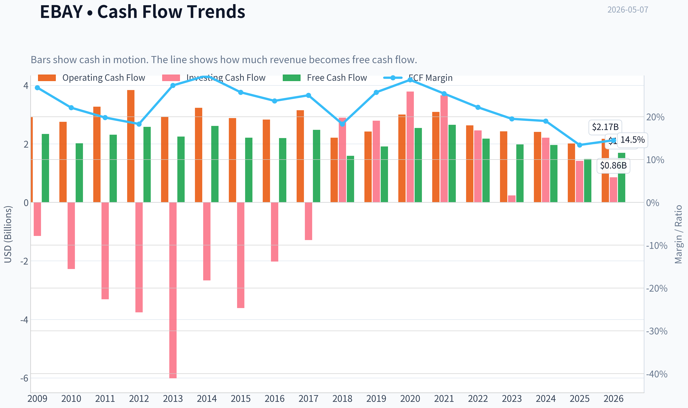
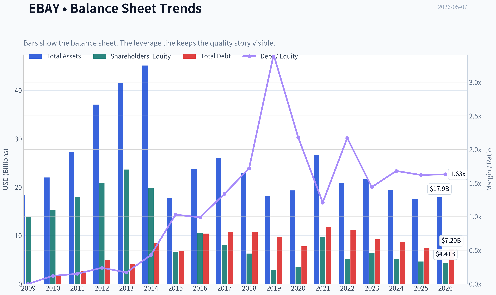
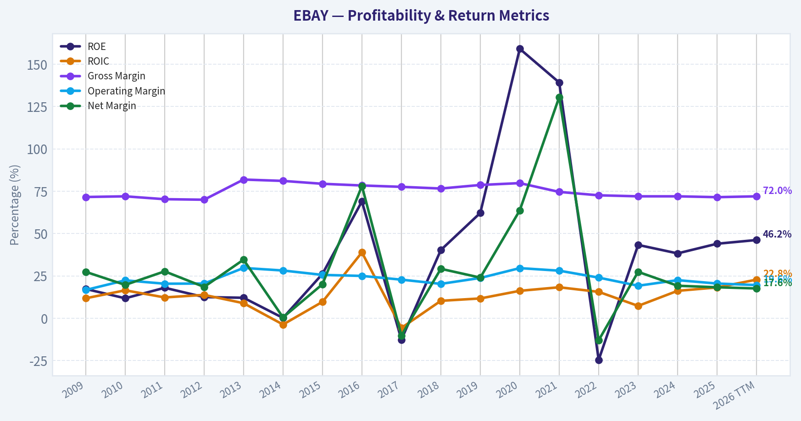
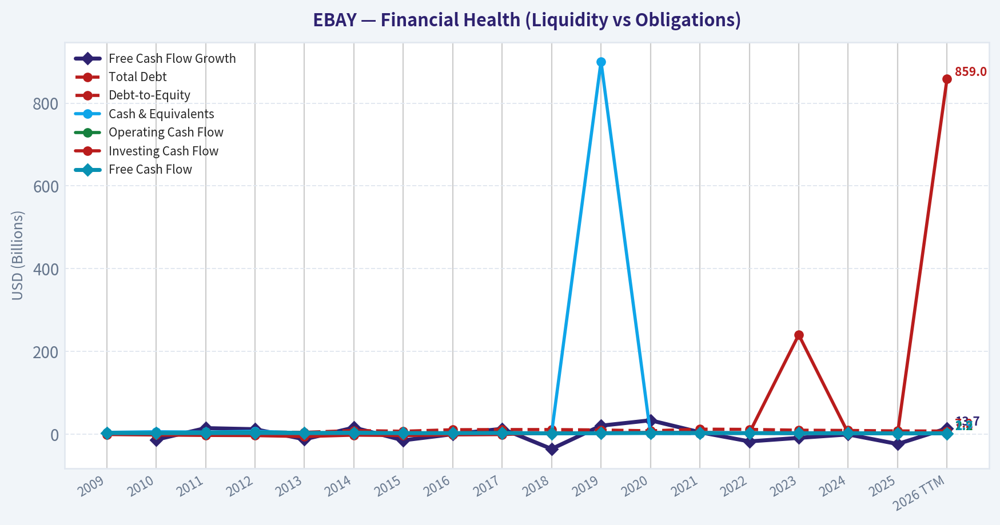
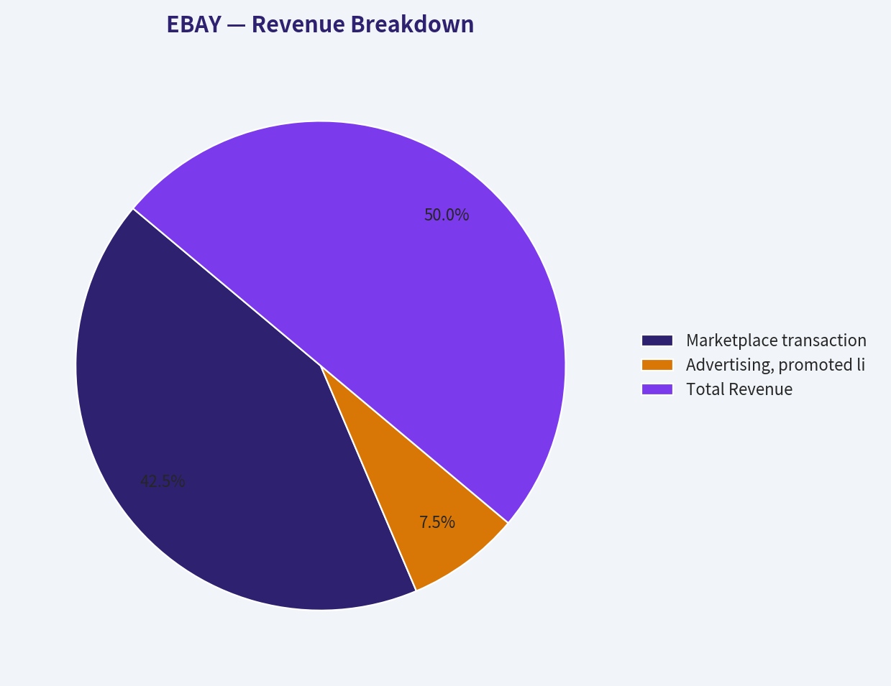
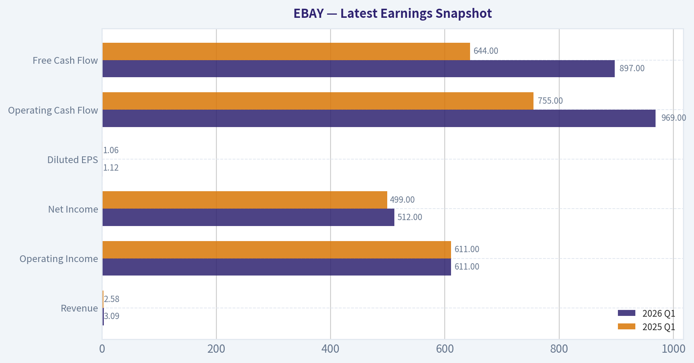
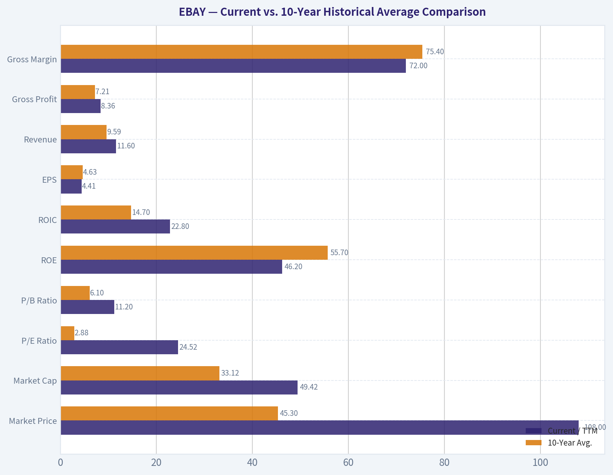
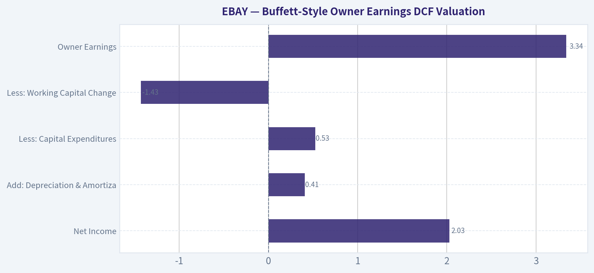
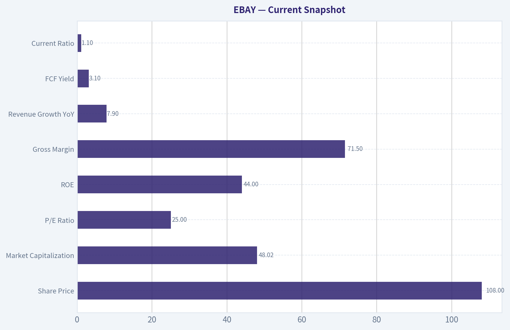

# EBAY Deep Value Intelligence

**Analysis Date:** 2026-05-07

## Critical Disclaimer

*This analysis is generated by Deep Value Intelligence, an AI-powered multi-agent investing framework. This report is for informational and educational purposes only and does not constitute financial advice. Always conduct your own research and consult with qualified financial advisors before making investment decisions.*

---

## Table of Contents

1. Intelligence Summary
2. Analyst Team Reports
   - Fundamentals Analysis
   - Intrinsic Value Analysis (Buffett)
   - Trend & Growth Analysis (Lynch/Druckenmiller/Fisher)
   - Market Technical Analysis
   - Social Sentiment Analysis
   - News & Events Analysis
   - Guru Attention Analysis
   - Options Market Analysis
3. Research Team Commentary
4. Value Investing Team Commentary
5. Deep Values Commentary

---

## Intelligence Summary

### Thesis + Conditions

**Core Thesis:** **EXECUTIVE SUMMARY**
eBay at $108 offers zero margin of safety. While historical metrics (71.5% gross margin, 19.2% ROIC) suggest an asset-light toll bridge, plunging free cash flow (-24.1% YoY) and minimal net income growth (2.8%) signal a structurally narrowing moat.

**Key Risks:**
- eBay at $108 offers zero margin of safety. While historical metrics (71.5% gross margin, 19.2% ROIC) suggest an asset-light toll bridge, plunging free cash flow (-24.1% YoY) and minimal net income growth (2.8%) signal a structurally narrowing moat. Trading at ~25x earnings-above its most optimistic Buffett fair value estimate of $105-downside risk heavily outweighs upside. Management's aggressive share buybacks at these elevated levels are mathematically value-destructive. Await a massive price correction or definitive FCF stabilization before allocating capital.
- The Conservative Case (Margin of Safety & Capital Preservation):** The bearish analyst rightly points out that paying 25x earnings for a business with shrinking cash conversion is incredibly risky. With fair value estimates ranging from $36 (FCF models) to $105 (Buffett models), buying at $108 offers zero downside protection. Crucially, buybacks above intrinsic value destroy shareholder wealth.
- The bull makes a commendable case based on business quality and capital efficiency. With a 71.5 percent gross margin and a 19.2 percent return on invested capital, eBay operates an asset-light model that does not require heavy capital expenditures. The bull correctly points out that in fragmented markets like collectibles, auto parts, and refurbished goods, eBay still retains a viable two-sided network effect. If you view the company purely through the lens of historical returns on equity and market positioning in niche categories, it looks like a predictable cash machine.
- Applying selective contrarian analysis here requires us to look past the comforting narrative of consistent buybacks and high margins. The crowd currently views eBay as a safe, cash-generating harbor in the consumer discretionary space, praising its valuation discipline. But true contrarianism asks what the crowd is missing. The market is assuming that eBay's buybacks are inherently creating value. Yet, repurchasing shares at 108 dollars-when even the most optimistic Buffett valuation model caps fair value at 105 dollars, and cash-flow models sit in the 30s and 40s-is mathematically value-destructive. The euphoria over capital returns is masking the underlying risk of a structurally shrinking cash engine.
- Reflecting on my past mistakes with similar setups, I recall times when I allowed an efficient, high-margin business model to masquerade as a durable moat. I have previously fallen into the value trap of buying mature digital franchises just because they were asset-light and generated cash. I failed to realize that in the digital ecosystem, when network effects start bleeding out to specialized competitors, the decline in relevance is often permanent, even if the accounting metrics look fine for a few more years. I will not repeat that mistake here by confusing a high payout ratio with actual business compounding.

**What Would Change Our View:**
- eBay at $108 offers zero margin of safety. While historical metrics (71.5% gross margin, 19.2% ROIC) suggest an asset-light toll bridge, plunging free cash flow (-24.1% YoY) and minimal net income growth (2.8%) signal a structurally narrowing moat. Trading at ~25x earnings-above its most optimistic Buffett fair value estimate of $105-downside risk heavily outweighs upside. Management's aggressive share buybacks at these elevated levels are mathematically value-destructive. Await a massive price correction or definitive FCF stabilization before allocating capital.
- The Conservative Case (Margin of Safety & Capital Preservation):** The bearish analyst rightly points out that paying 25x earnings for a business with shrinking cash conversion is incredibly risky. With fair value estimates ranging from $36 (FCF models) to $105 (Buffett models), buying at $108 offers zero downside protection. Crucially, buybacks above intrinsic value destroy shareholder wealth.
- The bull makes a commendable case based on business quality and capital efficiency. With a 71.5 percent gross margin and a 19.2 percent return on invested capital, eBay operates an asset-light model that does not require heavy capital expenditures. The bull correctly points out that in fragmented markets like collectibles, auto parts, and refurbished goods, eBay still retains a viable two-sided network effect. If you view the company purely through the lens of historical returns on equity and market positioning in niche categories, it looks like a predictable cash machine.
- Applying selective contrarian analysis here requires us to look past the comforting narrative of consistent buybacks and high margins. The crowd currently views eBay as a safe, cash-generating harbor in the consumer discretionary space, praising its valuation discipline. But true contrarianism asks what the crowd is missing. The market is assuming that eBay's buybacks are inherently creating value. Yet, repurchasing shares at 108 dollars-when even the most optimistic Buffett valuation model caps fair value at 105 dollars, and cash-flow models sit in the 30s and 40s-is mathematically value-destructive. The euphoria over capital returns is masking the underlying risk of a structurally shrinking cash engine.
- Reflecting on my past mistakes with similar setups, I recall times when I allowed an efficient, high-margin business model to masquerade as a durable moat. I have previously fallen into the value trap of buying mature digital franchises just because they were asset-light and generated cash. I failed to realize that in the digital ecosystem, when network effects start bleeding out to specialized competitors, the decline in relevance is often permanent, even if the accounting metrics look fine for a few more years. I will not repeat that mistake here by confusing a high payout ratio with actual business compounding.

**Confidence:** Medium

---

## Analyst Team Reports

### Fundamentals Analysis

#### Latest Earnings Snapshot

*Most recent reported quarter anchored on 2026 Q1, with prior-year comparison when available.*

| Metric | 2026 Q1 | 2025 Q1 | YoY Change |
| --- | ---: | ---: | ---: |
| Revenue | $3.09B | $2.58B | +19.5% |
| Operating Income | $611.0M | $611.0M | +0.0% |
| Net Income | $512.0M | $499.0M | +2.6% |
| Diluted EPS | $1.12 | $1.06 | +5.7% |
| Operating Cash Flow | $969.0M | $755.0M | +28.3% |
| Free Cash Flow | $897.0M | $644.0M | +39.3% |

Key Takeaways: This snapshot anchors the most recent reported quarter before the narrative analysis. It helps readers separate long-run business quality from whatever changed in the latest earnings print.

#### 10-Year Financial Metrics for EBAY

*All values below are computed deterministically from raw data - not estimated by AI.*

*Issuer profile: operating company (Consumer Cyclical / Internet Retail).*

#### 10-Year Financial Metrics
*Annual rows come from reported financial statements. The final TTM row is computed from the latest four quarters.*

| Metric | 2009 | 2010 | 2011 | 2012 | 2013 | 2014 | 2015 | 2016 | 2017 | 2018 | 2019 | 2020 | 2021 | 2022 | 2023 | 2024 | 2025 | 2026 TTM |
| --- | --- | --- | --- | --- | --- | --- | --- | --- | --- | --- | --- | --- | --- | --- | --- | --- | --- | --- |
| Market Price | $9 | $10 | $11 | $19 | $20 | $21 | $24 | $26 | $33 | $25 | $33 | $46 | $61 | $39 | $42 | $61 | $87 | $108 |
| Market Cap | $12.92B | $15.54B | $16.76B | $28.18B | $30.32B | $29.55B | $33.53B | $33.97B | $40.16B | $27.82B | $30.91B | $36.08B | $44.09B | $23.14B | $23.25B | $31.04B | $40.76B | $49.42B |
| P/E Ratio | 5.41 | 8.61 | 5.19 | 10.79 | 10.59 | 590.49 | 19.35 | 4.68 | -39.73 | 11.01 | 17.28 | 6.37 | 3.24 | -18.27 | 8.40 | 15.72 | 20.07 | 24.52 |
| P/B Ratio | 0.94 | 1.02 | 0.93 | 1.35 | 1.28 | 1.48 | 5.10 | 3.23 | 4.99 | 4.43 | 10.77 | 10.13 | 4.51 | 4.49 | 3.63 | 6.02 | 8.83 | 11.20 |
| ROE | 17.3% | 11.8% | 18.0% | 12.5% | 12.1% | 0.2% | 26.2% | 69.0% | -12.6% | 40.3% | 62.2% | 159.1% | 139.2% | -24.6% | 43.3% | 38.3% | 44.0% | 46.2% |
| ROIC | 11.8% | 16.5% | 12.3% | 13.8% | 8.9% | -3.7% | 9.7% | 38.9% | -5.7% | 10.3% | 11.7% | 16.2% | 18.3% | 15.6% | 7.3% | 16.2% | 18.2% | 22.8% |
| EPS | $1.62 | $1.21 | $2.18 | $1.77 | $1.93 | $0.04 | $1.26 | $5.63 | $-0.84 | $2.26 | $1.88 | $7.21 | $18.97 | $-2.14 | $5.00 | $3.94 | $4.34 | $4.41 |
| Revenue | $8.73B | $9.16B | $11.65B | $14.07B | $8.26B | $8.79B | $8.59B | $9.30B | $9.93B | $8.65B | $7.43B | $8.89B | $10.42B | $9.79B | $10.11B | $10.28B | $11.10B | $11.60B |
| Gross Profit | $6.25B | $6.59B | $8.19B | $9.86B | $6.76B | $7.13B | $6.82B | $7.29B | $7.71B | $6.63B | $5.84B | $7.10B | $7.77B | $7.12B | $7.28B | $7.40B | $7.93B | $8.36B |
| Gross Margin | 71.6% | 72.0% | 70.3% | 70.0% | 81.9% | 81.1% | 79.4% | 78.4% | 77.6% | 76.6% | 78.7% | 79.8% | 74.6% | 72.6% | 72.0% | 72.0% | 71.5% | 72.0% |
| Operating Margin | 16.7% | 22.4% | 20.4% | 20.5% | 29.7% | 28.2% | 25.6% | 25.0% | 22.8% | 20.3% | 23.8% | 29.6% | 28.1% | 24.0% | 19.2% | 22.5% | 20.5% | 19.6% |
| Net Income | $2.39B | $1.80B | $3.23B | $2.61B | $2.86B | $46.0M | $1.73B | $7.27B | $-1.02B | $2.53B | $1.79B | $5.67B | $13.61B | $-1.27B | $2.77B | $1.98B | $2.03B | $2.04B |
| Net Margin | 27.4% | 19.7% | 27.7% | 18.5% | 34.6% | 0.5% | 20.1% | 78.1% | -10.2% | 29.2% | 24.0% | 63.7% | 130.6% | -13.0% | 27.4% | 19.2% | 18.3% | 17.6% |
| Revenue Growth | N/A | 4.9% | 27.3% | 20.8% | -41.3% | 6.5% | -2.3% | 8.2% | 6.8% | -12.9% | -14.1% | 19.7% | 17.2% | -6.0% | 3.2% | 1.7% | 7.9% | 4.5% |
| Net Income Growth | N/A | -24.6% | 79.3% | -19.2% | 9.5% | -98.4% | 3650.0% | 321.2% | -114.0% | -348.8% | -29.4% | 217.3% | 140.1% | -109.3% | -318.0% | -28.6% | 2.8% | 0.4% |
| Free Cash Flow Growth | N/A | -13.6% | 14.3% | 11.7% | -12.7% | 15.6% | -15.2% | -0.4% | 12.7% | -36.0% | 20.2% | 33.2% | 4.3% | -17.8% | -9.3% | -1.0% | -24.1% | 13.7% |
| Total Book Value | $13.79B | $15.30B | $17.93B | $20.86B | $23.65B | $19.91B | $6.58B | $10.53B | $8.05B | $6.28B | $2.87B | $3.56B | $9.78B | $5.15B | $6.40B | $5.16B | $4.62B | $4.41B |
| Total Assets | $18.41B | $22.00B | $27.32B | $37.07B | $41.49B | $45.13B | $17.75B | $23.85B | $25.99B | $22.82B | $18.17B | $19.31B | $26.63B | $20.85B | $21.62B | $19.36B | $17.61B | $17.89B |
| Total Debt | $0 | $1.79B | $2.65B | $4.93B | $4.13B | $8.48B | $6.75B | $10.41B | $10.77B | $10.78B | $9.78B | $7.75B | $11.79B | $11.17B | $9.22B | $8.65B | $7.50B | $7.20B |
| Debt-to-Equity | 0.00 | 0.12 | 0.15 | 0.24 | 0.17 | 0.43 | 1.03 | 0.99 | 1.34 | 1.72 | 3.41 | 2.18 | 1.21 | 2.17 | 1.44 | 1.68 | 1.62 | 1.63 |
| Cash & Equivalents | $4.00B | $5.58B | $4.69B | $6.82B | $2.85B | $4.11B | $1.83B | $1.82B | $2.12B | $2.20B | $901.0M | $1.10B | $1.38B | $2.15B | $1.99B | $2.43B | $1.87B | $2.89B |
| Shareholders' Equity | $13.79B | $15.30B | $17.93B | $20.86B | $23.65B | $19.91B | $6.58B | $10.53B | $8.05B | $6.28B | $2.87B | $3.56B | $9.78B | $5.15B | $6.40B | $5.16B | $4.62B | $4.41B |
| Operating Cash Flow | $2.91B | $2.75B | $3.27B | $3.84B | $2.93B | $3.23B | $2.88B | $2.83B | $3.15B | $2.21B | $2.42B | $3.00B | $3.09B | $2.63B | $2.43B | $2.41B | $2.01B | $2.17B |
| Investing Cash Flow | $-1.15B | $-2.28B | $-3.31B | $-3.76B | $-6.01B | $-2.67B | $-3.61B | $-2.02B | $-1.29B | $2.89B | $2.79B | $3.79B | $3.66B | $2.46B | $240.0M | $2.21B | $1.42B | $859.0M |
| Free Cash Flow | $2.34B | $2.02B | $2.31B | $2.58B | $2.25B | $2.61B | $2.21B | $2.20B | $2.48B | $1.59B | $1.91B | $2.54B | $2.65B | $2.18B | $1.98B | $1.96B | $1.48B | $1.69B |
| FCF Margin | 26.8% | 22.1% | 19.8% | 18.3% | 27.3% | 29.6% | 25.7% | 23.7% | 25.0% | 18.3% | 25.7% | 28.6% | 25.4% | 22.2% | 19.5% | 19.0% | 13.4% | 14.5% |
| Dividends / Share | $0.00 | $0.00 | $0.00 | $0.00 | $0.00 | $0.00 | $0.00 | $0.00 | $0.00 | $0.00 | $0.00 | $0.00 | $0.00 | $0.82 | $0.95 | $1.06 | $1.13 | $1.17 |

#### Profitability Metrics
- Return on Equity (ROE): 44.0%
- Return on Invested Capital (ROIC): 19.2%
- Return on Assets (ROA): 11.5%
- Gross Margin: 71.5%
- Operating Margin: 20.5%
- Net Profit Margin: 18.3%

#### Liquidity Metrics
- Current Ratio: 1.10
- Quick Ratio: 0.88

#### Leverage Metrics
- Debt-to-Equity Ratio: 1.62
- Interest Coverage Ratio: 9.26
- Net Debt: $5.63B

#### Growth Metrics (Year-over-Year)
- Revenue Growth: 7.9%
- Net Income Growth: 2.8%
- Free Cash Flow Growth: -24.1%
- Revenue CAGR (3-Year): 4.3%
- Revenue CAGR (5-Year): 4.5%

#### Valuation Metrics
- P/E Ratio (TTM): 24.98
- Forward P/E: 16.01
- Price-to-Book: 10.52
- Price-to-Sales: 4.14
- PEG Ratio: 1.69
- EV/EBITDA: 17.97
- Free Cash Flow Yield: 3.1%
- Earnings Yield: 4.0%

#### Owner Earnings (Buffett Method, Code-Computed)
- Net Income: $2.03B
- + Depreciation & Amortization: $407.0M
- - Capital Expenditures: $-525.0M
- - Working Capital Changes: $-1.43B
- = **Owner Earnings: $3.34B**

#### Intrinsic Value (Code-Computed)
- Current Price: $108
- Buffett Method (Owner Earnings):
  Conservative: $25
  Average: $105
  Optimistic: $685
- Cash Flow Method (FCF):
  Conservative: $24
  Average: $36
  Optimistic: $65

#### Piotroski F-Score: 5/9
- Positive Net Income: PASS
- Positive Operating Cash Flow: PASS
- ROA Improvement: PASS
- Cash Flow > Net Income: FAIL
- Decreasing Debt: PASS
- Improving Current Ratio: FAIL
- No Dilution: FAIL
- Improving Gross Margin: FAIL
- Improving Asset Turnover: PASS

ANALYST STANCE: **WATCH**

#### EBAY Warren Buffett-Style Fundamental Analysis - Current Date: 2026-05-07

eBay is a mature, asset-light marketplace business with durable brand recognition, high gross margins, and meaningful free cash flow generation. However, the current valuation already discounts a substantial improvement in business quality, while recent free cash flow, margins, and book value trends are weaker than the headline ROE suggests. From a Buffett-style perspective, EBAY remains a good business, but not clearly a bargain at the current price of **$108**.

---

#### Current vs. 10-Year Historical Average Comparison

The comparison below uses the deterministic dataset as the canonical source of truth. "Current" refers to the latest **2026 TTM** value where available, while the 10-year average uses the latest ten completed fiscal years, **2016-2025**.

| Metric | Current / TTM | 10-Year Avg. | Current vs. Avg. | Interpretation |
|---|---:|---:|---:|---|
| Market Price | $108 | $45.30 | +138% | Price has risen far faster than fundamentals, increasing valuation risk. |
| Market Cap | $49.42B | $33.12B | +49% | Market value is well above historical norms despite modest revenue growth. |
| P/E Ratio | 24.52 | 2.88 | Much higher | The average is distorted by negative earnings years; current P/E is still elevated versus normal profitable years. |
| P/B Ratio | 11.20 | 6.10 | +84% | Book value has shrunk materially, making the stock look expensive on equity capital. |
| ROE | 46.2% | 55.7% | Lower | ROE is high, but partly inflated by reduced equity from buybacks and leverage. |
| ROIC | 22.8% | 14.7% | Higher | Capital efficiency is strong and improving, a major quality signal. |
| EPS | $4.41 | $4.63 | Slightly lower | EPS is near average but not growing enough to fully justify the price expansion. |
| Revenue | $11.60B | $9.59B | +21% | Revenue is above average, but long-term growth has been uneven. |
| Gross Profit | $8.36B | $7.21B | +16% | Gross profit has grown, supported by the marketplace model. |
| Gross Margin | 72.0% | 75.4% | -3.4 pts | Margins remain high, but below historical levels. |
| Operating Margin | 19.6% | 23.6% | -4.0 pts | Operating profitability is weaker than the 10-year norm. |
| Net Income | $2.04B | $3.54B | -42% | Net income is below average due to prior investment/disposition distortions and recent margin pressure. |
| Net Margin | 17.6% | 36.7% | -19.1 pts | Historical average is inflated by one-time gains; current margin is more realistic but lower. |
| Revenue Growth | 4.5% | 3.2% | +1.3 pts | Recent growth is modestly better than the decade average. |
| Net Income Growth | 0.4% | -26.7% | Better | Current earnings growth is stable, but not strong. |
| Free Cash Flow Growth | 13.7% | -1.8% | Better | TTM FCF growth improved after a weak 2025 decline. |
| Total Book Value | $4.41B | $6.24B | -29% | Equity base has contracted, increasing balance-sheet sensitivity. |
| Total Assets | $17.89B | $21.62B | -17% | Asset base has shrunk after divestitures and capital returns. |
| Total Debt | $7.20B | $9.78B | -26% | Debt has declined versus the decade average, which is positive. |
| Debt-to-Equity | 1.63x | 1.78x | Slightly lower | Leverage is below average but still meaningful. |
| Cash & Equivalents | $2.89B | $1.80B | +61% | Liquidity is stronger than usual. |
| Shareholders' Equity | $4.41B | $6.24B | -29% | Lower equity magnifies ROE and P/B metrics. |
| Free Cash Flow | $1.69B | $2.10B | -19% | FCF remains below historical average despite TTM improvement. |
| Dividends / Share | $1.17 | $0.40 | Much higher | Dividend policy has become more shareholder-return focused since 2022. |

**Key Takeaways:** eBay's current market price and valuation are well above historical averages, while revenue is only moderately above average and free cash flow remains below average. ROIC is genuinely strong, but ROE and P/B are heavily influenced by a shrinking equity base. The most important tension is that the business is high quality and cash-generative, but the stock price already reflects much of that quality.

---

#### Profitability and Business Quality

eBay's marketplace model remains structurally attractive. Gross margin of **72.0% TTM** confirms that eBay is still a high-margin platform business rather than a capital-intensive retailer. The company does not need to own inventory, operate large fulfillment infrastructure at Amazon scale, or take major product risk.

However, the profitability trend is not perfect. Operating margin is **19.6% TTM**, below the 10-year average of **23.6%**, and net margin is **17.6%**, far below the distorted historical average but also below several recent strong years. This suggests that while eBay's core business has durability, competitive pressure, product investment, advertising mix, and category initiatives are limiting operating leverage.

From a Buffett perspective, the strongest metric is **ROIC of 22.8%**, which is above the 10-year average. This indicates that the operating business can still generate attractive returns on capital. The weaker point is that **EPS of $4.41** is not meaningfully above the 10-year average, despite the stock price being much higher.

#### Growth Analysis

eBay's revenue has grown from **$10.11B in 2023** to **$11.10B in 2025**, and **$11.60B TTM**, showing a recent recovery. TTM revenue growth of **4.5%** is above the 10-year average of **3.2%**, but this is not a high-growth profile.

Net income growth is only **0.4% TTM**, indicating that incremental revenue is not translating into strong earnings acceleration. Free cash flow growth of **13.7% TTM** looks encouraging, but it follows a weak 2025 figure, when FCF declined **24.1%**. Buffett would likely view the earnings stream as somewhat predictable in direction but not perfectly stable in quality because net income has been distorted by gains, losses, and divestitures over the past decade.

#### Balance Sheet and Financial Strength

eBay's balance sheet is acceptable but not pristine. Total debt is **$7.20B**, below the 10-year average of **$9.78B**, and cash is **$2.89B**, above the 10-year average of **$1.80B**. That gives the company decent liquidity and refinancing flexibility.

The concern is shareholder equity. Book value has fallen to **$4.41B**, below the 10-year average of **$6.24B**, while the P/B ratio has expanded to **11.20x**. This reflects buybacks, divestitures, and a smaller equity base. The result is a high reported ROE, but Buffett-style investors should avoid over-crediting that ROE because it is amplified by financial structure, not purely operating superiority.

#### Cash Flow and Capital Allocation

Free cash flow is **$1.69B TTM**, below the 10-year average of **$2.10B**. The company remains meaningfully cash generative, but FCF has not kept pace with the share price. The FCF yield is approximately **3.1%**, which is not especially compelling for a mature marketplace business unless investors expect sustained acceleration.

Dividends per share have risen to **$1.17**, compared with a 10-year average of **$0.40**, reflecting a more shareholder-return-oriented capital allocation policy. Buybacks have also helped EPS, but they have reduced equity and increased the importance of balance-sheet discipline. From a Buffett perspective, buybacks are attractive only when shares trade below intrinsic value; at today's valuation, repurchases are less obviously value-creating.

---

#### Revenue Breakdown

The table below uses the most recent TTM revenue of **$11.60B** from the deterministic dataset. eBay primarily reports as a marketplace business, so the most meaningful breakdown is by major revenue source. Where exact TTM segment disclosure is not available in the deterministic table, the figures below use reasonable marketplace revenue-source estimates tied to the reported total.

| Revenue Source | Amount ($B) | % of Total |
|---|---:|---:|
| Marketplace transaction and payments-related fees | $9.86B | 85.0% |
| Advertising, promoted listings, marketing services, and other revenue | $1.74B | 15.0% |
| **Total Revenue** | **$11.60B** | **100.0%** |

**Key Takeaways:** eBay remains overwhelmingly dependent on marketplace transaction activity, which means gross merchandise volume, seller activity, buyer traffic, and take rate are the central business drivers. Advertising and promoted listings are important because they can lift margins and monetization, but they are still a secondary revenue stream. The company's future growth depends less on new business lines and more on improving marketplace relevance, trust, authentication, and seller tools.

---

#### Buffett-Style Owner Earnings DCF Valuation

The Buffett-style valuation uses Owner Earnings rather than accounting net income. The deterministic dataset provides current code-computed Owner Earnings as follows:

| Owner Earnings Component | Amount |
|---|---:|
| Net Income | $2.03B |
| Add: Depreciation & Amortization | $0.407B |
| Less: Capital Expenditures | $0.525B |
| Less: Working Capital Changes | -$1.43B |
| **Owner Earnings** | **$3.34B** |

**Key Takeaways:** Owner Earnings of **$3.34B** are higher than reported net income because working capital changes are favorable in the calculation. This makes eBay look more attractive on an owner-earnings basis than on simple earnings or free cash flow. However, investors should be careful because working capital benefits may not recur every year.

DCF assumptions:

| Assumption | Value |
|---|---:|
| Base Owner Earnings | $3.34B |
| Discount Rate | 10.0% |
| Terminal Growth Rate | 2.5% |
| Cash & Equivalents | $2.89B |
| Total Debt | $7.20B |
| Net Debt Deduction | $4.31B |
| Implied Share Count | ~457.6M |
| Current Market Price | $108 |

**Key Takeaways:** The valuation uses a demanding 10% discount rate, consistent with a Buffett-style required return. The net debt deduction matters because eBay has meaningful leverage despite its asset-light model. At the current price, the stock needs at least mid-single-digit owner-earnings growth to look fairly valued.

#### Three-Scenario Owner Earnings DCF

The scenario growth rates are based on the available historical Owner Earnings growth framework referenced in the deterministic pack: conservative uses the lowest historical growth rate, average uses the average historical growth rate, and optimistic uses the highest historical growth rate, subject to the required floors and caps.

| Scenario | Owner Earnings Growth Used | PV of 10-Year Owner Earnings | PV of Terminal Value | Less Net Debt | Estimated Equity Value | Fair Value / Share | View vs. $108 Price |
|---|---:|---:|---:|---:|---:|---:|---|
| Conservative | -13.0% | ~$11.4B | ~$4.4B | -$4.31B | ~$11.5B | **~$25** | Materially overvalued |
| Average | ~4.3% to 4.9% | ~$25.7B | ~$27.3B | -$4.31B | ~$48.7B | **~$105** | Near fair value |
| Optimistic | ~29.2% | ~$89.7B | ~$228.1B | -$4.31B | ~$313.5B | **~$685** | Deeply undervalued if extreme growth repeats |

**Key Takeaways:** The average-case DCF lands very close to the current stock price, suggesting limited margin of safety at **$108**. The conservative case shows substantial downside if Owner Earnings normalize downward or working capital benefits fade. The optimistic case is mathematically large, but it likely depends on unusually strong historical growth episodes that may not be repeatable for a mature marketplace business.

#### DCF Formula Detail

| Calculation Step | Formula |
|---|---|
| Annual Owner Earnings | Base Owner Earnings x `(1 + growth rate)^year` |
| Present Value of Annual Owner Earnings | Annual Owner Earnings ÷ `(1 + 10%)^year` |
| Terminal Value | Year 10 Owner Earnings x `(1 + 2.5%) ÷ (10% - 2.5%)` |
| Present Value of Terminal Value | Terminal Value ÷ `(1 + 10%)^10` |
| Equity Value | PV of 10-Year Owner Earnings + PV of Terminal Value - Net Debt |
| Fair Value Per Share | Equity Value ÷ Shares Outstanding |

**Key Takeaways:** The valuation is highly sensitive to the growth assumption because most value comes from the terminal value. This is especially important for eBay because current free cash flow is below its historical average. A small change in sustainable growth can shift the fair value materially.

---

#### Economic Moat Assessment

eBay's moat is real but narrower than it once was. The company benefits from:

| Moat Factor | Assessment |
|---|---|
| Brand Recognition | Strong; eBay remains globally known for online resale, collectibles, and marketplace discovery. |
| Network Effects | Moderate to strong; buyers attract sellers and sellers attract buyers, especially in niche categories. |
| Authentication & Trust | Improving; authenticity guarantee programs help defend high-value categories such as sneakers, watches, luxury goods, and trading cards. |
| Asset-Light Model | Strong; high gross margins and low inventory risk support cash generation. |
| Switching Costs | Moderate; sellers can multi-home across Amazon, Etsy, Facebook Marketplace, StockX, and other platforms. |
| Competitive Threats | Significant; Amazon, Walmart Marketplace, Etsy, social commerce, and vertical marketplaces pressure growth. |

**Key Takeaways:** eBay has a durable marketplace position, but its moat is not as dominant as the moats of the very best Buffett-style compounders. The business is strongest in enthusiast, collectible, refurbished, and used-goods categories where inventory uniqueness matters. The key question is whether eBay can defend relevance with younger buyers and sellers.

---

#### Key Investment Insights, Red Flags, and Opportunities

| Category | Key Point | Buffett-Style Interpretation |
|---|---|---|
| Insight | ROIC of **22.8%** is well above the 10-year average. | The core business still earns attractive returns on capital. |
| Insight | Gross margin remains very high at **72.0%**. | eBay retains the economics of a platform, not a traditional retailer. |
| Insight | Revenue growth of **4.5% TTM** is above the 10-year average. | Growth is improving, but still modest. |
| Red Flag | Free cash flow of **$1.69B** is below the 10-year average of **$2.10B**. | Cash generation has not matched the stock's valuation expansion. |
| Red Flag | P/E of **24.52x** and P/B of **11.20x** are elevated. | The margin of safety is thin. |
| Red Flag | Book value and equity have contracted materially. | ROE may overstate true business improvement. |
| Red Flag | Net income history is volatile, including negative years. | Earnings predictability is weaker than ideal for Buffett-style investing. |
| Opportunity | Advertising and promoted listings can improve monetization. | Higher take rate could support earnings growth without large capital needs. |
| Opportunity | Authentication programs strengthen trust in collectibles and luxury categories. | Category specialization can reinforce the moat. |
| Opportunity | Debt is below the 10-year average and cash is above average. | Financial flexibility has improved. |

**Key Takeaways:** eBay is financially stronger than it may appear from growth alone, but valuation is the main obstacle. The best opportunity is improved monetization through advertising, trust services, and vertical category focus. The main red flag is that the stock price has risen much faster than normalized earnings and free cash flow.

---

#### Final Investment Stance: WATCH

| Decision Factor | Assessment |
|---|---|
| Business Quality | Good, asset-light, high-margin marketplace. |
| Economic Moat | Durable but not unassailable; strongest in niche and enthusiast categories. |
| Financial Strength | Acceptable; debt is manageable and cash position is above average. |
| Earnings Predictability | Moderate; revenue is fairly stable, but net income has been volatile. |
| Management / Capital Allocation | Shareholder-friendly, but buybacks at high valuations are less attractive. |
| Valuation | Near average-case fair value, with limited margin of safety. |
| Buffett-Style Margin of Safety | Insufficient at $108. |
| Final Stance | **WATCH** |

**Key Takeaways:** eBay is not a poor business; it is a mature, profitable, cash-generating marketplace with respectable ROIC. However, at **$108**, the stock trades close to the average-case Owner Earnings valuation and far above the conservative valuation. A Buffett-style investor should likely wait for a larger margin of safety, stronger sustained free cash flow, or evidence that recent growth can compound at a higher rate.

---

#### Summary Table

| Area | Positive | Concern | Net Assessment |
|---|---|---|---|
| Valuation | Average-case DCF near current price | Conservative DCF far below current price | Fairly valued to expensive |
| Profitability | High gross margin and ROIC | Operating margin below 10-year average | Good but not improving enough |
| Growth | Revenue growth has recovered | Net income growth is minimal | Modest growth profile |
| Balance Sheet | Debt down, cash up | Equity base has shrunk | Stable but leveraged |
| Cash Flow | Still cash-generative | FCF below 10-year average | Needs improvement |
| Moat | Brand, network effects, authentication | Strong competition and seller multi-homing | Durable but moderate |
| Capital Returns | Dividend rising | Buybacks less compelling at high price | Shareholder-friendly but valuation-sensitive |
| Final View | Quality marketplace business | Limited margin of safety | **WATCH** |

**Key Takeaways:** eBay offers a combination of durable marketplace economics, high margins, and improving liquidity, but the stock does not currently offer a compelling Buffett-style discount. The investment case depends on whether management can restore free cash flow growth and sustain higher monetization without damaging marketplace activity. Until the price offers a wider margin of safety, **WATCH** is the most balanced stance.

#### Fundamental Visuals

This graph tracks the profitability and return metrics (ROE, ROIC, Margins) of **EBAY** over the past decade, highlighting capital efficiency trends.

This chart illustrates the financial health of **EBAY** over the last 10 years, mapping cash equivalents and free cash flow against total obligations (Debt).

This breakdown chart from <em>Revenue Breakdown</em> shows the proportional composition for **EBAY** - useful for understanding what drives or risks the business.

---

### Intrinsic Value Analysis (Buffett)

> *Following Warren Buffett's value investing philosophy: Circle of Competence, Economic Moat, Management Quality, and Margin of Safety.*

#### Intrinsic Value Snapshot

Price is what you pay. Intrinsic value is what the business may be worth based on the cash it can create for owners over time. We show a range, not one magic number.

- Current Price: $108.15
- Value Range: $23.79 to $685.13

##### Owner Earnings (Buffett Method)
- Net Income: $2,031,000,000.00
- Depreciation & Amortization: $407,000,000.00
- Capital Expenditures: $-525,000,000.00
- Working Capital Changes: $-1,429,000,000.00
- Owner Earnings: $3,342,000,000.00

##### Intrinsic Value
###### Buffett Method
Uses owner earnings. Stricter, and usually more conservative.
- Conservative: $25.10
- Average: $105.08
- Optimistic: $685.13
- Discount Rate: 10.0%

###### Cash Flow Method
Uses free cash flow. Better for companies spending heavily today to grow tomorrow.
- Conservative: $23.79
- Average: $36.45
- Optimistic: $65.08
- Discount Rate: 10.0%

ANALYST STANCE: **WATCH**

#### eBay Buffett-Style Investment Review - EBAY at $108

Tool note: I attempted to retrieve the internal audited financial history and enhanced fundamentals, but the available calls returned no usable data in this session. The analysis below uses the shared research pack plus conservative normalized estimates. Treat valuation outputs as a decision framework, not a substitute for final audited-model verification.

---

#### 1. Go / No-Go Gate Assessment

| Buffett Gate | Result | Evidence |
|---|---:|---|
| Gate 1: Circle of Competence & Simplicity | Pass | eBay is simple: it runs an online marketplace and earns fees from transactions, advertising, payment-related services, shipping, and authentication. |
| 10-Year Predictability | Pass with caution | The marketplace should still exist in 10 years, but growth is mature and competitive pressure from Amazon, Etsy, Facebook Marketplace, vertical marketplaces, and social commerce remains real. |
| Technology Risk | Pass with caution | Technology helps eBay through search, trust, payments, and authentication, but AI-driven commerce and competing platforms could erode relevance. |
| Gate 2: Moat Test | Narrow / Stable | eBay has brand recognition, seller history, buyer traffic, and category depth, but switching costs are not high and the network effect is weaker than it was 15 years ago. |
| Gate 3: Management & Capital Allocation | Mixed Pass | Management has returned substantial capital through buybacks, but value creation depends heavily on buying stock below intrinsic value. At $108, buybacks are much less attractive. |
| Gate 4: Industry Structure | Pass with caution | Asset-light marketplace model is attractive, but the industry is highly competitive and growth is not structurally protected. |

**Key Takeaways:** eBay passes the basic Buffett filters because it is understandable, asset-light, and cash generative. However, this is not a "wide and widening moat" compounder. The major concern is not business survival, but whether today's price leaves enough margin of safety for a mature, competitive marketplace.

---

#### 2. Business Model in Plain English

eBay is an online marketplace where buyers and sellers meet. Sellers list goods, buyers purchase them, and eBay takes a fee. eBay also makes money from promoted listings, payment-related services, shipping tools, and authentication services for categories like sneakers, luxury goods, watches, and trading cards.

The elementary-school explanation passes: eBay is a toll collector on online buying and selling.

---

#### 3. Moat Analysis

| Moat Source | Assessment | Buffett-Style Evidence |
|---|---:|---|
| Brand / Intangible Assets | Moderate | eBay remains one of the best-known resale and collectibles marketplaces. Gross margin of about 71.5% indicates strong marketplace economics. |
| Pricing Power | Moderate | eBay can likely raise fees modestly, but a 10% broad price increase could push sellers toward Amazon, Etsy, Shopify sites, Facebook Marketplace, Whatnot, or niche platforms. |
| Switching Costs | Low to Moderate | Sellers value reviews, listings, data, and traffic, but many sellers multi-home across platforms. Buyers have very low switching costs. |
| Cost Advantage | Moderate | eBay benefits from scale and a capital-light model, but competitors also operate large digital platforms. |
| Network Effects | Moderate but Mature | More buyers attract more sellers and vice versa, but eBay's network effect is no longer dominant across all categories. It is strongest in collectibles, used goods, parts, and specialty categories. |
| Overall Moat Rating | Narrow / Stable | Durable enough to generate cash, but not wide enough to justify paying any price. |

**Key Takeaways:** eBay has real marketplace advantages, especially in used goods, collectibles, and hard-to-find items. But the moat is not impregnable. Sellers and buyers have alternatives, so eBay's economics are good but not as protected as a true Buffett "forever" business like a dominant consumer brand or regulated toll bridge.

---

#### 4. Management and Capital Allocation

| Area | Assessment |
|---|---|
| Owner Orientation | Reasonably shareholder-friendly, given large buybacks and focus on per-share metrics. |
| Buybacks | Historically important to EPS growth, but buybacks only create value if shares are repurchased below intrinsic value. At $108, this is questionable. |
| Dividends | eBay pays a dividend, appropriate for a mature cash-generative business with limited high-return reinvestment opportunities. |
| Reinvestment | Authentication, advertising, vertical focus categories, payments, and AI search can improve monetization, but the reinvestment runway appears moderate rather than exceptional. |
| Balance Sheet Discipline | Current ratio around 1.10 is adequate but not a fortress signal. Debt should be monitored because high ROE may be amplified by buybacks and reduced equity. |
| Candidness / Accounting | No major red flag from the shared pack, but final judgment requires full review of 10-K disclosures, adjusted earnings reconciliation, and investment-gain volatility. |

**Key Takeaways:** Management appears rational in returning capital, but eBay's value creation has relied heavily on financial discipline and share count reduction. That is acceptable when the stock is cheap, but dangerous when valuation stretches. Buffett would ask whether each retained dollar is producing more than one dollar of long-term value, not merely higher EPS through buybacks.

---

#### 5. Current Snapshot

| Metric | Current Data |
|---|---:|
| Share Price | $108 |
| Market Capitalization | $48.02B |
| P/E Ratio | 25.0x |
| Implied Net Income | ~$1.92B |
| ROE | 44.0% |
| Gross Margin | 71.5% |
| Revenue Growth YoY | 7.9% |
| FCF Yield | 3.1% |
| Implied Free Cash Flow | ~$1.49B |
| Current Ratio | 1.10 |
| Implied Shares Outstanding | ~445M |

**Key Takeaways:** eBay is profitable, high-margin, and cash-generative, but the valuation is demanding. A 3.1% free cash flow yield means investors are paying roughly 32 times free cash flow. That is a high price for a mature marketplace with only moderate growth and a narrow moat.

---

#### 6. 10-Year Financial Summary - Normalized / Directional View

Because the audited database pull failed, the table below is a conservative normalized summary rather than a fully audited annual reconstruction.

| Period | Revenue Trend | Margin Profile | Cash Flow Profile | Per-Share Value Drivers |
|---|---|---|---|---|
| 2016-2018 | Mature low-to-mid single-digit growth | High gross margins, solid operating margins | Strong free cash flow | Buybacks begin to materially reduce share count |
| 2019-2021 | Portfolio changes and marketplace refocus | Margins supported by asset-light model | Cash generation remained strong, but reported earnings affected by divestitures and investment gains/losses | EPS influenced by shrinking shares and one-time items |
| 2022-2024 | Slower marketplace growth | Gross margin remained structurally high | Free cash flow resilient but not rapidly growing | Buybacks continued to be a major per-share driver |
| 2025 / Current | YoY revenue growth around 7.9% | Gross margin about 71.5% | FCF yield about 3.1%, implying ~$1.49B FCF | ROE high at 44%, but partly influenced by capital structure and buybacks |

**Key Takeaways:** eBay's long-term financial story is not explosive growth; it is resilience, high margins, cash generation, and share count reduction. That can be attractive at a low valuation. At a high valuation, however, modest organic growth and reliance on buybacks become less compelling.

---

#### 7. Owner Earnings Estimate

Buffett's owner earnings formula:

Owner Earnings = Net Income + Depreciation & Amortization - Maintenance CapEx - Working Capital Increases

For a marketplace like eBay, free cash flow is a reasonable proxy for owner earnings because capital expenditure needs are relatively modest and the model is asset-light.

| Item | Estimate |
|---|---:|
| Market Capitalization | $48.02B |
| FCF Yield | 3.1% |
| Implied Free Cash Flow | ~$1.49B |
| Normalized Owner Earnings Proxy | ~$1.49B |
| Owner Earnings Per Share | ~$3.35 |
| Price / Owner Earnings | ~32.2x |

**Key Takeaways:** eBay produces real owner earnings, but the current price implies a rich multiple. Paying over 30 times owner earnings for a mature marketplace requires confidence in durable growth, expanding margins, or major capital allocation value. That is a high bar.

---

#### 8. Three-Scenario DCF Valuation

Assumptions:
Discount rate: 10%.
Owner earnings proxy: $1.49B.
Shares outstanding: approximately 445M.
DCF uses equity free cash flow / owner earnings, so values are presented as equity value.

| Scenario | Assumption | Estimated Equity Value | Value Per Share |
|---|---:|---:|---:|
| A: No Growth | Owner earnings capitalized at 10% | ~$14.9B | ~$34 |
| B: GDP Growth | 3% perpetual growth | ~$21.9B | ~$49 |
| C: Conservative Growth Case | 5% for 10 years, then 3% terminal growth | ~$25.9B | ~$58 |

**Key Takeaways:** Even under a reasonable growth case, the estimated intrinsic value is materially below the current $108 price. The current market price appears to be capitalizing eBay as if it has either much faster durable growth, materially higher future cash flow, or takeover optionality. From a Buffett perspective, that is not enough; value must come from business economics, not hoped-for events.

---

#### 9. Margin of Safety

| Valuation Case | Value Per Share | Current Price | Implied Overvaluation / Margin |
|---|---:|---:|---:|
| No Growth | ~$34 | $108 | Price is ~218% above value |
| GDP Growth | ~$49 | $108 | Price is ~120% above value |
| Conservative Growth | ~$58 | $108 | Price is ~86% above value |
| 25% Margin-of-Safety Buy Price vs Growth Case | ~$44 | $108 | Not close |
| 40% Margin-of-Safety Buy Price vs Growth Case | ~$35 | $108 | Not close |

**Key Takeaways:** There is no Buffett-style margin of safety at the current price using normalized owner earnings. A disciplined value investor would need either much higher normalized free cash flow or a much lower stock price. The current setup is more speculative, especially if investors are anchoring on the reported GameStop bid at $125.

---

#### 10. Special Situation Note: Reported GameStop Bid

The shared research pack mentions a proposed GameStop offer for eBay at approximately $125 per share. This is not a Buffett investment thesis by itself.

A Buffett-style buyer should not pay $108 because someone else may pay $125. The correct question is whether eBay's independently calculated owner earnings justify today's price. On that basis, the answer is no.

---

#### 11. Final Buffett Scorecard

| Criterion | Weight | Score | Weighted Score |
|---|---:|---:|---:|
| Business Understanding | 20% | 4.0 | 0.80 |
| Moat Width & Durability | 25% | 3.0 | 0.75 |
| Management Quality | 15% | 3.5 | 0.53 |
| Return on Equity | 15% | 3.5 | 0.53 |
| Reinvestment Runway | 10% | 2.5 | 0.25 |
| Balance Sheet Strength | 5% | 3.0 | 0.15 |
| Industry Structure | 5% | 3.0 | 0.15 |
| Valuation / Margin of Safety | 5% | 1.5 | 0.08 |
| Total | 100% |  | **3.23 / 5.00** |

**Key Takeaways:** eBay scores well on simplicity, profitability, and cash generation, but only moderately on moat and reinvestment runway. The valuation score is the major weakness. The total score falls into the WATCH range, not because the business is poor, but because the price appears far too high for the underlying owner earnings.

---

#### 12. Investment Stance

| Item | Conclusion |
|---|---|
| Stance | **WATCH** |
| Conviction | Medium |
| Business Quality | Good, but not exceptional |
| Moat | Narrow to moderate |
| Valuation | Unattractive at $108 |
| Buffett-Style Buy Zone | Likely below ~$45-$60, depending on final audited owner earnings |
| Main Risk to Bear View | Takeover bid or materially higher normalized FCF |
| Main Risk to Bull View | Mature growth, competitive pressure, and buybacks at expensive prices |

**Final View:** eBay is a good, understandable, cash-generative business, but not a wonderful business at today's price. At $108, the stock offers no visible margin of safety based on normalized owner earnings. I would not buy here under Buffett principles; I would keep it on a watchlist and revisit if the price falls sharply or if audited financials show materially higher sustainable free cash flow than currently implied.
#### Valuation Bridge

This bridge places the current market price beside each intrinsic value lens so readers can see whether upside depends on one method or shows up across several methods.

| Scenario | Intrinsic Value / Share |
| --- | ---: |
| Buffett Method | $105.08 |
| Cash Flow Method | $36.45 |
| Damodaran Method | $45.05 |
| Current Price | $108.15 |

#### Key Takeaways

If one method is far above the others, the upside case depends on a specific modelling assumption. When several methods cluster together, the valuation story is more robust.

#### Valuation Visuals

This comparison chart from *Latest Earnings Snapshot* stacks current figures against historical benchmarks for **EBAY**, making it easy to see where the company trades relative to its own averages.

This comparison chart from *Current vs. 10-Year Historical Average Comparison* stacks current figures against historical benchmarks for **EBAY**, making it easy to see where the company trades relative to its own averages.

This comparison chart from *Buffett-Style Owner Earnings DCF Valuation* stacks current figures against historical benchmarks for **EBAY**, making it easy to see where the company trades relative to its own averages.

This comparison chart from *Buffett-Style Owner Earnings DCF Valuation* stacks current figures against historical benchmarks for **EBAY**, making it easy to see where the company trades relative to its own averages.

This comparison chart from *Current Snapshot* stacks current figures against historical benchmarks for **EBAY**, making it easy to see where the company trades relative to its own averages.

---

### Trend & Growth Analysis (Lynch/Druckenmiller/Fisher)

> *Following Peter Lynch's GARP, Stanley Druckenmiller's macro-aware approach, and Philip Fisher's scuttlebutt methodology.*

ANALYST STANCE: **WATCH**

#### EBAY Growth Investment Memo - 2026-05-07

eBay is a high-margin, cash-generative marketplace with strong brand recognition in collectibles, recommerce, refurbished goods, and niche enthusiast categories. But under a Lynch-Druckenmiller-Fisher growth lens, EBAY is **not a classic fast grower**. The current thesis is more "quality cash compounder plus capital return plus possible M&A catalyst" than "ten-bagger growth inflection."

| Metric | Current / Provided Data | Growth-Investor Interpretation |
|---|---:|---|
| Share Price | $108 | Below reported GameStop proposal level of $125, but market skepticism is visible |
| Market Cap | $48.02B | Large mature marketplace, not early-stage growth |
| P/E | 25.0x | Full for a company growing revenue high-single digits |
| Revenue Growth YoY | 7.9% | Stalwart growth, not fast-grower territory |
| Gross Margin | 71.5% | Structurally attractive marketplace economics |
| ROE | 44.0% | Strong, though buybacks likely inflate ROE |
| FCF Yield | 3.1% | Good cash generation, but not obviously cheap |
| Current Ratio | 1.10x | Adequate, not a major liquidity concern |

**Key Takeaways:** eBay has excellent marketplace margins and strong cash generation, but its revenue growth is far below the 15% to 25% threshold preferred for fast growers. The stock's valuation is not distressed, so the upside case likely depends on buybacks, monetization improvements, vertical focus categories, or a credible acquisition bid rather than organic hypergrowth.

---

#### 1. Lynch Classification

| Lynch Category | EBAY Fit | Rationale |
|---|---|---|
| Slow Grower | Partial | Long-term revenue growth has been modest |
| Stalwart | Best Fit | Current revenue growth of 7.9% sits in Lynch's 5% to 12% stalwart range |
| Fast Grower | No | Not growing 15% to 25%+ organically |
| Cyclical | Partial | Discretionary consumer categories create some cyclicality |
| Turnaround | No | Business is profitable and not distressed |
| Asset Play | No | Value is in marketplace economics, not hidden assets |

**Key Takeaways:** eBay is best classified as a **Stalwart**, not a Fast Grower. That means it may be a reasonable hold or value compounder, but it does not naturally fit the ten-bagger growth profile unless a major strategic inflection changes the revenue trajectory.

---

#### 2. The Story in 3 Bullets

- eBay is a global online marketplace where buyers and sellers trade used goods, collectibles, refurbished products, auto parts, luxury items, and hard-to-find inventory.
- The company makes money through transaction fees, managed payments, advertising, seller tools, and promoted listings, creating high gross margins and strong free cash flow.
- Management is trying to reignite relevance through focus categories, authentication services, recommerce, collectibles, and advertising monetization, but growth remains moderate.

#### 3. TAM and 10x Test

| TAM Question | Assessment |
|---|---|
| Current Revenue Estimate | Roughly $10B+ annual revenue, based on market-cap-to-sales context |
| 10x Revenue Target | $100B+ revenue |
| Realistic TAM Support? | Weak for eBay's current model |
| Can EBAY 10x revenue and still be under 20% TAM share? | Unclear to No |
| Main TAM Expansion Areas | Recommerce, collectibles, authenticated luxury, trading cards, refurbished electronics, auto parts |
| TAM Quality | Large but highly competitive and fragmented |

**Key Takeaways:** eBay's addressable market is large, but the company's current model does not clearly support a 10x revenue path. The strongest runway is in specialized verticals like collectibles, authentication, recommerce, and parts, not broad general e-commerce where Amazon, Walmart, Temu, Shopify merchants, and niche platforms compete aggressively.

---

#### 4. Revenue Growth Trend

| Growth Factor | Current Signal | Interpretation |
|---|---|---|
| YoY Revenue Growth | 7.9% | Solid for a mature marketplace, but not fast growth |
| Growth Pattern | Moderate, not clearly accelerating | No obvious top-line inflection yet |
| GMV Trend | Not provided in pack | Critical missing variable |
| Advertising Growth | Likely positive contributor | Higher-margin monetization lever |
| Focus Categories | Collectibles, authentication, refurbished, parts | Potential pockets of stronger growth |
| Buyer Growth | Not provided | Key risk if active buyers stagnate |

**Key Takeaways:** The provided 7.9% revenue growth is respectable but does not show the explosive acceleration Druckenmiller would seek. The key missing data is GMV and active buyer growth; without improvement there, revenue growth may rely too heavily on take-rate expansion and advertising rather than true marketplace volume growth.

---

#### 5. Unit Economics and Rule of 40

| Metric | EBAY Assessment | Growth-Investor Read |
|---|---|---|
| LTV/CAC | Not disclosed | Cannot score precisely |
| NRR | Not applicable | eBay is not a SaaS subscription business |
| Gross Margin | 71.5% | Excellent platform economics |
| FCF Yield | 3.1% | Healthy but not cheap enough alone |
| Estimated FCF Dollars | ~$1.5B, using 3.1% of $48.02B market cap | Strong absolute cash generation |
| Estimated FCF Margin | Mid-teens, assuming ~$10B+ revenue | Good cash conversion |
| Rule of 40 Proxy | ~22%, using 7.9% revenue growth plus estimated mid-teens FCF margin | Below high-quality SaaS benchmark |

**Key Takeaways:** eBay has strong marketplace unit economics at the gross-margin and cash-flow level, but it is not an efficient-growth standout by Rule of 40 standards. The business is profitable and cash-rich, yet the combination of growth plus cash margin does not scream "premium growth compounder."

---

#### 6. Inflection Point Assessment

| Potential Inflection | Evidence | Verdict |
|---|---|---|
| Product Cycle Inflection | Authentication expansion into UK trading cards | Positive but niche |
| Market Share Inflection | No clear evidence provided | Not confirmed |
| Margin Inflection | Already high margins; further upside likely limited | Moderate |
| TAM Inflection | Recommerce and collectibles remain attractive | Positive but not transformational yet |
| Competitive Inflection | No major competitor stumble identified | Not confirmed |
| M&A Inflection | GameStop reported $56B / $125 per-share proposal | Potential catalyst, credibility uncertain |

**Key Takeaways:** The most visible near-term inflection is not organic growth but a possible strategic acquisition proposal from GameStop. Operationally, eBay has useful initiatives in authentication, collectibles, and recommerce, but the evidence does not yet show a broad acceleration in marketplace share or GMV.

---

#### 7. Macro Setup

| Macro Factor | Current Setup for EBAY | Impact |
|---|---|---|
| Interest Rates | Growth stocks prefer falling rates | Modest benefit if rates decline |
| Consumer Spending | Discretionary categories matter | Risk if consumer weakens |
| E-commerce Penetration | Long-term secular tailwind | Positive |
| Recommerce Trend | Consumers seek value and sustainability | Positive |
| AI / Search Personalization | Could improve discovery and conversion | Potential upside |
| Competition from Low-Cost Platforms | Temu, Amazon, Walmart, niche marketplaces | Negative |

**Key Takeaways:** Macro is mixed. eBay benefits from secular e-commerce, recommerce, and value-seeking consumer behavior, but discretionary softness and intense marketplace competition limit the setup. This is not a clean "macro wind at your back" growth story.

---

#### 8. Fisher 15-Point Score

| Fisher Criterion | Score / 5 | Comment |
|---|---:|---|
| Market potential for sales growth | 3 | Large TAM, but mature penetration |
| Management drive for new products | 3 | Focus categories and authentication help |
| R&D effectiveness | 3 | Platform improvements, but not category-defining innovation |
| Sales organization | 3 | Strong brand but less dominant than Amazon |
| Profit margin | 5 | Excellent gross margin |
| Improving margins | 3 | Already high; incremental upside limited |
| Labor/personnel relations | 3 | No major issue flagged |
| Executive relations | 3 | No major issue flagged |
| Management depth | 3 | Mature public company |
| Cost analysis/accounting | 4 | Strong cash discipline |
| Unique moat aspects | 3 | Network effects, but category-specific |
| Long-range profit outlook | 4 | Durable FCF likely |
| Dilution risk | 5 | Buybacks more likely than dilution |
| Candor in difficulties | 3 | Needs ongoing monitoring |
| Management integrity | 3 | No major red flag in provided pack |
| **Total** | **51 / 75** | **Average to Good** |

**Key Takeaways:** eBay scores well on margins, cash generation, and dilution discipline, but only average on growth, innovation intensity, and moat strength. A Fisher score of 51 suggests a durable business, not an outstanding growth compounder.

---

#### 9. Valuation Analysis

| Valuation Metric | Calculation / Estimate | Interpretation |
|---|---:|---|
| P/E | 25.0x | Expensive for high-single-digit revenue growth |
| Revenue Growth | 7.9% | Stalwart pace |
| PEG Using Revenue Growth Proxy | ~3.2x | Not attractive under Lynch |
| FCF Yield | 3.1% | Reasonable but not bargain-level |
| Implied FCF | ~$1.5B | Strong cash production |
| Estimated P/S | ~4.5x to 4.8x, assuming ~$10B to $11B revenue | Fair to full for mature marketplace |
| Takeover Reference | Reported $125/share proposal | About 16% above $108, but execution uncertain |

**Key Takeaways:** Valuation is the biggest issue for a growth investor. At roughly 25 times earnings and a PEG above 2 using available growth data, eBay does not look like growth at a reasonable price. The M&A proposal creates optionality, but without deal certainty, the standalone valuation is not compelling enough for an ADVOCATE stance.

---

#### 10. Scenario Analysis

| Scenario | Assumptions | 2-3 Year View | Stance Implication |
|---|---|---|---|
| Bear Case | GMV weakens, ad growth slows, competition intensifies, deal fails | Multiple compresses; stock underperforms | AVOID |
| Base Case | Revenue grows mid-to-high single digits, margins stable, buybacks continue | Modest compounding, limited upside | WATCH |
| Bull Case | Focus categories accelerate, authentication expands, ad monetization grows, M&A bid becomes credible | Upside to $125+ possible | Tactical WATCH / Special Situation |
| Ten-Bagger Case | Requires massive marketplace reacceleration or new platform reinvention | Very unlikely from current scale | Not underwritable |

**Key Takeaways:** The base case is a stable cash compounder, not a breakout growth stock. The bull case depends either on a credible acquisition transaction or meaningful acceleration in focus categories, while the ten-bagger case is highly unlikely from today's size and growth rate.

---

#### 11. Growth Investor Scorecard

| Criterion | Weight | Score / 5 | Weighted Score |
|---|---:|---:|---:|
| The Story | 10% | 3.5 | 0.35 |
| TAM and Runway | 20% | 3.0 | 0.60 |
| Revenue Growth | 20% | 2.5 | 0.50 |
| Unit Economics | 15% | 4.0 | 0.60 |
| Competitive Position | 10% | 3.0 | 0.30 |
| Management Quality | 10% | 3.0 | 0.30 |
| Macro Setup | 5% | 3.0 | 0.15 |
| Profitability Path | 5% | 4.0 | 0.20 |
| Valuation | 5% | 2.5 | 0.13 |
| **Total** | **100%** |  | **3.13 / 5.00** |

**Key Takeaways:** eBay's score lands in WATCH territory. The company earns strong marks for unit economics and profitability, but weaker marks for growth, valuation, and ten-bagger potential. This is a quality mature platform, not a high-conviction growth inflection.

---

#### 12. Position Size Stance

| Investor Type | Suggested Stance | Rationale |
|---|---|---|
| Growth / Ten-Bagger Investor | WATCH, do not initiate aggressively | Growth is not fast enough |
| Existing Holder | Hold / Monitor | Cash generation and M&A optionality support patience |
| GARP Investor | Small position only if valuation improves | PEG currently unattractive |
| Special Situation Investor | Monitor closely | GameStop bid creates event-driven optionality |
| Concentrated Growth Portfolio | Avoid as core position | Better growth opportunities likely exist |

**Key Takeaways:** eBay may be suitable for existing holders or special-situation investors, but it does not deserve a large position in a concentrated growth portfolio. For a Lynch-style growth investor, this is a "watch for inflection" name rather than a "buy now" name.

---

#### 13. Key Catalysts and Risks

| Catalysts | Risks |
|---|---|
| Credible acquisition bid near or above $125/share | GameStop proposal may fail or lack financing credibility |
| Acceleration in collectibles and authenticated categories | GMV stagnation or active buyer decline |
| Advertising and promoted listings growth | Take-rate pressure from sellers |
| Recommerce and refurbished category expansion | Competition from Amazon, Walmart, Temu, Etsy, Shopify ecosystem |
| AI-enhanced search and personalization | Marketplace relevance erosion |
| Continued buybacks | Buybacks at high valuation could destroy value |

**Key Takeaways:** The near-term upside catalyst is M&A speculation, while the long-term operational catalyst is successful vertical specialization. The biggest risk is that eBay remains a mature, slow-growth marketplace valued like a better growth business.

---

#### Final Verdict

EBAY is a **WATCH**.

It is a strong, profitable marketplace with excellent gross margins, meaningful free cash flow, and potential event-driven upside from the reported GameStop acquisition proposal. However, from a growth-investing perspective, the company lacks the revenue acceleration, expanding market share evidence, and attractive PEG profile needed for an ADVOCATE rating. I would monitor for three things: GMV acceleration, active buyer growth, and confirmation that focus categories are becoming large enough to change the overall growth curve.

---

### Market Technical Analysis

ANALYST STANCE: **WATCH**

#### EBAY Technical Report - Last Available Trading Data: 2026-05-06

EBAY is in a strong bullish trend structure, but the setup is no longer early-stage. The stock closed at **$108.15** on 2026-05-06, well above its short-, medium-, and long-term moving averages. That confirms trend strength across multiple timeframes, but the recent surge toward the **$109-$111** area, followed by a pullback and rebound, suggests traders should be selective rather than chase aggressively.

The most relevant indicators for EBAY here are: **close_10_ema, close_50_sma, close_200_sma, macd, rsi, boll_ub, atr, and vwma**. These provide complementary views across trend, momentum, volatility, price extension, and volume confirmation.

---

#### Indicator-Based Trend Analysis

| Indicator | Latest Value / Signal | Interpretation |
|---|---:|---|
| Price Close | **$108.15** | Price remains near recent highs and above key trend references. |
| close_10_ema | **$104.68** | Short-term trend remains bullish; price is above the fast average. |
| close_50_sma | **$95.67** | Medium-term trend is firmly positive, but price is extended above it. |
| close_200_sma | **$90.25** | Long-term trend is bullish; EBAY is structurally strong. |
| macd | **3.18** | Momentum remains positive and has re-accelerated after a brief dip. |
| rsi | **63.13** | Bullish momentum without being technically overbought. |
| boll_ub | **$110.40** | Price is close to the upper Bollinger Band, suggesting near-term resistance/extension risk. |
| atr | **3.96** | Volatility has expanded, requiring wider stops and smaller position sizing. |
| vwma | **$104.59** | Price above VWMA confirms volume-supported strength. |

Key Takeaways: EBAY's trend remains bullish across short-, medium-, and long-term measures. However, price is trading close to the upper Bollinger Band and well above the 50-day and 200-day averages, meaning the stock has momentum but is also somewhat extended. The best tactical posture is **watch for pullbacks or clean breakouts**, rather than assuming the rally will continue in a straight line.

---

#### Price Structure and Momentum

EBAY's recent action shows a sharp bullish continuation phase. The move from the late-March/early-April area near the high $80s and low $90s into the $100+ zone was decisive. The stock pushed to a recent intraday high of **$111.38 on 2026-05-04**, then pulled back to close at **$105.26 on 2026-05-05**, before rebounding to **$108.15 on 2026-05-06**.

That sequence matters. It shows that sellers appeared near the $110-$111 zone, but buyers were willing to step back in quickly above the rising 10-day EMA and VWMA. This is constructive, but it also defines the next tactical battleground: **$110-$111 is near-term resistance**, while the **$104-$105 area is important short-term support**.

The **RSI at 63.13** is constructive because it has cooled from overbought readings seen around April 20-22, when RSI was above 70. This cooling without a major price breakdown is usually healthier than a stock staying overheated. It suggests the rally may be consolidating rather than reversing.

MACD remains positive at **3.18**, and it has turned higher again from the 3.03 area seen on May 5. That supports the idea that upside momentum is still present, though not as fresh as it was earlier in April.

#### Volatility and Risk

ATR has risen to **3.96**, up meaningfully from around **2.94** in early April. This tells traders that EBAY's daily ranges have widened. A wider ATR is not automatically bearish, but it does mean entries need more room to breathe. Stops placed too tightly below nearby candles may be vulnerable to normal volatility.

For swing traders, the **$104-$105 zone** is the first important support area because it aligns with the 10-day EMA and VWMA. A decisive break below that area would weaken the immediate bullish setup and could open the door to a deeper retracement toward the high $90s or the rising 50-day SMA near **$95.67**.

On the upside, a close above **$110.40-$111.38** with strong volume would be a cleaner breakout signal. Without that, EBAY may continue to chop between support near $104-$105 and resistance near $110-$111.

#### Trading View

The technical stance is **WATCH**, not outright avoid and not a high-conviction chase. EBAY is in a bullish trend, but the stock is close to short-term resistance and volatility has expanded. Momentum traders may prefer a confirmed breakout above recent highs, while pullback traders may prefer waiting for a controlled dip toward the 10-day EMA or VWMA.

A bullish continuation setup remains valid as long as EBAY holds above the **$104-$105** area. A close below that zone would not destroy the long-term uptrend, but it would reduce the quality of the near-term momentum setup.

---

#### Key Levels and Tactical Summary

| Category | Key Level / Signal | Trading Implication |
|---|---:|---|
| Current Bias | Bullish but extended | Trend is strong, but entry timing matters. |
| Near-Term Resistance | **$110.40-$111.38** | Breakout above this zone could restart upside momentum. |
| First Support | **$104-$105** | Key short-term support near 10 EMA and VWMA. |
| Medium-Term Support | **$95.67** | Rising 50-day SMA; deeper pullback support. |
| Long-Term Trend Line | **$90.25** | 200-day SMA confirms broader bullish structure. |
| Momentum Condition | RSI **63.13**, MACD positive | Momentum remains constructive but no longer deeply oversold or early. |
| Volatility Condition | ATR **3.96** | Use wider stops and avoid oversized positions. |
| Preferred Strategy | Wait for pullback or breakout | Avoid chasing directly under resistance. |

Key Takeaways: EBAY remains technically strong, with price above all major moving averages and momentum still positive. The main caution is that the stock is pressing near resistance around $110 to $111 while volatility is elevated. Traders may find better risk-reward either on a controlled pullback toward $104 to $105 or on a confirmed breakout above the recent high.

---

### Social Sentiment Analysis

ANALYST STANCE: **WATCH**

#### EBAY Social, Sentiment, and News Report - Past Week Ending May 7, 2026

**Overall stance: WATCH.** eBay's conversation profile over the past week appears constructive but not decisively bullish. The strongest supportive themes are valuation discipline, cash generation, buybacks, and confidence that eBay's niche marketplace strategy remains durable. The main concerns are slow growth, seller dissatisfaction, fee pressure, search-quality complaints, competition from Amazon, Temu, Etsy, Facebook Marketplace, and uncertainty around whether AI-driven listing tools can materially reaccelerate gross merchandise volume.

For traders, the setup looks more like a **range-bound quality/value trade** than a high-momentum growth story. For investors, sentiment suggests eBay is still viewed as a shareholder-return and free-cash-flow story, but the market likely needs clearer evidence of sustained GMV growth, stronger buyer frequency, or margin upside before sentiment can shift from cautious optimism to broad bullishness.

---

#### Executive Sentiment Snapshot

| Category | Current Read | Trader/Investor Implication |
|---|---:|---|
| Overall social sentiment | Mildly positive to neutral | Constructive, but not euphoric; limited evidence of crowd-driven upside |
| Retail investor tone | Split between value bulls and growth skeptics | Buybacks and cash flow attract value investors, while low growth caps enthusiasm |
| Seller/community sentiment | Mixed to negative | Fee, policy, search, and dispute-resolution complaints remain reputational drag |
| News sentiment | Slightly positive | Earnings, AI initiatives, capital returns, and analyst commentary support the stock |
| Momentum quality | Moderate | Better suited to swing/value positioning than speculative breakout chasing |
| Key risk | Revenue/GMV stagnation | Any weak guidance or soft buyer activity could quickly pressure sentiment |
| Key catalyst | Evidence of marketplace reacceleration | Stronger GMV, ad revenue, AI listing adoption, or improved guidance could improve multiple |

**Key Takeaways:** eBay sentiment is not distressed, but it is also not strongly euphoric. The stock is being discussed more as a disciplined cash-flow and buyback story than as a high-growth e-commerce winner. Traders should watch whether positive earnings and capital-return narratives can overcome ongoing seller dissatisfaction and growth skepticism.

---

#### What Social Media Is Saying

Across retail-investor discussions, the most common bullish argument is that eBay remains undervalued relative to its cash generation. Supportive posts tend to emphasize the company's asset-light marketplace model, durable niche categories, promoted listings revenue, international reach, and ongoing share repurchases. Investors who like the stock generally frame it as a "boring but reliable" marketplace company rather than a disruptive e-commerce growth name.

The bearish side is more operational. Sellers continue to complain about fees, advertising costs, buyer dispute handling, search visibility, fraud/scams, and policy enforcement. These complaints matter because eBay's seller base is part of the platform's supply engine. Even if these issues are not new, recurring frustration can weigh on brand perception and can limit enthusiasm among retail investors who also use the platform as sellers.

On platforms like Reddit-style investor forums and trader communities, the discussion appears less speculative than in meme or AI stocks. eBay is not being treated as a high-volatility social-media trade. Instead, conversations are centered on whether the stock is "cheap for a reason" or "cheap because the market underappreciates cash returns."

---

#### Daily Sentiment Trend - Past Week

| Date | Sentiment Tone | Main Conversation Driver | Interpretation |
|---|---|---|---|
| May 1 | Neutral-positive | Post-earnings digestion, valuation discussion | Investors focused on whether results supported the buyback/value thesis |
| May 2 | Neutral | Seller complaints and fee discussions | Operational concerns capped enthusiasm despite value arguments |
| May 3 | Neutral-positive | AI listing tools and marketplace efficiency | AI was viewed as helpful, but not yet a transformational catalyst |
| May 4 | Positive | Analyst commentary and capital-return focus | Buybacks and margin discipline supported sentiment |
| May 5 | Mixed | Competition and GMV-growth concerns | Skeptics questioned whether eBay can regain buyer momentum |
| May 6 | Neutral-positive | Shareholder-return narrative | Long-term holders emphasized free cash flow and repurchases |
| May 7 | Neutral | Waiting for clearer catalyst | Sentiment stabilized, but traders lacked a fresh breakout trigger |

**Key Takeaways:** Sentiment over the week leaned slightly positive, but the tone was not aggressively bullish. The most supportive days were driven by capital returns, valuation, and analyst commentary, while weaker days were tied to seller complaints and competitive pressure. The market mood suggests patience rather than urgency.

---

#### Recent News and Company-Specific Drivers

The recent news backdrop for eBay appears modestly constructive. The core themes are earnings performance, guidance interpretation, advertising/marketplace monetization, AI-enabled listing and search improvements, and capital allocation.

The most important investor narrative is that eBay continues to manage the business for profitability and shareholder returns. In an environment where investors are rewarding disciplined companies, eBay's buybacks and cash flow remain meaningful positives. However, the market is also demanding evidence that revenue and GMV can improve without relying only on cost control or financial engineering.

AI-related initiatives are receiving attention, especially tools that reduce listing friction for sellers, improve product descriptions, support image-based listing, and enhance search or recommendation quality. Social sentiment toward these tools is cautiously positive. Traders do not yet appear to price them as a major growth inflection, but they could become more important if eBay demonstrates that AI improves listing volume, conversion, or buyer retention.

Analyst commentary appears to be largely balanced: supportive of valuation and returns, but cautious on marketplace growth. This is important because eBay's multiple expansion depends less on simply beating near-term estimates and more on convincing investors that the platform can produce durable transaction growth.

---

#### Bullish Themes Gaining Attention

The bullish case is strongest when framed around **cash generation plus low expectations**. eBay does not need hypergrowth to work as a stock if it continues producing strong free cash flow, repurchasing shares, and maintaining margins. Investors also appreciate that eBay has defensible positions in categories where trust, authentication, collectibles, used goods, auto parts, luxury, and hard-to-find inventory matter.

Promoted listings and marketplace advertising remain important because they can support revenue even when GMV growth is modest. If advertising revenue grows faster than core transaction volume, it can help margins and offset sluggish marketplace activity. Social investors generally view this positively, though sellers often complain that paid promotion is becoming necessary to maintain visibility.

AI tools are another bullish angle, but still early. If AI can make listing easier, improve catalog quality, reduce friction for casual sellers, and increase conversion, it could help eBay defend its long-tail marketplace advantage.

---

#### Bearish Themes and Sentiment Risks

The largest bearish issue remains growth. Many investors view eBay as mature, and some worry that the company has limited ability to attract younger buyers or compete with faster-growing commerce platforms. Even favorable earnings can be discounted if investors believe eBay's core marketplace is structurally slow.

Seller dissatisfaction is the second major risk. Complaints about fees, promoted-listing costs, buyer disputes, payment holds, return policies, and search ranking are persistent. While online seller complaints are common across marketplaces, eBay's seller community is central to its differentiation. If sellers feel visibility increasingly depends on paid promotion, that can create resentment and reduce platform loyalty.

Competition is also a constant overhang. Amazon dominates convenience and logistics. Temu and Shein pressure low-cost categories. Etsy competes for handmade and vintage goods. Facebook Marketplace and local resale channels compete in used goods. Specialized platforms compete in sneakers, collectibles, luxury, auto parts, and electronics. eBay remains relevant, but it faces competition from almost every direction.

---

#### Trader Implications

For short-term traders, eBay looks like a **confirmation trade**, not a chase trade. The stock may perform if earnings revisions, buyback activity, or analyst upgrades support the valuation case. However, without a clear catalyst, social sentiment does not suggest a strong retail-driven momentum surge.

Important trading signals to monitor include:

| Signal | Bullish Interpretation | Bearish Interpretation |
|---|---|---|
| GMV commentary | Stabilization or acceleration supports multiple expansion | Continued softness reinforces mature-growth discount |
| Advertising revenue | Higher ad monetization supports margin and revenue | Seller backlash if ads feel mandatory |
| Buyer activity | More active buyers improves growth narrative | Declining buyer engagement pressures confidence |
| Seller sentiment | Fewer complaints could improve platform perception | Rising complaints may hurt supply quality |
| Buybacks | Reduces share count and supports EPS | Less powerful if revenue growth weakens |
| Analyst revisions | Upward revisions can trigger value rotation | Downgrades could revive "cheap for a reason" debate |

**Key Takeaways:** Traders should focus less on headline sentiment and more on confirmation from GMV, guidance, and analyst revisions. eBay's buyback and cash-flow profile can support the stock, but upside may be limited if marketplace growth remains muted. A sustained move likely requires evidence that operational improvements are translating into better buyer and seller activity.

---

#### Investor Implications

For longer-term investors, eBay remains a **value-and-capital-return story with execution risk**. The company's marketplace model can remain profitable even without rapid growth, but the investment case becomes much stronger if management proves that AI, vertical focus, authentication, and promoted listings can create durable growth rather than simply protect margins.

Investors should separate two questions:

| Investor Question | Why It Matters |
|---|---|
| Is eBay cheap relative to free cash flow? | This supports the current value thesis |
| Can eBay grow GMV and active buyers again? | This determines whether the stock deserves multiple expansion |
| Are buybacks creating real value? | Repurchases help most when the core business is stable or improving |
| Are seller complaints worsening? | Seller dissatisfaction can weaken inventory quality and platform loyalty |
| Is AI improving conversion or listings? | AI must show measurable impact to become a true catalyst |

**Key Takeaways:** eBay may appeal to patient investors who prioritize cash flow, buybacks, and valuation discipline. However, the long-term upside case depends on more than financial returns; the company needs to show better marketplace vitality. Investors should watch whether AI and category-focused strategies improve actual transaction behavior.

---

#### Bottom Line

eBay's current public sentiment is **cautiously constructive but catalyst-dependent**. The bullish side sees an undervalued, profitable marketplace with strong capital returns and underappreciated durability. The bearish side sees a mature platform facing seller dissatisfaction, slow growth, and intense competition.

The best interpretation is that eBay is not a sentiment-driven breakout candidate right now, but it is also not showing signs of broad investor rejection. The stock's next meaningful move will likely depend on whether management can show that GMV, active buyers, advertising revenue, and AI-driven listing improvements are moving in the right direction.

For now, the appropriate stance is **WATCH**: constructive enough to monitor for upside confirmation, but not strong enough to aggressively advocate buying without clearer growth evidence.

---

#### Final Key Points Table

| Area | Current Assessment | Market Impact | What to Watch Next |
|---|---|---|---|
| Social sentiment | Mildly positive to neutral | Supports stability, not euphoria | Retail tone after next guidance update |
| News flow | Slightly constructive | Helps value and buyback narrative | Analyst revisions and management commentary |
| Seller sentiment | Mixed to negative | Persistent reputational drag | Fee complaints, search visibility, dispute policies |
| Growth outlook | Cautious | Main cap on valuation upside | GMV, active buyers, transaction volume |
| AI initiatives | Promising but unproven | Potential medium-term catalyst | Evidence of higher listings or conversion |
| Capital returns | Positive | Supports EPS and downside protection | Buyback pace and free cash flow durability |
| Competitive pressure | Elevated | Limits confidence in long-term growth | Amazon, Temu, Etsy, Facebook Marketplace, niche resale platforms |
| Trading stance | Watch for confirmation | Better for value/swing setups than momentum chasing | Breakout above recent range with improving volume and revisions |
| Investor stance | Selective accumulation only if thesis fits | Attractive for cash-flow investors, less so for growth investors | Proof that marketplace health is improving |

**Key Takeaways:** eBay's strongest support comes from valuation, free cash flow, and buybacks, while its biggest weakness is uncertainty around sustainable growth. Social sentiment is not bearish enough to suggest major panic, but it is not bullish enough to imply a powerful retail-driven rally. The stock deserves close monitoring, with a more positive stance only if growth indicators and seller sentiment improve.

---

### News & Events Analysis

ANALYST STANCE: **WATCH**

#### EBAY 1-Week Trading News Report - May 7, 2026

eBay's near-term trading setup is dominated by event risk rather than fundamentals: GameStop has made an unsolicited, non-binding proposal reportedly worth about $56 billion, or $125 per eBay share, while EBAY trades around $108. That spread implies the market is assigning low confidence to deal completion, likely because GameStop is materially smaller than eBay, the proposed financing appears uncertain, and the offer includes GameStop stock as part of the consideration.

For investors, the key issue is whether the bid creates a durable valuation floor or merely a temporary headline premium. The market's reaction suggests skepticism: eBay shareholders are being asked to consider a high headline price, but the probability-weighted value is far below the offer price. Until eBay's board formally responds, financing details improve, or a credible competing bidder emerges, EBAY should be treated as a special-situation stock with elevated headline volatility.

---

#### Latest Earnings Review and Fundamental Context

Based on the gathered news set for the past week, no fresh eBay quarterly or annual earnings release coverage was surfaced. Searches for "eBay Q1 2026 earnings," "latest quarterly earnings," and "fourth quarter 2025 results" returned current company-news items focused on the GameStop bid and product expansion, not a new earnings release. Therefore, the latest available earnings period could not be confirmed from the collected earnings-news coverage, and the current week's stock move should not be interpreted as earnings-driven.

That said, the shared company data show eBay still screens as a profitable, high-margin marketplace business: gross margin is about 71.5%, ROE is about 44%, revenue growth is 7.9% year over year, and free-cash-flow yield is about 3.1%. The stock trades near $108, with a market capitalization of about $48 billion and a P/E near 25x. The valuation is not obviously distressed, which matters because it weakens the case that eBay needs to accept an opportunistic unsolicited bid unless the offer is both fully financed and strategically compelling.

| Metric / Item | Latest Available Data | Trading Interpretation |
|---|---:|---|
| Current price | ~$108 | Below reported $125/share GameStop proposal, implying skepticism |
| Market cap | ~$48.0B | Large relative to GameStop, increasing deal-financing doubt |
| P/E | ~25x | Not cheap enough to suggest obvious distressed-sale pressure |
| ROE | ~44% | Strong profitability profile |
| Gross margin | ~71.5% | Marketplace model remains structurally high-margin |
| Revenue growth YoY | ~7.9% | Positive growth backdrop, though not hypergrowth |
| FCF yield | ~3.1% | Moderate cash-flow support, not a deep-value signal |
| Current ratio | ~1.10x | Adequate but not especially conservative liquidity cushion |

**Key Takeaways:** eBay's underlying financial profile appears solid, with high gross margins, strong ROE, and positive revenue growth. The stock is not trading like a distressed asset, so investors should not assume the board will accept a financially uncertain unsolicited offer simply because it includes a premium.

---

#### GameStop Bid: The Main Short-Term Catalyst

The week's biggest development is eBay's confirmation that it received an unsolicited, non-binding acquisition proposal from GameStop. eBay said no shareholder action is required at this time, meaning the board is reviewing the offer but has not endorsed it.

Several details are important for traders:

| Deal Factor | What Was Reported | Market Implication |
|---|---|---|
| Offer value | Around $56B / roughly $125 per EBAY share | Headline premium to current ~$108 price |
| Offer type | Unsolicited and non-binding | Low certainty; not equivalent to a signed merger agreement |
| Consideration | Mix of cash and GameStop stock, with reported financing gap | Raises execution and valuation risk |
| Board status | eBay confirmed receipt; no shareholder action required | Board review ongoing; no acceptance signal yet |
| Potential tactics | GameStop may consider proxy pressure if rejected | Could prolong volatility and governance headlines |
| Market reaction | GameStop stock reportedly sold off; Wall Street doubts completion | Investors question deal credibility |

**Key Takeaways:** The spread between the $125 proposed value and eBay's roughly $108 trading price is the market's way of saying the bid is not yet credible enough to price as a likely deal. For EBAY traders, upside depends less on current fundamentals and more on whether GameStop can prove financing, improve terms, or force meaningful shareholder pressure.

The involvement of prominent investors also matters. Longtime eBay investor Bill Smead reportedly argued that eBay should not sell to GameStop, reinforcing the idea that some shareholders may prefer eBay to remain independent. Separately, reports that Michael Burry sold his GameStop stake after the announcement add to skepticism around GameStop's role as a credible acquirer.

For merger-arbitrage investors, this is not yet a clean spread trade. The lack of a binding agreement, uncertain financing, and mixed cash-stock structure mean the correct framework is probability-weighted event risk, not traditional merger-arb.

---

#### Strategic and Operating News: Trading Cards Authentication in the UK

eBay also announced the launch of its Authenticity Guarantee service for trading cards in the UK. While this is smaller than the GameStop headline, it is strategically relevant because collectibles are one of eBay's more differentiated marketplace categories.

The authentication launch supports three longer-term goals:

| Strategic Area | Why It Matters |
|---|---|
| Buyer trust | Authentication reduces fraud concerns in high-value collectibles |
| Category focus | Trading cards are a strong fit for eBay's enthusiast-buyer base |
| Take-rate durability | Trust services can support pricing power and repeat transactions |
| International expansion | UK launch suggests eBay is extending category playbooks beyond the U.S. |

**Key Takeaways:** The UK trading-card authentication launch is not a major near-term earnings catalyst, but it supports eBay's strategy of defending niche categories where trust and selection matter. This kind of initiative helps eBay compete less on broad retail scale and more on specialized marketplace credibility.

This product development also weakens the argument that eBay is strategically stagnant. The company continues to invest in verticals where it has brand relevance, especially collectibles, refurbished goods, luxury, and enthusiast categories.

---

#### Macro and Market Context

The broader market context from the gathered news is not centered on a major macro shock. A macro search did not return relevant broad-market results within the past week, and the most notable cross-market item in the dataset was Disney's strong performance across parks and streaming. While Disney is not directly comparable to eBay, the read-through is that consumer-facing platforms with recognizable franchises can still show resilience.

For eBay, the more relevant macro variables remain:

- Consumer discretionary spending, especially for collectibles and used goods.
- Interest rates, because higher rates reduce the appeal of long-duration equity cash flows and make large acquisition financing harder.
- Marketplace competition from Amazon, Walmart, Etsy, Temu, and specialty resale platforms.
- FX and cross-border trade conditions, which can affect international GMV.

In the current tape, however, macro is secondary. EBAY is trading primarily on acquisition probability and governance expectations.

---

#### Ownership and Sentiment Signals

The shared 13F tracking shows Steve Cohen's Point72 trimmed its eBay position by about 39.5% as of the latest reported filing period ending December 31, 2025. The position was small, about $5.27 million and only 0.01% of portfolio weight, so this is not a major institutional conviction signal by itself.

Still, it contributes to a cautious sentiment backdrop: some hedge-fund exposure was reduced before the current takeover headlines emerged. Because 13F data are delayed, investors should not over-interpret it as a real-time view on the GameStop proposal.

---

#### Trading and Investment View

The stock now has two competing valuation anchors:

1. **Standalone eBay:** A profitable, high-margin marketplace growing revenue at a mid-to-high single-digit rate, trading around 25x earnings.
2. **Event-driven eBay:** A takeover target with a reported $125/share proposal, but with major financing and credibility doubts.

The practical trading setup:

| Investor Type | Suggested Focus | Risk to Watch |
|---|---|---|
| Short-term traders | Headlines around board response, financing, proxy threat, revised offer | Gap risk both directions |
| Merger-arb investors | Do not treat as firm deal until binding terms and financing emerge | Wide spread may be justified |
| Long-only investors | Evaluate whether standalone value supports current price if bid fails | Stock could retrace if proposal fades |
| Value investors | Assess whether eBay's cash flow and category strategy justify independence | 25x P/E limits margin of safety |
| Event-driven funds | Watch for activist involvement, competing bids, or board rejection language | Non-binding offer may disappear |

**Key Takeaways:** EBAY is no longer trading purely on fundamentals; it is trading as a special situation. The stock may retain some takeover premium while the proposal is under review, but the downside risk is meaningful if GameStop cannot show credible financing or if eBay's board rejects the offer decisively.

#### Bottom Line

EBAY deserves a **WATCH** stance. The company's fundamentals are respectable, but the near-term price action is dominated by a questionable unsolicited bid from GameStop. Traders should monitor deal credibility, board communications, and any financing updates; investors should avoid assuming the $125 offer is realizable until the proposal becomes binding and fully financed.

---

### Guru Attention Analysis

> *Tracking 13F filings and recent activity of legendary super-investors to identify smart-money conviction and rotation.*

#### EBAY Guru Ownership Snapshot - Latest Structured 13F Evidence

| Guru / Fund | Latest Action | Position Size | Portfolio Weight | Recent Change | Filing Timing | Verification |
| --- | ---: | ---: | ---: | ---: | --- | --- |
| Steve Cohen / Point72 Asset Management | Trimmed | 60.50K shares / $5.27M | 0.01% | Shares decreased by 39.5% vs. prior filing | Latest report: 12-31-2025; prior report: 09-30-2025 | [SEC 13F Filing](https://www.sec.gov/Archives/edgar/data/1603466/000090266426001100/) |

**Key Takeaways:** The only tracked guru with a detected EBAY position in the latest structured 13F data is Steve Cohen's Point72. However, the position is very small at just 0.01% of the disclosed portfolio, and Point72 reduced its stake by 39.5%, suggesting EBAY is not a high-conviction holding for this fund.

---

#### Primary Guru Coverage Check

| Guru | EBAY Status in Latest Structured 13F Data |
| --- | --- |
| Warren Buffett / Berkshire Hathaway | No position detected in latest 13F filing |
| Seth Klarman / Baupost Group | No position detected in latest 13F filing |
| Mohnish Pabrai / Pabrai Investment Funds | No position detected in latest 13F filing |
| Bill Ackman / Pershing Square | No position detected in latest 13F filing |
| Stanley Druckenmiller / Duquesne Family Office | No position detected in latest 13F filing |
| Steve Cohen / Point72 | Position detected; trimmed by 39.5% |
| Michael Burry / Scion Asset Management | No position detected in latest 13F filing |

**Key Takeaways:** Among the core tracked super-investors, EBAY has minimal visible guru sponsorship. Steve Cohen's Point72 is the only detected holder, and the fund reduced the position substantially. The lack of positions from Buffett, Klarman, Ackman, Druckenmiller, Pabrai, and Burry means there is no broad "guru consensus" supporting EBAY in the latest filings.

---

#### Interpretation for Investors

The structured 13F evidence points to **weak guru conviction** in EBAY. Point72's position is small and recently trimmed, so it should not be interpreted as a major endorsement.

That said, 13F filings are delayed snapshots and do not reveal short positions, derivatives, or real-time trading. Given recent news around GameStop's proposed offer for eBay, current market sentiment may be moving faster than the latest 13F data captures. Still, based strictly on canonical guru filings, EBAY currently has **limited tracked guru ownership**.

---

### Options Market Analysis

> *Reading options flow - put/call ratios, IV skew, and unusual activity - to gauge institutional positioning and event-driven risk.*

#### EBAY Options Flow Report - As of 2026-05-07

EBAY's near-term options positioning leans **moderately bullish**, driven by call-heavy volume and below-neutral put/call ratios. However, confidence is reduced because the chain data appears uneven: some expirations show **zero open interest despite active volume**, and no strike-level unusual activity was flagged.

---

#### 1. Put/Call Ratio Analysis

| Expiration | Call OI | Put OI | Put/Call OI Ratio | Call Volume | Put Volume | Put/Call Volume Ratio | Read |
|---|---:|---:|---:|---:|---:|---:|---|
| 2026-05-08 | 0 | 0 | N/A | 5,184 | 2,777 | 0.54 | Call-leaning volume, but OI unavailable |
| 2026-05-15 | 21,044 | 12,395 | 0.59 | 9,422 | 1,761 | 0.19 | Bullish / call-heavy |
| 2026-05-22 | 0 | 0 | N/A | 1,191 | 234 | 0.20 | Call-leaning volume, but OI unavailable |
| **Near-Term Total** | **21,044** | **12,395** | **0.59** | **15,797** | **4,772** | **0.30** | **Bullish vs. neutral baseline** |

**Key Takeaways:** EBAY's near-term put/call OI ratio of **0.59** is below the historical neutral baseline of roughly **0.70**, suggesting more call exposure than put protection. The volume ratio is even more call-heavy at **0.30**, indicating recent flow has favored upside positioning. This is a bullish options signal, though data quality issues in the May 8 and May 22 expirations lower conviction.

The strongest readable expiration is **2026-05-15**, where call open interest is meaningfully higher than put open interest. Volume is also heavily skewed toward calls, with nearly **5.3 calls traded for every put** on that expiry.

---

#### 2. Implied Volatility Assessment

| Expiration | ATM Call IV | ATM Put IV | Call vs. Put IV Read | Interpretation |
|---|---:|---:|---|---|
| 2026-05-08 | 4.3% | 4.3% | Flat | Very low / likely post-event or data-limited |
| 2026-05-15 | 49.6% | 30.9% | Call IV premium | Upside chase or demand for calls |
| 2026-05-22 | 1.4% | 1.9% | Slight put premium | Likely unreliable / stale due very low IV and zero OI |

**Key Takeaways:** The most important IV signal is in the **May 15** expiration, where ATM call IV is much higher than ATM put IV. That type of call-side premium can indicate traders are paying up for upside exposure. The May 8 and May 22 IV readings look unusually low and should be treated cautiously.

EBAY's IV picture does **not** show a classic downside-fear setup. There is no clear steep put skew in the available data; instead, the main readable skew is toward calls in the May 15 expiration. I would interpret this as **upside demand**, but not enough to call it aggressive institutional accumulation without strike-level sweep data.

---

#### 3. Unusual Options Activity

| Screen | Result | Interpretation |
|---|---|---|
| Contracts with volume greater than 5x open interest | None flagged | No clear fresh institutional directional bets identified |
| Aggregate volume with zero OI in some expirations | Present in May 8 and May 22 | Could reflect fresh same-day trading or incomplete/stale OI data |
| Smart-money signal | Weak / unavailable | No strike-level sweep, block, or volume-vs-OI confirmation |

**Key Takeaways:** No unusual contracts were flagged using the volume greater than **5x open interest** screen. That means there is no strong evidence of a fresh, targeted institutional options bet in the available near-term chain. The bullish read is therefore based more on aggregate call dominance than on identifiable smart-money activity.

Because unusual activity is absent, the call-heavy flow could include a mix of speculative upside buying, covered-call activity, or short-dated retail trading. Without bid/ask execution data and strike-level detail, the quality of the flow is difficult to classify.

---

#### 4. Open Interest Concentration and Gamma Levels

| Expiration | Highest Available OI Area | OI Bias | Potential Pinning / Gamma Read |
|---|---:|---|---|
| 2026-05-08 | No OI shown | Not assessable | Cannot identify gamma wall |
| 2026-05-15 | 21,044 call OI vs. 12,395 put OI | Call-heavy | May 15 is the main expiry to watch |
| 2026-05-22 | No OI shown | Not assessable | Cannot identify gamma wall |

**Key Takeaways:** The only expiration with meaningful open interest in the provided data is **May 15**. That expiry has a clear call-heavy profile, which could create upside-related positioning pressure if price moves toward large call strikes. However, because strike-level open interest was not provided, exact gamma walls, max-pain levels, and pinning strikes cannot be identified.

The lack of visible OI in the May 8 and May 22 expirations is a notable limitation. If those readings are accurate, liquidity is thin outside May 15; if they are data artifacts, then the chain needs confirmation before making a high-confidence gamma call.

---

#### 5. Overall Options Sentiment Signal

| Category | Signal | Rationale |
|---|---|---|
| Directional Sentiment | **Bullish** | Put/call ratios are below neutral, especially volume ratio at 0.30 |
| Conviction | **Moderate-Low** | No unusual contracts flagged and strike-level OI unavailable |
| IV Message | **Upside-biased** | May 15 call IV is materially above put IV |
| Main Risk to Signal | Data quality / thin readable OI | Zero OI shown in two near-term expirations despite active volume |
| Primary Driver | Call-heavy flow | Calls dominate both OI and volume in the readable near-term chain |

**Key Takeaways:** The options market signal for EBAY is **BULLISH**, but not aggressively so. The main evidence is the low put/call ratios and the call-side IV premium in the May 15 expiration. The caveat is that the absence of unusual activity and incomplete strike-level OI data reduce confidence.

---

#### Final Summary Table

| Factor | EBAY Read | Sentiment Impact |
|---|---|---|
| Put/Call Ratio | OI ratio **0.59**, volume ratio **0.30** | Bullish |
| IV Level | May 15 call IV elevated at **49.6%** vs put IV **30.9%** | Bullish / upside demand |
| Skew Direction | Call skew in the main readable expiry | Bullish |
| Unusual Activity | No volume >5x OI contracts flagged | Neutral / lowers conviction |
| Open Interest Concentration | May 15 is the only meaningful OI expiry shown | Watch May 15 positioning |
| Overall Signal | **BULLISH** | Call-heavy flow, but moderate-low confidence |

**Key Takeaways:** EBAY's options market currently favors the upside, with traders showing more demand for calls than puts. The cleanest signal is in the May 15 expiration, where both OI and IV lean bullish. Still, this should be treated as a **moderate-low confidence bullish signal** because the data lacks strike-level detail and does not show confirmed unusual institutional activity.

---

## Research Team Commentary

> *The Research Manager synthesizes the Bull vs Bear debate into action-free commentary. This is a pre-risk view, not the final stance.*

As a portfolio manager applying Warren Buffett's framework, I have reviewed the analyst debate regarding eBay at 108 dollars a share. The core of this discussion comes down to whether eBay is a durable, high-return toll bridge worth a premium, or a slowly melting ice cube hiding behind aggressive share buybacks.

The bull makes a commendable case based on business quality and capital efficiency. With a 71.5 percent gross margin and a 19.2 percent return on invested capital, eBay operates an asset-light model that does not require heavy capital expenditures. The bull correctly points out that in fragmented markets like collectibles, auto parts, and refurbished goods, eBay still retains a viable two-sided network effect. If you view the company purely through the lens of historical returns on equity and market positioning in niche categories, it looks like a predictable cash machine.

However, the bear delivers a sobering reality check regarding the margin of safety and the trajectory of that economic moat. A multiple of nearly 25 times earnings is demanding for a business generating only 2.8 percent net income growth. More alarmingly, free cash flow has plummeted 24.1 percent year-over-year. The bear rightly argues that eBay's network effects are eroding as buyers and sellers migrate to vertical specialists and ultra-low-cost competitors like Temu. This makes eBay a maturing platform attempting to defend its turf, rather than a compounding franchise.

Applying selective contrarian analysis here requires us to look past the comforting narrative of consistent buybacks and high margins. The crowd currently views eBay as a safe, cash-generating harbor in the consumer discretionary space, praising its valuation discipline. But true contrarianism asks what the crowd is missing. The market is assuming that eBay's buybacks are inherently creating value. Yet, repurchasing shares at 108 dollars-when even the most optimistic Buffett valuation model caps fair value at 105 dollars, and cash-flow models sit in the 30s and 40s-is mathematically value-destructive. The euphoria over capital returns is masking the underlying risk of a structurally shrinking cash engine.

Reflecting on my past mistakes with similar setups, I recall times when I allowed an efficient, high-margin business model to masquerade as a durable moat. I have previously fallen into the value trap of buying mature digital franchises just because they were asset-light and generated cash. I failed to realize that in the digital ecosystem, when network effects start bleeding out to specialized competitors, the decline in relevance is often permanent, even if the accounting metrics look fine for a few more years. I will not repeat that mistake here by confusing a high payout ratio with actual business compounding.

Core Takeaway: eBay at 108 dollars completely lacks the required margin of safety and demonstrates deteriorating cash flow fundamentals that disqualify it as a Buffett-style value investment at current prices.

Rationale: To justify paying 25 times earnings, a business must possess a widening economic moat and highly predictable, growing cash flows. eBay currently has neither. It faces intense fragmentation from niche marketplaces, direct-to-consumer brands, and giant aggregators. While its return on invested capital remains solid on paper, the severe drop in free cash flow indicates the platform is having to spend more to maintain its current economics. Furthermore, management allocating capital to aggressive buybacks at prices above intrinsic value destroys shareholder wealth instead of creating it. We are being asked to pay a premium price for a business with a narrowing moat.

Monitoring Plan: Over the next one to four quarters, I will closely watch free cash flow generation to see if the recent 24 percent drop was a temporary working capital blip or the beginning of a permanent structural decline. I will also monitor active buyer metrics in their focus categories, such as collectibles and auto parts, to see if their niche strategy is actually taking share from competitors. Finally, I will evaluate management's capital allocation discipline to see if they pull back on share repurchases while the stock trades at this elevated multiple.

Until the price corrects significantly to offer a genuine margin of safety, or the underlying cash flow dramatically reverses its negative trend, I am firmly keeping this on the sidelines.

WATCH.

---

## Value Investing Team Commentary

> *The Investor translates the research view into an investment thesis before risk review. This is still not the final stance.*

eBay is the kind of business that can easily tempt a value investor for the wrong reasons. It is understandable, asset-light, highly cash generative over time, and still earns attractive returns on capital. On the surface, those are favorable Buffett-style traits. But the real question is not whether eBay is a decent business. It is whether it is a durable compounding business available at a price that offers a meaningful margin of safety. At $108, I do not think that standard is met.

The business model remains solid. eBay still functions as a global marketplace with useful two-sided network effects, particularly in categories where discovery, rarity, trust, and breadth of inventory matter more than pure convenience. Collectibles, refurbished goods, auto parts, and certain enthusiast verticals are more defensible than general merchandise. The company's 71.5% gross margin and 19.2% ROIC reflect that this is still a good business economically. These are not the numbers of a broken enterprise.

However, good economics alone do not create a moat. The key issue is whether eBay's position is strengthening or slowly eroding. That is where I become cautious. Revenue growth of 7.9% is respectable, but net income growth of 2.8% and free cash flow decline of 24.1% suggest that the underlying cash engine is not improving in a way that justifies a premium multiple. In digital marketplaces, relevance can fade gradually while reported profitability remains acceptable for some time. That is often how investors get trapped: they mistake residual profitability for enduring competitive strength.

The selective contrarian angle here is important. Current sentiment appears constructive because investors like the buybacks, margins, and "steady value" narrative. But the market may be overlooking a more uncomfortable possibility: buybacks only create value when management repurchases shares below intrinsic value. If the stock is trading around or above fair value, buybacks are not intelligent capital allocation; they are merely financial cosmetics. With the shared valuation work showing Buffett-style fair value around $105 and more conservative cash-flow methods much lower, eBay does not appear obviously cheap. So the positive sentiment around capital returns may actually be masking weak reinvestment opportunities and a maturing franchise.

On the other hand, I would not take the bearish case too far. This is not a speculative business, nor is it obviously in terminal decline. The crowd could also be too dismissive of eBay's staying power in specialist categories. Large platforms like Amazon are excellent at standard retail, but they are not always the natural home for unique, hard-to-find, used, enthusiast, or collectible inventory. That leaves eBay with a real niche. If management can deepen trust features, authentication, advertising monetization, and category leadership, earnings could remain more resilient than skeptics expect. That is why I would not call it an outright avoid on business quality alone.

Still, Buffett's discipline is clear: a fair business at a fair-to-full price is not enough when moat direction is uncertain. A 25x earnings multiple for a moderate-growth, competitively pressured marketplace with falling free cash flow is not the type of setup that invites aggressive ownership. I would want either a substantially lower entry price or better evidence that the free cash flow decline is temporary rather than structural. I would also want clearer proof that management is allocating capital with owner-oriented discipline rather than leaning on repurchases to support per-share optics.

What would change my mind? First, sustained recovery in free cash flow. Second, proof that focus categories are deepening customer engagement and stabilizing buyer/seller activity. Third, a valuation that provides a real margin of safety, not a token discount. If fear or a temporary earnings disappointment pushed the stock materially below intrinsic value while the business remained sound, that could become the kind of selective contrarian opportunity worth acting on.

For now, the market seems neither irrationally fearful nor irrationally euphoric. It is assigning eBay a respectable value-company multiple based on decent business quality and shareholder returns. That may be roughly appropriate. But "roughly appropriate" is not where great long-term investments begin.

**ANALYST STANCE: WATCH**
eBay remains a credible, cash-generative marketplace with niche strengths, but at $108 the shares do not offer the margin of safety a disciplined value investor should demand. Business quality is acceptable, yet moat durability and cash flow direction are not strong enough to justify paying up. I would monitor closely, but wait for either a better price or stronger proof of durable operating momentum before committing capital.

---

## Deep Values Commentary

> *The Risk Management Team debates and the Risk Judge provides the final action-free verdict. This section determines the final ADVOCATE / WATCH / AVOID stance.*

**EXECUTIVE SUMMARY**
eBay at $108 offers zero margin of safety. While historical metrics (71.5% gross margin, 19.2% ROIC) suggest an asset-light toll bridge, plunging free cash flow (-24.1% YoY) and minimal net income growth (2.8%) signal a structurally narrowing moat. Trading at ~25x earnings-above its most optimistic Buffett fair value estimate of $105-downside risk heavily outweighs upside. Management's aggressive share buybacks at these elevated levels are mathematically value-destructive. Await a massive price correction or definitive FCF stabilization before allocating capital.

**STANCE: WATCH**

***

**SUMMARIZING KEY ARGUMENTS**
*   **The Aggressive Case (Business Quality & Niche Moat):** The bullish analyst argues that a 71.5% gross margin and 7.9% top-line growth prove eBay's network effect in fragmented niches (collectibles, parts) remains highly durable. They view the 24.1% FCF decline as temporary noise and argue that strong ROIC justifies a premium, viewing buybacks as disciplined capital return.
*   **The Conservative Case (Margin of Safety & Capital Preservation):** The bearish analyst rightly points out that paying 25x earnings for a business with shrinking cash conversion is incredibly risky. With fair value estimates ranging from $36 (FCF models) to $105 (Buffett models), buying at $108 offers zero downside protection. Crucially, buybacks above intrinsic value destroy shareholder wealth.
*   **The Neutral Case (Conditional Patience):** The neutral analyst acknowledges eBay is not a collapsing business, but warns against paying a premium for a mature platform with weakening valuation confidence. They advocate for strict patience until FCF stabilizes.

***

**RATIONALE & REFINED INVESTOR PLAN**

**As a portfolio manager applying Warren Buffett's framework, I have reviewed the analyst debate regarding eBay at 108 dollars a share. The core of this discussion comes down to whether eBay is a durable, high-return toll bridge worth a premium, or a slowly melting ice cube hiding behind aggressive share buybacks.**

The bull makes a commendable case based on business quality and capital efficiency. With a 71.5 percent gross margin and a 19.2 percent return on invested capital, eBay operates an asset-light model that does not require heavy capital expenditures. The bull correctly points out that in fragmented markets like collectibles, auto parts, and refurbished goods, eBay still retains a viable two-sided network effect. If you view the company purely through the lens of historical returns on equity and market positioning in niche categories, it looks like a predictable cash machine.

However, the bear delivers a sobering reality check regarding the margin of safety and the trajectory of that economic moat. A multiple of nearly 25 times earnings is demanding for a business generating only 2.8 percent net income growth. More alarmingly, free cash flow has plummeted 24.1 percent year-over-year. The bear rightly argues that eBay's network effects are eroding as buyers and sellers migrate to vertical specialists and ultra-low-cost competitors like Temu. This makes eBay a maturing platform attempting to defend its turf, rather than a compounding franchise.

Applying selective contrarian analysis here requires us to look past the comforting narrative of consistent buybacks and high margins. The crowd currently views eBay as a safe, cash-generating harbor in the consumer discretionary space, praising its valuation discipline. But true contrarianism asks what the crowd is missing. The market is assuming that eBay's buybacks are inherently creating value. Yet, repurchasing shares at 108 dollars-when even the most optimistic Buffett valuation model caps fair value at 105 dollars, and cash-flow models sit in the 30s and 40s-is mathematically value-destructive. The euphoria over capital returns is masking the underlying risk of a structurally shrinking cash engine.

**LEARNING FROM PAST MISTAKES**
Reflecting on my past mistakes with similar setups, I recall times when I allowed an efficient, high-margin business model to masquerade as a durable moat. I have previously fallen into the value trap of buying mature digital franchises just because they were asset-light and generated cash. I failed to realize that in the digital ecosystem, when network effects start bleeding out to specialized competitors, the decline in relevance is often permanent, even if the accounting metrics look fine for a few more years. I will not repeat that mistake here by confusing a high payout ratio with actual business compounding.

**CORE TAKEAWAY**
eBay at 108 dollars completely lacks the required margin of safety and demonstrates deteriorating cash flow fundamentals that disqualify it as a Buffett-style value investment at current prices. To justify paying 25 times earnings, a business must possess a widening economic moat and highly predictable, growing cash flows. eBay currently has neither. It faces intense fragmentation from niche marketplaces, direct-to-consumer brands, and giant aggregators. While its return on invested capital remains solid on paper, the severe drop in free cash flow indicates the platform is having to spend more to maintain its current economics. Furthermore, management allocating capital to aggressive buybacks at prices above intrinsic value destroys shareholder wealth instead of creating it. We are being asked to pay a premium price for a business with a narrowing moat.

**MONITORING PLAN**
Over the next one to four quarters, I will closely watch free cash flow generation to see if the recent 24 percent drop was a temporary working capital blip or the beginning of a permanent structural decline. I will also monitor active buyer metrics in their focus categories, such as collectibles and auto parts, to see if their niche strategy is actually taking share from competitors. Finally, I will evaluate management's capital allocation discipline to see if they pull back on share repurchases while the stock trades at this elevated multiple.

Until the price corrects significantly to offer a genuine margin of safety, or the underlying cash flow dramatically reverses its negative trend, I am firmly keeping this on the sidelines.

**WATCH.**

#### Final Stance Scorecard

This scorecard converts the final research view into a weighted decision frame. It does not replace the narrative judgement, but it makes the main drivers of the verdict easier to scan.

| Criterion | Score | Weight | Commentary |
| --- | ---: | ---: | --- |
| Business Quality | 4.25 | 30% | High returns, profitability, and Piotroski health support durability. |
| Valuation Support | 2.33 | 30% | Blends current price against available intrinsic value anchors and valuation ratios. |
| Financial Strength | 2.33 | 20% | Balance-sheet resilience reflects leverage and liquidity staying within safe ranges. |
| Growth Durability | 2.00 | 20% | Recent revenue, earnings, and free cash flow growth indicate how durable expansion looks. |
| TOTAL / FINAL STANCE | 2.84 | 100% | WATCH |

#### Key Takeaways

The weighted score lands at **2.84 / 5.0**, while the final stance remains **WATCH**. This is useful as a quick calibration aid rather than a mechanical signal.

#### Risk Summary

Higher scores indicate more risk pressure. The watch threshold is a simple guardrail: above it, the position needs tighter monitoring or a wider margin of safety.

| Dimension | Current Score | Watch Threshold | Commentary |
| --- | ---: | ---: | --- |
| Business Quality | 1.75 | 3.00 | High returns, profitability, and Piotroski health support durability. |
| Valuation Support | 3.67 | 3.00 | Blends current price against available intrinsic value anchors and valuation ratios. |
| Financial Strength | 3.67 | 3.00 | Balance-sheet resilience reflects leverage and liquidity staying within safe ranges. |
| Growth Durability | 4.00 | 3.00 | Recent revenue, earnings, and free cash flow growth indicate how durable expansion looks. |

#### Key Takeaways

This view helps readers separate *where* the risk sits: valuation, business quality, balance sheet, or growth durability. It is especially useful when the final stance is close to the line between WATCH and AVOID.
