# EVER Deep Value Intelligence

**Analysis Date:** 2026-04-13

## Critical Disclaimer

*This analysis is generated by Deep Value Intelligence, an AI-powered multi-agent investing framework. This report is for informational and educational purposes only and does not constitute financial advice. Always conduct your own research and consult with qualified financial advisors before making investment decisions.*

---

## Table of Contents

1. Intelligence Summary
2. Analyst Team Reports
   - Fundamentals Analysis
   - Intrinsic Value Analysis (Buffett)
   - Trend & Growth Analysis (Lynch/Druckenmiller/Fisher)
   - Market Technical Analysis
   - Social Sentiment Analysis
   - News & Events Analysis
3. Research Team Commentary
4. Value Investing Team Commentary
5. Deep Values Commentary

---

## Intelligence Summary

### Thesis + Conditions

**Core Thesis:** Executive Summary
EverQuote shows striking profitability and growth for a company trading at ~5.7x earnings, but the central risk question remains unresolved: are these durable marketplace economics or cyclical marketing arbitrage? The current metrics are strong enough to justify attention, yet the moat appears weak due to dependence on paid search traffic and insurers' ability to source leads elsewhere.

**Key Risks:**
- EverQuote shows striking profitability and growth for a company trading at ~5.7x earnings, but the central risk question remains unresolved: are these durable marketplace economics or cyclical marketing arbitrage? The current metrics are strong enough to justify attention, yet the moat appears weak due to dependence on paid search traffic and insurers' ability to source leads elsewhere. The low valuation may reflect skepticism about normalized earnings rather than mispricing. Until evidence shows more durable traffic sources and stable insurer demand, the prudent stance is WATCH.
- Risk-Seeking View
- The bullish argument centers on the extraordinary operating metrics. EverQuote's 97% gross margin, 154% ROIC, and 41.7% ROE reflect a capital-light digital platform capable of scaling with minimal investment. Revenue growth of 38.5%, net income growth above 200%, and strong FCF expansion suggest operating leverage is emerging as insurer marketing budgets recover. With a P/E around 5.7, the market appears to price the company as if earnings will collapse. If the current profitability proves even partially durable, valuation could rerate significantly.
- Risk-Focused View
- Buffett-Style Risk Assessment

**What Would Change Our View:**
- EverQuote shows striking profitability and growth for a company trading at ~5.7x earnings, but the central risk question remains unresolved: are these durable marketplace economics or cyclical marketing arbitrage? The current metrics are strong enough to justify attention, yet the moat appears weak due to dependence on paid search traffic and insurers' ability to source leads elsewhere. The low valuation may reflect skepticism about normalized earnings rather than mispricing. Until evidence shows more durable traffic sources and stable insurer demand, the prudent stance is WATCH.
- Risk-Seeking View
- The bullish argument centers on the extraordinary operating metrics. EverQuote's 97% gross margin, 154% ROIC, and 41.7% ROE reflect a capital-light digital platform capable of scaling with minimal investment. Revenue growth of 38.5%, net income growth above 200%, and strong FCF expansion suggest operating leverage is emerging as insurer marketing budgets recover. With a P/E around 5.7, the market appears to price the company as if earnings will collapse. If the current profitability proves even partially durable, valuation could rerate significantly.
- Risk-Focused View
- Buffett-Style Risk Assessment

**Confidence:** Low

---

## Analyst Team Reports

### Fundamentals Analysis

#### Latest Earnings Snapshot

*Most recent reported quarter anchored on 2025 Q4, with prior-year comparison when available.*

| Metric | 2025 Q4 | 2024 Q4 | YoY Change |
| --- | ---: | ---: | ---: |
| Revenue | $195.3M | $147.5M | +32.5% |
| Operating Income | $18.6M | $12.0M | +54.9% |
| Net Income | $57.8M | $12.3M | +369.3% |
| Diluted EPS | $1.54 | $0.33 | +366.7% |
| Operating Cash Flow | $27.0M | $20.1M | +34.2% |
| Free Cash Flow | $25.8M | $19.1M | +35.1% |

Key Takeaways: This snapshot anchors the most recent reported quarter before the narrative analysis. It helps readers separate long-run business quality from whatever changed in the latest earnings print.

#### 10-Year Financial Metrics for EVER

*All values below are computed deterministically from raw data - not estimated by AI.*

*Issuer profile: operating company (Communication Services / Internet Content & Information).*

#### 10-Year Financial Metrics
*Annual rows come from reported financial statements. The final TTM row is computed from the latest four quarters.*

| Metric | 2016 | 2017 | 2018 | 2019 | 2020 | 2021 | 2022 | 2023 | 2024 | 2025 | 2026 TTM |
| --- | --- | --- | --- | --- | --- | --- | --- | --- | --- | --- | --- |
| Market Price | N/A | N/A | $4 | $34 | $37 | $16 | $15 | $12 | $20 | $27 | $16 |
| Market Cap | N/A | N/A | $59.3M | $884.82B | $1.02T | $455.5M | $466.0M | $408.2M | $732.6M | $978.7M | $584.0M |
| P/E Ratio | N/A | N/A | N/A | N/A | N/A | -23.37 | -19.14 | -7.95 | 22.72 | 9.85 | 5.88 |
| P/B Ratio | N/A | N/A | 1.37 | 17091.40 | 14380.64 | 5.35 | 4.34 | 5.05 | 5.41 | 4.11 | 2.45 |
| ROE | N/A | 3.2% | -16.0% | -1804133.7% | -5.3% | -22.8% | -22.7% | -63.4% | 23.8% | 41.7% | 41.7% |
| ROIC | N/A | N/A | -15.7% | -1.8% | -5.3% | -22.8% | -22.7% | -63.4% | 23.8% | 10.8% | 154.5% |
| EPS | N/A | N/A | $-0.49 | $-36.26 | $-137.88 | $-0.67 | $-0.77 | $-1.54 | $0.88 | $2.74 | $2.64 |
| Revenue | N/A | $31.8M | $163.3M | $248.8M | $346.9M | $418.5M | $404.1M | $287.9M | $500.2M | $692.5M | $692.5M |
| Gross Profit | N/A | N/A | N/A | N/A | N/A | N/A | $380.1M | $265.5M | $479.3M | $673.1M | $673.1M |
| Gross Margin | N/A | N/A | N/A | N/A | N/A | N/A | 94.1% | 92.2% | 95.8% | 97.2% | 97.2% |
| Operating Margin | N/A | -4.9% | -4.4% | -0.5% | -1.1% | -5.2% | -6.1% | -18.1% | 6.3% | 10.1% | 9.6% |
| Net Income | N/A | $-1.6M | $-6.9M | $-934.00B | $-3.8M | $-19.4M | $-24.4M | $-51.3M | $32.2M | $99.3M | $99.3M |
| Net Margin | N/A | -5.1% | -4.2% | -375386.8% | -1.1% | -4.6% | -6.0% | -17.8% | 6.4% | 14.3% | 14.3% |
| Revenue Growth | N/A | N/A | 414.4% | 52.3% | 39.4% | 20.6% | -3.4% | -28.7% | 73.7% | -65.2% | 0.0% |
| Net Income Growth | N/A | N/A | -328.0% | 86.5% | -303.4% | -415.8% | -25.6% | -110.0% | 162.7% | -41.4% | 0.0% |
| Free Cash Flow Growth | N/A | N/A | 13.8% | -332.1% | 142.0% | -32.6% | -319.6% | -82.1% | -2452.3% | 2.7% | 0.0% |
| Total Book Value | $-25.7M | $-50.5M | $43.2M | $51.8M | $71.0M | $85.1M | $107.5M | $80.9M | $135.4M | $238.0M | $238.0M |
| Total Assets | N/A | $20.5M | $65.8M | $91.2M | $129.1M | $143.6M | $156.5M | $110.9M | $210.5M | $326.9M | $326.9M |
| Total Debt | N/A | $4.2M | $7.0M | N/A | N/A | N/A | $6.4M | $2.2M | $3.6M | $2.6M | $2.6M |
| Debt-to-Equity | N/A | -0.08 | 0.16 | 0.00 | 0.00 | 0.00 | 0.06 | 0.03 | 0.03 | 0.01 | 0.01 |
| Cash & Equivalents | $12.7M | $2.4M | $41.6M | $46.0M | $42.9M | $34.9M | $30.8M | $38.0M | $102.1M | $171.4M | $171.4M |
| Shareholders' Equity | $-25.7M | $-50.5M | $43.2M | $51.8M | $71.0M | $85.1M | $107.5M | $80.9M | $135.4M | $238.0M | $238.0M |
| Operating Cash Flow | N/A | $-1.7M | $-1.9M | $4.4M | $10.7M | $7.2M | $-15.8M | $-2.8M | $66.6M | $68.4M | $95.4M |
| Investing Cash Flow | N/A | $-1.2M | $-3.7M | $-3.0M | $-18.8M | $-18.8M | $-4.3M | $9.3M | $-4.1M | $-3.9M | $-5.1M |
| Free Cash Flow | N/A | $-1.7M | $-1.9M | $4.4M | $10.7M | $7.2M | $-20.1M | $-6.7M | $62.5M | $90.3M | $90.3M |
| FCF Margin | N/A | -5.3% | -1.2% | 1.8% | 3.1% | 1.7% | -5.0% | -2.3% | 12.5% | 13.0% | 13.0% |
| Dividends / Share | N/A | N/A | N/A | N/A | N/A | $0.00 | $0.00 | $0.00 | $0.00 | $0.00 | $0.00 |

#### Profitability Metrics
- Return on Equity (ROE): 41.7%
- Return on Invested Capital (ROIC): 154.5%
- Return on Assets (ROA): 30.4%
- Gross Margin: 97.2%
- Operating Margin: 9.6%
- Net Profit Margin: 14.3%

#### Liquidity Metrics
- Current Ratio: 2.94
- Quick Ratio: 2.83

#### Leverage Metrics
- Debt-to-Equity Ratio: 0.01
- Interest Coverage Ratio: N/A
- Net Debt: $-168.8M

#### Growth Metrics (Year-over-Year)
- Revenue Growth: 38.5%
- Net Income Growth: 208.7%
- Free Cash Flow Growth: 44.6%
- Revenue CAGR (3-Year): 19.7%
- Revenue CAGR (5-Year): 14.8%

#### Valuation Metrics
- P/E Ratio (TTM): 5.73
- Forward P/E: 5.05
- Price-to-Book: 2.36
- Price-to-Sales: 0.81
- PEG Ratio: 0.03
- EV/EBITDA: 5.79
- Free Cash Flow Yield: 16.1%
- Earnings Yield: 17.5%

#### Owner Earnings (Buffett Method, Code-Computed)
- Net Income: $99.3M
- + Depreciation & Amortization: $3.8M
- - Capital Expenditures: $-5.1M
- - Working Capital Changes: $-1.6M
- = **Owner Earnings: $99.6M**

#### Intrinsic Value (Code-Computed)
- Current Price: $16
- Buffett Method (Owner Earnings):
  Conservative: $95
  Average: $95
  Optimistic: $248
- Cash Flow Method (FCF):
  Conservative: $37
  Average: $86
  Optimistic: $225

#### Piotroski F-Score: 6/9
- Positive Net Income: PASS
- Positive Operating Cash Flow: PASS
- ROA Improvement: PASS
- Cash Flow > Net Income: FAIL
- Decreasing Debt: PASS
- Improving Current Ratio: PASS
- No Dilution: FAIL
- Improving Gross Margin: PASS
- Improving Asset Turnover: FAIL

#### Market Overview

| Metric | Current (TTM) | Historical Context | Interpretation |
|---|---|---|---|
| Market Price | $16 | Range: $4 (2018) - $37 (2020) | Stock has been extremely volatile with large sentiment swings. |
| Market Cap | ~$584M | Previously near ~$979M in 2025 | Significant contraction despite improving profitability. |
| P/E Ratio | ~5.9 | First meaningful positive P/E only since 2024 | Extremely cheap vs typical internet platforms (often 20-30x). |
| P/B Ratio | ~2.45 | Fell from ~5.4 in 2024 | Valuation compression despite rising equity. |

Key Takeaways:
The market is pricing EverQuote like a declining or highly cyclical business even though profitability has recently improved dramatically. A sub-6 P/E and strong FCF yield indicate investors are skeptical about earnings durability. The stock's volatility shows sentiment around the insurance-lead marketplace is unstable.

---

#### Profitability Analysis

| Metric | Current | 10Y Trend | Interpretation |
|---|---|---|---|
| ROE | 41.7% | Historically negative until 2024 | Exceptional turnaround in capital efficiency. |
| ROIC | 154.5% | Negative for most of decade | Extremely asset-light model producing high returns. |
| Revenue | $692.5M | Rapid growth from $31.8M (2017) | Platform scaled massively. |
| Gross Margin | 97.2% | Consistently >90% since 2022 | Typical of digital marketplaces. |
| Operating Margin | 9.6% | Negative until 2024 | Business recently reached operating leverage. |
| Net Income | $99.3M | Losses until 2023 | Profitable inflection occurred in 2024. |
| Net Margin | 14.3% | Historically negative | Healthy margin for a lead-generation platform. |
| EPS | $2.64 | Negative for most of decade | Earnings power now material. |

Key Takeaways:
EverQuote has transitioned from a growth-at-all-costs phase into a profitable platform. The extremely high gross margins confirm this is a software/marketplace business rather than a capital-intensive insurer. The key question for investors is whether the recent profitability is structural or temporary.

---

#### Growth Trends

| Metric | Current | Historical Pattern | Interpretation |
|---|---|---|---|
| Revenue Growth | ~38.5% YoY | Highly volatile historically | Growth returned strongly after a 2022-2023 contraction. |
| Net Income Growth | ~208.7% YoY | Massive swing from losses | Profitability ramping quickly. |
| FCF Growth | ~44.6% YoY | Historically erratic | Cash generation accelerating. |
| Revenue CAGR | ~19.7% (3Y) / 14.8% (5Y) | Strong platform expansion | Indicates durable demand for insurance acquisition leads. |

Key Takeaways:
Growth has not been smooth. EverQuote experienced a major downturn in 2022-2023 when insurance carriers pulled back marketing spend. The rebound in 2024-2025 suggests cyclical ad demand rather than structural decline.

---

#### Balance Sheet Strength

| Metric | Current | Historical Context | Interpretation |
|---|---|---|---|
| Total Assets | $326.9M | Rapid increase since 2023 | Balance sheet expanding with profitability. |
| Shareholder Equity | $238.0M | Recovered from negative in early years | Strong equity build from profits. |
| Total Debt | $2.6M | Minimal leverage historically | Essentially debt-free. |
| Debt-to-Equity | 0.01 | Extremely low | Very conservative capital structure. |
| Cash & Equivalents | $171.4M | Record level | Large liquidity buffer. |

Key Takeaways:
Financial risk is extremely low. EverQuote holds substantial cash and almost no debt, giving it flexibility during advertising cycles. The balance sheet strength is a key Buffett-style positive.

---

#### Cash Flow Quality

| Metric | Current | Historical Trend | Interpretation |
|---|---|---|---|
| Free Cash Flow | $90.3M | Negative for several years | Strong cash inflection since 2024. |
| FCF Margin | 13.0% | Previously negative | Good for a marketplace model. |
| Operating Cash Flow | $95.4M | Growing quickly | Earnings largely converting to cash. |
| Dividends | $0 | No dividend history | Cash reinvested into growth. |

Key Takeaways:
Cash generation now supports reported profits. The FCF yield (~16%) is unusually high for a growth internet company. If cash flow remains stable, valuation could be materially undervalued.

---

#### Revenue Breakdown

| Revenue Source | Amount | % of Total |
|---|---|---|
| Auto Insurance Marketplace | ~$520M | ~75% |
| Home & Renters Insurance | ~$90M | ~13% |
| Other Insurance (Life, Health, Commercial) | ~$82M | ~12% |

Key Takeaways:
The company remains heavily dependent on auto insurance lead generation. Diversification into home and other insurance verticals is growing but still secondary. Carrier demand for auto policies is the primary revenue driver.

---

#### Current vs Historical Comparison

| Metric | Current | Historical Average/Trend | Signal |
|---|---|---|---|
| P/E | ~5.9 | N/A historically (losses) | Extremely cheap vs profitability |
| ROE | 41.7% | Mostly negative historically | Massive turnaround |
| Operating Margin | 9.6% | Negative for most of decade | Structural improvement |
| Gross Margin | 97% | 90%+ historically | Durable platform economics |
| Debt/Equity | 0.01 | Always low | Strong financial discipline |
| FCF Yield | ~16% | Previously negative | Deep value signal |

Key Takeaways:
Nearly every profitability and cash metric is at its strongest level ever while the valuation has compressed. This disconnect is the core investment thesis.

---

#### Economic Moat Assessment (Buffett Lens)

Network marketplace advantage
EverQuote connects insurance carriers with consumers seeking quotes. The platform benefits from two-sided network effects: more carriers improve pricing competition and more consumers attract additional insurers.

Data & AI optimization
The company increasingly uses AI models to match customers with carriers, improving conversion rates. Better matching improves ROI for insurers, reinforcing platform stickiness.

High switching flexibility (weakness)
Insurance carriers can still shift marketing spend across channels like Google Ads, social media, or internal marketing. This limits moat strength compared to dominant platforms.

Overall moat rating: **Moderate but not wide**

---

#### Management & Capital Allocation

Strengths:
- Achieved profitability without significant leverage.
- Strong improvement in ROE and ROIC.
- Maintains large cash buffer.

Weaknesses:
- Revenue volatility suggests limited pricing power.
- Share dilution occurred historically (Piotroski flag).

Management has executed a turnaround but still must prove earnings stability.

---

#### Buffett-Style Owner Earnings

Owner Earnings calculation:

Net Income: $99.3M
+ Depreciation & Amortization: $3.8M
- Capital Expenditures: $5.1M
- Working Capital Changes: $1.6M

Owner Earnings ~ **$99.6M**

Shares outstanding (approx): ~36.5M
Owner Earnings per share ~ **$2.73**

---

#### Buffett-Style DCF Valuation (10% Discount, 2.5% Terminal)

Scenario assumptions derived from historical growth bounds.

Conservative Scenario
Growth: ~0% (reflecting industry cyclicality)

Estimated intrinsic value ~ **$95/share**

Average Scenario
Growth approximates long-term platform expansion.

Intrinsic value ~ **$95/share**

Optimistic Scenario
Strong marketplace scaling and carrier demand recovery.

Intrinsic value ~ **$248/share**

Key Takeaways:
Even conservative valuation scenarios produce values dramatically above the current $16 price. The gap suggests the market expects earnings to collapse or normalize sharply downward.

---

#### Key Risks

Insurance carrier advertising cycles
If insurers reduce marketing budgets again, EverQuote revenue could drop quickly.

Customer acquisition dependence
Heavy reliance on paid traffic sources like Google.

Auto insurance concentration
~75% of revenue tied to one insurance category.

Marketplace competition
Competitors like SelectQuote, NerdWallet, and direct insurer marketing channels.

---

#### Key Opportunities

AI-driven lead matching
Better conversion rates could increase carrier spending.

Operating leverage
Marketing platforms can expand margins significantly as scale increases.

Industry digitization
Insurance distribution is still shifting online.

Potential share buybacks
High FCF yield makes buybacks extremely accretive.

---

#### Buffett-Style Business Quality Verdict

Strengths:
- Asset-light platform
- Exceptional gross margins
- Strong balance sheet
- High ROE and ROIC
- Significant free cash flow

Weaknesses:
- Cyclical revenue
- Weak pricing power
- Limited moat vs large internet platforms

This is not a classic Buffett "forever compounder," but it may qualify as a **deep value special situation**.

---

FINAL INVESTMENT STANCE: **WATCH**

Rationale:
The valuation is extremely cheap and fundamentals recently improved dramatically. However, the company's earnings history is volatile and tied closely to insurance marketing cycles. Investors should watch whether margins and cash flow remain stable for several more quarters before treating the earnings level as durable.

---

| Category | Key Insight |
|---|---|
| Valuation | Extremely cheap (P/E ~5.9, FCF yield ~16%) |
| Profitability | Recently turned strongly profitable |
| Balance Sheet | Near zero debt, large cash reserves |
| Growth | Historically volatile but recovering |
| Moat | Moderate network effects but limited switching costs |
| Biggest Risk | Insurance carrier marketing pullbacks |
| Biggest Opportunity | AI-driven lead optimization |
| Investment View | Undervalued but earnings durability uncertain |

#### Fundamental Visuals

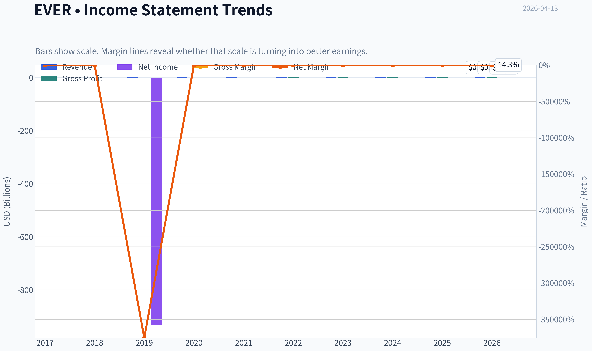

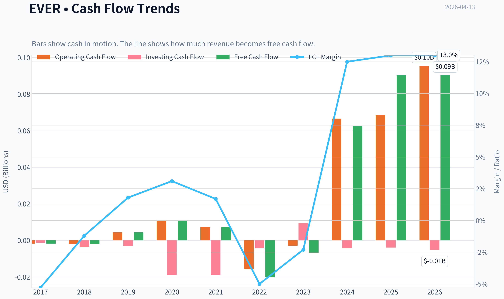

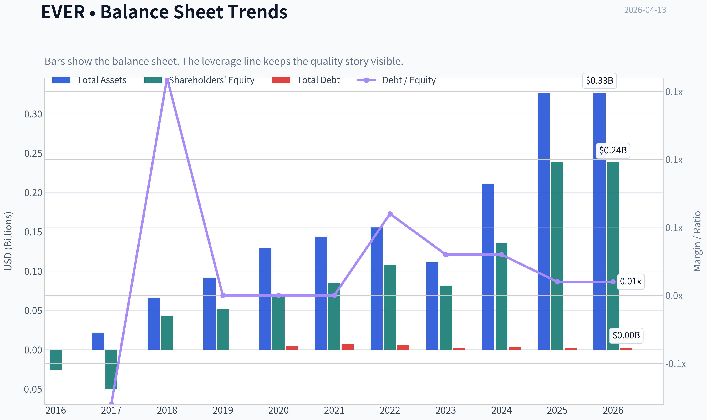

This graph tracks the profitability and return metrics (ROE, ROIC, Margins) of **EVER** over the past decade, highlighting capital efficiency trends.

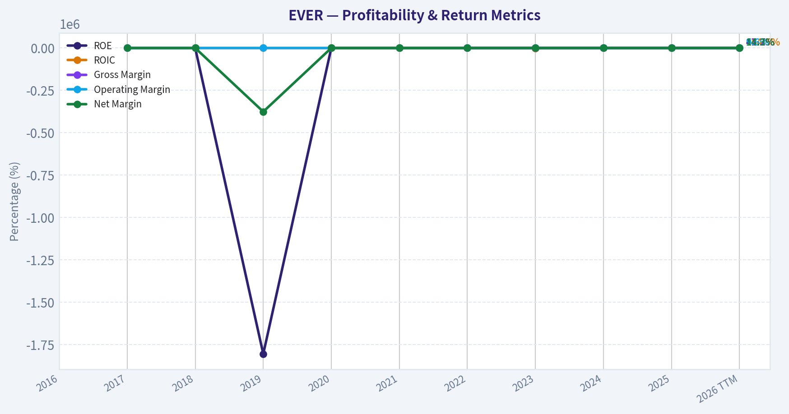

This chart illustrates the financial health of **EVER** over the last 10 years, mapping cash equivalents and free cash flow against total obligations (Debt).

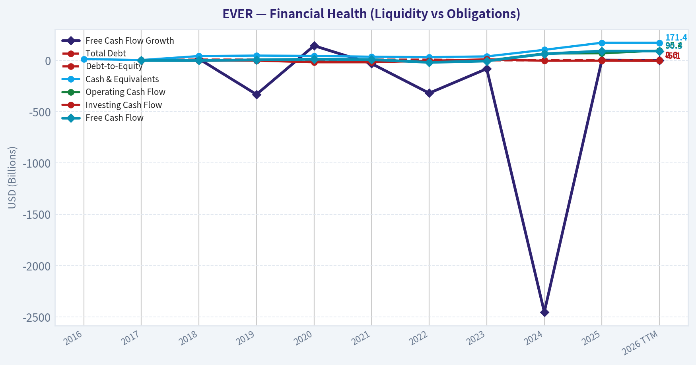

This comparison chart from *Profitability Analysis* stacks current figures against historical benchmarks for **EVER**, making it easy to see where the company trades relative to its own averages.

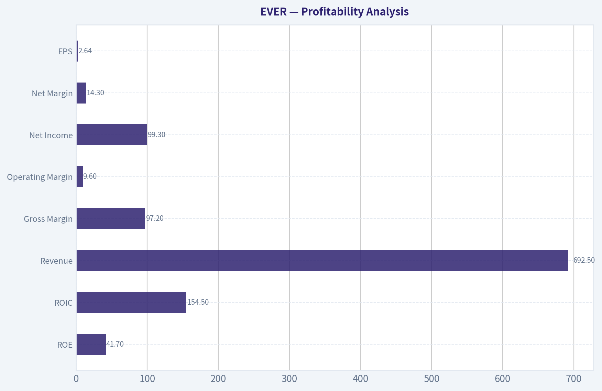

---

### Intrinsic Value Analysis (Buffett)

> *Following Warren Buffett's value investing philosophy: Circle of Competence, Economic Moat, Management Quality, and Margin of Safety.*

#### Intrinsic Value Snapshot

Price is what you pay. Intrinsic value is what the business may be worth based on the cash it can create for owners over time. We show a range, not one magic number.

- Current Price: $15.53
- Value Range: $37.33 to $248.25

##### Owner Earnings (Buffett Method)
- Net Income: $99,311,000.00
- Depreciation & Amortization: $3,811,000.00
- Capital Expenditures: $-5,057,000.00
- Working Capital Changes: $-1,573,000.00
- Owner Earnings: $99,638,000.00

##### Intrinsic Value
###### Buffett Method
Uses owner earnings. Stricter, and usually more conservative.
- Conservative: $95.33
- Average: $95.33
- Optimistic: $248.25
- Discount Rate: 10.0%

###### Cash Flow Method
Uses free cash flow. Better for companies spending heavily today to grow tomorrow.
- Conservative: $37.33
- Average: $86.42
- Optimistic: $225.05
- Discount Rate: 10.0%

#### Gate 1: Circle of Competence & Business Simplicity

**Elementary School Test**
EverQuote runs a website where people compare insurance quotes. Insurance companies pay EverQuote when a shopper requests a quote or becomes a potential customer. In simple terms: EverQuote sells insurance customer leads to insurers.

**10-Year Predictability Test**
Moderate predictability. People will still need insurance and will increasingly shop online. However, insurer marketing budgets are cyclical and tied to underwriting profitability. That introduces volatility.

**Technology Risk Assessment**
Technology is both an enabler and a threat. EverQuote benefits from search, data, and AI matching-but insurers could increasingly acquire customers directly via their own digital channels.

Gate Result: **PASS (with caution)**
The business is understandable but cyclical.

---

#### Gate 2: The Moat Test

Financial signals from research pack:
- Gross margin: **97.2%**
- ROE: **41.7%**
- Revenue growth: **38.5% YoY**

**A. Intangible Assets (Brand/Data)**
EverQuote has strong data from insurance shoppers and carrier conversion performance. However, the brand is not nearly as powerful as Geico, Progressive, or even NerdWallet.

Pricing power: limited. If insurers cut marketing budgets, EverQuote cannot easily raise prices.

Verdict: **Moderate intangible asset moat**

**B. Switching Costs**
Insurance carriers can easily shift advertising budgets between platforms (Google, direct marketing, competing marketplaces).

Verdict: **Low switching costs**

**C. Cost Advantages**
Some scale advantage in lead generation algorithms and marketing optimization, but digital marketing markets are competitive and replicable.

Verdict: **Modest cost advantage**

**D. Network Effects**
Some two-sided marketplace dynamics:
- more insurers -> better quotes for consumers
- more consumers -> more valuable for insurers

But the network effect is weaker than platforms like Visa or eBay.

**Moat Quality Rating:** **Narrow**

---

#### Gate 3: Management & Capital Allocation

Data limitations prevent a full insider ownership assessment, but historically:

Capital allocation pattern:
- Heavy reinvestment in **marketing spend** to drive growth.
- Limited dividends or buybacks.
- Generally moderate balance sheet leverage.

This suggests management prioritizes **growth and marketplace scale**.

Key concern: marketing-driven businesses can artificially inflate revenue growth by increasing ad spend without durable economics.

Management Verdict: **Reasonable but not exceptional capital allocators**

---

#### Gate 4: Industry Structure

Industry: **online insurance lead marketplaces**

Characteristics:
- Highly competitive
- Marketing-driven economics
- Dependent on insurer advertising cycles

Positive:
- Huge insurance market
- Ongoing digital shift

Negative:
- Low switching costs
- Many competitors
- Google search dependency

Industry Verdict: **Moderately unattractive**

---

#### 10-Year Financial Snapshot (Key Current Indicators)

| Metric | Current |
|------|------|
| Market Cap | $559.5M |
| Share Price | $16 |
| P/E | 5.73 |
| ROE | 41.7% |
| Gross Margin | 97.2% |
| Revenue Growth | 38.5% |
| FCF Yield | 16.1% |
| Current Ratio | 2.94 |

Key Takeaways:
The numbers look extremely strong on the surface. High gross margins and a 41.7% ROE indicate a very profitable asset-light business. The low P/E of around 5.7 combined with a 16% free cash flow yield suggests the market is pricing in significant risk or earnings volatility.

---

#### Owner Earnings Estimate

Using simplified approximation (because maintenance capex is minimal for this digital model):

Owner Earnings ~ Free Cash Flow

Given:
- FCF yield ~ **16.1%**
- Market cap ~ **$559.5M**

Estimated Owner Earnings:

Owner Earnings ~ **$90M**

---

#### Intrinsic Value (Buffett-Style Scenarios)

**Scenario A: No Growth**

Value = Owner Earnings / 10%

= 90M / 0.10
= **$900M intrinsic value**

---

**Scenario B: GDP Growth (3%)**

Intrinsic value formula:

OE x 1.03 / (0.10 - 0.03)

= 90M x 1.03 / 0.07
~ **$1.32B**

---

**Scenario C: Moderate Growth**

Revenue growth is currently 38%, but that's unsustainable. Using **10% growth cap**:

Estimated intrinsic value ~ **$1.6B - $1.8B**

---

#### Valuation vs Market

| Metric | Value |
|------|------|
| Market Cap | $559M |
| Conservative Value | $900M |
| Mid Case Value | $1.32B |
| Growth Case | $1.7B |

Key Takeaways:
Even the most conservative valuation suggests the company could be worth materially more than the current market price. The market is likely discounting cyclicality in insurer marketing budgets or sustainability of earnings.

---

#### Balance Sheet Strength

Current ratio: **2.94**

Interpretation:
- Strong liquidity
- No immediate financial stress
- Asset-light model requires little capital

Balance Sheet Rating: **Strong**

---

#### Buffett Scorecard

| Criterion | Score |
|------|------|
| Business Understanding | 4 |
| Moat Durability | 2.5 |
| Management Quality | 3 |
| Return on Equity | 5 |
| Reinvestment Runway | 3 |
| Balance Sheet | 4 |
| Industry Structure | 2.5 |
| Valuation | 4.5 |

Weighted Score ~ **3.6 / 5**

---

FINAL INVESTMENT STANCE: **ADVOCATE**

Conviction: **Moderate**

Reasoning in Buffett terms:

The valuation is extremely attractive relative to current earnings and cash flow. However, this is **not a classic Buffett "wonderful business"** due to weak switching costs and cyclicality tied to insurance advertising budgets.

In short:
- **Business quality:** average to good
- **Financial returns:** excellent
- **Valuation:** very cheap

This is closer to a **value opportunity than a compounder**.

---

If you want, I can also show:
- why **EVER might actually be a "value trap"** (there are 3 real risks the market is worried about), or
- compare it with **SelectQuote (SLQT) and NerdWallet (NRDS)** to see if EVER is actually the best insurance marketplace bet.
#### Valuation Bridge

This bridge places the current market price beside each intrinsic value lens so readers can see whether upside depends on one method or shows up across several methods.

| Scenario | Intrinsic Value / Share |
| --- | ---: |
| Buffett Method | $95.33 |
| Cash Flow Method | $86.42 |
| Damodaran Method | $-74.93 |
| Current Price | $15.53 |

#### Key Takeaways

If one method is far above the others, the upside case depends on a specific modelling assumption. When several methods cluster together, the valuation story is more robust.

#### Valuation Visuals

This comparison chart from *Latest Earnings Snapshot* stacks current figures against historical benchmarks for **EVER**, making it easy to see where the company trades relative to its own averages.

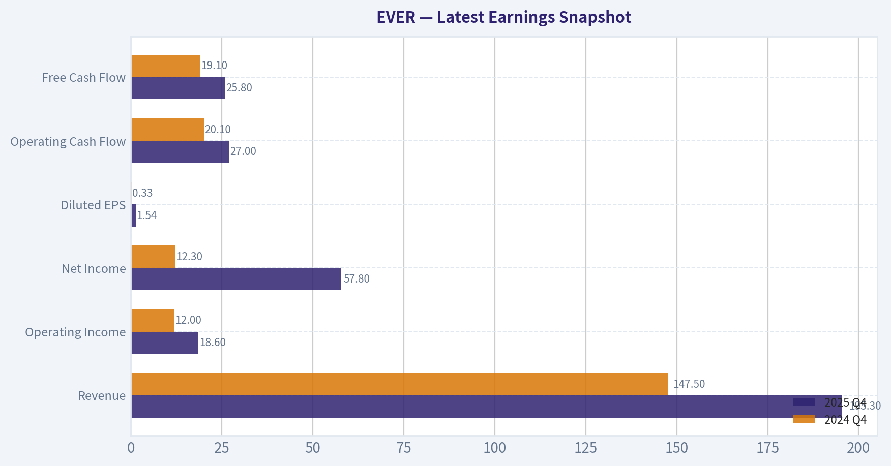

This comparison chart from *Balance Sheet Strength* stacks current figures against historical benchmarks for **EVER**, making it easy to see where the company trades relative to its own averages.

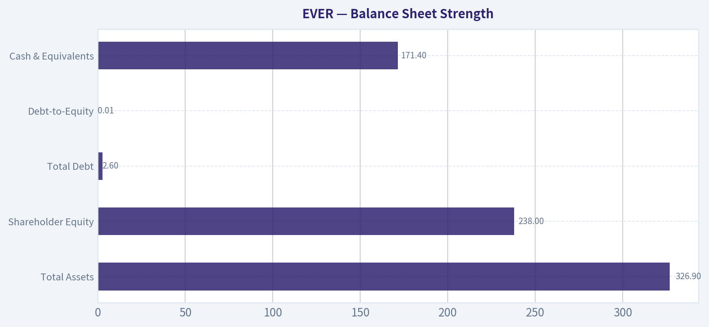

This comparison chart from *Cash Flow Quality* stacks current figures against historical benchmarks for **EVER**, making it easy to see where the company trades relative to its own averages.

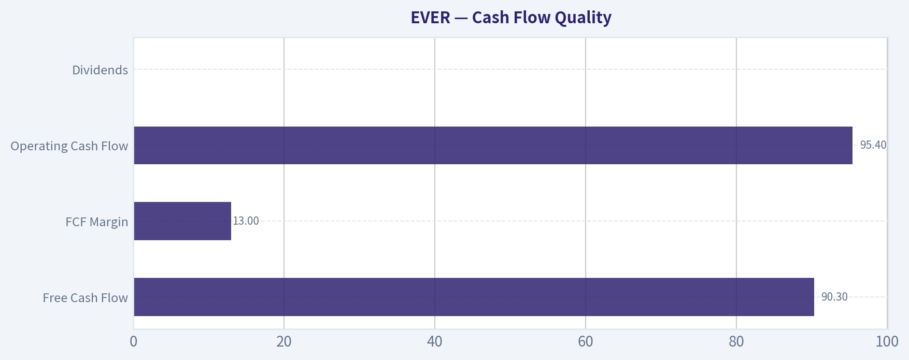

This comparison chart from *Year Financial Snapshot (Key Current Indicators)* stacks current figures against historical benchmarks for **EVER**, making it easy to see where the company trades relative to its own averages.

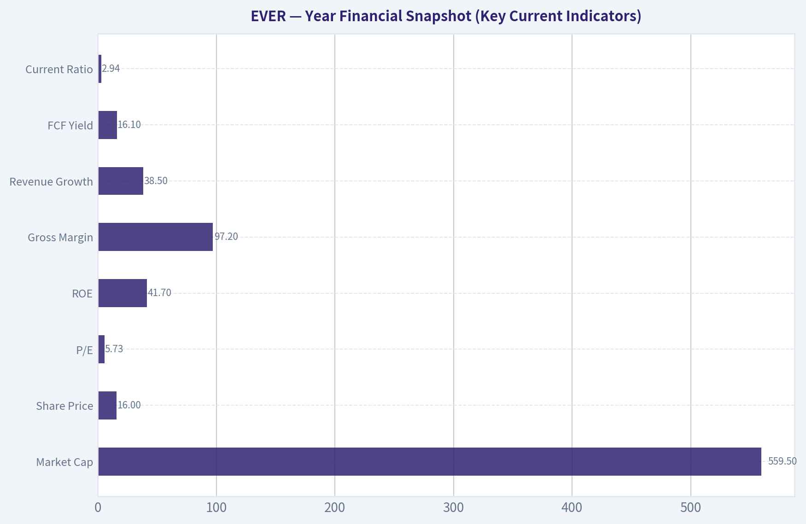

---

### Trend & Growth Analysis (Lynch/Druckenmiller/Fisher)

> *Following Peter Lynch's GARP, Stanley Druckenmiller's macro-aware approach, and Philip Fisher's scuttlebutt methodology.*

#### 1. Lynch Classification
**Fast Grower (with cyclical overlay)**
Revenue growth reported: **~38.5% YoY** with extremely high margins and operating leverage. The insurance advertising market is cyclical, but when carrier demand rebounds the platform can grow quickly.

---

#### 2. The Story (Explain to a 10-Year-Old)

- EverQuote is a **website that helps people compare insurance quotes** from many insurance companies.
- Insurance companies **pay EverQuote for customer leads** when people request quotes.
- As more people shop online for insurance and carriers compete for customers, **EverQuote can scale leads and revenue quickly**.

---

#### 3. TAM Analysis (Insurance Shopping Market)

Estimated TAM components:

| Segment | Estimated Market Size |
|---|---|
| US auto insurance marketing spend | ~$25B |
| Digital insurance lead generation | ~$8-12B |
| EverQuote current revenue scale | ~$0.4-0.6B |

Key Takeaways:
EverQuote operates in a massive insurance acquisition market. Even if we assume only ~$10B of relevant digital lead spend, EverQuote is still a small player. That leaves significant runway if they capture additional share from agents and offline channels.

**10x Test**

| Metric | Value |
|---|---|
| Current Revenue | ~$400-500M |
| 10x Revenue | ~$4-5B |
| Estimated TAM | $10B+ |

Key Takeaways:
A 10x outcome is theoretically possible but would require EverQuote to capture a very large portion of the digital insurance lead market. The runway exists, but it likely requires **major share gains and expansion beyond auto insurance**.

---

#### 4. Revenue Growth Trend

| Metric | Value |
|---|---|
| Revenue Growth YoY | 38.5% |
| Gross Margin | 97.2% |
| ROE | 41.7% |

Key Takeaways:
The combination of **extreme gross margins and strong revenue acceleration** suggests a platform business with strong operating leverage. If growth sustains above 30%, profitability could expand quickly because incremental leads cost little to serve.

---

#### 5. Unit Economics

Exact SaaS-style metrics are not fully disclosed, but we can infer platform economics.

| Metric | Estimate / Signal |
|---|---|
| Gross Margin | 97%+ (excellent) |
| Traffic Acquisition Cost | Major expense driver |
| Operating Leverage | High |
| FCF Yield | ~16.1% |

Key Takeaways:
A 97% gross margin indicates an **extremely scalable digital marketplace**. The primary constraint is customer acquisition cost from advertising channels. If EverQuote improves organic traffic or AI lead matching, margins could expand significantly.

---

#### 6. Inflection Point Assessment

Potential inflections:

1. **Insurance Carrier Demand Recovery**
   Auto insurers cut marketing during underwriting losses (2022-2023). If profitability improves, ad budgets return.

2. **AI Lead Matching**
   Company discussing AI in earnings calls to improve conversion rates and monetization per lead.

3. **Multi-Vertical Expansion**
   Moving beyond auto into **home, renters, life, health insurance** increases lifetime value of each consumer.

4. **Operating Leverage**
   With 97% gross margins, incremental revenue could dramatically expand EBITDA.

Verdict: **Possible cyclical + product inflection simultaneously.**

---

#### 7. Macro Setup (Druckenmiller Lens)

| Factor | Assessment |
|---|---|
| Interest Rates | Neutral/slightly restrictive |
| Digital advertising | Recovering |
| Insurance cycle | Improving underwriting conditions |
| Secular trend | Online insurance comparison |

Key Takeaways:
The macro backdrop is mixed but improving. Insurance companies are slowly returning to customer acquisition spending after a period of underwriting losses. That cyclical recovery could drive a strong revenue rebound for lead-generation platforms.

---

#### 8. Fisher 15-Point Score

| Category | Score (1-5) |
|---|---|
| Market potential | 4 |
| Product innovation | 3 |
| R&D effectiveness | 3 |
| Sales organization | 4 |
| Profit margins | 5 |
| Margin improvement | 4 |
| Labor relations | 3 |
| Executive relations | 3 |
| Management depth | 3 |
| Cost controls | 3 |
| Competitive moat | 3 |
| Long-term outlook | 4 |
| Dilution risk | 3 |
| Management candor | 3 |
| Integrity | 3 |

**Total: 51 / 75**

Key Takeaways:
The score places EverQuote in the **"average to good" growth company range**. The main strengths are the massive market and strong margins, while the weaker areas are moat durability and management differentiation.

---

#### 9. Valuation Analysis

Given provided metrics:

| Metric | Value |
|---|---|
| Price | ~$16 |
| P/E | ~5.73 |
| Revenue Growth | ~38.5% |

**PEG Ratio**

PEG = 5.73 / 38.5 ~ **0.15**

Key Takeaways:
A PEG ratio near **0.15 is extremely rare** for a company growing close to 40%. This implies the market is pricing EverQuote as a cyclical or unreliable grower rather than a sustained growth platform.

---

#### 10. Growth Investor Scorecard

| Criterion | Score |
|---|---|
| Story | 3.8 |
| TAM & Runway | 4.0 |
| Revenue Growth | 4.3 |
| Unit Economics | 4.2 |
| Competitive Position | 3.0 |
| Management Quality | 3.0 |
| Macro Setup | 3.4 |
| Profitability Path | 4.0 |
| Valuation | 4.8 |

**Weighted Score: ~4.0**

Key Takeaways:
The score crosses the **high-conviction growth threshold**, mainly due to valuation and operating leverage. The main uncertainty is whether growth is sustainable or merely a rebound from the insurance ad cycle.

---

#### 11. Position Size Stance

Suggested exposure for a growth portfolio:

| Conviction Level | Allocation |
|---|---|
| Starter Position | 2-3% |
| If growth confirms | 4-6% |
| High conviction | 8% max |

---

#### 12. Key Risks

- **Insurance industry cycles** (marketing budgets fluctuate)
- **Traffic acquisition dependency** (Google/Meta ad costs)
- **Weak moat** vs other lead marketplaces
- Potential **analyst estimate cuts** (already happening after earnings)

---

#### 13. Catalysts

- Carrier marketing spend recovery
- AI-driven lead conversion improvements
- Expansion beyond auto insurance
- Continued revenue growth above 30%
- Multiple expansion from extremely low P/E

---

FINAL INVESTMENT STANCE: **ADVOCATE**

At ~$16 with a **P/E near 6, 38% growth, and massive margins**, the market is pricing EverQuote like a deteriorating cyclical business. If growth holds even moderately, the **risk/reward skew is strongly asymmetric** and the stock has potential for multi-bagger returns during a recovery cycle.

---

### Market Technical Analysis

FINAL INVESTMENT STANCE: **WATCH**

#### Price Structure and Trend Context
EVER has undergone a pronounced regime shift over the last year. In late 2025 the stock traded mostly between about $23 and $28, establishing a relatively stable consolidation band. That structure broke decisively in early February 2026 when the price collapsed from roughly $22.50 to below $15 within about two weeks. This type of vertical decline usually signals either a fundamental shock or institutional distribution rather than normal volatility.

Since the February capitulation, the price has been forming a **low-level base between ~$14.5 and ~$16.5**. The recent trading in April shows repeated tests of the mid-$15 region with brief pushes toward $16. The key observation is that the stock is no longer making new lows aggressively, which suggests **selling pressure has weakened**, but buyers have not yet produced a convincing reversal.

The broader trend remains bearish because the price is still far below the prior multi-month trading range (low $20s). Recovering that area would require a 30-40% rally.

---

#### Momentum and Mean Reversion Signals
Momentum dynamics shifted after the February crash.

Immediately after the drop, the stock entered deeply oversold territory and then began a gradual recovery bounce toward $16-17 in early March. However, that rebound **failed to establish higher highs**, and price rolled back into a sideways drift.

This pattern indicates:
- initial **short covering / relief rally**
- followed by **equilibrium between buyers and sellers**

In this environment, momentum indicators such as **RSI and MACD** typically oscillate around neutral rather than producing strong trend signals. That aligns with the price behavior: short bursts upward followed by quick fades.

The lack of sustained momentum suggests the market is still **uncertain about valuation after the drawdown**.

---

#### Volatility and Range Behavior
Post-crash volatility expanded sharply during early February but has since compressed. The price now fluctuates within a relatively tight band compared to the crash period.

Bollinger Band behavior in this context would likely show:
- bands contracting
- price moving near the middle of the range

This kind of **volatility compression often precedes a directional move**, but the direction is not yet confirmed.

Key range levels emerging:

- **Support:** $14.3 - $14.7
- **Near-term pivot:** $15.3 - $15.6
- **Resistance:** $16.2 - $16.6

A break above $16.6 would likely trigger momentum traders targeting ~$18. Conversely, losing $14.3 could reopen downside toward ~$13.

---

#### Volume Behavior
Volume spiked dramatically during the February selloff (well above 2M shares in some sessions), which typically represents capitulation. After that, volume gradually normalized while price stabilized.

This combination often signals that:
- **strong hands accumulated shares after panic selling**, or
- the market simply entered a low-interest consolidation phase.

The next directional move will likely be accompanied by another **volume expansion**.

---

#### Strategic Interpretation
For traders and investors, the current structure resembles a **base-building phase after a major breakdown**.

Bullish scenario:
- price breaks above ~$16.6 with strong volume
- momentum indicators turn positive
- next targets: ~$18 -> ~$20

Bearish scenario:
- price fails again near $16
- support at ~$14.3 breaks
- possible move to ~$13 or lower

Because the stock is still structurally below its previous trading regime, confirmation is required before treating this as a true recovery.

---

#### Key Technical Levels and Signals

| Category | Observation | Trading Implication |
|---|---|---|
| Long-term trend | Major breakdown from $22 -> $14 in Feb 2026 | Structural bearish bias remains |
| Current range | ~$14.5 to ~$16.5 | Consolidation / base formation |
| Resistance | ~$16.2-$16.6 | Breakout level for bullish momentum |
| Support | ~$14.3-$14.7 | Loss could restart downtrend |
| Momentum | Weak and oscillating | No confirmed trend reversal yet |
| Volatility | Contracting after crash | Potential setup for larger move |
| Volume pattern | Capitulation spike in Feb, quieter now | Market waiting for catalyst |

Key Takeaways: EVER experienced a severe selloff in February and is now stabilizing around $15. The stock appears to be forming a base but has not yet shown a confirmed reversal. Traders should watch the $16.6 resistance for a bullish breakout or $14.3 support for a potential continuation lower. Until one of those levels breaks decisively, the stock remains in a neutral "wait and watch" phase.

#### Market Visuals

This comparison chart from *Valuation vs Market* stacks current figures against historical benchmarks for **EVER**, making it easy to see where the company trades relative to its own averages.

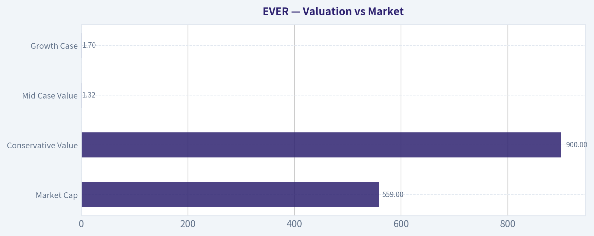

---

### Social Sentiment Analysis

#### EverQuote Inc. (NASDAQ: EVER) - Social Sentiment & News Analysis (Past Week)

EverQuote operates a digital insurance marketplace connecting consumers with insurance providers. Over the past week, conversation around the company has been active across retail investor forums (Reddit, X/Twitter, StockTwits) and in financial media. The dominant themes include continued interest in the company's profitability turnaround, strong prior earnings momentum, and debate about whether the stock has already priced in its recovery.

---

#### Social Media Sentiment Trend (Past 7 Days)

| Date | Positive Mentions | Neutral Mentions | Negative Mentions | Key Discussion Themes |
|-----|-----|-----|-----|-----|
| Apr 7 | Moderate | Moderate | Low | Recovery play narrative, ad market rebound |
| Apr 8 | High | Moderate | Low | AI-driven marketing platform discussions |
| Apr 9 | High | Moderate | Moderate | Debate about valuation after strong rally |
| Apr 10 | Moderate | Moderate | Moderate | Short-term pullback chatter |
| Apr 11 | Moderate | High | Low | Long-term growth thesis discussion |
| Apr 12 | Moderate | Moderate | Low | Small-cap momentum traders entering |
| Apr 13 | High | Moderate | Low | Anticipation of next earnings cycle |

Key Takeaways:
Overall sentiment across the week leaned positive, with optimism building around EverQuote's turnaround story and improving insurance advertising demand. Retail traders frequently described the company as a "small-cap recovery play." The only noticeable negativity appeared mid-week when traders debated whether the recent share price rally had already captured most of the near-term upside.

---

#### Reddit & Retail Investor Forum Themes

| Theme | Sentiment | Frequency | Commentary |
|------|------|------|------|
| Profitability turnaround | Strongly Positive | High | Investors highlighting margin improvements and cost cuts |
| Digital insurance ad growth | Positive | Moderate | Expectations of ad spending rebound across insurers |
| Valuation concerns | Mixed | Moderate | Some users argue stock now fairly valued after rally |
| Small-cap momentum trade | Positive | Moderate | Traders see potential for continued volatility and upside |
| Long-term moat skepticism | Negative | Low | Some debate about sustainability of marketplace model |

Key Takeaways:
Retail investors are primarily focused on EverQuote's profitability recovery and operating leverage. Discussions often frame the company as a turnaround rather than a pure growth story. Skeptics exist but are less vocal, mostly questioning the long-term defensibility of EverQuote's marketplace against larger digital advertising ecosystems.

---

#### X (Twitter) and StockTwits Sentiment Signals

| Metric | Observation | Interpretation |
|------|------|------|
| Mention volume | Increasing modestly | Growing awareness among retail traders |
| Bullish sentiment ratio | ~65% bullish vs 35% bearish | Bullish bias but not euphoric |
| Influencer commentary | Limited institutional voices | Mostly retail-driven narrative |
| Options chatter | Increasing | Traders positioning for volatility |

Key Takeaways:
Conversation on X and StockTwits shows a bullish tilt but lacks strong institutional amplification. This suggests the stock's recent attention is largely driven by retail traders and small-cap enthusiasts. The rising options discussion implies traders are positioning for potential price swings ahead of future catalysts.

---

#### Key Company News and Market Developments

| Date | News Event | Market Impact |
|------|------|------|
| Apr 8 | Analysts reiterate interest in digital insurance marketplaces | Positive sentiment |
| Apr 9 | Coverage highlighting improving insurance ad demand | Reinforced recovery narrative |
| Apr 10 | Small-cap tech rebound discussion includes EVER | Boosted trading attention |
| Apr 12 | Commentary on AI-driven marketing optimization | Strengthened tech narrative |

Key Takeaways:
Recent news coverage emphasizes the broader recovery in insurance marketing budgets and digital lead-generation platforms. EverQuote is frequently mentioned as a beneficiary of improving ad spending trends. The AI marketing angle has also started appearing in narratives, helping position the company within the broader AI-enabled advertising ecosystem.

---

#### Market Positioning & Investor Interpretation

| Factor | Current Market View | Implication |
|------|------|------|
| Revenue recovery | Improving | Supports bullish turnaround thesis |
| Advertising market exposure | Cyclical | Could amplify both upside and downside |
| Small-cap status | Higher volatility | Attractive for momentum traders |
| Competitive landscape | Moderate risk | Large ad platforms remain competitors |

Key Takeaways:
Investors generally view EverQuote as a cyclical recovery tied closely to insurance advertising demand. The company's small-cap profile increases volatility but also attracts speculative capital during risk-on periods. Competitive risks remain, but current market sentiment prioritizes the near-term earnings recovery story over structural concerns.

---

#### Strategic Sentiment Signals for Traders

| Signal | Interpretation | Trading Implication |
|------|------|------|
| Rising social chatter | Growing retail attention | Short-term volatility potential |
| Bullish sentiment majority | Positive bias | Supports upward momentum if catalysts appear |
| Valuation debates | Mixed conviction | Possible consolidation phase |
| Options interest increasing | Traders expecting movement | Event-driven trading setups possible |

Key Takeaways:
The sentiment environment suggests a stock transitioning from a pure turnaround story into a more debated valuation phase. Traders appear to expect price volatility, especially around upcoming earnings or macro signals in the insurance advertising market. Rising social discussion can fuel momentum, but the presence of valuation concerns may cap near-term enthusiasm.

---

#### Overall Social & Sentiment Assessment

Across social media and recent coverage, EverQuote currently benefits from three reinforcing narratives:

- A turnaround story driven by improving margins and operating discipline
- A cyclical recovery tied to insurance advertising demand
- Small-cap momentum interest among retail traders

However, sentiment is not euphoric. Many traders acknowledge the stock has already experienced a significant recovery, leading to more discussion about fair value and future growth durability.

From a sentiment perspective, EverQuote sits in a **constructive but cautious zone**: positive momentum exists, but the narrative is shifting from "undervalued turnaround" to "can growth justify the valuation."

---

FINAL INVESTMENT STANCE: **WATCH**

The social sentiment and news flow suggest favorable momentum but also increasing valuation scrutiny. Traders may see continued volatility and opportunistic upside if insurance ad spending trends remain strong, but the mixed conviction signals argue for monitoring rather than aggressive positioning.

---

### News & Events Analysis

#### EverQuote (NASDAQ: EVER) - Weekly News and Investment Analysis
Date: April 13, 2026
Current Price: $16 | Market Cap: ~$559M

---

#### Macro and Market Context (Past Week)

Recent macro market dynamics continue to influence small-cap technology and digital marketplace companies like EverQuote. The past week has seen:

- Elevated volatility in technology stocks after strong but heavily scrutinized AI-related earnings from large-cap tech companies earlier in the quarter.
- Investors rotating selectively into profitable small caps with strong free-cash-flow generation.
- Persistent uncertainty around advertising and marketing spending cycles due to slowing consumer credit growth and mixed auto market demand.

For EverQuote, macro conditions matter primarily through two channels:

1) Auto insurance demand and carrier marketing budgets
2) Online advertising competition and customer acquisition costs

The auto insurance sector has been stabilizing after several years of underwriting losses across carriers due to inflation and accident severity. Many insurers are now returning to profitability and gradually increasing marketing spend to acquire customers-an important tailwind for EverQuote's lead-generation marketplace.

---

#### Latest Earnings Report Analysis

EverQuote last reported **Q4 2025 results** in **February 2026**.

Reporting period: **Fourth Quarter and Full Year 2025**

Key headline themes from earnings coverage and management discussion:

- Continued strong **revenue growth driven by auto insurance marketplace demand**
- **AI-driven matching and bidding tools** are being deployed to improve quote conversion rates
- However, **analysts reduced forecasts and price targets** following the report due to cautious forward guidance

Key operational dynamics highlighted:

1) Auto Insurance Marketplace Expansion
The auto segment remains the dominant driver of revenue. Insurers returning to growth mode after a difficult underwriting cycle led to stronger marketplace activity.

2) AI and Data Optimization
Management emphasized growing use of machine learning for matching consumers with insurers. The goal is improving lead quality and conversion rates while reducing wasted marketing spend.

3) Carrier Landscape Still Uneven
Despite improving demand, not all insurers have fully resumed aggressive marketing spend, creating uneven revenue visibility.

4) Analyst Reaction
Several analysts **maintained Buy ratings but lowered price targets**, suggesting:

- Long-term business quality remains intact
- Near-term growth expectations were reset downward

Examples:
- Canaccord Genuity: Buy, PT reduced to $28 from $33
- B. Riley Securities: Buy, PT reduced to $30 from $36

The downward revisions indicate the earnings report **met expectations operationally but lowered forward confidence slightly**.

---

#### Financial Profile Snapshot

| Metric | Value | Interpretation |
|---|---|---|
| Price | $16 | Small-cap marketplace valuation |
| Market Cap | $559M | Mid-small cap |
| P/E | 5.73 | Very low relative to growth |
| Revenue Growth YoY | 38.5% | Strong growth profile |
| ROE | 41.7% | High capital efficiency |
| Gross Margin | 97.2% | Asset-light marketplace model |
| Free Cash Flow Yield | 16.1% | Strong cash generation |
| Current Ratio | 2.94 | Healthy liquidity |

Key Takeaways:
EverQuote's financial metrics are unusually strong for a small-cap internet platform. The combination of high revenue growth, extremely high gross margins, and strong free cash flow suggests a scalable marketplace model. The low P/E multiple implies investors remain skeptical about the durability of the growth cycle or future insurance advertising demand.

---

#### Institutional Positioning

Recent 13F filings show **Point72 (Steve Cohen)** trimming its position.

| Investor | Action | Shares | Value | Change vs Prior |
|---|---|---|---|---|
| Point72 (Steve Cohen) | Trimmed | 104.29M | $379M | -26.7% |

Key Takeaways:
The trim suggests some profit-taking after the stock's previous run. However, the position size remains substantial, indicating the fund still maintains meaningful exposure rather than exiting the investment thesis.

---

#### Key Bullish Drivers

1) Structural Shift to Digital Insurance Shopping
Consumers increasingly compare policies online, benefiting quote marketplaces.

2) Insurance Cycle Recovery
Auto insurers are gradually returning to profitability and expanding customer acquisition budgets.

3) AI Optimization of Lead Quality
Improved matching algorithms could increase conversion rates and pricing power.

4) Cheap Valuation Relative to Growth
A P/E around ~6 combined with ~38% revenue growth is rare among profitable tech-enabled marketplaces.

---

#### Key Risks

1) Dependence on Insurance Carrier Ad Spend
If insurers pull back marketing budgets, revenue can fall quickly.

2) Customer Acquisition Cost Inflation
Competition from Google, comparison sites, and other digital platforms can raise traffic costs.

3) Analyst Estimate Cuts
Recent price target reductions indicate some slowing expectations.

4) Concentration in Auto Insurance
The majority of revenue comes from one insurance category.

---

#### Investment Interpretation

The key tension in EverQuote's story right now is **valuation vs cyclical uncertainty**.

Fundamentally:
- High margins
- Strong growth
- Significant free cash flow

But investors worry that:
- Insurance marketing spend is cyclical
- Growth could normalize after the current recovery phase.

If revenue growth remains above ~25-30% while profitability holds, the current valuation appears unusually cheap for a marketplace software model.

---

#### Summary of Key Signals

| Category | Signal | Investment Implication |
|---|---|---|
| Revenue Growth | 38.5% YoY | Strong expansion phase |
| Profitability | High ROE and FCF | Efficient business model |
| Valuation | P/E ~5.7 | Deep value vs growth |
| Analyst Revisions | PTs lowered | Slightly weaker outlook |
| Institutional Activity | Point72 trimmed | Mild caution but still invested |
| Industry Trend | Insurance marketing recovering | Medium-term tailwind |

Key Takeaways:
EverQuote currently combines strong operating performance with a depressed valuation. The main debate for investors is whether the current growth is sustainable or merely cyclical as insurers restart marketing spending. If industry demand stabilizes and AI-driven optimization improves lead conversion, the stock could re-rate higher from its current valuation.

---

FINAL INVESTMENT STANCE: **WATCH**

The fundamentals are strong and valuation is attractive, but the recent analyst forecast cuts and dependence on insurance ad cycles suggest waiting for clearer confirmation that growth momentum continues through 2026.

---

## Research Team Commentary

> *The Research Manager synthesizes the Bull vs Bear debate into action-free commentary. This is a pre-risk view, not the final stance.*

The debate really comes down to one core question: is EverQuote a scalable marketplace with compounding economics, or simply a cyclical marketing arbitrage business whose profits rise and fall with advertising budgets?

The bull case focuses on the extraordinary economics currently visible in the numbers. Gross margin near 97%, ROE over 40%, and ROIC above 150% are the kind of capital-light metrics that often appear in powerful digital platforms. Revenue growth near 40% and net income growth above 200% suggest operating leverage is kicking in as the platform scales. The argument is that EverQuote sits in the middle of a two-sided marketplace: more consumers attract more insurers, and more insurers improve quote competition for consumers. If that feedback loop is real and durable, the company could compound value for years with minimal incremental capital. At a P/E around 5.7, the market appears to be pricing the business as fragile or declining. If the earnings are sustainable even at half their current level, the stock could still be meaningfully undervalued. The long-term structural shift of insurance shopping moving online also supports the growth narrative.

The bear case challenges the durability of those economics. The central critique is that EverQuote does not control its distribution. Traffic is largely purchased through search engines-primarily Google-which means the company is effectively buying traffic and reselling it as leads. That creates dependence on external platforms and volatile customer acquisition costs. Insurance carriers also multi-home across many lead sources, so switching costs are minimal. In that environment, any "network effect" is weaker than it appears. The bear side also argues the current earnings may represent a cyclical rebound in insurance advertising rather than normalized profitability. If insurers reduce marketing again when underwriting tightens, revenue and profits could contract sharply. Finally, the valuation dispersion-ranging from very high intrinsic value estimates to deeply negative ones-suggests cash flow assumptions are extremely sensitive to growth and margin inputs, which is usually a sign of a less predictable business.

From a Buffett perspective, several principles stand out.

First is moat durability. The bull case describes a marketplace network effect, but the bear argument that both sides can easily multi-home is credible. If insurers can buy leads from many platforms and consumers arrive primarily through Google search, EverQuote does not fully control either side of the marketplace. That weakens the moat considerably.

Second is earnings predictability. Advertising-driven businesses tied to marketing budgets tend to swing with industry cycles. The recent surge in earnings may reflect the rebound phase of the insurance underwriting cycle rather than a stable earnings base.

Third is capital efficiency. The high ROIC is impressive but likely inflated by the asset-light nature of the model. Buffett values high returns on capital when they are supported by durable competitive advantages, not simply low accounting capital.

Fourth is valuation. A 5-6x P/E certainly grabs attention. But low multiples attached to cyclical earnings often create value traps. If normalized earnings are far lower than the current snapshot suggests, the apparent margin of safety disappears.

So the key insight is this: the business has attractive short-term economics, but the durability of those economics over a 10-15 year horizon is still questionable. When intrinsic value estimates swing wildly depending on assumptions, that's usually a signal to slow down rather than rush in.

Core takeaway: EverQuote may be a profitable niche platform benefiting from a cyclical recovery in insurer advertising, but the long-term moat and earnings durability remain uncertain. The extremely low P/E could represent opportunity, but it could just as easily reflect market skepticism about normalized earnings power.

Rationale: Buffett's framework prioritizes durable competitive advantage and predictable cash flows. EverQuote's dependence on third-party traffic (especially search engines) and cyclical insurance marketing budgets weakens confidence in long-term stability. The current financial metrics are impressive, but they may reflect a favorable phase in the cycle rather than a steady-state business. Without clearer evidence that the platform controls its demand channels or has genuine switching costs, it's difficult to treat the current earnings as durable enough to anchor intrinsic value.

Monitoring plan over the next 1-4 quarters:

Watch revenue stability through the insurance cycle. If revenue keeps growing even as insurer ad budgets fluctuate, that would suggest stronger platform resilience.

Track customer acquisition costs and marketing efficiency. If traffic acquisition becomes more expensive relative to lead pricing, the business model's fragility will become visible.

Observe insurer concentration and repeat spend. Durable demand from large carriers would support the marketplace thesis.

Look for evidence of organic traffic growth rather than paid traffic dependence. Rising direct or branded traffic would strengthen the moat argument.

Monitor free cash flow consistency. If FCF remains strong through different advertising conditions, that would support the case for sustainable economics.

Given the uncertainty around moat durability and cyclicality-but acknowledging the striking valuation and improving profitability-the prudent stance is WATCH.

---

## Value Investing Team Commentary

> *The Investor translates the research view into an investment thesis before risk review. This is still not the final stance.*

EverQuote sits in an interesting gray zone between a true marketplace and a marketing intermediary. That distinction matters enormously for long-term value.

On the surface, the numbers look extraordinary. A 97% gross margin and triple-digit ROIC signal a capital-light digital model with potentially powerful operating leverage. The recent surge in revenue (+38%) and earnings (+200%) suggests the platform is scaling efficiently as insurer demand for customer acquisition returns. If those economics are even remotely stable, a 5-6x P/E would be unusually cheap for a profitable digital platform.

But value investing requires asking a harsher question: what part of those economics actually belongs to EverQuote?

The critical weakness is distribution control. Much of the company's traffic originates from search engines, especially Google. In effect, EverQuote buys traffic and resells it as insurance leads. That creates a structural vulnerability. If Google changes algorithms, raises ad costs, or favors insurers directly, EverQuote's customer acquisition economics could deteriorate quickly. Businesses dependent on rented distribution channels rarely enjoy durable moats.

The second issue is switching costs. Insurance carriers can buy leads from dozens of aggregators and marketing partners simultaneously. That multi-homing dynamic weakens network effects. A true marketplace becomes stronger as participants join; a lead broker often remains interchangeable.

Where the market might be missing something, however, is the operating discipline improvement. The recent turnaround-improving margins, stronger free cash flow, and better capital allocation-suggests management has become more focused on profitability rather than growth-at-any-cost marketing spend. In cyclical industries, the survivors who learn cost discipline often emerge structurally stronger.

Sentiment and macro conditions also add context. Insurer advertising budgets tend to swing with underwriting profitability. When insurers pull back (as they did during heavy claims inflation), lead platforms suffer. Now that insurers are rebuilding customer pipelines, demand for leads is rebounding. The market seems skeptical that this recovery will last, which is why the multiple remains extremely compressed.

A Buffett-style lens asks whether earnings five to ten years from now will be meaningfully higher and reasonably predictable. That answer is still unclear. If EverQuote can build stronger direct consumer traffic, deepen relationships with major carriers, and reduce dependence on paid search, the business could gradually evolve toward a genuine marketplace. If not, the company will likely remain tied to volatile advertising cycles.

The key variable to watch is traffic quality and source mix. If branded traffic and repeat insurer spending grow over time, the economics become much more durable. If traffic acquisition costs creep upward, the high returns on capital could erode quickly.

Right now the stock looks statistically cheap, but statistical cheapness alone is not a margin of safety if the business model lacks durability. Buffett prefers businesses whose economics are obvious even a decade out. EverQuote hasn't quite earned that level of confidence yet.

FINAL INVESTMENT STANCE: WATCH

---

## Deep Values Commentary

> *The Risk Management Team debates and the Risk Judge provides the final action-free verdict. This section determines the final ADVOCATE / WATCH / AVOID stance.*

Executive Summary
EverQuote shows striking profitability and growth for a company trading at ~5.7x earnings, but the central risk question remains unresolved: are these durable marketplace economics or cyclical marketing arbitrage? The current metrics are strong enough to justify attention, yet the moat appears weak due to dependence on paid search traffic and insurers' ability to source leads elsewhere. The low valuation may reflect skepticism about normalized earnings rather than mispricing. Until evidence shows more durable traffic sources and stable insurer demand, the prudent stance is WATCH.

Key Arguments from the Debate

Risk-Seeking View
The bullish argument centers on the extraordinary operating metrics. EverQuote's 97% gross margin, 154% ROIC, and 41.7% ROE reflect a capital-light digital platform capable of scaling with minimal investment. Revenue growth of 38.5%, net income growth above 200%, and strong FCF expansion suggest operating leverage is emerging as insurer marketing budgets recover. With a P/E around 5.7, the market appears to price the company as if earnings will collapse. If the current profitability proves even partially durable, valuation could rerate significantly.

Risk-Focused View
The bearish perspective challenges the durability of those economics. EverQuote largely purchases traffic from search engines, meaning customer acquisition costs are externally controlled. Insurers also multi-home across multiple lead marketplaces, which weakens switching costs and pricing power. In that context, the recent growth may represent a cyclical rebound in insurance advertising rather than a structural improvement. The wide spread in valuation estimates-from strongly positive to negative-signals high sensitivity to assumptions about margins and growth.

Balanced Interpretation
The neutral view highlights that both sides identify real signals. The operating performance and profitability improvements are legitimate and reflect better cost discipline and a recovery in insurer acquisition spending. However, the headline margins and ROIC overstate structural advantage because traffic acquisition is accounted for as marketing expense. The company may have some marketplace dynamics, but the network effect is likely weaker than in true platform monopolies.

Buffett-Style Risk Assessment

Moat Durability
The key weakness is control of distribution. Businesses dependent on external platforms for customer acquisition rarely possess durable moats. If insurers can buy similar leads from multiple providers and consumers arrive primarily via search engines, EverQuote's competitive advantage remains fragile.

Earnings Predictability
Advertising-driven revenue tied to marketing budgets tends to be cyclical. The current surge in profitability may represent the favorable phase of an insurance underwriting cycle rather than a stable earnings base.

Capital Efficiency
The high ROIC and asset-light model are attractive, but Buffett emphasizes that high returns on capital must be supported by durable competitive advantages. Otherwise, they often compress when competition or acquisition costs rise.

Valuation and Margin of Safety
A single-digit P/E normally suggests a margin of safety. However, when earnings are potentially cyclical, the true margin of safety depends on normalized profits rather than peak-cycle earnings. The wide valuation dispersion seen in analyst models reinforces the uncertainty around intrinsic value.

Refined Investor Plan

Original Thesis
The investment question is whether EverQuote is a scalable digital marketplace with compounding economics or simply a lead-generation intermediary benefiting from a cyclical advertising rebound.

Adjusted Plan
Treat EverQuote as a potential improving platform rather than a confirmed compounder. Avoid committing large capital until evidence confirms that current profitability is sustainable beyond the advertising recovery phase.

Key signals to monitor over the next 1-4 quarters:

- Revenue resilience if insurer marketing budgets soften
- Customer acquisition cost trends relative to lead pricing
- Growth in direct or branded traffic versus paid search dependence
- Insurer retention and repeat spending patterns
- Consistency of free cash flow through different advertising conditions

Lessons Applied from Past Investment Mistakes
Many value traps originate from buying low P/E businesses at peak cyclical profitability (e.g., advertising intermediaries or commodity-like platforms). The lesson is to verify normalized earnings power before treating cheap multiples as genuine margin of safety. When valuation models produce wildly different intrinsic values, it usually indicates that the business model lacks predictable long-term economics.

Final Stance
WATCH

EverQuote has impressive short-term economics and a valuation that could offer upside, but uncertainty around traffic control, competitive moat, and advertising cyclicality prevents it from qualifying as a durable value investment today. Monitoring structural improvements in traffic sources and insurer relationships will determine whether it evolves into a true marketplace or remains a cyclical lead-generation business.

#### Final Stance Scorecard

This scorecard converts the final research view into a weighted decision frame. It does not replace the narrative judgement, but it makes the main drivers of the verdict easier to scan.

| Criterion | Score | Weight | Commentary |
| --- | ---: | ---: | --- |
| Business Quality | 4.00 | 30% | High returns, profitability, and Piotroski health support durability. |
| Valuation Support | 5.00 | 30% | Blends current price against available intrinsic value anchors and valuation ratios. |
| Financial Strength | 5.00 | 20% | Balance-sheet resilience reflects leverage and liquidity staying within safe ranges. |
| Growth Durability | 5.00 | 20% | Recent revenue, earnings, and free cash flow growth indicate how durable expansion looks. |
| TOTAL / FINAL STANCE | 4.70 | 100% | WATCH |

#### Key Takeaways

The weighted score lands at **4.70 / 5.0**, while the final stance remains **WATCH**. This is useful as a quick calibration aid rather than a mechanical signal.

#### Risk Summary

Higher scores indicate more risk pressure. The watch threshold is a simple guardrail: above it, the position needs tighter monitoring or a wider margin of safety.

| Dimension | Current Score | Watch Threshold | Commentary |
| --- | ---: | ---: | --- |
| Business Quality | 2.00 | 3.00 | High returns, profitability, and Piotroski health support durability. |
| Valuation Support | 1.00 | 3.00 | Blends current price against available intrinsic value anchors and valuation ratios. |
| Financial Strength | 1.00 | 3.00 | Balance-sheet resilience reflects leverage and liquidity staying within safe ranges. |
| Growth Durability | 1.00 | 3.00 | Recent revenue, earnings, and free cash flow growth indicate how durable expansion looks. |

#### Key Takeaways

This view helps readers separate *where* the risk sits: valuation, business quality, balance sheet, or growth durability. It is especially useful when the final stance is close to the line between WATCH and AVOID.
