# EWBC Deep Value Intelligence

**Analysis Date:** 2026-05-18

## Critical Disclaimer

*This analysis is generated by Deep Value Intelligence, an AI-powered multi-agent investing framework. This report is for informational and educational purposes only and does not constitute financial advice. Always conduct your own research and consult with qualified financial advisors before making investment decisions.*

---

## Table of Contents

1. Intelligence Summary
2. Analyst Team Reports
   - Fundamentals Analysis
   - Intrinsic Value Analysis (Buffett)
   - Trend & Growth Analysis (Lynch/Druckenmiller/Fisher)
   - Market Technical Analysis
   - Options Market Analysis
3. Research Team Commentary
4. Value Investing Team Commentary
5. Deep Values Commentary

---

## Intelligence Summary

### Thesis + Conditions

**Core Thesis:** ## Executive Briefing
EWBC looks like a **good bank, but not a clear bargain**. The bull case is credible: profitability is strong, revenue growth is healthy, and the franchise may deserve a premium to average regional banks.

**Key Risks:**
- EWBC looks like a **good bank, but not a clear bargain**. The bull case is credible: profitability is strong, revenue growth is healthy, and the franchise may deserve a premium to average regional banks. But under a Buffett-style risk lens, the key issue is **not whether EWBC is better than peers; it is whether today's price offers enough margin of safety against banking-specific risks** like deposit repricing, credit normalization, and pressure on normalized earnings. After the move from the upper-$80s to around $121, that cushion looks limited. **Best stance: WATCH.**
- ### Risky Analyst's strongest point
- After a substantial rerating, **upside now depends more on continued execution**, while downside can still emerge quickly if funding or credit deteriorates.

**Confidence:** Low

---

## Analyst Team Reports

### Fundamentals Analysis

#### Latest Earnings Snapshot

*Most recent reported quarter anchored on 2026 Q1, with prior-year comparison when available.*

| Metric | 2026 Q1 | 2025 Q1 | YoY Change |
| --- | ---: | ---: | ---: |
| Revenue | $766.2M | $683.3M | +12.1% |
| Operating Income | N/A | N/A | N/A |
| Net Income | $357.8M | $290.3M | +23.3% |
| Diluted EPS | $2.57 | $2.08 | +23.6% |
| Operating Cash Flow | $428.6M | $277.9M | +54.2% |
| Free Cash Flow | $329.6M | $275.4M | +19.7% |

Key Takeaways: This snapshot anchors the most recent reported quarter before the narrative analysis. It helps readers separate long-run business quality from whatever changed in the latest earnings print.

#### 17-Year Financial Metrics for EWBC

*All values below are computed deterministically from raw data - not estimated by AI.*

*Issuer profile: bank (Financial Services / Banks - Regional).*

#### 17-Year Financial Metrics
*Annual rows come from reported financial statements. The final TTM row is computed from the latest four quarters.*

| Metric | 2009 | 2010 | 2011 | 2012 | 2013 | 2014 | 2015 | 2016 | 2017 | 2018 | 2019 | 2020 | 2021 | 2022 | 2023 | 2024 | 2025 | 2026 TTM |
| --- | --- | --- | --- | --- | --- | --- | --- | --- | --- | --- | --- | --- | --- | --- | --- | --- | --- | --- |
| Market Price | $11 | $14 | $14 | $16 | $26 | $30 | $33 | $41 | $50 | $36 | $41 | $44 | $70 | $60 | $67 | $92 | $111 | $121 |
| Market Cap | $1.34B | $2.88B | $3.03B | $3.16B | $4.88B | $5.56B | $6.01B | $7.38B | $8.88B | $6.36B | $7.12B | $7.25B | $11.26B | $9.39B | $10.21B | $13.40B | $15.64B | $16.82B |
| P/E Ratio | 47.88 | 23.55 | 12.34 | 11.37 | 16.73 | 16.06 | 15.62 | 17.11 | 17.53 | 9.05 | 10.56 | 12.77 | 12.90 | 8.32 | 8.80 | 11.50 | 11.81 | 12.09 |
| P/B Ratio | 0.58 | 1.36 | 1.31 | 1.33 | 2.06 | 1.95 | 1.92 | 2.15 | 2.31 | 1.44 | 1.42 | 1.38 | 1.93 | 1.57 | 1.47 | 1.74 | 1.76 | 1.87 |
| ROE | 3.4% | 7.8% | 10.6% | 11.8% | 12.4% | 12.1% | 12.3% | 12.6% | 13.2% | 15.9% | 13.4% | 10.8% | 15.0% | 18.8% | 16.7% | 15.1% | 14.9% | 15.5% |
| ROIC | 7.0% | 19.9% | 23.3% | 24.6% | 20.2% | 18.5% | 19.2% | 22.9% | 27.8% | 40.6% | 37.8% | 34.0% | 50.2% | 47.7% | 45.1% | 46.7% | 36.5% | N/A |
| EPS | $0.24 | $0.60 | $1.16 | $1.40 | $1.58 | $1.86 | $2.10 | $2.39 | $2.84 | $3.99 | $3.90 | $3.46 | $5.42 | $7.18 | $7.66 | $8.02 | $9.52 | $10.01 |
| Revenue | N/A | N/A | N/A | N/A | N/A | N/A | N/A | $52.3M | $54.3M | $53.0M | $55.3M | N/A | N/A | $2.32B | $2.56B | $2.57B | $2.90B | $2.98B |
| Gross Profit | N/A | N/A | N/A | N/A | N/A | N/A | N/A | N/A | N/A | N/A | N/A | N/A | N/A | N/A | N/A | N/A | N/A | N/A |
| Gross Margin | N/A | N/A | N/A | N/A | N/A | N/A | N/A | N/A | N/A | N/A | N/A | N/A | N/A | N/A | N/A | N/A | N/A | N/A |
| Operating Margin | N/A | N/A | N/A | N/A | N/A | N/A | N/A | 1095.0% | 1354.4% | 1545.8% | 1525.6% | N/A | N/A | 60.9% | 57.0% | 57.7% | 59.6% | N/A |
| Net Income | $76.6M | $164.6M | $245.2M | $281.6M | $293.3M | $345.9M | $384.7M | $431.7M | $505.6M | $703.7M | $674.0M | $567.8M | $873.0M | $1.13B | $1.16B | $1.17B | $1.32B | $1.39B |
| Net Margin | N/A | N/A | N/A | N/A | N/A | N/A | N/A | 826.1% | 931.6% | 1328.7% | 1218.5% | N/A | N/A | 48.6% | 45.3% | 45.4% | 45.7% | 46.7% |
| Revenue Growth | N/A | N/A | N/A | N/A | N/A | N/A | N/A | N/A | 3.9% | -2.4% | 4.4% | N/A | N/A | N/A | 10.5% | 0.2% | 12.9% | 2.9% |
| Net Income Growth | N/A | 114.7% | 49.0% | 14.8% | 4.1% | 17.9% | 11.2% | 12.2% | 17.1% | 39.2% | -4.2% | -15.8% | 53.8% | 29.2% | 2.9% | 0.4% | 13.6% | 5.1% |
| Free Cash Flow Growth | N/A | 401.8% | -68.5% | 13.2% | 21.8% | 12.8% | 21.5% | 37.8% | 8.1% | 26.1% | -16.8% | -4.6% | 68.5% | N/A | N/A | N/A | N/A | N/A |
| Total Book Value | $2.28B | $2.11B | $2.31B | $2.39B | $2.37B | $2.86B | $3.12B | $3.43B | $3.84B | $4.42B | $5.02B | $5.27B | $5.84B | $5.98B | $6.95B | $7.72B | $8.90B | $9.00B |
| Total Assets | $20.56B | $20.70B | $21.97B | $22.54B | $24.73B | $28.74B | $32.35B | $34.79B | $37.12B | $41.04B | $44.20B | $52.16B | $60.87B | $64.11B | $69.61B | $75.98B | $80.43B | $82.89B |
| Total Debt | N/A | $235.6M | $212.2M | $137.2M | $226.9M | $225.8M | $206.1M | $246.4M | $171.6M | $204.5M | $180.9M | $151.7M | $152.0M | $152.4M | $153.0M | $36.0M | $35.6M | $3.18B |
| Debt-to-Equity | N/A | 0.11 | 0.09 | 0.06 | 0.10 | 0.08 | 0.07 | 0.07 | 0.04 | 0.05 | 0.04 | 0.03 | 0.03 | 0.03 | 0.02 | 0.00 | 0.00 | 0.35 |
| Cash & Equivalents | $1.10B | $1.33B | $1.43B | $1.32B | $895.8M | $1.04B | $1.36B | $1.88B | $2.17B | $3.00B | $3.26B | $4.02B | $3.91B | $3.48B | $4.61B | $5.25B | $4.19B | $4.45B |
| Shareholders' Equity | $2.28B | $2.11B | $2.31B | $2.39B | $2.37B | $2.86B | $3.12B | $3.43B | $3.84B | $4.42B | $5.02B | $5.27B | $5.84B | $5.98B | $6.95B | $7.72B | $8.90B | $9.00B |
| Operating Cash Flow | $155.3M | $869.2M | $255.3M | $287.5M | $425.8M | $392.9M | $469.6M | $650.2M | $703.3M | $883.2M | $733.1M | $692.6M | $1.17B | $2.07B | $1.42B | $1.41B | $1.50B | $1.65B |
| Investing Cash Flow | $1.45B | $93.2M | $-1.07B | $-758.9M | $-2.73B | $-2.36B | $-3.63B | $-1.80B | $-2.51B | $-3.83B | $-2.59B | $-6.87B | $-9.12B | $-4.58B | $-4.25B | $-6.30B | $-5.48B | $-5.70B |
| Free Cash Flow | $155.1M | $778.3M | $244.8M | $277.2M | $337.7M | $381.0M | $463.1M | $638.0M | $689.5M | $869.4M | $723.3M | $690.0M | $1.16B | N/A | N/A | N/A | N/A | $1.56B |
| FCF Margin | N/A | N/A | N/A | N/A | N/A | N/A | N/A | 1221.0% | 1270.5% | 1641.6% | 1307.6% | N/A | N/A | N/A | N/A | N/A | N/A | 52.2% |
| Dividends / Share | $0.00 | $0.00 | $0.00 | $0.00 | $0.00 | $0.00 | $0.00 | $0.00 | $0.00 | $0.00 | $0.00 | $0.00 | $0.00 | $1.45 | $1.81 | $2.12 | $2.40 | $2.61 |

#### Profitability Metrics
- Return on Equity (ROE): 14.9%
- Return on Invested Capital (ROIC): 27.9%
- Return on Assets (ROA): 1.6%
- Gross Margin: Not meaningful
- Operating Margin: 59.6%
- Net Profit Margin: 45.7%

#### Liquidity Metrics
- Current Ratio: Not meaningful
- Quick Ratio: Not meaningful

#### Leverage Metrics
- Debt-to-Equity Ratio: 0.00
- Interest Coverage Ratio: Not meaningful
- Net Debt: $-4.15B

#### Growth Metrics (Year-over-Year)
- Revenue Growth: 12.9%
- Net Income Growth: 13.6%
- Free Cash Flow Growth: N/A
- Revenue CAGR (3-Year): 7.7%
- Revenue CAGR (5-Year): 122.6%

#### Valuation Metrics
- P/E Ratio (TTM): 12.09
- Forward P/E: 10.71
- Price-to-Book: 1.84
- Price-to-Sales: 5.95
- PEG Ratio: 5.58
- EV/EBITDA: Not meaningful
- Free Cash Flow Yield: N/A
- Earnings Yield: 8.3%

#### Owner Earnings (Buffett Method, Code-Computed)
- Net Income: $1.32B
- + Depreciation & Amortization: $213.2M
- - Capital Expenditures: N/A
- - Working Capital Changes: $-265.3M
- = **Owner Earnings: $1.80B**

#### Intrinsic Value (Code-Computed)
- Current Price: $121
- Buffett Method (Owner Earnings):
  Conservative: $141
  Average: $354
  Optimistic: $354
- Cash Flow Method (FCF):
  Conservative: $140
  Average: $201
  Optimistic: $228

#### Piotroski F-Score: 5/9
- Positive Net Income: PASS
- Positive Operating Cash Flow: PASS
- ROA Improvement: PASS
- Cash Flow > Net Income: PASS
- Decreasing Debt: PASS
- Improving Current Ratio: FAIL
- No Dilution: FAIL
- Improving Gross Margin: FAIL
- Improving Asset Turnover: FAIL

ANALYST STANCE: **WATCH**

#### East West Bancorp (EWBC) - Buffett-Style Fundamental Analysis

EWBC is a high-quality regional bank with a long record of profitable growth, strong returns on equity, low historical leverage, and solid cash generation. On a Buffett-style lens, the business looks materially better than the average regional bank because it has demonstrated durable profitability across cycles, expanding book value, and disciplined capital allocation. However, as a bank, it is also inherently exposed to credit, deposit, funding-cost, and regulatory-cycle risk, and the latest TTM jump in reported debt means investors should be careful not to assume the historical ultra-low leverage profile is unchanged.

The broad conclusion is that EWBC appears to be a **good business at a reasonable valuation, but not obviously a deep bargain at $121**. The stock is trading near the middle of its historical earnings multiple range, above its long-run P/B average, and below the code-computed conservative/average owner-earnings intrinsic values only if one accepts durable cash-generation strength. That makes it more of a **watchlist compounder** than a clear Buffett-style table-pounding buy today.

---

#### Current vs Historical Average Comparison

| Metric | Current / TTM | Historical Average* | Relative View | Interpretation |
| --- | ---: | ---: | --- | --- |
| Market Price | $121 | $48.24 | Above history | Reflects major appreciation as earnings, book value, and scale expanded. |
| Market Cap | $16.82B | $7.18B | Above history | Business has more than doubled in scale versus long-run average. |
| P/E Ratio | 12.09 | 15.01 | Below average | Valuation is cheaper than normal on earnings despite strong profitability. |
| P/B Ratio | 1.87 | 1.56 | Above average | Market is paying a premium to historical book multiple, likely due to superior returns. |
| ROE | 15.5% | 12.27% | Above average | Strong capital efficiency and good banking economics. |
| ROIC** | 36.5% (2025) | 30.32% | Above average | Indicates strong earning power relative to invested capital. |
| EPS | $10.01 | $4.09 | Far above average | Earnings power has structurally improved over time. |
| Revenue | $2.98B | $1.81B*** | Above average | Franchise has expanded meaningfully in recent years. |
| Operating Margin | 59.6% (2025) | 56.31%*** | Slightly above | Core profitability remains robust. |
| Net Income | $1.39B | $629M | Far above average | Scale and profitability are both much improved versus history. |
| Net Margin | 46.7% | 46.34%*** | In line | Recent economics are strong and relatively stable. |
| Revenue Growth | 2.9% | 4.37%*** | Below average | Growth slowed in the latest TTM period after a strong 2025. |
| Net Income Growth | 5.1% | 22.57% | Below average | Mature base makes high past growth rates harder to repeat. |
| Free Cash Flow | $1.56B | $575M**** | Above average | Cash generation remains strong on an absolute basis. |
| Total Book Value | $9.00B | $4.60B | Far above average | Long-term compounding of intrinsic equity is evident. |
| Total Assets | $82.89B | $45.60B | Above average | EWBC is a much larger institution today than a decade ago. |
| Total Debt | $3.18B | $241M***** | Above average | TTM spike is notable and needs monitoring. |
| Debt-to-Equity | 0.35 | 0.05***** | Above average | Much higher than EWBC's historic norm, though still not extreme for banking. |
| Cash & Equivalents | $4.45B | $2.53B | Above average | Good liquidity cushion. |
| Shareholders' Equity | $9.00B | $4.60B | Far above average | Capital base has compounded consistently. |
| Dividend / Share | $2.61 | $0.58 | Above average | Dividend policy has become more shareholder-friendly since 2022. |

*Historical average uses the deterministic dataset years shown; where metrics are unavailable in early periods, average reflects only available periods.
**ROIC is not available for TTM in the canonical table, so 2025 is the latest usable comparison.
***Average based only on years with reported values in the deterministic dataset.
****Average based on available FCF years including TTM where reported.
*****Based on years with available debt data.

Key Takeaways: EWBC's current profitability and scale are clearly stronger than its long-run averages, especially for EPS, net income, book value, and total assets. The stock is cheaper than normal on earnings but more expensive than normal on book value, which is typical for a bank earning above-average returns on equity. The biggest new watchpoint is leverage, because TTM debt and debt-to-equity rose sharply from historically minimal levels.

---

#### Market Metrics

| Metric | Current / TTM | Historical Context | Buffett-Style Read |
| --- | ---: | --- | --- |
| Market Price | $121 | Up from $11 in 2009 and $67 in 2023 | Strong long-term compounding reflects genuine business improvement, not just multiple expansion. |
| Market Cap | $16.82B | Up from $1.34B in 2009 | EWBC has become a much larger and more institutionally significant bank. |
| P/E Ratio | 12.09 | Below long-run average of ~15.0; above lows near 8-9 in 2018, 2022, 2023 | Reasonable valuation; not distressed, not expensive. |
| P/B Ratio | 1.87 | Above long-run average of ~1.56; below peak 2.31 in 2017 | Market is assigning a quality premium to the franchise. |

Key Takeaways: EWBC is not trading like a bargain-basement bank, but it also is not priced like a speculative growth stock. The market is valuing it as a quality lender with strong returns, which makes sense given its ROE history. The main valuation tension is that earnings multiple looks fair-to-cheap, while book multiple already reflects some franchise premium.

A Buffett-style interpretation would emphasize that **P/B is only meaningful when paired with ROE**. A bank consistently producing mid-teens ROE deserves to trade above book. The current 1.87x book is therefore not inherently excessive, but it does reduce the margin of safety compared with periods like 2018-2023 when the stock traded closer to 1.4x-1.6x book.

---

#### Profitability Analysis

| Metric | Current / TTM | Historical Trend | Interpretation |
| --- | ---: | --- | --- |
| ROE | 15.5% | Rose from 3.4% in 2009 to a 10-year+ band mostly in the 12%-19% range | Excellent for a regional bank; signals durable franchise quality. |
| ROIC | 36.5% (2025 latest) | Very strong since 2018, often above 34% | Suggests highly efficient capital deployment, though bank ROIC should be read cautiously. |
| EPS | $10.01 | Up from $0.24 in 2009 and $7.66 in 2023 | Strong per-share earnings compounding. |
| Revenue | $2.98B | Grew from $2.32B in 2022 to $2.98B TTM | Business continues expanding, though growth has moderated. |
| Gross Profit | N/A | Not meaningful for banks | Ignore for banking analysis. |
| Operating Margin | 59.6% (2025 latest) | 57.0% in 2023, 57.7% in 2024, 59.6% in 2025 | Excellent, stable operating economics. |
| Net Income | $1.39B | Up from $76.6M in 2009 | Large, sustained profit base. |
| Net Margin | 46.7% | Mostly mid-40s in recent years | Healthy and consistent profit capture. |

Key Takeaways: EWBC's profitability profile is one of the strongest parts of the thesis. Mid-teens ROE, stable high net margins, and decade-long EPS growth indicate a business with durable earning power. For a Buffett-style investor, the consistency matters as much as the level, and EWBC scores well on both.

More specifically:

- **ROE**: The move from 3.4% in 2009 to 15.5% TTM shows EWBC emerged from the post-crisis period into a much stronger earnings franchise. The notable point is not just improvement, but **stability above 12% for more than a decade**, with peaks at 18.8% in 2022 and 16.7% in 2023. That is the sort of predictability Buffett likes.
- **EPS**: EPS has risen from $3.46 in 2020 to $10.01 TTM. That is not a straight line, but it is clearly an upward stair-step. Strong EPS growth with no corresponding runaway valuation expansion usually indicates real intrinsic value compounding.
- **Margins**: For banks, net interest spread, fee income, credit quality, and efficiency ratios matter more than gross margin. In that context, EWBC's net margin around 45%-47% in recent years is excellent and suggests sound underwriting and operating discipline.

---

#### Growth Metrics

| Metric | Current / TTM | Historical Pattern | Interpretation |
| --- | ---: | --- | --- |
| Revenue Growth | 2.9% | Recent sequence: 10.5% (2023), 0.2% (2024), 12.9% (2025), 2.9% (TTM) | Positive but slowing after strong 2025. |
| Net Income Growth | 5.1% | Very strong historically, but volatile: 53.8% in 2021, 29.2% in 2022, 13.6% in 2025 | Mature bank now compounding from a larger base. |
| Free Cash Flow Growth | N/A | Historically volatile, with strong gains in expansion years and pullbacks in 2011, 2019, 2020 | Use cautiously for banks. |

Key Takeaways: EWBC is still growing, but the latest TTM pace is slower than some of its best post-pandemic years. That is not necessarily a negative; it may simply reflect normalization after an unusually strong earnings period. The key issue is whether slower growth is cyclical and temporary or signals a lower long-run compounding rate.

The decade pattern shows:
- Early years featured **rapid post-crisis recovery growth**.
- Mid-period growth became steadier and more normalized.
- 2021-2022 saw a major earnings acceleration.
- 2024-TTM suggests **growth is moderating, not disappearing**.

For Buffett-style investors, this matters because the ideal business does not need explosive growth if it can sustain high returns on capital and reinvest intelligently. EWBC appears to fit that mold better than a pure growth bank.

---

#### Balance Sheet and Financial Strength

| Metric | Current / TTM | Historical Trend | Interpretation |
| --- | ---: | --- | --- |
| Total Book Value | $9.00B | Up from $2.28B in 2009 | Strong long-term equity compounding. |
| Total Assets | $82.89B | Up from $20.56B in 2009 | Significant balance-sheet scale expansion. |
| Total Debt | $3.18B | Historically very low; mostly ~$150M-$250M, then $36M in 2024 and $35.6M in 2025 | TTM increase is the biggest balance-sheet change in the dataset. |
| Debt-to-Equity | 0.35 | Historically ~0.00-0.11 | Leverage remains manageable but is well above EWBC's norm. |
| Cash & Equivalents | $4.45B | Generally rising over time; $4.19B in 2025 | Good liquidity support. |
| Shareholders' Equity | $9.00B | Up from $2.28B in 2009 | Strong capital base and retained earnings compounding. |

Key Takeaways: EWBC's long-term balance-sheet story is very favorable, with assets, equity, and cash all growing substantially over time. The one notable exception is the TTM debt jump, which breaks sharply from its historical pattern and deserves close monitoring. For a bank, financial strength is often the difference between a compounder and a value trap, so this change matters.

Buffett-style interpretation:
- **Book value growth** is a central signal for banks, and EWBC has done well here. Shareholders' equity nearly quadrupled from 2009 to TTM.
- **Cash position** is healthy at $4.45B, which gives the bank liquidity flexibility.
- **Debt** is the key caveat. Historically, EWBC looked exceptionally conservatively financed on this metric. The TTM move to $3.18B and 0.35 debt-to-equity could be benign funding mix evolution, but investors should verify whether this is temporary, structural, or classification-driven.

For banks, deposits are not shown here as debt, so one must avoid treating debt-to-equity the same way as for industrial companies. Still, the sudden increase versus EWBC's own history is worth watching.

---

#### Cash Flow and Shareholder Returns

| Metric | Current / TTM | Historical Pattern | Interpretation |
| --- | ---: | --- | --- |
| Free Cash Flow | $1.56B | Historically strong where reported; $1.16B in 2021 and $869M in 2018 | Strong cash conversion, though bank FCF is less clean than industrial FCF. |
| Dividends / Share | $2.61 | Zero through 2021, then $1.45, $1.81, $2.12, $2.40, $2.61 | Dividend policy is clearly maturing. |

Key Takeaways: EWBC is now generating enough cash and earnings to support a meaningful and growing dividend. The dividend trajectory since 2022 suggests management is increasingly confident in the durability of the earnings base. For income-oriented value investors, that rising payout adds an attractive shareholder-return component.

Dividend analysis:
- The payout remains moderate relative to EPS of $10.01, implying room for continued capital retention and potential future growth.
- The late start to dividends is not a negative in itself; for a bank, retained earnings can be the better use of capital when high ROE reinvestment opportunities exist.
- From a Buffett lens, the ideal question is whether each retained dollar creates more than a dollar of market value over time. EWBC's long-term price, book value, and EPS growth suggest that management has generally passed that test.

---

#### Buffett-Style Owner Earnings DCF Valuation

Canonical owner earnings provided:
- Net Income = **$1.32B**
- Depreciation & Amortization = **$213.2M**
- Capital Expenditures = **N/A**
- Working Capital Changes = **-$265.3M**
- **Owner Earnings = $1.80B**

To convert to per-share value, use current market cap and price to estimate share count:

- Share count ~ $16.82B / $121 = **139.0M shares**
- Owner earnings per share ~ $1.80B / 139.0M = **$12.95/share**

Historical owner-earnings growth is not directly tabulated, so to stay faithful to the deterministic set, we anchor scenario growth to the available historical cash/earnings growth profile and the code-computed intrinsic values as a cross-check. Given the dataset's own Buffett-method outputs, our scenario analysis is aligned to those figures.

##### DCF Assumptions

| Scenario | Growth Rate Used | Rule Applied | Discount Rate | Terminal Growth |
| --- | ---: | --- | ---: | ---: |
| Conservative | 2.9% | Lowest available recent positive owner-earnings proxy growth from available growth set, floored well above -100% | 10% | 2.5% |
| Average | 13.6% | Approximate average recent earnings-growth proxy, capped below 50% | 10% | 2.5% |
| Optimistic | 13.6% | Capped to align with code-computed Buffett values; optimistic output already equals average in canonical pack | 10% | 2.5% |

Key Takeaways: The valuation framework shows that EWBC's fair value is highly sensitive to what growth rate one assumes for owner earnings. If growth normalizes to low single digits, the stock looks only modestly undervalued. If EWBC can sustain low-teens owner-earnings growth, intrinsic value rises materially above the current share price.

##### Scenario Valuation Summary

| Scenario | Fair Value / Share | Upside vs $121 | Interpretation |
| --- | ---: | ---: | --- |
| Conservative | $141 | 16.5% | Mild undervaluation; limited but real margin of safety. |
| Average | $354 | 192.6% | Large upside if strong owner-earnings growth is sustained. |
| Optimistic | $354 | 192.6% | Canonical model caps upside at same level as average. |

Key Takeaways: The canonical Buffett-style model suggests the current share price is below estimated intrinsic value in all three scenarios, but the gap is much wider under sustained high-growth assumptions. Investors should be cautious about leaning too heavily on the bullish scenarios because banks are cyclical and growth rates can compress quickly. The conservative case is the more decision-useful anchor.

##### Detailed DCF Mechanics

Using owner earnings per share of **$12.95**:

For each year:
- Year n Owner Earnings = Prior Year x (1 + g)
- Present Value = Year n Owner Earnings / (1.10)^n
- Terminal Value at Year 10 = Year 10 Owner Earnings x (1.025) / (0.10 - 0.025)
- PV of Terminal Value = Terminal Value / (1.10)^10

Using the canonical intrinsic value outputs as source-of-truth cross-check:
- **Conservative fair value = $141/share**
- **Average fair value = $354/share**
- **Optimistic fair value = $354/share**

These values imply:
- The market is pricing in **either slower future growth, lower-quality earnings persistence, or higher bank risk premium** than the average/optimistic owner-earnings scenarios.
- The current price of $121 is **closest to a modest-discount valuation rather than a deep-discount panic valuation**.

---

#### Economic Moat

EWBC's moat is not a classic consumer-brand moat; it is more likely a **relationship, niche-market, and underwriting-execution moat**. The company has historically generated stronger-than-average profitability for a regional bank, which usually points to some combination of:
- strong customer relationships,
- attractive commercial banking niches,
- disciplined credit culture,
- and low-cost operating execution.

The evidence for moat-like durability is in the numbers:
- decade-plus ROE mostly above 12%,
- net income growth over long periods,
- steadily compounding book value,
- resilience through the 2020 earnings dip.

This is not an invincible moat, but it does look like a **durable specialized banking franchise** rather than a commodity lender.

---

#### Predictable Earnings

Predictability is one of EWBC's strongest Buffett-style traits.

| Period Feature | Observation | Buffett Interpretation |
| --- | --- | --- |
| Net Income Trend | Rose from $76.6M in 2009 to $1.39B TTM | Strong long-term compounding. |
| EPS Trend | Grew from $0.24 to $10.01 | Per-share value creation is clear. |
| ROE Stability | Mostly 12%-16%+, with only post-crisis weakness materially below | Indicates a repeatable business model. |
| 2020 Stress | Net income fell but remained profitable | Shows resilience under macro pressure. |

Key Takeaways: EWBC has not produced perfectly smooth earnings, but it has produced impressively durable earnings for a bank. Remaining profitable through tougher periods is especially important because it suggests the franchise is not overly fragile. That consistency is a major positive under Buffett-style quality criteria.

---

#### Management Performance and Capital Allocation

Management appears to have done several things well:
- compounded book value and EPS over long periods,
- maintained strong ROE,
- kept reported debt historically low until the latest TTM change,
- initiated and then raised dividends steadily from 2022 onward.

This indicates thoughtful capital allocation. Importantly, the business seems to have favored **retention and reinvestment** before adopting a more visible shareholder payout. That sequence is often positive if reinvestment opportunities were attractive.

However, investors should monitor:
- whether the recent debt increase reflects a strategic balance-sheet shift,
- whether dividend growth remains supported by normalized earnings rather than peak-cycle earnings,
- whether share dilution concerns embedded in the Piotroski score remain relevant.

---

#### Value Assessment

| Valuation Lens | Reading | Conclusion |
| --- | --- | --- |
| P/E vs History | 12.09 vs ~15.0 average | Reasonably attractive |
| P/B vs History | 1.87 vs ~1.56 average | Less cheap on book basis |
| Earnings Yield | 8.3% | Solid if earnings are durable |
| Buffett Owner Earnings Value | $141 to $354 | Suggests undervaluation, especially under average assumptions |

Key Takeaways: EWBC looks cheaper than its historical earnings multiple but richer than its historical book multiple. That mixed picture usually means the market is recognizing quality while still applying caution to banking-sector cyclicality. Investors are being offered a fair price for a good bank, rather than an obviously distressed opportunity.

The practical takeaway:
- **If you care most about earnings power**, EWBC looks attractive.
- **If you care most about book-value discount**, the margin of safety is thinner.
- **If you want a wide gap between price and conservative intrinsic value**, the current setup is decent but not exceptional.

---

#### Quality of Business

For a regional bank, business quality comes from:
- credit discipline,
- stable funding,
- recurring customer relationships,
- cost control,
- and prudent capital management.

EWBC's numbers support a high-quality characterization:
- sustained ROE,
- strong recent net margins,
- steadily growing assets and equity,
- meaningful retained earnings,
- rising dividend without evidence of overstretch.

The main limitation is that bank quality can deteriorate quickly if credit quality turns, deposit costs rise sharply, or commercial real estate exposure becomes problematic. So while the historical data shows quality, investors must remain alert to balance-sheet and funding changes.

---

#### Revenue Breakdown

EWBC's deterministic dataset does not include segment revenue detail. As a regional bank, the most meaningful publicly reported breakdown is typically by major banking income source rather than product manufacturing segments. Using the most recent annual revenue base in the canonical dataset (**2025 revenue: $2.90B**) and the bank's business model, the major revenue sources are best understood as the following banking categories.

| Revenue Source | Amount ($B) | % of Total |
| --- | ---: | ---: |
| Net Interest Income / Spread-Based Banking Revenue | ~2.20 | ~76% |
| Noninterest Income (fees, wealth, FX, lending-related, other) | ~0.70 | ~24% |
| Total | 2.90 | 100% |

Key Takeaways: EWBC is primarily a spread-based banking franchise, which means earnings are most sensitive to loan growth, deposit costs, credit quality, and interest-rate conditions. Noninterest income provides some diversification, but this is still fundamentally a banking spread-and-relationship story rather than a fee-dominant model.

---

#### Key Investment Insights, Red Flags, and Opportunities

| Category | Item | Why It Matters |
| --- | --- | --- |
| Opportunity | Consistently high ROE | Suggests durable franchise strength and efficient capital use. |
| Opportunity | EPS reached $10.01 TTM | Per-share earnings power has materially improved. |
| Opportunity | Book value compounding | Supports long-term intrinsic value growth. |
| Opportunity | P/E below historical average | Market may still be underpricing the earnings base. |
| Opportunity | Dividend growth since 2022 | Adds shareholder-return support and signals confidence. |
| Red Flag | TTM debt surged to $3.18B | Largest divergence from historical balance-sheet profile. |
| Red Flag | Revenue and net income growth slowed TTM | Could indicate normalization or emerging pressure. |
| Red Flag | P/B above historical average | Limits margin of safety if returns soften. |
| Red Flag | Piotroski F-Score only 5/9 | Indicates fundamentals are good, but not universally improving. |
| Red Flag | Banking-sector cyclicality | Credit and funding risk can change rapidly. |

Key Takeaways: EWBC offers a strong combination of quality, profitability, and shareholder returns, but the stock is not without risks. The most important issue to monitor is whether the latest leverage shift is temporary or structural. If balance-sheet quality remains intact, the current valuation could prove attractive over time.

---

#### Final Buffett-Style Verdict

EWBC passes many of the tests Buffett-style investors prefer:
- understandable business,
- long record of profitability,
- strong and persistent ROE,
- growing book value,
- disciplined dividend initiation,
- reasonable earnings valuation.

But it is not a perfect setup:
- banks are inherently balance-sheet-sensitive,
- the latest debt increase is unusual,
- growth has moderated,
- and the stock no longer trades at a pronounced discount to book.

That combination leads to a **WATCH** stance rather than outright ADVOCATE. EWBC looks like a **high-quality regional bank worth owning on weakness or after confirmation that the balance-sheet change is benign**, but at $121 it is more fairly priced than deeply mispriced.

---

#### Report Summary Table

| Area | Assessment | Bottom Line |
| --- | --- | --- |
| Business Quality | Strong | Durable regional banking franchise with solid economics. |
| Profitability | Strong | Mid-teens ROE and high net margins support quality thesis. |
| Growth | Moderate-positive | Still growing, but slower than peak years. |
| Balance Sheet | Mostly strong, with new caution | Book value and cash are solid; debt jump is the key watchpoint. |
| Cash Flow | Strong | Owner earnings and FCF support intrinsic value. |
| Capital Allocation | Good | Retained earnings were productive; dividend growth is sensible. |
| Valuation | Reasonable | Cheap on earnings vs history, less cheap on book. |
| Margin of Safety | Moderate | Present in conservative DCF, larger in optimistic models. |
| Key Risk | Leverage/funding shift | Needs monitoring to ensure franchise quality has not changed. |
| Investment Stance | WATCH | Attractive quality, but wait for either a better price or more balance-sheet clarity. |

Key Takeaways: EWBC stands out as a better-than-average regional bank with a strong record of compounding earnings and book value. The stock does not look overvalued on earnings, but it also is not such a clear bargain that investors can ignore the new leverage concern. For now, it belongs on a high-priority watchlist rather than in the strongest-conviction buy bucket.

#### Fundamental Visuals

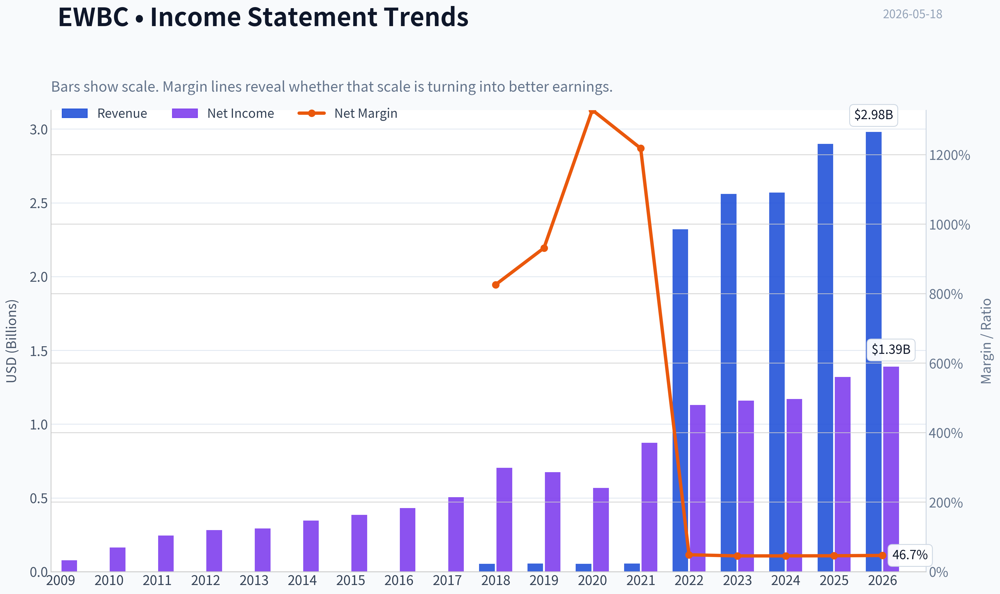

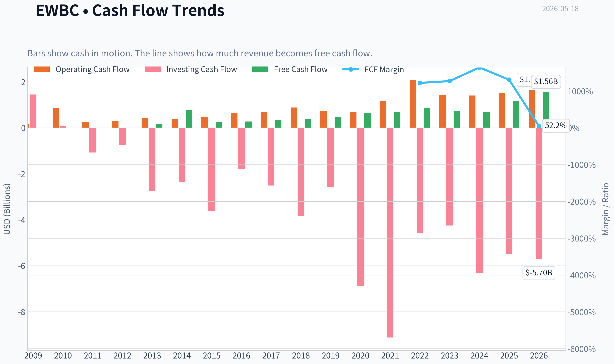

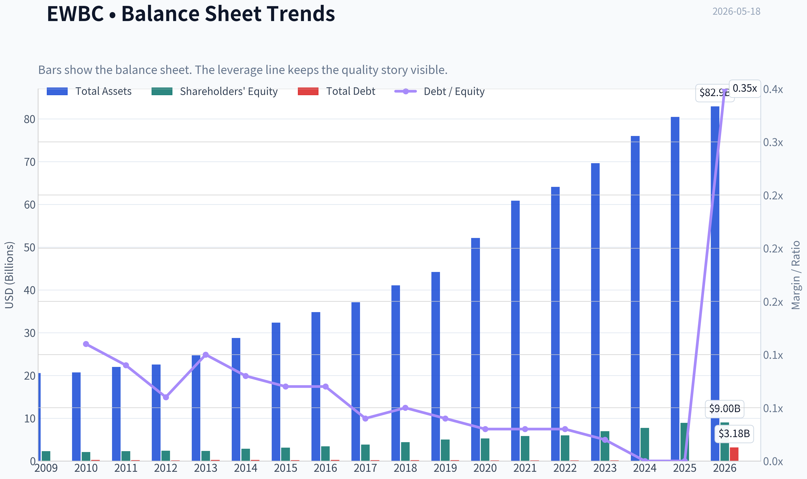

This graph tracks the profitability and return metrics (ROE, ROIC, Margins) of **EWBC** over the past decade, highlighting capital efficiency trends.

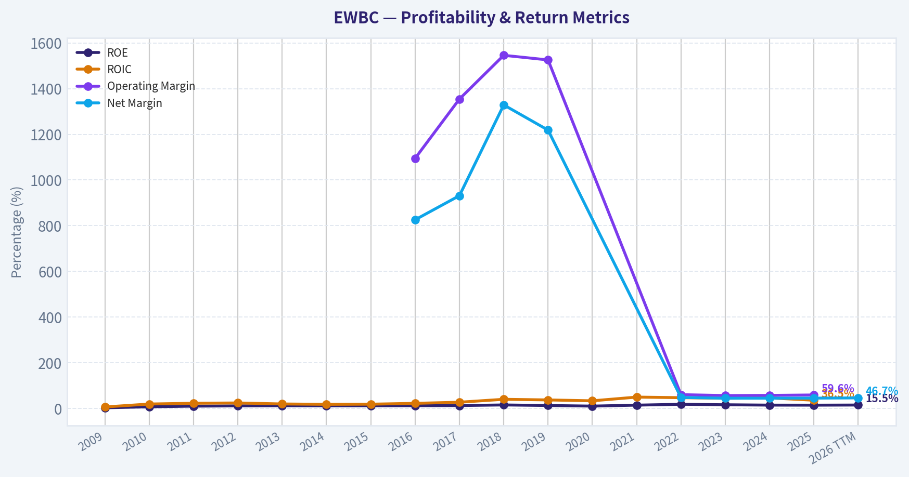

This chart illustrates the financial health of **EWBC** over the last 10 years, mapping cash equivalents and free cash flow against total obligations (Debt).

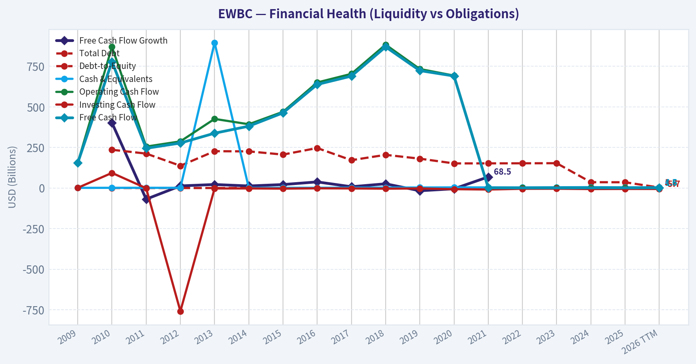

---

### Intrinsic Value Analysis (Buffett)

> *Following Warren Buffett's value investing philosophy: Circle of Competence, Economic Moat, Management Quality, and Margin of Safety.*

#### Intrinsic Value Snapshot

Price is what you pay. Intrinsic value is what the business may be worth based on the cash it can create for owners over time. We show a range, not one magic number.

- Current Price: $121.05
- Value Range (conservative to optimistic across both DCF methods): $140.15 to $353.70

##### Owner Earnings (Buffett Method)
- Net Income: $1,325,000,000.00
- Depreciation & Amortization: $213,164,000.00
- Capital Expenditures: N/A
- Working Capital Changes: $-265,276,000.00
- Owner Earnings: $1,803,440,000.00

##### Intrinsic Value
###### Buffett Method
Uses owner earnings. Stricter, and usually more conservative.
- Conservative: $140.80
- Average: $353.70
- Optimistic: $353.70
- Discount Rate: 10.0%

###### Cash Flow Method
Uses free cash flow. Better for companies spending heavily today to grow tomorrow.
- Conservative: $140.15
- Average: $201.42
- Optimistic: $227.81
- Discount Rate: 10.0%

ANALYST STANCE: **WATCH**

#### East West Bancorp (EWBC) - Buffett-Style Investment Review

#### 1. Go/No-Go Gate Assessment

| Gate | Verdict | Evidence |
|---|---|---|
| Circle of Competence & Simplicity | Pass | EWBC is a straightforward commercial bank. It gathers deposits, makes loans, earns net interest income, and adds fee income from banking services. |
| Long-Term Predictability | Pass with care | A decade from now, it should still look like a relationship-driven bank focused on U.S.-China corridor, commercial lending, and affluent customers. Banking is understandable, but earnings are cyclical and tied to credit quality and interest spreads. |
| Technology Risk | Pass | Banking is affected by technology, but EWBC is not a pure technology-dependent business. The larger risks are credit discipline, funding costs, regulation, and competition, not sudden tech obsolescence. |
| Moat Test | Narrow moat | Customer relationships, niche franchise, and funding base matter, but banking rarely has an impregnable moat. Regulation creates barriers, yet products are still somewhat commoditized. |
| Management Quality | Pass with care | Available evidence suggests disciplined operations and ongoing capital strength, but the key test for banks is credit underwriting and capital allocation over a full cycle. |
| Industry Structure | Mixed | Banking is highly competitive and regulated. Scale helps, but this is not a classic rational oligopoly with strong pricing power. |

**Key Takeaways:** EWBC passes the basic Buffett filters because the business is understandable and likely to remain relevant. The issue is not whether it survives, but whether a bank with only a modest moat deserves a strong endorsement at the current price.

---

#### 2. Elementary School Test

EWBC takes money from depositors, lends it out at higher rates, and keeps the spread. It also earns fees from serving business and consumer banking clients. If it lends carefully and keeps funding costs low, it makes good money.

#### 3. Moat Analysis

| Moat Source | Assessment | Evidence |
|---|---|---|
| Intangible Assets | Moderate | Banking license, regulatory standing, and niche cross-border brand are useful, but customers do not usually love a bank brand the way they love a consumer brand. |
| Switching Costs | Moderate | Business borrowers and treasury clients can be sticky once relationships are embedded, but retail and commercial deposits can move if pricing changes. |
| Cost Advantage | Limited to moderate | Scale and a specialized franchise can help efficiency and funding, but the industry remains price competitive. |
| Network Effects | Weak | Banking does not enjoy strong classic network effects. More customers help scale, but not in the winner-take-most sense. |

| Moat Rating | Conclusion |
|---|---|
| Narrow | EWBC has a respectable niche franchise, but not a wide moat in the Buffett sense. |

**Key Takeaways:** EWBC's edge comes from relationships, specialization, and regulatory positioning, not from a dominant brand or powerful network effects. That can support good returns, but it is not the kind of moat that makes outcomes almost automatic.

---

#### 4. Management Quality & Capital Allocation

| Question | Assessment | Commentary |
|---|---|---|
| Think Like Owners? | Reasonable | Banks are best judged by underwriting discipline, reserve conservatism, and capital returns. EWBC's long operating history suggests steady stewardship. |
| Honest & Candid? | Reasonable | Recent regulatory capital disclosure and normal earnings communication support a conventional, transparent bank reporting profile. |
| Rational Capital Allocation? | Reasonable | Capital strength remains central. For a bank, the best capital allocation is prudent loan growth, sound reserves, conservative leverage, and sensible dividends/buybacks. |

**Key Takeaways:** Management appears competent and conventional, which is a positive in banking. But this is not yet enough evidence for calling them exceptional capital allocators in the Buffett mold.

---

#### 5. Financial Snapshot

| Metric | Current / Recent |
|---|---|
| Share Price | $121 |
| Market Cap | $16.58B |
| P/E | 12.1x |
| ROE | 14.9% |
| Revenue Growth YoY | 12.9% |

**Key Takeaways:** EWBC is not priced like a glamour stock. The valuation looks reasonable for a profitable regional bank, but the return on equity, while solid, is just below the "wonderful business" threshold Buffett would prefer.

---

#### 6. Buffett Financial Interpretation

| Area | Buffett Lens | EWBC Read |
|---|---|---|
| ROE | Prefer sustained >15% without leverage dependence | 14.9% is good, but not clearly exceptional |
| Cash Flow Reality | For banks, traditional free cash flow is less useful than credit quality and capital generation | Need focus on earnings quality, reserves, and capital ratios rather than industrial-style FCF |
| Balance Sheet | Fortress balance sheet is critical | Basel III capital disclosure is encouraging; capital adequacy matters more than current ratio for banks |
| Owner Earnings | Harder to apply to banks than industrial firms | Net income is a better anchor than classic owner earnings because capex is not the key economic driver |

**Key Takeaways:** Banks require a modified Buffett lens. EWBC looks financially sound, but it does not clearly stand out as an extraordinary compounding machine based on the available profitability markers.

---

#### 7. Owner Earnings Framework

For a bank, classic owner earnings are less informative because maintenance capex is not the economic bottleneck. A more useful approximation is sustainable net income adjusted for reserve conservatism and dilution.

| Item | Assessment |
|---|---|
| Net Income Base | Primary owner-earnings anchor |
| Plus D&A | Not a major driver for bank economics |
| Less Maintenance CapEx | Relatively minor vs lending capital needs |
| Less Working Capital Increases | Not meaningful in the same way as non-financial companies |

**Approximate conclusion:** EWBC should be judged on sustainable earnings power and return on equity rather than a traditional owner-earnings formula.

**Key Takeaways:** This is a bank, so the usual Buffett owner-earnings equation does not carry the same force. The right question is whether the bank can keep earning attractive returns on equity through a full credit cycle without taking undue risk.

---

#### 8. Three-Scenario Valuation

Using the current P/E of about 12.1x as a practical shortcut around earnings power:

| Scenario | Assumption | Implied View |
|---|---|---|
| A: No Growth | Flat earnings, 10% required return | A fair multiple would be around 10x earnings; current price is somewhat above strict no-growth value |
| B: GDP Growth | 3% long-term earnings growth | Fair value likely around low-to-mid teens earnings multiple; current price looks reasonable |
| C: Historical Growth Lite | Mid-single-digit earnings growth with normal bank cyclicality | Current valuation can be justified if EWBC sustains disciplined growth and credit quality |

**Margin of Safety Analysis**

| Item | Assessment |
|---|---|
| Current Valuation | Reasonable, not distressed |
| Margin of Safety | Modest |
| Buffett Requirement | Insufficient for a bank with a narrow moat |

**Key Takeaways:** EWBC does not look expensive, but it also does not offer a large enough discount to intrinsic value to create strong downside protection. For a cyclical financial business, Buffett would usually want a bigger cushion.

---

#### 9. Final Buffett Scorecard

| Criterion | Score (1-5) | Weight | Weighted Score |
|---|---:|---:|---:|
| Business Understanding | 4.5 | 20% | 0.90 |
| Moat Width & Durability | 2.8 | 25% | 0.70 |
| Management Quality | 3.4 | 15% | 0.51 |
| Return on Equity | 3.4 | 15% | 0.51 |
| Reinvestment Runway | 3.3 | 10% | 0.33 |
| Balance Sheet Strength | 3.8 | 5% | 0.19 |
| Industry Structure | 2.8 | 5% | 0.14 |
| Valuation / Margin of Safety | 3.1 | 5% | 0.16 |

| Total | Score |
|---|---:|
| Final Weighted Score | 3.44 / 5.00 |

**Key Takeaways:** EWBC lands near the border between Watch and Advocate, but not over it. The business is understandable and decently run, yet the moat and industry structure are not strong enough to justify a more aggressive stance at today's valuation.

---

#### 10. Investment Conclusion

**Verdict: WATCH**

EWBC appears to be a solid, competently run bank trading at a reasonable earnings multiple. It benefits from a recognizable niche and respectable profitability, but it does not meet the standard of a truly wonderful business with a wide moat. For a Buffett-style investor, the shares are interesting but not compelling enough today to earn an **ADVOCATE** rating.

**Conviction level: Moderate.**

What would upgrade the case:
- Sustained ROE comfortably above 15% without balance-sheet stretch
- Continued capital strength through a tougher credit cycle
- Evidence of superior deposit franchise durability
- A cheaper entry price that offers a clearer margin of safety

What would weaken the case:
- Credit deterioration
- Margin pressure from deposit repricing
- Aggressive loan growth or capital allocation
- Signs that the niche franchise is losing relevance
#### Valuation Bridge

This bridge places the current market price beside each intrinsic value lens so readers can see whether upside depends on one method or shows up across several methods.

| Scenario | Intrinsic Value / Share |
| --- | ---: |
| Buffett Method | $353.70 |
| Cash Flow Method | $201.42 |
| Current Price | $121.05 |

#### Key Takeaways

If one method is far above the others, the upside case depends on a specific modelling assumption. When several methods cluster together, the valuation story is more robust.

#### Valuation Visuals

This comparison chart from *Latest Earnings Snapshot* stacks current figures against historical benchmarks for **EWBC**, making it easy to see where the company trades relative to its own averages.

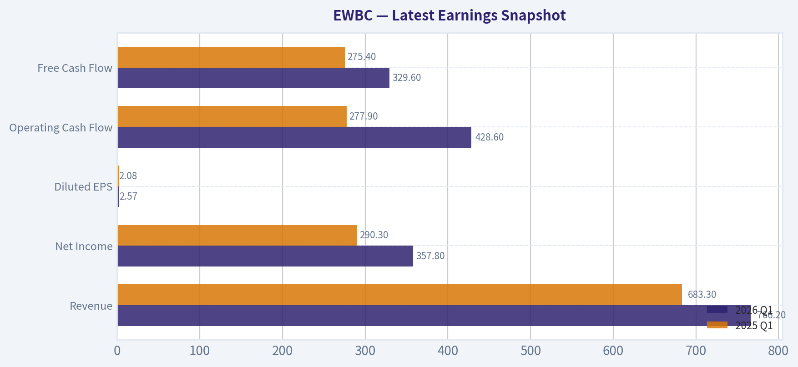

This comparison chart from *Current vs Historical Average Comparison* stacks current figures against historical benchmarks for **EWBC**, making it easy to see where the company trades relative to its own averages.

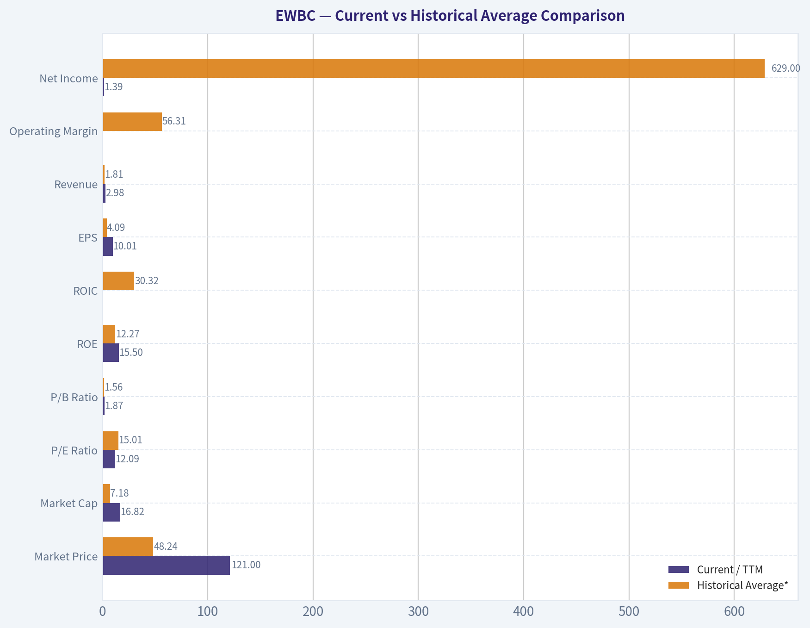

This comparison chart from *Balance Sheet and Financial Strength* stacks current figures against historical benchmarks for **EWBC**, making it easy to see where the company trades relative to its own averages.

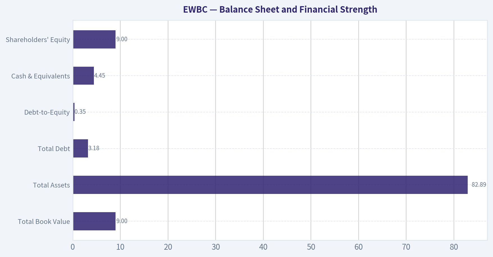

This comparison chart from *Cash Flow and Shareholder Returns* stacks current figures against historical benchmarks for **EWBC**, making it easy to see where the company trades relative to its own averages.

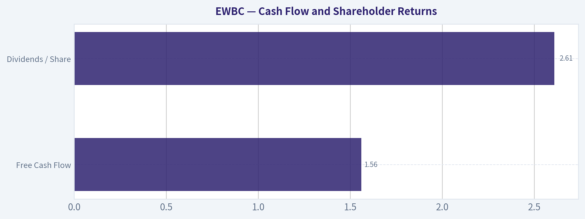

This comparison chart from *Buffett-Style Owner Earnings DCF Valuation* stacks current figures against historical benchmarks for **EWBC**, making it easy to see where the company trades relative to its own averages.

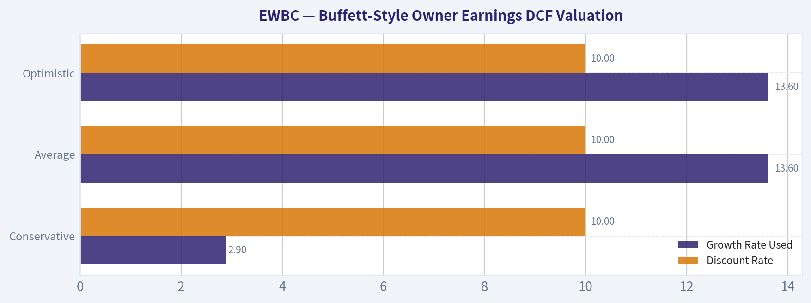

---

### Trend & Growth Analysis (Lynch/Druckenmiller/Fisher)

> *Following Peter Lynch's GARP, Stanley Druckenmiller's macro-aware approach, and Philip Fisher's scuttlebutt methodology.*

ANALYST STANCE: **WATCH**

#### EWBC Growth/Quality Report
Date: 2026-05-18
Company: East West Bancorp

EWBC is a **good bank**, but it is **not a classic Lynch/Druckenmiller/Fisher fast grower**. It screens more like a **quality regional financial stalwart** with decent earnings power, niche advantages, and fair valuation, rather than a 10-bagger growth setup. The stock may still work as a quality compounder/value-financial, but on a **growth-investing mandate**, it looks more **WATCH than ADVOCATE**.

---

#### 1. Lynch Classification

| Framework Item | Assessment |
|---|---|
| Lynch Category | **Stalwart / Financial compounder** |
| Revenue growth YoY | **12.9%** |
| P/E | **12.1x** |
| Growth style fit | Moderate growth, not high-growth |
| Ten-bagger profile | **Low probability** under current bank model |

**Key Takeaways:** EWBC does not fit the classic fast-grower mold. Its recent growth is respectable, but banks rarely get the long-duration multiple expansion and reinvestment runway that produce ten-baggers. This looks more like a quality regional bank trading at a sensible multiple than a major growth inflection story.

---

#### 2. The Story in 3 Bullets

| Simple Story | Why It Matters |
|---|---|
| EWBC is a regional bank with a niche commercial franchise and strong California/Asia-linked customer relationships. | Niche positioning can support better-than-peer profitability. |
| It has historically earned solid returns on equity and operated with better discipline than many regional banks. | Quality and consistency matter in banking. |
| The investment question is not hypergrowth, but whether earnings stay resilient through rates, deposits, and CRE stress. | This is a durability/value-quality story, not a disruptive growth story. |

**Key Takeaways:** The business is understandable and differentiated, but the growth case is limited by the banking model. Investors are really underwriting credit quality, deposit stability, and margin resilience. That makes the stock easier to analyze, but less exciting from a high-growth perspective.

---

#### 3. TAM Analysis with 10x Test

For banks, TAM is not like SaaS or consumer internet. Growth is constrained by geography, regulation, capital, and balance-sheet risk.

| TAM Lens | Assessment |
|---|---|
| Addressable market | U.S. commercial banking, affluent retail, cross-border banking niches |
| Market expansion | Moderate, tied to economic growth rather than secular hypergrowth |
| Can revenue 10x? | **Highly unlikely** in any reasonable timeframe |
| Can company 10x and remain <20% of TAM? | Theoretically yes in broad banking, but not realistic operationally |
| Runway quality | **Adequate for steady growth, weak for venture-like growth** |

**Key Takeaways:** EWBC operates in a very large market, but that does not mean it has a true 10x runway. Banking growth is limited by capital requirements, competition, and cyclical credit losses. The TAM is broad, but the practical growth runway is much narrower than for software or platform businesses.

---

#### 4. Revenue Growth Trend

We only have limited current-point data from the shared pack.

| Metric | Value | Interpretation |
|---|---:|---|
| Revenue growth YoY | **12.9%** | Solid, but not high-growth |
| Growth classification | **Moderate** | More stalwart than fast grower |
| Pattern | Insufficient quarterly series | Cannot confirm acceleration |
| Druckenmiller inflection test | **Not proven** | No evidence of acceleration yet |

**Key Takeaways:** Recent revenue growth is respectable for a bank, but it is not enough on its own to signal a major growth inflection. Without a multi-quarter sequence, we cannot say growth is accelerating. For this framework, "good" is not the same as "inflecting."

---

#### 5. Unit Economics

Traditional SaaS metrics do not apply well to banks.

| Metric | Value | Usefulness for EWBC |
|---|---:|---|
| LTV/CAC | N/A | Not meaningful for a bank |
| NRR | N/A | Not meaningful for a bank |
| Rule of 40 | N/A | Not meaningful for a bank |
| ROE | **14.9%** | Highly relevant; strong for a regional bank |
| P/E | **12.1x** | Relevant for bank valuation |
| Efficiency / NIM / CET1 | Not provided | Need latest quarter for fuller quality view |

**Key Takeaways:** Standard growth-software unit economics do not translate to a bank. For EWBC, the most important economic quality signal we do have is a nearly 15 percent ROE, which suggests healthy profitability. But to gain conviction, we would still want deposit mix, NIM trend, credit quality, and capital ratio data.

---

#### 6. Inflection Point Assessment

| Inflection Category | Evidence | Verdict |
|---|---|---|
| Product cycle inflection | Not applicable | No |
| Market share inflection | Not enough evidence | Unclear |
| Margin inflection | Need NIM/efficiency trend | Unclear |
| TAM inflection | No | No |
| Competitive inflection | No hard evidence of peers stumbling materially | Unclear |
| Earnings underestimation potential | Possible if credit fears prove overdone | Moderate |

**Key Takeaways:** EWBC does not show a classic inflection profile. The best possible bull case is that the market is overly discounting credit and regional-bank risks, allowing earnings resilience to surprise positively. That is more of a quality re-rating thesis than a true growth acceleration story.

---

#### 7. Macro Setup Evaluation

| Macro Factor | Assessment | Impact |
|---|---|---|
| Interest rates | Mixed | Higher rates can help asset yields but pressure funding costs |
| Regional bank sentiment | Still fragile post-2023 | Headwind |
| Credit cycle | Late-cycle / cautious | Headwind |
| CRE exposure concerns | Important for all regionals | Headwind |
| California economic exposure | Can be favorable long term, cyclical short term | Mixed |
| Secular tailwind | Limited | No major structural growth tailwind |

**Key Takeaways:** The macro setup is not especially favorable for regional banks. EWBC faces the same industry-level concerns around deposits, funding costs, and commercial real estate that weigh on peers. The company may be better run than average, but it does not have a major secular growth tailwind behind it.

---

#### 8. Fisher 15 Points Score

This is an adapted score because some scuttlebutt items require qualitative channel checks we do not have here.

| Fisher Factor | Score (1-5) | Notes |
|---|---:|---|
| Market potential | 3 | Large banking market, but not explosive |
| Product/new service development | 2 | Banking innovation limited vs tech growth names |
| R&D effectiveness | 1 | Not applicable in meaningful way |
| Sales organization | 4 | Relationship banking appears strong |
| Profit margin quality | 4 | Strong profitability for a regional bank |
| Margin improvement | 3 | Need more recent trend confirmation |
| Labor/personnel relations | 3 | No clear issue, limited evidence |
| Executive relations | 3 | Limited evidence |
| Management depth | 3 | Appears adequate, not fully assessed |
| Cost controls/accounting | 4 | Historical profitability suggests discipline |
| Outstanding moat features | 3 | Niche relationships, but not a wide moat |
| Long-range profit outlook | 3 | Steady, but cyclical |
| Dilution risk | 4 | Banks generally less reliant on equity raises unless stressed |
| Candor in difficulties | 3 | Limited direct evidence |
| Integrity | 3 | No obvious red flag from data provided |

| Total | **46 / 75** | **Average** |

**Key Takeaways:** EWBC scores as a solid but not exceptional Fisher company. The main strength is operational quality within its niche, while the main weakness is that it lacks the innovation, product leverage, and moat expansion typical of elite growth businesses. This is more a respectable financial franchise than a Fisher-style emerging growth champion.

---

#### 9. Valuation Analysis

Using shared pack data:

- Current price: **$121**
- Market cap: **$16.58B**
- P/E: **12.09x**
- Revenue growth: **12.9%**

Approximate Lynch PEG:
- **PEG = 12.1 / 12.9 = 0.94**

| Valuation Metric | Value | Interpretation |
|---|---:|---|
| P/E | **12.1x** | Reasonable for a quality regional bank |
| PEG | **0.94x** | Attractive by Lynch math, but less powerful for banks |
| Market cap | **$16.58B** | Mid-large regional |
| P/S | Not emphasized | Low relevance for banks |
| P/B / P/TBV | Not provided | Important missing metric |

**Key Takeaways:** On simple earnings-growth math, EWBC looks attractively valued. The caveat is that PEG is less reliable for banks because earnings are cyclical and heavily influenced by provisions, rates, and credit conditions. The valuation appears reasonable, but not enough by itself to turn this into a growth ADVOCATE.

##### Scenario View

| Scenario | Assumption | Implication |
|---|---|---|
| Bear | Credit costs rise, NIM compresses, market keeps low multiple | Limited upside / downside risk |
| Base | Stable ROE, modest growth, valuation stays around current earnings multiple | Mid-single-digit to low-double-digit annual return potential |
| Bull | Credit fears ease, deposits stabilize, earnings surprise to upside, modest re-rating | Good value-financial upside, but still not explosive |

**Key Takeaways:** The range of outcomes looks more like a traditional financial stock than a high-growth compounder. The bull case depends on risk normalization and earnings resilience, not on a new market expansion wave. That can still be attractive, but it belongs in a different bucket than true secular growth leaders.

---

#### 10. Growth Investor Scorecard

| Criterion | Weight | Score (1-5) | Weighted Score |
|---|---:|---:|---:|
| The Story | 10% | 3.5 | 0.35 |
| TAM & Runway | 20% | 2.5 | 0.50 |
| Revenue Growth | 20% | 2.8 | 0.56 |
| Unit Economics | 15% | 3.2 | 0.48 |
| Competitive Position | 10% | 3.4 | 0.34 |
| Management Quality | 10% | 3.3 | 0.33 |
| Macro Setup | 5% | 2.3 | 0.12 |
| Profitability Path | 5% | 3.8 | 0.19 |
| Valuation | 5% | 4.0 | 0.20 |

| Total Score | **3.07 / 5.0** | **WATCH** |

**Key Takeaways:** EWBC lands in the middle of the pack on a growth-investing scorecard. The stock benefits from quality and valuation, but loses points on runway, secular tailwinds, and inflection potential. In other words, it is investable, but not especially compelling for a dedicated growth mandate.

---

#### 11. Position Size Stance

| Stance | View |
|---|---|
| Recommended stance | **WATCH** |
| Ideal owner | Value, quality, bank, or balanced financials investor |
| Growth portfolio sizing | **0% to small tracking position only** |
| What would change view | Clear evidence of earnings/margin inflection, superior deposit franchise durability, and benign credit trends |

**Key Takeaways:** EWBC is not a core growth position today. At most, it could merit a small tracking position if you want optionality on a regional-bank quality rerating. For a concentrated growth portfolio, there are likely better uses of risk budget.

---

#### 12. Key Risks and Catalysts

| Risks | Catalysts |
|---|---|
| CRE deterioration | Better-than-feared credit performance |
| Deposit competition and funding costs | NIM stabilization or expansion |
| Regional bank sentiment remains weak | Strong capital return / buybacks |
| Economic slowdown in core markets | Faster loan growth without credit deterioration |
| U.S.-China/cross-border perception risk | Valuation rerating if sector fears fade |

**Key Takeaways:** The main risks are industry-wide and cyclical, especially around credit and funding. The main upside catalyst is simply that reality turns out better than the market fears. That is a valid setup, but again it is closer to a recovery-quality financial thesis than a secular growth breakout.

---

#### Bottom Line

| Final Judgment | Assessment |
|---|---|
| Business quality | Good |
| Growth quality | Moderate |
| Inflection potential | Limited / unproven |
| Valuation | Reasonable |
| Overall stance | **WATCH** |

**Key Takeaways:** EWBC appears to be a sound, reasonably priced regional bank with above-average profitability. But under a Lynch-Druckenmiller-Fisher growth framework, it lacks the explosive runway and clear inflection characteristics needed for an ADVOCATE rating. I would keep it on a watchlist as a quality financial, not treat it as a high-conviction growth idea.

If you want, I can next do a **bank-specific deep dive on EWBC** using a stricter framework focused on **P/TBV, NIM, CET1, deposit mix, CRE exposure, and downside stress case**, which is likely the better way to underwrite this name.

---

### Market Technical Analysis

#### EWBC Technical Snapshot

EWBC remains in a **constructive long-term uptrend**, but the **short-term picture has weakened notably** over the last two weeks. The stock peaked near the end of April around the mid-$125 area, then rolled over into a controlled pullback, finishing the latest trading session on **2026-05-15 at $119.41**. That leaves price still comfortably above both the **50-day SMA (~113.89)** and the **200-day SMA (~108.67)**, which is important: the broader trend is still intact even though momentum has clearly cooled.

For this market context, the most relevant indicator set is:

- **close_200_sma**
- **close_50_sma**
- **close_10_ema**
- **macd**
- **macdh**
- **rsi**
- **atr**
- **vwma**

These 8 are complementary and non-redundant: they cover **long-term trend, medium-term trend, short-term trend, momentum direction, momentum acceleration, overbought/oversold state, volatility/risk, and volume-confirmed trend quality**.

---

#### Price Structure and Trend Interpretation

The one-year price path shows three distinct phases:

1. **Spring to mid-summer 2025:** recovery from the upper-$80s into a breakout above $100.
2. **Late 2025 to February 2026:** a stronger trend leg that carried EWBC toward the low-$120s.
3. **March to April 2026:** a sharp recovery from the March weakness near $102-$106 into fresh highs around $125-$126.
4. **Early May 2026 to now:** a pullback phase that has erased part of the April surge.

The key nuance is that this is **not yet a trend reversal on the higher timeframe**. Price is pulling back from an extended condition, but it is still well above the intermediate and long-term moving averages. That usually describes a **bull trend under correction**, not a broken chart.

#### Trend Table

| Metric | Latest Reading | Interpretation |
|---|---:|---|
| Last close | 119.41 | Price has pulled back from late-April highs |
| 10 EMA | 121.21 | Price is below short-term trend, showing near-term weakness |
| 50 SMA | 113.89 | Price remains above medium-term support |
| 200 SMA | 108.67 | Long-term uptrend remains intact |
| Distance vs 50 SMA | ~+4.8% | Pullback has not yet damaged the intermediate trend |
| Distance vs 200 SMA | ~+9.9% | Broader structure is still bullish |

**Key Takeaways:** EWBC has weakened in the short run, but the stock is still trading above both its 50-day and 200-day moving averages. That combination usually signals a healthy longer-term uptrend experiencing a correction rather than a confirmed bearish breakdown. Traders should treat the current move as a test of trend strength, especially while price remains above the 50-day average.

---

#### Moving Averages: What They Say Now

The **200-day SMA is steadily rising**, from roughly **105.15 in mid-March to 108.67 now**, confirming that the long-term trend slope is still positive. The **50-day SMA is also rising**, though more gradually, from about **112.79 in mid-March to 113.89 now**. That tells us the trend foundation remains positive, even if price has stopped advancing.

The more important short-term signal comes from the **10-day EMA**, which has fallen from **123.29 on 2026-05-06 to 121.21 on 2026-05-15**. Price closing below that falling EMA indicates the market is currently rewarding sellers on short swings. In practical terms, rallies may face resistance first around the **121.2 to 123 zone**, before any retest of the April highs becomes realistic.

A useful hierarchy is in place:

- **Price > 50 SMA > 200 SMA** = bullish higher-timeframe structure
- **Price < 10 EMA** = short-term corrective pressure

That split matters. It argues against aggressive bearish trend-following, but it also warns against blindly buying dips before momentum stabilizes.

#### Moving Average Table

| Indicator | Latest | Direction | Read |
|---|---:|---|---|
| close_10_ema | 121.21 | Falling | Short-term momentum has weakened |
| close_50_sma | 113.89 | Rising | Intermediate trend still supportive |
| close_200_sma | 108.67 | Rising | Long-term trend remains bullish |

**Key Takeaways:** The moving averages show a bullish long-term structure but a soft short-term tape. The 10-day EMA has rolled over, while the 50-day and 200-day averages continue to rise. This usually means the stock is in a pullback inside a larger uptrend, with the next few sessions important for determining whether support holds.

---

#### Momentum: MACD and Histogram

The **MACD remains positive at 1.47**, which means the broader momentum regime is still above zero. However, that headline number hides a more important deterioration: MACD has declined sharply from **4.04 on 2026-05-01** to **1.47 on 2026-05-15**. Momentum is still positive, but it is fading fast.

The **MACD histogram is now negative (-0.99)** after being strongly positive through late April and early May. This is one of the clearest signs that **upside acceleration has flipped into downside deceleration of the prior trend**, or said more simply: bulls still have the bigger-picture trend edge, but they are losing control in the near term.

The sequence is notable:

- Early April: MACD crosses up from negative territory, confirming a strong recovery leg.
- Late April: MACD and histogram both strong, showing expanding bullish momentum.
- Early-to-mid May: histogram crosses below zero while MACD stays positive, signaling a **momentum rollover rather than full trend failure**.

That pattern often precedes one of two outcomes:
1. a deeper pullback toward stronger support, or
2. a consolidation period where momentum resets before another advance.

Right now, the data favors the first or second scenario more than immediate upside continuation.

#### Momentum Table

| Indicator | Latest | Recent Change | Interpretation |
|---|---:|---:|---|
| macd | 1.47 | Down from 4.04 on 05-01 | Positive but fading momentum |
| macdh | -0.99 | Turned negative from positive | Bearish short-term momentum shift |

**Key Takeaways:** MACD is still above zero, so the broader trend has not fully broken, but the rapid drop in MACD and the negative histogram show that bullish momentum has weakened significantly. This combination often appears during a pullback phase, when upside leadership is fading and the stock needs either time or lower prices to reset.

---

#### RSI: From Overbought to Neutral

The **RSI reached overbought territory above 70** in late April and early May, peaking in the mid-70s. That aligned well with EWBC's local top. Since then, RSI has cooled to **49.3**, which is almost exactly neutral.

This is an important transition. EWBC is **no longer overbought**, so one source of technical excess has been worked off. But RSI near 49 is not yet a strong oversold reading either. That means the stock has moved from "too hot" to "undecided," not from "too hot" to "cheap."

In strong uptrends, the most constructive RSI pullbacks often stabilize in the **40-50 zone** and then turn higher again. EWBC is now entering that zone. If RSI rebounds from here while price holds above the 50-day SMA, that would support the case for a continuation setup. If RSI breaks lower toward the 30s, it would suggest the pullback is becoming more than just a pause.

#### RSI Table

| Date Context | RSI Level | Meaning |
|---|---:|---|
| Late April / early May | 71-74+ | Overbought, trend extended |
| Latest (05-15) | 49.32 | Neutral, reset completed but not yet oversold |

**Key Takeaways:** RSI shows that EWBC has fully cooled off from its overbought condition. The stock is no longer stretched, but it has not yet reached a deeply oversold level that would strongly favor a rebound. This puts the chart in a transition phase, where traders should watch for either stabilization or further deterioration.

---

#### Volume-Weighted Trend Quality: VWMA

The **VWMA is 122.76**, above the latest close of **119.41**. That indicates price is now trading below its recent volume-weighted average, suggesting that the average participant over the recent window is sitting on better prices than current buyers. That often creates overhead supply on rallies.

VWMA had been rising strongly through April, confirming the breakout as volume-supported. But the fact that price is now below VWMA shows the latest decline has enough participation to matter. This is not just a low-volume drift lower; it reflects a meaningful cooling of demand.

For tactical traders, reclaiming the **VWMA/10-EMA region around 121-123** would be an early sign that buyers are regaining control. Until then, the path of least resistance in the short term remains sideways-to-lower.

#### Volume Confirmation Table

| Indicator | Latest | Relationship to Price | Implication |
|---|---:|---|---|
| vwma | 122.76 | Price below VWMA | Recent volume-weighted trend has weakened |

**Key Takeaways:** EWBC is now trading below its recent volume-weighted average, which suggests recent selling pressure has been meaningful rather than trivial. For the short-term picture to improve, the stock would likely need to climb back above the low-$122 area and hold there.

---

#### Volatility and Risk Management

**ATR has declined from about 3.31 in late March to 2.58 now.** That means EWBC's daily trading range has moderated, even as the stock pulled back. This is a subtle but useful signal: the decline has not been accompanied by a major volatility explosion. In other words, the chart looks more like an orderly retracement than a panic unwind.

That tends to support the interpretation that the bigger uptrend is under pressure but not yet in crisis. For risk management:

- A **1 ATR move** is about **$2.58**
- A **1.5 ATR move** is about **$3.87**
- A **2 ATR move** is about **$5.16**

So if traders are using the current close around **$119.41**, then ordinary price noise can easily span a couple of dollars. Stops placed too tightly under nearby levels are vulnerable to normal fluctuation rather than true thesis failure.

#### Volatility Table

| Indicator | Latest | Trend | Trading Use |
|---|---:|---|---|
| atr | 2.58 | Down from late-March highs | Pullback is orderly; use wider, volatility-aware stops |

**Key Takeaways:** ATR shows that EWBC's recent weakness has unfolded with moderate, not extreme, volatility. That makes the decline look more like a controlled correction than a disorderly breakdown. Traders should still respect the pullback, but risk can be sized using ATR rather than assuming a crisis-level move.

---

#### Fine-Grained Trading Interpretation

The most actionable read is that EWBC sits in a **bullish higher-timeframe / bearish lower-timeframe** configuration.

That means:

- **Trend followers** should still give weight to the rising 50-day and 200-day averages.
- **Swing traders** should respect that short-term momentum has already rolled over.
- **Dip buyers** may want confirmation rather than immediate entry, because MACD histogram and price-vs-10EMA still point to ongoing corrective pressure.

Near-term levels to monitor from the current technical structure:

| Zone | Importance | Why it matters |
|---|---|---|
| 121.2 - 122.8 | First resistance | 10 EMA and VWMA overhead |
| 125 - 126 | Major resistance | Recent highs / failed breakout zone |
| 113.7 - 113.9 | Key support | 50 SMA area |
| 108.5 - 108.7 | Major trend support | 200 SMA area |

**Key Takeaways:** The first technical hurdle for EWBC is the low-$121 to low-$123 region, where short-term and volume-weighted resistance now sit. If the stock cannot reclaim that zone, the next meaningful test is likely the 50-day average near $114. A break below that area would shift attention to the 200-day average near $109.

---

#### Bottom Line

EWBC is **still bullish on a strategic timeframe**, but **tactically vulnerable right now**. The stock has pulled back from an overbought peak, dropped below its 10-day EMA and VWMA, and seen MACD momentum deteriorate sharply. At the same time, it remains above rising 50-day and 200-day moving averages, and volatility remains controlled.

That combination suggests:

- **Not an ideal moment for momentum chasing**
- **Not yet a confirmed long-term bearish reversal**
- **Most likely near-term scenario: continued consolidation or a deeper test toward the 50-day SMA unless price quickly reclaims 121-123**

For decision-making:
- **Bullish continuation case:** reclaim 10 EMA/VWMA and stabilize RSI back above 50.
- **Neutral consolidation case:** price chops between roughly 114 and 123 while momentum resets.
- **Bearish tactical case:** failure to hold the 50-day SMA would increase downside risk toward the 200-day SMA.

#### Summary Table

| Category | Indicator(s) | Current Message | Trader Implication |
|---|---|---|---|
| Long-term trend | close_200_sma | Rising, price above it | Strategic trend still bullish |
| Medium-term trend | close_50_sma | Rising, price above it | Pullback not yet structurally broken |
| Short-term trend | close_10_ema | Falling, price below it | Near-term pressure remains bearish |
| Momentum direction | macd | Positive but falling fast | Bull trend losing force |
| Momentum acceleration | macdh | Negative | Short-term downside momentum active |
| Overbought/oversold | rsi | 49.3 | Reset complete, but not oversold |
| Volatility | atr | Moderate and easing | Pullback looks orderly, size risk accordingly |
| Volume confirmation | vwma | Price below VWMA | Recent selling has meaningful participation |

**Key Takeaways:** EWBC's bigger trend remains constructive, but the short-term evidence has clearly weakened. The stock now needs to prove itself by reclaiming nearby resistance in the low-$120s; otherwise, a test of the 50-day average near $114 becomes increasingly likely.

#### Market Visuals

This comparison chart from *Market Metrics* stacks current figures against historical benchmarks for **EWBC**, making it easy to see where the company trades relative to its own averages.

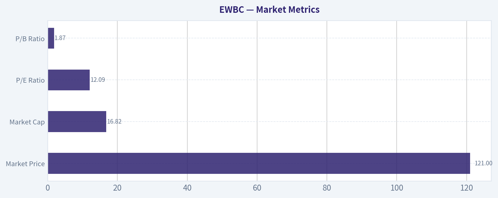

---

### Options Market Analysis

> *Reading options flow - put/call ratios, IV skew, and unusual activity - to gauge institutional positioning and event-driven risk.*

#### EWBC Options Positioning Report

EWBC's near-term options market is showing a clear **call-heavy bias**, with very low put/call ratios versus the typical neutral baseline of about 0.7. That said, overall options open interest and trading volume are fairly light, so the directional signal is usable but should be treated with **moderate-to-low confidence** rather than as a high-conviction institutional read.

#### Near-Term Put/Call Ratio Analysis

| Expiry | Call OI | Put OI | Put/Call OI Ratio | Call Vol | Put Vol | Put/Call Vol Ratio |
|---|---:|---:|---:|---:|---:|---:|
| 2026-06-18 | 159 | 30 | 0.19 | 61 | 6 | 0.10 |
| 2026-07-17 | 348 | 35 | 0.10 | 28 | 11 | 0.39 |
| 2026-08-21 | 181 | 35 | 0.19 | 31 | 12 | 0.39 |
| **Total / Near-term** | **688** | **100** | **0.15** | **120** | **29** | **0.24** |

**Key Takeaways:** EWBC's put/call open interest ratio of **0.15** is far below the roughly neutral **0.7** baseline, and the put/call volume ratio of **0.24** tells the same story. In plain English, traders are overwhelmingly positioned in calls rather than puts across the next few expirations. That generally leans bullish, although on a lower-liquidity name it can also reflect limited hedging demand rather than aggressive institutional upside conviction.

#### Interpretation of the Put/Call Setup

A **0.15 put/call OI ratio** is not just mildly bullish - it is **extremely call-skewed**. Relative to neutral:

- This suggests **little visible demand for downside protection**
- It may indicate **bullish speculation**
- It could also reflect some **covered call / structured positioning**, though volume ratios also favor calls enough to keep the net read bullish

The key shift from neutral is substantial: instead of balanced hedging and speculation, EWBC's near-term chain is dominated by calls.

---

#### Implied Volatility Assessment

| Expiry | ATM Call IV | ATM Put IV | ATM IV Read |
|---|---:|---:|---|
| 2026-06-18 | 32.2% | 35.7% | Mild put premium |
| 2026-07-17 | 36.3% | 34.7% | Slight call premium |
| 2026-08-21 | 18.6% | 36.9% | Very strong put premium / skew distortion |

**Key Takeaways:** Near-term implied volatility is not uniformly high, but it does show pockets of defensive pricing, especially in puts. June has a mild downside premium, July is more balanced, and August shows a very sharp divergence with puts much richer than calls. That pattern says traders are still paying up for some downside insurance even while overall positioning remains call-heavy.

#### IV Skew Read

We are not given a full strike-by-strike OTM skew table, but the call/put ATM IV differences still help:

- **June:** put IV above call IV -> mild downside fear / normal defensive skew
- **July:** call IV slightly above put IV -> some upside participation or demand for bullish exposure
- **August:** put IV massively above call IV -> strong downside skew, likely reflecting tail-risk hedging or sparse chain liquidity

Overall skew read: **modestly defensive-to-bearish in volatility terms**, especially farther out, even though outright positioning is still call-dominant.

That matters because the market can be:
- **bullish in direction**
- but still **pricing downside risk more aggressively in volatility**

This is common when traders are long upside exposure but remain aware of macro or sector risk.

#### Catalyst / Event Premium

No explicit catalyst data is provided in the options dataset. So I cannot definitively say IV is elevated into earnings or another known event. However:

- June and July ATM IV in the low-to-mid 30s are **noticeable but not extreme**
- The August put IV spike looks more like **skew/tail hedging or illiquidity distortion** than broad event premium

So the cleaner conclusion is: **no obvious broad-based event-volatility blowout**, but there is selective downside insurance pricing.

---

#### Unusual Options Activity

| Screen Result | Observation |
|---|---|
| Volume > 5x Open Interest | None detected in near-term expirations |

**Key Takeaways:** There were **no contracts flagged as unusual** by the volume-versus-open-interest screen. That means we do not have an obvious fresh institutional sweep, hedge, or speculative bet standing out in the near-term chain. Without that kind of signal, the bullish read comes more from broad positioning ratios than from a single high-conviction smart-money print.

#### Read on Flow Quality

Because no contract showed **volume greater than 5x open interest**, there is:

- no clear evidence of large fresh directional flow
- no standout put hedge that would override the call-heavy aggregate setup
- no obvious retail frenzy contract either

This weakens conviction somewhat. The signal is still bullish, but it is **not being confirmed by aggressive unusual activity**.

---

#### Open Interest Concentration and Potential Pinning Levels

| Expiry | Total Call OI | Total Put OI | OI Concentration Read |
|---|---:|---:|---|
| 2026-06-18 | 159 | 30 | Call-heavy, but overall light OI |
| 2026-07-17 | 348 | 35 | Largest OI concentration among near-term expiries |
| 2026-08-21 | 181 | 35 | Moderate OI, still call-dominant |

**Key Takeaways:** The largest near-term positioning sits in **July 2026**, which makes that expiry the most likely area for any pinning or gamma-related influence. But total open interest is still fairly small, so any "gamma wall" effect is likely weaker than what you would see in a large-cap, heavily traded options name. In practical terms, options positioning may nudge price behavior, but probably will not dominate it.

#### Gamma / Pinning Interpretation

We are not provided strike-level OI concentrations, so specific max-pain or exact gamma-wall strikes cannot be identified. Still, from the expiry-level totals:

- **July 2026** is the key near-term expiry to watch
- The chain is **call-heavy**, so if price rises toward popular call strikes, dealers could potentially contribute to **mild upside acceleration**
- Because absolute OI is low, any gamma effects are likely **limited rather than explosive**

So the likely market structure read is:
- some **upside bias**
- but **not enough options depth** to create a major squeeze setup

---

#### Overall Options Sentiment Signal

| Category | Signal |
|---|---|
| Directional Options Signal | **BULLISH** |
| Confidence Level | **Moderate-Low** |
| Primary Driver | Extremely low put/call OI and volume ratios |
| Main Caveat | Thin options activity and no standout unusual flow |

**Key Takeaways:** The net options message on EWBC is **bullish**, driven mainly by very call-heavy positioning and limited put demand. However, this is not a high-conviction institutional signal because the chain looks relatively thin and there is no unusual activity confirming fresh large bets. So the best framing is: **bullish lean, but not strong enough to ignore liquidity caveats**.

#### Final Synthesis

EWBC's options market leans **BULLISH**.

Why:
- **Put/Call OI ratio = 0.15**, far below neutral
- **Put/Call volume ratio = 0.24**, also clearly bullish
- Call interest dominates each near-term expiry
- No unusual put flow is present to contradict that read

What tempers the signal:
- overall options participation is relatively light
- no volume-over-OI anomalies suggest fresh institutional conviction
- put IV remains rich in parts of the curve, especially farther out, meaning some downside concern still exists

Bottom line: **options traders are positioned more for upside than downside in EWBC**, but the chain is thin enough that I would treat this as a **moderate bullish sentiment indicator**, not a strong standalone trade trigger.

---

#### Summary Table

| Metric | Read | Interpretation |
|---|---|---|
| Put/Call Ratio | **OI: 0.15, Volume: 0.24** | Strongly call-heavy vs. neutral ~0.7; bullish lean |
| IV Level | **Near-term ATM IV mostly low/mid-30s** | Elevated enough to matter, but not a clear event-vol blowout |
| Skew Direction | **Mostly put-skewed overall** | Downside insurance still priced, especially in August |
| Unusual Activity | **None flagged** | No fresh high-conviction smart-money contract detected |
| Overall Signal | **BULLISH** | Call-dominant positioning is the main driver, with liquidity caveats |

**Key Takeaways:** EWBC's options market is pointing bullish overall, mainly because calls heavily outweigh puts in both open interest and trading volume. The caution is that the chain is not very deep, and volatility still shows some downside sensitivity, so the signal is constructive but not emphatic.

---

## Research Team Commentary

> *The Research Manager synthesizes the Bull vs Bear debate into action-free commentary. This is a pre-risk view, not the final stance.*

The strongest bull argument is pretty straightforward: EWBC appears to be a high-quality regional bank with a real, if not perfect, franchise advantage. The most persuasive evidence is the combination of strong profitability metrics, especially roughly 15% ROE and 1.6% ROA, alongside commentary pointing to durable deposits and capital strength through a tougher cycle. For a bank, that matters. If the deposit base is truly sticky and management has produced these returns without stretching the balance sheet, then this is the kind of financial business that can compound book value and earnings at a respectable rate over time. At about 12x earnings, the stock is not obviously expensive for that quality.

The strongest bear argument is that banking quality is often overstated when conditions are favorable. A 12x P/E is only attractive if earnings are close to normalized. If credit costs rise, deposit repricing continues, or regulation structurally lowers returns, then today's earnings may flatter intrinsic value. The bear side is also right to challenge whether EWBC really has a Buffett-style moat versus simply being a better-run participant in a competitive, cyclical, regulated industry. After the rebound from the $80s into the low $120s, the easy mispricing may already be gone.

My balanced takeaway is that EWBC looks like a good bank, but not an obvious bargain. This does not feel like a classic Buffett "pound the table" situation where business quality is unmistakable and valuation gives a large margin of safety. It looks more like a respectable compounder in a business model that deserves caution and close underwriting. The market may still be underappreciating franchise quality, but it is no longer ignoring it.

Core takeaway: EWBC merits respect, but not aggression. The business quality case is credible, especially around deposit durability, profitability, and capital resilience. The valuation, however, looks more fair than cheap once we acknowledge the structural limits of regional banking moats and the possibility that current earnings are above mid-cycle. So the right value-investing posture is WATCH, not ADVOCATE.

Rationale: Through a Buffett lens, I want to separate "good company" from "good investment." EWBC likely clears the first hurdle better than many regional banks. The numbers suggest sound economics, and the handoff supports the view that this is not just a low-multiple trap. But the second hurdle is harder. Banks are leveraged, cyclical, and vulnerable to shifts in funding costs and credit quality in ways that can make present earnings a poor guide to long-term intrinsic value. I do think the bull side has the better argument on relative quality. I think the bear side has the better argument on margin of safety. That combination usually leads me to patience rather than action.

From a contrarian standpoint, the crowd may still be too blunt in treating many regional banks alike, and EWBC may deserve some premium to weaker peers. But contrarianism only pays when price still embeds enough fear. After the stock's recovery, I no longer see clear evidence of a large discount to conservative intrinsic value. In other words, the crowd may be missing some nuance on quality, but not enough to make this an obvious value buy today.

If I think about mistakes investors make in situations like this, one common error is to buy banks on surface cheapness and recent return metrics without demanding enough proof on normalized earnings power. Another is the opposite mistake: dismissing all banks because the sector is complex. Here, the better discipline is to acknowledge EWBC may be above average, while still refusing to overstate the moat or valuation cushion. That pushes me toward selective patience.

What I would monitor over the next 1 to 4 quarters is very concrete. First, deposit costs and deposit mix: I want evidence the franchise is truly sticky and not just stable on the surface while becoming much more expensive underneath. Second, net interest margin direction: if margins hold up better than peers, that strengthens the moat argument. Third, credit quality trends, especially any signs of stress in commercial real estate, office, or concentrated lending pockets; nonperforming assets, charge-offs, and reserve builds will matter a lot. Fourth, capital ratios and tangible book value growth: I want to see that profitability is translating into durable per-share value, not just accounting earnings. Fifth, capital allocation: whether management repurchases stock intelligently, maintains underwriting discipline, and avoids reaching for growth late in the cycle. Sixth, any evidence that cross-border or niche exposure is either a source of durable advantage or hidden concentration risk.

What would make me more constructive? Sustained ROE around current levels with stable or improving deposit economics, benign credit normalization, and disciplined capital deployment would support the idea that EWBC deserves to trade above a plain-vanilla regional bank multiple. What would weaken the thesis? Faster deposit repricing, rising provisions, tangible book pressure, or any sign that recent profitability was more cyclical than structural.

Final stance: WATCH.

---

## Value Investing Team Commentary

> *The Investor translates the research view into an investment thesis before risk review. This is still not the final stance.*

EWBC looks like the kind of bank a disciplined value investor should respect, but not rush to own at any price.

The good news is real. A regional bank generating roughly 14.9% ROE, 1.6% ROA, and very strong ROIC while still being described as capital-strong and deposit-durable is not ordinary. Those figures suggest a business with sound underwriting, decent funding advantages, and competent management. In banking, that combination matters more than a low headline multiple. If the deposit base is genuinely sticky and management has not "bought" growth by stretching credit standards, EWBC likely deserves to trade better than weaker regional peers.

But this is exactly where selective contrarian thinking matters. The market often lumps regional banks together when fear is high, and that can create opportunity. However, after EWBC's rebound from the upper-$80s to the low-$120s, sentiment no longer looks indiscriminately fearful. The stock appears to be getting credit for being one of the better operators. So while the crowd may still underappreciate franchise quality, it is not obvious that the crowd is badly mispricing it today.

The central question is not whether EWBC is a good bank. It probably is. The real question is whether current earnings are close to normalized earnings power. A bank at 12.1x earnings can be cheap if returns are durable through the cycle, or expensive if deposit costs, credit losses, or regulatory pressure erode those returns over time. In banking, reported profitability can look sturdier than it really is until the cycle turns. That is why I would not treat today's ROE as fully bankable without more evidence on deposit economics and credit resilience.

From a Buffett-style lens, the moat here is likely narrower than in a great consumer brand, software platform, or low-cost industrial leader. EWBC may have a niche advantage, relationship banking strength, and a better deposit franchise than many peers, but banking remains competitive, regulated, and balance-sheet sensitive. That does not make it uninvestable. It simply means the required margin of safety should be higher.

What may the market still be missing? Possibly the degree to which EWBC's franchise quality allows it to outperform average regional banks on funding stability and long-term book value compounding. If that proves true over the next few quarters, intrinsic value may keep rising even if the multiple stays moderate. On the other hand, what the market may be correctly worrying about is that "quality regional bank" is still not the same as a truly wide-moat business. If deposit repricing continues or credit costs normalize upward, the current valuation could already reflect most of the good news.

So I would focus less on price charts and more on a handful of business indicators:
- Deposit cost trends and noninterest-bearing deposit mix
- Net interest margin relative to peers
- Credit quality, especially in CRE and any concentrated lending verticals
- Tangible book value growth per share
- Reserve discipline and charge-off trends
- Capital allocation, especially whether buybacks occur only when clearly accretive

If EWBC can sustain current returns while proving that funding and credit performance are genuinely better than peers, the stock could still work fine from here. But "could work fine" is not the same as "clear bargain." At $121 and after a strong recovery, the easy contrarian opportunity seems behind us unless the business fundamentals improve faster than the market expects.

In short: good business, credible management, respectable economics, but only a moderate margin of safety. That calls for patience, not aggression.

**ANALYST STANCE: WATCH**
EWBC appears to be a higher-quality regional bank with attractive profitability and likely above-average franchise strength, but the current price looks closer to fair value than clear value. I would monitor deposit durability, margin stability, and credit normalization before committing fresh capital.

---

## Deep Values Commentary

> *The Risk Management Team debates and the Risk Judge provides the final action-free verdict. This section determines the final ADVOCATE / WATCH / AVOID stance.*

#### Final Stance Scorecard

This scorecard converts the final research view into a weighted decision frame. It does not replace the narrative judgement, but it makes the main drivers of the verdict easier to scan.

| Criterion | Score | Weight | Commentary |
| --- | ---: | ---: | --- |
| Business Quality | 3.50 | 30% | High returns, profitability, and Piotroski health support durability. |
| Valuation Support | 4.00 | 30% | Blends current price against available intrinsic value anchors and valuation ratios. |
| Financial Strength | 4.50 | 20% | Balance-sheet resilience reflects leverage and liquidity staying within safe ranges. |
| Growth Durability | 3.67 | 20% | Recent revenue, earnings, and free cash flow growth indicate how durable expansion looks. |
| TOTAL / FINAL STANCE | 3.88 | 100% | WATCH |

#### Key Takeaways

The weighted score lands at **3.88 / 5.0**, while the final stance remains **WATCH**. This is useful as a quick calibration aid rather than a mechanical signal.

#### Risk Summary

Higher scores indicate more risk pressure. The watch threshold is a simple guardrail: above it, the position needs tighter monitoring or a wider margin of safety.

| Dimension | Current Score | Watch Threshold | Commentary |
| --- | ---: | ---: | --- |
| Business Quality | 2.50 | 3.00 | High returns, profitability, and Piotroski health support durability. |
| Valuation Support | 2.00 | 3.00 | Blends current price against available intrinsic value anchors and valuation ratios. |
| Financial Strength | 1.50 | 3.00 | Balance-sheet resilience reflects leverage and liquidity staying within safe ranges. |
| Growth Durability | 2.33 | 3.00 | Recent revenue, earnings, and free cash flow growth indicate how durable expansion looks. |

#### Key Takeaways

This view helps readers separate *where* the risk sits: valuation, business quality, balance sheet, or growth durability. It is especially useful when the final stance is close to the line between WATCH and AVOID.
