# EWBC Deep Value Intelligence

**Analysis Date:** 2026-11-15

## Critical Disclaimer

*This analysis is generated by Deep Value Intelligence, an AI-powered multi-agent investing framework. Education & research only - not financial advice, not a financial advisor.*

---

## Table of Contents

1. Intelligence Summary
2. Analyst Team Reports
   - Fundamentals Analysis
   - Intrinsic Value Analysis (Buffett)
   - Trend & Growth Analysis (Lynch/Druckenmiller/Fisher)
   - Market Technical Analysis
   - Options Market Analysis
3. Research Team Commentary
4. Value Investing Team Commentary
5. Deep Values Commentary

---

## Intelligence Summary

### Thesis + Conditions

**Core Thesis:** **Verdict: EWBC appears to be an above-average regional bank, but approximately $131 represents a fair price rather than a clear Buffett-style bargain.** Its 14.9% ROE, 1.6% ROA, 12.2% revenue growth, rising book value, and differentiated U.S.-Asia franchise support the quality case. However, the evidence does not establish through-cycle earnings durability or provide the essential bank-specific data needed to judge credit, funding, liquidity, and capital risk.

**Key Risks:**
- **Verdict: EWBC appears to be an above-average regional bank, but approximately $131 represents a fair price rather than a clear Buffett-style bargain.** Its 14.9% ROE, 1.6% ROA, 12.2% revenue growth, rising book value, and differentiated U.S.-Asia franchise support the quality case. However, the evidence does not establish through-cycle earnings durability or provide the essential bank-specific data needed to judge credit, funding, liquidity, and capital risk.
- There is no demonstrated distress or business impairment, so **Bearish** is unwarranted. But the current valuation offers insufficient protection against normalized ROE, deposit-cost pressure, credit deterioration, or geopolitical disruption. Maintain the original watchlist plan; existing shareholders can hold a sensibly sized position, but new capital should await either better evidence or a better price.
- The Risky and Fundamentals analysts correctly identify EWBC as more than a generic regional bank:

**Confidence:** Low

---

## Analyst Team Reports

### Fundamentals Analysis

#### Latest Earnings Snapshot

*Most recent reported quarter anchored on 2026 Q3, with prior-year comparison when available.*

| Metric | 2026 Q3 | 2025 Q3 | YoY Change |
| --- | ---: | ---: | ---: |
| Revenue | $813.3M | $769.2M | +5.7% |
| Operating Income | N/A | N/A | N/A |
| Net Income | $382.2M | $368.4M | +3.7% |
| Diluted EPS | $2.76 | $2.65 | +4.2% |
| Operating Cash Flow | $467.6M | $231.7M | +101.8% |
| Free Cash Flow | $450.5M | $231.7M | +94.5% |

Key Takeaways: This snapshot anchors the most recent reported quarter before the narrative analysis. It helps readers separate long-run business quality from whatever changed in the latest earnings print.

#### 17-Year Financial Metrics for EWBC

*All values below are computed deterministically from raw data - not estimated by AI.*

*Issuer profile: bank (Financial Services / Banks - Regional).*

#### 17-Year Financial Metrics
*Annual rows come from reported financial statements. The final TTM row is computed from the latest four quarters.*

| Metric | 2009 | 2010 | 2011 | 2012 | 2013 | 2014 | 2015 | 2016 | 2017 | 2018 | 2019 | 2020 | 2021 | 2022 | 2023 | 2024 | 2025 | 2026 TTM |
| --- | --- | --- | --- | --- | --- | --- | --- | --- | --- | --- | --- | --- | --- | --- | --- | --- | --- | --- |
| Market Price | $11 | $14 | $14 | $16 | $26 | $30 | $32 | $40 | $49 | $36 | $41 | $44 | $69 | $59 | $67 | $91 | $110 | $131 |
| Market Cap | $1.34B | $2.88B | $3.03B | $3.16B | $4.88B | $5.56B | $6.01B | $7.38B | $8.88B | $6.36B | $7.12B | $7.25B | $11.26B | $9.39B | $10.21B | $13.40B | $15.64B | $18.17B |
| P/E Ratio | 47.88 | 23.55 | 12.34 | 11.37 | 16.73 | 16.06 | 15.62 | 17.11 | 17.53 | 9.05 | 10.56 | 12.77 | 12.90 | 8.32 | 8.80 | 11.50 | 11.81 | 12.48 |
| P/B Ratio | 0.58 | 1.36 | 1.31 | 1.33 | 2.06 | 1.95 | 1.92 | 2.15 | 2.31 | 1.44 | 1.42 | 1.38 | 1.93 | 1.57 | 1.47 | 1.74 | 1.76 | 2.01 |
| ROE | 3.4% | 7.8% | 10.6% | 11.8% | 12.4% | 12.1% | 12.3% | 12.6% | 13.2% | 15.9% | 13.4% | 10.8% | 15.0% | 18.8% | 16.7% | 15.1% | 14.9% | 16.2% |
| ROIC | 7.0% | 19.9% | 23.3% | 24.6% | 20.2% | 18.5% | 19.2% | 22.9% | 27.8% | 40.6% | 37.8% | 34.0% | 50.2% | 47.7% | 45.1% | 46.7% | 36.5% | N/A |
| EPS | $0.23 | $0.59 | $1.15 | $1.38 | $1.56 | $1.84 | $2.07 | $2.36 | $2.80 | $3.94 | $3.86 | $3.42 | $5.35 | $7.10 | $7.57 | $7.92 | $9.28 | $10.51 |
| Revenue | $876.6M | $934.0M | $914.0M | $913.3M | $863.7M | $1.03B | $1.13B | $1.21B | $1.44B | $1.60B | $1.69B | $1.61B | $1.82B | $2.34B | $2.61B | $2.61B | $2.93B | $3.11B |
| Gross Profit | N/A | N/A | N/A | N/A | N/A | N/A | N/A | N/A | N/A | N/A | N/A | N/A | N/A | N/A | N/A | N/A | N/A | N/A |
| Gross Margin | N/A | N/A | N/A | N/A | N/A | N/A | N/A | N/A | N/A | N/A | N/A | N/A | N/A | N/A | N/A | N/A | N/A | N/A |
| Operating Margin | 11.9% | 27.4% | 41.9% | 46.6% | 51.8% | 43.4% | 51.0% | 47.1% | 50.9% | 51.0% | 49.9% | 42.5% | 58.1% | 60.2% | 56.0% | 56.7% | 58.9% | N/A |
| Net Income | $76.6M | $164.6M | $245.2M | $281.6M | $293.3M | $345.9M | $384.7M | $431.7M | $505.6M | $703.7M | $674.0M | $567.8M | $873.0M | $1.13B | $1.16B | $1.17B | $1.33B | $1.46B |
| Net Margin | 8.7% | 17.6% | 26.8% | 30.8% | 34.0% | 33.6% | 33.9% | 35.5% | 35.0% | 43.9% | 39.9% | 35.2% | 48.0% | 48.1% | 44.6% | 44.6% | 45.2% | 46.9% |
| Revenue Growth | N/A | 6.5% | -2.1% | -0.1% | -5.4% | 19.2% | 10.2% | 7.2% | 18.8% | 11.2% | 5.4% | -4.6% | 12.7% | 29.0% | 11.1% | 0.3% | 12.2% | 6.1% |
| Net Income Growth | N/A | 114.7% | 49.0% | 14.8% | 4.1% | 17.9% | 11.2% | 12.2% | 17.1% | 39.2% | -4.2% | -15.8% | 53.7% | 29.2% | 2.9% | 0.4% | 13.7% | 10.2% |
| Free Cash Flow Growth | N/A | 401.8% | -68.5% | 13.2% | 21.8% | 12.8% | 21.5% | 37.8% | 8.1% | 26.1% | -16.8% | -4.6% | 68.5% | N/A | N/A | N/A | N/A | N/A |
| Total Book Value | $2.28B | $2.11B | $2.31B | $2.39B | $2.37B | $2.86B | $3.12B | $3.43B | $3.84B | $4.42B | $5.02B | $5.27B | $5.84B | $5.98B | $6.95B | $7.72B | $8.90B | $9.04B |
| Total Assets | $20.56B | $20.70B | $21.97B | $22.54B | $24.73B | $28.74B | $32.35B | $34.79B | $37.12B | $41.04B | $44.20B | $52.16B | $60.87B | $64.11B | $69.61B | $75.98B | $80.43B | $86.01B |
| Total Debt | N/A | $235.6M | $212.2M | $137.2M | $226.9M | $225.8M | $206.1M | $246.4M | $171.6M | $204.5M | $180.9M | $151.7M | $152.0M | $152.4M | $153.0M | $36.0M | $35.6M | $3.21B |
| Debt-to-Equity | N/A | 0.11 | 0.09 | 0.06 | 0.10 | 0.08 | 0.07 | 0.07 | 0.04 | 0.05 | 0.04 | 0.03 | 0.03 | 0.03 | 0.02 | 0.00 | 0.00 | 0.36 |
| Cash & Equivalents | $1.10B | $1.33B | $1.43B | $1.32B | $895.8M | $1.04B | $1.36B | $1.88B | $2.17B | $3.00B | $3.26B | $4.02B | $3.91B | $3.48B | $4.61B | $5.25B | $4.19B | $4.65B |
| Shareholders' Equity | $2.28B | $2.11B | $2.31B | $2.39B | $2.37B | $2.86B | $3.12B | $3.43B | $3.84B | $4.42B | $5.02B | $5.27B | $5.84B | $5.98B | $6.95B | $7.72B | $8.90B | $9.04B |
| Operating Cash Flow | $155.3M | $869.2M | $255.3M | $287.5M | $425.8M | $392.9M | $469.6M | $650.2M | $703.3M | $883.2M | $733.1M | $692.6M | $1.17B | $2.07B | $1.42B | $1.41B | $1.50B | $2.21B |
| Investing Cash Flow | $1.45B | $93.2M | $-1.07B | $-758.9M | $-2.73B | $-2.36B | $-3.63B | $-1.80B | $-2.51B | $-3.83B | $-2.59B | $-6.87B | $-9.12B | $-4.58B | $-4.25B | $-6.30B | $-5.48B | $-7.36B |
| Free Cash Flow | $155.1M | $778.3M | $244.8M | $277.2M | $337.7M | $381.0M | $463.1M | $638.0M | $689.5M | $869.4M | $723.3M | $690.0M | $1.16B | N/A | N/A | N/A | N/A | $2.08B |
| FCF Margin | 17.7% | 83.3% | 26.8% | 30.4% | 39.1% | 37.0% | 40.8% | 52.5% | 47.8% | 54.2% | 42.8% | 42.8% | 64.0% | N/A | N/A | N/A | N/A | 66.9% |
| Dividends / Share | $0.00 | $0.00 | $0.00 | $0.00 | $0.00 | $0.00 | $0.00 | $0.00 | $0.00 | $0.00 | $0.00 | $0.00 | $0.00 | $1.44 | $1.79 | $2.10 | $2.34 | $3.00 |

#### Profitability Metrics
- Return on Equity (ROE): 14.9%
- Return on Invested Capital (ROIC): 27.9%
- Return on Assets (ROA): 1.6%
- Gross Margin: Not meaningful
- Operating Margin: 58.9%
- Net Profit Margin: 45.2%

#### Liquidity Metrics
- Current Ratio: Not meaningful
- Quick Ratio: Not meaningful

#### Leverage Metrics
- Debt-to-Equity Ratio: 0.00
- Interest Coverage Ratio: Not meaningful
- Net Debt: $-4.15B

#### Growth Metrics (Year-over-Year)
- Revenue Growth: 12.2%
- Net Income Growth: 13.7%
- Free Cash Flow Growth: N/A
- Revenue CAGR (3-Year): 7.7%
- Revenue CAGR (5-Year): 12.7%

#### Valuation Metrics
- P/E Ratio (TTM): 12.47
- Forward P/E: 11.12
- Price-to-Book: 1.99
- Price-to-Sales: 6.17
- PEG Ratio: 5.58
- EV/EBITDA: Not meaningful
- Free Cash Flow Yield: N/A
- Earnings Yield: 8.0%

#### Owner Earnings (Buffett Method, Code-Computed)
- Net Income: $1.33B
- + Depreciation & Amortization: $213.2M
- - Capital Expenditures: N/A
- - Working Capital Changes: $-265.3M
- = **Owner Earnings: $1.80B**

#### Intrinsic Value (Code-Computed)
- Current Price: $131
- Headline Intrinsic Value: not meaningful (financial issuer - DCF/FCFF is not the right primary frame; use sector-specific book/earnings metrics)
- Buffett Method (Owner Earnings):
  Conservative: $121
  Average: $289
  Optimistic: $289
- Cash Flow Method (FCF):
  Conservative: $262
  Average: $372
  Optimistic: $420
- Reverse-DCF: price implies ~-1.4%/yr owner-earnings growth for 10y; trailing 3y was 41.3%, 5y 26.1%.

#### Piotroski F-Score: 6/9
- Positive Net Income: PASS
- Positive Operating Cash Flow: PASS
- ROA Improvement: PASS
- Cash Flow > Net Income: PASS
- Decreasing Debt: PASS
- Improving Current Ratio: FAIL
- No Dilution: FAIL
- Improving Gross Margin: FAIL
- Improving Asset Turnover: PASS

ANALYST STANCE: **Bullish**

#### Executive Summary

East West Bancorp, Inc. (EWBC) is a profitable regional bank with a differentiated U.S.-Asia cross-border franchise, strong recent earnings momentum, improving returns, substantial cash, and a currently moderate earnings multiple. The deterministic dataset shows a current market price of **$131**, market capitalization of **$18.17 billion**, trailing P/E of **12.48**, ROE of **16.2%**, and TTM net income of **$1.46 billion**.

The principal attraction is the combination of improving profitability and a valuation that implies approximately **-1.4% annual owner-earnings growth over the next decade** under the provided reverse-DCF calculation. The principal risks are banking-specific: credit losses, commercial real estate exposure, deposit competition, interest-rate volatility, regulatory capital requirements, and the possibility that recent earnings growth normalizes.

EWBC is not a traditional deep-value bank at approximately **2.0 times book value**, but that premium can be justified if the bank sustains mid-teens ROE and strong asset quality. On balance, the company merits an **Advocate** stance, although the position should be sized with awareness of regional-bank cyclicality.

#### Current Market and Valuation Metrics

| Metric | Current Value | Historical Context / Interpretation |
|---|---:|---|
| Market Price | $131 | Highest level in the deterministic history |
| Market Capitalization | $18.17B | Also the highest recorded level |
| P/E Ratio | 12.48 | Below the approximately 15.5x 2009-2025 average, but above the 2022-2024 trough range |
| P/B Ratio | 2.01x | Above the long-term average of approximately 1.60x |
| Earnings Yield | 8.0% | Reasonable for a high-quality bank with mid-teens ROE |
| Forward P/E | 11.12x | Indicates analysts expect continued earnings support |

**Key Takeaways:** EWBC trades at a historically reasonable earnings multiple but at a premium to its historical book multiple. Because EWBC is a bank, P/B should be evaluated alongside sustainable ROE, credit quality, capital adequacy, and growth-not treated as a mechanical cheapness signal. The current valuation is most defensible if the bank can maintain ROE around 15% or higher.

#### Profitability and Earnings Performance

| Metric | Current Value | Historical Average / Trend |
|---|---:|---|
| ROE | 16.2% TTM | Approximately 12.8% average across 2009-2025 |
| ROIC | 27.9% current pack metric | Historically high, though ROIC is less informative for banks |
| EPS | $10.51 | Up substantially from $0.23 in 2009 and $9.28 in 2025 |
| Revenue | $3.11B | Approximately 6.1% TTM growth; long-term upward trend |
| Gross Profit / Gross Margin | Not meaningful | Banks do not report gross profit in the industrial-company sense |
| Operating Margin | 58.9% latest annual figure | Well above the approximately 45% long-term average |
| Net Income | $1.46B TTM | Up from $76.6M in 2009 and $1.33B in 2025 |
| Net Margin | 46.9% TTM | Near the upper end of the historical range |
| ROA | 1.6% current pack metric | Strong for a banking institution |

**Key Takeaways:** Profitability has structurally improved since the post-financial-crisis period. Current ROE is roughly 3.4 percentage points above the long-term average, while net margins have remained near historically strong levels. The combination of rising EPS, high ROE, and stable margins indicates that EWBC is not merely benefiting from balance-sheet expansion; it has also improved earnings productivity.

#### Growth Metrics

| Metric | Current Growth | Historical Interpretation |
|---|---:|---|
| Revenue Growth | 6.1% TTM dataset calculation; 12.2% latest annual growth in the research pack | Long-term growth has been positive but cyclical |
| Net Income Growth | 10.2% TTM dataset calculation; 13.7% latest annual growth in the research pack | Strong rebound and continued earnings momentum |
| Free Cash Flow Growth | Not available for most recent annual periods; TTM FCF is $2.08B | Historical FCF growth was positive but volatile |
| Revenue CAGR, 3-Year | 7.7% | Indicates durable medium-term expansion |
| Revenue CAGR, 5-Year | 12.7% | Stronger recent compounding |
| EPS Trend | $0.23 in 2009 to $10.51 TTM | Long-term earnings compounding, interrupted by cyclical periods |

**Key Takeaways:** Recent earnings growth is stronger than the long-term revenue trend, suggesting a combination of balance-sheet growth, improved spreads, fee development, and operating leverage. However, bank earnings growth should not be extrapolated indefinitely because credit costs and net interest margins can reverse quickly.

#### Balance Sheet and Financial Strength

| Metric | Current Value | Historical Interpretation |
|---|---:|---|
| Total Book Value | $9.04B | Increased from $2.28B in 2009 |
| Total Assets | $86.01B | Increased from $20.56B in 2009 |
| Total Debt | $3.21B | Higher than recent years, when reported debt was minimal |
| Debt-to-Equity | 0.36x | Still manageable, but higher than the 0.00-0.05x range reported from 2017-2025 |
| Cash and Equivalents | $4.65B | Strong absolute liquidity; materially above 2009 levels |
| Shareholders' Equity | $9.04B | Consistent with long-term capital accumulation |
| Net Debt | Negative $4.15B | Cash exceeds reported debt |

**Key Takeaways:** EWBC has built a much larger capital and liquidity base over the decade. The increase in reported debt to $3.21 billion deserves monitoring, although the company still has more cash than debt on the deterministic figures. For banks, deposits and other funding sources are more important than corporate debt alone, so investors should also monitor uninsured deposits, liquidity coverage, tangible common equity, and unrealized securities losses.

#### Cash Flow and Capital Allocation

| Metric | Current Value | Historical Interpretation |
|---|---:|---|
| TTM Free Cash Flow | $2.08B | High relative to $3.11B of revenue, but bank FCF is less comparable to industrial FCF |
| TTM Owner Earnings | $1.80B | Code-computed Buffett-method estimate |
| Operating Cash Flow | $2.21B TTM | Strong and above recent annual levels |
| Dividends per Share | $3.00 | Increased from $1.44 in 2022 |
| Dividend Payout Approximation | About 29% of TTM EPS | Leaves substantial capital for reinvestment and buybacks |
| Piotroski F-Score | 6/9 | Generally healthy, but not a perfect score |

**Key Takeaways:** EWBC appears to retain most of its earnings, allowing capital to support asset growth, regulatory requirements, and shareholder distributions. Dividend growth has been meaningful, but the modest payout ratio means the investment case depends more on retained earnings and future book-value compounding than on current income alone.

#### Historical Comparison

| Metric | Current | Historical Average or Reference | Current vs. History |
|---|---:|---:|---|
| P/E | 12.48x | Approximately 15.52x for 2009-2025 | About 20% below average |
| ROE | 16.2% | Approximately 12.8% for 2009-2025 | Well above average |
| Revenue Growth | 6.1% TTM dataset figure | Approximately 6%-7% long-run typical pace, excluding unusually strong years | Near normalized level |
| Net Income Growth | 10.2% TTM dataset figure | Highly volatile; long-term average is distorted by recovery years | Above normalized mature-bank growth |
| Operating Margin | 58.9% latest annual figure | Approximately 45% long-term average | Materially above average |
| Net Margin | 46.9% TTM | Generally low-to-mid 30% range in earlier years | Near historical high |
| Book Value | $9.04B | $2.28B in 2009 | Nearly fourfold increase |
| Total Assets | $86.01B | $20.56B in 2009 | More than fourfold increase |
| P/B | 2.01x | Approximately 1.60x across 2009-2025 | Premium valuation |
| Dividends per Share | $3.00 | $0 through 2021; $1.44 in 2022 | Strongly increased distribution |

**Key Takeaways:** The most favorable divergence is that profitability is currently above historical norms while the P/E ratio remains below its long-term average. The less favorable divergence is the 2.01x P/B ratio, which requires sustained superior ROE to remain justified. EWBC is therefore a quality-at-a-reasonable-earnings-price investment rather than a simple below-book-value bargain.

#### Revenue Breakdown

The deterministic dataset does not provide precise segment revenue amounts. For EWBC, conventional industrial gross-profit analysis is not meaningful, and the most economically relevant breakdown is by banking income source and franchise.

| Revenue Source | Amount ($M or $B) | % of Total |
|---|---:|---:|
| Net interest income | Not disclosed in deterministic dataset | Not available |
| Noninterest income and fees | Not disclosed in deterministic dataset | Not available |
| Consumer and commercial banking | Not separately disclosed | Not available |
| Cross-border U.S.-Asia banking | Not separately disclosed | Not available |
| Wealth management and payments | Not separately disclosed | Not available |
| Total reported revenue | $3.11B TTM | 100% |

**Key Takeaways:** The available dataset confirms total revenue of approximately $3.11 billion but does not provide a reliable numerical split by income source or geography. Qualitatively, EWBC's moat is tied to its commercial banking relationships, cross-border U.S.-Asia expertise, deposits, payments capabilities, and wealth-management expansion rather than to a single disclosed product line.

#### Buffett-Style Owner Earnings DCF

For a bank, owner earnings and FCF require more caution than for a manufacturer because loan growth, securities purchases, deposits, and regulatory capital can make reported cash flows look unusually volatile. The provided code-computed owner earnings figure is:

- Net income: **$1.80B?** No-the deterministic pack reports **$1.33B**
- Add depreciation and amortization: **$213.2M**
- Working-capital adjustment: **$265.3M**
- Capital expenditures: not available
- Code-computed owner earnings: **$1.80B**

Using the supplied owner-earnings figure and approximately **137.2 million shares** implied by market capitalization divided by price:

- Current owner earnings per share: approximately **$13.12**
- Discount rate: **10%**
- Terminal growth rate: **2.5%**
- Forecast horizon: **10 years**

The hand-built DCF is a sanity check only. The pack's model-based values remain the primary reference because banks require sector-specific treatment.

| Scenario | Explicit Growth Assumption | Pack Owner-Earnings Value | Hand DCF Approximation | Indicative Fair-Value Range |
|---|---:|---:|---:|---:|
| Conservative | 3% for 10 years, then 2.5% terminal growth | $121/share | $186/share | $121-$186 |
| Average | 8% for 10 years, then 2.5% terminal growth | $289/share | $268/share | $268-$289 |
| Optimistic | 12% for 10 years, fading into 2.5% terminal growth | $289/share | $359/share | $289-$359 |

**Key Takeaways:** The model output is highly sensitive to the treatment of bank cash flows and capital needs. The conservative pack value of $121 is close to the current $131 price, while the average and optimistic cases indicate substantial upside if EWBC sustains strong growth and mid-teens returns. The reverse-DCF result is particularly favorable: the current price implies approximately negative 1.4% annual owner-earnings growth over ten years.

The hand DCF calculations are summarized below:

- **Conservative:** Owner earnings grow from $1.80B at 3% annually. The present value of the explicit forecast and terminal value is approximately $25.5B, or about **$186 per share**.
- **Average:** Owner earnings grow at 8% annually for the explicit period. The estimated value is approximately $36.7B, or about **$268 per share**.
- **Optimistic:** Owner earnings grow at 12% annually while fading to the terminal rate thereafter. The estimated value is approximately $49.3B, or about **$359 per share**.

These values should not be interpreted as precise targets. For a bank, a residual-income model based on book value, ROE, growth, and cost of equity may be more robust than a conventional FCF DCF. At approximately 2.0x book value, EWBC needs to continue producing ROE materially above its cost of equity to justify the premium.

#### Economic Moat and Business Durability

EWBC's potential moat is specialized rather than absolute:

- **Cross-border expertise:** The bank has longstanding exposure to U.S.-Asia commercial and capital flows.
- **Relationship banking:** Commercial banking relationships can produce recurring deposits, lending opportunities, treasury services, and fee income.
- **Deposit franchise:** A stable, low-cost deposit base can support net interest income and reduce reliance on wholesale funding.
- **Switching costs:** Commercial customers often value payments, treasury management, credit facilities, and relationship continuity.
- **Geographic and customer specialization:** A focused franchise can provide underwriting knowledge that generalist competitors may lack.

The moat is not risk-free. Cross-border exposure can introduce geopolitical, regulatory, currency, and trade-cycle risks. A bank's moat also depends heavily on underwriting discipline; poor credit decisions can destroy years of accumulated franchise value.

#### Management and Capital Allocation

Management's historical record is generally favorable:

- ROE improved from **3.4% in 2009** to **16.2% TTM**.
- Book value rose from **$2.28 billion** to **$9.04 billion**.
- EPS expanded from **$0.23** to **$10.51**.
- Dividends increased meaningfully beginning in 2022.
- The payout ratio remains moderate, allowing retained earnings to support growth and capital.

The main question is whether management can preserve underwriting quality while expanding into cross-border payments and wealth management. The 6/9 Piotroski score is supportive but not exceptional; the failed "no dilution" factor and unavailable or weak historical gross-margin/asset-turnover indicators deserve less weight for a bank but still reinforce the need for ongoing monitoring.

#### Key Investment Insights, Red Flags, and Opportunities

| Category | Assessment |
|---|---|
| Opportunity: Valuation | P/E of 12.48x is below the long-term average despite stronger profitability |
| Opportunity: Earnings Power | ROE and margins are materially above historical averages |
| Opportunity: Franchise Expansion | Cross-border payments and wealth management could diversify fee income |
| Opportunity: Capital Compounding | Moderate payout leaves capital available for growth and book-value compounding |
| Red Flag: Credit Cycle | Commercial real estate, commercial loans, and regional-bank credit costs can deteriorate rapidly |
| Red Flag: Interest Rates | Net interest margins may compress if funding costs rise faster than asset yields |
| Red Flag: Valuation Premium | P/B near 2.0x leaves less margin for error than a below-book bank |
| Red Flag: Reported Debt Increase | Debt rose to $3.21B from very low recent levels and should be investigated |
| Red Flag: Data Quality | FCF and ROIC are less reliable valuation measures for banks |
| Monitoring Item | Tangible common equity, criticized loans, nonperforming assets, charge-offs, deposits, and securities marks |

**Key Takeaways:** The opportunity is a strong regional-bank franchise priced more attractively on earnings than on book value. The largest risk is not ordinary business volatility but a deterioration in credit quality or funding conditions that could reduce both earnings and the appropriate valuation multiple.

#### Final Investment Stance

**Bullish**

EWBC is attractive for a long-term value investor because:

1. Current earnings valuation is below the company's long-term average.
2. ROE, net margin, EPS, and book value have materially improved over the decade.
3. The company maintains substantial liquidity and negative net debt under the dataset's reported figures.
4. The current price appears to discount very low or negative long-term owner-earnings growth.
5. The cross-border franchise and fee-income initiatives offer potential growth beyond traditional spread income.

The stance is not an unconditional "buy at any price." At approximately 2.0x book value, the investment depends on continued mid-teens ROE and disciplined credit management. A more conservative investor could wait for a lower entry price or build a position gradually, particularly if regional-bank risks intensify. Nevertheless, the balance of valuation, profitability, financial strength, and franchise durability supports an **Advocate** rating.

| Key Point | Assessment |
|---|---|
| Valuation | Attractive on P/E; premium on P/B but potentially justified by ROE |
| Profitability | Strong and above long-term historical norms |
| Growth | Positive medium-term growth with cyclical earnings risk |
| Balance Sheet | Strong liquidity and equity base; reported debt increase requires monitoring |
| Cash Generation | Strong reported TTM owner earnings and operating cash flow, with bank-specific limitations |
| Moat | Specialized cross-border and relationship-banking franchise |
| Main Risk | Credit losses, funding pressure, interest-rate changes, and regional-bank cyclicality |
| DCF Conclusion | Current price is near the conservative case and below average/optimistic cases |
| Final Stance | **Bullish** |

#### Fundamental Visuals

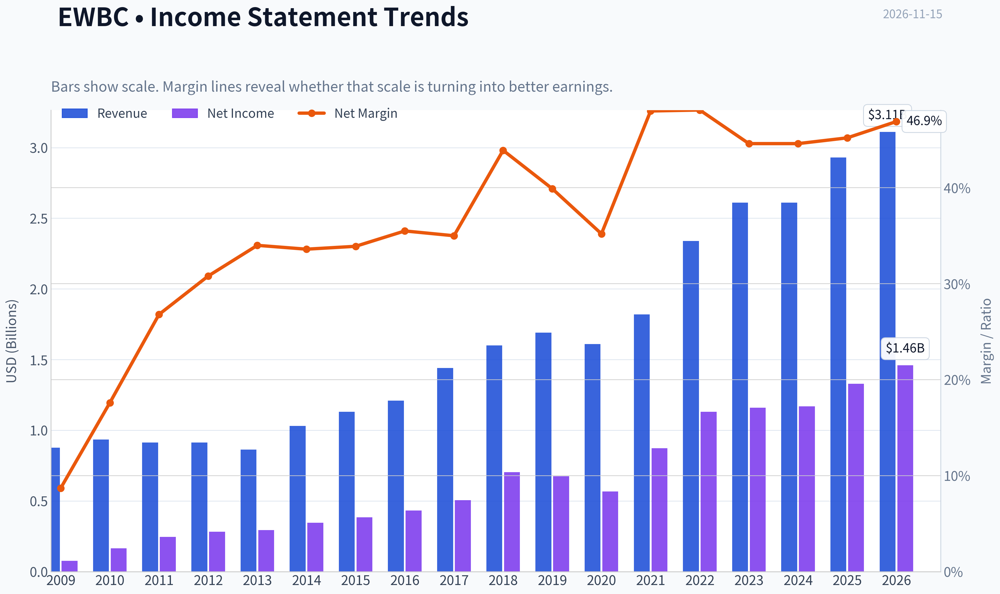

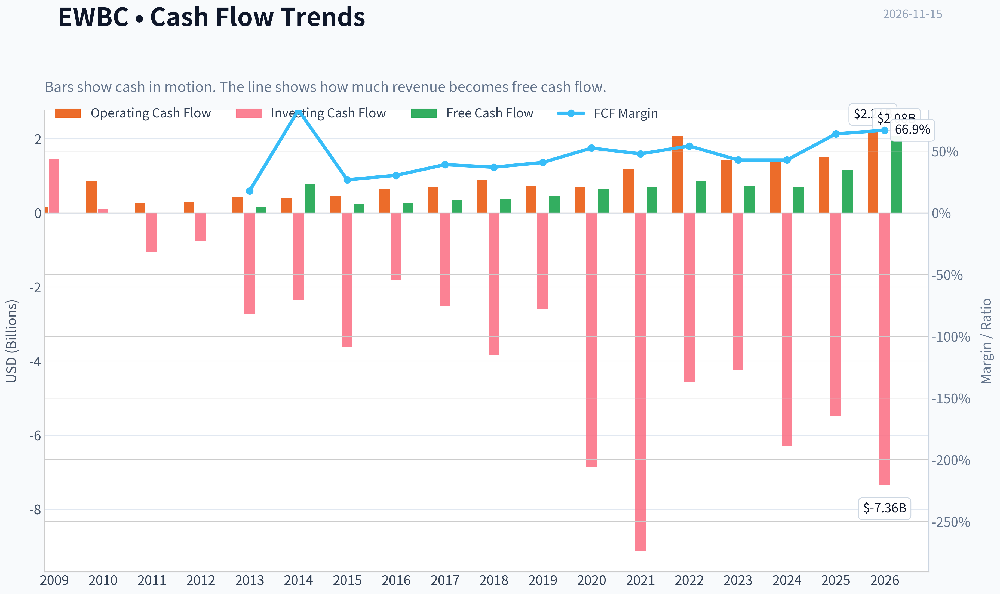

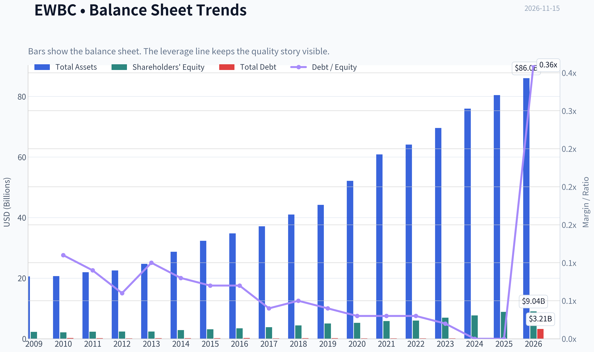

This graph tracks the profitability and return metrics (ROE, ROIC, Margins) of **EWBC** over the past decade, highlighting capital efficiency trends.

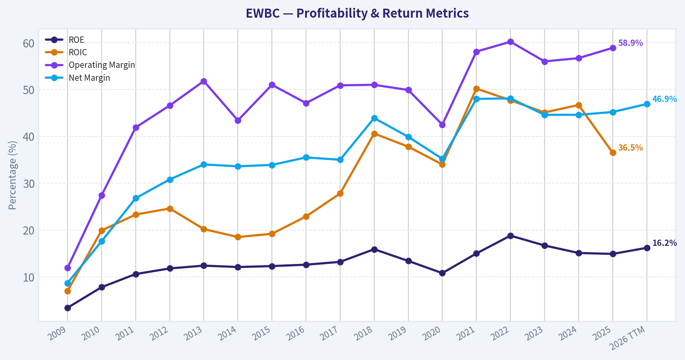

This chart illustrates the financial health of **EWBC** over the last 10 years, mapping cash equivalents and free cash flow against total obligations (Debt).

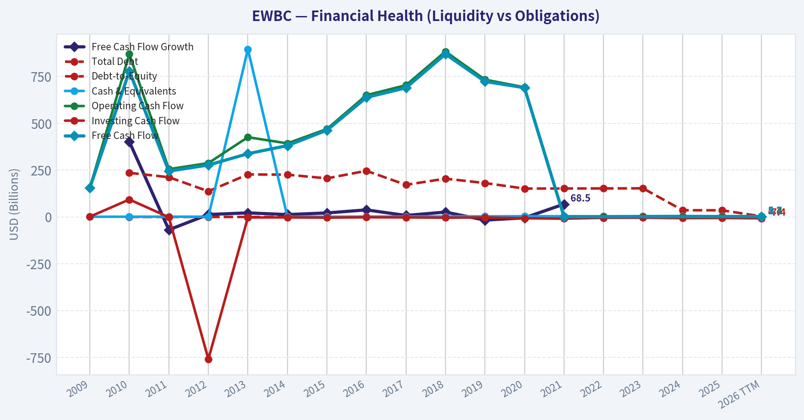

---

### Intrinsic Value Analysis (Buffett)

> *Following Warren Buffett's value investing philosophy: Circle of Competence, Economic Moat, Management Quality, and Margin of Safety.*

#### Intrinsic Value Snapshot

Price is what you pay. Intrinsic value is what the business may be worth based on the cash it can create for owners over time. We show a range, not one magic number.

- Current Price: $131.21
- Value Range (conservative to optimistic across both DCF methods): $121.32 to $419.66

##### Owner Earnings (Buffett Method)
- Net Income: $1,325,188,000.00
- Depreciation & Amortization: $213,164,000.00
- Capital Expenditures: N/A
- Working Capital Changes: $-265,276,000.00
- Owner Earnings: $1,803,628,000.00

##### Intrinsic Value
###### Buffett Method
Uses owner earnings. Stricter, and usually more conservative.
- Conservative: $121.32
- Average: $289.07
- Optimistic: $289.07
- Discount Rate: 10.0%

###### Cash Flow Method
Uses free cash flow. Better for companies spending heavily today to grow tomorrow.
- Conservative: $262.17
- Average: $372.25
- Optimistic: $419.66
- Discount Rate: 10.0%

ANALYST STANCE: **Neutral**

#### Executive Summary

East West Bancorp is a high-quality regional bank with a differentiated cross-border U.S.-Asia franchise, strong earnings power, and reasonable-not obviously cheap-valuation. Its 14.9% ROE and 12.5x earnings multiple suggest a sound business priced near fair value, but the current price of $131 does not provide a clear 25%-35% margin of safety appropriate for a bank exposed to credit, commercial real estate, and interest-rate cycles.

The appropriate action is to watch for a better entry price, preferably near $105-$115, or for evidence that sustainable ROE is moving materially above 15%.

#### 1. Factor Scorecard

| Factor | Score | Assessment |
|---|---:|---|
| Circle of competence and simplicity | 4/5 | The bank gathers deposits, makes loans, earns interest spreads, and generates fee income. Cross-border banking adds complexity but remains understandable. |
| Durable competitive advantage | 4/5 | Long-standing U.S.-China and Asia-Pacific relationships, specialized knowledge, customer trust, and deposit franchises create a meaningful niche moat. |
| Management and capital allocation | 4/5 | East West has historically operated with a disciplined banking model and appears focused on relationship lending, cross-border payments, and wealth management rather than excessive financial engineering. |
| Industry structure | 3/5 | Banking has meaningful scale and regulatory barriers, but competition for deposits and loans is intense. Credit losses and interest-rate cycles remain permanent risks. |

**Key Takeaways:** EWBC appears to be a strong, understandable regional bank rather than a commodity lender. Its moat is real but narrower than that of a dominant national financial platform, and the banking industry naturally carries more balance-sheet and credit risk than an asset-light compounder.

#### 2. Moat Analysis

| Moat Source | Evidence | Rating |
|---|---|---:|
| Intangible assets and trust | Specialized reputation serving Chinese-American businesses, multinational companies, and Asia-linked customers | Strong |
| Switching costs | Commercial banking relationships, credit history, treasury services, and cross-border workflows make switching inconvenient | Moderate to strong |
| Cost advantage | Scale in its niche and relationship density can support efficient funding and underwriting, though no explicit cost-leadership evidence is available | Moderate |
| Network effects | A larger cross-border customer network improves referrals, transaction flows, and institutional knowledge | Moderate |

East West's competitive advantage is primarily relationship-based rather than brand-based. Its specialized expertise can make it a preferred lender and financial-services provider for customers with U.S.-Asia exposure. The announced focus on cross-border payments and wealth management could broaden fee income and deepen customer relationships.

The main threat is geopolitical and economic concentration. Changes in U.S.-China relations, trade flows, immigration patterns, or regulatory policy could weaken the attractiveness of the niche. Credit underwriting quality is also critical: a banking moat disappears quickly if loan losses overwhelm the earnings advantage.

#### 3. Management Quality Assessment

Management receives a provisional **4/5**.

Positive indicators include:

- Focus on relationship banking rather than highly speculative activities.
- Continued development of cross-border payments and wealth management.
- A reported ROE of 14.9%, indicating that capital is being deployed productively.
- No evidence in the supplied information of accounting restatements, distress, or reckless balance-sheet expansion.

The principal diligence question is capital allocation through the credit cycle. For a bank, management quality is best judged by loan-loss experience, reserve adequacy, underwriting discipline, deposit retention, and performance during recessions-not simply by one year's earnings.

#### 4. Financial Summary

| Metric | Latest figure |
|---|---:|
| Share price | $131 |
| Market capitalization | $17.98 billion |
| P/E ratio | 12.47x |
| Implied earnings per share | Approximately $10.50 |
| ROE | 14.9% |
| Revenue growth, year over year | 12.2% |
| Implied book value per share | Approximately $70.50 |
| Implied price-to-book ratio | Approximately 1.86x |
| Intrinsic-value framework | Bank-specific earnings and book-value analysis |
| Gate 5 solvency floor | Not tripped |

The implied earnings per share is calculated as $131 divided by the 12.47x P/E ratio. Implied book value per share is estimated as EPS divided by ROE: approximately $10.50 divided by 14.9%.

**Key Takeaways:** EWBC is growing revenue at a healthy 12.2% year-over-year rate and earns close to a 15% return on equity. At roughly 1.86x implied book value, the stock requires continued strong profitability; it is not priced like a distressed bank.

#### 5. Owner Earnings Calculation

The standard industrial-company owner-earnings formula is not directly appropriate for a bank because:

- Capital expenditures are not the primary reinvestment requirement.
- Deposits and regulatory capital are integral operating inputs.
- Retained earnings must support loan growth and regulatory capital ratios.
- Reported net income cannot simply be distributed to shareholders without considering capital needs and credit reserves.

A practical bank-specific owner-earnings proxy is normalized earnings available to common shareholders:

| Item | Per-share estimate |
|---|---:|
| Net income / EPS proxy | $10.50 |
| Less: maintenance capital expenditure | Not separately meaningful for a bank |
| Less: required regulatory capital retention | Requires detailed capital and growth assumptions |
| Normalized distributable earnings proxy | Approximately $10.50 before capital-retention adjustment |

**Key Takeaways:** EWBC's reported earnings are a useful starting point, but true owner earnings are below reported EPS if the bank must retain capital to support prudent loan growth. The central question is how much of the $10.50 per share can be distributed without weakening future earning power.

#### 6. Three-Scenario Valuation

Because EWBC is a financial institution, the valuation uses earnings capitalization and bank-specific residual-income logic rather than a conventional industrial-company free-cash-flow DCF.

| Scenario | Assumption | Estimated value per share |
|---|---|---:|
| A. No growth | $10.50 EPS capitalized at 10% | $105 |
| B. GDP-like growth | 3% perpetual earnings growth, 10% discount rate | $155 |
| C. Normalized growth | Approximately 5% earnings growth for 10 years, 3% terminal growth, 10% discount rate | $179 |

Scenario A is intentionally conservative. Scenario B represents a bank that grows roughly with the economy while maintaining current profitability. Scenario C assumes continued execution in cross-border payments, wealth management, and relationship banking, but also assumes that current ROE and credit quality remain broadly intact.

A second check uses justified price-to-book value:

- With approximately 14.9% ROE, 3% long-term growth, and a 10% cost of equity, justified P/B is roughly 1.5x-1.7x.
- Applied to estimated book value of approximately $70.50 per share, this implies roughly $106-$120 per share.
- A lower cost of equity or sustained ROE above 15% can justify a higher valuation.

**Key Takeaways:** The valuation range is wide because bank value depends heavily on normalized ROE, credit losses, and the cost of equity. At $131, EWBC is above the conservative no-growth and justified-book-value estimates, but below the value supported by sustained 3%-5% earnings growth.

#### 7. Margin of Safety Analysis

| Valuation reference | Value | Margin versus $131 price |
|---|---:|---:|
| Conservative no-growth value | $105 | Negative 25% |
| Justified book-value range | $106-$120 | Negative 9% to 19% |
| GDP-growth earnings value | $155 | Positive 18% |
| Normalized-growth value | $179 | Positive 37% |
| Indicative blended value range | $120-$155 | Negative 9% to positive 18% |

For an average-quality or cyclical financial institution, the preferred margin of safety is approximately 25%-35%. EWBC's current price does not clearly meet that standard. The stock becomes more compelling around $105-$115, where the purchase price would better compensate investors for credit-cycle, geopolitical, and interest-rate risks.

The market price implies only modest long-term earnings growth under a 10% required return-approximately 2% using a simple perpetual earnings model. That is not an aggressive expectation, but the valuation still depends on EWBC maintaining close to its current profitability.

#### 8. Final Buffett Scorecard

| Criterion | Weight | Score | Weighted contribution |
|---|---:|---:|---:|
| Moat width and durability | 25% | 4.0 | 1.00 |
| Valuation and margin of safety | 20% | 2.8 | 0.56 |
| Capital returns versus cost of capital | 15% | 4.0 | 0.60 |
| Business understanding and predictability | 12% | 4.0 | 0.48 |
| Management quality and capital allocation | 12% | 4.0 | 0.48 |
| Reinvestment runway | 8% | 3.5 | 0.28 |
| Balance-sheet strength | 4% | 3.0 | 0.12 |
| Industry structure | 4% | 3.0 | 0.12 |
| **Total** | **100%** |  | **3.64/5** |

**Key Takeaways:** EWBC scores well on franchise quality, returns, business clarity, and reinvestment opportunities. Valuation is the limiting factor: the bank appears good enough to own, but not sufficiently discounted at $131 to offset the normal risks of regional banking.

#### 9. Investment Stance

**Neutral - Moderate conviction.**

East West Bancorp is a credible long-term compounder candidate, particularly if its cross-border franchise continues producing strong deposits, disciplined credit performance, and fee growth. However, the present price offers only a modest margin of safety against conservative bank-specific valuation methods.

A more attractive entry zone would be approximately **$105-$115**, or a price at which the stock trades near a justified 1.5x-1.6x book value while maintaining ROE near 15%. Reassessment would also be warranted if ROE rises sustainably above 16% without increased credit risk.
#### Valuation Bridge

This bridge places the current market price beside each intrinsic value lens so readers can see whether upside depends on one method or shows up across several methods.

| Scenario | Intrinsic Value / Share |
| --- | ---: |
| Buffett Method | $289.07 |
| Cash Flow Method | $372.25 |
| Current Price | $131.21 |

#### Key Takeaways

If one method is far above the others, the upside case depends on a specific modelling assumption. When several methods cluster together, the valuation story is more robust.

#### Valuation Visuals

This comparison chart from *Latest Earnings Snapshot* stacks current figures against historical benchmarks for **EWBC**, making it easy to see where the company trades relative to its own averages.

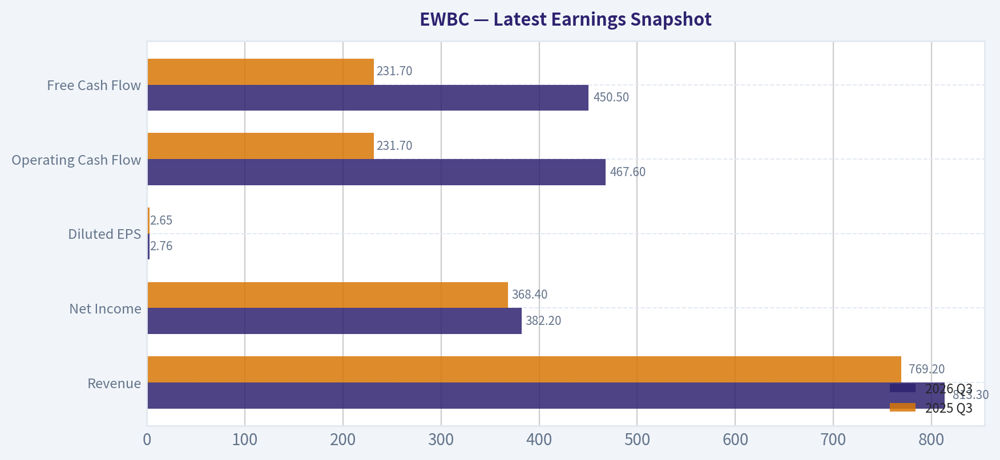

This comparison chart from *Balance Sheet and Financial Strength* stacks current figures against historical benchmarks for **EWBC**, making it easy to see where the company trades relative to its own averages.

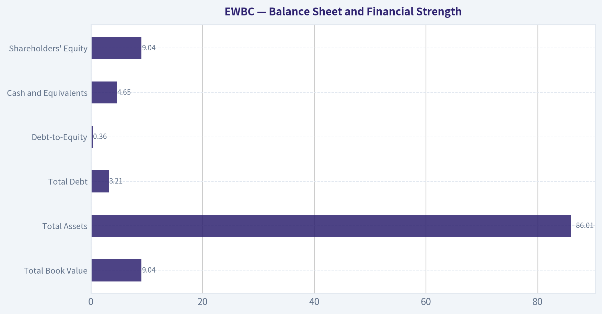

This comparison chart from *Cash Flow and Capital Allocation* stacks current figures against historical benchmarks for **EWBC**, making it easy to see where the company trades relative to its own averages.

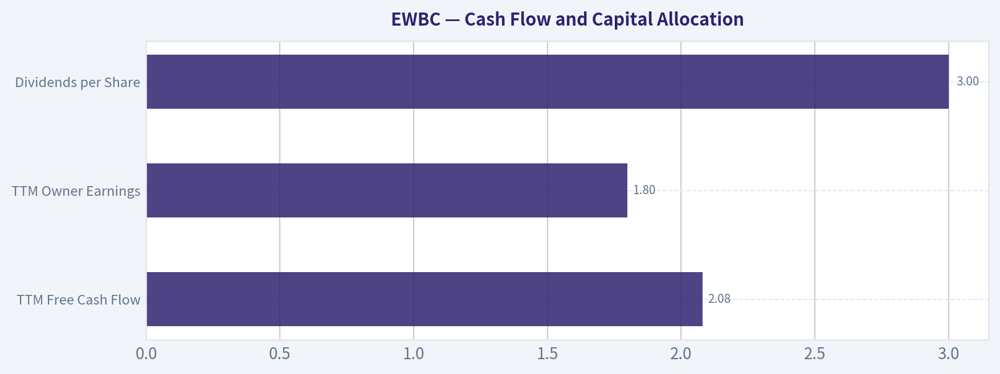

This comparison chart from *Financial Summary* stacks current figures against historical benchmarks for **EWBC**, making it easy to see where the company trades relative to its own averages.

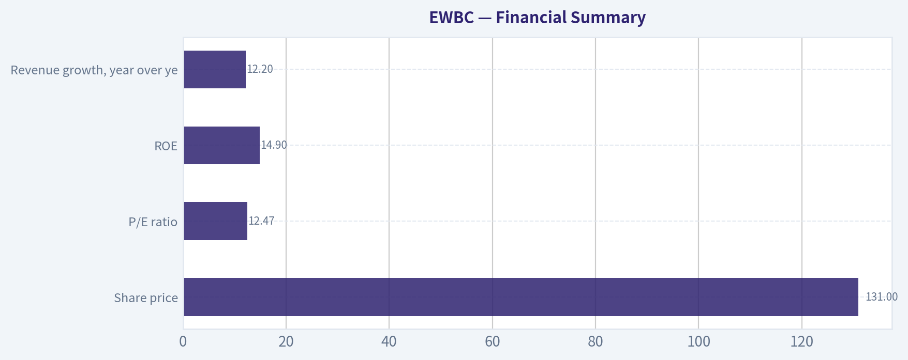

This comparison chart from *Owner Earnings Calculation* stacks current figures against historical benchmarks for **EWBC**, making it easy to see where the company trades relative to its own averages.

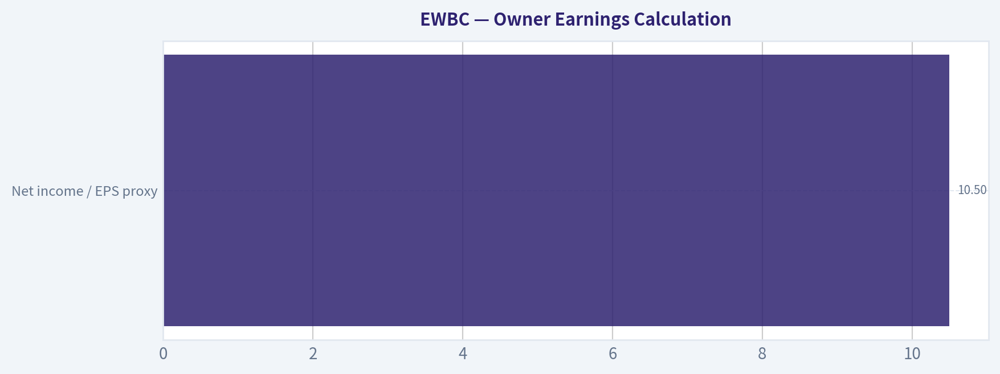

---

### Trend & Growth Analysis (Lynch/Druckenmiller/Fisher)

> *Following Peter Lynch's GARP, Stanley Druckenmiller's macro-aware approach, and Philip Fisher's scuttlebutt methodology.*

ANALYST STANCE: **Neutral**

#### 1. Lynch Classification

**Stalwart / high-quality regional-bank compounder**, not a classic fast grower.

EWBC has delivered respectable long-term growth and strong profitability, but current revenue growth of roughly 12% is below Lynch's 15-25% fast-grower threshold. It is better viewed as a profitable banking compounder with selective growth opportunities in cross-border banking, wealth management, and fee income.

#### 2. The Story in Three Bullets

- East West Bancorp is a U.S. regional bank with a differentiated focus on businesses and customers connected to the U.S.-Asia trade and capital corridor.
- It combines strong profitability-approximately 16% TTM ROE-with a solid capital base, rising book value, and a growing dividend.
- Cross-border payments and wealth management could provide a new fee-income growth layer, but the investment case still depends primarily on credit quality, net interest income, and regional-bank conditions.

#### 3. Fundamental Snapshot

| Metric | EWBC |
|---|---:|
| Current price | $131.21 |
| Market capitalization | $17.98B |
| TTM P/E | 12.47x |
| Forward P/E | 11.12x |
| Price/book | 1.99x |
| Dividend yield | 2.44% |
| Revenue growth | 12.2% |
| Net-income growth | 13.7% |
| TTM ROE | 16.2% |
| TTM ROA | 1.6% |
| TTM net margin | 46.9% |
| TTM EPS | $10.51 |
| TTM revenue | $3.11B |

**Key Takeaways:** EWBC is attractively valued on earnings relative to its profitability, with a forward P/E near 11x and ROE around 16%. However, the valuation is not obviously distressed because the stock trades near 2x book value. The company's growth profile is solid but does not yet qualify as a high-growth inflection story.

#### 4. TAM and 10x Test

A conventional 10x revenue test is less useful for a bank because deposits, loans, assets, net interest income, and fee revenue are more meaningful than reported "revenue." EWBC's total assets are approximately $86 billion, compared with $3.1 billion of reported revenue.

| TAM / Runway Factor | Assessment |
|---|---|
| Core regional banking market | Large, but mature and competitive |
| U.S.-Asia cross-border banking | Attractive niche with secular trade and capital-flow potential |
| Wealth management and payments | Potentially expanding fee-income markets |
| Current scale | $86B of assets and $18B market capitalization |
| Can the company grow 10x? | Possible in theory, but unlikely through organic banking growth alone |
| 10x verdict | Fails the high-confidence ten-bagger test |

**Key Takeaways:** EWBC has meaningful room to grow in cross-border banking and fee-based services, but a tenfold increase in equity value would require sustained compounding, acquisitions, or a substantial expansion beyond its current regional-bank model. The TAM is adequate for continued compounding, but not clearly large enough to support a straightforward ten-bagger thesis.

#### 5. Revenue and Earnings Growth Trend

| Period | Revenue Growth | Net-Income Growth | Interpretation |
|---|---:|---:|---|
| 2019 | 5.4% | -4.2% | Soft |
| 2020 | -4.6% | -15.8% | Pandemic pressure |
| 2021 | 12.7% | 53.7% | Strong recovery |
| 2022 | 29.0% | 29.2% | Peak acceleration |
| 2023 | 11.1% | 2.9% | Deceleration |
| 2024 | 0.3% | 0.4% | Flat |
| 2025 | 12.2% | 13.7% | Reacceleration |
| 2026 TTM | 6.1% | 10.2% | Moderate growth |

**Key Takeaways:** EWBC's recent earnings trend has improved from the flat 2024 period, but the data does not show a persistent acceleration comparable to a 20%-30% growth company. The 2022 surge was partly cyclical and should not be extrapolated. Current growth is respectable, yet still vulnerable to interest-rate, credit, and loan-demand conditions.

#### 6. Unit Economics and Operating Efficiency

Traditional SaaS metrics such as LTV/CAC, NRR, and Rule of 40 do not apply to a deposit-funded bank.

| Bank-Specific Metric | EWBC | Interpretation |
|---|---:|---|
| ROE | 16.2% TTM | Strong |
| ROA | 1.6% TTM | Strong for a bank |
| Net margin | 46.9% | High, though not comparable to industrial companies |
| Price/book | 1.99x | Market assigns a premium to book value |
| Debt/equity | 0.36x TTM data | Less meaningful than bank capital ratios |
| Piotroski F-score | 6/9 | Generally healthy, with data limitations |

**Key Takeaways:** EWBC's strongest economic indicators are ROE, ROA, and sustained profitability. The near-2x price-to-book valuation implies the market expects the bank to continue earning above its cost of equity. Investors should prioritize tangible common equity, CET1 capital, loan-loss provisions, nonperforming assets, deposit costs, and net interest margin over conventional free-cash-flow metrics.

#### 7. Inflection Point Assessment

| Potential Inflection | Current Evidence | Assessment |
|---|---|---|
| Product cycle | Cross-border payments expansion | Positive but early |
| Fee-income growth | Wealth-management buildout | Potential catalyst |
| Market-share gains | Specialized U.S.-Asia franchise | Difficult to verify from supplied data |
| Margin inflection | Strong profitability, but bank margins are rate-sensitive | Neutral |
| TAM expansion | Cross-border capital and trade flows | Positive secular trend |
| Competitive inflection | No clear major competitor disruption | Unconfirmed |

**Key Takeaways:** The most credible inflection opportunity is a gradual shift toward fee income from cross-border payments and wealth management. That could make earnings less dependent on lending spreads, but there is not yet enough evidence of a sharp acceleration in fee revenue or market share. The inflection thesis remains watch-list quality rather than confirmed.

#### 8. Macro Setup

EWBC's macro sensitivity is higher than that of a typical software or healthcare growth company.

- **Interest rates:** Falling rates may support credit demand and reduce funding pressure, but could also compress net interest margins.
- **Credit cycle:** Commercial real estate and regional-bank credit quality remain important risks.
- **U.S.-China relations:** The cross-border franchise benefits from trade and capital flows but is exposed to geopolitical and regulatory friction.
- **Deposits:** Funding stability and deposit pricing are critical to future earnings.
- **Economic cycle:** A soft landing would be favorable; recession would increase provisions and weaken loan growth.

Overall, the macro setup is **mixed to moderately favorable**, not strongly supportive. The business has secular niche exposure, but its earnings remain cyclical.

#### 9. Fisher 15-Point Assessment

| Fisher Criterion Group | Score |
|---|---:|
| Market potential and long-term sales opportunity | 4/5 |
| Product and service development | 3/5 |
| R&D / technology effectiveness | 3/5 |
| Sales organization and franchise | 4/5 |
| Profit margins | 5/5 |
| Margin improvement potential | 3/5 |
| Personnel and executive depth | 4/5 |
| Cost controls and accounting | 4/5 |
| Competitive advantages | 4/5 |
| Long-range profit outlook | 4/5 |
| Dilution risk | 3/5 |
| Management candor and integrity | 3/5 |
| **Total** | **47/75** |

**Key Takeaways:** EWBC scores well on franchise quality, profitability, and its specialized cross-border niche. The score is held back by limited evidence regarding innovation velocity, fee-income acceleration, dilution controls, and management-scuttlebutt data. A score of 47 places EWBC in the average range for a growth-investor Fisher assessment, rather than the outstanding range.

#### 10. Valuation Analysis

| Valuation Measure | Result | Interpretation |
|---|---:|---|
| TTM P/E | 12.47x | Reasonable |
| Forward P/E | 11.12x | Attractive if earnings remain stable |
| PEG ratio | 5.58 | Misleading for a cyclical bank |
| Price/book | 1.99x | Premium valuation |
| Dividend yield | 2.44% | Moderate shareholder return |
| Earnings yield | 8.0% | Solid |
| Reverse-DCF implication | Approximately -1.4% annual owner-earnings growth | Conservative market pricing in the model |

**Key Takeaways:** On earnings, EWBC does not look expensive. However, the nearly 2x price-to-book ratio means investors are paying for continued high returns on equity, not merely asset value. The PEG ratio should not drive the decision because bank earnings growth is cyclical and the denominator is distorted by prior recovery periods.

| Scenario | Assumption | Indicative Value Framework |
|---|---|---:|
| Bear | 10x-11x normalized EPS, lower ROE and credit concerns | $95-$115 |
| Base | 11x-13x EPS, stable ROE and modest growth | $125-$150 |
| Bull | 13x-15x EPS, fee-income acceleration and strong credit | $155-$180 |

**Key Takeaways:** At approximately $131, EWBC is close to the lower-middle portion of the base-case range. Upside exists if fee businesses accelerate and credit remains benign, but the margin of safety is not large enough to justify an aggressive position. The primary valuation risk is multiple compression if ROE declines or credit losses rise.

#### 11. Growth Investor Scorecard

| Criterion | Weight | Score / 5 |
|---|---:|---:|
| Lynch story | 10% | 3.5 |
| TAM and runway | 20% | 3.0 |
| Revenue growth | 20% | 3.0 |
| Unit economics / profitability | 15% | 4.0 |
| Competitive position | 10% | 4.0 |
| Management quality | 10% | 3.5 |
| Macro setup | 5% | 3.0 |
| Profitability path | 5% | 4.0 |
| Valuation | 5% | 3.8 |
| **Weighted score** | **100%** | **3.45 / 5** |

**Key Takeaways:** EWBC narrowly falls below the 3.5 threshold for an "Advocate" rating. Its profitability, franchise, and valuation are attractive, but growth and TAM expansion are not strong enough to establish a high-conviction ten-bagger setup. The stock merits monitoring for evidence that cross-border payments and wealth management are accelerating overall earnings growth.

#### 12. Position Size Stance

**Position size: 0%-2% starter/watch position; up to 3% only with confirming data.**

A larger allocation would require evidence of:

1. Sustained revenue and EPS growth above 15%.
2. Rising fee income from payments and wealth management.
3. Stable or improving net interest margin.
4. Controlled credit losses and commercial real-estate exposure.
5. ROE remaining comfortably above 14%.
6. Book value per share continuing to compound at a double-digit rate.

#### 13. Key Risks and Catalysts

| Catalysts | Risks |
|---|---|
| Faster growth in cross-border payments | Commercial real-estate credit deterioration |
| Wealth-management fee scaling | Recession and higher loan provisions |
| Falling funding costs | Net interest margin compression |
| Stronger U.S.-Asia trade and capital flows | U.S.-China geopolitical restrictions |
| Continued book-value and dividend growth | Deposit competition and funding outflows |
| Earnings beat with raised guidance | Valuation contraction if ROE falls |

**Key Takeaways:** The key upside catalyst is proof that EWBC is becoming more than a traditional spread-based regional bank. The central risk is that credit or funding pressures reduce ROE and force the market to value the stock closer to book value. Until growth visibly accelerates, EWBC is better treated as a quality, reasonably valued bank to monitor-not as a high-conviction ten-bagger candidate.

---

### Market Technical Analysis

ANALYST STANCE: **Neutral**

#### EWBC technical analysis

**Data as of November 13, 2026**, the latest available trading session. November 15 was a weekend, so the most recent closing price is **$131.21**.

EWBC remains in a constructive medium- and long-term trend, but short-term momentum has cooled after the sharp advance into early November. The stock is above both its 50-day and 200-day moving averages, while the MACD remains positive. However, the recent pullback from the November 4 high and the loss of momentum in several indicators suggest that the stock is currently better characterized as consolidating than accelerating.

#### Trend structure

The closing price of **$131.21** is approximately **2.7% above the 50-day SMA at $127.80** and **7.1% above the 200-day SMA at $122.49**. Both moving averages are rising, which confirms that the broader trend remains upward rather than merely being a short-lived rebound.

The 50-day SMA has risen from approximately **$127.22 on October 30** to **$127.80 on November 13**, while the 200-day SMA has advanced from roughly **$121.49 to $122.49** over the same period. This upward slope in both averages is supportive, although the relatively modest separation between the current price and the 50-day average means that a failure near $127-$128 would weaken the medium-term setup.

The price also remains close to the volume-weighted moving average, or VWMA, at **$131.44**. EWBC closed slightly below the VWMA, indicating that recent price action is not decisively outperforming the volume-weighted average. This is a neutral-to-cautious short-term signal, especially after the high-volume volatility around November 4-6.

#### Momentum and MACD

The MACD is positive at approximately **0.98**, confirming that the shorter-term exponential averages remain above the longer-term averages. The indicator turned positive during the October 20-22 advance and climbed to **1.74 on November 4**, coinciding with the move toward the recent high near **$137.36**.

Since then, MACD has declined steadily to **0.98**. This does not yet represent a bearish trend reversal by itself; rather, it indicates that upward momentum is decelerating. The key issue is whether MACD stabilizes above zero. A renewed rise would support another attempt toward the November high, while a move below zero would indicate that the October-to-November advance has lost more substantial momentum.

RSI is approximately **54.9**, down from readings above 60 during the early-November advance. This is a neutral reading: it is neither oversold nor overbought and leaves room for movement in either direction. The decline from above 64 to the mid-50s confirms cooling momentum, but RSI has not fallen into the weak zone below 40 that would suggest broad downside pressure.

#### Volatility and Bollinger Bands

The Bollinger Upper Band is approximately **$134.59**, while the Lower Band is approximately **$126.56**. EWBC is therefore trading in the upper half of its recent volatility envelope, but not near an extreme. The stock is about **$3.38 below the upper band** and **$4.65 above the lower band**.

The band width of roughly **$8.04**, equivalent to approximately **6.1% of the current price**, indicates that volatility remains meaningful. The bands expanded during the late-October and early-November move, and the upper band has continued to rise even as price consolidated. This suggests that the broader structure is still constructive, but the stock may need to hold above the middle region around the 50-day average before a sustained breakout becomes more credible.

A decisive close above **$134.60-$135.00**, particularly with stronger volume, would improve the case for a retest of the November 4 high around **$137.36**. Conversely, sustained closes below **$126.50-$127.80** would indicate deterioration toward the lower Bollinger area and the 50-day trend support.

#### Volatility and risk management

ATR is approximately **$2.80**, meaning EWBC's typical daily trading range is about **2.1% of its share price**. This is not exceptionally high for the stock, but it is large enough that stops placed too close to the entry price could be triggered by normal daily fluctuations.

ATR has declined from approximately **$3.12 on November 5** to **$2.80 on November 13**, suggesting that the post-news volatility spike is easing. Even so, the November 5 session produced a wide range from **$137.00 to $128.74**, demonstrating that event-driven gaps can temporarily overwhelm normal ATR expectations. Traders should therefore distinguish between ordinary volatility and potential news-related price shocks.

#### Key price levels and scenarios

The first nearby support zone is approximately **$129-$130**, corresponding to recent reaction lows and the lower part of the current consolidation. The more important medium-term support zone is **$127-$128**, where the 50-day SMA and the lower Bollinger Band are located. A sustained break below that area would weaken the bullish structure and expose the stock to the **$124-$125** region, followed by the rising 200-day SMA near **$122.50**.

On the upside, the first resistance area is approximately **$134.50-$135.00**, near the upper Bollinger Band. Above that, the principal resistance is the November 4 high near **$137.36**. A breakout through that level would provide stronger confirmation that the broader uptrend is resuming; failure near that area would reinforce the interpretation that EWBC is still range-bound after its recent advance.

Overall, the technical picture is bullish on the intermediate and longer-term horizons but neutral in the immediate term. The most favorable setup would be either a controlled pullback that holds around $127-$130, or a high-volume breakout above $135 and then $137. A close below the 50-day average would materially reduce the quality of the current trend setup.

#### Selected indicators

| Indicator | Latest reading | Interpretation |
|---|---:|---|
| Close | $131.21 | Latest close; below VWMA but above both major moving averages |
| 50-day SMA | $127.80 | Rising medium-term trend support |
| 200-day SMA | $122.49 | Rising long-term trend benchmark |
| MACD | 0.98 | Positive, but declining from 1.74 on November 4 |
| RSI | 54.9 | Neutral momentum; neither overbought nor oversold |
| Bollinger Upper Band | $134.59 | Near-term upside resistance and breakout reference |
| Bollinger Lower Band | $126.56 | Important downside volatility and support reference |
| ATR | $2.80 | Moderate daily volatility; useful for position sizing and stops |
| VWMA | $131.44 | Price is slightly below the volume-weighted average |

**Key Takeaways:** EWBC remains above rising 50-day and 200-day moving averages, so the broader trend is still constructive. Short-term momentum has cooled, with MACD declining and RSI settling near neutral, while price is slightly below its volume-weighted average. Traders should watch $127-$130 as the main support zone and $134.50-$137.36 as the confirmation area for a renewed upside move.

#### Market Visuals

This comparison chart from *Current Market and Valuation Metrics* stacks current figures against historical benchmarks for **EWBC**, making it easy to see where the company trades relative to its own averages.

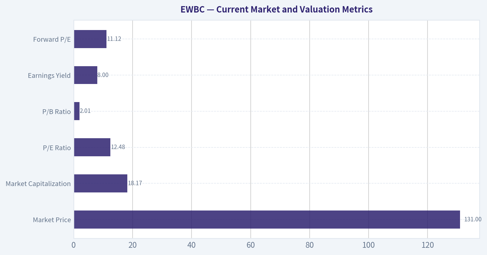

---

### Options Market Analysis

> *Reading options flow - put/call ratios, IV skew, and unusual activity - to gauge institutional positioning and event-driven risk.*

ANALYST STANCE: **Bullish**

#### EWBC Options Flow Overview

Data is as of November 15, 2026. The available chain covers the November 20, December 18, and January 15 expirations. Overall positioning is call-heavy, but total activity is relatively thin, so confidence in the signal is moderate-to-low.

#### Put/Call Ratio Analysis

| Expiration | Call OI | Put OI | Put/Call OI | Call Volume | Put Volume | Put/Call Volume |
|---|---:|---:|---:|---:|---:|---:|
| Nov. 20, 2026 | 505 | 247 | 0.49 | 119 | 57 | 0.48 |
| Dec. 18, 2026 | 177 | 87 | 0.49 | 12 | 9 | 0.75 |
| Jan. 15, 2027 | 505 | 195 | 0.39 | 47 | 40 | 0.85 |
| **Total** | **1,187** | **529** | **0.45** | **178** | **106** | **0.60** |

**Key Takeaways:** EWBC's aggregate put/call open-interest ratio is 0.45, well below the approximately 0.70 neutral baseline. The 0.60 volume ratio also favors calls, indicating a bullish bias or potentially substantial covered-call activity. The strongest call concentration is in January open interest, while near-term November trading is also call-heavy.

#### Implied Volatility Assessment

| Expiration | Call ATM IV | Put ATM IV | Put Minus Call IV | Assessment |
|---|---:|---:|---:|---|
| Nov. 20, 2026 | 51.7% | 54.7% | +3.0 pts | Elevated near-term volatility; modest put premium |
| Dec. 18, 2026 | 34.3% | 39.8% | +5.5 pts | Lower overall IV; downside protection costs more |
| Jan. 15, 2027 | 31.9% | 17.2% | -14.7 pts | Calls carry substantially higher ATM IV |

**Key Takeaways:** Near-term IV is elevated, with ATM volatility around 52% to 55%, while later expirations fall toward 32% to 40%. Puts are more expensive than calls in November and December, implying some near-term downside-hedging demand. However, January shows much higher call IV than put IV, which may reflect upside speculation, sparse trading, or unreliable pricing in this thin chain.

The data does not provide separate out-of-the-money call and put IVs, so a precise OTM skew calculation is unavailable. The ATM differences suggest modest short-term put skew but a pronounced January call-side bias. No specific earnings, product, or macro catalyst was provided, so the elevated November IV cannot be definitively attributed to a known event.

#### Unusual Options Activity

| Finding | Result |
|---|---|
| Contracts with volume greater than 5 times open interest | None |
| Fresh directional institutional-style trades identified | None |
| Most active expiration | November 20, with 176 contracts traded |
| Activity quality | Thin; no confirmed unusual flow |

**Key Takeaways:** No contract met the tool's unusual-activity threshold, so there is no identifiable fresh sweep or high-conviction institutional bet. The bullish read comes from aggregate call-heavy positioning rather than from a specific unusual contract. Because volume is limited, retail activity, covered calls, or stale open interest may be influencing the ratios.

#### Open Interest Concentration and Gamma Considerations

| Expiration | Call OI | Put OI | Total OI | Relative Concentration |
|---|---:|---:|---:|---|
| Nov. 20, 2026 | 505 | 247 | 752 | Highest total near-term concentration |
| Dec. 18, 2026 | 177 | 87 | 264 | Lightest concentration |
| Jan. 15, 2027 | 505 | 195 | 700 | Large call-heavy deferred concentration |

**Key Takeaways:** November 20 has the largest total open interest and may exert the strongest short-term expiration-related influence. January 15 also has substantial open interest, dominated by calls. Strike-level data was not supplied, so specific gamma walls, max-pain levels, and price-pinning strikes cannot be identified reliably.

#### Overall Options Sentiment

**Signal: BULLISH, with low-to-moderate confidence.**

The primary bullish driver is the unusually low aggregate put/call OI ratio of 0.45 and volume ratio of 0.60, showing substantially more call positioning than put positioning. January's call-heavy open interest and high call-side ATM IV further support an upside-oriented interpretation.

The main caveat is liquidity. There is no unusual activity, the absolute volume is small, and the data does not distinguish bought calls from covered-call writing. Near-term put IV is also modestly higher than call IV, indicating that traders continue to pay for downside protection. Accordingly, the options market is directionally bullish but not displaying a strong, clean institutional conviction signal.

#### Summary

| Category | Assessment |
|---|---|
| Put/Call Ratio | Bullish: 0.45 OI ratio and 0.60 volume ratio, both below the 0.70 neutral baseline |
| IV Level | Elevated near term at roughly 52%-55%; materially lower in December and January |
| Skew Direction | Mild near-term put skew; pronounced January call-side ATM IV bias; true OTM skew unavailable |
| Unusual Activity | None detected; no contracts exceeded 5 times open interest |
| Overall Signal | **BULLISH**, but with reduced confidence because of thin volume and limited strike-level data |

**Key Takeaways:** EWBC options positioning favors calls and supports a bullish directional read. The signal is weakened by low trading volume, the absence of unusual contracts, and uncertainty over whether call open interest represents buying or covered-call writing. The market appears cautiously bullish rather than aggressively positioned for an upside breakout.

---

## Research Team Commentary

> *The Research Manager synthesizes the Bull vs Bear debate into action-free commentary. This is a pre-risk view, not the final stance.*

Core takeaway: East West Bancorp appears to be an above-average regional bank, but at approximately $131 it is not clearly available at a Buffett-style margin of safety. Its 15% ROE, 1.6% ROA, differentiated U.S.-Asia franchise, and potential fee-income expansion support business quality. However, the valuation requires much of that quality to persist through changing interest-rate, funding, credit, and geopolitical conditions that the supplied data do not fully address. I would keep the shares on the watchlist rather than buy aggressively or avoid the company outright.

The strongest bull argument is that EWBC is more than a commodity regional bank. Its cross-border expertise, established commercial relationships, and knowledge of U.S.-Asia customers can create meaningful switching costs. Banking relationships become sticky when a provider understands a client's credit history, treasury needs, payment flows, and ownership structure. Cross-border payments, treasury services, and wealth management could deepen those relationships while adding capital-light fee revenue.

Current profitability supports that view. ROE of roughly 15% and ROA of 1.6% are strong bank metrics, while 12.2% year-over-year revenue growth is encouraging. Rising book value and dividends also suggest productive capital deployment. The quoted 27.9% ROIC should largely be disregarded because conventional ROIC is not economically meaningful for a deposit-funded financial institution, but the bank-specific profitability measures remain attractive.

At 12.5 times approximately $10.50 of earnings, the shares are not extravagantly valued. If EWBC can sustain mid-teens ROE, maintain sound credit quality, and compound earnings per share at a high-single-digit rate, shareholders could earn a satisfactory long-term return. There is also no evidence in the debate of distress, capital impairment, or reckless management. That makes Bearish too negative.

The bear's strongest point, however, is that a reasonable multiple is not the same as a margin of safety. The bull's $205-$350 values are future values ten years from now, not present intrinsic values. Starting with $10.50 of EPS, 7% annual growth produces roughly $20.70 of year-ten EPS. At a 12 times exit multiple, that is approximately $248 in year ten, representing only about 6.6% annual price appreciation from $131 before dividends. Depending on the dividend stream, the total return might reach the high single digits, but it would not obviously clear a 10% required return. Something closer to sustained 9% EPS growth, a higher terminal multiple, or a lower purchase price would likely be needed for a more compelling return.

The price also appears to be around 1.8-1.9 times implied book value based on the reported earnings and ROE. That can be justified for a bank consistently earning 15% on equity, but it leaves the valuation sensitive to any decline in normalized ROE. If through-cycle ROE proves closer to 11%-13% because of higher deposit costs, credit provisions, or regulatory capital requirements, the premium to book value could compress even if the bank remains profitable.

The missing balance-sheet evidence is therefore decisive. For a bank, credit quality, funding stability, liquidity, and regulatory capital are not peripheral due-diligence items; they are the heart of the business. The debate does not provide Common Equity Tier 1 capital, tangible common equity, uninsured-deposit exposure, deposit beta, commercial real-estate concentrations, criticized loans, net charge-offs, reserve coverage, or securities losses. Without those figures, "solid capital base" is plausible but not sufficiently demonstrated.

The moat should also be described as differentiated rather than unquestionably wide. The U.S.-Asia corridor produces expertise and relationship depth, but it simultaneously creates geopolitical, sanctions, compliance, and trade-volume exposure. Larger banks and technology-driven payment providers can also compete for attractive customers. The franchise deserves a premium only if it delivers superior risk-adjusted returns after credit losses and compliance costs, not merely because it occupies a specialized niche.

The cross-border payments and wealth-management initiatives should currently be treated as valuable optionality. The case would become stronger if management disclosed their revenue contribution, growth, margins, customer retention, and incremental returns. Until then, they are not substantial enough to offset the cyclicality of net interest income in the valuation.

Market psychology does not reveal an obvious contrarian opportunity here. The stock's appreciation and constructive longer-term trend indicate that the market already recognizes much of the bank's quality. Short-term momentum has cooled, but that is not an intrinsic-value signal. Call-heavy options flow is thin and similarly unhelpful. Unlike a regional bank trading at a crisis valuation, EWBC does not appear burdened by indiscriminate fear. Nor is it priced at an obviously euphoric level. The market may simply be valuing a good bank reasonably.

The lesson from prior mistakes is to avoid treating current market conditions and current bank earnings as permanent. Recent revenue growth and ROE must be normalized against funding costs, the interest-rate environment, provisions, and the credit cycle. It would also be a mistake to infer balance-sheet strength from headline profitability or to capitalize unproven fee-income initiatives prematurely.

Over the next one to four quarters, I would first watch deposit balances, the mix of noninterest-bearing and uninsured deposits, deposit costs, and net interest margin. Stable deposits without aggressive repricing would strengthen the franchise argument; deposit outflows or funding costs rising faster than asset yields would weaken it.

Second, I would track net charge-offs, nonperforming assets, criticized and classified loans, provision expense, reserve coverage, and commercial real-estate concentrations. Stable or improving credit metrics while economic conditions soften would be persuasive evidence that the current ROE is high quality. Rapid deterioration or reserves lagging criticized-loan growth would be a significant warning.

Third, I would monitor CET1 capital, tangible common equity, accumulated other comprehensive losses, available liquidity, and tangible book value per share. The thesis strengthens if tangible book value compounds after dividends while capital remains comfortably above management and regulatory requirements.

Fourth, I would look for measurable progress in payments, treasury management, and wealth management. Fee income should grow faster than balance-sheet assets and become a larger, demonstrably profitable part of revenue. Spending on these initiatives without corresponding fee growth would undermine the diversification claim.

Finally, I would compare reported EPS with normalized owner earnings after provisions. An upgrade to Bullish would become reasonable if EWBC demonstrates that roughly $10.50 or more of EPS is sustainable, maintains approximately 14%-16% ROE with clean credit performance, and shows credible high-single-digit per-share growth-or if the share price falls toward roughly 9-10 times defensible normalized earnings without fundamental deterioration. Conversely, a decline in normalized ROE toward the low teens, material deposit instability, rising criticized assets, or geopolitical disruption to the core corridor would move the assessment toward Bearish.

EWBC looks like a good bank, but the current price asks investors to trust that its strong present economics are durable. That may prove correct, yet the evidence and discount are not sufficient for a high-conviction value purchase today.

STANCE: Neutral

---

## Value Investing Team Commentary

> *The Investor translates the research view into an investment thesis before risk review. This is still not the final stance.*

East West Bancorp appears to be a good bank at a reasonably full price-not an obvious bargain and certainly not a distressed opportunity. The appropriate question is whether its differentiated franchise can compound book value and earnings through a full credit and interest-rate cycle.

### Business quality and moat

EWBC's U.S.-Asia commercial banking franchise is a genuine point of differentiation. Deep knowledge of cross-border customers, ownership structures, payment flows, and regulatory requirements can create relationship stickiness. This is more valuable than simply having exposure to a growing trade corridor.

However, the moat should be considered specialized rather than impregnable. The same corridor introduces geopolitical, sanctions, compliance, and trade-volume risks. Larger banks can compete for the best customers, while fintech and payment platforms may pressure transaction economics. EWBC earns a premium valuation only if this specialization produces superior risk-adjusted returns after credit losses and compliance costs.

Cross-border payments, treasury services, and wealth management are attractive potential extensions of the franchise. At present, they are best viewed as optionality rather than a major component of intrinsic value. A more persuasive thesis would require evidence of fee revenue growth, customer retention, margins, and incremental returns on capital.

### Profitability and valuation

Reported ROE near 15%, ROA around 1.6%, revenue growth of 12.2%, rising book value, and a growing dividend are encouraging. Those metrics suggest EWBC is operating above the level of an undifferentiated regional bank.

The quoted 27.9% ROIC is not particularly useful for a deposit-funded bank. Bank analysis should focus instead on:

- Through-cycle ROE and ROA
- Net interest margin and deposit costs
- Credit losses and reserve adequacy
- Tangible book value growth
- CET1 capital and liquidity
- Sustainable earnings after normalized provisions

At approximately $131 and 12.5 times earnings, the stock is not obviously expensive. But neither is it priced with a substantial margin of safety. If normalized EPS is approximately $10.50, the market is paying a fair price for a bank capable of maintaining strong profitability. It is not receiving a crisis-level discount.

The valuation becomes more demanding when viewed through a long-term return lens. At 7% annual EPS growth and a 12 times terminal multiple, the eventual share-price appreciation would be respectable but not clearly exceptional from the current starting point. To justify a stronger buy case, investors likely need some combination of:

1. Sustained high-single-digit or better EPS growth
2. Durable ROE in the mid-teens
3. Continued tangible book value compounding
4. A stable or higher terminal valuation
5. Meaningful contribution from fee-based businesses

That is possible, but much of the return depends on execution and continued favorable credit performance.

### What sentiment and market action reveal

The constructive long-term trend and recent price appreciation indicate that the market already recognizes EWBC's quality. The cooling short-term momentum is not, by itself, a reason to buy or sell. It merely suggests that the shares are no longer benefiting from accelerating enthusiasm.

Likewise, call-heavy options activity has limited analytical value because the reported volume is thin. It may reflect short-term positioning rather than informed conviction about the bank's ten-year earnings power.

The contrarian opportunity is therefore modest. This is not a high-quality bank being indiscriminately punished by fear. Conversely, the market does not appear euphoric enough to create an obvious short opportunity. Sentiment seems broadly consistent with the fundamentals: investors view EWBC as a good, differentiated regional bank and are willing to pay a respectable price for it.

### Key risks that matter most

The missing balance-sheet information is more important than the headline valuation. Before upgrading EWBC, I would want to examine:

- Deposit growth, deposit beta, and uninsured-deposit exposure
- Net interest margin sensitivity to funding costs
- Commercial real-estate and other concentrated loan exposures
- Criticized and classified loans
- Net charge-offs, nonperforming assets, and reserve coverage
- CET1 capital and tangible common equity
- Unrealized securities losses and available liquidity
- The effect of geopolitical developments on cross-border activity

A bank can report attractive current ROE while quietly accumulating future problems. Conversely, strong credit performance through a weakening economic environment would substantially increase confidence that EWBC's profitability is durable.

### What would change the stance?

EWBC would become more attractive if the share price moved toward roughly 9-10 times defensible normalized earnings without a deterioration in the business. That would provide a more appropriate margin of safety for the risks inherent in regional banking.

An upgrade could also be justified if management demonstrates:

- ROE remaining near 14%-16% through a full cycle
- Stable deposits and controlled funding costs
- Clean credit metrics and conservative reserves
- Tangible book value growth after dividends
- Measurable, profitable expansion in payments and wealth management

The stance would worsen if normalized ROE fell toward the low teens, criticized assets rose materially, deposit costs outpaced asset yields, or geopolitical disruption impaired the core U.S.-Asia franchise.

EWBC is the type of business worth monitoring closely: differentiated, profitable, and potentially capable of compounding value. But a Buffett-style investor should distinguish between owning a good bank and buying it at an attractive price. At $131, the shares appear to offer a reasonable prospective return if management executes well, but not enough downside protection to warrant an aggressive purchase.

**ANALYST STANCE: Neutral** - EWBC is a quality regional-bank franchise with credible long-term strengths, but the current valuation appears to reflect much of that quality. Wait for either a better entry price or additional evidence that its profitability, credit discipline, and fee-income initiatives are durable through the cycle.

---

## Deep Values Commentary

> *The Risk Management Team debates and the Risk Judge provides the final action-free verdict. This section determines the final Bullish / Neutral / Bearish stance.*

#### Final Stance Scorecard

This scorecard converts the final research view into a weighted decision frame. It does not replace the narrative judgement, but it makes the main drivers of the verdict easier to scan.

| Criterion | Score | Weight | Commentary |
| --- | ---: | ---: | --- |
| Business Quality | 3.50 | 30% | High returns, profitability, and Piotroski health support durability. |
| Valuation Support | 4.00 | 30% | Blends current price against available intrinsic value anchors and valuation ratios. |
| Financial Strength | 4.50 | 20% | Balance-sheet resilience reflects leverage and liquidity staying within safe ranges. |
| Growth Durability | 3.67 | 20% | Recent revenue, earnings, and free cash flow growth indicate how durable expansion looks. |
| TOTAL / FINAL STANCE | 3.88 | 100% | Bearish |

#### Key Takeaways

The weighted score lands at **3.88 / 5.0**, while the final stance remains **Bearish**. This is useful as a quick calibration aid rather than a mechanical signal.

#### Risk Summary

Higher scores indicate more risk pressure. The watch threshold is a simple guardrail: above it, the position needs tighter monitoring or a wider margin of safety.

| Dimension | Current Score | Watch Threshold | Commentary |
| --- | ---: | ---: | --- |
| Business Quality | 2.50 | 3.00 | High returns, profitability, and Piotroski health support durability. |
| Valuation Support | 2.00 | 3.00 | Blends current price against available intrinsic value anchors and valuation ratios. |
| Financial Strength | 1.50 | 3.00 | Balance-sheet resilience reflects leverage and liquidity staying within safe ranges. |
| Growth Durability | 2.33 | 3.00 | Recent revenue, earnings, and free cash flow growth indicate how durable expansion looks. |

#### Key Takeaways

This view helps readers separate *where* the risk sits: valuation, business quality, balance sheet, or growth durability. It is especially useful when the final stance is close to the line between Neutral and Bearish.
