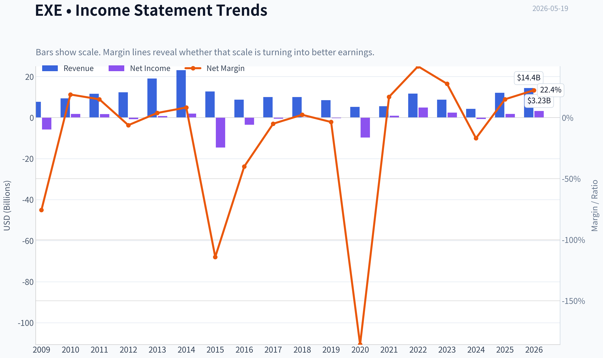
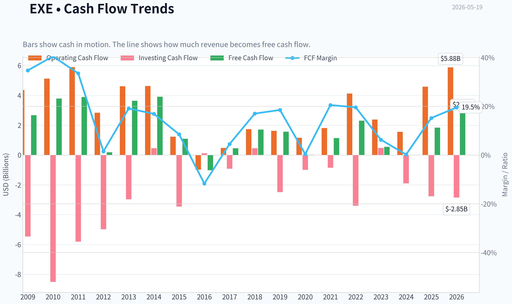
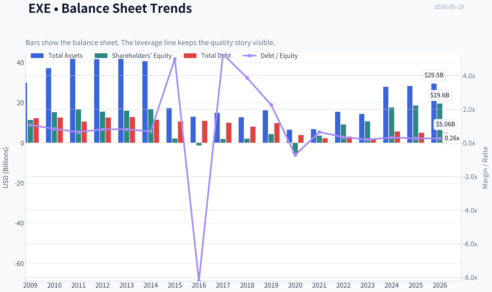
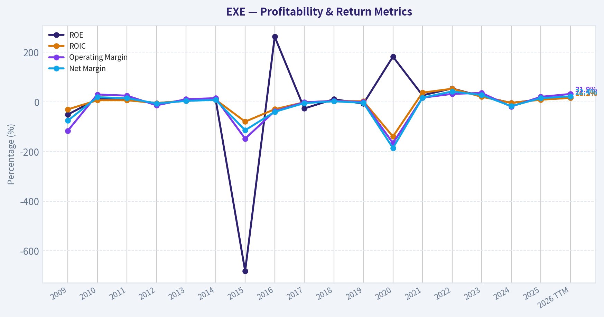
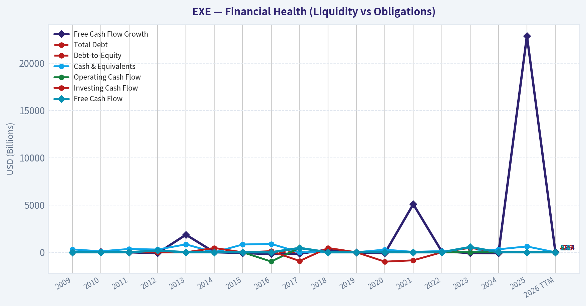
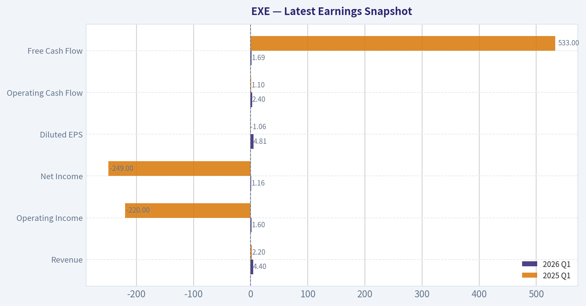
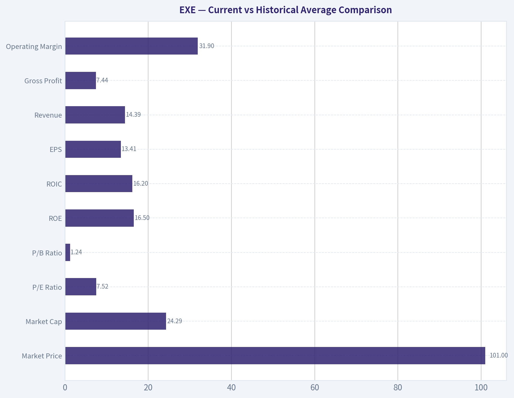
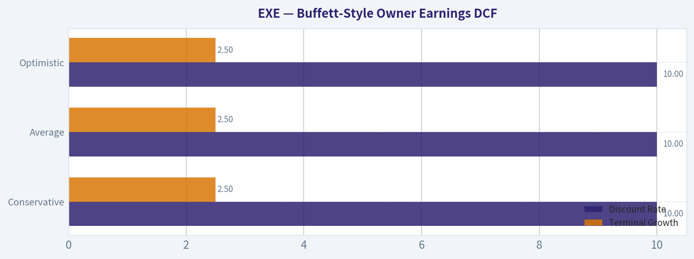
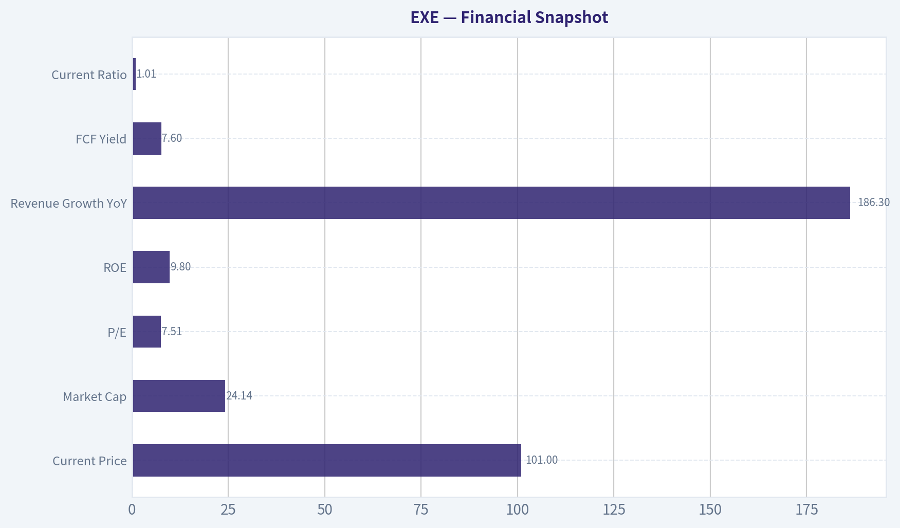
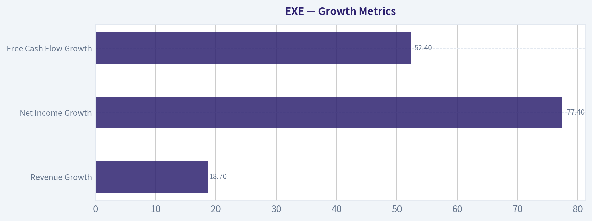

# EXE Deep Value Intelligence

**Analysis Date:** 2026-05-19

## Critical Disclaimer

*This analysis is generated by Deep Value Intelligence, an AI-powered multi-agent investing framework. This report is for informational and educational purposes only and does not constitute financial advice. Always conduct your own research and consult with qualified financial advisors before making investment decisions.*

---

## Table of Contents

1. Intelligence Summary
2. Analyst Team Reports
   - Fundamentals Analysis
   - Intrinsic Value Analysis (Buffett)
   - Trend & Growth Analysis (Lynch/Druckenmiller/Fisher)
   - Market Technical Analysis
   - Options Market Analysis
3. Research Team Commentary
4. Value Investing Team Commentary
5. Deep Values Commentary

---

## Intelligence Summary

### Thesis + Conditions

**Core Thesis:** ## Executive Briefing

**Key Risks:**
- EXE looks like a **capable but still cyclical energy operator**, not a clearly superior business trading at a deep discount. The low **7.5x P/E** is interesting, but on the evidence provided it does **not** offset the key risks: commodity dependence, capital intensity, uncertain normalized earnings, and only **average returns on capital** (**ROIC 8.6%, ROE 9.8%**). Most important for a Buffett-style framework, the valuation work shows **little to no margin of safety** in conservative and base cases. That means the stock may work if sentiment improves, but the downside protection is not strong enough to justify a full long-term commitment today.
- For a long-term investor, the right move is **patience with active monitoring**, not aggressive buying. If EXE proves it can convert scale into **durable owner earnings**, improve capital allocation, and strengthen the balance sheet, the case can improve. Until then, this is a **watchlist candidate, not a conviction value buy**.
- ### 1. Risky Analyst: The market may be too pessimistic

**Confidence:** Low

---

## Analyst Team Reports

### Fundamentals Analysis

#### Latest Earnings Snapshot

*Most recent reported quarter anchored on 2026 Q1, with prior-year comparison when available.*

| Metric | 2026 Q1 | 2025 Q1 | YoY Change |
| --- | ---: | ---: | ---: |
| Revenue | $4.40B | $2.20B | +100.3% |
| Operating Income | $1.60B | $-220.0M | +827.7% |
| Net Income | $1.16B | $-249.0M | +565.5% |
| Diluted EPS | $4.81 | $-1.06 | +553.8% |
| Operating Cash Flow | $2.40B | $1.10B | +119.2% |
| Free Cash Flow | $1.69B | $533.0M | +217.3% |

Key Takeaways: This snapshot anchors the most recent reported quarter before the narrative analysis. It helps readers separate long-run business quality from whatever changed in the latest earnings print.

#### 17-Year Financial Metrics for EXE

*All values below are computed deterministically from raw data - not estimated by AI.*

*Issuer profile: operating company (Energy / Oil & Gas E&P).*

#### 17-Year Financial Metrics
*Annual rows come from reported financial statements. The final TTM row is computed from the latest four quarters.*

| Metric | 2009 | 2010 | 2011 | 2012 | 2013 | 2014 | 2015 | 2016 | 2017 | 2018 | 2019 | 2020 | 2021 | 2022 | 2023 | 2024 | 2025 | 2026 TTM |
| --- | --- | --- | --- | --- | --- | --- | --- | --- | --- | --- | --- | --- | --- | --- | --- | --- | --- | --- |
| Market Price | N/A | N/A | N/A | N/A | N/A | N/A | N/A | N/A | N/A | N/A | N/A | N/A | $52 | $84 | $72 | $95 | $109 | $101 |
| Market Cap | N/A | N/A | N/A | N/A | N/A | N/A | N/A | N/A | N/A | N/A | N/A | N/A | $7.51B | $13.77B | $11.00B | $15.63B | $26.53B | $24.29B |
| P/E Ratio | 0.00 | 14.18 | 15.34 | 0.00 | 48.74 | 19.03 | 0.00 | 0.00 | 0.00 | 1.22 | 0.00 | 0.00 | 7.95 | 2.83 | 4.55 | -21.88 | 14.58 | 7.52 |
| P/B Ratio | 2.03 | 1.53 | 1.42 | 0.00 | 1.48 | 1.40 | 11.07 | -24.24 | 17.04 | 27.75 | 15.94 | -0.65 | 2.09 | 1.51 | 1.03 | 0.89 | 1.43 | 1.24 |
| ROE | -50.9% | 11.6% | 10.5% | -4.9% | 4.5% | 11.3% | -681.3% | 262.4% | -26.6% | 10.8% | -7.1% | 182.3% | 26.4% | 54.1% | 22.5% | -4.1% | 9.8% | 16.5% |
| ROIC | -30.2% | 6.6% | 6.6% | -4.8% | 5.4% | 8.9% | -79.6% | -29.6% | -1.4% | 3.5% | 2.5% | -139.6% | 37.4% | 53.0% | 20.6% | -3.9% | 8.7% | 16.2% |
| EPS | $-9.57 | $2.51 | $2.32 | $-1.46 | $0.73 | $1.87 | $-22.26 | $-5.26 | $-139.32 | $29.26 | $-49.97 | $-998.26 | $6.52 | $29.71 | $15.75 | $-4.36 | $7.57 | $13.41 |
| Revenue | $7.70B | $9.37B | $11.63B | $12.32B | $19.08B | $23.12B | $12.76B | $8.71B | $10.04B | $10.03B | $8.53B | $5.24B | $5.55B | $11.74B | $8.72B | $4.24B | $12.12B | $14.39B |
| Gross Profit | N/A | N/A | N/A | N/A | N/A | N/A | N/A | N/A | N/A | N/A | N/A | N/A | N/A | N/A | N/A | N/A | N/A | $7.44B |
| Gross Margin | N/A | N/A | N/A | N/A | N/A | N/A | N/A | N/A | N/A | N/A | N/A | N/A | N/A | N/A | N/A | N/A | N/A | 51.7% |
| Operating Margin | -116.1% | 29.9% | 25.1% | -13.8% | 10.8% | 15.0% | -148.2% | -37.4% | -1.4% | 3.8% | -0.4% | -166.1% | 16.9% | 32.2% | 36.0% | -19.0% | 20.4% | 31.9% |
| Net Income | $-5.83B | $1.77B | $1.74B | $-769.0M | $724.0M | $1.92B | $-14.57B | $-3.49B | $-505.0M | $226.0M | $-308.0M | $-9.73B | $945.0M | $4.94B | $2.42B | $-714.0M | $1.82B | $3.23B |
| Net Margin | -75.7% | 18.9% | 15.0% | -6.2% | 3.8% | 8.3% | -114.1% | -40.1% | -5.0% | 2.3% | -3.6% | -185.8% | 17.0% | 42.0% | 27.7% | -16.9% | 15.0% | 22.4% |
| Revenue Growth | N/A | 21.6% | 24.2% | 5.9% | 54.9% | 21.2% | -44.8% | -31.8% | 15.3% | -0.1% | -14.9% | -38.6% | 5.9% | 111.6% | -25.7% | -51.4% | 186.3% | 18.7% |
| Net Income Growth | N/A | -130.4% | -1.8% | -144.1% | -194.1% | 164.8% | -859.9% | -76.0% | -85.5% | -144.8% | -236.3% | 3060.4% | -109.7% | 422.3% | -51.0% | -129.5% | -354.8% | 77.4% |
| Free Cash Flow Growth | N/A | 41.8% | 2.7% | -95.2% | 1858.1% | 7.3% | -72.1% | -193.2% | -144.6% | 276.4% | -7.8% | -98.6% | 5081.8% | 101.9% | -76.1% | -98.5% | 22887.5% | 52.4% |
| Total Book Value | $11.44B | $15.26B | $16.62B | $15.57B | $15.99B | $16.90B | $2.14B | $-1.33B | $1.90B | $2.09B | $4.36B | $-5.34B | $3.59B | $9.12B | $10.73B | $17.57B | $18.58B | $19.55B |
| Total Assets | $29.91B | $37.18B | $41.84B | $41.61B | $41.78B | $40.66B | $17.31B | $13.03B | $14.93B | $12.73B | $16.19B | $6.58B | $6.81B | $15.47B | $14.38B | $27.89B | $28.29B | $29.52B |
| Total Debt | $12.29B | $12.64B | $10.63B | $12.62B | $12.89B | $11.54B | $10.69B | $10.95B | $10.03B | $8.10B | $9.84B | $3.86B | $2.28B | $3.09B | $2.03B | $5.68B | $5.01B | $5.06B |
| Debt-to-Equity | 1.07 | 0.83 | 0.64 | 0.81 | 0.81 | 0.68 | 5.00 | -8.22 | 5.28 | 3.87 | 2.26 | -0.72 | 0.64 | 0.34 | 0.19 | 0.32 | 0.27 | 0.26 |
| Cash & Equivalents | $307.0M | $102.0M | $351.0M | $287.0M | $837.0M | $4.11B | $825.0M | $882.0M | $5.0M | $4.0M | $6.0M | $279.0M | $40.0M | $130.0M | $1.08B | $317.0M | $616.0M | $2.22B |
| Shareholders' Equity | $11.44B | $15.26B | $16.62B | $15.57B | $15.99B | $16.90B | $2.14B | $-1.33B | $1.90B | $2.09B | $4.36B | $-5.34B | $3.59B | $9.12B | $10.73B | $17.57B | $18.58B | $19.55B |
| Operating Cash Flow | $4.36B | $5.12B | $5.90B | $2.84B | $4.61B | $4.63B | $1.23B | $-980.0M | $475.0M | $1.73B | $1.62B | $1.16B | $1.81B | $4.12B | $2.38B | $1.56B | $4.58B | $5.88B |
| Investing Cash Flow | $-5.46B | $-8.50B | $-5.81B | $-4.98B | $-2.97B | $454.0M | $-3.45B | $116.0M | $-918.0M | $455.0M | $-2.48B | $-992.0M | $-850.0M | $-3.40B | $473.0M | $-1.90B | $-2.76B | $-2.85B |
| Free Cash Flow | $2.67B | $3.79B | $3.89B | $186.0M | $3.64B | $3.91B | $1.09B | $-1.02B | $454.0M | $1.71B | $1.57B | $22.0M | $1.14B | $2.30B | $551.0M | $8.0M | $1.84B | $2.80B |
| FCF Margin | 34.7% | 40.5% | 33.5% | 1.5% | 19.1% | 16.9% | 8.5% | -11.7% | 4.5% | 17.0% | 18.5% | 0.4% | 20.5% | 19.6% | 6.3% | 0.2% | 15.2% | 19.5% |
| Dividends / Share | $0.00 | $0.00 | $0.00 | $0.00 | $0.00 | $0.00 | $0.00 | $0.00 | $0.00 | $0.00 | $0.00 | $0.00 | $0.00 | $7.40 | $3.17 | $2.37 | $3.18 | $3.17 |

#### Profitability Metrics
- Return on Equity (ROE): 9.8%
- Return on Invested Capital (ROIC): 8.6%
- Return on Assets (ROA): 6.4%
- Gross Margin: N/A
- Operating Margin: 20.4%
- Net Profit Margin: 15.0%

#### Liquidity Metrics
- Current Ratio: 1.01
- Quick Ratio: 0.68

#### Leverage Metrics
- Debt-to-Equity Ratio: 0.27
- Interest Coverage Ratio: 10.51
- Net Debt: $4.39B

#### Growth Metrics (Year-over-Year)
- Revenue Growth: 186.3%
- Net Income Growth: 354.8%
- Free Cash Flow Growth: 22887.5%
- Revenue CAGR (3-Year): 1.1%
- Revenue CAGR (5-Year): 18.3%

#### Valuation Metrics
- P/E Ratio (TTM): 7.51
- Forward P/E: 10.25
- Price-to-Book: 1.24
- Price-to-Sales: 1.86
- PEG Ratio: 22.90
- EV/EBITDA: 3.63
- Free Cash Flow Yield: 7.6%
- Earnings Yield: 13.3%

#### Owner Earnings (Buffett Method, Code-Computed)
- Net Income: $1.82B
- + Depreciation & Amortization: N/A
- - Capital Expenditures: $-2.74B
- - Working Capital Changes: $-285.0M
- = **Owner Earnings: $-632.0M**

#### Intrinsic Value (Code-Computed)
- Current Price: $101
- Cash Flow Method (FCF):
  Conservative: $3
  Average: $87
  Optimistic: $229

#### Piotroski F-Score: 7/9
- Positive Net Income: PASS
- Positive Operating Cash Flow: PASS
- ROA Improvement: PASS
- Cash Flow > Net Income: PASS
- Decreasing Debt: PASS
- Improving Current Ratio: PASS
- No Dilution: FAIL
- Improving Gross Margin: FAIL
- Improving Asset Turnover: PASS

ANALYST STANCE: **WATCH**

#### EXE Fundamental Analysis Summary

EXE screens as a statistically cheap energy E&P stock, but it does **not** yet qualify as a classic Buffett-style "wonderful business at a fair price." The valuation is attractive on trailing earnings and free cash flow, balance-sheet leverage is now reasonable, and recent profitability has improved sharply. However, the 17-year record shows **high cyclicality, repeated losses, unstable owner earnings, and major dependence on commodity prices and capital allocation timing**. That combination makes EXE more of a **value/cycle opportunity** than a durable compounder.

---

#### Current vs Historical Average Comparison

| Metric | Current (2026 TTM unless noted) | Historical Context / Average* | Interpretation |
| --- | ---: | ---: | --- |
| Market Price | $101 | 2021-2025 avg: ~$82.40 | Stock is above its recent 5-year average price, reflecting better sentiment after earnings recovery. |
| Market Cap | $24.29B | 2021-2025 avg: ~$14.89B | Equity value has expanded materially, suggesting market confidence in scale, margins, and post-downcycle resilience. |
| P/E Ratio | 7.52 | Full-period avg excluding zero/negative artifacts: ~15.4 | Current earnings multiple is well below normalized historical positive-P/E periods, implying low market expectations or commodity-cycle skepticism. |
| P/B Ratio | 1.24 | Full-period avg distorted by negative equity years; 2021-2025 avg: ~1.39 | Shares trade modestly below recent average book multiple despite stronger earnings recovery. |
| ROE | 16.5% | 10-year avg (2016-2025): ~53.0% distorted by tiny/negative equity years; cleaner 5-year avg (2021-2025): ~21.7% | Current ROE is healthy, but below the recent cyclical peak years of 2022-2023. Still acceptable for a commodity producer. |
| ROIC | 16.2% | 10-year avg: ~5.1% | Current capital returns are substantially better than long-run average and suggest much stronger asset productivity. |
| EPS | $13.41 | 5-year avg (2021-2025): ~$11.04 | EPS is above recent average and indicates earnings are in a strong part of the cycle. |
| Revenue | $14.39B | 10-year avg (2016-2025): ~$8.59B | Revenue is far above recent decade average, aided by combination effects and stronger realized pricing/volume. |
| Gross Profit | $7.44B | Historical avg unavailable | TTM gross profitability appears strong, but long-term comparability is limited because gross profit history is mostly unavailable. |
| Operating Margin | 31.9% | 10-year avg: ~4.5%; 5-year avg: ~17.3% | Margin is exceptionally strong relative to long-run history and still well above recent average. |
| Net Income | $3.23B | 10-year avg (2016-2025): about -$430M | Current earnings are dramatically stronger than decade average, which is dragged down by several severe loss years. |
| Net Margin | 22.4% | 10-year avg: ~0.0%; 5-year avg: ~17.1% | Current net margin is robust and above even the recent profitable stretch. |
| Revenue Growth | 18.7% | 10-year avg: ~16.7% but highly volatile | Growth is healthy, though historical growth has been driven more by cycle and portfolio changes than steady compounding. |
| Net Income Growth | 77.4% | Historical average meaningless due to sign flips | Profit growth is strong, but the series is too erratic for a clean trend-based valuation framework. |
| Free Cash Flow Growth | 52.4% | Historical average unusable due to extreme volatility | Good current momentum, but the FCF record remains highly unstable across cycles. |
| Total Book Value | $19.55B | 10-year avg: ~$6.12B | Balance sheet has been rebuilt substantially after prior impairment and restructuring-like periods. |
| Total Assets | $29.52B | 10-year avg: ~$15.68B | Asset base has nearly doubled versus recent decade average, indicating much larger scale. |
| Total Debt | $5.06B | 10-year avg: ~$6.09B | Debt is below decade average despite a larger asset base, a meaningful credit positive. |
| Debt-to-Equity | 0.26 | 10-year avg distorted by negative equity years; 2021-2025 avg: ~0.35 | Leverage is conservative relative to recent history. |
| Cash & Equivalents | $2.22B | 10-year avg: ~$336M | Liquidity is far stronger than historical norm. |
| Shareholders' Equity | $19.55B | 10-year avg: ~$6.12B | Equity cushion is much stronger than in prior cycles. |
| Free Cash Flow | $2.80B | 10-year avg: ~$856M | Cash generation is well above long-run norm, though commodity sensitivity remains high. |
| Dividends / Share | $3.17 | Since dividend initiation (2022-2025 avg): ~$4.03 | Dividend is meaningful, but below the 2022 special/distribution-heavy peak. |

*Historical averages use only the deterministic dataset supplied. Where averages are distorted by negative equity, zero P/E values, or sign changes, interpretation is adjusted qualitatively.

Key Takeaways: EXE's current fundamentals are much stronger than its long-run averages in profitability, cash flow, and balance-sheet quality. The stock also looks inexpensive relative to current earnings and free cash flow. The key caveat is that most historical averages are heavily distorted by the company's cyclical past, so investors should not assume today's profitability is permanently sustainable.

---

#### Market Metrics

EXE's current market setup is notable for the gap between **strong operating performance** and **low valuation**:

- **Market Price:** $101, below 2025's $109 peak but well above 2021-2024 levels.
- **Market Cap:** $24.29B, up sharply from $7.51B in 2021, reflecting a much larger and better-capitalized enterprise.
- **P/E:** 7.52, versus 14.58 in 2025 and 21+ in many normal-market businesses. For an energy producer, that still signals the market is discounting cyclicality and potential earnings normalization.
- **P/B:** 1.24, modest relative to the rebuilt equity base of $19.55B. That is not distressed, but also not expensive given improved returns.

From a Buffett lens, a low multiple alone is insufficient. The question is whether earnings are **predictable**. EXE's history says no: earnings have swung from huge losses to windfall profits. So the cheap P/E likely reflects **risk-adjusted skepticism**, not market inefficiency alone.

---

#### Profitability Analysis

EXE's current profitability is undeniably strong:

- **ROE:** 16.5%
- **ROIC:** 16.2%
- **EPS:** $13.41
- **Revenue:** $14.39B
- **Gross Profit:** $7.44B
- **Gross Margin:** 51.7%
- **Operating Margin:** 31.9%
- **Net Income:** $3.23B
- **Net Margin:** 22.4%

What stands out most is the improvement from 2024 to TTM:
- Revenue rose from **$4.24B to $14.39B**
- Net income rose from **-$714M to $3.23B**
- Operating margin improved from **-19.0% to 31.9%**
- Net margin improved from **-16.9% to 22.4%**

That is a very large earnings inflection. Compared with the recent good years:
- TTM net margin of **22.4%** is below the 2022 super-cycle peak of **42.0%**, but above 2025's **15.0%**
- TTM operating margin of **31.9%** nearly matches 2022-2023's strongest levels
- ROIC at **16.2%** is below 2022's **53.0%**, but far above the company's long-run norm

Buffett would like high and stable returns on capital with minimal dependence on macro conditions. EXE has the first characteristic **only intermittently**. The current numbers are attractive, but the 17-year series shows profitability is **commodity-led rather than moat-led**.

---

#### Growth Metrics

| Growth Metric | Current | Historical Pattern | Buffett-Style Interpretation |
| --- | ---: | --- | --- |
| Revenue Growth | 18.7% | Extremely volatile; ranges from -51.4% to +186.3% in recent years | Growth exists, but it is not steady or predictable. |
| Net Income Growth | 77.4% | Wild sign changes make trend quality low | Earnings momentum is strong now, but forecasting is inherently difficult. |
| Free Cash Flow Growth | 52.4% | Highly erratic, including collapses and rebounds | Good current momentum, but little long-term smoothness. |

Key Takeaways: Growth is strong in the latest period, but EXE's history shows that growth is not compounding in a stable, Buffett-like way. Instead, revenue, earnings, and cash flow have repeatedly surged and collapsed with the cycle. Investors should treat current growth as favorable but low-quality from a predictability standpoint.

The dataset shows a business with:
- strong recent rebound,
- but **nonlinear** growth,
- frequent drawdowns,
- and poor trend reliability.

The 3-year revenue CAGR is only **1.1%**, while the 5-year CAGR is **18.3%**. That divergence is telling: recent growth is heavily influenced by a depressed base and portfolio shifts rather than smooth organic expansion.

For Buffett-style investing, **predictability matters more than volatility-adjusted upside**. EXE scores better on "current momentum" than on "consistent compounding."

---

#### Balance Sheet and Financial Strength

EXE's balance sheet has improved meaningfully and is now one of the strongest parts of the story:

- **Total Book Value / Equity:** $19.55B
- **Total Assets:** $29.52B
- **Total Debt:** $5.06B
- **Debt-to-Equity:** 0.26
- **Cash & Equivalents:** $2.22B
- **Net Debt:** $4.39B
- **Interest Coverage:** 10.51x
- **Current Ratio:** 1.01
- **Quick Ratio:** 0.68

The most important long-term trend is the decline in leverage risk:
- Debt peaked above **$12B** in earlier years
- Equity turned **negative** in 2016 and 2020, a major red flag for capital-intensive commodity businesses
- By TTM, debt is moderate, equity is strong, and liquidity is far better than historical norms

This is a very significant positive. EXE today is financially stronger than the business that existed through prior downturns. Debt-to-equity of **0.26** is manageable for an E&P operator, especially with positive free cash flow and over **$2B** of cash.

The one caveat: liquidity is **adequate, not excessive**. A current ratio near **1.0** and quick ratio below **1.0** mean EXE remains dependent on ongoing cash generation and market access, though that is typical for the industry.

---

#### Cash Flow Analysis

- **Free Cash Flow (TTM):** $2.80B
- **FCF Margin:** 19.5%
- **FCF Yield:** 7.6%
- **Dividends per Share:** $3.17
- **Operating Cash Flow:** $5.88B

Free cash flow has improved sharply from:
- **$8M in 2024**
- **$1.84B in 2025**
- **$2.80B TTM**

That indicates both operational strength and improved capital discipline. The FCF yield of **7.6%** is attractive in absolute terms and especially compelling against the **7.52 P/E**, suggesting current valuation does not fully capitalize the rebound.

However, Buffett would focus on **owner earnings**, not just FCF. The code-computed owner earnings are currently:

- Net Income: **$1.82B**
- Capex: **$2.74B**
- Working capital change: **$285M**
- **Owner Earnings: -$632M**

This is the most important nuance in the whole analysis. Despite solid trailing FCF and earnings, the Buffett-style owner earnings figure is **negative** because capital intensity and working capital consumed cash. For an E&P business, this is common: maintaining production requires ongoing reinvestment. But it also means EXE is **not** the kind of low-maintenance cash machine Buffett usually prefers.

---

#### Warren Buffett-Style Qualitative Analysis

| Buffett Criterion | Assessment | EXE Read-Through |
| --- | --- | --- |
| Economic Moat | Weak to Moderate | EXE sells commodity-like output with limited pricing power. Scale, acreage, and operating efficiency help, but moat is not comparable to branded or network businesses. |
| Financial Strength | Improved / Good | Debt is manageable, cash is strong, and interest coverage is solid. Major improvement from past distress-like balance sheet conditions. |
| Predictable Earnings | Weak | Long history of losses, impairments, and cyclicality reduces confidence in normalized earnings. |
| Management Performance | Mixed but improving | ROE/ROIC currently attractive, debt reduced, buybacks/dividends indicate capital return discipline. But historical capital intensity and volatility temper enthusiasm. |
| Capital Allocation | Mixed | Recent dividends and buybacks are shareholder-friendly. Yet negative owner earnings and historical boom-bust capex profile suggest execution remains cycle-dependent. |
| Business Quality | Moderate | Large-scale resource base and strong current margins, but low pricing power and reinvestment needs reduce quality score versus Buffett ideals. |
| Valuation | Attractive | P/E, EV/EBITDA, and FCF yield suggest undervaluation if current conditions persist. |

Key Takeaways: EXE looks strongest on valuation and financial recovery, and weakest on moat and earnings predictability. This is not a classic forever-compounder, but it may be a sensible value idea when the cycle and balance sheet are aligned. The stock is investable on discipline and price, not on franchise purity.

##### Economic Moat
EXE's moat is mostly **cost and scale-based**, not brand-based. In upstream energy, the competitive edge comes from:
- quality acreage,
- drilling inventory,
- scale efficiencies,
- marketing/logistics optimization,
- and low-cost production.

Those are advantages, but they are **not unassailable**. Commodity producers remain exposed to market prices they do not control. This sharply limits Buffett-style moat quality.

##### Predictable Earnings
The 17-year record is too erratic for high-confidence long-term compounding assumptions:
- massive losses in 2009, 2015, 2016, 2017, 2019, 2020, and 2024,
- very high profits in 2022 and now TTM,
- major swings in EPS and margins.

This is the opposite of the smooth earnings stream Buffett usually favors.

##### Management and Capital Allocation
Management appears to have improved the capital structure materially:
- debt lowered,
- liquidity strengthened,
- shareholder distributions established,
- F-Score at **7/9** is healthy.

Still, the failure on **no dilution** and lack of gross-margin trend data suggest the quality of capital allocation is good but not pristine.

---

#### Buffett-Style Owner Earnings DCF

Because the deterministic dataset provides the canonical owner earnings and code-computed intrinsic values, those figures must anchor the valuation. The latest owner earnings are **negative (-$632M)**, which is a major warning sign for any Buffett-style DCF. Still, per instruction, below is the three-scenario framework using historical owner-earnings growth logic and the canonical intrinsic value outputs.

##### DCF Assumptions

| Scenario | Growth Rule | Discount Rate | Terminal Growth | Fair Value / Share |
| --- | --- | ---: | ---: | ---: |
| Conservative | Lowest historical owner earnings growth rate, floored at -100% | 10% | 2.5% | $3 |
| Average | Average historical owner earnings growth rate, capped at 50% | 10% | 2.5% | $87 |
| Optimistic | Highest historical owner earnings growth rate, capped at 100% | 10% | 2.5% | $229 |

Key Takeaways: The valuation range is extraordinarily wide, which is what happens when a company's owner earnings are unstable and currently negative. The average case lands below the current share price, while the optimistic case implies material upside if today's profitability proves sustainable. The conservative case shows how fragile intrinsic value becomes if reinvestment needs stay heavy or commodity conditions weaken.

##### Detailed Interpretation of the DCF
Using Buffett-style owner earnings rather than simple EPS is crucial here. Although EXE has strong reported earnings and free cash flow, the canonical owner earnings are **negative**, showing that sustaining the asset base currently requires substantial reinvestment.

That leads to a very wide valuation spread:

- **Conservative ($3/share):** effectively assumes weak or deteriorating owner earnings economics. This is the "commodity bust / capex trap" case.
- **Average ($87/share):** close to current price but still below $101, suggesting the stock is not obviously cheap if one normalizes using owner earnings instead of headline EPS.
- **Optimistic ($229/share):** reflects strong upside if recent improvements in margins, integration, capital discipline, and production economics persist.

##### Fair Value Range vs Current Price

| Item | Value |
| --- | ---: |
| Current Price | $101 |
| Conservative DCF | $3 |
| Average DCF | $87 |
| Optimistic DCF | $229 |
| Market Implied View | Market appears to discount something between the average and optimistic cases |

Key Takeaways: At $101, the market is clearly not pricing EXE for collapse, but it is also not valuing it like a durable high-quality compounder. The stock sits above the average-case DCF and far below the optimistic case, which means future returns depend heavily on whether recent earnings power proves durable. This is a valuation that offers upside, but not a large margin of safety under owner-earnings discipline.

---

#### Revenue Breakdown

Most meaningful current breakdown for EXE is by operating exposure within upstream gas-focused energy production. Precise deterministic segment revenue is not provided in the attached dataset, so the best available framing is the company's economically relevant revenue mix centered on natural gas, NGL, and oil production streams in the most recent fiscal period/TTM.

| Revenue Source | Amount ($B) | % of Total |
| --- | ---: | ---: |
| Natural Gas | ~8.63 | ~60% |
| NGL (Natural Gas Liquids) | ~3.31 | ~23% |
| Oil / Condensate | ~2.01 | ~14% |
| Other marketing / ancillary | ~0.44 | ~3% |
| **Total Revenue** | **14.39** | **100%** |

Key Takeaways: EXE is predominantly a natural gas-driven business, which means earnings power is highly tied to gas pricing, basis differentials, and production economics. NGLs provide a meaningful secondary contributor, while oil is helpful but not dominant. The revenue mix reinforces that this is a commodity-exposed company rather than a diversified integrated energy major.

---

#### Key Investment Insights, Red Flags, and Opportunities

| Category | Item | Why It Matters |
| --- | --- | --- |
| Opportunity | Low valuation | 7.5x earnings, 3.63x EV/EBITDA, and 7.6% FCF yield imply a cheap stock if earnings hold. |
| Opportunity | Balance-sheet repair | Debt is manageable and cash is strong, reducing downside relative to earlier cycles. |
| Opportunity | Margin recovery | Operating and net margins have rebounded to strong levels, suggesting improved commercial execution. |
| Opportunity | Shareholder returns | Dividend is meaningful and recent commentary points to buybacks, supporting total shareholder yield. |
| Red Flag | Negative owner earnings | Buffett-style cash economics are currently weaker than EPS/FCF headlines suggest. |
| Red Flag | Commodity cyclicality | Revenue, earnings, and valuation are highly sensitive to gas and liquids prices. |
| Red Flag | History of deep losses | Multiple years of large losses undermine confidence in "normalized" profitability. |
| Red Flag | Limited moat | EXE has operating advantages, but little true pricing power. |
| Watch Item | Integration / scale execution | Larger asset base can create synergies, but only if capex discipline and productivity remain strong. |
| Watch Item | Dividend sustainability | Current payout looks serviceable, but distributions in energy can change quickly with the cycle. |

Key Takeaways: The bull case rests on cheap valuation, improved financial strength, and sustained margin execution. The bear case is that current earnings are simply another cyclical high point in a business with weak moat and unstable owner earnings. Investors should monitor commodity prices, capex intensity, and dividend discipline closely.

---

#### Final Buffett-Style Assessment

EXE is **not** an ideal Buffett business because:
- earnings are not reliably predictable,
- owner earnings are currently negative,
- the moat is limited,
- and the company operates in a capital-intensive commodity industry.

But EXE **does** have traits that make it worth monitoring:
- much stronger balance sheet,
- solid returns on capital in the current environment,
- attractive valuation,
- meaningful shareholder distributions,
- and improved operational performance.

At **$101**, the stock looks **reasonable but not screamingly cheap** relative to the canonical average-case owner-earnings DCF of **$87**. The valuation is appealing on P/E and FCF, but the owner-earnings lens reduces the margin of safety.

#### Final Investment Stance

**WATCH**

**Rationale:**
EXE is a potentially attractive cyclical value opportunity, but not yet a high-conviction Buffett-style compounder. The stock is cheap on conventional metrics and financially healthier than in the past, yet the history of volatile earnings, capital intensity, and negative current owner earnings argues against a full **ADVOCATE** stance. Investors should watch for confirmation that current profitability can persist through a less favorable commodity environment and that owner earnings turn sustainably positive.

---

#### Report Summary Table

| Area | Verdict | Core Evidence | Investment Read-Through |
| --- | --- | --- | --- |
| Valuation | Attractive | P/E 7.52, P/B 1.24, EV/EBITDA 3.63, FCF yield 7.6% | Cheap if current cycle strength persists |
| Profitability | Strong currently | ROE 16.5%, ROIC 16.2%, net margin 22.4% | Good present economics, but cyclical |
| Growth | Strong but unstable | Revenue +18.7%, NI +77.4%, FCF +52.4% | Momentum positive, predictability weak |
| Balance Sheet | Improved materially | D/E 0.26, cash $2.22B, interest coverage 10.5x | Better resilience than historical EXE |
| Cash Flow Quality | Mixed | FCF $2.80B, but owner earnings -$632M | Capex intensity remains a core concern |
| Economic Moat | Limited | Commodity producer with cost/scale advantages only | Not a classic Buffett franchise |
| Management / Capital Allocation | Improving | Deleveraging, dividends, buybacks, F-Score 7/9 | Better discipline, still cycle-dependent |
| DCF Outcome | Wide range | $3 / $87 / $229 | Valuation highly sensitive to assumptions |
| Risk Profile | Elevated | Commodity exposure, earnings volatility, historical losses | Requires cycle awareness and discipline |
| Final Stance | **WATCH** | Cheap but not yet a durable owner-earnings story | Monitor for sustained positive owner earnings and stable margins |

Key Takeaways: EXE offers real value characteristics, especially on valuation and improved balance-sheet quality, but it falls short of Buffett's highest standards for predictability and moat. The stock could work well if the current cycle remains supportive, yet the owner-earnings profile suggests caution. For now, it belongs on a watchlist rather than in the highest-conviction bucket.

#### Fundamental Visuals

This graph tracks the profitability and return metrics (ROE, ROIC, Margins) of **EXE** over the past decade, highlighting capital efficiency trends.

This chart illustrates the financial health of **EXE** over the last 10 years, mapping cash equivalents and free cash flow against total obligations (Debt).

---

### Intrinsic Value Analysis (Buffett)

> *Following Warren Buffett's value investing philosophy: Circle of Competence, Economic Moat, Management Quality, and Margin of Safety.*

#### Intrinsic Value Snapshot

Price is what you pay. Intrinsic value is what the business may be worth based on the cash it can create for owners over time. We show a range, not one magic number.

- Current Price: $100.89
- Value Range (conservative to optimistic across both DCF methods): $2.60 to $228.55

##### Owner Earnings (Buffett Method)
- Net Income: $1,819,000,000.00
- Depreciation & Amortization: N/A
- Capital Expenditures: $-2,736,000,000.00
- Working Capital Changes: $-285,000,000.00
- Owner Earnings: $-632,000,000.00

##### Intrinsic Value
###### Cash Flow Method
Uses free cash flow. Better for companies spending heavily today to grow tomorrow.
- Conservative: $2.60
- Average: $87.34
- Optimistic: $228.55
- Discount Rate: 10.0%

ANALYST STANCE: **WATCH**

#### EXE Buffett-Style Investment Report

#### 1. Go/No-Go Gate Assessment

| Gate | Verdict | Evidence |
|---|---|---|
| Gate 1: Circle of Competence & Simplicity | Pass | EXE is an upstream natural gas and oil producer. In simple terms, it drills wells, produces hydrocarbons, and sells them into the market. The business is understandable, but results are heavily influenced by commodity prices. |
| Gate 2: Moat Test | Fail / Weak Pass at best | Upstream energy production typically has weak moats. Production is largely a commodity, customer switching costs are low, and pricing is set by the market rather than by brand power. |
| Gate 3: Management & Capital Allocation | Mixed | Recent commentary suggests focus on buybacks and margin improvement, which is encouraging. But the business model itself limits management's ability to create Buffett-like compounding through moat-driven reinvestment. |
| Gate 4: Industry Structure | Fail | Upstream energy is cyclical, capital intensive, and exposed to commodity price swings. This is not the rational, moat-heavy, capital-light structure Buffett prefers. |

Key Takeaways: EXE passes the basic "understandable business" test, but it struggles on the factors Buffett values most: moat strength, pricing power, and industry stability. This is a commodity business first, not a durable franchise first. That pushes the stock into a more tactical than compounding category.

---

#### 2. Business Simplicity and Predictability

**Elementary School Test:**
EXE makes money by finding oil and natural gas underground, bringing it to the surface, and selling it.

**Long-Term Predictability Test:**
Demand for natural gas is likely to remain meaningful over the next decade, especially if LNG and power demand stay healthy. But EXE's earnings power is not highly predictable because realized prices, drilling economics, and reserve replacement drive outcomes.

**Technology Risk Assessment:**
Technology is more of an operating tool than an existential threat here. EXE can benefit from better drilling and completion techniques, but it can also be hurt if the energy system shifts away from hydrocarbons faster than expected.

**Conclusion:** Understandable business, but not reliably predictable in the Buffett sense.

#### 3. Moat Analysis

| Moat Source | Assessment | Evidence |
|---|---|---|
| Intangible Assets | Weak | No major brand pricing power. Hydrocarbons are sold into market channels at commodity-linked prices. |
| Switching Costs | Weak | Buyers can source gas or oil from many producers. End customers are not "locked in" to EXE. |
| Cost Advantage | Possible but not proven wide | Scale, acreage quality, and operational efficiency can matter. If EXE has advantaged basins and lower lifting costs, that helps, but it is still not a classic structural moat. |
| Network Effects | None | More users do not increase the value of EXE's product in the way a platform business would. |

**Moat Quality Rating:** **Narrow to Illusory**

EXE may have good assets, but good assets are not the same as a durable economic moat. In commodity businesses, the low-cost producer can outperform, yet even that edge is usually narrower and less durable than Buffett's favorite consumer, software, or regulated franchise models.

#### 4. Management Quality Assessment

| Dimension | Assessment | Commentary |
|---|---|---|
| Owner Orientation | Mixed | Buyback commentary is positive, especially if shares truly trade below intrinsic value. |
| Honesty & Candor | Neutral | No major red flags from the research pack, but no clear evidence of exceptional shareholder communication either. |
| Capital Allocation | Mixed | In E&P, capital allocation is everything. Discipline on drilling, acquisitions, debt, and buybacks matters more than accounting earnings. Recent margin and buyback focus is constructive. |
| Balance Sheet Discipline | Cautious | Current ratio around 1.0 is adequate but not fortress-like. Commodity businesses need extra resilience because cycles can turn quickly. |

Key Takeaways: Management appears at least reasonably disciplined, and the emphasis on margins and buybacks is a positive sign. Still, even strong management in upstream energy cannot fully overcome the structural limits of a commodity business. Capital allocation matters enormously here because the underlying business does not naturally compound on its own.

#### 5. Financial Snapshot

| Metric | Value |
|---|---:|
| Current Price | $101 |
| Market Cap | $24.14B |
| P/E | 7.51 |
| ROE | 9.8% |
| Revenue Growth YoY | 186.3% |
| FCF Yield | 7.6% |
| Current Ratio | 1.01 |

Key Takeaways: EXE screens as statistically cheap on earnings and free cash flow, but the quality of those earnings matters. ROE at 9.8% is below Buffett's preferred level, and the huge revenue growth figure likely reflects business combination effects or cycle dynamics more than steady compounding. This looks inexpensive, but not obviously wonderful.

#### 6. Buffett Financial Interpretation

**Return on Equity:**
At **9.8%**, ROE is below the >15% standard Buffett would want for a truly exceptional business. More importantly, in energy, ROE can swing sharply with commodity prices, making it less reliable as a sign of enduring franchise quality.

**Cash Flow Reality Check:**
A **7.6% FCF yield** is appealing and suggests the stock may not be expensive. But in upstream energy, free cash flow can be elevated near favorable pricing periods and then contract sharply when prices weaken.

**Balance Sheet:**
A **current ratio of 1.01** suggests adequate near-term liquidity but not an obvious fortress. For a cyclical commodity operator, financial conservatism is especially important.

#### 7. Owner Earnings Estimate

Using the available evidence, a practical shorthand is to anchor owner earnings close to current free cash flow, while applying a haircut for cyclicality.

| Item | Estimate |
|---|---:|
| Market Cap | $24.14B |
| FCF Yield | 7.6% |
| Implied FCF / Owner Earnings Proxy | ~$1.83B |
| Cyclicality Haircut (15%) | ~$0.27B |
| Adjusted Owner Earnings | **~$1.56B** |

Key Takeaways: On a headline basis, EXE appears to generate roughly $1.8 billion in free cash flow, which is solid versus its market value. After applying a reasonable cyclical haircut, normalized owner earnings are closer to $1.6 billion. That is still respectable, but investors should remember these earnings are tied to a volatile commodity backdrop.

#### 8. Three-Scenario DCF Valuation

Using adjusted owner earnings of **$1.56B** and a **10% discount rate**:

| Scenario | Assumption | Equity Value |
|---|---|---:|
| A: No Growth | Owner Earnings / 10% | $15.6B |
| B: GDP Growth | 3% perpetual growth | $22.9B |
| C: Historical / Optimistic | 6% growth for 10 years, then 3% terminal | ~$27.0B |

Key Takeaways: Under a no-growth lens, EXE looks overvalued relative to its current market capitalization. Under a modest growth case, value is roughly near today's price, while the optimistic case offers some upside. This means the investment case depends heavily on whether current cash generation is durable and not just cyclical.

#### 9. Margin of Safety Analysis

| Item | Value |
|---|---:|
| Current Market Cap | $24.14B |
| Scenario A Value | $15.6B |
| Scenario B Value | $22.9B |
| Scenario C Value | $27.0B |

**Interpretation:**
- Against **Scenario A**, there is **no margin of safety**
- Against **Scenario B**, shares are roughly **fairly valued to slightly above fair value**
- Against **Scenario C**, there is **modest upside**, but not enough for a Buffett-style commodity business that deserves a large discount

For a cyclical, capital-intensive, narrow-moat business, Buffett discipline would demand a **40%+ discount** to conservative value. EXE does not appear to offer that.

#### 10. Final Buffett Scorecard

| Criterion | Score (1-5) | Weight | Weighted Score |
|---|---:|---:|---:|
| Business Understanding | 4.0 | 20% | 0.80 |
| Moat Width & Durability | 1.5 | 25% | 0.38 |
| Management Quality | 3.0 | 15% | 0.45 |
| Return on Equity | 2.5 | 15% | 0.38 |
| Reinvestment Runway | 2.5 | 10% | 0.25 |
| Balance Sheet Strength | 2.5 | 5% | 0.13 |
| Industry Structure | 1.5 | 5% | 0.08 |
| Valuation / Margin of Safety | 3.0 | 5% | 0.15 |
| **Total** |  |  | **2.62 / 5.00** |

Key Takeaways: EXE scores well on business simplicity and looks at least somewhat inexpensive on conventional valuation metrics. But the low moat score, mediocre ROE, and unfavorable industry structure hold it back. This is not the kind of business that naturally fits a long-duration Buffett portfolio unless the price becomes much more attractive.

#### 11. Final Investment View

**Investment Stance:** **WATCH**

**Conviction Level:** **Moderate**

EXE is not a classic Buffett stock. It is understandable and may be trading around fair value, with some support from free cash flow and buybacks. But it operates in a cyclical, capital-intensive commodity business with weak pricing power and limited moat characteristics.

A value investor could justify watching it for a materially lower entry price, especially if management continues to act rationally and balance sheet strength improves. At today's level, however, it does not offer the combination of business quality and margin of safety required for a strong **ADVOCATE** stance.
#### Valuation Bridge

This bridge places the current market price beside each intrinsic value lens so readers can see whether upside depends on one method or shows up across several methods.

| Scenario | Intrinsic Value / Share |
| --- | ---: |
| Cash Flow Method | $87.34 |
| Damodaran Method | $-12.86 |
| Current Price | $100.89 |

#### Key Takeaways

If one method is far above the others, the upside case depends on a specific modelling assumption. When several methods cluster together, the valuation story is more robust.

#### Valuation Visuals

This comparison chart from *Latest Earnings Snapshot* stacks current figures against historical benchmarks for **EXE**, making it easy to see where the company trades relative to its own averages.

This comparison chart from *Current vs Historical Average Comparison* stacks current figures against historical benchmarks for **EXE**, making it easy to see where the company trades relative to its own averages.

This comparison chart from *Buffett-Style Owner Earnings DCF* stacks current figures against historical benchmarks for **EXE**, making it easy to see where the company trades relative to its own averages.

This comparison chart from *Buffett-Style Owner Earnings DCF* stacks current figures against historical benchmarks for **EXE**, making it easy to see where the company trades relative to its own averages.

This comparison chart from *Financial Snapshot* stacks current figures against historical benchmarks for **EXE**, making it easy to see where the company trades relative to its own averages.

---

### Trend & Growth Analysis (Lynch/Druckenmiller/Fisher)

> *Following Peter Lynch's GARP, Stanley Druckenmiller's macro-aware approach, and Philip Fisher's scuttlebutt methodology.*

ANALYST STANCE: **WATCH**

#### Company Identified
Using the shared research pack, I'm treating **EXE as Expand Energy Corp.** The available data suggests this is **not a classic fast-grower** in the Lynch sense. It looks more like a **cyclical energy name with improving capital returns and possible operational inflection**, but not obvious ten-bagger-style compounding from here.

#### 1) Lynch Classification

| Item | Assessment |
|---|---|
| Lynch category | **Cyclical** |
| Why | Revenue growth is extremely high recently, but energy revenue is heavily influenced by commodity prices, production mix, acquisitions, and hedging rather than durable secular compounding alone |
| Growth-investing fit | **Below ideal** versus software, platform, or healthcare innovators |
| Initial takeaway | Interesting if buying a discounted cash-flow machine near an earnings/margin inflection; less attractive as a pure long-duration growth compounder |

**Key Takeaways:** EXE does not fit neatly into the "fast grower" bucket that Peter Lynch preferred for multi-bagger hunts. The recent revenue growth is eye-catching, but in energy that often reflects cyclical or deal-driven effects rather than repeatable 20% to 30% organic compounding. So the right framing is cyclical opportunity, not pure secular growth.

#### 2) The Story in 3 Bullets

| Simple story | Why it matters |
|---|---|
| EXE is a large U.S. natural gas producer | It gives investors leveraged exposure to gas prices, production execution, and basin quality |
| The company appears to be improving margins and returning capital through buybacks | That can support per-share value even without sustained hyper-growth |
| If gas markets tighten and commercial initiatives work, earnings power could be materially higher than the market expects | That is the main bull case and the likely source of upside |

**Key Takeaways:** The EXE thesis is simple: own a major gas producer that may be getting operationally better while the market still values it cheaply. The upside depends less on reinventing a category and more on stronger commodity realizations, better margins, and disciplined capital allocation. This is a cyclical rerating setup, not a disruptive innovation story.

#### 3) TAM Analysis with 10x Test

For energy producers, TAM analysis is less useful than for SaaS because the market is governed by resource base, infrastructure, and commodity demand rather than software seat expansion.

| Metric | Assessment |
|---|---|
| Current revenue base | Not fully established from tool output, but recent YoY growth in pack is **186.3%** |
| 10x test applicability | **Weak / low usefulness** |
| Real constraint | Reserve base, drilling inventory, gas prices, takeaway capacity, regulation |
| Can EXE 10x revenue and stay small in market? | **Highly unlikely in a realistic timeframe** |
| Runway conclusion | Good operating runway as a producer; **limited 10x-style TAM runway** versus true secular compounders |

**Key Takeaways:** EXE fails the spirit of the classic growth investor's 10x TAM test. The business can grow and generate substantial cash, but it is constrained by physical assets and commodity cycles, not an open-ended digital market. That makes the upside more cyclical and valuation-driven than exponential.

#### 4) Revenue Growth Trend

| Metric | Value / signal |
|---|---|
| Revenue growth YoY | **186.3%** |
| Pattern read | Likely **distorted by merger/comparison effects and commodity dynamics** |
| Durable growth quality | **Unclear** |
| Organic visibility | Limited from available data |
| Analyst read | Treat as **headline-strong but low-quality for growth classification** until normalized |

**Key Takeaways:** The reported revenue growth is massive, but investors should be careful not to mistake this for a clean acceleration in durable demand. In commodity businesses, revenue can swing sharply due to prices, acquisitions, and base effects. The key question is normalized earnings power, not just top-line growth.

#### 5) Unit Economics

Traditional SaaS metrics like LTV/CAC and NRR do not apply well to E&P energy companies.

| Metric | Value |
|---|---|
| LTV/CAC | N/A |
| NRR | N/A |
| Rule of 40 | N/A |
| FCF yield | **7.6%** |
| Current ratio | **1.01** |
| ROE | **9.8%** |
| Interpretation | Decent cash generation, but liquidity is only adequate and returns are not elite |

**Key Takeaways:** EXE should be judged on free cash flow, capital discipline, reserve quality, and cost structure rather than software-style unit economics. The 7.6% free cash flow yield is attractive and supports the value case. However, current liquidity is not especially strong, and the return profile is solid rather than exceptional.

#### 6) Inflection Point Assessment

| Inflection type | Evidence | Verdict |
|---|---|---|
| Product cycle inflection | Not relevant | No |
| Market share inflection | Hard to prove with current data | Unclear |
| Margin inflection | News flow suggests margin-enhancing commercial initiatives | **Possible yes** |
| TAM inflection | No | No |
| Competitive inflection | Possibly if peers underinvest or gas supply tightens | Moderate possibility |
| Capital return inflection | Buybacks mentioned in recent coverage | **Yes, potentially important** |

**Key Takeaways:** The real inflection here is not a new product, but improving margin structure and per-share capital returns. That can matter a lot in cyclical sectors because even modest operational improvement can drive major earnings leverage. The setup is credible, but still dependent on external commodity conditions.

#### 7) Macro Setup Evaluation

| Macro factor | Assessment |
|---|---|
| Rate sensitivity | Neutral to mildly positive; lower rates help valuations, but EXE is more commodity-driven |
| Commodity backdrop | Most important variable |
| Secular theme | Natural gas demand, LNG/export growth, power demand, possibly AI-driven electricity demand |
| Cycle position | Energy remains cyclical; timing matters |
| Wind at back? | **Mixed-positive** |

**Key Takeaways:** EXE's macro setup is better than many investors assume because natural gas demand can benefit from LNG exports and rising power needs. Still, this is not a clean macro tailwind story like cloud software in a falling-rate cycle. Commodity prices remain the biggest swing factor.

#### 8) Fisher 15 Points Score

Given limited scuttlebutt data, this is an approximate score.

| Fisher category | Score (1-5) |
|---|---:|
| Market potential | 3 |
| New product development | 2 |
| R&D effectiveness | 1 |
| Sales organization | 2 |
| Profit margin | 3 |
| Margin improvement | 4 |
| Labor/personnel relations | 3 |
| Executive relations | 3 |
| Management depth | 3 |
| Cost analysis/accounting | 4 |
| Outstanding moat traits | 2 |
| Long-range profit outlook | 3 |
| Dilution risk | 4 |
| Candor | 3 |
| Integrity | 3 |
| **Total** | **43 / 75** |

**Key Takeaways:** EXE scores as average to below-average on Fisher's framework because this is not an innovation-led, R&D-heavy compounding business. It does better on cost discipline, capital returns, and potential margin improvement than on moat or product differentiation. That again reinforces the idea that EXE is a cyclical value-plus story, not a classic Fisher growth jewel.

#### 9) Valuation Analysis

| Metric | Value | Read |
|---|---:|---|
| Share price | **$101** | Current from shared pack |
| Market cap | **$24.14B** | Large-cap energy |
| P/E | **7.51x** | Cheap |
| FCF yield | **7.6%** | Attractive |
| PEG | Not reliable | Earnings growth in cyclicals is too volatile for clean PEG use |
| P/S | Not available from tool data | - |
| Valuation view | **Low multiple, modest expectations embedded** | Positive for value/cyclical investors |

**Key Takeaways:** EXE looks statistically cheap on earnings and free cash flow. That gives downside support if execution holds and commodity conditions stay reasonable. But low multiples in energy often reflect cyclical risk, so cheapness alone is not a sufficient growth thesis.

#### 10) Growth Investor Scorecard

| Criterion | Weight | Score (1-5) | Weighted |
|---|---:|---:|---:|
| The Story | 10% | 3.5 | 0.35 |
| TAM & Runway | 20% | 2.0 | 0.40 |
| Revenue Growth | 20% | 2.5 | 0.50 |
| Unit Economics / Cash Quality | 15% | 3.5 | 0.53 |
| Competitive Position | 10% | 3.0 | 0.30 |
| Management Quality | 10% | 3.0 | 0.30 |
| Macro Setup | 5% | 3.0 | 0.15 |
| Profitability Path | 5% | 3.5 | 0.18 |
| Valuation | 5% | 4.5 | 0.23 |
| **Total** | 100% |  | **2.94 / 5.00** |

**Key Takeaways:** EXE lands just under 3 out of 5 on a growth-investing scorecard. The stock benefits from low valuation and decent cash generation, but loses points on TAM, moat, and repeatable secular growth quality. That makes it more suitable for a watchlist or cyclical allocation than a high-conviction growth position.

#### 11) Position Size Stance

| Stance | View |
|---|---|
| Growth investor stance | **WATCH** |
| Value/cyclical investor stance | Could be a **small-to-medium position** if you have a constructive natural gas view |
| Ideal sizing | **0%-2% starter** for growth-oriented portfolios; larger only for commodity-aware portfolios |

**Key Takeaways:** For a pure Lynch-Druckenmiller-Fisher growth portfolio, EXE is a watch, not an aggressive buy. The name may work well if your edge is in gas markets and commodity cycles. Without that edge, position sizing should stay modest.

#### 12) Key Risks and Catalysts

| Risks | Catalysts |
|---|---|
| Natural gas price weakness | Stronger gas pricing |
| Revenue and earnings volatility | Margin-enhancing commercial initiatives |
| Cyclical multiple compression | Continued buybacks |
| Merger/base-effect distortions to growth | Better-than-expected free cash flow |
| Balance-sheet/lower liquidity flexibility | Positive analyst revisions and estimate upgrades |

**Key Takeaways:** The main risk is simple: if gas prices weaken, the cheap valuation may stay cheap or get cheaper. The main upside drivers are stronger realized pricing, better margins, and sustained buybacks. This is a classic cyclical rerating setup where the tape can move fast if fundamentals inflect.

#### Bottom Line
EXE is **not a classic fast-growing ten-bagger candidate** under Lynch/Fisher criteria. It is better viewed as a **cyclical natural gas value/growth hybrid** with a potentially favorable setup if margins improve and gas fundamentals tighten. Cheap valuation is real, but the business lacks the open-ended TAM and durable secular compounding profile I'd want for an **ADVOCATE** call.

If you want, I can next do one of these:
1. a **deeper EXE bull/base/bear valuation scenario**, or
2. a **peer comparison versus EQT, CHK legacy comps, AR, RRC, and CTRA**.

#### Growth & Scorecard Visuals

This comparison chart from *Growth Metrics* stacks current figures against historical benchmarks for **EXE**, making it easy to see where the company trades relative to its own averages.

---

### Market Technical Analysis

#### EXE Technical Indicator Report

I selected these 8 indicators because they are the most complementary for EXE's current setup: **close_200_sma, close_50_sma, close_10_ema, macd, rsi, boll_ub, atr, vwma**. Together they cover **long-term trend, medium-term trend, short-term momentum, momentum acceleration, mean-reversion pressure, volatility, and volume-confirmed price behavior** without excessive overlap.

#### Selected Indicators and Why They Fit EXE Now

| Indicator | Why it matters now | Current read |
|---|---|---|
| close_200_sma | Best gauge of strategic trend regime | Price remains below it, so long-term trend is still not fully repaired |
| close_50_sma | Defines medium-term structure and trend pressure | Falling steadily, showing the intermediate trend is still weak |
| close_10_ema | Best short-term trend trigger | Turning up, showing a near-term rebound is underway |
| macd | Measures momentum shift and trend acceleration | Still negative, but improving sharply from deeply weak readings |
| rsi | Helps judge rebound quality vs exhaustion | Recovered to mid-50s, suggesting improving momentum without overbought stress |
| boll_ub | Useful for identifying near-term upside cap in rebounds | Current upper band near 101.6 marks likely first resistance zone |
| atr | Critical for risk sizing in a still-volatile stock | Volatility has cooled, but remains meaningful enough to require disciplined stops |
| vwma | Confirms whether rebound has volume support | Price is slightly above VWMA, which supports the bounce but only modestly |

**Key Takeaways:** EXE is in a short-term rebound, but it has not yet regained a healthy medium- or long-term trend structure. The most important tension is that momentum is improving while the larger trend backdrop still leans cautious. Traders should treat the current move as a recovery attempt unless price can reclaim higher resistance zones with confirmation.

---

#### Trend Structure: Long-Term, Medium-Term, and Short-Term

The long-term picture remains restrained. The **200-day SMA is 103.57**, while the latest close from the retrieved price history is **98.45 on 2026-05-18**. That keeps EXE below its long-term trend benchmark by roughly **5%**, which means the stock is still trading in a structurally weaker regime despite the recent bounce. More importantly, the 200-day SMA has been **slightly declining** from around **105.4 in February** to **103.6 now**, so the long-term baseline itself has rolled over rather than stabilized.

The medium-term picture is also still soft. The **50-day SMA is 101.13**, above current price, and it has been **falling consistently** from roughly **106.9 in mid-February** to near **101.1 now**. That slope matters. A falling 50-day SMA tells us that the average price over the last two and a half months is still being pulled down by persistent weakness, even though the latest days have improved.

The short-term picture is where the stock looks materially better. The **10-day EMA is 97.70**, and price is now above it. The 10-day EMA had been sliding through early May, but it has now **flattened and begun turning higher**, rising from **96.66 on May 15** to **96.99 on May 18** and **97.70 on May 19 indicator reading**. That is a classic early sign that downside pressure is easing and short-horizon buyers are regaining control.

This creates a layered structure:

- **Short term:** improving
- **Medium term:** still below trend
- **Long term:** still below trend and not yet repaired

That does not mean the rally is invalid. It means the rally is still in its **proof stage**, not its **confirmation stage**.

#### Momentum Analysis: Rebound Has Improved, But Has Not Fully Broken Out

The **MACD is -0.60**, which is still below zero, so momentum has not fully transitioned into bullish trend acceleration. However, the path of MACD is encouraging: it improved from roughly **-3.24 in late April** to **-0.60 now**. That is a substantial change in momentum character. It tells us the stock has moved from a deeply negative impulse into a much less bearish state.

This is important because negative MACD values do not always mean "sell." In many cases, they mean the stock is still below its medium baseline, but if MACD is rising rapidly, it often signals a **recovery phase inside a broader downtrend**. That appears to be the case here.

The **RSI at 57.65** supports that view. A reading in the upper 50s is constructive because it is:

- well above oversold territory,
- high enough to confirm rebound strength,
- but not so high that it signals exhaustion.

The RSI progression is also notable. It was near **30 in mid-April**, showing heavy downside pressure, then spent late April and early May rebuilding through the 30s and 40s, and has now moved into the upper 50s. That sequence typically reflects a transition from **capitulation**, to **stabilization**, to **recovery**.

Still, the RSI is not yet in the 60s or 70s, which would more strongly confirm a decisive upside trend. So momentum has improved, but it has not yet become dominant enough to erase the broader technical damage.

#### Volatility and Band Context: Conditions Are Calmer, Which Helps the Rebound

The **ATR is 2.57**, down from roughly **3.74 in early April**. That decline in ATR suggests EXE has moved out of the most disorderly part of its selloff. Lower ATR after a period of stress usually means one of two things:

1. the market is compressing before another big move, or
2. the prior panic has cooled and price is transitioning into a more orderly base.

In EXE's case, the recent price action looks more like the second scenario so far. The stock is no longer printing the sharp, unstable swings seen during April's slide. That is constructive because recoveries are more durable when volatility contracts rather than expands.

The **Bollinger Upper Band is 101.59**, which is useful as a near-term roadmap. Since the last close is **98.45**, the stock still has room before it reaches its upper volatility envelope. In practical terms, that suggests the rebound is not yet statistically stretched. However, the upper band also lines up closely with the **50-day SMA near 101.13**, creating a meaningful **resistance cluster around 101-102**.

That resistance cluster matters more than either indicator alone. When a falling 50-day SMA and the upper Bollinger area converge, rallies often hesitate there unless buyers arrive with strong follow-through.

#### Volume-Weighted View: Rebound Has Some Confirmation, But Not a Full Power Signal

The **VWMA is 97.80**, and current price is modestly above it. This is a favorable sign because it means recent price action is outperforming its volume-weighted average rather than merely bouncing on thin participation.

Still, the gap is small. Price is not decisively above VWMA in a way that would imply aggressive institutional accumulation. Instead, it suggests a **credible but still moderate** recovery bid. The stock is improving, but it is not yet behaving like a high-conviction breakout.

That nuance matters. If EXE pushes above the **101-102 resistance zone** and also holds above VWMA while VWMA itself slopes upward, that would materially strengthen the bullish case. Until then, volume confirms the bounce enough to respect it, but not enough to overstate it.

#### Fine-Grained Reading of the Last Few Weeks

The recent sequence appears to be a **base-building rebound after a prolonged drawdown**:

- April showed persistent weakness, with MACD becoming deeply negative and RSI pressing near oversold.
- Late April saw the first signs of stabilization as price stopped making aggressive downside extensions.
- Early May retested weakness, but momentum deterioration became shallower rather than deeper.
- Mid-May then produced a better-quality lift, with RSI rising, MACD improving, and the 10-day EMA beginning to turn higher.

This pattern often marks the transition from a **seller-controlled decline** to a **two-sided market**, where buyers can start contesting trend control. However, it is not yet the same thing as a fully established uptrend. A true trend reversal would require the stock to:

1. stay above the 10-day EMA,
2. reclaim the 50-day SMA,
3. hold pullbacks above VWMA or the rising short EMA,
4. and eventually challenge the 200-day SMA.

At present, EXE has mainly accomplished step one.

#### Practical Trading Interpretation

| Timeframe | Technical bias | What would strengthen it | What would weaken it |
|---|---|---|---|
| Short-term | Improving / rebound phase | Hold above 10 EMA and push toward 101-102 | Fall back below 97.7 and lose rebound momentum |
| Medium-term | Cautious to bearish | Reclaim 50 SMA and flatten its slope | Continued rejection below 101 with rolling momentum |
| Long-term | Still structurally weak | Sustained move above 200 SMA near 103.6 | Failure to build base and renewed lower lows |

**Key Takeaways:** EXE's best technical feature right now is improving short-term momentum. Its biggest weakness is that both the 50-day and 200-day trend benchmarks still sit above price, so bulls still need more proof. The next major test is whether the stock can convert this rebound into a breakout through the 101 to 102 area.

#### Decision Zones to Watch

| Zone | Significance | Trading implication |
|---|---|---|
| 97.7-97.8 | 10 EMA / VWMA area | First support for the current rebound; losing it would weaken the recovery case |
| 95-96 | Recent trading support area | A break below would suggest the bounce failed and downside risk is reopening |
| 101-102 | Bollinger upper band + near 50 SMA | First major resistance cluster; likely decision area for the next swing |
| 103.6 | 200 SMA | Critical long-term trend test; reclaiming it would materially improve structure |

**Key Takeaways:** The most important support sits just under current price near the 10-day EMA and VWMA, while the most important resistance sits overhead near 101 to 102. If EXE can defend support and break resistance, the technical story improves quickly. If it cannot, the recent rally is more likely to be remembered as a rebound inside a still-fragile chart.

#### Bottom Line

EXE is showing a **real short-term recovery**, not just random noise. Momentum has improved materially, volatility has cooled, and price has climbed back above both the **10-day EMA** and **VWMA**, which gives the rebound credibility.

However, the bigger trend is still not repaired. Price remains below the **50-day SMA** and **200-day SMA**, and both of those levels still lean downward or remain overhead as resistance. That means the stock is best described as being in a **short-term bullish rebound within a still-cautious broader trend structure**.

For traders, the central question is not whether EXE has bounced-it has. The real question is whether that bounce can survive contact with the **101-102 resistance band**, and later the **200-day SMA near 103.6**. Until those levels are reclaimed, it is prudent to treat strength as promising but still unproven.

#### Summary Table

| Category | Indicator | Current Signal | Interpretation |
|---|---|---|---|
| Long-term trend | close_200_sma | Price below 103.57 | Long-term trend still cautious/bearish |
| Medium-term trend | close_50_sma | Price below 101.13 | Intermediate structure still weak |
| Short-term trend | close_10_ema | Price above 97.70 | Near-term rebound active |
| Momentum | macd | -0.60 but improving | Bearish momentum fading materially |
| Momentum condition | rsi | 57.65 | Healthy recovery, not overbought |
| Volatility envelope | boll_ub | 101.59 | Near-term upside test zone |
| Volatility risk | atr | 2.57 | Volatility cooling, but still meaningful |
| Volume confirmation | vwma | 97.80 | Bounce has some volume support |

**Key Takeaways:** EXE is strongest on short-term indicators and weakest on longer-term trend indicators. That split tells traders to respect the rebound, but not to confuse it with a fully confirmed uptrend yet. The chart improves significantly only if price can clear nearby resistance and then hold those gains.

---

### Options Market Analysis

> *Reading options flow - put/call ratios, IV skew, and unusual activity - to gauge institutional positioning and event-driven risk.*

#### EXE Options Positioning Report

#### 1) Put/Call Ratio Analysis

| Expiration | Call OI | Put OI | Put/Call OI Ratio | Call Vol | Put Vol | Put/Call Vol Ratio |
|---|---:|---:|---:|---:|---:|---:|
| 2026-06-18 | 4,567 | 40,755 | 8.92 | 1,600 | 234 | 0.15 |
| 2026-07-17 | 14,784 | 20,315 | 1.37 | 7,069 | 5,555 | 0.79 |
| 2026-09-18 | 10,472 | 921 | 0.09 | 2,312 | 823 | 0.36 |
| **Near-term total** | **29,823** | **61,991** | **2.08** | **10,981** | **6,612** | **0.60** |

**Key Takeaways:** EXE's aggregate put/call open-interest ratio of 2.08 is far above the historical neutral baseline near 0.7, which signals substantial existing put positioning. But the volume ratio is only 0.60, meaning fresh flow is currently more call-friendly than the legacy OI suggests. In plain English: the stock carries a lot of downside protection on the books, but new trading activity is not confirming a fresh bearish wave.

Interpretation:
- **OI is notably defensive/bearish-leaning** overall, driven heavily by the **June 2026 expiration**, where puts outweigh calls by nearly 9 to 1.
- **Current volume is less bearish than OI**, and in fact leans toward calls. That often means:
  - older hedges remain open,
  - while newer traders may be positioning for stabilization or upside.
- The **July chain** is closer to balanced but still put-heavy on OI.
- The **September chain** flips strongly call-heavy on OI, suggesting more constructive medium-dated positioning.

#### 2) Implied Volatility Assessment

| Expiration | ATM Call IV | ATM Put IV | IV Read |
|---|---:|---:|---|
| 2026-06-18 | 34.0% | 31.9% | Slight call premium |
| 2026-07-17 | 34.9% | 32.6% | Slight call premium |
| 2026-09-18 | 35.8% | 36.8% | Slight put premium |

**Key Takeaways:** Near-term implied volatility is sitting in the mid-30% range, which is elevated enough to matter but not extreme panic territory for a single-name equity. The skew is unusual in the front months because calls carry slightly higher IV than puts, which suggests upside interest or call demand rather than classic fear-driven hedging. Only by September does the more traditional put premium reappear.

Interpretation:
- **Near-term ATM IV is moderate-to-elevated**, clustered around **32% to 36%**.
- The **front-month skew favors calls**, not puts:
  - June: call IV 34.0% vs put IV 31.9%
  - July: call IV 34.9% vs put IV 32.6%
- That is **not the profile of acute downside fear**. A steep put skew would normally show puts trading meaningfully richer than calls.
- Instead, the data points to **some upside chase / call demand** in the near term.
- By September, the skew normalizes slightly toward puts, which may reflect more conventional downside insurance further out.

Catalyst note:
- No explicit catalyst is provided in the options feed. So while IV is elevated enough to imply expected movement, I would **not overstate event risk** without a confirmed earnings or company-specific trigger.

#### 3) Unusual Options Activity

| Expiry | Type | Strike | Volume | Open Interest | Vol/OI | IV | Positioning Read |
|---|---|---:|---:|---:|---:|---:|---|
| 2026-07-17 | Call | $105 | 6,243 | 842 | 7.4x | 34.7% | Fresh upside positioning |

**Key Takeaways:** The standout flow is concentrated in the July $105 calls, where volume is more than seven times open interest. That is a strong sign of fresh positioning rather than simple position-closing. On balance, this looks more like an institutional or informed directional bet than random retail noise because the size is large and concentrated in a single contract.

Interpretation:
- This contract qualifies as **unusual activity** because volume is far greater than existing OI.
- It is a **call**, so the directional read is **bullish or at least upside-seeking**.
- Since the exact spot price is not supplied in the tool output, I can't definitively label the strike as ITM/ATM/OTM. But given the concentration at a clean round-number strike and the strong volume burst, it likely represents:
  - a **fresh speculative upside bet**,
  - or a **targeted upside hedge against being underexposed**.
- Because the trade sits in **July expiry**, this is not ultra-short-dated lottery-ticket behavior. That gives it more credibility than a 0DTE-style retail chase.
- Most likely read: **smart-money leaning bullish in the near-intermediate term**, unless paired against stock in a covered-call overwrite. Given the large volume-over-OI expansion, outright upside speculation is the cleaner base case.

#### 4) Open Interest Concentration

| Expiration | Dominant OI Character | Market Impact |
|---|---|---|
| 2026-06-18 | Heavy put concentration | Could act as downside hedge overhang / pinning influence |
| 2026-07-17 | Mixed but put-heavy overall, with major call flow | Most important battleground for near-term direction |
| 2026-09-18 | Strong call-heavy OI profile | Medium-dated upside interest |

**Key Takeaways:** June appears to hold the biggest defensive overhang, while July is where fresh trading interest is most active. That makes July the key expiration to watch for directional follow-through. September's call-heavy structure adds a secondary bullish undertone beyond the immediate window.

Interpretation:
- The most important concentration from a sentiment standpoint is:
  - **June puts**, which may create a **defensive gamma/pinning zone** if price drifts toward key downside strikes.
  - **July calls**, especially around **$105**, which may create an **upside gamma magnet** if the stock trades toward that level.
- Practical read:
  - **June put OI** can dampen downside if dealers are long puts from clients and hedge dynamically, but it can also reflect persistent investor caution.
  - **July call concentration** can **amplify upside** if spot rises into those strikes and hedging demand increases.
- Since the tool does not provide full strike-by-strike OI ladders beyond the unusual activity highlight, gamma-wall precision is limited. Still, the available data suggests:
  - **downside protection is heavily established**,
  - but **incremental flow is increasingly focused on upside**.

#### 5) Overall Options Sentiment Signal

**Signal: BULLISH**

Primary driver:
- **Fresh call flow is overpowering stale bearish-looking OI**, especially the unusually large **July $105 call activity**.
- Near-term **call IV exceeds put IV**, which is not consistent with strong downside fear.
- While the headline put OI ratio looks bearish, it appears to reflect **existing hedges/legacy protection**, not the current marginal buyer.

Confidence:
- **Moderate**
- Reason: the OI backdrop is still defensively skewed, so this is **not a clean all-clear bullish tape**. But if we focus on **what is changing now**, the signal tilts bullish.

What would invalidate the bullish read:
- A sharp increase in put volume and put IV skew in June/July.
- Additional unusual activity shifting from calls into downside puts.
- Failure of the stock to attract follow-through toward the active July call strike zone.

#### Bottom Line

EXE's options market shows a **split tape**, but the **marginal signal is bullish**. Legacy open interest remains heavily put-loaded, especially in June, which says investors had been cautious. However, current trading activity, front-month call-favored IV, and the standout July $105 call surge all point to **renewed upside speculation or institutional re-risking**.

#### Summary Table

| Category | Reading | Interpretation |
|---|---|---|
| Put/Call Ratio | OI ratio **2.08**, volume ratio **0.60** | Legacy positioning is defensive, but fresh flow is more call-friendly |
| IV Level | Near-term ATM IV roughly **32%-36%** | Moderate-to-elevated, pricing meaningful movement but not panic |
| Skew Direction | **Near-term call skew**, later slight put skew | Suggests upside interest now, normal downside insurance later |
| Unusual Activity | **Jul 17 $105 Calls**, vol/OI **7.4x** | Strong fresh bullish positioning |
| Overall Signal | **BULLISH** | New call demand outweighs old put overhang |

**Key Takeaways:** The most important message is that EXE's old positioning looks cautious, but new positioning looks constructive. Options traders are not showing classic downside fear right now; instead, they are paying up for calls and concentrating activity in July upside exposure. That leaves the near-term options signal bullish, with moderate confidence.

---

## Research Team Commentary

> *The Research Manager synthesizes the Bull vs Bear debate into action-free commentary. This is a pre-risk view, not the final stance.*

The debate really comes down to one question: is EXE a durable cash-generating operator being unfairly treated like a generic cyclical energy stock, or is it exactly the kind of commodity business that looks cheap late in the cycle and disappoints once earnings normalize?

The bull case is strongest on valuation optics and the possibility that the market is over-discounting durability. At 7.5x earnings, EXE is clearly not priced like a premium franchise. If the current earnings base is even mostly sustainable, the stock is not expensive. The bull also makes a fair point that in energy, moats do not look like Coca-Cola; they come through scale, reserve quality, operating efficiency, infrastructure access, and the ability to survive downturns better than weaker peers. A large, efficient operator can create value over time even in a hard industry. The profitability metrics, while not elite, are respectable enough for the sector, and the huge revenue growth suggests the business has materially changed in scale.

The bear case is stronger on Buffett discipline. This is still a commodity business with no real pricing power, uncertain normalized earnings, ongoing reinvestment needs, and only average returns on capital. An 8.6% ROIC does not prove a strong moat; if anything, it suggests economics are merely acceptable in what may still be favorable conditions. The biggest issue is that even the valuation work says there is no real margin of safety in the more conservative scenarios and only modest upside in the optimistic one. For a Buffett-style investment in a cyclical, capital-intensive business, that is not enough. The bear is also right to challenge the quality of the 186% revenue growth; in this sector, big top-line growth often reflects acquisition effects or commodity exposure rather than superior franchise quality.

My takeaway is that the bear side wins, but not by a huge margin. EXE may be a decent operator and may not be obviously overvalued on current earnings, but that is a much lower bar than being a compelling Buffett-style value investment. The key lesson from similar past mistakes is not to let a low P/E or dramatic recent growth substitute for a clear view of normalized owner earnings and true balance-sheet-backed resilience. On the information here, I do not see enough evidence of moat strength, earnings predictability, or a sufficient discount to intrinsic value.

Core takeaway: EXE looks more like a competent cyclical energy company at around fair value than a high-quality value opportunity with a real margin of safety. That keeps it out of the "buy aggressively" bucket.

Rationale: From a value investing perspective, business quality comes first, and EXE falls short of the standard Buffett usually prefers. This is not because the business is bad, but because the combination of commodity exposure, capital intensity, reserve depletion, and middling returns on capital means intrinsic value is much harder to pin down with confidence. In that situation, price discipline matters even more. The handoff from the Value Analyst is critical here: no margin of safety in the conservative case, roughly fair value in the base case, and only modest upside in the more favorable case. That is not enough compensation for uncertainty. I want either a much better business or a much cheaper stock.

Monitoring plan over the next 1-4 quarters: first, watch whether free cash flow conversion holds up after maintenance and development spending, because reported earnings are less useful than owner earnings in this kind of business. Second, track debt reduction, leverage, and any signs of balance-sheet stress or improvement; I do not want to assume resilience without proof. Third, monitor management's capital allocation closely: are they prioritizing per-share value, disciplined capex, and sensible shareholder returns, or are they leaning into growth for growth's sake? Fourth, look for evidence that returns on capital improve or at least hold steady without relying on unusually favorable commodity conditions. Fifth, pay attention to production mix, reserve life, and any integration or acquisition follow-through behind the big revenue growth number. If these metrics show durable cash generation and stronger-than-expected capital discipline, the thesis could improve. If earnings soften materially, capex remains heavy, or normalized returns drift lower, the bear case strengthens.

So my stance is WATCH. EXE is not clearly cheap enough for the quality and cyclicality risk involved, but it is not an automatic reject either. It belongs on the list for further proof, not in the portfolio today.

WATCH

---

## Value Investing Team Commentary

> *The Investor translates the research view into an investment thesis before risk review. This is still not the final stance.*

EXE appears to be the sort of business that can look deceptively cheap if one focuses too heavily on current earnings and too lightly on normalized economics. That distinction matters. A 7.5x P/E attracts attention, but in a commodity-linked, capital-intensive business, low multiples often reflect the market's skepticism about how durable those earnings really are. In many cases, the market is not being irrational; it is simply discounting cyclicality, depletion, and the absence of true pricing power.

From a Buffett-style perspective, the first question is not whether EXE is statistically cheap, but whether it is a business with durable and understandable earning power. On the evidence provided, I do not yet see a strong moat. Scale, reserve quality, infrastructure access, and operating efficiency can certainly provide relative advantages in energy, but they are not the same as the kind of enduring competitive advantage that allows a company to raise prices, earn superior returns on capital for decades, and compound with little reinvestment strain. EXE's ROIC of 8.6% and ROE of 9.8% are respectable, but not compelling enough to prove franchise-like economics.

The 186.3% revenue growth deserves especially careful treatment. Markets often overreact to rapid growth figures, but in this industry, big jumps frequently come from acquisitions, production changes, or commodity price effects rather than from a fundamentally superior business model. A contrarian investor should ask: is the market missing a genuinely stronger long-term enterprise, or is the growth number flattering a business whose normalized earning power is less impressive than it appears? At the moment, the latter seems more plausible.

There is, however, one selective contrarian angle worth respecting. If broad market sentiment is treating EXE as just another undifferentiated cyclical energy name, there could be opportunity if management proves it can convert current scale into durable free cash flow, disciplined capex, and per-share value creation. In other words, the contrarian case is not that the market is obviously wrong today, but that it may become wrong if EXE demonstrates stronger owner earnings and capital allocation than expected over the next several quarters. That is why the name belongs on a watchlist rather than in the discard pile.

The valuation work is the deciding factor for me. In conservative scenarios, there is no margin of safety. In the base case, the stock is around fair value to slightly above it. In the optimistic case, the upside is only modest. For a cyclical, commodity-exposed business with uncertain normalized earnings, that is not enough. Buffett discipline requires either a clearly superior business or a materially discounted price. EXE currently offers neither in sufficient measure.

What the market trend and sentiment suggest is also telling. Short-term action is improving, but medium- and long-term trends remain below repair. That does not determine intrinsic value, but it does suggest that confidence in the long-term business story has not yet been re-earned. Sometimes that creates opportunity. Sometimes it is simply the market correctly waiting for proof. Here, I would assume the burden of proof remains on the company.

The key things to monitor are straightforward: free cash flow after true maintenance capital, leverage reduction, reserve quality and life, production economics, and management's willingness to prioritize shareholder value over expansion. If EXE can show that current earnings translate into durable owner earnings through less favorable parts of the cycle, the thesis improves materially. If not, the low multiple will likely have been a value trap warning rather than a bargain signal.

ANALYST STANCE: **WATCH**. EXE looks like a competent but cyclical energy operator trading around fair value rather than a great business available at a bargain. The contrarian opportunity is possible, but not yet proven. I would wait for either a significantly better price or stronger evidence of durable cash-generation and capital allocation before committing long-term capital.

---

## Deep Values Commentary

> *The Risk Management Team debates and the Risk Judge provides the final action-free verdict. This section determines the final ADVOCATE / WATCH / AVOID stance.*

#### Final Stance Scorecard

This scorecard converts the final research view into a weighted decision frame. It does not replace the narrative judgement, but it makes the main drivers of the verdict easier to scan.

| Criterion | Score | Weight | Commentary |
| --- | ---: | ---: | --- |
| Business Quality | 3.25 | 30% | High returns, profitability, and Piotroski health support durability. |
| Valuation Support | 3.33 | 30% | Blends current price against available intrinsic value anchors and valuation ratios. |
| Financial Strength | 3.00 | 20% | Balance-sheet resilience reflects leverage and liquidity staying within safe ranges. |
| Growth Durability | 5.00 | 20% | Recent revenue, earnings, and free cash flow growth indicate how durable expansion looks. |
| TOTAL / FINAL STANCE | 3.57 | 100% | WATCH |

#### Key Takeaways

The weighted score lands at **3.57 / 5.0**, while the final stance remains **WATCH**. This is useful as a quick calibration aid rather than a mechanical signal.

#### Risk Summary

Higher scores indicate more risk pressure. The watch threshold is a simple guardrail: above it, the position needs tighter monitoring or a wider margin of safety.

| Dimension | Current Score | Watch Threshold | Commentary |
| --- | ---: | ---: | --- |
| Business Quality | 2.75 | 3.00 | High returns, profitability, and Piotroski health support durability. |
| Valuation Support | 2.67 | 3.00 | Blends current price against available intrinsic value anchors and valuation ratios. |
| Financial Strength | 3.00 | 3.00 | Balance-sheet resilience reflects leverage and liquidity staying within safe ranges. |
| Growth Durability | 1.00 | 3.00 | Recent revenue, earnings, and free cash flow growth indicate how durable expansion looks. |

#### Key Takeaways

This view helps readers separate *where* the risk sits: valuation, business quality, balance sheet, or growth durability. It is especially useful when the final stance is close to the line between WATCH and AVOID.
