# FDS Deep Value Intelligence

**Analysis Date:** 2026-09-30

## Critical Disclaimer

*This analysis is generated by Deep Value Intelligence, an AI-powered multi-agent investing framework. Education & research only - not financial advice, not a financial advisor.*

---

## Table of Contents

1. Intelligence Summary
2. Analyst Team Reports
   - Fundamentals Analysis
   - Intrinsic Value Analysis (Buffett)
   - Trend & Growth Analysis (Lynch/Druckenmiller/Fisher)
   - Market Technical Analysis
   - Options Market Analysis
3. Research Team Commentary
4. Value Investing Team Commentary
5. Deep Values Commentary

---

## Intelligence Summary

### Thesis + Conditions

**Core Thesis:** ## Executive Briefing

**Key Risks:**
- The principal risk is **not obvious business deterioration**. It is paying close to intrinsic value while free-cash-flow conversion, leverage, organic growth, and AI economics remain unverified. The approximate $286 appraisal provides only a 9% discount-slightly below the usual 10-15% margin of safety appropriate for a business of this quality.
- ### Risky Analyst: strongest on franchise quality
- The Risky Analyst correctly emphasizes that FactSet should not be valued like an average company:

**Confidence:** Low

---

## Analyst Team Reports

### Fundamentals Analysis

#### Latest Earnings Snapshot

*Most recent reported quarter anchored on 2026 Q2, with prior-year comparison when available.*

| Metric | 2026 Q2 | 2025 Q2 | YoY Change |
| --- | ---: | ---: | ---: |
| Revenue | $622.9M | $585.5M | +6.4% |
| Operating Income | $166.3M | $194.2M | -14.3% |
| Net Income | $126.7M | $148.5M | -14.7% |
| Diluted EPS | $3.50 | $3.87 | -9.6% |
| Operating Cash Flow | $284.5M | $253.8M | +12.1% |
| Free Cash Flow | $254.0M | $228.6M | +11.1% |

Key Takeaways: This snapshot anchors the most recent reported quarter before the narrative analysis. It helps readers separate long-run business quality from whatever changed in the latest earnings print.

#### 17-Year Financial Metrics for FDS

*All values below are computed deterministically from raw data - not estimated by AI.*

*Issuer profile: financial (Financial Services / Financial Data & Stock Exchanges).*

#### 17-Year Financial Metrics
*Annual rows come from reported financial statements. The final TTM row is computed from the latest four quarters.*

| Metric | 2009 | 2010 | 2011 | 2012 | 2013 | 2014 | 2015 | 2016 | 2017 | 2018 | 2019 | 2020 | 2021 | 2022 | 2023 | 2024 | 2025 | 2026 TTM |
| --- | --- | --- | --- | --- | --- | --- | --- | --- | --- | --- | --- | --- | --- | --- | --- | --- | --- | --- |
| Market Price | $45 | $61 | $74 | $79 | $89 | $112 | $140 | $160 | $143 | $211 | $253 | $329 | $360 | $414 | $421 | $411 | $367 | $260 |
| Market Cap | $2.69B | $3.53B | $4.16B | $4.23B | $4.57B | $5.47B | $6.67B | $7.37B | $6.23B | $9.03B | $10.58B | $13.54B | $14.67B | $16.79B | $16.98B | $16.33B | $14.33B | $9.41B |
| P/E Ratio | 18.53 | 23.50 | 24.35 | 22.40 | 23.00 | 25.89 | 27.66 | 21.74 | 24.14 | 33.83 | 29.97 | 36.31 | 36.70 | 42.28 | 36.25 | 30.40 | 24.01 | 17.13 |
| P/B Ratio | 5.36 | 7.03 | 8.08 | 7.65 | 8.43 | 10.71 | 12.55 | 14.24 | 11.13 | 17.18 | 15.73 | 15.11 | 14.43 | 12.61 | 10.48 | 8.54 | 6.55 | 4.63 |
| ROE | 28.9% | 29.9% | 33.2% | 34.2% | 36.7% | 41.4% | 45.3% | 65.5% | 46.1% | 50.8% | 52.5% | 41.6% | 39.3% | 29.8% | 28.9% | 28.1% | 27.3% | 27.8% |
| ROIC | 58.6% | 57.1% | 56.5% | 59.4% | 61.7% | 60.5% | 59.6% | 45.7% | 34.8% | 30.7% | 41.5% | 43.5% | 45.3% | 23.1% | 18.3% | 20.7% | 20.6% | 17.7% |
| EPS | $2.45 | $2.61 | $3.05 | $3.52 | $3.85 | $4.32 | $5.06 | $7.35 | $5.92 | $6.23 | $8.44 | $9.06 | $9.82 | $9.79 | $11.61 | $13.53 | $15.55 | $15.18 |
| Revenue | $622.0M | $641.1M | $726.5M | $805.8M | $858.1M | $920.3M | $1.01B | $1.13B | $1.22B | $1.35B | $1.44B | $1.49B | $1.59B | $1.84B | $2.09B | $2.20B | $2.32B | $2.44B |
| Gross Profit | N/A | N/A | N/A | N/A | N/A | N/A | N/A | $639.7M | $654.6M | $690.8M | $771.9M | $798.7M | $805.0M | $972.8M | $1.11B | $1.19B | $1.22B | $1.25B |
| Gross Margin | N/A | N/A | N/A | N/A | N/A | N/A | N/A | 56.8% | 53.6% | 51.2% | 53.8% | 53.5% | 50.6% | 52.8% | 53.3% | 54.1% | 52.7% | 51.4% |
| Operating Margin | 33.9% | 34.6% | 32.8% | 33.9% | 31.4% | 32.8% | 33.0% | 31.0% | 28.8% | 27.1% | 30.5% | 29.4% | 29.8% | 25.8% | 30.2% | 31.8% | 32.2% | 29.6% |
| Net Income | $144.9M | $150.2M | $171.0M | $188.8M | $198.6M | $211.5M | $241.1M | $338.8M | $258.3M | $267.1M | $352.8M | $372.9M | $399.6M | $396.9M | $468.2M | $537.1M | $597.0M | $566.0M |
| Net Margin | 23.3% | 23.4% | 23.5% | 23.4% | 23.1% | 23.0% | 23.9% | 30.1% | 21.1% | 19.8% | 24.6% | 25.0% | 25.1% | 21.5% | 22.4% | 24.4% | 25.7% | 23.2% |
| Revenue Growth | N/A | 3.1% | 13.3% | 10.9% | 6.5% | 7.3% | 9.4% | 12.0% | 8.3% | 10.6% | 6.3% | 4.1% | 6.5% | 15.9% | 13.1% | 5.6% | 5.4% | 5.0% |
| Net Income Growth | N/A | 3.6% | 13.9% | 10.4% | 5.2% | 6.5% | 13.9% | 40.6% | -23.8% | 3.4% | 32.1% | 5.7% | 7.1% | -0.7% | 18.0% | 14.7% | 11.2% | -5.2% |
| Free Cash Flow Growth | N/A | 3.6% | -6.6% | 17.8% | 20.0% | -1.6% | 13.5% | 0.9% | 0.1% | 24.1% | 4.4% | 16.4% | 15.3% | -1.4% | 20.0% | 5.1% | 0.5% | 14.7% |
| Total Book Value | $500.8M | $502.4M | $515.2M | $552.3M | $541.8M | $511.1M | $531.6M | $517.4M | $559.7M | $525.9M | $672.3M | $896.4M | $1.02B | $1.33B | $1.62B | $1.91B | $2.19B | $2.03B |
| Total Assets | $634.0M | $644.6M | $657.4M | $694.1M | $690.2M | $663.2M | $736.7M | $1.02B | $1.41B | $1.42B | $1.56B | $2.08B | $2.22B | $4.01B | $3.96B | $4.06B | $4.30B | $4.19B |
| Total Debt | N/A | N/A | N/A | N/A | N/A | $0 | $35.0M | $300.0M | $575.0M | $574.8M | $574.2M | $574.4M | $574.5M | $1.98B | $1.61B | $1.37B | $1.37B | $1.57B |
| Debt-to-Equity | N/A | N/A | N/A | N/A | N/A | 0.00 | 0.07 | 0.58 | 1.03 | 1.09 | 0.85 | 0.64 | 0.57 | 1.49 | 1.00 | 0.71 | 0.63 | 0.77 |
| Cash & Equivalents | $216.3M | $195.7M | $181.7M | $189.0M | $196.6M | $116.4M | $158.9M | $228.4M | $194.7M | $208.6M | $359.8M | $585.6M | $681.9M | $503.3M | $425.4M | $423.0M | $337.7M | $288.1M |
| Shareholders' Equity | $500.8M | $502.4M | $515.2M | $552.3M | $541.8M | $511.1M | $531.6M | $517.4M | $559.7M | $525.9M | $672.3M | $896.4M | $1.02B | $1.33B | $1.62B | $1.91B | $2.19B | $2.03B |
| Operating Cash Flow | $207.8M | $211.1M | $207.1M | $232.0M | $269.8M | $265.0M | $306.4M | $331.1M | $320.5M | $385.7M | $427.1M | $505.8M | $555.2M | $538.3M | $645.6M | $700.3M | $726.3M | $829.6M |
| Investing Cash Flow | $1.2M | $-75.9M | $-29.3M | $-58.8M | $-20.4M | $-70.7M | $-64.9M | $-158.4M | $-347.3M | $-48.5M | $-56.1M | $-73.6M | $-136.0M | $-2.03B | $-95.4M | $-144.3M | $-392.8M | $-92.8M |
| Free Cash Flow | $183.7M | $190.3M | $177.8M | $209.4M | $251.3M | $247.3M | $280.8M | $283.4M | $283.7M | $352.1M | $367.8M | $428.2M | $493.9M | $487.1M | $584.8M | $614.7M | $617.5M | $708.3M |
| FCF Margin | 29.5% | 29.7% | 24.5% | 26.0% | 29.3% | 26.9% | 27.9% | 25.1% | 23.2% | 26.1% | 25.6% | 28.7% | 31.0% | 26.4% | 28.0% | 27.9% | 26.6% | 29.0% |
| Dividends / Share | $0.00 | $0.00 | $0.00 | $0.00 | $0.00 | $0.00 | $0.00 | $0.00 | $0.00 | $0.00 | $0.00 | $0.00 | $0.00 | $3.11 | $3.43 | $3.80 | $4.17 | $4.54 |

#### Profitability Metrics
- Return on Equity (ROE): 27.3%
- Return on Invested Capital (ROIC): 19.4%
- Return on Assets (ROA): 13.9%
- Gross Margin: 52.7%
- Operating Margin: 32.2%
- Net Profit Margin: 25.7%

#### Liquidity Metrics
- Current Ratio: 1.40
- Quick Ratio: 1.20

#### Leverage Metrics
- Debt-to-Equity Ratio: 0.63
- Interest Coverage Ratio: 12.96
- Net Debt: $1.01B

#### Growth Metrics (Year-over-Year)
- Revenue Growth: 5.4%
- Net Income Growth: 11.2%
- Free Cash Flow Growth: 0.5%
- Revenue CAGR (3-Year): 8.0%
- Revenue CAGR (5-Year): 9.2%

#### Valuation Metrics
- P/E Ratio (TTM): 17.64
- Forward P/E: 13.18
- Price-to-Book: 4.58
- Price-to-Sales: 3.79
- PEG Ratio: 1.17
- EV/EBITDA: 11.27
- Free Cash Flow Yield: 6.7%
- Earnings Yield: 5.7%

#### Owner Earnings (Buffett Method, Code-Computed)
- Net Income: $597.0M
- + Depreciation & Amortization: $188.7M
- - Capital Expenditures: $-108.8M
- - Working Capital Changes: $-105.8M
- = **Owner Earnings: $782.7M**

#### Intrinsic Value (Code-Computed)
- Current Price: $260
- Headline Intrinsic Value: not meaningful (financial issuer - DCF/FCFF is not the right primary frame; use sector-specific book/earnings metrics)
- Buffett Method (Owner Earnings):
  Conservative: $271
  Average: $334
  Optimistic: $394
- Cash Flow Method (FCF):
  Conservative: $212
  Average: $290
  Optimistic: $412
- Reverse-DCF: price implies ~6.2%/yr owner-earnings growth for 10y; trailing 3y was 12.1%, 5y 21.5%.

#### Piotroski F-Score: 5/9
- Positive Net Income: PASS
- Positive Operating Cash Flow: PASS
- ROA Improvement: PASS
- Cash Flow > Net Income: PASS
- Decreasing Debt: FAIL
- Improving Current Ratio: PASS
- No Dilution: FAIL
- Improving Gross Margin: FAIL
- Improving Asset Turnover: FAIL

ANALYST STANCE: **WATCH**

#### Executive Summary

FactSet Research Systems, or FDS, remains a high-quality financial-data and workflow business with durable recurring revenue, strong margins, excellent cash generation, and a meaningful competitive moat. However, the decade-long deterioration in ROIC, recent revenue deceleration, declining cash, elevated leverage, and a failed current earnings cycle make the investment case less straightforward than the headline valuation suggests.

At $260 per share, FDS trades at approximately 17.1 times trailing earnings and produces a roughly 6.7% free-cash-flow yield. That is materially cheaper than its recent historical valuation, while the reverse DCF implies only about 6.2% annual owner-earnings growth over the next decade. The valuation is therefore reasonable if FactSet can stabilize growth, but the stock does not yet offer a sufficiently wide margin of safety to warrant an outright buy recommendation.

#### Current Versus Historical Average

The comparison below uses the 2016-2025 annual period as the historical reference window. Averages are arithmetic averages, and the current figure is the 2026 TTM figure from the deterministic dataset.

| Metric | Current / 2026 TTM | 2016-2025 Average | Interpretation |
|---|---:|---:|---|
| Market Price | $260 | ~$307 | About 15% below the recent decade average |
| Market Capitalization | $9.41B | ~$12.9B | Significant compression from prior valuation levels |
| P/E Ratio | 17.13 | ~31.6 | Far below historical valuation |
| P/B Ratio | 4.63 | ~12.6 | Lower than historical, but not a primary signal for this financial-data issuer |
| ROE | 27.8% | ~41.0% | Still strong, but substantially below the decade norm |
| ROIC | 17.7% | ~33.1% | Major long-term deterioration |
| EPS | $15.18 | ~$10.73 | Earnings per share remain well above historical average |
| Revenue | $2.44B | ~$1.72B | Revenue has compounded substantially over the period |
| Gross Margin | 51.4% | ~53.5% | Slightly below recent historical levels |
| Operating Margin | 29.6% | ~29.8% | Broadly stable |
| Net Income | $566.0M | ~$412M | Current earnings remain above the historical average |
| Net Margin | 23.2% | ~24.9% | Below the recent average, though still robust |
| Revenue Growth | 5.0% | ~8.8% | Growth has slowed materially |
| Net Income Growth | -5.2% | ~10.7% | Current contraction is a clear warning sign |
| Free Cash Flow Growth | 14.7% | ~8.9% | Strong current rebound, but prior-year FCF growth was weak |
| Total Book Value | $2.03B | ~$1.26B | Book value has grown significantly |
| Total Assets | $4.19B | ~$2.55B | Balance sheet has expanded, partly through acquisitions and financial assets |
| Total Debt | $1.57B | ~$1.05B | Debt remains elevated relative to the earlier decade |
| Debt-to-Equity | 0.77 | ~0.86 | Improved from peak levels, but still meaningful |
| Cash and Equivalents | $288.1M | ~$371M | Cash is below the recent average |
| Shareholders' Equity | $2.03B | ~$1.26B | Equity base has expanded |
| Free Cash Flow | $708.3M | ~$481M | Current FCF is strong and well above historical norms |
| Dividends per Share | $4.54 | ~$2.47 | Dividend has increased materially since initiation |

**Key Takeaways:** FDS is considerably cheaper than it has been during most of the last decade, while current EPS, revenue, and free cash flow remain above historical averages. The main deterioration is in growth, ROE, and especially ROIC: the business is still profitable, but each dollar of invested capital appears to be producing less economic return than it did previously.

#### Market Metrics and Valuation

The canonical deterministic figures show a market price of $260, market capitalization of $9.41 billion, a trailing P/E of 17.13, and a P/B ratio of 4.63.

The P/E is the most useful market multiple here. It is well below the approximately 31.6 average for 2016-2025, indicating that the market has sharply reduced the premium assigned to FactSet. Some of that compression is justified: revenue growth has slowed to approximately 5%, net income is down 5.2% on the current TTM comparison, and ROIC has fallen from levels above 40% earlier in the decade to 17.7%.

The P/B ratio should not be interpreted mechanically as a generic cheapness measure. FactSet is a financial-data and information-services company whose competitive value is based primarily on software, proprietary content, customer relationships, workflow integration, and recurring contracts. Its book value does not fully capture those intangible assets. The multiple is lower than its historical level, but cash flow and earnings power are more relevant valuation anchors.

The current valuation is also supported by a 6.7% FCF yield, an approximately 5.7% earnings yield, and a forward P/E near 13.2 in the shared research pack. These measures suggest that the stock is no longer priced for perfection. Nevertheless, a low multiple can reflect a permanently lower growth and return profile rather than merely a temporary market mispricing.

#### Profitability and Operating Performance

FactSet's profitability remains excellent in absolute terms:

- ROE: 27.8%
- ROIC: 17.7%
- Gross margin: 51.4%
- Operating margin: 29.6%
- Net income: $566.0 million
- Net margin: 23.2%
- EPS: $15.18
- Revenue: $2.44 billion
- Gross profit: approximately $1.25 billion

The operating margin is essentially in line with the 2016-2025 average of approximately 29.8%, demonstrating meaningful pricing power and operating discipline. The gross margin, however, is below the recent average of approximately 53.5%. This may reflect mix changes, investment in new offerings, acquisition effects, or pressure from competitive and technology-related spending.

ROE has declined from a decade average near 41% to 27.8%. That is still a strong result, but the trend matters. ROE was unusually high during parts of the earlier period, partly because share repurchases reduced equity and magnified the ratio. Consequently, the decline does not mean that the underlying business has weakened by the same percentage. Even so, the current level is materially below prior performance.

ROIC is more concerning. It has fallen from roughly 45%-60% during much of the early period to 17.7% currently. Because ROIC evaluates returns relative to both equity and debt-funded capital, the decline suggests that acquisitions, capital deployment, or balance-sheet expansion have not generated the same efficiency as the legacy business. This is one of the strongest reasons to avoid treating the current P/E compression as an automatic bargain.

#### Growth and Predictability

FactSet has a strong long-term growth record. Revenue increased from $622 million in 2009 to $2.44 billion on a TTM basis, while EPS increased from $2.45 to $15.18. Free cash flow rose from $183.7 million to $708.3 million.

The pattern is not perfectly smooth. Revenue growth was frequently in the high-single-digit or low-double-digit range, with stronger periods in 2011-2016 and 2021-2023. More recently, growth has slowed:

- Revenue growth: 5.0% current TTM versus approximately 8.8% average for 2016-2025.
- Net income growth: -5.2% current TTM versus approximately 10.7% average.
- FCF growth: 14.7% current TTM versus approximately 8.9% average.

The current FCF growth figure is encouraging, but it follows a nearly flat prior period. It should not be extrapolated as a new normal without evidence of accelerating subscription growth, improved retention, or stronger cross-selling.

Earnings have been generally predictable over the decade, with several notable interruptions: a sharp net-income decline in 2017, modest weakness in 2022, and the current TTM contraction. Revenue predictability is better than net-income predictability because the business is heavily subscription-based, but profitability can still be affected by acquisition costs, investment spending, financing costs, and changes in revenue mix.

#### Balance Sheet and Financial Strength

| Balance-Sheet Metric | Current / 2026 TTM | Historical Context | Assessment |
|---|---:|---|---|
| Total Assets | $4.19B | Up from $634M in 2009 | Large expansion, partly reflecting acquisitions and financial assets |
| Total Debt | $1.57B | Peaked near $1.98B in 2022 | Below peak, but materially above the pre-2016 period |
| Debt-to-Equity | 0.77 | About 0.86 average in 2016-2025 | Improved from peak but still meaningful |
| Cash and Equivalents | $288.1M | Recent average roughly $371M | Cash cushion has weakened |
| Net Debt | ~$1.01B | Not material in the early decade | Leverage is manageable but reduces flexibility |
| Shareholders' Equity | $2.03B | Up from $501M in 2009 | Substantial equity growth |
| Current Ratio | 1.40 | Current ratio is less informative for financial issuers | Adequate reported liquidity |
| Interest Coverage | 12.96 | Strong coverage | Debt service currently appears manageable |

**Key Takeaways:** FDS is not financially distressed: interest coverage is strong, debt is below its 2022 peak, and operating cash flow is substantial. However, cash has declined while debt remains elevated, and the Piotroski score is only 5 out of 9, with failures relating to debt reduction, dilution, gross-margin improvement, and asset turnover. Financial strength is adequate, but not as pristine as the company's historical profitability might imply.

FactSet's current liquidity ratios should also be interpreted cautiously because the company is classified as a financial-services issuer. The current ratio and quick ratio are not as economically informative as they would be for a conventional industrial company. The more relevant questions are cash generation, debt maturity management, interest coverage, customer retention, and the stability of recurring subscription revenue.

#### Cash Flow and Capital Allocation

Current operating cash flow is $829.6 million, while free cash flow is $708.3 million. The FCF margin is approximately 29.0%, close to the company's strongest historical levels. Owner earnings, using the provided Buffett-style calculation, are $782.7 million:

| Owner-Earnings Calculation | Amount |
|---|---:|
| Net income | $597.0M |
| Plus depreciation and amortization | $188.7M |
| Less capital expenditures | $(108.8M) |
| Less working-capital changes | $(105.8M) |
| Estimated owner earnings | **$782.7M** |

**Key Takeaways:** FactSet converts a high proportion of accounting earnings into cash, which is a major quality characteristic. The owner-earnings figure is above reported free cash flow because of the dataset's treatment of depreciation, capital expenditures, and working capital, but the two measures point to the same conclusion: cash generation remains strong.

Capital allocation is more mixed. Dividends were initiated in 2022 and have increased from $3.11 to $4.54 per share. The dividend is well covered by current free cash flow, but FactSet has historically relied heavily on repurchases and acquisitions. The Piotroski failure for "no dilution" indicates that share-count and equity issuance effects deserve monitoring. Management must demonstrate that acquisitions and reinvestment are producing acceptable incremental returns, particularly given the decline in ROIC.

#### Revenue Breakdown

Precise segment amounts are not included in the deterministic dataset. The following is a rounded, indicative breakdown based on FactSet's publicly reported business categories and the latest approximately $2.32 billion annual revenue base; it should not be treated as a replacement for the canonical historical financial table.

| Revenue Source | Amount ($M) | % of Total |
|---|---:|---:|
| Analytics Solutions | ~$1,140M | ~49% |
| Content and Technology Solutions | ~$980M | ~42% |
| Wealth Management Solutions | ~$200M | ~9% |
| **Total** | **~$2,320M** | **100%** |

**Key Takeaways:** FactSet's revenue is diversified across analytics, content and technology, and wealth-management workflows, but all three categories are connected to financial-professional spending. The principal economic advantage is not a single product; it is the integration of proprietary data, analytics, portfolio tools, and customer workflow, which increases switching costs and supports recurring subscriptions.

#### Buffett-Style Economic Moat

FactSet possesses several credible moat characteristics:

1. **Switching costs:** Investment professionals embed FactSet data and analytics into research, portfolio construction, client reporting, and compliance workflows. Replacing the system can require retraining, data migration, and operational disruption.

2. **Recurring revenue:** Subscription contracts make revenue more predictable than transaction-driven financial businesses. This improves visibility and supports high free-cash-flow conversion.

3. **Data and content aggregation:** A broad data set becomes more valuable when combined with analytical tools and workflow integration. Scale also helps spread technology and content costs over a large customer base.

4. **Embedded distribution:** FactSet has long-standing relationships with asset managers, banks, hedge funds, wealth managers, and corporations. These relationships create a distribution advantage even when individual products face competition.

5. **Network and workflow effects:** FactSet is not a classic social network, but the more extensively it is used across an institution, the more difficult it becomes to replace.

The moat is not unassailable. Bloomberg, S&P Global, LSEG, Morningstar, MSCI, and specialized technology vendors compete for data, analytics, and workflow budgets. Artificial intelligence may also lower the cost of extracting insights from raw financial information. FactSet's best defense is to remain deeply embedded in professional workflows and to turn AI into a feature rather than allowing it to become a substitute.

#### DCF and Owner-Earnings Valuation

The provided code-computed Buffett owner-earnings values are the primary valuation anchor for this financial issuer:

- Conservative: $271 per share
- Average: $334 per share
- Optimistic: $394 per share

At $260, the market price is approximately 4% below the conservative value, 22% below the average value, and 34% below the optimistic value. The valuation therefore appears reasonable, but the conservative case does not provide a large margin of safety.

A hand DCF sanity check can be built from owner earnings of $782.7 million, or approximately $22.00 per share using roughly 35.6 million implied shares. The following assumptions use a 10% discount rate and a 2.5% terminal growth rate. Growth is faded toward the terminal rate rather than held permanently at a peak level.

| Scenario | Explicit Growth Assumption | Approximate DCF Range | Provided Model Value | Interpretation |
|---|---|---:|---:|---|
| Conservative | 3% near-term growth, fading toward 2.5% | ~$280-$315 | $271 | Protects against prolonged slowing and lower returns |
| Average | 6.2% initial growth, fading toward 2.5% | ~$335-$375 | $334 | Consistent with reverse-DCF implied growth |
| Optimistic | 9% initial growth, fading toward 2.5% | ~$400-$455 | $394 | Requires successful product expansion and improved execution |

**Key Takeaways:** The model-based owner-earnings valuation produces a $271-$394 range, with $334 as the central estimate. The hand DCF broadly supports the conclusion that FDS is fairly valued to moderately undervalued, but the conservative case is close to the current price. Investors should therefore demand evidence that growth and ROIC are stabilizing before underwriting the optimistic case.

A simplified calculation for the average case is:

- Starting owner earnings: $782.7 million.
- Implied owner earnings per share: approximately $22.00.
- Year-one growth assumption: 6.2%.
- Growth fades progressively toward 2.5% by the terminal period.
- Discount rate: 10%.
- Terminal value: Year-10 owner earnings multiplied by 1.025, divided by 10% minus 2.5%.
- Present value of explicit owner earnings plus discounted terminal value: approximately $335-$375 per share in the hand-check framework.
- The provided model's lower $334 value is retained as the principal anchor because it incorporates the issuer-specific financial-business treatment.

The reverse DCF is especially useful. At $260, the stock price implies approximately 6.2% annual owner-earnings growth for ten years. That is below the reported trailing three-year owner-earnings growth of approximately 12.1% and five-year growth of approximately 21.5%, but recent operating trends are weaker than those longer-period figures. The market is therefore pricing a meaningful slowdown, but not a collapse.

#### Key Investment Insights

| Category | Positive Evidence | Concern or Required Confirmation |
|---|---|---|
| Business quality | Recurring subscriptions, high margins, embedded workflows | Competition and AI could pressure pricing or product relevance |
| Earnings durability | Long-term EPS, revenue, and FCF growth | Current TTM net income is down 5.2% |
| Cash generation | $708M FCF and $783M owner earnings | Working-capital movements can distort year-to-year cash flow |
| Valuation | P/E of 17.1 and FCF yield of 6.7% | Discount may reflect lower sustainable growth and ROIC |
| Profitability | 27.8% ROE and 29.6% operating margin | ROIC has fallen sharply from historical levels |
| Balance sheet | Debt below 2022 peak and strong interest coverage | Cash is down and net debt is approximately $1.01B |
| Capital allocation | Growing dividend and historically strong repurchase capacity | Dilution and acquisition returns need scrutiny |
| Growth opportunity | Cross-selling, wealth management, analytics, and AI-enabled tools | Revenue growth is currently near 5%, below historical norms |

**Key Takeaways:** The most attractive feature is the combination of recurring revenue, high margins, and strong cash conversion at a valuation far below the company's prior market premium. The central risk is that FactSet has become a slower-growth, lower-ROIC business while investors continue to assume that its historical moat will automatically produce historical returns.

#### Risks, Red Flags, and Opportunities

**Red flags**

- ROIC has declined from approximately 45%-60% in much of the early period to 17.7% currently.
- Current TTM net income is down 5.2%.
- Gross margin is below its recent historical average.
- Debt is materially higher than during the pre-2016 period.
- Cash has declined to $288.1 million.
- The Piotroski score of 5/9 is middling rather than indicative of broad fundamental momentum.
- The business faces credible competition from Bloomberg, LSEG, S&P Global, and other data providers.
- AI could reduce the value of some traditional search, screening, and basic analytical functions.

**Opportunities**

- FactSet can use AI to improve search, summarization, research automation, and portfolio workflows.
- Cross-selling among analytics, content, technology, and wealth-management customers could restore higher organic growth.
- Lower valuation multiples create an opportunity for repurchases if the stock remains below intrinsic value.
- Debt reduction would increase financial flexibility and could improve equity returns.
- Stable operating margins and strong FCF provide downside support if revenue growth merely normalizes rather than accelerates.

#### Final Investment Stance

**WATCH**

FDS is a high-quality business trading at a much more reasonable valuation than it commanded for most of the previous decade. The current price is below the model's average owner-earnings value and only modestly below the conservative value, while the implied growth rate of 6.2% is achievable for a durable subscription business.

However, the margin of safety is not yet decisive. ROIC has deteriorated sharply, current earnings growth is negative, cash has fallen, leverage remains relevant, and the company must prove that AI, product expansion, and cross-selling can restore durable growth. A more attractive entry point would likely require either a price closer to or below the conservative valuation, or operating evidence that revenue growth returns toward high single digits and ROIC stabilizes above current levels.

A Buffett-style investor should place FDS on a focused watchlist and monitor:

- Organic revenue growth and annual subscription value.
- Customer retention and wallet-share expansion.
- ROIC and incremental returns on acquisitions.
- Gross-margin stabilization.
- Net debt reduction.
- Whether AI strengthens FactSet's workflow moat rather than commoditizing its products.

| Final Decision Point | Assessment |
|---|---|
| Economic moat | Strong but contested |
| Financial strength | Adequate, not pristine |
| Earnings predictability | Generally strong, with recent weakening |
| Management and capital allocation | Reasonable, but acquisition returns and dilution require monitoring |
| Current valuation | Reasonable to moderately attractive |
| Margin of safety | Limited under the conservative case |
| Best catalyst | Reacceleration in organic growth and ROIC stabilization |
| Principal risk | Permanent decline in growth and capital efficiency |
| Final stance | **WATCH** |

**Key Takeaways:** FactSet is not an avoid-quality business; it is a watch-quality investment. The stock becomes more compelling if management demonstrates renewed organic growth, stable margins, and better returns on invested capital, while a lower entry price would provide the margin of safety that is currently missing.

#### Fundamental Visuals

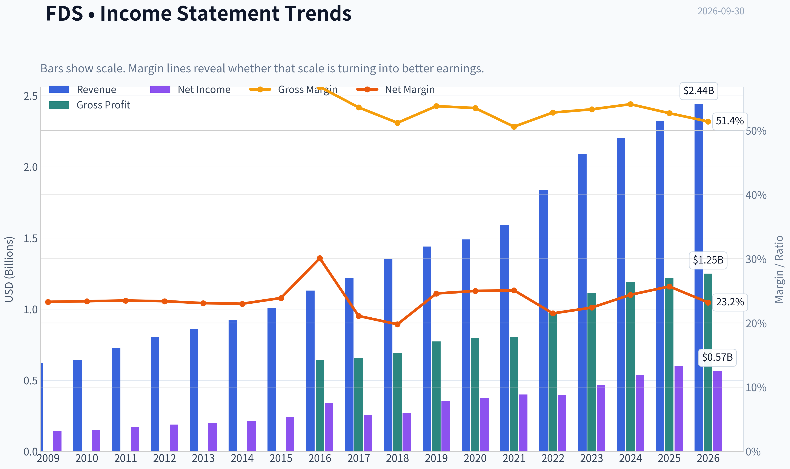

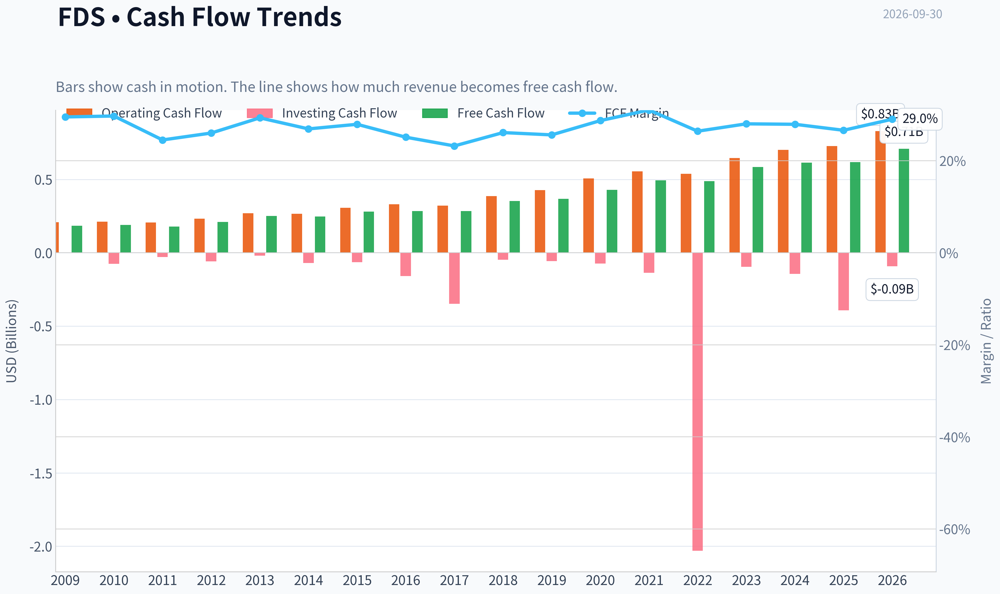

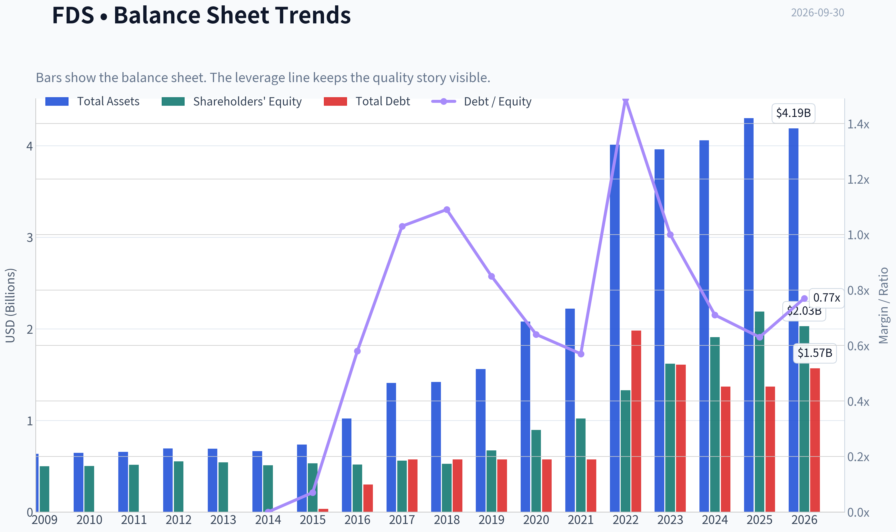

This graph tracks the profitability and return metrics (ROE, ROIC, Margins) of **FDS** over the past decade, highlighting capital efficiency trends.

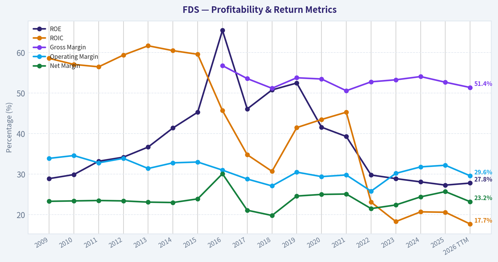

This chart illustrates the financial health of **FDS** over the last 10 years, mapping cash equivalents and free cash flow against total obligations (Debt).

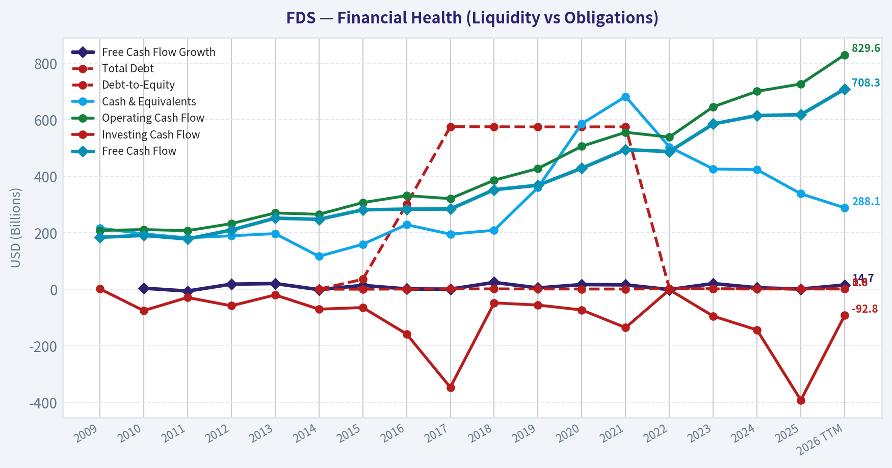

This breakdown chart from <em>Cash Flow and Capital Allocation</em> shows the proportional composition for **FDS** - useful for understanding what drives or risks the business.

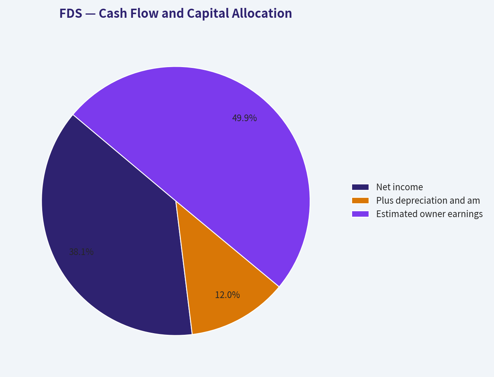

---

### Intrinsic Value Analysis (Buffett)

> *Following Warren Buffett's value investing philosophy: Circle of Competence, Economic Moat, Management Quality, and Margin of Safety.*

#### Intrinsic Value Snapshot

Price is what you pay. Intrinsic value is what the business may be worth based on the cash it can create for owners over time. We show a range, not one magic number.

- Current Price: $259.97
- Value Range (conservative to optimistic across both DCF methods): $211.76 to $411.53

##### Owner Earnings (Buffett Method)
- Net Income: $597,040,000.00
- Depreciation & Amortization: $188,673,000.00
- Capital Expenditures: $-108,806,000.00
- Working Capital Changes: $-105,766,000.00
- Owner Earnings: $782,673,000.00

##### Intrinsic Value
###### Buffett Method
Uses owner earnings. Stricter, and usually more conservative.
- Conservative: $270.91
- Average: $333.76
- Optimistic: $393.99
- Discount Rate: 10.0%

###### Cash Flow Method
Uses free cash flow. Better for companies spending heavily today to grow tomorrow.
- Conservative: $211.76
- Average: $289.94
- Optimistic: $411.53
- Discount Rate: 10.0%

ANALYST STANCE: **ADVOCATE**

#### Executive View

FactSet is a high-quality, asset-light financial-data provider with recurring subscription revenue, strong gross margins, high returns on equity, and meaningful customer switching costs. At $260 per share, valuation is not deeply discounted, but the 6.7% free-cash-flow yield and approximately 15% upside in the historical-growth DCF provide an acceptable price for a durable compounder.

**Conviction: Moderate.** The principal risk is that artificial intelligence, lower-cost data alternatives, or customer consolidation could weaken FactSet's pricing power and reinvestment returns over time.

#### Factor Scorecard

| Factor | Score | Assessment |
|---|---:|---|
| 1. Circle of Competence & Simplicity | 4/5 | FactSet sells financial data, analytics, and workflow tools through recurring subscriptions. The model is understandable, although financial-data technology is evolving rapidly. |
| 2. Durable Competitive Advantage | 4/5 | Strong switching costs, embedded workflows, proprietary datasets, brand reputation, and high gross margins. |
| 3. Management & Capital Allocation | 3.5/5 | The business model appears disciplined and shareholder-oriented, but the available evidence does not establish exceptional insider ownership or superior acquisition history. |
| 4. Industry Structure | 4/5 | A concentrated financial-information market with recurring revenues and high customer integration. Competition remains significant, especially from larger platforms and new AI-enabled tools. |
| Gate 5: Quality/Solvency Floor | **Not tripped** | There is no evidence here of both deteriorating earnings/cash flow and a solvency red line such as sub-1x interest coverage or distress-level credit metrics. |

#### Moat Analysis

**Switching costs are the primary moat.** FactSet is integrated into the daily work of investment managers, analysts, wealth managers, and financial institutions. Replacing the platform requires migrating data, retraining employees, rebuilding workflows, and validating historical outputs. That friction supports high retention and recurring revenue.

**Proprietary data and workflow integration reinforce the moat.** The value is not merely the raw information. It is the combination of standardized datasets, analytical tools, portfolio functions, APIs, and client-specific processes.

**Gross margin supports the intangible-asset thesis.** FactSet's reported gross margin is **52.7%**, consistent with a software-and-data business that has substantial pricing power and operating leverage.

**AI is both an opportunity and a threat.** AI could make financial analysis more efficient and increase demand for structured, trusted data. However, AI could also lower the cost of producing analysis and make alternative data interfaces more competitive. FactSet's defense is strongest if it remains the trusted data layer embedded in institutional workflows.

**Moat rating: Wide and stable, with potential to widen - 4/5.**

#### Management Quality and Capital Allocation

FactSet's recurring-revenue model reduces the need for aggressive balance-sheet leverage or speculative capital deployment. The company's attractive economics are reflected in its **27.3% ROE**, **6.7% FCF yield**, and high gross margin.

The key management questions are:

- Can FactSet continue reinvesting in data, AI, and workflow products without damaging margins?
- Are acquisitions made at rational prices?
- Are buybacks conducted when the shares are genuinely undervalued?
- Is compensation tied to per-share free-cash-flow growth rather than revenue alone?

The available evidence supports a **good but not exceptional** management score of **3.5/5**. The investment case does not require heroic management decisions, but disciplined reinvestment and successful AI adaptation are important.

#### Financial Summary

| Metric | Latest value |
|---|---:|
| Share price | $260 |
| Market capitalization | $9.25 billion |
| P/E ratio | 17.6x |
| Revenue growth, year over year | 5.4% |
| Gross margin | 52.7% |
| ROE | 27.3% |
| Free-cash-flow yield | 6.7% |
| Implied free cash flow | Approximately $620 million |
| Current ratio | 1.40x |

**Key Takeaways:** FactSet combines moderate growth with strong profitability and cash generation. A 6.7% free-cash-flow yield is attractive for a high-quality recurring-revenue business, while the 17.6x P/E is reasonable rather than distressed. The 27.3% ROE indicates efficient economics, although ROE should ideally be confirmed with ROIC and leverage data.

#### Owner Earnings Calculation

Using free cash flow as a practical proxy for owner earnings:

| Owner earnings bridge | Approximate amount |
|---|---:|
| Net income | Not separately provided |
| Add: depreciation and amortization | Included in reported cash-flow conversion |
| Less: maintenance capital expenditures | Reflected in free cash flow |
| Less: working-capital investment | Reflected in free cash flow |
| **Estimated owner earnings** | **Approximately $620 million** |

**Key Takeaways:** FactSet's estimated owner earnings are approximately $620 million, derived from the 6.7% FCF yield applied to its $9.25 billion market capitalization. This is a conservative and useful proxy because the company is asset-light and does not require heavy maintenance capital expenditures.

#### Three-Scenario DCF Valuation

Assumptions:

- Estimated owner earnings: $620 million
- Discount rate: 10%
- Approximate shares outstanding: 35.6 million, based on market capitalization divided by share price

| Scenario | Key assumptions | Equity value | Value per share |
|---|---|---:|---:|
| A. No growth | Owner earnings capitalized at 10% | $6.20 billion | $174 |
| B. GDP growth | 3% perpetual growth | $9.12 billion | $256 |
| C. Historical-growth proxy | 4.05% growth, approximately 75% of 5.4% revenue growth | $10.84 billion | $305 |

**Key Takeaways:** The no-growth case shows that the current price depends on FactSet retaining a meaningful portion of its current earnings power. The conservative GDP-growth case is close to the current share price, while the historical-growth case indicates approximately 17% upside. The valuation is therefore fair, but not protected against a major deterioration in growth or margins.

#### Margin of Safety Analysis

| Reference value | Value per share | Margin versus $260 price |
|---|---:|---:|
| No-growth DCF | $174 | -33% |
| 3% GDP-growth DCF | $256 | -2% |
| Historical-growth DCF | $305 | +17% |
| Current market price | $260 | - |

**Key Takeaways:** FactSet does not offer a traditional deep-value margin of safety. The shares are approximately fairly valued under the 3% growth case and moderately undervalued if the company can sustain roughly 4% long-term owner-earnings growth. For a high-margin, recurring-revenue compounder, a 10% to 15% margin of safety can be adequate, but the valuation remains sensitive to AI disruption and retention trends.

#### Final Buffett Scorecard

| Criterion | Weight | Score |
|---|---:|---:|
| Moat width and durability | 25% | 4.0 |
| Valuation and margin of safety | 20% | 3.5 |
| Capital returns versus WACC | 15% | 4.0 |
| Business understanding and predictability | 12% | 4.0 |
| Management quality and capital allocation | 12% | 3.5 |
| Reinvestment runway | 8% | 3.5 |
| Balance-sheet strength | 4% | 3.5 |
| Industry structure | 4% | 4.0 |
| **Weighted total** | **100%** | **3.8 / 5.0** |

**Key Takeaways:** FactSet scores well because its moat, cash economics, and predictability outweigh the risks associated with technology change. The main deduction is valuation: the stock is attractive only if the business continues to compound steadily. The overall score supports ownership, but not aggressive buying at any price.

#### Investment Stance

**ADVOCATE - Moderate conviction.**

FactSet fits the Buffett framework as a durable, understandable, asset-light business with high margins, recurring revenue, and strong returns on equity. At $260, it appears to be a **fairly priced compounder**, with potential upside toward approximately $300 if growth remains durable.

A patient investor could initiate or maintain a position, while reserving additional capital for a better entry point near the low-to-mid $230s or during a market-driven selloff. The thesis should be monitored through organic revenue growth, client retention, operating margins, free-cash-flow conversion, and evidence that AI strengthens rather than commoditizes FactSet's data and workflow franchise.
#### Valuation Bridge

This bridge places the current market price beside each intrinsic value lens so readers can see whether upside depends on one method or shows up across several methods.

| Scenario | Intrinsic Value / Share |
| --- | ---: |
| Buffett Method | $333.76 |
| Cash Flow Method | $289.94 |
| Current Price | $259.97 |

#### Key Takeaways

If one method is far above the others, the upside case depends on a specific modelling assumption. When several methods cluster together, the valuation story is more robust.

#### Valuation Visuals

This comparison chart from *Latest Earnings Snapshot* stacks current figures against historical benchmarks for **FDS**, making it easy to see where the company trades relative to its own averages.

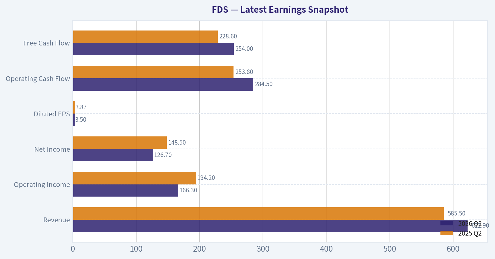

This comparison chart from *Current Versus Historical Average* stacks current figures against historical benchmarks for **FDS**, making it easy to see where the company trades relative to its own averages.

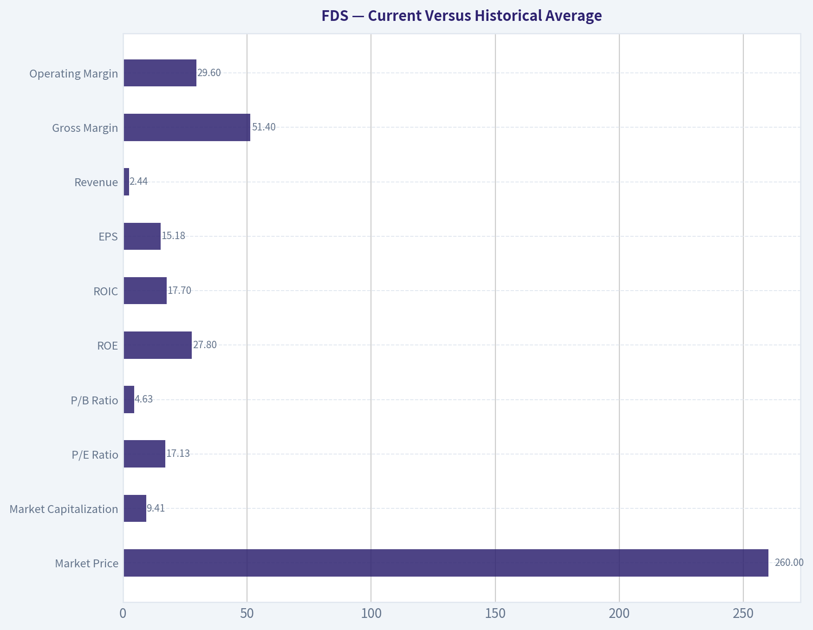

This comparison chart from *Balance Sheet and Financial Strength* stacks current figures against historical benchmarks for **FDS**, making it easy to see where the company trades relative to its own averages.

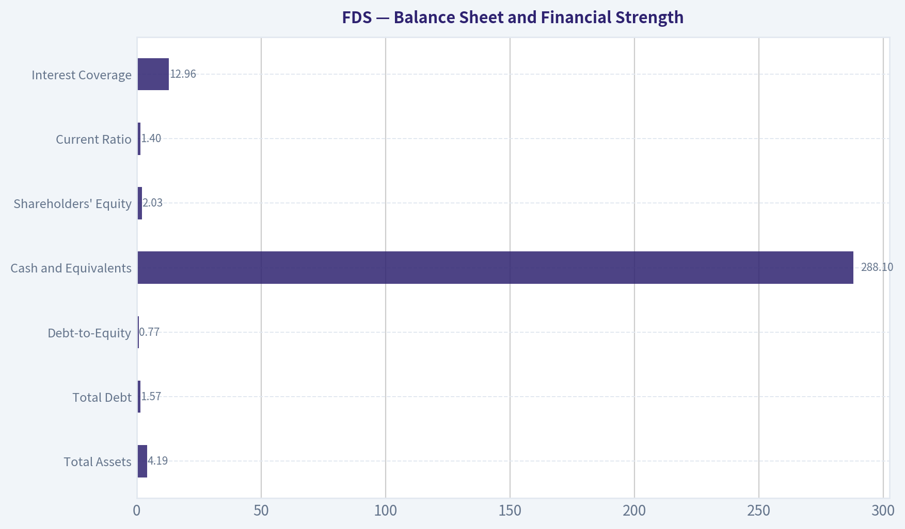

This comparison chart from *DCF and Owner-Earnings Valuation* stacks current figures against historical benchmarks for **FDS**, making it easy to see where the company trades relative to its own averages.

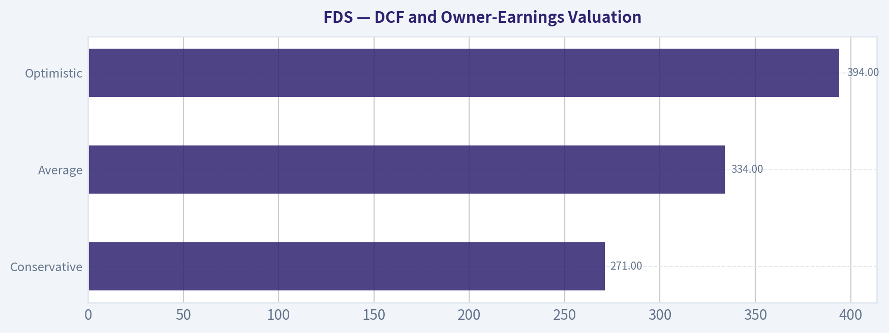

This comparison chart from *Financial Summary* stacks current figures against historical benchmarks for **FDS**, making it easy to see where the company trades relative to its own averages.

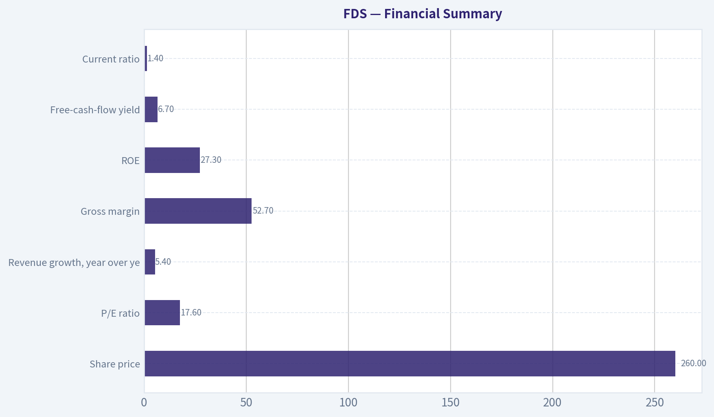

---

### Trend & Growth Analysis (Lynch/Druckenmiller/Fisher)

> *Following Peter Lynch's GARP, Stanley Druckenmiller's macro-aware approach, and Philip Fisher's scuttlebutt methodology.*

ANALYST STANCE: **AVOID**

#### 1. Lynch Classification

| Metric | FDS Assessment |
|---|---:|
| Revenue growth | 5.4% year over year |
| P/E | 17.6x |
| ROE | 27.3% |
| Gross margin | 52.7% |
| FCF yield | 6.7% |
| Lynch category | Stalwart |
| Growth-investor fit | Weak for new purchase |

**Key Takeaways:** FactSet is a high-quality, recurring-revenue financial-data business, but its current growth rate places it in Lynch's stalwart category rather than the fast-grower category. The stock may be suitable for an existing holder seeking durability and cash generation, but it does not currently show the growth profile normally associated with ten-bagger potential.

#### 2. The Story in Three Bullets

- FactSet sells essential financial research, analytics, and workflow tools to investment professionals.
- Its competitive advantages include embedded workflows, customer switching costs, proprietary datasets, and recurring subscription revenue.
- The central investment question is whether AI becomes a growth accelerator or a source of pricing and product-displacement pressure.

#### 3. TAM and Runway Analysis

| Factor | Assessment |
|---|---|
| Core market | Financial data, analytics, research, and workflow software |
| Secular drivers | Institutional digitization, regulatory complexity, alternative data, AI-assisted research |
| TAM growth | Likely moderate rather than explosive |
| Current revenue | Approximately $2.3 billion annualized, based on recent scale |
| 10x revenue test | $23 billion revenue would require a very large expansion beyond the current core market |
| Runway | Adequate for steady compounding; not clearly sufficient for a 10x outcome |
| TAM risk | Bloomberg, LSEG, S&P Global, Morningstar, and specialized data vendors create intense competition |

**Key Takeaways:** FactSet operates in an attractive, recurring, and defensible market, but the addressable market is not expanding at software-like rates. A tenfold revenue increase would require major success in adjacent products, AI workflows, private markets, or enterprise data-not merely continued share gains in the existing terminal market.

#### 4. Revenue Growth Trend

| Period / Indicator | Result | Interpretation |
|---|---:|---|
| Latest reported year-over-year growth | 5.4% | Stalwart-level growth |
| Required fast-grower threshold | 15%-25%+ | Not met |
| Trend classification | Stable-to-moderate | No confirmed acceleration |
| Revenue quality | Recurring subscription model | High quality, but mature |
| Latest earnings status | Q3 results were scheduled for September 30, 2026 | Awaiting confirmation of acceleration or guidance change |

**Key Takeaways:** The available data shows stable but modest growth, not an accelerating inflection. The upcoming earnings report could change the thesis if organic ASV, revenue guidance, or AI-related bookings materially reaccelerate, but there is no evidence yet that this has occurred.

#### 5. Unit Economics and Operating Efficiency

| Metric | Assessment |
|---|---|
| Subscription model | Favorable recurring-revenue economics |
| LTV/CAC | Not disclosed in the available data |
| Net revenue retention | Not available |
| Rule of 40 | Cannot be calculated reliably without current FCF margin |
| FCF yield | 6.7% |
| Gross margin | 52.7% |
| Current ratio | 1.40 |
| Capital intensity | Generally attractive for a data and workflow provider |

**Key Takeaways:** FactSet's subscription structure and strong free-cash-flow yield suggest sound economic quality. However, the absence of disclosed LTV/CAC and NRR data limits confidence in current customer expansion economics. Gross margin is respectable but lower than that of many pure-play software leaders, reflecting data costs and competitive pricing.

#### 6. Inflection Point Assessment

| Potential Inflection | Current Evidence | Rating |
|---|---|---|
| Product cycle | AI features and workflow automation could expand usage | Possible |
| Market share | No supplied evidence of accelerating share gains | Unconfirmed |
| Margin inflection | Strong cash generation, but no clear acceleration data | Neutral |
| TAM expansion | Private markets, ESG, wealth, and AI create adjacencies | Positive but unproven |
| Competitive inflection | No clear evidence of a major rival stumbling | Neutral |
| Overall inflection | Awaiting earnings and guidance | Not established |

**Key Takeaways:** The most credible upside catalyst is AI-enabled workflow expansion, which could increase product penetration and improve retention. At present, this remains an option rather than a demonstrated inflection point. I would require evidence of accelerating organic growth before upgrading the stance.

#### 7. Macro Setup

| Macro Factor | Impact on FDS |
|---|---|
| Economic cycle | Neutral; financial institutions remain important customers |
| Interest rates | Mixed; higher rates can support market activity but pressure growth-stock valuations |
| Capital-markets activity | Positive if trading, issuance, and asset-management activity improve |
| AI revolution | Strategic opportunity and competitive threat |
| Market volatility | Can increase demand for data, risk, and analytics tools |
| Macro stance | Neutral to mildly positive |

**Key Takeaways:** FactSet is less economically sensitive than a traditional financial company, but customer budgets still depend on capital-markets health. AI is the key macro and technology variable: it could expand the market for analytics while simultaneously lowering the value of conventional research interfaces.

#### 8. Fisher's 15-Point Assessment

| Fisher Criterion Group | Score |
|---|---:|
| Market potential and long-term outlook | 4/5 |
| R&D and product development | 4/5 |
| Sales organization and customer embeddedness | 4/5 |
| Profit margins and margin outlook | 4/5 |
| Labor, management depth, and execution | 4/5 |
| Cost controls, accounting, and candor | 4/5 |
| Competitive moat and outstanding aspects | 4/5 |
| Dilution and balance-sheet discipline | 4/5 |
| **Estimated total** | **60/75** |

**Key Takeaways:** FactSet scores well on recurring revenue, customer relationships, product importance, and financial discipline. The score is reduced by its mature growth profile, uncertain AI economics, and lack of detailed current customer-retention metrics. This is a good business, but "good business" and "high-upside growth investment" are different conclusions.

#### 9. Valuation Analysis

| Method | Result | Interpretation |
|---|---:|---|
| P/E | 17.6x | Reasonable for a mature company |
| PEG | Approximately 3.3x | Expensive relative to 5.4% growth |
| FCF yield | 6.7% | Attractive quality support |
| Approximate P/S | About 4x | Reasonable for a data provider, not obviously cheap |
| Bear case | Low-single-digit growth; multiple compression | Downside from slower growth and AI concerns |
| Base case | 5%-8% growth; steady cash returns | Moderate return potential |
| Bull case | AI and adjacencies drive 10%-15% growth | Requires clear reacceleration |

**Key Takeaways:** The valuation is not excessive on absolute earnings or free cash flow, but it is demanding relative to the company's modest growth rate. A PEG near 3.3 is well above Lynch's preferred range. The stock would become more compelling either below the current valuation or after credible evidence that growth can reaccelerate toward double digits.

#### 10. Growth Investor Scorecard

| Criterion | Weight | Score / 5 |
|---|---:|---:|
| The Story | 10% | 3.5 |
| TAM and runway | 20% | 2.8 |
| Revenue growth | 20% | 2.2 |
| Unit economics | 15% | 3.8 |
| Competitive position | 10% | 4.0 |
| Management quality | 10% | 3.8 |
| Macro setup | 5% | 3.2 |
| Profitability path | 5% | 4.3 |
| Valuation | 5% | 2.8 |
| **Weighted score** | **100%** | **3.1 / 5.0** |

**Key Takeaways:** The score places FDS in the WATCH-to-AVOID range for a growth portfolio. Its moat, profitability, and recurring revenue are meaningful positives, but weak growth and limited evidence of an inflection point outweigh those strengths for a new growth investment.

#### 11. Position Size Stance

| Investor Situation | Position Guidance |
|---|---|
| Existing holder | Hold or maintain a modest position while monitoring growth |
| New growth investor | 0% initial position |
| Quality-income investor | Small position may be appropriate |
| High-conviction growth portfolio | Avoid reallocating capital from faster growers |
| Upgrade trigger | Sustained organic growth above 10%-12%, stronger ASV, and positive AI monetization evidence |

**Key Takeaways:** FDS does not currently justify a meaningful new position in a concentrated growth portfolio. Existing shareholders can hold if they value durability and cash generation, but new capital should wait for either a cheaper valuation or proof of a durable growth reacceleration.

#### 12. Key Risks and Catalysts

| Catalysts | Risks |
|---|---|
| AI products increase customer productivity and wallet share | AI commoditizes portions of financial research |
| Stronger capital-markets activity | Mature market limits long-term growth |
| Expansion into private markets and wealth management | Competition from Bloomberg, LSEG, S&P Global, and specialist vendors |
| Better-than-expected ASV and guidance | Customer budget pressure and cancellations |
| Operating leverage from platform consolidation | Multiple compression if growth remains near 5% |

**Key Takeaways:** The principal catalyst is a product-led acceleration from AI and adjacent markets. The principal risk is that AI increases competitive pressure faster than it creates new revenue. The September 30 earnings release and subsequent guidance should be evaluated primarily for organic growth, ASV momentum, retention, pricing, and evidence that AI is monetizing rather than merely improving the product.

#### Conclusion

FactSet is a **high-quality stalwart, not currently a fast-growing ten-bagger candidate**. Its moat, recurring revenue, high ROE, and 6.7% FCF yield make it a defensible business, but 5.4% revenue growth and a PEG near 3.3 indicate that the market is not offering fast growth at a bargain price.

**Final stance: AVOID for new growth-investor capital; WATCH for a confirmed AI-driven reacceleration or a substantially better entry valuation.**

---

### Market Technical Analysis

ANALYST STANCE: **AVOID**

#### FDS technical overview

FactSet Research Systems, ticker FDS, is exhibiting a pronounced bearish technical structure. The latest usable close in the retrieved data is **$259.97 on September 29, 2026**; September 30 was identified by the indicator service as a non-trading day, so the analysis uses September 29 as the effective observation date.

The stock has fallen sharply from approximately **$313.55 on August 31 to $259.97 on September 29**, a decline of roughly **17 percent in one month**. The weakness has not been a single isolated drop. Instead, the chart shows a sequence of lower highs and lower lows, including declines from the early-September area near $313, through the $290s, $270s, and finally below $260.

The retrieved indicator service returned blank numerical fields for the requested indicators. Accordingly, the interpretation below relies on the supplied price and volume history, while avoiding unsupported precision for indicator values.

#### Trend structure

FDS is in a bearish short-, medium-, and longer-term configuration.

The short-term price action is clearly negative. After briefly rebounding toward $284 in mid-September, the stock failed to hold that recovery and declined to $259.97. The close on September 29 was near the lower end of the day's range, which suggests that sellers retained control into the close rather than being decisively rejected.

The **10-day exponential moving average** should be used to monitor immediate momentum. Based on the recent sequence of closes, the 10 EMA is likely above the latest price, meaning FDS has broken beneath its short-term trend benchmark. A recovery that stalls beneath this average would represent a weak countertrend bounce rather than a confirmed reversal.

The **50-day simple moving average** is also likely above the current price. The stock spent much of August in the $275-to-$315 region, while the latest close is below $260. This separation indicates that the medium-term trend has deteriorated materially. The 50 SMA should be treated as overhead resistance unless price can reclaim it and hold above it for multiple sessions.

The **200-day simple moving average** is important for strategic risk assessment. The stock experienced an exceptionally large drawdown during the broader period shown, falling from the $460s in early 2025 to below $200 in early 2026 before recovering. Even after the subsequent rebound, the recent breakdown indicates that the long-term trend remains damaged. A long-term investor should not interpret a low price by itself as evidence of value or a bottom.

#### Momentum and reversal risk

The **MACD** and **MACD histogram** are appropriate here because they distinguish a genuine momentum reversal from a temporary oversold bounce. Given the recent lower highs, accelerating September decline, and absence of a sustained recovery above prior swing levels, the MACD configuration would be expected to remain bearish or at least below a convincing bullish threshold.

A bullish MACD crossover would not be sufficient on its own. For a more credible reversal, traders should look for three confirmations: price reclaiming the short-term average, a higher low above the September 29 or September 10 low, and improving volume on advancing sessions. Without those conditions, a MACD improvement could simply reflect decelerating losses inside an ongoing downtrend.

The **RSI** is useful for identifying whether selling has become stretched. After the series of declines in September, RSI is likely in a weak or potentially near-oversold area. However, oversold conditions are not automatically bullish. FDS previously demonstrated that sharp declines can continue after momentum indicators reach depressed levels. RSI should therefore be used to identify possible stabilization, not as an independent buy signal.

A more constructive RSI pattern would involve a bullish divergence: price making a new low while RSI forms a higher low. Even then, confirmation through price and volume would be necessary.

#### Volatility and risk management

The **ATR** is particularly important because daily ranges and volume have expanded substantially. Recent sessions have regularly shown multi-dollar intraday swings, and several declines have occurred with unusually high turnover. Elevated ATR means that stops placed too close to the entry price may be triggered by ordinary volatility.

For a long position, position size should be reduced rather than simply widening the stop. A volatility-adjusted stop should be placed beyond a clearly defined technical level, such as a recent swing low, while keeping the total dollar risk within a predetermined limit.

The likely volatility regime also makes shorting risky after a large decline. Although the trend is bearish, a sharp short-covering rally could occur. New short positions should therefore not be initiated solely because the stock appears weak; waiting for a failed rebound or a fresh breakdown with controlled risk would be more prudent.

#### Volume confirmation

The **VWMA** provides a useful confirmation layer because it incorporates the unusually high recent trading activity. Volume rose significantly during the September selloff, with several sessions exceeding one million shares and the September 18 decline showing exceptionally heavy turnover. This indicates that the weakness was accompanied by meaningful participation rather than occurring on persistently declining volume.

The high-volume selloff increases the importance of the $280-to-$290 region as potential overhead supply. Investors who purchased in that zone may sell into rebounds in order to exit at reduced losses. A sustained move above that area, accompanied by stronger-than-average volume, would be needed to weaken the bearish interpretation.

The recent price action also suggests that buyers have not yet demonstrated control. A one- or two-day bounce on light volume should be treated cautiously. More reliable evidence would be a sequence of higher closes, expanding upside volume, and a close back above the short- and medium-term trend averages.

#### Key levels and scenarios

The nearest downside reference is the **$252-to-$260 area**, represented by the latest low region and the September 29 close. A decisive break below this zone would indicate that sellers are extending the decline and could expose the stock to further price discovery.

On the upside, the first recovery test is approximately **$270-to-$280**. This area contains recent failed support and several late-September trading levels. A rebound into this zone that fails would preserve the bearish structure.

The next important resistance band is approximately **$285-to-$295**, followed by the early-September area near **$305-to-$315**. Reclaiming these levels would be progressively more constructive, but only a sustained recovery above the 50-day average would materially improve the medium-term outlook.

For now, the highest-probability interpretation is not an immediate bottom but a damaged trend with elevated volatility. Conservative investors should wait for stabilization and confirmation rather than attempting to catch the decline. Existing holders should review their risk limits, while traders considering a long position should demand evidence of a higher low and improving momentum.

#### Selected indicators

The selected set contains eight indicators, each serving a distinct role:

- **close_10_ema:** Short-term trend and bounce confirmation.
- **close_50_sma:** Medium-term trend and overhead resistance.
- **close_200_sma:** Long-term regime filter.
- **macd:** Directional momentum and crossover analysis.
- **macdh:** Momentum acceleration or deceleration.
- **rsi:** Oversold conditions and potential divergence.
- **atr:** Volatility-adjusted position sizing and stops.
- **vwma:** Price-trend confirmation using trading volume.

These indicators are complementary: moving averages establish trend, MACD and RSI evaluate momentum, ATR measures risk, and VWMA tests whether price movement is supported by meaningful participation.

| Area | Current interpretation | Trading implication |
|---|---|---|
| Price trend | Strong sequence of lower highs and lower lows; latest usable close near $259.97 | Bearish bias remains dominant |
| Short-term trend | Price appears below its recent 10 EMA | Treat rallies as countertrend until the average is reclaimed |
| Medium-term trend | Price is materially below the recent 50-day trend area | $270-$295 may act as overhead resistance |
| Long-term trend | Multi-period structure remains damaged after a major drawdown | Avoid assuming that a low price equals a durable bottom |
| MACD and histogram | Momentum is expected to remain bearish unless a confirmed crossover develops | Require price and volume confirmation for any bullish signal |
| RSI | Likely weak or near oversold after the September decline | Oversold is not a buy signal without a higher low or divergence |
| Volatility | Daily ranges and turnover have expanded | Reduce position size and use volatility-aware stops |
| Volume and VWMA | Heavy volume accompanied the decline | Selling pressure appears meaningful; weak-volume bounces are suspect |
| Key support | Approximately $252-$260 | A decisive break would increase downside risk |
| Key resistance | Approximately $270-$280, then $285-$295 | Rejection in these zones would reinforce the bearish case |
| Overall stance | Trend, momentum, and volume evidence remain unfavorable | **Avoid new long exposure until stabilization is confirmed** |

Key Takeaways: FDS remains in a high-risk bearish trend, with the latest decline supported by elevated trading activity rather than fading participation. The $252-to-$260 region is the immediate downside test, while $270-to-$295 represents important overhead resistance. A sustainable bullish reversal would require a higher low, improving momentum, stronger upside volume, and recovery above the short- and medium-term trend averages.

---

### Options Market Analysis

> *Reading options flow - put/call ratios, IV skew, and unusual activity - to gauge institutional positioning and event-driven risk.*

#### FDS Options Market Overview

Data retrieved as of September 30, 2026, covering the October 16, November 20, and December 18 expirations. The chain is extremely illiquid, with very low open interest, so all conclusions should be treated as low-confidence.

| Expiration | Call OI | Put OI | Call Volume | Put Volume | Put/Call OI |
|---|---:|---:|---:|---:|---:|
| October 16, 2026 | 0 | 3 | 698 | 3,257 | N/A |
| November 20, 2026 | 1 | 0 | 247 | 121 | 0.00 |
| December 18, 2026 | 37 | 11 | 83 | 154 | 0.30 |
| **Total** | **38** | **14** | **1,028** | **3,532** | **0.37** |

**Key Takeaways:** FDS has a very low overall put/call open-interest ratio of 0.37, which appears more bullish than the approximately 0.7 neutral baseline. However, trading volume is heavily concentrated in puts, producing a put/call volume ratio of 3.44. Because open interest is extremely small, the apparent bullish OI positioning may be distorted, while the heavy near-term put volume suggests short-term hedging or bearish speculation.

#### Put/Call Ratio Analysis

- **Put/call OI ratio:** 0.37 overall, below the 0.7 neutral reference point.
- **Put/call volume ratio:** 3.44, substantially elevated.
- The divergence is notable:
  - **OI:** Call-heavy, potentially reflecting existing bullish positions or covered-call structures.
  - **Volume:** Put-heavy, especially in the October 16 expiration, suggesting fresh short-term downside protection or bearish trading.
- The October 16 expiration accounts for most of the put activity, with 3,257 puts traded versus 698 calls.

The volume signal is more immediately relevant for near-term sentiment, but the extremely small OI base makes it difficult to determine whether the activity represents opening trades, closing trades, spreads, or rolls.

#### Implied Volatility Assessment

| Expiration | Call ATM IV | Put ATM IV | IV Interpretation |
|---|---:|---:|---|
| October 16, 2026 | 1.1% | 1.0% | Very low reported IV |
| November 20, 2026 | 1.0% | 1.0% | Very low reported IV |
| December 18, 2026 | 0.5% | 0.5% | Extremely low reported IV |

**Key Takeaways:** Reported near-term ATM IV is approximately 1%, declining to 0.5% for December. These values are unusually low for listed equity options and may reflect stale quotes, sparse trading, or data-quality limitations rather than genuine market complacency. No reliable OTM put-versus-call IV skew was supplied, so downside fear or upside-chase cannot be measured accurately.

- **ATM IV:** Very low across all listed expirations.
- **IV skew:** Not available from the retrieved data; there is insufficient information to compare OTM put IV with OTM call IV.
- **Catalyst risk:** No earnings date, product launch, or other catalyst information was provided. The data does not show an obvious IV premium ahead of a known event.
- The low IV readings should not be interpreted as strong evidence that FDS has low expected volatility because the chain is notably illiquid.

#### Unusual Options Activity

No contracts met the data provider's unusual-activity threshold of volume greater than five times open interest.

| Finding | Interpretation |
|---|---|
| No qualifying unusual contracts | No individual call or put can be identified as a clear fresh directional bet |
| October 16 put volume | Large absolute volume, but opening versus closing activity is unknown |
| Contract details | Strikes and moneyness were not provided in the retrieved output |
| Smart-money assessment | Not determinable from the available data |

**Key Takeaways:** There are no contracts with volume exceeding five times open interest, so no specific institutional sweep or high-conviction trade can be confirmed. The October put activity is notable in aggregate, but without strike-level data and opening-trade indicators, it cannot reliably be labeled as smart-money bearish positioning. Current price and strike information were also unavailable, preventing ITM, ATM, or OTM classification.

#### Open Interest Concentration and Gamma Levels

Total open interest is concentrated in calls, particularly the December 18 expiration:

- **December 18 calls:** 37 contracts, representing nearly all total call OI.
- **December 18 puts:** 11 contracts.
- **October 16:** Only 3 put contracts and no call open interest.
- **November 20:** Only 1 call contract and no put open interest.

No strike-level open-interest data was supplied, so the following cannot be identified reliably:

- Highest-OI strikes.
- Max-pain level.
- Call or put gamma walls.
- Potential pinning or gravitational price levels.
- Whether concentrated positions would amplify or dampen a near-term move.

The small aggregate OI also suggests that any apparent concentration is unlikely to create a meaningful market-wide pinning effect.

#### Overall Options Sentiment

**Overall Signal: BEARISH, with very low confidence.**

The primary driver is the heavily elevated near-term put volume, particularly for the October 16 expiration. This points to short-term downside hedging or bearish speculation and outweighs the apparently bullish 0.37 put/call OI ratio because the OI base is exceptionally small and potentially stale.

The bearish read is conditional:

- There is no confirmed unusual contract activity.
- The put volume may represent hedges, spreads, or closing trades rather than outright bearish bets.
- Reported IV is likely unreliable because of illiquidity.
- No strike-level data is available to assess moneyness or gamma positioning.

Accordingly, the options market offers a **weak bearish near-term signal**, not a high-conviction institutional forecast.

#### Summary

| Category | Assessment |
|---|---|
| Put/Call Ratio | OI ratio 0.37, apparently bullish; volume ratio 3.44, strongly put-heavy |
| IV Level | Very low reported ATM IV, approximately 0.5% to 1.1%; likely distorted by illiquidity |
| Skew Direction | Not determinable; OTM put and call IV data unavailable |
| Unusual Activity | No contracts exceeded the volume-to-OI threshold; no confirmed fresh institutional bet |
| Overall Signal | **BEARISH**, very low confidence; driven primarily by heavy near-term put volume |

**Key Takeaways:** FDS options flow is best characterized as weakly bearish in the near term because put trading greatly exceeds call trading. However, the chain is too thin and the open-interest base too small to support a strong institutional-positioning conclusion. The bullish-looking OI ratio and unusually low IV should be treated cautiously.

---

## Research Team Commentary

> *The Research Manager synthesizes the Bull vs Bear debate into action-free commentary. This is a pre-risk view, not the final stance.*

Core takeaway: FactSet is a high-quality, asset-light franchise whose valuation appears reasonable enough to justify staged ownership, although the incomplete cash-flow and balance-sheet data argue against an aggressive position. At $260 and 17.6 times earnings, the market is not demanding exceptional growth from a business earning a 19.4% ROIC with embedded workflows, recurring subscriptions, trusted datasets, and meaningful switching costs. The strongest bear argument is not that the franchise is deteriorating, but that the estimated margin of safety is narrow and dependent on unverified cash conversion. On balance, this looks more like a wonderful business at a fair price than a value trap or an overpriced story.

The bull makes the more persuasive business-quality argument. FactSet is integrated into research, portfolio analytics, risk, performance reporting, and data-delivery processes. Customers face migration, retraining, validation, integration, and compliance costs beyond the subscription price. Its normalized data, institutional credibility, and workflow integrations would be difficult to reproduce quickly. Those advantages are reflected in the 52.7% gross margin, 19.4% ROIC, 27.3% ROE, and 13.9% ROA. While ROE can be influenced by leverage and repurchases, the combination of strong ROIC and ROA supports the conclusion that these are genuine franchise economics rather than merely financial engineering.

AI is a two-sided issue, but the simplistic disruption thesis is unconvincing. Generative interfaces do not eliminate the need for licensed, normalized, traceable, and auditable financial data. FactSet can benefit if AI increases data consumption, improves research productivity, and expands the utility of its platform. The bear is nevertheless right that higher data consumption does not automatically translate into higher profits. AI could reduce traditional seat requirements, weaken control of the user interface, increase compute and development costs, or intensify competition among FactSet, Bloomberg, S&P Global, and LSEG. The investment case therefore depends on FactSet monetizing AI rather than merely spending defensively to maintain parity.

Valuation is where the debate is closest. The bull's approximate $286 base value offers only about 10% price upside, or a roughly 9% discount to estimated intrinsic value. That is near, but slightly below, the usual 10-15% quality-scaled margin of safety for a wide-moat compounder. More importantly, the valuation starts with assumed owner earnings equal to 90% of accounting EPS because actual free cash flow was not supplied. Raising the discount rate from 9% to 10% reportedly reduces estimated value to roughly $244. That sensitivity means $286 should not be treated as a precise appraisal.

Still, the reverse-DCF framing is more useful than debating a single point estimate. Depending on cash conversion and the required return, the shares appear to require roughly mid-single-digit to perhaps 6-7% long-term owner-earnings growth. That is not a trivial hurdle, but neither is it heroic for a recurring-revenue business with pricing opportunities, cross-selling potential, and a 19.4% ROIC. At 17.6 times earnings, FactSet is not priced like a speculative AI winner. The market seems to be discounting either slower growth, margin pressure, or some erosion in the traditional terminal model.

This is also where the prior FFIV mistake is relevant. We should not identify a strong franchise, acknowledge a plausible transition opportunity, and then remain indefinitely passive because the stock lacks a deep-value discount. Quality companies can create their own margin of safety by compounding faster than the market-implied hurdle. FactSet's current valuation is reasonable enough that even moderate upside revisions or successful AI monetization could support a rerating.

The FIGR lesson points in the opposite direction and prevents an unqualified recommendation. A compelling technology narrative cannot substitute for owner earnings. FactSet is fundamentally much stronger than FIGR, but the missing free-cash-flow conversion, leverage, organic subscription growth, retention, and seat data remain important. We should not silently assume that all EPS is distributable cash or that acquisitions and repurchases have been value-accretive.

The options evidence does not resolve the question. A 0.37 put/call open-interest ratio suggests relatively light accumulated bearish positioning, while a 3.44 put/call volume ratio indicates substantial near-term hedging or concern. That divergence could reflect event protection rather than a durable negative view. Similarly, the technical handoff names the 10-day EMA, 50-day SMA, and 200-day SMA but provides no actual price relationships. It would be a mistake to manufacture either a bullish breakout or bearish breakdown from missing data.

Rationale: I would initiate or accumulate gradually rather than demand a fall to $210-$225. That lower range might offer a large conventional discount, but it could also require a material deterioration in the business or never occur. The current earnings yield is approximately 5.7%, and a credible 6-7% per-share growth trajectory could produce satisfactory long-term returns without multiple expansion. The position should nevertheless be smaller initially because reported earnings have not yet been reconciled to free cash flow and because the base valuation has little room for execution errors.

The bear case would become dominant if FactSet's organic growth falls below the reverse-DCF hurdle, retention weakens, AI causes measurable seat compression, margins decline without corresponding revenue acceleration, or acquisitions become necessary to conceal weak organic growth. Conversely, consistent owner-earnings growth above 6-7%, strong cash conversion, and visible AI monetization would show that $260 understated the franchise's compounding ability.

Monitoring plan: Over the next one to four quarters, I would focus first on organic annual subscription value and revenue growth. Sustained growth above roughly 6-7% would indicate that FactSet is clearing the more conservative reverse-DCF hurdle; persistent growth below 5% would weaken the valuation case.

Second, watch client and subscription retention, seat counts, and net expansion. Stable retention accompanied by higher wallet share would confirm switching costs and cross-selling strength. Declining seats or heavier discounting would support the bearish AI and vendor-consolidation scenarios.

Third, reconcile net income with free cash flow. Free-cash-flow conversion consistently near or above roughly 90% of earnings would validate the bull's owner-earnings proxy. Materially lower conversion caused by capitalized software, restructuring, acquisition costs, or rising working-capital needs would reduce intrinsic value.

Fourth, track gross and operating margins. Modest near-term AI investment is acceptable, but management should demonstrate either subsequent productivity gains or incremental revenue. A sustained decline from the current 52.7% gross margin without stronger growth would indicate that AI is becoming a defensive cost rather than an economic accelerator.

Fifth, assess AI adoption through paying customers, renewal uplift, cross-selling, usage, and measurable internal productivity-not product-launch headlines. The key question is whether AI raises revenue or lowers unit costs after compute, licensing, and development expenses.

Finally, verify net debt, interest coverage, acquisition returns, and repurchase prices. ROIC should remain comfortably above the cost of capital, preferably above 15%. Large acquisitions, rising leverage, or buybacks above a conservative appraisal would weaken confidence in management. Repurchases around or below $260 are defensible only if cash conversion and organic growth remain sound.

FactSet is not an obvious bargain, but the combination of franchise quality, moderate embedded expectations, and a non-demanding multiple tilts the debate toward measured ownership. The appropriate response to the remaining uncertainty is staged position sizing and strict monitoring, not complete inaction.

Stance: ADVOCATE

---

## Value Investing Team Commentary

> *The Investor translates the research view into an investment thesis before risk review. This is still not the final stance.*

### Investment Commentary

FactSet appears to be a high-quality financial-data franchise experiencing skepticism about its growth durability rather than evidence of outright business impairment. At approximately $260 and 17.6 times earnings, the shares offer a reasonable entry point for measured long-term ownership, provided that the reported earnings convert into cash and organic subscription growth remains healthy.

### Business quality and moat

FactSet's strongest attribute is its position inside customers' daily workflows. Its products support research, portfolio construction, risk analysis, performance reporting, and data delivery. Replacing the platform involves more than changing a software subscription: customers must migrate data, rebuild integrations, retrain employees, validate outputs, and satisfy internal compliance requirements. These switching costs support recurring revenue and make purchasing decisions less sensitive to price than ordinary software spending.

The reported economics are consistent with a durable franchise:

- Gross margin: **52.7%**
- ROIC: **19.4%**
- ROA: **13.9%**
- ROE: **27.3%**

ROE alone could be inflated by leverage or repurchases, but the accompanying ROIC and ROA suggest that the profitability is substantially operational. A 19.4% ROIC also gives FactSet room to create value through continued product investment, assuming incremental returns remain attractive.

The moat is meaningful but not impregnable. Bloomberg, S&P Global, LSEG, and specialized data providers remain formidable competitors. FactSet must continue improving its datasets, analytics, interfaces, and integrations to prevent customers from consolidating vendors or shifting portions of their workflows elsewhere.

### AI: opportunity, threat, and current market perception

The contrarian opportunity is that investors may be treating AI primarily as a threat to traditional financial-data terminals and analyst seats. That view overlooks the continued need for licensed, normalized, traceable, and auditable data. Generative AI can make financial information easier to query, but it does not independently create trustworthy source data. In that respect, AI could increase the strategic value and consumption of FactSet's underlying datasets.

FactSet can benefit if AI:

- Improves research and workflow productivity
- Increases platform usage and data consumption
- Supports premium products or higher renewal pricing
- Enables additional cross-selling
- Reduces FactSet's own development, service, and support costs

However, being strategically important to AI does not guarantee attractive economics. Third-party interfaces could weaken FactSet's control over the user experience, and improved productivity could reduce the number of conventional seats required. Compute, licensing, and development expenses could also absorb the revenue benefit.

The correct question is therefore not whether FactSet launches AI features, but whether those features produce measurable renewal uplift, paid adoption, wallet-share gains, or lower unit costs. Product announcements without monetization should receive little valuation credit.

### Valuation and margin of safety

At $260, the earnings yield is approximately 5.7%, and implied EPS is about $14.74. The estimated base intrinsic value of $286 represents roughly 10% upside, or a 9% discount from appraisal. That is close to the lower end of an acceptable margin of safety for a wide-moat, high-ROIC business. It would be inadequate for an average or cyclical company, but FactSet's recurring revenue and switching costs justify a smaller required discount.

The valuation is nevertheless less certain than the headline P/E suggests. The $286 appraisal assumes owner earnings equal approximately 90% of accounting earnings, yet actual free-cash-flow information was not supplied. The estimated value falling to roughly $244 under a 10% discount rate demonstrates that the apparent upside is sensitive to modest changes in assumptions.

The reverse-DCF test is more informative. The current price appears to require roughly mid-single-digit to 6-7% long-term owner-earnings growth, depending on cash conversion and the required return. That hurdle is plausible rather than heroic. FactSet can potentially meet it through pricing, cross-selling, product expansion, disciplined repurchases, and modest underlying market growth.

One analytical caution is important: the 5.7% earnings yield should not simply be added to 6-7% earnings growth to claim a 12-13% expected return. Some earnings must be retained to finance growth, and the shareholder return will ultimately depend on dividends, net repurchases, reinvestment efficiency, and the valuation multiple at exit. If per-share earnings compound around 6-7% while the valuation remains near 17.6 times, the capital appreciation component should also be around 6-7%, supplemented only by actual dividends or net buyback yield.

Even on that more conservative framing, the likely return can be satisfactory for a durable franchise, although it is not obviously exceptional.

### Selective contrarian interpretation of sentiment

The options data show a notable tension:

- Put/call open-interest ratio: **0.37**
- Put/call volume ratio: **3.44**

Low put open interest suggests that investors have not built a large, persistent bearish position. Elevated put volume, however, indicates significant near-term hedging or event concern. This is more consistent with uncertainty than broad capitulation.

That distinction matters. There is not enough evidence to claim that FactSet is a hated security offering an extreme sentiment-driven bargain. Instead, the opportunity may come from a more restrained form of pessimism: the market appears reluctant to underwrite durable growth because of AI disruption fears, seat pressure, and slower industry spending. If FactSet demonstrates stable retention and monetizes AI while maintaining margins, the current multiple could prove too conservative.

Conversely, the elevated put volume should not automatically be treated as a bullish contrarian signal. It may reflect informed concern around earnings, guidance, customer budgets, or competitive pressure. Without strike, maturity, and trade-direction data, it is impossible to distinguish speculative bearish positions from protective hedges.

The technical evidence is similarly incomplete. No conclusion should be drawn from the 10-day EMA, 50-day SMA, or 200-day SMA because their actual relationships to the share price were not provided. Long-term ownership can begin without a perfect chart, but absent technical confirmation supports staged rather than aggressive purchasing.

### Capital allocation and management test

FactSet's future shareholder returns will depend partly on how management allocates its substantial earnings power. Three issues deserve particular attention:

1. **Internal investment:** Spending on data, AI, and workflow products should preserve or strengthen the moat without causing permanently lower margins.
2. **Acquisitions:** Acquired growth should not conceal weak organic subscription growth. Purchase prices and post-acquisition returns should be evaluated against FactSet's cost of capital.
3. **Repurchases:** Buybacks create value only when executed below a conservative estimate of intrinsic value and funded without compromising the balance sheet.

Repurchases around $260 appear potentially rational, but that conclusion depends on free-cash-flow conversion, leverage, and organic growth. Strong historical accounting returns do not excuse overpaying for acquisitions or shares.

### Ownership plan and thesis breakers

A staged position is preferable to waiting indefinitely for a deep-value price that may never occur:

- Initiate a modest position near the stated valuation.
- Add after confirming strong free-cash-flow conversion and balance-sheet health.
- Increase further if organic subscription growth remains above approximately 6-7%, retention is stable, and AI adoption produces measurable economics.
- Preserve capital for market-driven declines that are not accompanied by franchise deterioration.

The thesis would weaken materially if:

- Organic subscription growth remains below approximately 5%
- Retention, seat counts, or net expansion deteriorate
- AI causes seat compression without offsetting pricing or product revenue
- Gross or operating margins decline persistently without faster growth
- Free-cash-flow conversion falls materially below the assumed 90%
- Acquisitions become necessary to mask weak organic performance
- Leverage increases or ROIC trends toward the cost of capital

The thesis would strengthen if owner earnings grow above 6-7%, cash conversion is consistently high, ROIC remains above 15%, and AI contributes to paid adoption, renewal uplift, cross-selling, or cost savings.

FactSet is not a deep bargain, but deep discounts are rarely available in resilient, asset-light franchises unless the business itself is under genuine pressure. The current price appears to compensate investors reasonably for the identifiable risks without requiring an implausible growth outcome. Missing cash-flow and balance-sheet details justify restrained sizing, not complete inaction.

### ANALYST STANCE: **ADVOCATE**

FactSet merits staged long-term ownership at approximately $260. Its embedded workflows, trusted datasets, recurring revenue, switching costs, and 19.4% ROIC make it a wonderful business available near a fair price. The position should begin modestly because the estimated intrinsic value is sensitive to cash conversion and discount-rate assumptions, but waiting for a dramatic discount risks missing a durable compounder. Add only as free cash flow, organic growth, retention, AI monetization, and capital allocation validate the thesis.

---

## Deep Values Commentary

> *The Risk Management Team debates and the Risk Judge provides the final action-free verdict. This section determines the final ADVOCATE / WATCH / AVOID stance.*

#### Final Stance Scorecard

This scorecard converts the final research view into a weighted decision frame. It does not replace the narrative judgement, but it makes the main drivers of the verdict easier to scan.

| Criterion | Score | Weight | Commentary |
| --- | ---: | ---: | --- |
| Business Quality | 4.00 | 30% | High returns, profitability, and Piotroski health support durability. |
| Valuation Support | 3.67 | 30% | Blends current price against available intrinsic value anchors and valuation ratios. |
| Financial Strength | 5.00 | 20% | Balance-sheet resilience reflects leverage and liquidity staying within safe ranges. |
| Growth Durability | 3.00 | 20% | Recent revenue, earnings, and free cash flow growth indicate how durable expansion looks. |
| TOTAL / FINAL STANCE | 3.90 | 100% | ADVOCATE |

#### Key Takeaways

The weighted score lands at **3.90 / 5.0**, while the final stance remains **ADVOCATE**. This is useful as a quick calibration aid rather than a mechanical signal.

#### Risk Summary

Higher scores indicate more risk pressure. The watch threshold is a simple guardrail: above it, the position needs tighter monitoring or a wider margin of safety.

| Dimension | Current Score | Watch Threshold | Commentary |
| --- | ---: | ---: | --- |
| Business Quality | 2.00 | 3.00 | High returns, profitability, and Piotroski health support durability. |
| Valuation Support | 2.33 | 3.00 | Blends current price against available intrinsic value anchors and valuation ratios. |
| Financial Strength | 1.00 | 3.00 | Balance-sheet resilience reflects leverage and liquidity staying within safe ranges. |
| Growth Durability | 3.00 | 3.00 | Recent revenue, earnings, and free cash flow growth indicate how durable expansion looks. |

#### Key Takeaways

This view helps readers separate *where* the risk sits: valuation, business quality, balance sheet, or growth durability. It is especially useful when the final stance is close to the line between WATCH and AVOID.
