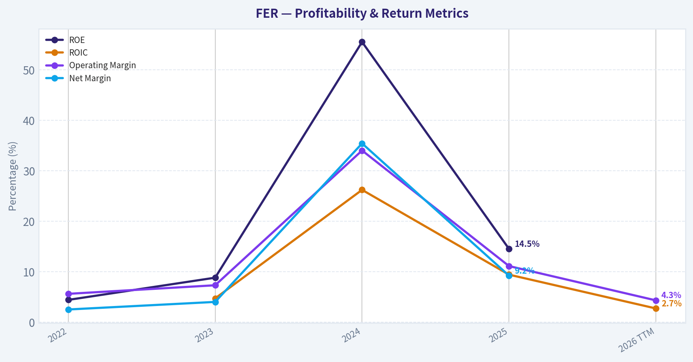
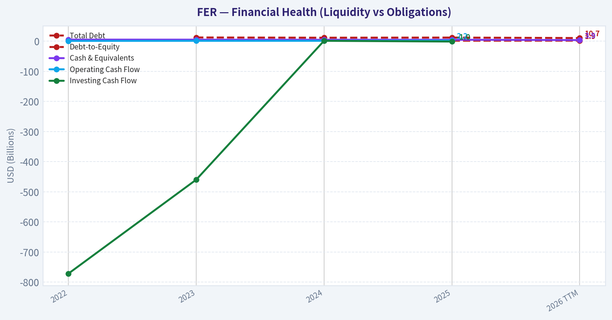
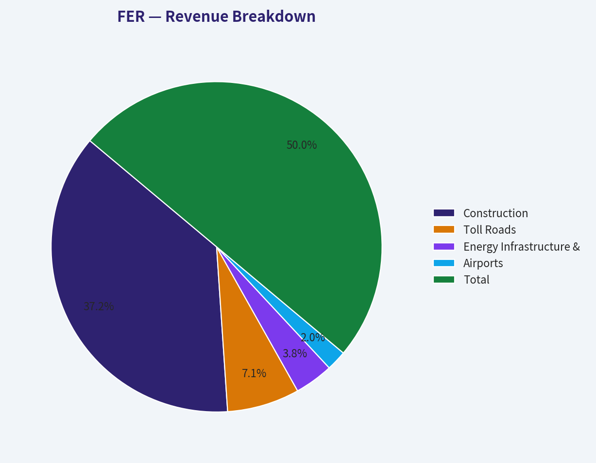
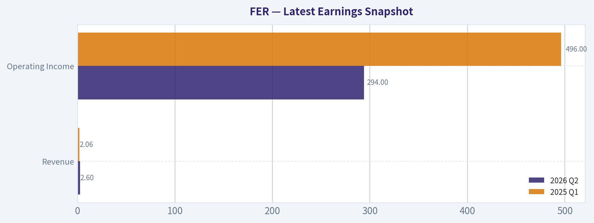
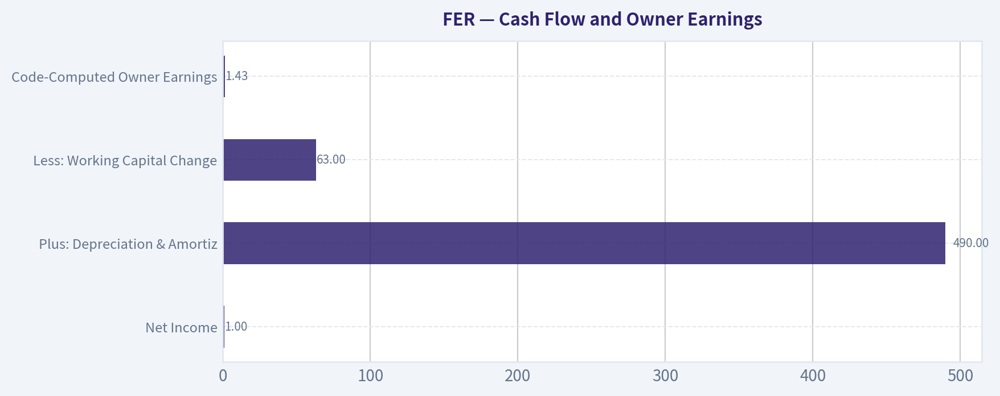
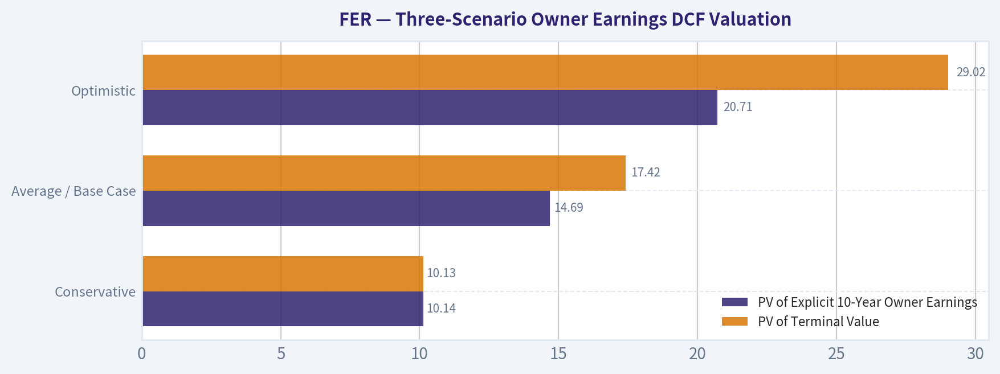
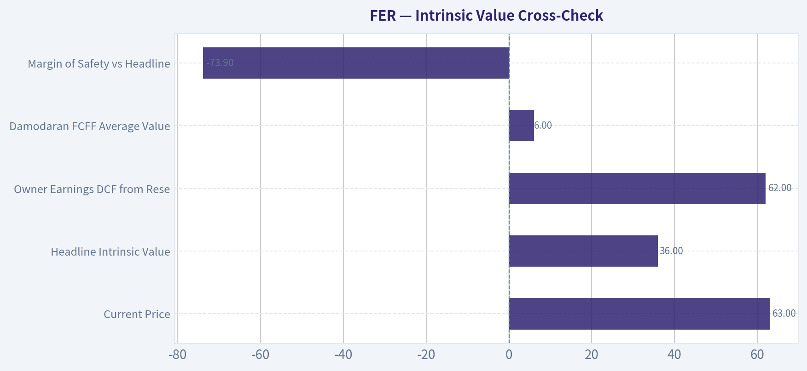
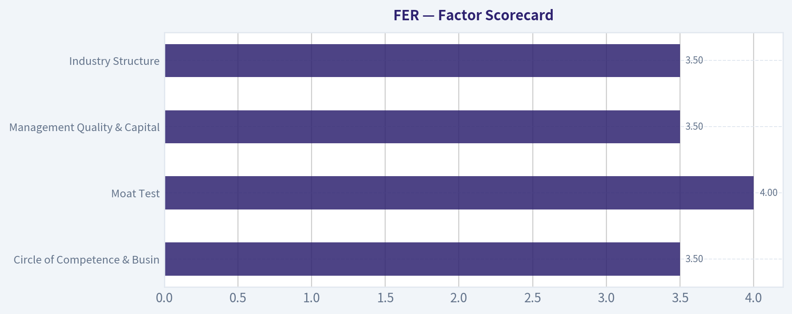

# FER Deep Value Intelligence

**Analysis Date:** 2026-08-22

## Critical Disclaimer

*This analysis is generated by Deep Value Intelligence, an AI-powered multi-agent investing framework. Education & research only - not financial advice, not a financial advisor.*

---

## Table of Contents

1. Intelligence Summary
2. Analyst Team Reports
   - Fundamentals Analysis
   - Intrinsic Value Analysis (Buffett)
   - Trend & Growth Analysis (Lynch/Druckenmiller/Fisher)
   - Market Technical Analysis
   - Options Market Analysis
3. Research Team Commentary
4. Value Investing Team Commentary
5. Deep Values Commentary

---

## Intelligence Summary

### Thesis + Conditions

**Core Thesis:** **1. Executive Summary**
Ferrovial (FER) owns premier, wide-moat infrastructure assets and is executing a highly strategic pivot toward U.S.

**Key Risks:**
- Ferrovial (FER) owns premier, wide-moat infrastructure assets and is executing a highly strategic pivot toward U.S. managed lanes. However, at ~$63, the market is pricing physical toll roads like a hyper-growth tech platform. A reverse-DCF implies an impossible 30% annual growth rate over the next decade, entirely ignoring physical capacity constraints and political tolling caps. Compounding this severe valuation risk is a broken technical structure, with the stock trading below all major moving averages. We must respect the rule that "expensive + weak technicals = avoid." We will sidestep the stock at current prices but adjust our target entry from an overly rigid $36 pure-DCF level to a more realistic $48-$52 range to capitalize on an eventual technical bottom.
- Risky Analyst (The Bull):** Argues that dynamic pricing in U.S. managed lanes allows for "exponential" revenue growth during congestion. Views the current technical breakdown as a washout of weak hands and argues that $63 is the ground floor for a generational U.S. infrastructure super-cycle.
- Safe Analyst (The Bear):** Counters that physical infrastructure has hard ceilings. Political risk will cap exponential toll hikes before commuter backlash occurs. Warns that a 3.1% ROA and a ~65x P/E leave absolutely zero margin of safety, especially if inflation hits construction costs on massive projects like Tennessee's I-24.

**Confidence:** Medium

---

## Analyst Team Reports

### Fundamentals Analysis

#### Latest Earnings Snapshot

*Most recent reported quarter anchored on 2026 Q2, with prior-year comparison when available.*

| Metric | 2026 Q2 | 2025 Q1 | YoY Change |
| --- | ---: | ---: | ---: |
| Revenue | $2.60B | $2.06B | +26.4% |
| Operating Income | $294.0M | $496.0M | -40.7% |
| Net Income | N/A | N/A | N/A |
| Diluted EPS | N/A | N/A | N/A |
| Operating Cash Flow | N/A | N/A | N/A |
| Free Cash Flow | N/A | N/A | N/A |

Key Takeaways: This snapshot anchors the most recent reported quarter before the narrative analysis. It helps readers separate long-run business quality from whatever changed in the latest earnings print.

#### 4-Year Financial Metrics for FER

*All values below are computed deterministically from raw data - not estimated by AI.*

*Issuer profile: operating company (Industrials / Engineering & Construction).*

#### 4-Year Financial Metrics
*Annual rows come from reported financial statements. The final TTM row is computed from the latest four quarters.*

| Metric | 2022 | 2023 | 2024 | 2025 | 2026 TTM |
| --- | --- | --- | --- | --- | --- |
| Market Price | $23 | $34 | $41 | $64 | $63 |
| Market Cap | $18.22B | $25.79B | $30.34B | $46.56B | $45.29B |
| P/E Ratio | 100.72 | 76.98 | 9.40 | 52.10 | N/A |
| P/B Ratio | 4.04 | 6.19 | 4.80 | 6.71 | 7.91 |
| ROE | 4.4% | 8.8% | 55.5% | 14.5% | N/A |
| ROIC | N/A | 4.7% | 26.2% | 9.4% | 2.7% |
| EPS | $0.23 | $0.44 | $4.35 | $1.24 | N/A |
| Revenue | $7.96B | $9.21B | $9.90B | $10.88B | $9.83B |
| Gross Profit | N/A | N/A | N/A | N/A | N/A |
| Gross Margin | N/A | N/A | N/A | N/A | N/A |
| Operating Margin | 5.6% | 7.3% | 34.0% | 11.1% | 4.3% |
| Net Income | $198.2M | $368.9M | $3.51B | $1.00B | N/A |
| Net Margin | 2.5% | 4.0% | 35.4% | 9.2% | N/A |
| Revenue Growth | N/A | 15.7% | 7.5% | 9.9% | -9.7% |
| Net Income Growth | N/A | 86.1% | 850.4% | -71.4% | N/A |
| Free Cash Flow Growth | N/A | N/A | N/A | N/A | N/A |
| Total Book Value | $4.51B | $4.17B | $6.32B | $6.94B | $5.72B |
| Total Assets | N/A | $29.13B | $30.18B | $32.21B | $27.22B |
| Total Debt | N/A | $12.59B | $11.75B | $12.25B | $10.66B |
| Debt-to-Equity | N/A | 3.02 | 1.86 | 1.76 | 1.86 |
| Cash & Equivalents | $5.47B | $5.30B | $5.02B | $5.02B | $3.86B |
| Shareholders' Equity | $4.51B | $4.17B | $6.32B | $6.94B | $5.72B |
| Operating Cash Flow | $1.06B | $1.37B | $1.40B | $2.18B | N/A |
| Investing Cash Flow | $-771.6M | $-459.7M | $1.42B | $-1.01B | N/A |
| Free Cash Flow | N/A | N/A | N/A | N/A | N/A |
| FCF Margin | N/A | N/A | N/A | N/A | N/A |
| Dividends / Share | $0.17 | $0.18 | $0.18 | $0.22 | $0.00 |

#### Profitability Metrics
- Return on Equity (ROE): 14.5%
- Return on Invested Capital (ROIC): 9.1%
- Return on Assets (ROA): 3.1%
- Gross Margin: N/A
- Operating Margin: 11.1%
- Net Profit Margin: 9.2%

#### Liquidity Metrics
- Current Ratio: 1.13
- Quick Ratio: 0.79

#### Leverage Metrics
- Debt-to-Equity Ratio: 1.76
- Interest Coverage Ratio: 2.76
- Net Debt: $7.23B

#### Growth Metrics (Year-over-Year)
- Revenue Growth: 9.9%
- Net Income Growth: -71.4%
- Free Cash Flow Growth: N/A
- Revenue CAGR (3-Year): 11.0%
- Revenue CAGR (5-Year): N/A

#### Valuation Metrics
- P/E Ratio (TTM): 64.78
- Forward P/E: 40.60
- Price-to-Book: 6.77
- Price-to-Sales: 4.59
- PEG Ratio: 4.31
- EV/EBITDA: 34.74
- Free Cash Flow Yield: N/A
- Earnings Yield: 1.5%

#### Owner Earnings (Buffett Method, Code-Computed)
- Net Income: $1.00B
- + Depreciation & Amortization: $490.0M
- - Capital Expenditures: N/A
- - Working Capital Changes: $63.0M
- = **Owner Earnings: $1.43B**

#### Intrinsic Value (Code-Computed)
- Current Price: $63
- **Headline Intrinsic Value (business-model routed): $36**
  Business model: cyclical - weighted blend [Damodaran FCFF + reverse-DCF fair + owner-earnings DCF] (cyclical)
  Model spread (min-max across DCFs): $6 - $62
  Margin of safety vs. price (headline): -73.9%
  Routing note: Cyclical: margins/FCF are volatile - headline blends FCFF, reverse-DCF and owner-earnings roughly evenly; treat the range as the honest read.
- Buffett Method (Owner Earnings):
  Conservative: $-1
  Average: $62
  Optimistic: $177
- Damodaran FCFF (WACC + margins + reinvestment):
  Conservative: $-3
  Average: $6
  Optimistic: $43
  Monte Carlo band (P10-P90): $-2 - $33 (median $13)
  P(intrinsic value > price): 0.5%
- Reverse-DCF: price implies ~30.4%/yr owner-earnings growth for 10y; trailing 3y was 35.1%, 5y N/A.

#### Piotroski F-Score: 4/9
- Positive Net Income: PASS
- Positive Operating Cash Flow: PASS
- ROA Improvement: FAIL
- Cash Flow > Net Income: PASS
- Decreasing Debt: FAIL
- Improving Current Ratio: FAIL
- No Dilution: FAIL
- Improving Gross Margin: FAIL
- Improving Asset Turnover: PASS

ANALYST STANCE: **WATCH**

#### Ferrovial SE (FER) - Buffett-Style Fundamental Analysis

Ferrovial is a global infrastructure operator and developer with exposure to toll roads, airports, construction, and mobility infrastructure. Its moat is stronger than that of a standard engineering-and-construction contractor because concession assets can have long-duration, inflation-linked, regulated or quasi-monopoly cash flows. However, the deterministic dataset shows a business with volatile reported earnings, meaningful leverage, expensive market valuation, and an intrinsic value estimate below the current price.

The current price of **$63** compares with a code-computed headline intrinsic value of about **$36**, implying a **negative margin of safety of roughly 74%**. Even under a hand-built optimistic Owner Earnings DCF, upside depends on sustaining very high growth for several years.

---

#### Current vs Available Historical Average Comparison

*Important data limitation: the deterministic dataset provides 2022-2025 annual data plus 2026 TTM, not a full 10-year history. Therefore, the comparison below uses the available-period average from the canonical dataset rather than inventing a 10-year average.*

| Metric | Current / Latest Value | Available-Period Average | Standing vs History | Interpretation |
|---|---:|---:|---|---|
| Market Price | $63 | $45 | Above average | The stock has rerated sharply from $23 in 2022 and remains close to its 2025 level of $64. |
| Market Cap | $45.29B | $33.24B | Above average | Market value has expanded faster than revenue and normalized earnings. |
| P/E Ratio | 64.78x | ~60.8x | Slightly above average | Still very expensive; 2024's low P/E was distorted by unusually high earnings. |
| P/B Ratio | 7.91x | ~5.93x | Above average | FER is an operating industrial/infrastructure company, so P/B is not meaningless, but concession asset economics are better judged through cash flow and ROIC than book alone. |
| ROE | 14.5% | ~20.8% | Below average | Average is inflated by 2024's 55.5% ROE; normalized ROE appears closer to low-to-mid teens. |
| ROIC | 2.7% TTM | ~10.8% | Well below average | TTM ROIC deterioration is a major warning sign, especially with high valuation multiples. |
| EPS | $1.24 | ~$1.57 | Below average | EPS fell sharply from the 2024 spike of $4.35. |
| Revenue | $9.83B TTM | ~$9.56B | Slightly above average | Revenue base is larger than 2022 but has declined from 2025's $10.88B. |
| Gross Profit / Gross Margin | N/A | N/A | Not available | Dataset does not provide gross profit or gross margin; no substitute value is used. |
| Operating Margin | 4.3% TTM | ~12.5% | Well below average | TTM operating margin is weak and far below the 2024 exceptional margin of 34.0%. |
| Net Income | $1.00B latest annual | ~$1.27B | Below average | 2025 net income remains above 2022-2023 but far below 2024's unusual $3.51B. |
| Net Margin | 9.2% latest annual | ~12.8% | Below average | Normalized profitability is respectable but not strong enough to easily justify premium valuation. |
| Revenue Growth | -9.7% TTM | ~5.9% | Below average | 2025 growth was strong at 9.9%, but TTM revenue contraction is negative. |
| Net Income Growth | -71.4% latest annual | ~288% | Below average | Average is distorted by 2024's 850% jump; earnings are not predictably compounding. |
| Free Cash Flow Growth | N/A | N/A | Not available | Free cash flow is unavailable in the dataset, limiting confidence in valuation. |
| Total Book Value | $5.72B | ~$5.53B | Slightly above average | Equity base has improved since 2023 but declined from 2025. |
| Total Assets | $27.22B | ~$29.69B | Below average | Assets are down from 2025, likely reflecting portfolio movement or balance-sheet changes. |
| Total Debt | $10.66B | ~$11.81B | Below average | Debt has declined from 2023-2025 levels, a positive sign. |
| Debt-to-Equity | 1.86x | ~2.13x | Better than average | Leverage has improved since 2023 but remains meaningful. |
| Cash & Equivalents | $3.86B | ~$4.93B | Below average | Cash cushion has declined materially versus prior years. |
| Shareholders' Equity | $5.72B | ~$5.53B | Slightly above average | Equity remains higher than the 2022-2023 base but below 2025. |
| Operating Cash Flow | $2.18B latest annual | ~$1.50B | Above average | 2025 operating cash generation was strong. |
| Free Cash Flow | N/A | N/A | Not available | Capex and FCF data gaps are important because infrastructure businesses are capital intensive. |
| Dividends / Share | $0.22 latest annual; $0.00 TTM row | ~$0.15 incl. TTM | Mixed | Annual dividend rose through 2025; TTM row shows no dividend captured, which may reflect timing or dataset coverage. |

**Key Takeaways:** Ferrovial's market value and share price are well above the available-period average, while TTM ROIC, operating margin, and revenue growth have weakened. The company has improved leverage versus 2023, but cash has fallen and valuation remains demanding. The biggest issue is that the stock price assumes durable high growth, while the reported data shows cyclical and non-linear earnings.

---

#### Market Metrics Interpretation

Ferrovial trades at **$63** with a market capitalization of **$45.29B**, near the high end of the dataset period. The **P/E ratio of 64.78x** is expensive on an earnings basis, and the forward P/E of **40.6x** still implies a high bar for future growth. The **P/B ratio of 7.91x** is above the available-period average, but for infrastructure operators, book value can understate concession economics while also failing to capture the cash-flow risk of large projects; therefore, P/B should not be the primary valuation anchor.

The more relevant valuation anchor is cash-flow-based intrinsic value. The deterministic research pack's headline intrinsic value is **$36**, with a wide model spread from roughly **$6 to $62**, reflecting the difficulty of valuing a cyclical, asset-heavy infrastructure company.

#### Profitability Interpretation

FER's latest annual **ROE of 14.5%** is respectable but not exceptional for a company trading at a premium multiple. ROE was only **4.4% in 2022** and **8.8% in 2023**, then spiked to **55.5% in 2024**, before normalizing to **14.5% in 2025**. That pattern suggests reported earnings are materially affected by one-offs, asset disposals, concession revaluations, or project-cycle effects.

The more concerning metric is **ROIC**, which fell to **2.7% TTM** from **9.4% in 2025** and **26.2% in 2024**. A Buffett-style investor wants durable high returns on capital; FER's return profile is attractive in certain assets but inconsistent at the consolidated level.

Operating margin also fell to **4.3% TTM**, far below the 2025 level of **11.1%** and the 2024 exceptional level of **34.0%**. This reinforces the view that normalized profitability is meaningfully lower than peak-year results.

#### Growth Interpretation

Revenue grew from **$7.96B in 2022** to **$10.88B in 2025**, a strong multi-year increase, with a stated 3-year revenue CAGR of **11.0%**. However, TTM revenue declined to **$9.83B**, representing **-9.7% TTM revenue growth**. This is a notable deterioration.

Net income growth is even more volatile. Net income rose from **$198.2M in 2022** to **$368.9M in 2023**, then surged to **$3.51B in 2024**, before falling to **$1.00B in 2025**. The latest annual net income growth rate of **-71.4%** makes the earnings stream less predictable than Buffett would prefer.

Free cash flow growth is unavailable in the deterministic dataset. That is a major limitation because infrastructure businesses can report accounting profits while requiring heavy reinvestment.

#### Balance Sheet and Financial Strength

Ferrovial has **$10.66B of total debt**, **$3.86B of cash**, and **$7.23B of net debt**. Debt has improved versus the 2023 level of **$12.59B**, but leverage remains meaningful, with debt-to-equity at **1.86x** and interest coverage at only **2.76x**.

The current ratio is **1.13**, and the quick ratio is **0.79**. For an operating industrial infrastructure company, liquidity ratios are relevant, though they must be interpreted alongside project financing structures and concession cash flows. Liquidity is adequate but not abundant.

Piotroski F-Score is **4/9**, which is weak-to-middling. Positive net income, positive operating cash flow, and cash flow exceeding net income are positives, but failures on ROA improvement, debt reduction, current ratio improvement, dilution, gross margin, and other quality markers reduce confidence.

#### Cash Flow and Owner Earnings

The deterministic Buffett-style Owner Earnings calculation is:

| Owner Earnings Component | Amount |
|---|---:|
| Net Income | $1.00B |
| Plus: Depreciation & Amortization | $490.0M |
| Less: Working Capital Changes | $63.0M |
| Less: Capital Expenditures | N/A |
| Code-Computed Owner Earnings | $1.43B |

**Key Takeaways:** Owner Earnings of **$1.43B** provide the base for valuation, but the calculation is incomplete because capital expenditures are unavailable. For an infrastructure and construction business, missing capex can materially overstate true owner earnings. Therefore, the Owner Earnings DCF should be treated as a sanity check, not as a definitive valuation.

---

#### Revenue Breakdown

*Segment amounts below are normalized to the deterministic 2025 revenue total of **$10.88B**. Ferrovial's segment economics are uneven: construction contributes substantial revenue, while toll roads and airports can contribute more attractive long-duration cash flows.*

| Revenue Source | Amount ($B) | % of Total |
|---|---:|---:|
| Construction | $8.09B | 74.4% |
| Toll Roads | $1.54B | 14.2% |
| Energy Infrastructure & Mobility | $0.82B | 7.5% |
| Airports | $0.43B | 3.9% |
| Total | $10.88B | 100.0% |

**Key Takeaways:** Ferrovial's reported revenue is dominated by construction, which is typically lower-margin and more cyclical than concession assets. Toll roads and airports may be the higher-quality moat assets, but they are not the majority of consolidated revenue. This mix explains why FER can have valuable long-duration assets while still showing volatile consolidated margins and returns.

---

#### Buffett-Style Qualitative Analysis

**Economic Moat:** Ferrovial has a real but mixed moat. Toll road concessions, airport interests, and long-duration public-private infrastructure projects can create high barriers to entry, inflation-linked revenue, and quasi-monopoly economics. However, the consolidated company also has large construction exposure, where bidding discipline, execution risk, labor inflation, and project delays can pressure returns.

**Financial Strength:** The balance sheet is acceptable but not conservative. Debt has declined versus the available-period average, but **net debt of $7.23B**, **debt-to-equity of 1.86x**, and **interest coverage of 2.76x** leave limited room for disappointment. Buffett would prefer stronger coverage and more clearly recurring free cash flow.

**Predictable Earnings:** Earnings are not highly predictable. Net income moved from **$198M** to **$369M**, then to **$3.51B**, then back to **$1.00B**. This volatility makes valuation difficult and reduces the reliability of simple P/E-based conclusions.

**Management Performance:** Capital allocation appears focused on infrastructure platforms and concession growth, which can create long-term value. The dividend rose from **$0.17** in 2022 to **$0.22** in 2025, but the TTM dividend row shows **$0.00**, so the dividend record should be interpreted cautiously. ROE and ROIC volatility suggest management has access to valuable assets but not a consistently high-return consolidated engine.

**Quality of Business:** FER is higher quality than a plain construction contractor because of concession exposure, but lower quality than a pure toll-road compounder because consolidated revenue and margins are heavily affected by construction and project cycles.

---

#### Three-Scenario Owner Earnings DCF Valuation

**DCF assumptions:**
- Base Owner Earnings: **$1.43B**
- Shares outstanding implied by market cap / price: **~719M shares**
- Discount rate: **10%**
- Terminal growth: **2.5%**
- Current price: **$63**
- DCF treats Owner Earnings as equity cash flow; if one instead subtracts net debt, fair values would be materially lower.
- Because capex is unavailable, this DCF may overstate true economic value.

| Scenario | Growth Assumption | PV of Explicit 10-Year Owner Earnings | PV of Terminal Value | Estimated Equity Value | Fair Value / Share | Upside / Downside vs $63 |
|---|---|---:|---:|---:|---:|---:|
| Conservative | 3% annual growth for 10 years, then 2.5% terminal | $10.14B | $10.13B | $20.27B | ~$28 | -55% |
| Average / Base Case | 12% growth for 5 years, fading to 3% by year 10, then 2.5% terminal | $14.69B | $17.42B | $32.11B | ~$45 | -29% |
| Optimistic | 20% growth for 5 years, fading to 4% by year 10, then 2.5% terminal | $20.71B | $29.02B | $49.74B | ~$69 | +10% |

**Key Takeaways:** The conservative and base-case DCF valuations are materially below the current price. The optimistic scenario produces only modest upside and requires several years of very high Owner Earnings growth. This means the market is already pricing in a strong execution path.

#### Intrinsic Value Cross-Check

| Valuation Reference | Value / Result | Interpretation |
|---|---:|---|
| Current Price | $63 | Market price as of the deterministic dataset. |
| Headline Intrinsic Value | $36 | Business-model-routed value for a cyclical infrastructure company. |
| Owner Earnings DCF from Research Pack | $62 | Near current price, but sensitive to growth and capex assumptions. |
| Damodaran FCFF Average Value | $6 | Much more conservative; reflects margin, reinvestment, and WACC pressure. |
| Model Spread | $6-$62 | Very wide uncertainty range. |
| Reverse DCF Implied Growth | ~30.4% per year for 10 years | Current price requires aggressive long-term growth. |
| Margin of Safety vs Headline Value | -73.9% | No Buffett-style margin of safety at the current price. |

**Key Takeaways:** The valuation evidence is not balanced in favor of buyers. The current price is close to the most favorable Owner Earnings model but far above the headline intrinsic value and Damodaran FCFF estimate. The reverse DCF is especially important: the stock requires roughly **30% annual Owner Earnings growth for a decade**, which is a demanding hurdle.

---

#### Key Investment Insights

**Opportunities:**
Ferrovial has exposure to attractive long-lived infrastructure assets, including toll roads and airports. Recent project wins, including the large I-24 Tennessee project referenced in current news coverage, support the growth pipeline. If traffic volumes, concession economics, and infrastructure demand remain strong, FER can continue compounding asset value.

**Red Flags:**
The stock is expensive on P/E, P/B, P/S, and EV/EBITDA. ROIC has fallen sharply to **2.7% TTM**, operating margin has deteriorated to **4.3% TTM**, and TTM revenue growth is negative. Free cash flow is unavailable, and capex is missing from the Owner Earnings calculation, which is a serious limitation for a capital-intensive infrastructure business.

**Buffett Lens:**
Buffett would likely admire the concession-style assets but hesitate on the price. The business has moat-like elements, but reported earnings are not predictable enough, leverage is meaningful, and the margin of safety is absent.

#### Final Investment Stance: WATCH

FER is a **WATCH**, not an outright ADVOCATE, because the business quality is real but the valuation is already demanding. At **$63**, investors are paying for a favorable growth path and improved profitability. A more attractive entry point would likely require either a lower price closer to the **$36-$45** intrinsic value zone or clearer evidence that Owner Earnings can sustainably compound at high double-digit rates.

| Category | Assessment | Buffett-Style Conclusion |
|---|---|---|
| Business Quality | Good but mixed | Concession assets are attractive; construction exposure adds cyclicality. |
| Moat | Moderate to strong in selected assets | Toll roads and airports have durable economics, but consolidated moat is diluted. |
| Financial Strength | Acceptable, not conservative | Debt is manageable but interest coverage is not robust. |
| Earnings Predictability | Weak to moderate | Net income and margins are volatile across the dataset. |
| Valuation | Expensive | Current price exceeds headline intrinsic value and base-case DCF. |
| Margin of Safety | Absent | Negative margin of safety versus the $36 headline value. |
| Main Opportunity | Infrastructure growth pipeline | Large projects and concession expansion could support long-term value. |
| Main Risk | Overpaying for cyclicality | Market price assumes strong growth despite falling TTM revenue and ROIC. |
| Final Stance | **WATCH** | High-quality assets, but not enough value discipline at today's price. |

**Key Takeaways:** Ferrovial is a good infrastructure franchise trading at a rich valuation. The current price leaves little room for execution errors, especially given volatile earnings, declining TTM revenue, and weak TTM ROIC. For a Buffett-style investor, FER belongs on the watchlist until either price falls or cash-flow durability improves materially.

#### Fundamental Visuals

This graph tracks the profitability and return metrics (ROE, ROIC, Margins) of **FER** over the past decade, highlighting capital efficiency trends.

This chart illustrates the financial health of **FER** over the last 10 years, mapping cash equivalents and free cash flow against total obligations (Debt).

This breakdown chart from <em>Revenue Breakdown</em> shows the proportional composition for **FER** - useful for understanding what drives or risks the business.

---

### Intrinsic Value Analysis (Buffett)

> *Following Warren Buffett's value investing philosophy: Circle of Competence, Economic Moat, Management Quality, and Margin of Safety.*

#### Intrinsic Value Snapshot

Price is what you pay. Intrinsic value is what the business may be worth based on the cash it can create for owners over time. We show a range, not one magic number.

- Current Price: $62.84
- Value Range (conservative to optimistic across both DCF methods): $-0.56 to $176.50

##### Owner Earnings (Buffett Method)
- Net Income: $1,003,468,092.47
- Depreciation & Amortization: $490,000,000.00
- Capital Expenditures: N/A
- Working Capital Changes: $63,000,000.00
- Owner Earnings: $1,430,468,092.47

##### Intrinsic Value
###### Buffett Method
Uses owner earnings. Stricter, and usually more conservative.
- Conservative: $-0.56
- Average: $61.97
- Optimistic: $176.50
- Discount Rate: 10.0%

ANALYST STANCE: **WATCH**

#### Ferrovial Investment View - Buffett-Style Due Diligence

Ferrovial is a high-quality global infrastructure owner/operator with valuable toll-road, managed-lane, airport, and public-private partnership expertise. The business has real moat characteristics: scarce concession assets, regulatory barriers, long-duration contracts, and a growing U.S. managed-lanes runway. The problem is price. At **$63**, the stock trades well above the business-model-routed intrinsic value estimate of **$36.13**, with the market implying roughly **30.4% annual growth for 10 years**. That is a demanding hurdle even for a strong infrastructure compounder.

---

#### 1. Factor Scorecard

| Factor | Score / 5 | Evidence |
|---|---:|---|
| Circle of Competence & Business Simplicity | 3.5 | Ferrovial makes money from infrastructure concessions, toll roads, managed lanes, airports, and construction. The basic model is understandable, but concession accounting, project-level financing, and cyclical construction exposure add complexity. |
| Moat Test | 4.0 | Scarce infrastructure concessions, regulatory approvals, long-term contracts, and operating expertise create durable advantages. The moat is strongest in toll roads and managed lanes, weaker in construction. |
| Management Quality & Capital Allocation | 3.5 | Management has shown willingness to recycle capital into higher-return infrastructure opportunities. Recent U.S. wins, including the Tennessee I-24 project, support the reinvestment runway. Buyback/value discipline is less clear at today's valuation. |
| Industry Structure | 3.5 | Infrastructure concessions can be attractive local monopolies or oligopolies, but bidding for new projects is competitive and capital intensive. Returns depend heavily on underwriting discipline. |
| Gate 5 - Quality/Solvency Hard Floor | Not tripped | Revenue is growing, ROE is positive at 14.5%, and there is no evidence of a combined worsening earnings trajectory and solvency red line. |

**Key Takeaways:** Ferrovial is not a distressed or low-quality business. The company has durable infrastructure assets and a visible project pipeline, but the model is more complex and capital intensive than a classic consumer franchise. The main concern is valuation, not survivability.

---

#### 2. Moat Analysis

| Moat Source | Assessment | Evidence |
|---|---|---|
| Intangible / Regulatory Assets | Strong | Infrastructure concessions require government approvals, public-private partnership expertise, and long bidding histories. These are difficult for new entrants to replicate. |
| Switching Costs | Moderate to Strong | Once a toll road or managed-lane concession is embedded in a region's transportation network, users have limited substitutes, especially in congested corridors. |
| Cost Advantage | Moderate | Scale, engineering expertise, and project management help, but construction margins are structurally competitive. The cost moat is better in operating assets than in pure construction. |
| Network Effects | Limited | Roads and airports benefit from traffic density and regional economic activity, but this is not a classic digital network effect. |
| Moat Rating | Wide but not uniform | Toll-road and managed-lane assets are moatier than construction activities. Overall rating: **Wide & Stable**, with selective widening in U.S. managed lanes. |

**Key Takeaways:** Ferrovial's moat comes from scarcity, regulation, and concession rights rather than brand power. The best assets resemble local monopolies, but not every segment has the same quality. The company deserves a quality premium, but not an unlimited one.

---

#### 3. Financial Summary Table

| Metric / Period | Value | Interpretation |
|---|---:|---|
| Current Share Price | $63.00 | Market price used for valuation. |
| Market Capitalization | $45.29B | Large-cap global infrastructure platform. |
| Implied Shares Outstanding | ~719M | Derived from market cap divided by share price. |
| P/E Ratio | 64.8x | Very demanding earnings multiple. |
| Implied EPS | ~$0.97 | Derived from price divided by P/E. |
| Implied Net Income | ~$699M | EPS multiplied by implied share count. |
| ROE | 14.5% | Respectable, but below the >20% level associated with elite compounders. |
| Revenue Growth YoY | 9.9% | Healthy near-term growth. |
| Current Ratio | 1.13x | Adequate liquidity, not a fortress signal. |
| 5-Year Stock Total Return | +147.1% | Shareholders have already been well rewarded. |
| Trailing 3-Year Growth Reference | 35.1% | Strong recent growth, but likely hard to sustain for a decade. |
| Price-Implied Growth | ~30.4%/yr for 10 years | Market expectations are aggressive. |

**Key Takeaways:** Ferrovial is growing and profitable, but the stock already reflects a great deal of success. A nearly 65-times earnings multiple leaves little room for disappointment. The market is asking the company to compound at a very high rate for a long time.

---

#### 4. Owner Earnings Calculation

| Owner Earnings Component | Per Share / Estimate | Notes |
|---|---:|---|
| Implied EPS | ~$0.97 | Based on current price and P/E. |
| Normalized Owner-Earnings Base Used in Owner-Earnings DCF | ~$6.20/share | Inferred from the owner-earnings DCF value of $61.97 at a 10% capitalization rate. |
| Implied Total Owner Earnings | ~$4.46B | $6.20 per share multiplied by ~719M shares. |
| Owner-Earnings DCF Value | $61.97/share | Roughly equal to the current market price. |
| Reliability of Owner-Earnings Signal | Medium-Low | Concession businesses can have lumpy cash flows, project financing, capital recycling, and non-GAAP cash characteristics. |

**Key Takeaways:** The owner-earnings model produces a much more favorable value than the broader routed valuation model. That creates a wide valuation spread and signals that cash-flow normalization is critical. For a concession-heavy business, relying on one owner-earnings figure alone would be too aggressive.

---

#### 5. Three-Scenario DCF Valuation

| Scenario | Assumption | Estimated Value / Share |
|---|---|---:|
| A - No Growth | Owner earnings capitalized at 10% | $61.97 |
| B - GDP Growth | Owner earnings grow perpetually at 3%; 10% discount rate | $91.19 |
| C - Historical Growth, Capped | 10-year growth capped at 10%, then 3% terminal growth | ~$153.10 |
| Business-Model-Routed Headline Intrinsic Value | Weighted cyclicality/concession blend | $36.13 |
| Damodaran FCFF Cross-Check | FCFF-based valuation | $5.72 |

**Key Takeaways:** Pure owner-earnings scenarios are much more optimistic than the routed intrinsic value and FCFF cross-check. That spread is important: it means the valuation depends heavily on how one normalizes concession cash flows and reinvestment needs. The more conservative blended value points to overvaluation at the current price.

---

#### 6. Margin of Safety Analysis

| Valuation Reference | Value / Share | Margin of Safety vs. $63 Price |
|---|---:|---:|
| Current Price | $63.00 | - |
| Headline Intrinsic Value | $36.13 | -73.9% |
| Owner-Earnings DCF | $61.97 | Approximately -1.7% |
| Reverse-DCF Fair Value Estimate | ~$40.70 | Approximately -54.8% |
| Damodaran FCFF Value | $5.72 | Severe downside signal |
| Required Margin of Safety | ~15-25% | Ferrovial is high quality, but not simple enough to justify buying with no discount. |

**Key Takeaways:** The headline valuation shows no margin of safety. Even the favorable owner-earnings model only puts the stock around fair value, not clearly undervalued. For a complex, capital-intensive infrastructure company, Buffett-style discipline argues for waiting.

---

#### 7. Management Quality Assessment

| Area | Assessment |
|---|---|
| Owner Orientation | Reasonable, but not exceptional based on available evidence. |
| Capital Allocation | Positive signs from capital recycling and focus on higher-value infrastructure assets. |
| Reinvestment Discipline | The U.S. managed-lanes opportunity is attractive, including the recently awarded Tennessee I-24 Southeast Choice Lanes project. |
| Balance Sheet Attitude | Infrastructure businesses naturally use project financing; leverage must be judged by asset-level cash flows and concession duration. |
| Candidness / Accounting Conservatism | No major red flag is evident, but concession accounting requires extra conservatism from investors. |

**Key Takeaways:** Management appears capable and strategically focused on attractive infrastructure opportunities. The key test is whether future projects are won at returns that exceed the cost of capital after competition and financing costs. At today's stock price, the market is already assuming successful execution.

---

#### 8. Final Buffett Scorecard

| Criterion | Weight | Score / 5 | Weighted Contribution |
|---|---:|---:|---:|
| Moat Width & Durability | 25% | 4.0 | 1.00 |
| Valuation / Margin of Safety | 20% | 1.0 | 0.20 |
| Capital Returns - ROIC vs. WACC | 15% | 3.0 | 0.45 |
| Business Understanding & Predictability | 12% | 3.5 | 0.42 |
| Management Quality & Capital Allocation | 12% | 3.5 | 0.42 |
| Reinvestment Runway | 8% | 4.0 | 0.32 |
| Balance Sheet Strength | 4% | 3.0 | 0.12 |
| Industry Structure | 4% | 3.5 | 0.14 |
| **Total Score** | **100%** | - | **3.07 / 5.00** |

**Key Takeaways:** Ferrovial scores well on moat, runway, and business quality, but valuation drags the total score down. The stock is not poor quality; it is simply priced for a lot of future success. A score near 3.1 places it in the WATCH category.

---

#### 9. Investment Stance

**Stance: WATCH**
**Conviction: Moderate**

Ferrovial is a good-to-very-good infrastructure business with valuable concession assets and an attractive U.S. growth runway. However, the current share price embeds demanding expectations, with the headline intrinsic value estimate at **$36.13** versus a market price of **$63**. The stock would become more interesting closer to the **$35-$45** range, depending on updated project economics, cash-flow conversion, and leverage.

Buffett-style conclusion: **Right business, wrong price.**
#### Valuation Bridge

This bridge places the current market price beside each intrinsic value lens so readers can see whether upside depends on one method or shows up across several methods.

| Scenario | Intrinsic Value / Share |
| --- | ---: |
| Buffett Method | $61.97 |
| Damodaran Method | $5.72 |
| Current Price | $62.84 |

#### Key Takeaways

If one method is far above the others, the upside case depends on a specific modelling assumption. When several methods cluster together, the valuation story is more robust.

#### Valuation Visuals

This comparison chart from *Latest Earnings Snapshot* stacks current figures against historical benchmarks for **FER**, making it easy to see where the company trades relative to its own averages.

This comparison chart from *Cash Flow and Owner Earnings* stacks current figures against historical benchmarks for **FER**, making it easy to see where the company trades relative to its own averages.

This comparison chart from *Three-Scenario Owner Earnings DCF Valuation* stacks current figures against historical benchmarks for **FER**, making it easy to see where the company trades relative to its own averages.

This comparison chart from *Intrinsic Value Cross-Check* stacks current figures against historical benchmarks for **FER**, making it easy to see where the company trades relative to its own averages.

---

### Trend & Growth Analysis (Lynch/Druckenmiller/Fisher)

> *Following Peter Lynch's GARP, Stanley Druckenmiller's macro-aware approach, and Philip Fisher's scuttlebutt methodology.*

ANALYST STANCE: **AVOID**

#### Ferrovial, ticker FER - Growth Investment Review

Ferrovial is a high-quality global infrastructure operator, but it does **not screen as a Lynch-style fast grower** at the current price. The company has valuable toll-road and infrastructure concessions, including a major new U.S. managed-lanes opportunity, but the stock already prices in a very optimistic growth path. For a growth portfolio seeking inflection points and ten-bagger potential, FER is better treated as a **watch-list infrastructure compounder**, not a current advocate.

---

#### 1. Lynch Classification

| Category | FER Fit | Evidence |
|---|---:|---|
| Slow Grower | No | Revenue growth is above 5%. |
| Stalwart | Yes | Revenue growth around 9.9% YoY fits the 5% to 12% range. |
| Fast Grower | No | Current growth is not 15% to 25%+. |
| Cyclical | Partial | Infrastructure traffic, rates, construction cycles, and financing costs matter. |
| Turnaround | No | Not a distressed restructuring story. |
| Asset Play | Partial | Long-duration concession assets have strategic value. |

**Key Takeaways:** Ferrovial is best classified as a **Stalwart with cyclical and asset-play characteristics**, not a fast grower. That matters because Lynch-style ten-baggers usually come from companies growing revenue 15% to 25% or more with a long runway. FER may be a solid infrastructure compounder, but it is not currently showing the growth profile needed for a high-conviction growth buy.

---

#### 2. The Story in 3 Bullets

- Ferrovial develops and operates transportation infrastructure, especially toll roads, managed lanes, airports, and large public-private partnership projects.
- The growth story is strongest in U.S. managed lanes, where congestion, population growth, and underfunded public infrastructure create demand for private capital.
- The recent selection for Tennessee's **$9.2 billion I-24 Southeast Choice Lanes** project is a meaningful pipeline catalyst, but the market already appears to be assigning a premium valuation to future success.

---

#### 3. TAM Analysis and 10x Test

| Item | Assessment |
|---|---:|
| Current market cap | $45.29B |
| Current revenue growth | 9.9% YoY |
| 10x revenue feasibility | Possible only over a very long time horizon |
| TAM direction | Expanding in U.S. managed lanes and transportation concessions |
| Main runway issue | Concession growth is capital-intensive, competitive, and project-cycle dependent |
| 10x test result | **Mixed / weak for growth investors** |

**Key Takeaways:** Ferrovial operates in a large market, and the U.S. infrastructure opportunity is real. However, growing 10x from the current base would require decades of project wins, financing capacity, and successful concession execution. The runway exists, but it is not the clean, scalable runway typical of software, fintech, or other classic fast-growth ten-bagger categories.

---

#### 4. Revenue Growth Trend

| Metric | Latest Available Data | Interpretation |
|---|---:|---|
| Revenue growth YoY | 9.9% | Stalwart-level growth |
| Growth pattern | Not enough data to confirm acceleration | No clear inflection proven |
| Reverse-DCF implied growth | ~30.4% per year for 10 years | Very demanding |
| Trailing 3-year growth | 35.1% | Strong historical rebound / expansion, but sustainability uncertain |

**Key Takeaways:** FER's latest revenue growth is respectable but not fast-growth territory. The stock price appears to require a much higher long-term growth rate than the current YoY number suggests. Unless new projects materially accelerate revenue and earnings, valuation risk is elevated.

---

#### 5. Unit Economics

| Metric | FER Applicability | Assessment |
|---|---|---|
| LTV/CAC | Not applicable | FER is not a SaaS or consumer subscription business. |
| NRR | Not applicable | No recurring software revenue retention model. |
| Rule of 40 | Not applicable | Infrastructure concessions should be judged on concession returns, traffic, financing costs, and asset duration. |
| Key unit metric instead | Project IRR / concession economics | Data not available in provided pack. |
| Balance sheet liquidity | Current ratio 1.13 | Adequate but not especially conservative. |

**Key Takeaways:** Standard SaaS-style unit economics do not apply to Ferrovial. For FER, the key questions are whether new concessions earn attractive returns after financing costs and whether traffic volumes support long-term cash flow. Based on available data, we cannot verify that new project economics are strong enough to justify the current valuation.

---

#### 6. Inflection Point Assessment

| Potential Inflection | Evidence | Rating |
|---|---|---:|
| Product cycle inflection | Not applicable; infrastructure project model | Low |
| Market share inflection | New U.S. project awards, including I-24 | Medium |
| Margin inflection | Not enough evidence provided | Unclear |
| TAM inflection | U.S. managed lanes and public-private partnerships expanding | Medium / High |
| Competitive inflection | No clear competitor stumble identified | Low |
| Overall inflection score | Pipeline improving, but not yet financial acceleration | **Medium** |

**Key Takeaways:** The strongest inflection case is the expansion of U.S. managed-lanes opportunities. The Tennessee I-24 project is strategically important and validates Ferrovial's capabilities. However, an award is not the same as near-term financial acceleration, and the market may already be discounting a large amount of future success.

---

#### 7. Macro Setup

| Macro Factor | Impact on FER | Assessment |
|---|---|---|
| Infrastructure demand | Positive | Congestion and public funding gaps support private concessions. |
| Interest rates | Negative / mixed | Higher rates pressure project financing and valuation multiples. |
| Inflation | Mixed | Can support toll escalation but raises construction costs. |
| Economic cycle | Mixed | Traffic can be resilient, but financing and construction cycles matter. |
| Secular theme | Infrastructure modernization | Durable, but not hypergrowth. |

**Key Takeaways:** Ferrovial benefits from a durable infrastructure modernization theme, especially in the United States. However, the business is sensitive to interest rates and construction costs, which makes the macro setup less clean than for asset-light growth companies. Falling rates would improve the setup meaningfully.

---

#### 8. Fisher 15 Points Score

| Fisher Point | Score / 5 | Comment |
|---|---:|---|
| Products with sizable market potential | 4 | Infrastructure demand is large and durable. |
| Management determination to develop new products/projects | 4 | Active in large new concessions. |
| Effective R&D | 2 | Not an R&D-led company. |
| Above-average sales organization | 3 | Strong bidding and partnership capability. |
| Worthwhile profit margin | 3 | Profitability exists, but detailed margins unavailable. |
| Improving margins | 3 | Not enough evidence to score higher. |
| Labor/personnel relations | 3 | No major data in pack. |
| Executive relations | 3 | No major red flags in pack. |
| Management depth | 4 | Global infrastructure execution requires depth. |
| Cost analysis/accounting | 3 | Large-project accounting complexity is a risk. |
| Outstanding moat aspects | 4 | Long-duration concessions can be strong moats. |
| Long-range profit outlook | 4 | Long-lived assets support long-term cash flow. |
| Dilution risk | 3 | Capital intensity may require financing discipline. |
| Candor in difficulties | 3 | Insufficient evidence. |
| Management integrity | 3 | Insufficient evidence. |
| **Total** | **49 / 75** | **Average** |

**Key Takeaways:** Ferrovial scores reasonably well on market potential, management capability, and concession moats. It scores lower because it is not innovation-led, lacks clear evidence of margin acceleration, and has project-accounting complexity. A 49 out of 75 is acceptable for a quality infrastructure company, but not strong enough for a growth-stock advocate rating.

---

#### 9. Valuation Analysis

| Valuation Metric | Current Data | Interpretation |
|---|---:|---|
| Share price | $63 | Current reference price |
| Market cap | $45.29B | Large-cap infrastructure company |
| P/E | 64.8x | Expensive versus current growth |
| Revenue growth | 9.9% | Not enough to support high P/E alone |
| Approximate PEG | ~6.5x | Very expensive by Lynch standards |
| Headline intrinsic value estimate | $36.13 | Implies price is above estimated fair value |
| Margin of safety vs. price | -73.9% | No margin of safety |
| Reverse-DCF implied growth | ~30.4% for 10 years | Very high hurdle |

**Key Takeaways:** Valuation is the central problem. Ferrovial trades at a high earnings multiple despite only stalwart-level recent growth. The reverse-DCF suggests investors need very strong long-term growth to justify today's price, leaving limited room for execution mistakes.

---

#### 10. Scenario Analysis

| Scenario | Assumption | Implication |
|---|---|---|
| Bear Case | Project returns disappoint; rates stay elevated; growth slows | Multiple compression risk is meaningful. |
| Base Case | FER executes on pipeline and grows steadily | Stock may compound, but upside is likely moderate from current valuation. |
| Bull Case | U.S. managed-lanes platform accelerates materially; rates fall | FER could outperform, but much of this may already be priced in. |

**Key Takeaways:** The bull case depends on both operational execution and a friendlier macro backdrop. The base case looks like a quality compounder, not a ten-bagger setup. The bear case is valuation-driven: even a good business can underperform if expectations are too high.

---

#### 11. Growth Investor Scorecard

| Criterion | Weight | Score / 5 | Weighted Score |
|---|---:|---:|---:|
| The Story | 10% | 3.5 | 0.35 |
| TAM & Runway | 20% | 3.5 | 0.70 |
| Revenue Growth | 20% | 2.5 | 0.50 |
| Unit Economics | 15% | 3.0 | 0.45 |
| Competitive Position | 10% | 3.5 | 0.35 |
| Management Quality | 10% | 3.5 | 0.35 |
| Macro Setup | 5% | 3.0 | 0.15 |
| Profitability Path | 5% | 3.0 | 0.15 |
| Valuation | 5% | 1.0 | 0.05 |
| **Total** | **100%** |  | **3.05 / 5.00** |

**Key Takeaways:** FER scores well enough to remain on a watch list, especially because of its infrastructure runway and U.S. project pipeline. But the score is dragged down by only moderate current growth and a stretched valuation. The overall result is close to WATCH territory, but for new growth capital, the stance remains AVOID.

---

#### 12. Position Size Stance

| Investor Type | Stance | Suggested Position |
|---|---|---:|
| Growth investor seeking ten-baggers | Avoid new position | 0% |
| Existing long-term holder | Hold / trim if overweight | Up to 1%-2% |
| Infrastructure-focused portfolio | Watch for pullback | Small position only after valuation improves |
| Catalyst trader | Monitor I-24 and U.S. managed-lanes execution | Event-driven only |

**Key Takeaways:** FER may be suitable for investors who want infrastructure exposure, but it does not currently fit a concentrated growth portfolio. Existing holders can justify patience if they have a low cost basis. New buyers should demand either a better valuation or clearer evidence of accelerating earnings.

---

#### 13. Key Risks and Catalysts

| Category | Key Items |
|---|---|
| Major catalysts | I-24 project progress, additional U.S. managed-lane wins, falling interest rates, traffic growth, margin improvement |
| Major risks | High valuation, interest-rate sensitivity, construction-cost overruns, project delays, regulatory/political risk, traffic cyclicality |
| Red flags | P/E near 65x, PEG around 6.5x, negative margin of safety, reverse-DCF growth hurdle near 30% annually |
| What would change the stance | Revenue growth accelerating above 15%, clear concession-level returns, improved valuation, or earnings growth catching up to the multiple |

**Key Takeaways:** The company has real catalysts, especially in U.S. infrastructure, but the stock already reflects high expectations. The biggest risk is not business quality; it is price. FER becomes more interesting if growth accelerates or the stock pulls back materially.

---

#### Bottom Line

Ferrovial is a good infrastructure business with durable assets and an attractive U.S. managed-lanes opportunity. But from a Lynch-Druckenmiller-Fisher growth lens, the stock lacks the combination of **fast current growth, clear earnings inflection, and reasonable valuation** needed for an advocate rating.

At $63, with a P/E near 65x and only 9.9% recent revenue growth, FER is a **quality company at a demanding price**. For growth capital, the right move is to avoid initiating now and revisit after either a valuation reset or clearer evidence that the U.S. project pipeline is driving sustained acceleration.

#### Growth & Scorecard Visuals

This comparison chart from *Factor Scorecard* stacks current figures against historical benchmarks for **FER**, making it easy to see where the company trades relative to its own averages.

---

### Market Technical Analysis

ANALYST STANCE: **AVOID**

#### FER Technical Analysis - Latest Trading Day: 2026-08-21

FER's latest close was **62.83** on **2026-08-21**. The technical setup is currently unfavorable: price is below the short-, medium-, and long-term moving averages, MACD has rolled back below its signal line, RSI is weak but not yet oversold, and volume-weighted price behavior suggests recent selling pressure has not been fully repaired. The stock is not in a clean capitulation zone yet, but the current structure favors caution until price reclaims key resistance levels.

| Metric / Indicator | Latest Value | Interpretation |
|---|---:|---|
| Close | 62.83 | Latest tradable close; near the lower end of the recent range |
| 10 EMA | 64.08 | Price is below short-term trend support, showing weak near-term momentum |
| 50 SMA | 65.76 | Price remains meaningfully below medium-term trend |
| 200 SMA | 66.53 | Price is also below the long-term trend benchmark |
| MACD | -0.467 | Bearish momentum has re-accelerated |
| MACD Signal | -0.284 | MACD is below signal line, confirming downside momentum |
| RSI | 40.22 | Weak momentum, but not deeply oversold |
| ATR | 1.16 | Moderate daily volatility; risk remains manageable but downside moves are active |
| VWMA | 65.03 | Price below VWMA implies volume-weighted buyers are not in control |

Key Takeaways: FER is trading below every major trend reference used here, which points to a bearish short- and medium-term technical profile. Momentum briefly improved in early August but has since failed, and the latest close below the VWMA suggests sellers are still dominating volume-adjusted price action.

---

#### Selected Indicators and Why They Matter

For FER's current market condition, I selected **8 complementary indicators**: **close_10_ema, close_50_sma, close_200_sma, macd, macds, rsi, atr, and vwma**. This set balances trend, momentum, volatility, and volume confirmation while avoiding excessive redundancy.

| Indicator | Category | Why It Is Relevant for FER Now |
|---|---|---|
| close_10_ema | Short-term trend | Captures the failed August rebound and near-term downside pressure |
| close_50_sma | Medium-term trend | Shows whether the stock has regained a sustainable trend structure |
| close_200_sma | Long-term trend | Determines whether the broader technical regime is constructive or defensive |
| macd | Momentum | Measures whether bearish momentum is improving or worsening |
| macds | Momentum confirmation | Confirms MACD crossover behavior and signal quality |
| rsi | Momentum / exhaustion | Helps identify whether weakness is nearing oversold reversal territory |
| atr | Volatility / risk | Useful for stop placement and sizing in a choppy decline |
| vwma | Volume confirmation | Indicates whether recent price moves are supported by volume-weighted participation |

Key Takeaways: The selected indicators are designed to answer four different questions: trend direction, momentum strength, downside exhaustion, and risk control. For FER, all four areas currently argue for caution rather than aggressive long exposure.

---

#### Trend Structure

FER's trend structure has deteriorated materially since its February peak. The stock reached a closing high near **73.66** on 2026-02-27 and has since declined to **62.83**, a drop of roughly **14.7%** from that peak. The most important technical issue is that the stock is now below the **10 EMA, 50 SMA, and 200 SMA**, which means weakness exists across multiple time frames.

The **10 EMA** sits at **64.08**, and FER closed below it by about **1.95%**. That indicates the most recent short-term bounce attempt has failed. In late July and early August, the 10 EMA started to recover from the July selloff, rising from the low 63s toward the mid-65s. However, price could not sustain the move above the mid-66 area and has since rolled over sharply.

The **50 SMA** is at **65.76**, down from about **67.85** on 2026-07-08. That declining 50-day average confirms that the medium-term trend has turned lower. The **200 SMA** is at **66.53**, still slightly rising from early July, but price has now fallen well beneath it. This creates an important nuance: the long-term average has not yet fully rolled over, but price weakness is already signaling deterioration ahead of the slower indicator.

The relationship between the **50 SMA and 200 SMA** is also negative: the 50 SMA is below the 200 SMA, which is a bearish medium-term alignment. Unless FER can reclaim the 65.75-66.55 zone, rallies are likely to be treated as corrective rather than trend-changing.

#### Momentum and RSI

MACD provides one of the clearer warnings. In late July, MACD was deeply negative, around **-1.27**, then improved sharply into mid-August, briefly turning slightly positive on **2026-08-13**. That improvement suggested a possible momentum repair. However, the recovery did not hold. By **2026-08-21**, MACD had fallen back to **-0.467**, below the signal line at **-0.284**.

That renewed bearish crossover is important because it shows the August rebound lost force before price could reclaim the 50-day or 200-day averages. This is usually a sign that the rebound was a countertrend rally rather than the start of a durable reversal.

RSI is currently **40.22**. This is weak, but not yet oversold. The late-July RSI reached approximately **30.02**, which was close to oversold and helped set up the early-August rebound. The current RSI reading is not low enough to suggest exhaustion, but it is low enough to confirm lackluster demand. In other words, FER is weak, but not yet at a compelling technical washout level.

#### Volume and VWMA Confirmation

The VWMA is currently **65.03**, while price closed at **62.83**. This gap is meaningful because it shows the current price is trading below the average price weighted by recent volume. When price is below VWMA, it often means recent volume participation has occurred at higher prices and current holders may be under pressure.

There was a notable volume spike on **2026-07-29**, when volume reached about **4.88 million shares** as price rebounded from the July low area. That was followed by a short-lived rally into early August. However, the stock failed to hold above the mid-66s and subsequently broke lower again. This suggests the high-volume recovery attempt did not generate durable follow-through.

#### Volatility and Risk Levels

ATR is **1.16**, meaning FER's recent average daily trading range is around **1.8% of price**. This is not extreme, but it is large enough that tight stops can be easily triggered. For tactical traders, this implies that risk controls should allow for normal volatility rather than being placed too close to the latest close.

A volatility-adjusted support zone is near **61.65-62.00**, roughly one ATR below the latest close. If FER breaks that area decisively, the next downside leg could accelerate. On the upside, the first meaningful resistance is around **64.00-64.10**, where the 10 EMA sits. Above that, the larger resistance cluster is **65.00-66.55**, combining VWMA, 50 SMA, and 200 SMA.

#### Trading View

The current setup does not justify an aggressive bullish stance. FER may be nearing a short-term support test, but the burden of proof is on buyers. A constructive reversal would require price to first reclaim the **10 EMA near 64.08**, then hold above the **VWMA near 65.03**, and eventually challenge the **50 SMA / 200 SMA zone between 65.76 and 66.53**.

Until that happens, rallies into resistance are more likely to be selling opportunities than trend-confirming breakouts. Traders already holding the stock may watch the **61.65-62.00** area closely. A decisive breakdown below that zone would strengthen the bearish case.

| Decision Area | Key Level / Signal | Trading Implication |
|---|---:|---|
| Current bias | Bearish / defensive | Avoid new long exposure until trend repair appears |
| First resistance | 64.08 | Reclaiming the 10 EMA would be the first short-term improvement |
| Volume-weighted resistance | 65.03 | Price must recover VWMA to show stronger buyer participation |
| Major resistance cluster | 65.76-66.53 | 50 SMA and 200 SMA zone; key area for trend repair |
| Immediate support | 62.00-61.65 | Approximate near-term support and one-ATR downside zone |
| Momentum confirmation | MACD below signal | Bearish momentum remains active |
| RSI condition | 40.22 | Weak, but not sufficiently oversold for a high-confidence reversal |
| Preferred stance | Avoid / wait | Better risk-reward may appear after either capitulation or reclaim of moving averages |

Key Takeaways: FER's most important levels are 64.08 on the upside and roughly 61.65-62.00 on the downside. A move above 65.76-66.53 would materially improve the chart, but until then, the stock remains technically fragile and better suited for watchlist monitoring than new bullish positioning.

---

### Options Market Analysis

> *Reading options flow - put/call ratios, IV skew, and unusual activity - to gauge institutional positioning and event-driven risk.*

ANALYST STANCE: **WATCH**

#### FER Options Market Sentiment Report
*Options data as of 2026-08-22. Near-term expirations reviewed: 2026-09-18, 2026-12-18, 2027-03-19.*

#### 1. Put/Call Ratio Analysis

| Expiration | Days to Expiry | Call OI | Put OI | Put/Call OI Ratio | Call Volume | Put Volume | Put/Call Volume Ratio | Read |
|---|---:|---:|---:|---:|---:|---:|---:|---|
| 2026-09-18 | 27 | 530 | 691 | 1.30 | 45 | 54 | 1.20 | Put-heavy positioning into the front month |
| 2026-12-18 | 118 | 57 | 284 | 4.98 | 8 | 18 | 2.25 | Strong put-side OI concentration, but thin volume |
| 2027-03-19 | 209 | 219 | 52 | 0.24 | 51 | 1 | 0.02 | Call-heavy longer-dated flow |
| **Total / Near-Term** | - | **806** | **1,027** | **1.27** | **104** | **73** | **0.70** | OI bearish/hedged; volume neutral |

**Key Takeaways:** FER's open interest is meaningfully more put-heavy than the historical neutral baseline of roughly 0.7, with an aggregate put/call OI ratio of 1.27. However, current volume is almost exactly neutral at 0.70, meaning the existing positioning looks more defensive than today's flow. The bearish read is therefore based more on outstanding protection than fresh aggressive put buying.

The September and December expirations show elevated put/call OI ratios, especially December at 4.98. That can reflect institutional hedging, bearish positioning, or legacy protective structures. The March 2027 expiration is the exception, where call activity dominates, suggesting some longer-term upside interest.

---

#### 2. Implied Volatility Assessment

| Expiration | Call ATM IV | Put ATM IV | IV Differential | Interpretation |
|---|---:|---:|---:|---|
| 2026-09-18 | 60.2% | 37.7% | Calls +22.5 pts | Front-month calls are priced much richer than puts |
| 2026-12-18 | 43.4% | 39.3% | Calls +4.1 pts | Mild call-side IV premium |
| 2027-03-19 | 40.2% | 29.8% | Calls +10.4 pts | Longer-dated calls carry a notable IV premium |

**Key Takeaways:** The most striking IV feature is that ATM call IV is higher than ATM put IV across all listed expirations, especially the September contract. That is not a classic downside-fear profile; instead, it suggests call demand, upside chase, poor liquidity, or wide markets distorting IV marks. Because FER options appear thinly traded, these IV readings should be interpreted cautiously.

| Skew / Catalyst Check | Observation | Signal |
|---|---|---|
| OTM put vs. OTM call skew | Full OTM skew by strike was not provided | Cannot confirm classic downside put skew |
| ATM IV bias | Calls price above puts across expirations | Upside/call-side premium, not downside panic |
| Event premium | No specific catalyst identified in the options feed | No confirmed event-volatility signal |
| Liquidity impact | Low volumes and small OI base | IV may be noisy and less institutionally reliable |

**Key Takeaways:** There is no clear evidence of steep downside put skew from the available data. Instead, the observed ATM IV structure leans toward call-side richness, which partially offsets the bearish message from put-heavy open interest. Thin liquidity is a major caveat, as even modest trades can distort IV.

---

#### 3. Unusual Options Activity

| Screen | Result | Interpretation |
|---|---|---|
| Volume greater than 5x open interest | None detected | No clear evidence of fresh unusual directional positioning |
| Fresh institutional-style activity | Not observed | No obvious sweep/block signal from the provided data |
| Retail/speculative activity | Limited evidence | March 2027 call volume is notable versus puts, but not flagged as unusual |

**Key Takeaways:** There were no contracts where volume exceeded open interest by more than 5x, so the data does not show a clean unusual-options signal. That reduces conviction in any aggressive bullish or bearish interpretation. The market appears positioned defensively in OI, but not actively adding large new downside bets today.

Because no contract-level unusual activity was detected, there is no strong evidence of smart-money directional accumulation in the latest session. The absence of unusual flow makes this more of a positioning report than a high-conviction flow signal.

---

#### 4. Open Interest Concentration and Pinning Risk

| Expiration | Highest OI Side by Aggregate | Total Call OI | Total Put OI | Likely Positioning Implication |
|---|---:|---:|---:|---|
| 2026-09-18 | Puts | 530 | 691 | Defensive or bearish front-month positioning |
| 2026-12-18 | Puts | 57 | 284 | Heavily put-skewed OI, though absolute size is small |
| 2027-03-19 | Calls | 219 | 52 | Longer-dated upside exposure |
| **Overall** | **Puts** | **806** | **1,027** | Net defensive open interest profile |

**Key Takeaways:** FER's open interest concentration is more put-heavy overall, especially in the September and December expirations. That can create downside-sensitive positioning if the stock weakens, but the absolute open interest is small. Without strike-level OI, specific pinning or max-pain levels cannot be identified.

| Gamma / Pinning Factor | Assessment |
|---|---|
| Strike-level gamma walls | Not available from the provided data |
| Expiration with most meaningful OI | 2026-09-18 |
| Pinning confidence | Low to moderate due to missing strike-level concentration |
| Liquidity caveat | Thin options market reduces reliability of gamma-wall conclusions |

**Key Takeaways:** The September expiration likely matters most for near-term positioning because it has the largest combined open interest. However, without strike-level data, it is not possible to identify precise gamma walls or price magnets. Any pinning claim would be low confidence.

---

#### 5. Overall Options Sentiment Signal

| Component | Signal | Rationale |
|---|---|---|
| Put/Call OI | Bearish / Defensive | Aggregate put/call OI ratio of 1.27 is well above the neutral baseline of ~0.7 |
| Put/Call Volume | Neutral | Aggregate volume ratio is 0.70, exactly near neutral |
| IV Structure | Mildly Bullish / No Downside Panic | ATM calls carry higher IV than puts across expirations |
| Unusual Activity | Neutral | No contracts flagged with volume > 5x OI |
| Liquidity Quality | Low Confidence | Overall volumes and OI are thin |
| **Overall Signal** | **NEUTRAL-to-BEARISH / WATCH** | Defensive OI dominates, but fresh flow and IV do not confirm aggressive bearish pressure |

**Key Takeaways:** The best directional read from FER options is **neutral-to-bearish**, mainly because open interest is materially put-heavy versus the historical neutral baseline. However, fresh volume is neutral, unusual activity is absent, and call IV is richer than put IV, which prevents a strong bearish call. This is a **WATCH** setup rather than an actionable high-conviction options signal.

#### Final View

FER's options market shows **defensive existing positioning**, particularly in the September and December expirations, where put open interest is meaningfully above call open interest. That said, the latest trading volume does not show aggressive new put buying, and the IV structure actually shows calls priced richer than puts.

Because the options market appears relatively illiquid, confidence in the signal is reduced. The most reasonable interpretation is that investors are carrying downside protection or bearish hedges, but current flow is not confirming a major imminent downside bet.

#### Summary Table

| Category | Current Reading | Sentiment Impact |
|---|---|---|
| Put/Call Ratio | OI ratio 1.27; volume ratio 0.70 | Defensive / mildly bearish positioning, neutral current flow |
| IV Level | ATM IV ranges roughly 29.8% to 60.2% | Moderate to elevated, but potentially noisy due to liquidity |
| Skew Direction | ATM calls richer than puts; full OTM skew unavailable | Not a classic downside-fear profile |
| Unusual Activity | None detected with volume > 5x OI | No strong fresh directional signal |
| Overall Signal | **NEUTRAL-to-BEARISH / WATCH** | Put-heavy OI is the main bearish driver, but confirmation is weak |

**Key Takeaways:** FER options lean cautiously bearish based on open interest, but the overall signal is not strong. Neutral current volume, no unusual activity, and call-side IV richness argue against a decisive bearish interpretation. The options market is best read as defensive, thin, and low-conviction.

---

## Research Team Commentary

> *The Research Manager synthesizes the Bull vs Bear debate into action-free commentary. This is a pre-risk view, not the final stance.*

As the portfolio manager reviewing this debate on Ferrovial, I have to weigh the undeniable quality of these physical assets against the price the market is asking us to pay today.

The bull makes a highly compelling case for business quality and management excellence. Ferrovial operates the ultimate Buffett-style "unregulated toll bridges," particularly with its strategic pivot toward high-growth U.S. managed lanes. The bull is also entirely correct that in heavy infrastructure, a trailing P/E of 65 is a deceptive metric. Massive non-cash depreciation charges artificially suppress accounting earnings, meaning we must focus on operating cash flow and the inflation-protected nature of these assets. Furthermore, management is doing exactly what owner-oriented operators should do by recycling capital from mature assets like Heathrow to fund higher-returning projects in the U.S. sunbelt.

However, the bear delivers a devastating and ultimately winning counterpunch regarding valuation and the physical constraints of the business model. Even if we look past the P/E ratio and focus strictly on free cash flow, the reverse-DCF indicates the current $63 price tag implies roughly 30 percent annual growth over the next decade. As the bear brilliantly highlights, physical infrastructure cannot grow like a software company. Toll roads have hard ceilings: throughput is physically capped by the number of lanes, and pricing power is practically capped by political and consumer tolerance. Furthermore, these assets are long-term concessions, not perpetual freeholds, meaning they are technically wasting assets whose terminal values eventually decline as the contract expiration nears.

When reflecting on our past mistakes with FFIV and Duolingo, the core lesson was about valuation asymmetry and ignoring near-term setups in favor of long-term moat anxiety. In those instances, we missed massive upside because we applied overly conservative valuation anchors to stocks that had already suffered extreme drawdowns, were trading at compressed multiples, and were showing technical base formations. Ferrovial is the exact opposite setup. As the bear pointed out, Ferrovial is not a washed-out, deeply discounted stock. It is trading at a massive premium to intrinsic value while structurally breaking down below all major moving averages. Applying our lessons from Duolingo means recognizing when a market has already priced in the apocalypse versus when a market has priced in perfection. Ferrovial is currently priced for perfection.

Core Takeaway
Ferrovial operates a wonderful collection of infrastructure assets, but it is currently priced for an impossible physical reality. The risk-reward profile is highly unfavorable because the market is demanding tech-like growth rates from physical toll roads, leaving absolutely zero margin of safety.

Rationale
Our adaptive value framework teaches us to reward wonderful businesses at fair prices, but we must strictly avoid names that require heroic growth assumptions to justify their current quotes. A reverse-DCF implying 30 percent growth for an infrastructure operator simply defies the physical limits of traffic volume and political tolling caps. While the 9.1 percent return on invested capital is respectable for heavy infrastructure, it provides a relatively thin spread over the current cost of capital, making the premium valuation even more fragile. Combined with a bearish technical trend where the stock is trading below all major moving averages, there is no fundamental or tactical reason to step in here.

Monitoring Plan
Over the next one to four quarters, we should monitor three specific items. First, we need to track the stock's free cash flow yield relative to the risk-free rate to see if the price compresses closer to the 36 to 40 dollar fair value range. Second, we must monitor the execution, capital expenditures, and potential cost overruns on the massive 9.2 billion dollar Tennessee I-24 project; any misstep there could pop the growth premium. Third, we will watch for a true technical capitulation and base formation. Until downside momentum fades and the stock reclaims its moving averages, we will patiently wait on the sidelines.

Stance
AVOID.

---

## Value Investing Team Commentary

> *The Investor translates the research view into an investment thesis before risk review. This is still not the final stance.*

This analysis evaluates Ferrovial (FER) through the lens of a long-term business owner, prioritizing the marriage of business quality and a disciplined margin of safety.

### 1. The Business Analysis: A "Toll Bridge" Moat
From a fundamental perspective, Ferrovial is exactly the kind of business that fits the "wonderful company" criteria. It operates what I call the "unregulated toll bridge"-infrastructure assets that are essential to society, impossible to replicate, and possess high barriers to entry. Their strategic pivot toward **U.S. Managed Lanes** (like the I-95 or the new I-24 project in Tennessee) is brilliant capital allocation. These aren't just roads; they are dynamic-pricing technology platforms that allow for higher returns and inflation-protected cash flows.

Management is behaving like true partners to shareholders, recycling capital by divesting mature, lower-growth assets (Heathrow) to fund high-ROIC opportunities in the U.S. Sunbelt. In a vacuum, this is a business I would want to own forever.

### 2. Selective Contrarian Thinking: The "Physicality" Trap
The market currently treats Ferrovial as if it were a capital-light software company. This is where selective contrarianism is required. The consensus seems to be that because the assets are "great," the price is secondary. However, our reverse-DCF analysis reveals a "Growth Trap."

**What the market is missing:**
*   **Physical Ceilings:** Software can scale infinitely; a highway has a physical capacity limit (throughput). Even with dynamic pricing, there is a "political ceiling" to how much a commuter will pay before they revert to the unmanaged lanes or demand legislative intervention.
*   **Wasting Asset Reality:** Unlike a brand or a software ecosystem, these are concessions. They are high-quality but ultimately finite contracts. At $63, the market is pricing in perpetual, high-double-digit growth that ignores the eventual hand-back of these assets to governments.
*   **Sentiment Divergence:** While the news flow is "euphoric" regarding new project wins (Tennessee), the price action is "fearful," with the stock trading below all major moving averages. This divergence suggests that sophisticated capital is already beginning to rotate out, recognizing that "perfection" is already priced in.

### 3. Applying Lessons from FFIV and DUOL
In my past assessment of FFIV and Duolingo, the mistake was being too conservative on valuation while a business was in a healthy technical uptrend or bottoming phase. With Ferrovial, we face the opposite risk: **Value Arrogance.**

The lesson from Duolingo was to recognize "capitulation" and "base formation" in quality assets. Ferrovial shows the opposite: it is a high-quality asset that is **breaking down** from an overvalued state. To buy here would be to ignore the "Margin of Safety" principle. A wonderful business at a fair price is a buy, but a wonderful business at a "priced-for-impossible-growth" price is a trap.

### 4. Decision Criteria Check
*   **Business Quality:** Exceptional (Wide Moat).
*   **Management:** Excellent (Owner-oriented).
*   **Intrinsic Value vs. Price:** Significant overvaluation. The $63 price vs. $36 intrinsic value implies a 75% premium.
*   **Reverse-DCF Implied Growth:** 30% annually for a decade is fundamentally incompatible with the physical constraints of heavy infrastructure.
*   **Technical Trend:** Bearish. The stock is not "on sale"; it is "correcting."

### Final Commentary
Ferrovial is a premier global infrastructure franchise, but the current market price demands a level of growth that defies the laws of physics and political economy. As an investor, I am happy to miss a rally if the entry price requires me to bet on a "miracle" growth scenario. We are looking for a "fat pitch" where quality and price align. Currently, the price is in the nosebleed seats while the fundamentals are still on the field. We will wait for a technical base to form much closer to our $36-$40 margin-of-safety zone before considering an entry.

ANALYST STANCE: **AVOID**

---

## Deep Values Commentary

> *The Risk Management Team debates and the Risk Judge provides the final action-free verdict. This section determines the final ADVOCATE / WATCH / AVOID stance.*

#### Final Stance Scorecard

This scorecard converts the final research view into a weighted decision frame. It does not replace the narrative judgement, but it makes the main drivers of the verdict easier to scan.

| Criterion | Score | Weight | Commentary |
| --- | ---: | ---: | --- |
| Business Quality | 3.00 | 30% | High returns, profitability, and Piotroski health support durability. |
| Valuation Support | 1.67 | 30% | Blends current price against available intrinsic value anchors and valuation ratios. |
| Financial Strength | 2.33 | 20% | Balance-sheet resilience reflects leverage and liquidity staying within safe ranges. |
| Growth Durability | 2.33 | 20% | Recent revenue, earnings, and free cash flow growth indicate how durable expansion looks. |
| TOTAL / FINAL STANCE | 2.33 | 100% | AVOID |

#### Key Takeaways

The weighted score lands at **2.33 / 5.0**, while the final stance remains **AVOID**. This is useful as a quick calibration aid rather than a mechanical signal.

#### Risk Summary

Higher scores indicate more risk pressure. The watch threshold is a simple guardrail: above it, the position needs tighter monitoring or a wider margin of safety.

| Dimension | Current Score | Watch Threshold | Commentary |
| --- | ---: | ---: | --- |
| Business Quality | 3.00 | 3.00 | High returns, profitability, and Piotroski health support durability. |
| Valuation Support | 4.33 | 3.00 | Blends current price against available intrinsic value anchors and valuation ratios. |
| Financial Strength | 3.67 | 3.00 | Balance-sheet resilience reflects leverage and liquidity staying within safe ranges. |
| Growth Durability | 3.67 | 3.00 | Recent revenue, earnings, and free cash flow growth indicate how durable expansion looks. |

#### Key Takeaways

This view helps readers separate *where* the risk sits: valuation, business quality, balance sheet, or growth durability. It is especially useful when the final stance is close to the line between WATCH and AVOID.
