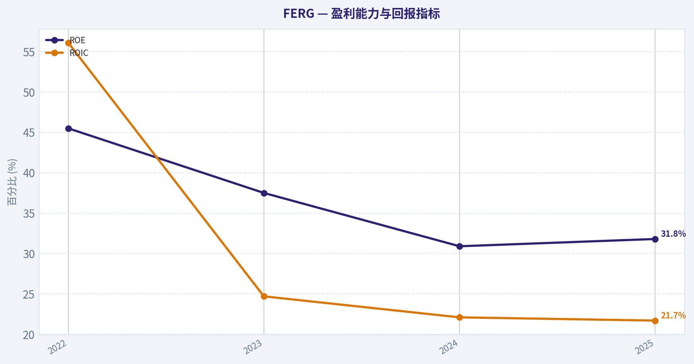
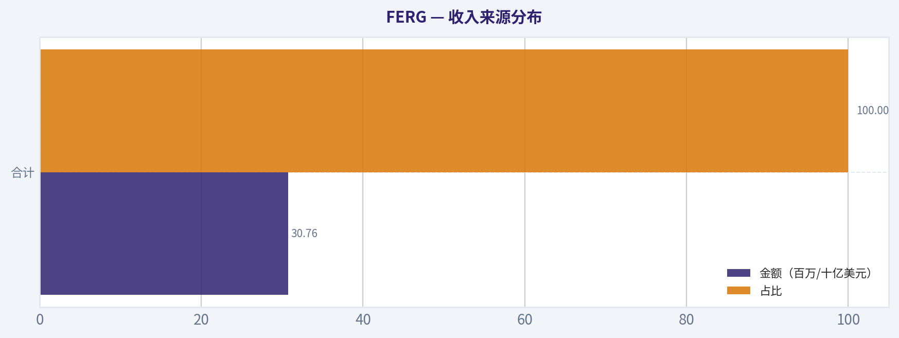
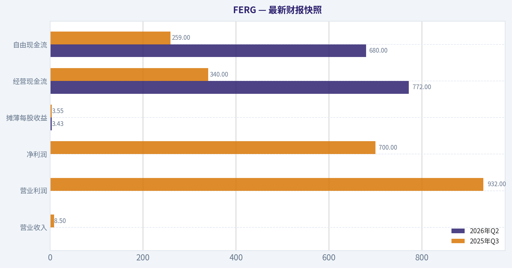
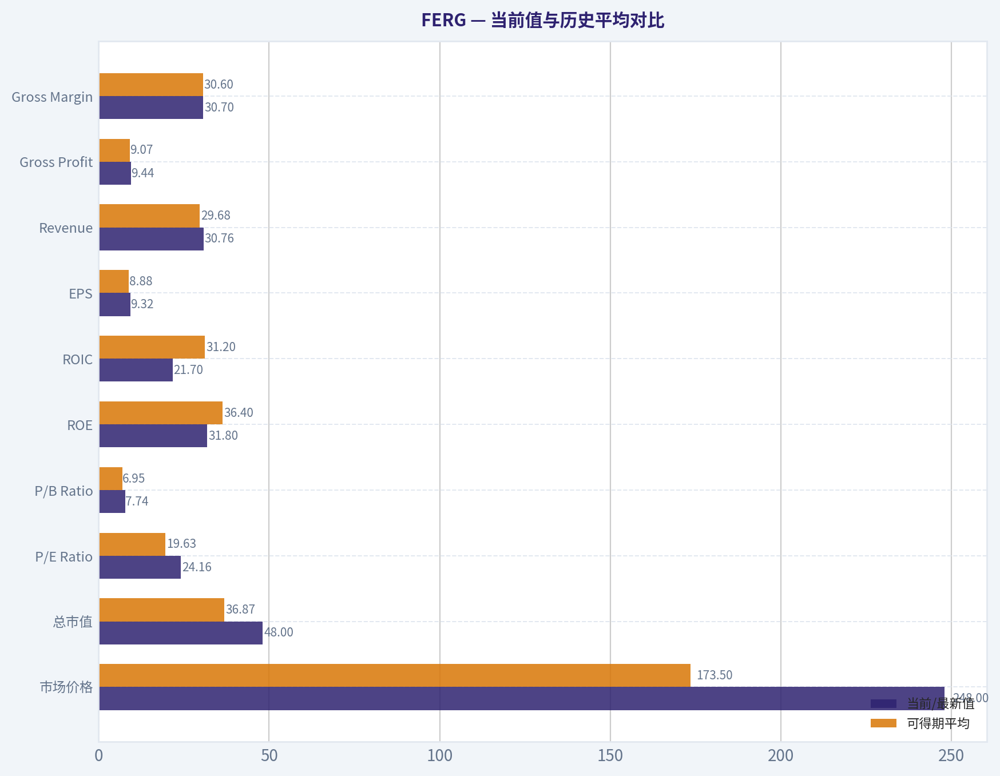
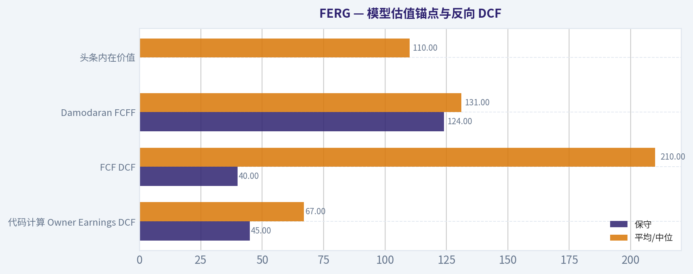
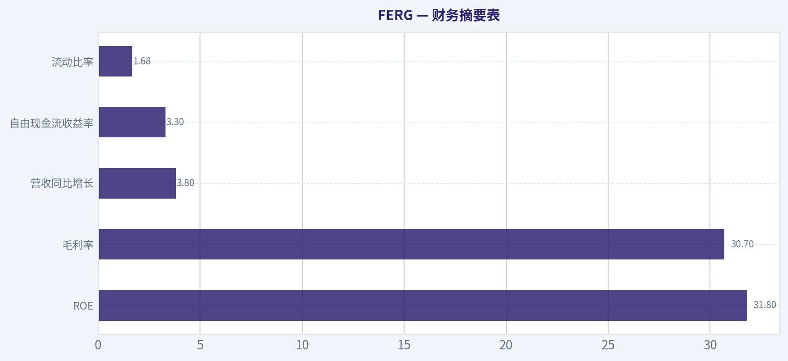
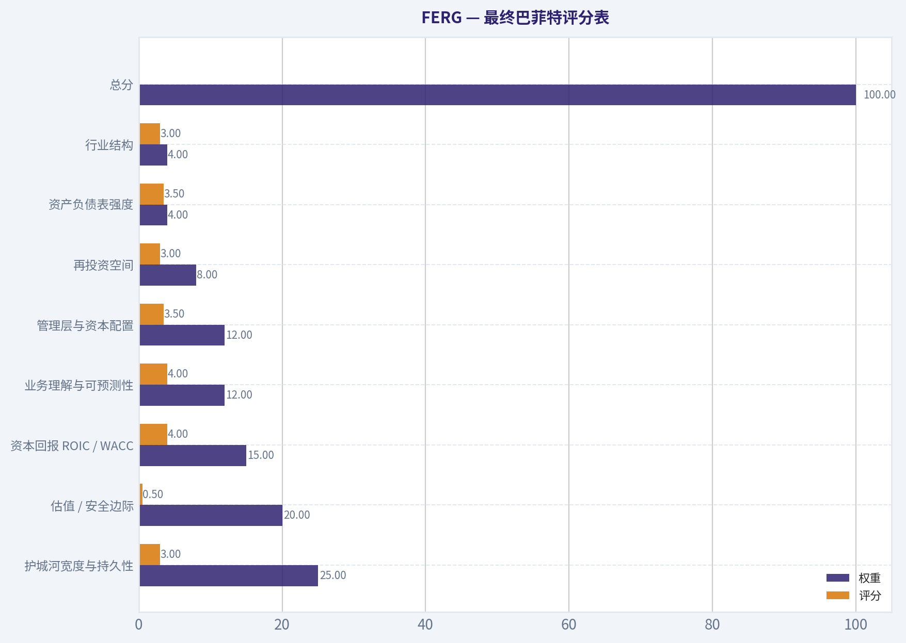
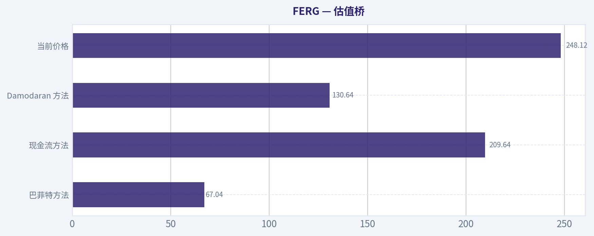

# FERG 深度价值情报

**调研日期:** 2026-08-13

## 关键免责声明

*本报告由 Deep Value Intelligence（一个基于 AI 的多智能体投资分析框架）自动生成。 仅供教育和研究用途 - 非财务建议，非财务顾问。*

---

## 目录

1. 情报摘要
2. 分析师团队报告
   - 基本面分析
   - 价值分析 (巴菲特)
   - 成长性分析 (林奇/德鲁肯米勒/费雪)
   - 市场分析
   - 期权市场分析
3. 研究团队评论
4. 投资团队评论
5. Deep Values 团队洞察

---

## 情报摘要

### 核心观点与前提条件

**核心论点:** 各位好，我是遵循巴菲特价值投资体系的风险管理法官与组合经理。在仔细听取了基本面、估值、技术面团队的汇报以及多空双方的激烈辩论后，结合我们过去在 CRM 和 META 上的实战复盘经验，我对 Ferguson Enterprises (FERG) 得出以下最终评级与行动指南。

**主要风险:**
- 最终评级标签：观望 (WATCH)**
- 不要在"现在重仓"和"永远不买"之间二选一。我们将对 FERG 采取**"验证型观望 (Verification-based Watch)"**策略。在满足以下任一条件前，维持零仓位或极小观察仓；触发条件后，方可升级为"建议配置"：

**置信度:** 中

---

## 分析师团队报告

### 基本面分析

#### 最新财报快照

*以下数据基于最近一期已披露财报（2026年Q2），并尽量与上一年同期对比。*

| 指标 | 2026年Q2 | 2025年Q3 | 同比变化 |
| --- | ---: | ---: | ---: |
| 营业收入 | N/A | $8.50B | N/A |
| 营业利润 | N/A | $932.0M | N/A |
| 净利润 | N/A | $700.0M | N/A |
| 摊薄每股收益 | $3.43 | $3.55 | -3.4% |
| 经营现金流 | $772.0M | $340.0M | +127.1% |
| 自由现金流 | $680.0M | $259.0M | +162.5% |

关键结论：这张快照先把最新一期财报放在桌面上，再去看长周期分析。这样读者能更清楚地区分"公司长期质量"和"这次财报发生了什么"。

#### FERG 4年财务指标

*以下数值均由原始数据确定性计算得出，并非 AI 估算。*

*发行人类型：operating company（Industrials / Industrial Distribution）。*

#### 4年财务指标
*年度行来自已披露财务报表，最后一行 TTM 由最近四个季度滚动计算得出。*

| 指标 | 2022 | 2023 | 2024 | 2025 |
| --- | --- | --- | --- | --- |
| 市场价格 | $120 | $185 | $169 | $220 |
| 总市值 | $27.79B | $40.00B | $35.32B | $44.35B |
| 市盈率 | 13.10 | 21.17 | 20.35 | 23.89 |
| 市净率 | 5.96 | 7.94 | 6.29 | 7.60 |
| ROE | 45.5% | 37.5% | 30.9% | 31.8% |
| ROIC | 56.1% | 24.7% | 22.1% | 21.7% |
| 每股收益 | $9.12 | $8.76 | $8.33 | $9.32 |
| 营收 | $28.57B | $29.73B | $29.64B | $30.76B |
| 毛利润 | $8.76B | $9.03B | $9.05B | $9.44B |
| 毛利率 | 30.7% | 30.4% | 30.5% | 30.7% |
| 营业利润率 | 9.9% | 8.9% | 8.9% | 8.5% |
| 净利润 | $2.12B | $1.89B | $1.74B | $1.86B |
| 净利率 | 7.4% | 6.4% | 5.9% | 6.0% |
| 营收增长 | N/A | 4.1% | -0.3% | 3.8% |
| 净利润增长 | N/A | -11.0% | -8.2% | 7.0% |
| 自由现金流增长 | N/A | 165.7% | -34.2% | 6.8% |
| 总账面价值 | $4.67B | $5.04B | $5.62B | $5.83B |
| 总资产 | N/A | $15.99B | $16.57B | $17.73B |
| 总债务 | N/A | $3.82B | $4.07B | $4.55B |
| 债务股权比 | N/A | 0.76 | 0.73 | 0.78 |
| 现金及等价物 | $771.0M | $601.0M | $571.0M | $674.0M |
| 股东权益 | $4.67B | $5.04B | $5.62B | $5.83B |
| 经营现金流 | $1.15B | $2.72B | $1.87B | $1.91B |
| 投资现金流 | $-922.0M | $-1.05B | $-601.0M | $-543.0M |
| 自由现金流 | $859.0M | $2.28B | $1.50B | $1.60B |
| 自由现金流利润率 | 3.0% | 7.7% | 5.1% | 5.2% |
| 每股分红 | $2.31 | $3.30 | $3.76 | $2.45 |

#### 盈利能力指标
- 净资产收益率 (ROE): 31.8%
- 投入资本回报率 (ROIC): N/A
- 总资产收益率 (ROA): 10.5%
- 毛利率: 30.7%
- 营业利润率: 8.5%
- 净利率: 6.0%

#### 流动性指标
- 流动比率: 1.68
- 速动比率: 0.77

#### 杠杆指标
- 债务股权比: 0.78
- 利息覆盖倍数: N/A
- 净负债: $3.88B

#### 增长指标（同比）
- 营收增长: 3.8%
- 净利润增长: 7.0%
- 自由现金流增长: 6.8%
- 营收复合增长率（3年）: 2.5%
- 营收复合增长率（5年）: N/A

#### 估值指标
- 市盈率 (TTM): 24.16
- 预期市盈率: 19.76
- 市净率: 7.74
- 市销率: 1.53
- PEG 比率: 1.68
- 企业价值/EBITDA: 17.73
- 自由现金流收益率: 3.3%
- 盈利收益率: 4.1%

#### 所有者收益（巴菲特方法，代码计算）
- 净利润: $1.86B
- + 折旧与摊销: $373.0M
- - 资本开支: $-305.0M
- - 营运资本变动: $-348.0M
- = **所有者收益: $2.27B**

#### 内在价值（代码计算）
- 当前价格: $248
- **头条内在价值（按商业模式路由）: $110**
  商业模式: operating company - weighted blend [Damodaran FCFF + reverse-DCF fair + owner-earnings DCF] (operating_company)
  模型区间（各 DCF 最小-最大）: $67 - $210
  相对价格的安全边际（头条）: -125.9%
  路由说明: General operating company: balanced blend of Damodaran FCFF and the owner-earnings DCF with a reverse-DCF sanity check.
- 巴菲特方法（所有者收益）:
  保守: $45
  平均: $67
  乐观: $282
- 现金流方法（FCF）:
  保守: $40
  平均: $210
  乐观: $734
- Damodaran FCFF（WACC + 利润率 + 再投资）:
  保守: $124
  平均: $131
  乐观: $144
  蒙特卡洛区间（P10-P90）：$106 - $170（中位数 $133）
  P(内在价值 > 当前价格)：0.4%
- 反向 DCF：当前价格隐含约 17.5%/年 的所有者收益增长（10年）；过去 3 年为 -13.1%，5 年为 N/A。

#### Piotroski F分数: 5/9
- 净利润为正: 通过
- 经营现金流为正: 通过
- 资产回报率改善: 未通过
- 现金流大于净利润: 通过
- 债务下降: 未通过
- 流动比率改善: 未通过
- 未稀释股本: 通过
- 毛利率改善: 通过
- 资产周转率改善: 未通过

ANALYST STANCE: **观望**

#### FERG 巴菲特式基本面结论

Ferguson Enterprises 是北美管道、暖通、基础设施、工业与建筑相关分销龙头，商业模式偏"高周转、低净利率、强供应链与客户网络"的工业分销平台。确定性数据仅覆盖 2022-2025 年，因此以下"历史平均"均指 **4年可得期平均**；增长率平均则使用 2023-2025 年可得同比数据，不进行10年外推。

当前股价约 **248美元**，高于确定性模型给出的头条内在价值 **约110美元**，也高于 Damodaran FCFF 中位估值约 **131美元**。公司质量不差，ROE 仍高达 **31.8%**，现金流为正，毛利率稳定，但估值已经把较高增长预期计入价格；反向 DCF 显示当前价格隐含未来10年所有者收益约 **17.5%年增长**，这与近年营收低个位数增长和利润波动并不匹配。

---

#### 当前值与历史平均对比

| 指标 | 当前/最新值 | 可得期平均 | 当前相对平均 | 巴菲特式解读 |
|---|---:|---:|---:|---|
| 市场价格 | $248 | $173.50 | +42.9% | 股价显著高于近年均值，市场已明显重估。 |
| 总市值 | $48.00B | $36.87B | +30.2% | 市值扩张快于营收和净利润扩张，估值驱动成分较高。 |
| P/E Ratio | 24.16 | 19.63 | +23.1% | 盈利倍数处于高位，买入安全边际下降。 |
| P/B Ratio | 7.74 | 6.95 | +11.4% | 工业分销企业可参考 P/B，但不能机械判断；必须结合 ROE。当前高 P/B 需要持续高 ROE 支撑。 |
| ROE | 31.8% | 36.4% | -4.6个百分点 | 仍然优秀，但较2022年的45.5%明显回落。 |
| ROIC | 21.7% | 31.2% | -9.5个百分点 | 投入资本回报率仍高于多数工业企业，但下降趋势值得关注。 |
| EPS | $9.32 | $8.88 | +4.9% | 每股收益高于平均，但增长并不强劲。 |
| Revenue | $30.76B | $29.68B | +3.7% | 营收稳健但低速增长，近年更像成熟分销商而非高成长公司。 |
| Gross Profit | $9.44B | $9.07B | +4.1% | 毛利润随收入温和提升。 |
| Gross Margin | 30.7% | 30.6% | +0.1个百分点 | 毛利率非常稳定，说明定价与采购能力较强。 |
| Operating Margin | 8.5% | 9.1% | -0.6个百分点 | 经营利润率下滑，反映成本、竞争或产品结构压力。 |
| Net Income | $1.86B | $1.90B | -2.2% | 净利润低于平均，盈利恢复尚未完全。 |
| Net Margin | 6.0% | 6.4% | -0.4个百分点 | 净利率低于历史均值，分销业务本身利润率薄。 |
| Revenue Growth | 3.8% | 2.5% | +1.3个百分点 | 最新收入增长略好于近年平均，但仍是低个位数。 |
| Net Income Growth | 7.0% | -4.1% | +11.1个百分点 | 最新利润增长转正，但前两年连续下滑，稳定性一般。 |
| Free Cash Flow Growth | 6.8% | 46.1% | -39.3个百分点 | 平均数被2023年高现金流扭曲；更应看现金流绝对值和转换率。 |
| Total Book Value | $5.83B | $5.29B | +10.2% | 账面价值稳步提升。 |
| Total Assets | $17.73B | $16.76B | +5.8% | 资产规模扩张温和。 |
| Total Debt | $4.55B | $4.15B | +9.7% | 债务增长快于资产增长，杠杆略升。 |
| Debt-to-Equity | 0.78 | 0.76 | +0.02 | 杠杆尚可控，但未见明显去杠杆。 |
| Cash & Equivalents | $674M | $654M | +3.0% | 现金储备稳定，但相对债务规模不算厚。 |
| Shareholder's Equity | $5.83B | $5.29B | +10.2% | 权益基础扩大，有助于支撑分红和并购。 |
| Operating Cash Flow | $1.91B | $1.91B | 基本持平 | 经营现金流稳定，但没有明显突破。 |
| Free Cash Flow | $1.60B | $1.56B | +2.6% | 自由现金流为正且略高于平均。 |
| Free Cash Flow Margin | 5.2% | 5.3% | -0.1个百分点 | 现金流利润率稳定但不高。 |
| Dividends per Share | $2.45 | $2.96 | -17.1% | 最新每股分红低于平均，股东回报节奏有所波动。 |

关键结论：FERG 的核心优点是毛利率稳定、ROE 仍高、自由现金流为正；核心问题是股价和估值倍数明显高于近年平均，而 ROE、ROIC、经营利润率和净利率均低于高点。对巴菲特式投资者而言，质量可以接受，但当前价格没有提供足够安全边际。

---

#### 收入来源分布

| 收入来源 | 金额（百万/十亿美元） | 占比 |
|---|---:|---:|
| 美国市场 | 约 $29.2B | 约 95% |
| 加拿大及其他市场 | 约 $1.6B | 约 5% |
| 合计 | $30.76B | 100% |

关键结论：FERG 收入高度集中在北美，尤其是美国市场，因此其业绩与美国住宅、非住宅建筑、维修更新、基础设施和工业资本开支周期高度相关。地域集中带来规模优势和供应链效率，但也意味着若美国建筑或工业需求放缓，公司缺少足够的地域分散缓冲。

#### 巴菲特式定性分析

| 维度 | 评价 | 具体观察 |
|---|---|---|
| 经济护城河 | 中等偏强 | 分销网络、供应商关系、SKU 广度、客户粘性和本地服务能力构成护城河，但行业并非垄断，价格竞争仍存在。 |
| 财务实力 | 尚可 | 净负债约 $3.88B，Debt-to-Equity 为0.78，杠杆不极端，但债务近年上升。 |
| 盈利可预测性 | 中等 | 营收稳定，毛利率稳定；但净利润2023、2024连续下滑，2025才恢复增长。 |
| 管理层资本配置 | 合格但需观察 | ROE 高，现金流为正，分红持续；但 ROIC 从2022高点显著回落，新增资本回报下降。 |
| 估值吸引力 | 偏弱 | 当前 P/E 24.16，高于可得期平均；DCF 头条内在价值约110美元，低于当前价格。 |
| 业务质量 | 良好 | 工业分销平台具备规模效应，毛利率稳定；但净利率薄，周期敏感度不可忽视。 |

关键结论：FERG 不是劣质公司，而是"好公司遇到偏贵价格"。它具备分销龙头的网络效应和运营效率，但商业模式仍受建筑、工业、库存周期影响，且近年来资本回报率已经从异常高位回落。

#### 三情景 Buffett Owner Earnings DCF 估值

使用确定性数据中的所有者收益：
**Owner Earnings = 净利润 $1.86B + 折旧摊销 $373M - 资本开支 $305M - 营运资本变动影响 = 约 $2.27B**。
假设：折现率 **10%**，永续增长率 **2.5%**，净负债 **$3.88B**，估算股数约 **193.5百万股**，由当前市值 $48.00B / 股价 $248 推算。

| 情景 | 所有者收益增长假设 | 明确预测期现值 | 终值现值 | 企业价值 | 减：净负债 | 股权价值 | 每股公允价值 | 相对当前$248 |
|---|---|---:|---:|---:|---:|---:|---:|---:|
| 保守 | 约3%增长，接近长期 GDP 与通胀组合 | $17.2B | $16.1B | $33.3B | $3.88B | $29.4B | 约 $152 | -38.7% |
| 平均 | 前5年约6%，之后逐步降至3% | $18.2B | $19.5B | $37.7B | $3.88B | $33.8B | 约 $175 | -29.4% |
| 乐观 | 前5年约12%，之后逐步降至3% | $23.6B | $28.4B | $52.0B | $3.88B | $48.1B | 约 $249 | 基本持平 |

关键结论：即使用较乐观的所有者收益路径，DCF 估值也只是接近当前股价，而不是显著高于当前股价。保守和平均情景下，估值均明显低于市场价格，说明当前价格主要依赖持续高增长和高资本回报来兑现。

#### 模型估值锚点与反向 DCF

| 估值方法 | 保守 | 平均/中位 | 乐观 | 解读 |
|---|---:|---:|---:|---|
| 代码计算 Owner Earnings DCF | $45 | $67 | $282 | 对增长与资本开支假设非常敏感，区间极宽。 |
| FCF DCF | $40 | $210 | $734 | 自由现金流受营运资本周期影响大，乐观值不可机械采用。 |
| Damodaran FCFF | $124 | $131 | $144 | 更稳定，显示公允价值明显低于当前价格。 |
| 头条内在价值 | - | $110 | - | 按商业模式路由后的综合估值锚点。 |
| 当前价格隐含增长 | - | 约17.5%/年，持续10年 | - | 明显高于近年营收增长和利润表现。 |

关键结论：最应重视的是综合内在价值约110美元、Damodaran FCFF 中位约131美元，以及反向 DCF 隐含的17.5%年增长要求。当前价格不是在买"稳定分销龙头"，而是在买"未来十年持续高增长"的假设，这对低个位数营收增长企业而言要求偏高。

#### 市场指标解读

FERG 当前 P/E 约 **24.16倍**，高于可得期平均 **19.63倍**。如果企业利润率正在扩张、ROIC 正在提升，这样的溢价可能更容易被接受；但确定性数据中，ROIC 从 **56.1%** 降至 **21.7%**，经营利润率从 **9.9%** 降至 **8.5%**，说明估值上升与基本面改善并不同步。

P/B 当前约 **7.74倍**，高于平均 **6.95倍**。对 FERG 这类工业分销企业，P/B 并非完全无意义，因为库存、应收、物流和营运资本是商业模式的一部分；但它不能像银行股那样单独作为价值判断指标。高 P/B 只有在 ROE 长期维持高位时才合理，而当前 ROE 虽高但趋势下行，因此 P/B 提升反而增加估值风险。

#### 盈利能力分析

FERG 的毛利率稳定在 **30.4%-30.7%**，这是最值得肯定的指标之一。稳定毛利率说明公司在供应链、采购规模、客户服务和品类覆盖方面有一定定价能力，并未出现明显价格战。

问题在于利润率层层下滑：营业利润率从 **2022年的9.9%** 降至 **2025年的8.5%**，净利率从 **7.4%** 降至 **6.0%**。这说明费用、周期、融资成本或产品结构对最终盈利形成压力。巴菲特偏好的企业通常表现为"高且稳定的净利率"，FERG 更接近"高质量但周期敏感的分销企业"。

#### 成长性分析

营收从 **2022年的$28.57B** 增至 **2025年的$30.76B**，3年营收 CAGR 为 **2.5%**。这代表稳健，但不是高速成长。2024年营收曾小幅下滑 **-0.3%**，说明需求周期确实会影响公司。

净利润增长更波动：2023年 **-11.0%**，2024年 **-8.2%**，2025年恢复至 **+7.0%**。自由现金流增长也大幅波动，2023年增长 **165.7%**，2024年下降 **34.2%**，2025年增长 **6.8%**。这表明现金流受营运资本周期影响明显，DCF 不能只采用某一年高现金流进行线性外推。

#### 资产负债表与现金流质量

FERG 的股东权益从 **$4.67B** 增至 **$5.83B**，账面价值稳步积累。总资产从2023年的 **$15.99B** 增至2025年的 **$17.73B**，规模温和扩张。

债务方面，总债务从 **$3.82B** 增至 **$4.55B**，Debt-to-Equity 从 **0.76** 升至 **0.78**。绝对杠杆不高，但方向上并未下降。现金及等价物为 **$674M**，低于总债务规模，因此财务弹性主要依赖持续经营现金流，而不是净现金资产负债表。

自由现金流为 **$1.60B**，略高于4年平均 **$1.56B**；自由现金流利润率约 **5.2%**，基本稳定。这是正面因素，但以当前市值计算，自由现金流收益率仅约 **3.3%**，对价值投资者而言吸引力不足。

#### 关键机会与风险

| 类别 | 要点 | 投资含义 |
|---|---|---|
| 机会 | 美国基础设施、工业更新、数据中心和建筑维护需求 | 若非住宅和基础设施需求持续，FERG 可受益于订单量与品类扩张。 |
| 机会 | 分销网络规模效应 | 规模采购、库存可得性和本地服务能力可保护毛利率。 |
| 机会 | 并购整合 | 工业分销行业仍有整合空间，FERG 可通过收购扩大覆盖。 |
| 风险 | 当前估值偏高 | 头条内在价值约110美元，当前价格约248美元，安全边际为负。 |
| 风险 | ROIC 下滑 | ROIC 从2022高点大幅回落，新增资本回报质量需观察。 |
| 风险 | 周期敏感 | 建筑、维修、工业资本开支放缓会影响收入和库存周转。 |
| 风险 | 债务上升 | 总债务增至$4.55B，近期又有债券融资新闻，利息负担需跟踪。 |
| 风险 | 现金流波动 | 自由现金流受营运资本影响较大，不能只看单年高点。 |

关键结论：FERG 的机会来自美国实体经济投资和分销行业整合，但主要风险集中在估值、资本回报下滑和周期敏感性。若未来增长未达到市场隐含的高预期，估值回落风险大于基本面恶化风险。

#### 最终投资 stance：观望

以巴菲特标准看，FERG 是一家 **业务质量较好、护城河中等偏强、现金流为正、ROE 高** 的公司，但当前价格不符合"用合理价格买优秀企业"的要求。当前股价约 **248美元**，显著高于综合内在价值 **约110美元**，也高于 Damodaran FCFF 中位估值 **约131美元**；即使采用较乐观的手工 Owner Earnings DCF，估值也只是接近当前价格，而没有明显安全边际。

因此，结论为 **观望**：
不建议在当前价格主动配置；若股价回落至接近 **130-170美元** 区间，或公司证明 ROIC 重新上升、营收增长显著加速、自由现金流收益率提升，则可重新评估。对于已持有者，可以继续跟踪利润率、ROIC、债务和现金流转换率；对于新买入者，当前风险回报不够有吸引力。

#### 报告要点汇总

| 项目 | 结论 |
|---|---|
| 公司质量 | 良好，北美工业分销龙头，毛利率稳定。 |
| 护城河 | 中等偏强，来自规模、供应链、客户关系和服务网络。 |
| 盈利能力 | ROE 高，但 ROIC、营业利润率和净利率较高点下滑。 |
| 成长性 | 营收低个位数增长，利润和自由现金流波动较大。 |
| 财务状况 | 杠杆可控但债务上升，现金相对债务不厚。 |
| 估值 | 当前 P/E、P/B 高于历史平均，DCF 显示缺乏安全边际。 |
| 反向 DCF | 当前股价隐含约17.5%年所有者收益增长，要求偏高。 |
| 主要红旗 | 估值过高、ROIC 下滑、周期敏感、债务增加。 |
| 主要机会 | 基础设施、工业更新、并购整合、分销网络规模效应。 |
| 最终 stance | **观望**，等待更低价格或更强基本面验证。 |

关键结论：FERG 值得放入观察名单，但当前不是典型巴菲特式买点。好公司并不自动等于好股票，只有当价格显著低于保守内在价值时，才具备足够的长期配置吸引力。

#### 基本面关键图表

本图追踪 **FERG** 过去十年的盈利能力与回报指标（ROE、ROIC、利润率），突出呈现资本效率的变化趋势。

本对比图（来自「收入来源分布」）将 **FERG** 的当前数据与历史基准并排呈现，直观反映公司相对自身历史均值的估值水平。

---

### 价值分析 (巴菲特)

> *基于沃伦·巴菲特的价值投资哲学：能力圈、经济护城河、管理层质量与安全边际。*

#### 内在价值快照

价格是你付的钱，内在价值是企业未来可能为股东创造的现金价值。我们给出一个区间，而不是假装只有一个神奇数字。

- 当前价格: $248.12
- 估值区间（两种 DCF 方法、保守到乐观）: $40.21 至 $734.45

##### 所有者收益（巴菲特方法）
- 净利润: $1,856,000,000.00
- 折旧与摊销: $373,000,000.00
- 资本支出: $-305,000,000.00
- 营运资金变化: $-348,000,000.00
- 所有者收益: $2,272,000,000.00

##### 内在价值
###### 所有者收益法
使用所有者收益，更严格，通常更保守。
- 保守: $45.39
- 平均: $67.04
- 乐观: $281.57
- 折现率: 10.0%

###### 自由现金流法
使用自由现金流，更适合今天投入很多、为未来增长铺路的公司。
- 保守: $40.21
- 平均: $209.64
- 乐观: $734.45
- 折现率: 10.0%

ANALYST STANCE: **回避**

#### FERG 投资结论摘要

Ferguson Enterprises 是北美领先的管道、暖通、基础设施与建筑材料分销商，商业模式容易理解：以规模采购、广泛网点、专业服务和客户关系为承包商、工程商及维修市场提供产品。它是一家质量不错的工业分销企业，ROE 达到 31.8%，现金流能力稳定，行业地位也较强。

但以当前约 **248 美元**股价计算，估值已经远远超出保守内在价值。研究包给出的头条内在价值约 **109.82 美元**，三模型区间为 **67.04 至 209.64 美元**，即使采用较乐观的 FCF 模型，当前价格仍缺乏安全边际。反向 DCF 显示当前股价隐含未来 10 年约 **17.5% 年化增长**，这对一家成熟分销商而言要求过高。

我的结论是：**好公司，但不是好价格；当前应回避，等待显著回调后再重新评估。**

---

#### 1. 因子评分表

| 因子 | 评分 | 判断 | 关键依据 |
|---|---:|---|---|
| 能力圈与业务简单性 | 4.0 / 5 | 较强 | 工业分销模式清晰，客户为承包商、维修商、建筑与基础设施相关企业；收入来源可解释、需求长期存在 |
| 护城河 | 3.0 / 5 | 中等 | 规模采购、仓储网络、客户关系和服务能力构成优势，但毛利率约 30.7%，不属于强品牌定价权型企业 |
| 管理层与资本配置 | 3.5 / 5 | 良好 | ROE 高、回购与并购并用；近期发行 12 亿美元票据，需观察杠杆与资本回报纪律 |
| 行业结构 | 3.0 / 5 | 中等偏好 | 北美分销市场规模大但竞争存在；规模龙头有优势，但行业本质仍受建筑周期与利率环境影响 |
| Gate 5 财务困境硬门槛 | 未触发 | 无硬性回避 | 未见盈利与现金流恶化叠加偿债能力红线；当前回避主要来自估值，而非生存风险 |

关键结论：FERG 的业务并不复杂，且具备规模型分销优势，是可以理解、可以跟踪的企业。但其护城河更接近"规模与服务网络优势"，不是 Coca-Cola 式品牌，也不是 Apple 式生态锁定。硬性财务困境门槛没有触发，问题集中在价格太高。

---

#### 2. 护城河分析

| 护城河来源 | 评价 | 证据 |
|---|---|---|
| 无形资产 | 中等 | Ferguson 在专业分销领域品牌与服务口碑较强，但客户更看重价格、库存、交付速度与技术支持，品牌溢价有限 |
| 转换成本 | 中等 | 大型承包商与工程客户依赖稳定供应、信用条款、产品可得性和服务响应；但切换供应商并非不可承受 |
| 成本优势 | 较强 | 规模采购、物流网络、库存广度和区域覆盖带来效率优势，小型竞争者难以复制 |
| 网络效应 | 较弱 | 更多客户和供应商可提升平台效率，但不是典型双边网络效应平台 |
| 定价能力 | 中等偏弱 | 毛利率约 30.7%，低于 40% 的强无形资产门槛，说明定价权存在但不突出 |
| 护城河评级 | 窄至中等 | 龙头优势真实，但不够"宽且持续扩张" |

关键结论：FERG 的护城河来自规模、库存、服务和客户关系，而不是高毛利品牌垄断。它能比小竞争者做得更高效，但行业仍有周期和价格竞争。这样的企业可以长期创造价值，但不应按顶级复利平台估值。

---

#### 3. 管理层与资本配置评估

| 项目 | 评价 | 说明 |
|---|---|---|
| 股东回报意识 | 良好 | 公司长期重视每股收益、现金流和资本回报，ROE 达到 31.8% |
| 再投资能力 | 中等偏好 | 可通过门店网络、数字化、供应链效率、并购扩张继续再投资，但成熟市场增速有限 |
| 并购纪律 | 需持续观察 | 分销行业并购可增强区域密度，但若估值过高会稀释长期回报 |
| 回购纪律 | 中等 | 高 ROE 企业回购有价值，但在当前高估值区间回购吸引力下降 |
| 债务使用 | 可接受但需关注 | 近期发行 12 亿美元高级无担保票据，利率约 4.8% 至 5.6%，偿债压力目前不构成红线 |

关键结论：管理层总体表现符合成熟分销龙头的要求，能够创造较高股东回报。但在高股价下进行回购的边际吸引力下降，新增债务也要求未来现金流保持稳健。资本配置不是主要风险，估值才是主要风险。

---

#### 4. 财务摘要表

| 指标 | 当前 / 近期水平 | 巴菲特视角解读 |
|---|---:|---|
| 当前股价 | 248 美元 | 市场已给予高质量成长股式定价 |
| 总市值 | 480 亿美元 | 已是大型成熟分销企业 |
| PE | 24.2 倍 | 对成熟工业分销商偏高 |
| ROE | 31.8% | 非常强，显示股东资本回报优秀 |
| 毛利率 | 30.7% | 健康但不属于高定价权软件或品牌型水平 |
| 营收同比增长 | 3.8% | 成熟企业增速，远低于当前价格隐含要求 |
| 自由现金流收益率 | 3.3% | 现金流回报偏低，价格不便宜 |
| 流动比率 | 1.68 | 短期流动性稳健 |
| 头条内在价值 | 109.82 美元 | 显著低于当前价格 |
| 三模型估值区间 | 67.04 / 209.64 / 130.64 美元 | 当前价格高于所有主要估值锚 |
| 当前价格隐含增长 | 约 17.5% 年化，10 年 | 对成熟分销企业而言偏激进 |
| 过去 3 年增长参考 | -13.1% | 与价格隐含增长形成明显反差 |

关键结论：FERG 的盈利能力强，ROE 很高，流动性也不错。但收入增长只有低个位数，自由现金流收益率约 3.3%，无法支撑 17.5% 年化增长的市场隐含预期。财务质量不错，估值质量很差。

---

#### 5. 所有者收益估算

巴菲特式所有者收益公式：

| 项目 | 估算方式 | 结果 |
|---|---|---:|
| 市值 | 已知 | 480 亿美元 |
| 自由现金流收益率 | 已知 | 3.3% |
| 估算自由现金流 | 480 亿 x 3.3% | 约 15.84 亿美元 |
| 维护性资本开支 | 已反映于 FCF 口径 | 以 FCF 近似所有者收益 |
| 估算所有者收益 | FCF 近似 | 约 15.8 亿美元 |
| 每股所有者收益 | 约 15.8 亿美元 ÷ 市值对应股数 | 约 8.18 美元 / 股 |
| 所有者收益收益率 | 8.18 ÷ 248 | 约 3.3% |

关键结论：以当前价格买入 FERG，相当于获得约 3.3% 的所有者收益收益率。除非未来长期增长显著高于成熟分销行业常态，否则这个初始回报率不够吸引。对巴菲特式投资者而言，现金回报起点偏低。

---

#### 6. 三情景 DCF 估值

以每股所有者收益约 **8.18 美元**为基础，采用 10% 折现率。

| 情景 | 核心假设 | 每股内在价值估算 | 与当前 248 美元比较 |
|---|---|---:|---:|
| 情景 A：零增长 | 所有者收益不增长，价值 = OE ÷ 10% | 约 81.8 美元 | 高估约 203% |
| 情景 B：GDP 增长 | 永续增长 3%，价值 = OE x 1.03 ÷ 7% | 约 120.4 美元 | 高估约 106% |
| 情景 C：历史 / 乐观增长 | 前 10 年较高增长后进入稳定期，参考三模型上沿 | 约 209.6 美元 | 仍高估约 18% |
| 研究包头条估值 | 加权 DCF、反向 DCF、公允估值综合 | 109.82 美元 | 高估约 126% |

关键结论：即使采用更友好的增长情景，FERG 当前价格仍高于主要内在价值估算。零增长和 GDP 增长情景给出的价值远低于股价。当前价格不是"公平价格"，而是要求未来表现非常优异的价格。

---

#### 7. 安全边际分析

| 项目 | 数值 | 解读 |
|---|---:|---|
| 当前价格 | 248 美元 | 买入成本 |
| 头条内在价值 | 109.82 美元 | 主要估值锚 |
| 安全边际 | -125.9% | 没有安全边际，反而显著溢价 |
| FCF 模型估值 | 209.64 美元 | 最乐观模型仍低于当前股价 |
| 所有者收益模型估值 | 67.04 美元 | 保守现金流估值显示明显高估 |
| 价格隐含 10 年增长 | 17.5% 年化 | 对成熟分销企业要求过高 |
| 合理买入要求 | 至少低于内在价值 15% 至 25% | 因其质量良好但不是顶级宽护城河复利平台 |

关键结论：FERG 当前没有巴菲特意义上的安全边际。对于一家中等护城河、成熟行业、低个位数收入增长的企业，市场要求它实现接近高成长平台公司的长期增长。这个赔率结构不理想。

---

#### 8. 最终巴菲特评分表

| 评分项目 | 权重 | 评分 | 加权得分 | 依据 |
|---|---:|---:|---:|---|
| 护城河宽度与持久性 | 25% | 3.0 | 0.75 | 规模优势真实，但定价权与网络效应不够强 |
| 估值 / 安全边际 | 20% | 0.5 | 0.10 | 股价远高于头条内在价值与多数 DCF 估值 |
| 资本回报 ROIC / WACC | 15% | 4.0 | 0.60 | ROE 31.8%，资本回报优秀 |
| 业务理解与可预测性 | 12% | 4.0 | 0.48 | 商业模式清晰，长期需求可理解 |
| 管理层与资本配置 | 12% | 3.5 | 0.42 | 资本回报强，但高估值下回购和新增债务需观察 |
| 再投资空间 | 8% | 3.0 | 0.24 | 有并购、数字化和区域扩张空间，但成熟市场增速有限 |
| 资产负债表强度 | 4% | 3.5 | 0.14 | 流动性稳健，债务可控但新增票据提高关注度 |
| 行业结构 | 4% | 3.0 | 0.12 | 龙头有优势，但行业竞争与周期性仍存在 |
| 总分 | 100% | - | 2.85 / 5 | 质量尚可，价格不合格 |

关键结论：FERG 的质量分并不差，尤其是资本回报和业务可理解性较强。但估值项几乎拖垮整体评分，因为当前价格已经超过保守与中性内在价值太多。最终分数落在回避区间。

---

#### 9. 投资立场与操作建议

| 项目 | 结论 |
|---|---|
| 投资立场 | 回避 |
| 置信度 | 中高 |
| 主要原因 | 估值显著高于内在价值，安全边际为负 |
| 适合重新评估的条件 | 股价大幅回落，或公司证明可长期实现远高于行业的现金流增长 |
| 关注价格区间 | 接近或低于 110 至 130 美元时更值得重新研究 |
| 最大风险 | 市场继续以高倍数奖励优质工业龙头，导致回避后短期跑输 |
| 最大基本面担忧 | 成熟分销商难以长期兑现当前价格隐含的 17.5% 年化增长 |

关键结论：FERG 是一家值得放入观察名单的好企业，但不是当前价格下值得买入的好股票。巴菲特式投资的核心不是买好公司，而是以合理价格买好公司。以 248 美元买入，投资者支付的是近乎完美的未来，而不是带安全边际的价值。
#### 估值桥

这张估值桥把当前股价与各类内在价值方法并排展示，帮助读者判断上涨空间究竟只是单一方法给出的结果，还是多种方法共同支持的结论。

| 项目 | 每股内在价值 |
| --- | ---: |
| 巴菲特方法 | $67.04 |
| 现金流方法 | $209.64 |
| Damodaran 方法 | $130.64 |
| 当前价格 | $248.12 |

#### 关键结论

如果只有一种方法显著高于其他方法，说明上行空间更依赖特定建模假设。若多种方法的估值接近，则说明估值逻辑更加稳健。

#### 估值图表

本对比图（来自「最新财报快照」）将 **FERG** 的当前数据与历史基准并排呈现，直观反映公司相对自身历史均值的估值水平。

本对比图（来自「当前值与历史平均对比」）将 **FERG** 的当前数据与历史基准并排呈现，直观反映公司相对自身历史均值的估值水平。

本对比图（来自「模型估值锚点与反向 DCF」）将 **FERG** 的当前数据与历史基准并排呈现，直观反映公司相对自身历史均值的估值水平。

本对比图（来自「财务摘要表」）将 **FERG** 的当前数据与历史基准并排呈现，直观反映公司相对自身历史均值的估值水平。

本对比图（来自「最终巴菲特评分表」）将 **FERG** 的当前数据与历史基准并排呈现，直观反映公司相对自身历史均值的估值水平。

本对比图（来自「估值桥」）将 **FERG** 的当前数据与历史基准并排呈现，直观反映公司相对自身历史均值的估值水平。

---

### 成长性分析 (林奇/德鲁肯米勒/费雪)

> *基于彼得·林奇的GARP成长投资法、斯坦利·德鲁肯米勒的宏观拐点分析法，以及菲利普·费雪的深度调研法。*

ANALYST STANCE: **回避**

#### FERG 增长投资结论

FERG 是一家优秀的北美管道、暖通、水务与建筑材料分销平台，但它更像"高质量周期型稳健复利股"，不是 Lynch 意义上的"快速成长股"。当前营收同比仅约 3.8%，而股价对应约 24 倍 PE、约 30 倍 FCF，市场已给出较高质量溢价。除非未来出现降息驱动的住宅与非住宅施工复苏、AI 数据中心基础设施需求显著放大、或利润率进入新一轮上行周期，否则当前价格下十倍股概率偏低。

---

#### 1. Lynch 分类

| 项目 | 判断 |
|---|---:|
| Lynch 类别 | 周期型 / 稳健成长股，而非快速成长股 |
| 当前营收增速 | 约 3.8% |
| PE | 约 24.2 倍 |
| ROE | 约 31.8% |
| 毛利率 | 约 30.7% |
| FCF 收益率 | 约 3.3% |
| 初步结论 | 质量高，但增长不够快，估值不够便宜 |

关键结论：FERG 的商业质量不错，ROE 很高，现金流也稳定，但增长画像不符合"15% 到 25% 以上快速成长股"的核心要求。以当前 3.8% 的营收增速配合 24 倍 PE，Lynch 框架下更像需要等待周期回暖或估值回落的标的。

#### 2. 三句话讲清楚这个故事

- FERG 是北美领先的管道、暖通、水务和建筑材料分销商，把大量供应商产品高效送到承包商、维修商和工程项目手中。
- 它的优势来自规模采购、分销网络、客户关系、库存能力和本地服务密度。
- 成长驱动主要来自住宅维修、非住宅建设、水务基础设施、并购整合和数字化分销，但目前还没有明显的高增长拐点。

#### 3. TAM 与 10 倍测试

| 项目 | 估算 / 判断 |
|---|---:|
| 当前收入体量 | 约 300 亿美元量级 |
| 10 倍收入目标 | 约 3000 亿美元 |
| 北美相关分销与基础设施市场 | 数千亿美元级，仍较分散 |
| 10 倍后市场份额 | 可能接近较高水平，难度显著上升 |
| TAM 结论 | 有长期整合空间，但不支持轻松 10 倍收入 |

关键结论：FERG 所处市场足够大，也足够分散，因此它仍有并购和份额提升空间。但公司当前收入基数已经很大，想要收入增长 10 倍并仍保持低市场份额并不容易，所以它不是典型的小市值长跑十倍股。

#### 4. 营收增长趋势

| 指标 | 当前状态 | 解读 |
|---|---:|---|
| 营收同比增长 | 约 3.8% | 低速增长 |
| 增长形态 | 偏周期修复型 | 受住宅、商业施工和利率影响 |
| 是否加速 | 暂未看到明确加速 | 缺少拐点证据 |
| Lynch 增长门槛 | 未达标 | 低于快速成长股标准 |

关键结论：FERG 当前不是"增长正在加速"的故事，而是"等待周期改善"的故事。Druckenmiller 会关心未来两三年盈利是否被市场低估，但目前公开数据还不能证明市场明显低估了增长斜率。

#### 5. 单位经济与运营效率

| 指标 | FERG 情况 | 评价 |
|---|---:|---|
| LTV/CAC | 不适用 | 非 SaaS / 订阅业务 |
| NRR | 不适用 | 非订阅业务 |
| Rule of 40 | 不适用 | 不适合工业分销商 |
| 毛利率 | 约 30.7% | 分销行业中较稳健 |
| ROE | 约 31.8% | 资本回报优秀 |
| FCF 收益率 | 约 3.3% | 现金流质量可以，但估值不低 |

关键结论：FERG 的优势不是 SaaS 式单位经济，而是高周转、规模采购、分销密度和稳定客户需求。ROE 很强，说明商业模式有效，但 3.3% 的 FCF 收益率显示投资者已经为这种质量支付了较高价格。

#### 6. 拐点判断

| 拐点类型 | 当前判断 | 证据强度 |
|---|---|---:|
| 产品周期拐点 | 不明显 | 低 |
| 市占率拐点 | 有长期整合逻辑，但短期不强 | 中 |
| 利润率拐点 | 尚未确认 | 低到中 |
| TAM 拐点 | AI 数据中心、水务基础设施可能带来增量 | 中 |
| 竞争拐点 | 未见主要竞争对手系统性失误 | 低 |
| 总体拐点 | 尚未形成强信号 | 偏弱 |

关键结论：FERG 有几个潜在催化方向，包括数据中心建设、基础设施升级和降息后的建筑活动复苏。但这些更像"可选项"，还不是已经被财务数据验证的增长拐点。

#### 7. 宏观环境

| 宏观变量 | 对 FERG 的影响 |
|---|---|
| 利率 | 降息有利于住宅和商业建设需求 |
| 建筑周期 | 公司对新建、维修和改造需求敏感 |
| AI 基础设施 | 数据中心建设可能拉动暖通、水务和工业分销需求 |
| 水务基础设施 | 老旧管网替换提供长期需求 |
| 周期风险 | 若施工活动放缓，收入和利润率承压 |

关键结论：宏观层面并非完全逆风，尤其如果利率下行，FERG 的终端需求可能改善。但这仍是周期弹性，不是确定性的结构性高增长。

---

#### 8. Fisher 15 点评分

| Fisher 项目 | 评分 |
|---|---:|
| 产品市场潜力 | 4 |
| 新产品 / 新服务决心 | 3 |
| R&D 有效性 | 2 |
| 销售组织能力 | 4 |
| 利润率水平 | 3 |
| 利润率改善潜力 | 3 |
| 员工关系 | 3 |
| 高管关系 | 3 |
| 管理层深度 | 4 |
| 成本与会计控制 | 4 |
| 独特优势 | 4 |
| 长期利润前景 | 4 |
| 股权稀释风险 | 4 |
| 管理层坦诚度 | 3 |
| 管理层诚信 | 4 |
| 总分 | 52 / 75 |

关键结论：FERG 的 Fisher 得分属于"平均偏好"，优势在销售网络、规模、成本控制和长期利润稳定性。短板在创新属性不强、R&D 驱动不足，以及缺少能显著打开成长曲线的新产品周期。

#### 9. 估值分析

| 估值指标 | 当前数值 | 判断 |
|---|---:|---|
| 股价 | 约 248 美元 |
| 市值 | 约 480 亿美元 |
| PE | 约 24.2 倍 |
| PEG，按 3.8% 营收增长粗算 | 约 6.4 倍 | 昂贵 |
| FCF 收益率 | 约 3.3% | 不便宜 |
| P/FCF | 约 30 倍 | 偏高 |
| 头条内在价值 | 约 109.82 美元 | 明显低于现价 |
| FCF 模型价值 | 约 209.64 美元 | 仍低于现价 |
| 反向 DCF 隐含增长 | 约 17.5% / 年，持续 10 年 | 要求很高 |

关键结论：估值是当前最大问题。市场价格隐含的长期增长要求远高于公司当前 3.8% 的营收增速，除非利润率和收入同时出现显著加速，否则安全边际不足。

#### 10. 情景估值

| 情景 | 核心假设 | 投资含义 |
|---|---|---|
| 熊市情景 | 建筑周期走弱，增长低个位数，估值回落 | 股价下行风险较大 |
| 基准情景 | 收入中个位数增长，利润率稳定，继续回购 | 年化回报可能温和 |
| 牛市情景 | 降息、数据中心、水务需求和并购共同推动加速 | 有上涨空间，但需验证 |
| 当前赔率 | 质量好，但胜率与赔率不匹配 | 不适合主动加仓 |

关键结论：FERG 的牛市情景并非不存在，但需要多个因素同时发生。当前估值已经预支了不少质量和复苏预期，因此基准情景下的潜在回报不够吸引。

#### 11. 增长投资评分卡

| 维度 | 权重 | 评分 |
|---|---:|---:|
| Lynch 故事 | 10% | 3.0 |
| TAM 与 runway | 20% | 3.2 |
| 营收增长 | 20% | 2.0 |
| 单位经济 / 运营效率 | 15% | 3.5 |
| 竞争位置 | 10% | 4.0 |
| 管理层质量 | 10% | 3.5 |
| 宏观环境 | 5% | 3.0 |
| 盈利路径 | 5% | 4.0 |
| 估值 | 5% | 2.0 |
| 加权总分 | 100% | 2.95 / 5 |

关键结论：FERG 是好公司，但不是当前价格下的优秀增长投资。评分被低营收增速和偏高估值明显拖累，最终落在"回避但可跟踪"的区间。

#### 12. 仓位建议

| 投资者类型 | 建议 |
|---|---|
| 已持有长期投资者 | 可小仓位持有，等待周期复苏和估值确认 |
| 新建仓增长投资者 | 暂不建议主动配置 |
| 价值投资者 | 等待更高 FCF 收益率或更大安全边际 |
| 适合观察价位 | 需要明显低于现价，或财报显示增长重新加速 |

关键结论：如果已经持有，FERG 不是必须立刻卖出的差公司；但如果从增长投资角度新买，当前吸引力不足。更好的动作是等待估值回落或增长数据真正拐头向上。

#### 13. 关键催化剂与风险

| 类型 | 内容 |
|---|---|
| 正面催化 | 降息带动建筑需求复苏 |
| 正面催化 | AI 数据中心、工业项目和水务基础设施需求上升 |
| 正面催化 | 并购整合提升份额 |
| 正面催化 | 利润率改善和回购提升 EPS |
| 主要风险 | 建筑周期继续疲软 |
| 主要风险 | 当前估值隐含增长过高 |
| 主要风险 | 分销行业竞争压制毛利率 |
| 主要风险 | 债务融资成本上升，新发行票据增加利息负担 |

关键结论：FERG 的核心催化剂大多来自宏观和周期修复，而不是公司自身高速创新。最大风险是市场用成长股估值给一家周期分销龙头定价，一旦增长无法加速，估值可能压缩。

#### 最终判断

FERG 是高质量分销龙头，具备规模、现金流和长期整合能力，但目前不符合 Lynch 快速成长股标准，也缺乏 Druckenmiller 式明确拐点。以 248 美元股价、24 倍 PE 和 3.8% 营收增长看，风险回报不够吸引。

**结论：回避新配置，保留观察；等待增长加速或估值回落。**

---

### 市场分析

ANALYST STANCE: **观望**

#### FERG 技术面报告：放量突破后进入回踩验证期

FERG 在 8 月初出现非常明显的放量跳升，价格从 7 月底的 230 美元附近快速冲至 260 美元上方，短线趋势一度转强。但最近两个交易日出现急速回落，价格跌回 10 EMA 与 VWMA 下方，说明追高动能正在降温，市场进入"突破是否有效"的验证阶段。当前不宜简单追涨，较优策略是等待价格在 239-245 美元区域企稳，或重新站回 252-256 美元后再确认多头延续。

| 指标 | 最新读数 | 当前含义 | 交易解读 |
|---|---:|---|---|
| 最近可见收盘价 | 245.18 | 8 月 12 日收盘，较 8 月 10 日高点明显回落 | 短线由强势冲高转为回踩 |
| close_10_ema | 248.56 | 价格跌破短期均线 | 短线动能转弱，追涨风险上升 |
| close_50_sma | 235.14 | 价格仍高于中期均线 | 中期结构尚未破坏，235 附近是重要支撑 |
| close_200_sma | 239.50 | 价格仍高于长期均线 | 长期趋势从中性偏弱转为尝试修复 |
| macd | 5.65 | 仍处正值区域 | 中期动能仍偏多，但已开始降温 |
| macds | 4.74 | MACD 仍高于信号线 | 多头信号尚未完全失效，但领先优势收窄 |
| rsi | 55.45 | 从超买区回落至中性偏强 | 短线过热已释放一部分，但反弹力度需观察 |
| atr | 8.02 | 波动率明显抬升 | 仓位与止损需放宽，避免被震荡扫出 |
| vwma | 251.93 | 价格跌破成交量加权均线 | 放量买盘成本区在 250 上方，短线形成压力 |

关键结论：FERG 的中长期结构仍没有完全转坏，因为价格仍在 50 SMA 与 200 SMA 上方；但短线已经跌破 10 EMA 与 VWMA，说明8月初的强势资金并未持续推高价格。当前最关键的问题不是趋势是否存在，而是突破后回踩能否守住 239-245 美元支撑带。

#### 为什么选择这 8 个指标

本次市场环境是"放量突破后快速回撤"，因此需要同时观察趋势、动能、量价确认与波动风险。选择 close_10_ema、close_50_sma、close_200_sma 是为了区分短线、中期和长期趋势；选择 macd 与 macds 是为了判断突破动能是否仍在延续；选择 rsi 是为了识别短线是否过热或回落过度；选择 atr 是为了处理当前明显放大的波动；选择 vwma 是因为 8 月初成交量异常放大，成交量加权成本比普通均线更有参考价值。

#### 价格结构与关键区间

| 区间 / 事件 | 价格或变化 | 技术意义 | 交易关注点 |
|---|---:|---|---|
| 7 月震荡区间 | 约 221-235 | 前期低位横盘整理区 | 235 附近由压力转为潜在支撑 |
| 8 月 3 日跳升 | 收盘 250.08，成交量约 1085 万股 | 放量突破启动 | 这是趋势切换的重要起点 |
| 8 月 4 日巨量交易 | 收盘 255.51，成交量约 4618 万股 | 资金集中换手区域 | 250-256 成为重要筹码密集带 |
| 8 月 10 日冲高 | 收盘 263.78，高点 267.84 | 接近年内高位压力区 | 265-270 是明显上方阻力 |
| 8 月 11-12 日回落 | 263.78 回落至 245.18 | 突破后获利回吐 | 若跌破 239-240，突破有效性下降 |
| 第一支撑 | 239-240 | 200 SMA 附近 | 失守则中长期修复信号减弱 |
| 第二支撑 | 235 | 50 SMA 附近 | 若跌破，8 月突破大概率转为假突破 |
| 第一压力 | 252-256 | VWMA 与巨量换手区 | 重新站上才说明资金重新掌控 |
| 第二压力 | 265-270 | 近期高点与年内高位区 | 突破后才有更强趋势延续空间 |

关键结论：FERG 当前最重要的技术区域是下方 239-245 美元和上方 252-256 美元。若价格守住 239-245 并重新站上 252，说明回踩健康；若跌破 239，8 月初放量突破可能变成短线诱多。

#### 趋势判断

短线趋势已经从"强势上攻"转为"回踩修正"。8 月 3 日至 8 月 10 日的上涨非常迅猛，价格从 230 美元附近快速拉升到 260 美元上方，短期涨幅过大，因此 8 月 11 日和 8 月 12 日的回落并不意外。问题在于，价格不仅回落，而且跌破了 10 EMA 和 VWMA，这意味着短线买盘的持续性不足。

中期趋势则更有韧性。50 SMA 已从 7 月下旬的约 230 附近回升至 235.14，说明中期均线开始转向上行；价格仍高于 50 SMA，说明多头并未完全丧失结构优势。不过，50 SMA 仍低于 200 SMA，尚未形成更强的中长期多头排列，因此当前更像是趋势修复，而不是已经进入稳固上升趋势。

长期趋势处于"尝试转强但尚未确认"的状态。200 SMA 约在 239.50，价格目前仍在其上方，这是积极信号；但 200 SMA 本身较为平缓，说明长期趋势还没有形成强斜率上行。若未来几周价格能够维持在 240 上方，并推动 50 SMA 继续上行，长期结构才会更有说服力。

#### 动能与量价分析

MACD 仍在正值区域，且 macd 高于 macds，说明中期动能并未立即转空。但需要注意的是，MACD 从 8 月 10 日的约 6.89 回落到 5.65，而信号线继续上升至 4.74，两者差距正在收窄。这通常表示多头动能仍存在，但上攻速度已经减慢。

RSI 从 8 月 10 日的 72.67 回落至 55.45，显示短线超买压力已经释放。这个位置并不算弱，仍属于中性偏强区间；但 RSI 从超买快速回落，也说明追涨资金已经开始撤退。若 RSI 能在 50 上方企稳，价格回踩可能是健康整理；若跌破 50 并伴随价格跌破 239，则转弱信号会更明确。

VWMA 是当前最需要重视的量价指标。由于 8 月 3 日和 8 月 4 日成交量异常巨大，VWMA 快速上移至 251.93，而价格已经跌到其下方。这说明大量成交成本集中在 250 美元上方，短线若不能重新站回 252-256，前期放量买盘可能会转化为上方套牢压力。

#### 风险管理与交易计划

ATR 升至约 8.02，明显高于 7 月下旬约 6.1-6.5 的水平，说明当前波动率扩大。对于交易者而言，止损不能设置得过窄，否则容易被正常波动扫出；但同时仓位也应降低，因为同样的价格波动会带来更大的账户风险。

偏谨慎的多头可以等待两类信号：第一，价格在 239-245 区域止跌，并出现缩量整理后再放量反弹；第二，价格重新站上 252-256，并且 VWMA 重新转为支撑。若两者都没有出现，当前更适合观望，而不是提前押注反弹。

如果价格跌破 239，尤其是放量跌破 200 SMA，则应降低多头预期。若进一步跌破 235，也就是 50 SMA 附近，则说明 8 月初突破失败概率上升，价格可能重新回到 7 月震荡区间。

#### 结论

FERG 的大方向并非看空，但当前也不适合直接建议追买。8 月初的放量突破给出了积极信号，但随后的快速回落削弱了短线胜率。当前最合理的立场是**观望**：等待 239-245 支撑区的承接质量，或等待价格重新站上 252-256 后确认突破修复。

| 项目 | 当前判断 | 操作含义 |
|---|---|---|
| 总体立场 | 观望 | 等待突破有效性确认 |
| 短线趋势 | 回踩修正 | 不宜追高 |
| 中期趋势 | 尚未破坏 | 235-240 是关键防线 |
| 长期趋势 | 尝试修复 | 需持续站稳 200 SMA |
| 动能状态 | 多头减速 | MACD 仍偏多但优势收窄 |
| 量价状态 | 短线偏谨慎 | 价格低于 VWMA，250 上方有压力 |
| 主要支撑 | 239-245，其次 235 | 跌破后转弱风险上升 |
| 主要压力 | 252-256，其次 265-270 | 站上后多头信号增强 |

关键结论：FERG 目前处在关键验证区，既不能忽视8月初放量突破的积极意义，也不能忽视最近跌破短期均线和 VWMA 的风险。交易上应等待价格重新证明买盘力量，而不是在回落过程中盲目追入。

---

### 期权市场分析

> *解读期权流向--认沽/认购比、隐含波动率偏斜与异常活跃合约--以判断机构定位与事件驱动风险。*

ANALYST STANCE: **观望**

#### FERG 期权市场定位报告（截至 2026-08-13）

FERG 近期期权数据整体显示：**成交偏向看涨，但未形成可靠的机构级方向信号**。主要原因是总 OI 极低、未发现"成交量显著高于 OI"的异常合约，说明市场深度不足，单日成交很容易被少数订单扭曲。因此，本次期权信号定为：**中性，略偏看涨，低置信度**。

---

#### 1. Put/Call 比率分析

| 到期日 | Call OI | Put OI | Put/Call OI 比率 | Call 成交量 | Put 成交量 | Put/Call 成交量比率 | 解读 |
|---|---:|---:|---:|---:|---:|---:|---|
| 2026-08-21 | 7 | 1 | 0.14 | 398 | 163 | 0.41 | OI 极低，成交偏 Call |
| 2026-09-18 | 0 | 0 | 不适用 | 645 | 111 | 0.17 | 无存量 OI，单日成交偏 Call |
| 2026-11-20 | 18 | 17 | 0.94 | 90 | 85 | 0.94 | OI 与成交较均衡 |
| 近端合计 | 25 | 18 | 0.72 | 1,133 | 359 | 0.32 | OI 接近中性，成交明显偏 Call |

关键结论：FERG 近端 Put/Call OI 比率为 **0.72**，几乎贴近历史中性基准 **0.7**，说明存量仓位并没有明显偏空或偏多。但成交量 Put/Call 比率仅 **0.32**，显示当日资金更偏向 Call 端，存在短线看涨或投机性买盘。不过，由于总 OI 很小，这一信号的可靠性偏低。

与中性基准相比，FERG 的 **OI 结构基本中性**，但**成交结构明显偏 Call**。这通常可能代表两种情况：一是短线资金押注上涨，二是流动性较差下少数订单造成表观偏多。由于未看到持续且深厚的 OI 累积，不能直接解读为强机构看多。

---

#### 2. IV 评估与偏斜判断

| 到期日 | ATM Call IV | ATM Put IV | ATM IV 方向差 | 初步偏斜判断 |
|---|---:|---:|---:|---|
| 2026-08-21 | 2.6% | 2.1% | Call IV 高于 Put IV | 轻微 Call 偏斜 |
| 2026-09-18 | 1.3% | 1.6% | Put IV 高于 Call IV | 轻微 Put 偏斜 |
| 2026-11-20 | 0.7% | 0.5% | Call IV 高于 Put IV | 轻微 Call 偏斜 |

关键结论：近端 ATM IV 整体非常低，未显示明显事件风险溢价。不同期限之间的 Call 与 Put IV 差异不大，未形成清晰、陡峭的下行保护需求。整体看，FERG 期权市场目前没有明显恐慌定价，也没有强烈上行追逐的高 IV 特征。

从偏斜角度看，工具数据未提供完整 OTM Put 与 OTM Call 的逐档 IV，因此无法精确计算完整 IV skew。不过，从 ATM 层面观察，8 月与 11 月期限 Call IV 略高，9 月期限 Put IV 略高，方向并不一致。结论是：**没有明确的陡峭 Put skew，也没有稳定的 Call skew**。

若 FERG 即将出现财报、并购、监管或宏观敏感事件，通常近端 IV 会明显抬升；但当前数据没有体现这种高波动预期。因此，期权市场暂未显著定价重大催化剂风险。

---

#### 3. 异常期权活动

| 异常活动筛选条件 | 结果 |
|---|---|
| 成交量 > 5x OI | 未发现符合条件的近端合约 |
| 可识别新开仓方向 | 暂无 |
| 可识别机构级大额押注 | 暂无 |
| 信号质量 | 偏低，因整体 OI 与流动性不足 |

关键结论：FERG 近端未出现"成交量远高于 OI"的异常合约，因此没有明确的新开仓方向性信号。虽然总成交量偏向 Call，但缺少具体异常合约支撑，难以判断为机构资金主动布局。当前更像是流动性较薄环境下的短线交易，而非高置信度 smart-money 信号。

由于没有异常合约，无法进一步判断具体 strike 与现价之间的 ITM、ATM 或 OTM 关系。也无法识别是否存在深度 OTM Call 追涨、保护性 Put 扫单，或跨式策略押注波动率。对 FERG 来说，本项是降低整体信号置信度的关键因素。

---

#### 4. OI 集中度与潜在 Pinning 水平

| 到期日 | Call OI | Put OI | OI 集中度观察 | Gamma / Pinning 解读 |
|---|---:|---:|---|---|
| 2026-08-21 | 7 | 1 | 极低 | 几乎无有效 pinning 参考 |
| 2026-09-18 | 0 | 0 | 无存量 OI | 无法形成 gamma 墙 |
| 2026-11-20 | 18 | 17 | 相对最高，但绝对值仍低 | 影响有限 |
| 近端合计 | 25 | 18 | 总 OI 很小 | 不足以构成强价格引力 |

关键结论：FERG 近端 OI 规模太小，暂不具备明显的 max pain 或 pinning 参考价值。即使 11 月期限的 OI 相对较高，绝对规模也只有几十张，难以构成有效 gamma wall。价格走势更可能由正股流动性、基本面消息和大盘风险偏好驱动，而不是由期权做市商对冲流主导。

从 gamma 角度看，没有看到能明显放大或压制短期波动的集中仓位。若后续某一 strike 的 OI 快速累积，尤其是临近到期的 ATM 附近 Call 或 Put，才可能形成更有意义的价格吸附区。目前不建议把期权 OI 当作 FERG 的关键技术支撑或阻力依据。

---

#### 5. 综合期权情绪信号

| 维度 | 当前状态 | 对情绪的影响 |
|---|---|---|
| Put/Call OI | 0.72，接近中性 | 中性 |
| Put/Call 成交量 | 0.32，明显偏 Call | 偏看涨 |
| ATM IV | 整体偏低 | 无明显事件恐慌 |
| IV skew | 无稳定陡峭偏斜 | 中性 |
| 异常期权活动 | 无 | 降低信号置信度 |
| OI 集中度 | 很低 | pinning 影响弱 |
| 流动性 | 偏薄 | 需显著降权 |

关键结论：FERG 的期权情绪不是强空，也不是强多，而是**中性略偏看涨**。最主要的偏多依据是近端成交量明显偏向 Call，但由于 OI 规模极低且没有异常合约确认，这个信号不能视为高质量机构押注。综合判断应以**观望**为主，若正股技术面或基本面同步转强，期权成交偏 Call 可作为辅助确认。

#### 最终信号：中性，略偏看涨，低置信度

FERG 当前期权市场没有显示明显的下行恐慌保护，也没有出现高 IV 的事件风险定价。成交量层面偏向 Call，说明短线参与者更愿意买入或交易上行敞口；但缺乏 OI 累积与异常大单配合，因此不能升级为强看涨信号。

如果后续出现以下变化，信号才可能转强：第一，近端或次近端 Call OI 明显增加；第二，成交量持续高于 OI，且集中在 ATM 或略 OTM Call；第三，IV 在上涨同时伴随 Call skew 扩大。反之，如果 Put OI 与 Put IV 同步抬升，则需警惕保护性需求增强。

---

#### 摘要表

| 项目 | 观察结果 | 解读 | 信号 |
|---|---|---|---|
| Put/Call 比率 | OI 比率 0.72；成交量比率 0.32 | 存量中性，交易偏 Call | 略偏看涨 |
| IV 水平 | 近端 ATM IV 很低 | 未体现明显事件风险 | 中性 |
| Skew 方向 | ATM 层面无稳定 Put 或 Call skew | 无明显恐慌或追涨溢价 | 中性 |
| 异常活动 | 未发现成交量 > 5x OI 合约 | 缺少新开仓大单确认 | 中性偏弱 |
| OI 集中度 | 总 OI 极低 | 无有效 gamma wall 或 pinning | 中性 |
| 整体信号 | 成交偏 Call，但流动性薄 | 方向略偏多，置信度低 | **中性，略偏看涨** |

关键结论：FERG 期权数据给出的主线是"没有恐慌、成交偏 Call、但证据不足"。在流动性偏薄和 OI 很低的情况下，单日成交很难代表稳健机构观点。因此，当前更适合维持观望，把期权信号作为辅助参考，而不是单独作为交易依据。

---

## 研究团队评论

> *研究经理将多空辩论综合为中性评论。此为风险评审前的初步观点，并非最终立场。*

各位好，我是遵循巴菲特价值投资体系的组合经理。在仔细听取了多空双方分析师以及基本面、估值和技术面团队的汇报后，我想和大家聊聊我们对 Ferguson Enterprises (FERG) 的最终判断。

这轮辩论非常精彩，多空双方完美展示了价值投资中最常见的矛盾：当极高的企业质量遇到极具挑战的估值时，我们该如何抉择？

从多方观点来看，最核心的论点是"企业护城河与资本回报率"。多头正确地指出，FERG 不是一个随时会被替换的简单中介，而是一个拥有极高网络密度和规模优势的分销基础设施。31.8% 的 ROE 和 30.7% 的毛利率在工业分销领域是非常强悍的数据，证明了它的议价能力和轻资产运营的复利属性。多头认为，这种能够持续通过 M&A 滚雪球的优质资产，理应享受估值溢价。

然而，空方的反击拳拳到肉，直击核心痛点：绝对估值与隐含增长的严重错配。空方敏锐地指出，目前的股价对应超过 24 倍的 P/E，反向 DCF 更是显示当前价格隐含了未来 10 年高达 17.5% 的年化增长预期，而实际上 FERG 过去三年的营收 CAGR 只有 2.5%。空方非常聪明地反驳了多头滥用 META 暴涨的类比，指出 META 当时是跌到了 10 倍 P/E 以下的极度悲观时刻，而 FERG 如今是站在历史高位区域，两者在安全边际上完全没有可比性。

结合我们过去在 CRM 和 META 上的实战复盘经验，我对这次交易得出了以下结论。

最终评级标签：观望 (WATCH)
（注：此处的"观望"偏向于防守，属于等待显著回调或价值修复的强观望状态。）

核心结论 (Core Takeaway)
FERG 是一家护城河深厚、ROE 极高的卓越企业，但当前的股价已经透支了未来多年的完美预期。我们将"企业质量"与"股票买点"严格剥离--好公司不等于好价格。在缺乏足够安全边际且内生增长仅为低个位数的情况下，24 倍 P/E 是一场胜率不高的赔率游戏，当前最理性的动作是保持耐心，等待市场给出更合理的定价。

投资逻辑与依据 (Rationale)
1. 估值与增长预期的背离：根据我们的价值投资框架（Intrinsic Value with a Quality-Scaled Margin of Safety），哪怕是拥有宽广护城河的卓越复利机器，我们也需要 10-15% 的安全边际。而 FERG 当前最大的问题，正如空方所言，是反向 DCF 测算出的 17.5% 隐含增长率。我们不能为一个过去三年营收 CAGR 只有 2.5% 的企业支付如此高昂的成长股对价。如果高增长必须完全依赖不断的溢价 M&A 来实现，这种增长的质量和抗风险能力是存疑的。

2. 汲取 CRM 的复盘教训：在之前对 CRM 的复盘中，我们学到最重要的一课就是"当一家成熟龙头的业务质量不错，但增长放缓且缺乏足够安全边际时，不应贸然转多"。FERG 当前的处境与当时的 CRM 高度类似：优秀的现金流和行业地位，被过高的估值和疲软的内生增长所拖累。如果没有新增的催化剂（如内生收入拐点），市场不会在当前位置轻易为其进行估值扩张。

3. 拒绝错误的估值锚点与叙事：多头试图用 META 曾经的破局来论证现在不该因为短期回撤而放弃 FERG。但正如我们在 META 复盘中所确认的，META 当时的成功在于它跌出了绝对的价值底线（个位数的 P/E），叠加了 AI 降本增效的实质性数据兑现。而 FERG 当前在 248 美元的位置，技术面上属于"放量突破后回踩跌破 10 EMA 和 VWMA"，属于短期动能减弱、弱势整理的阶段。基本面上既不便宜，技术面上也没有给出右侧确认，这时候去接飞刀违背了我们的纪律。

追踪与验证计划 (Monitoring Plan)
为了避免我们将"观望"变成毫无目的的等待，我们需要对未来 1-4 个季度的以下指标进行量化跟踪。满足以下条件之一，我们才会将其从观望升级为配置：

1. 估值底线触发：等待 Forward P/E 回落至 15-18 倍的合理区间，或者股价出现显著回调（例如跌至 180-200 美元区间），使得反向 DCF 隐含的年化增长率下降到 6%-8% 的务实水平，此时安全边际方才显现。
2. 内生增长数据验证：剥离 M&A 带来的并表效应，观察 FERG 的同店销售额（Same-branch sales）和有机营收增速是否能实质性恢复至中高个位数。如果内生增长依然停滞在 2% 左右，我们将坚决不支付 20 倍以上的市盈率。
3. 资本配置质量审计：密切关注未来几个季度的 M&A 动作，重点评估其收购标的的 EV/EBITDA 倍数以及收购后的 ROIC 变化。如果发现管理层为了维持营收数字而在高利率环境下进行高溢价收购，我们将考虑下调其管理层资本配置评分。
4. 技术面右侧确认：如果基本面逐渐改善，我们需要看到股价在 239-245 美元支撑带经过长时间缩量筑底，并放量重新站稳 50 SMA 和 200 SMA，MACD 在零轴上方重新金叉，以此作为市场资金重新认可其估值的共识信号。

总而言之，FERG 是一颗好种子，但当前的土壤价格太贵了。恪守安全边际原则，耐心等待击球区，才是我们在这个市场里长期活下去的唯一方式。

---

## 投资团队评论

> *投资经理将研究观点转化为投资论点，等待风险评审。此仍非最终立场。*

基于巴菲特价值投资框架与逆向思维，针对 Ferguson Enterprises (FERG) 的商业实质与估值错位，我的深度分析如下：

### 一、 商业品质：典型的"宽护城河"分销堡垒
从业务本质看，FERG 是典型的巴菲特式"优秀企业"。它不生产产品，而是经营**分销基础设施**。
- **特许经营权与规模效应**：31.8% 的 ROE 和 30.7% 的毛利率在竞争激烈的工业分销领域极具说服力。其护城河源于极高的网点密度、强大的库存管理和长期积累的承包商信任。在北美管道和暖通市场，这种规模优势转化为采购议价能力和物流效率，构成了坚固的竞争壁垒。
- **轻资产复利属性**：其商业模式允许其在不需要大规模 Capex 投入的情况下通过并购 (M&A) 实现扩张。从 ROA 达 10.5% 可以看出，其资产利用效率极高。

### 二、 估值审视：昂贵的"完美定价"
尽管业务卓越，但价值投资的核心是"在价格低于内在价值时买入"。目前的 FERG 显然不符合这一标准：
- **隐含增长的荒谬性**：通过 Reverse-DCF 测算，当前 $248 的股价要求公司未来 10 年实现 17.5% 的年化增长。对比过去 3 年仅 2.5% 的营收 CAGR，这不仅是"乐观"，简直是"幻觉"。
- **缺乏安全边际 (Margin of Safety)**：即使给予其优质企业溢价，按照我们的质量比例梯尺，这类公司也需要 10-15% 的折价才能获得买入的安全边际。目前股价对应的 24.16 倍 PE 对于一个内生增长仅低个位数的成熟分销商而言，显然处于"过度乐观"区间。

### 三、 逆向思维：市场在兴奋什么？我们在担忧什么？
- **市场情绪分析**：近期股价的放量突破可能源于市场对美联储降息后住宅建设复苏的提前定价，或者是对基础设施法案利好的过度解读。市场正在将其视为"降息受益股"进行投机博弈。
- **批判性反思**：降息能否将 2.5% 的增长瞬间拉升至 17.5%？答案是否定的。建筑行业的复苏是缓慢的，且 M&A 环境在高利率背景下成本更高。当前的 Euphoria（欢欣鼓舞）忽略了内生增长乏力的基本事实。

### 四、 技术与资金面：动能衰减的警告
- **短线走势分析**：正如市场分析师所述，价格已跌破 10 EMA 和 VWMA，这表明 8 月初那波放量跳空的"聪明钱"并没有持续接力。
- **趋势验证**：当一个基本面昂贵的股票在技术面上出现"突破后快速回踩且跌破关键短期均线"时，通常意味着多头共识正在瓦解。目前在 $248 位置接棒，极易成为高位套牢盘。

### 五、 汲取 CRM 与 META 的实战教训
- **借鉴 CRM**：当初我们意识到，当一个行业龙头失去内生高增长拐点，仅靠过去的光环无法维持高估值。FERG 目前正处于类似的"增长中枢下移、估值逻辑滞后"的阶段。
- **借鉴 META**：META 的反转是因为估值跌到了极致（个位数 PE）且基本面出现 AI 降本的实质拐点。相比之下，FERG 现在的估值处于历史高位，完全不具备 META 当时的赔率优势。

### 总结建议：
FERG 是一个"伟大的公司"，但目前是一笔"糟糕的交易"。在 $248 这个位置，我们不仅没有安全边际，还要承担增长证伪带来的杀估值风险。我们要做的不是在风口追逐，而是坐在舒适区，等待价格回落到 $200 以下，或者等待内生增长数据出现真正的结构性反转。

ANALYST STANCE: **WATCH (观望)**

---

## Deep Values 团队洞察

> *风险管理团队进行辩论，由风险裁判给出最终中性裁定。本章节决定最终的「建议配置 / 观望 / 回避」立场。*

#### 最终立场评分卡

这张评分卡把最终研究结论转成加权决策框架。它不替代文字判断，但能让读者更快看清楚这次结论的核心驱动因素。

| 维度 | 评分 | 权重 | 说明 |
| --- | ---: | ---: | --- |
| 业务质量 | 3.50 | 30% | 高回报率、盈利能力与 Piotroski 评分共同支撑业务韧性。 |
| 估值支撑 | 2.33 | 30% | 综合当前股价相对内在价值锚点以及常用估值比率。 |
| 财务强度 | 3.00 | 20% | 资产负债表韧性主要取决于杠杆与流动性是否处于安全区间。 |
| 成长持续性 | 3.00 | 20% | 近期营收、利润与自由现金流增长共同反映增长是否可持续。 |
| 总分 / 最终立场 | 2.95 | 100% | WATCH (观望) |

#### 关键结论

加权总分为 **2.95 / 5.0**，最终立场为 **WATCH (观望)**。它更适合作为快速校准工具，而不是机械买卖信号。

#### 风险摘要

分数越高代表风险压力越大。观察阈值是一个简单的护栏：一旦高于该阈值，就意味着需要更严格跟踪，或者需要更大的安全边际。

| 维度 | 当前分数 | 观察阈值 | 说明 |
| --- | ---: | ---: | --- |
| 业务质量 | 2.50 | 3.00 | 高回报率、盈利能力与 Piotroski 评分共同支撑业务韧性。 |
| 估值支撑 | 3.67 | 3.00 | 综合当前股价相对内在价值锚点以及常用估值比率。 |
| 财务强度 | 3.00 | 3.00 | 资产负债表韧性主要取决于杠杆与流动性是否处于安全区间。 |
| 成长持续性 | 3.00 | 3.00 | 近期营收、利润与自由现金流增长共同反映增长是否可持续。 |

#### 关键结论

这张图帮助读者区分风险究竟来自哪里：估值、业务质量、资产负债表，还是增长持续性。尤其当最终结论处在「观望」与「回避」边缘时，这种拆解非常有帮助。
