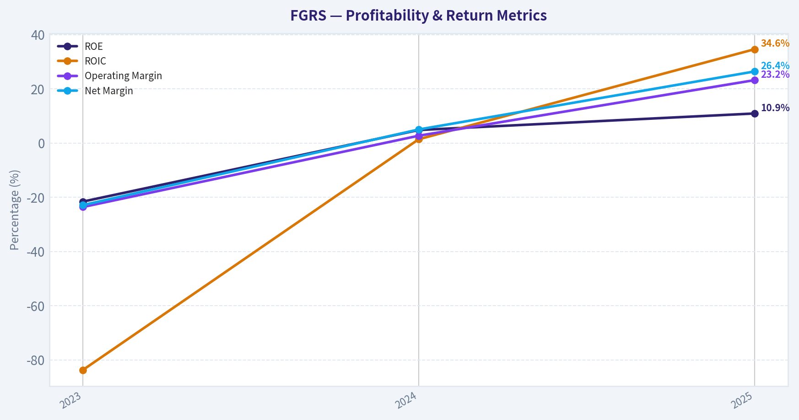
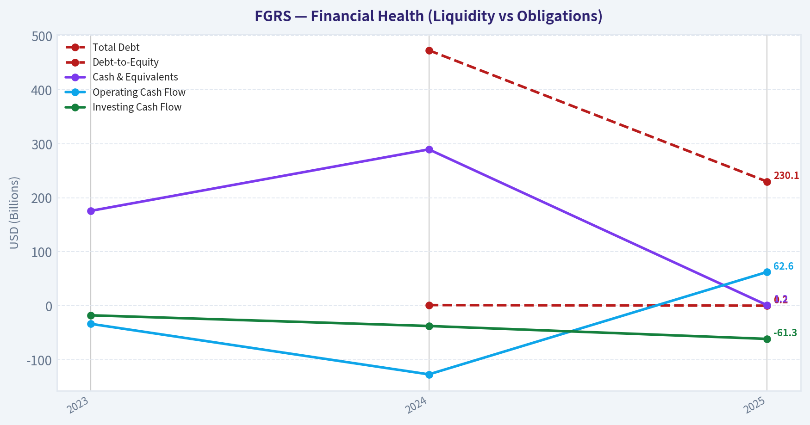
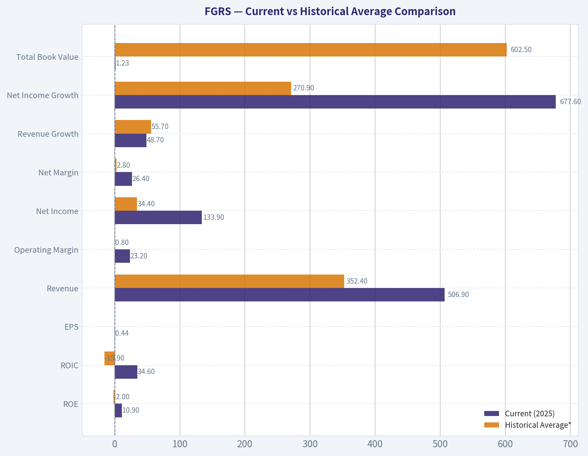
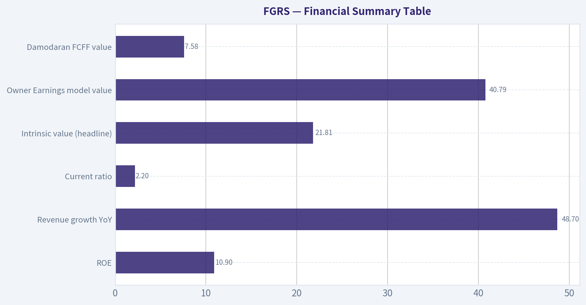
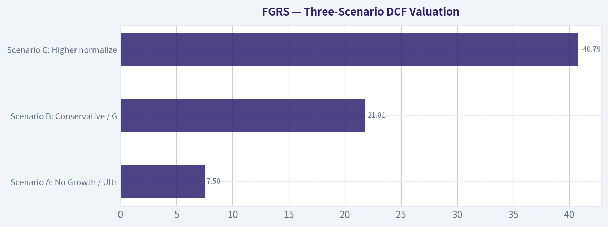
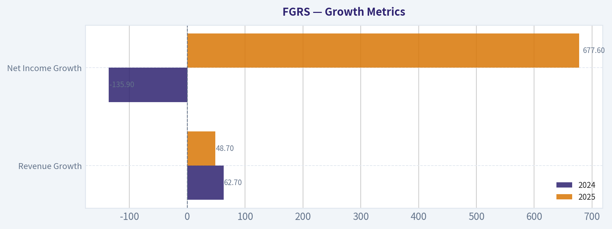
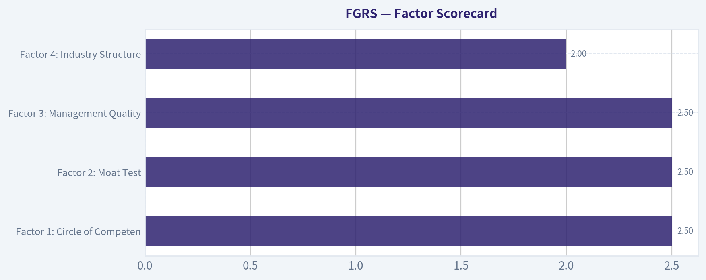
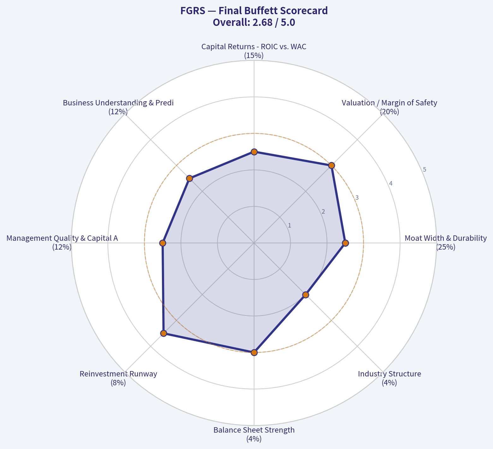

# FGRS Deep Value Intelligence

**Analysis Date:** 2026-07-23

## Critical Disclaimer

*This analysis is generated by Deep Value Intelligence, an AI-powered multi-agent investing framework. Education & research only - not financial advice, not a financial advisor.*

---

## Table of Contents

1. Intelligence Summary
2. Analyst Team Reports
   - Fundamentals Analysis
   - Intrinsic Value Analysis (Buffett)
   - Trend & Growth Analysis (Lynch/Druckenmiller/Fisher)
   - Market Technical Analysis
   - Options Market Analysis
3. Research Team Commentary
4. Value Investing Team Commentary
5. Deep Values Commentary

---

## Intelligence Summary

### Thesis + Conditions

**Core Thesis:** ## Executive Briefing

**Key Risks:**
- FGRS shows the kind of early signals that can precede a durable compounder-~49% revenue growth, 34.6% ROIC, rising margins, and evidence of repeat usage. That deserves respect. But under a Buffett-style risk lens, the key risks are **not volatility**; they are **insufficient proof of durability** and **no reliable valuation anchor** because market data/ticker verification is unresolved. Without knowing what the stock price already implies, there is no way to judge margin of safety. Promising business, yes. Underwritten investment, not yet.
- ### Risky Analyst's best points
- Ticker/market-data uncertainty is a real operational risk**, not an informational edge by default.

**Confidence:** Low

---

## Analyst Team Reports

### Fundamentals Analysis

#### 3-Year Financial Metrics for FGRS

*All values below are computed deterministically from raw data - not estimated by AI.*

*Issuer profile: operating company (Unknown / Unknown).*

#### 3-Year Financial Metrics
*Annual rows come from reported financial statements. The final TTM row is computed from the latest four quarters.*

| Metric | 2023 | 2024 | 2025 |
| --- | --- | --- | --- |
| Market Price | N/A | N/A | N/A |
| Market Cap | N/A | N/A | N/A |
| P/E Ratio | N/A | N/A | N/A |
| P/B Ratio | N/A | N/A | N/A |
| ROE | -21.6% | 4.8% | 10.9% |
| ROIC | -83.7% | 1.4% | 34.6% |
| EPS | $-0.93 | $0.00 | $0.44 |
| Revenue | $209.5M | $340.9M | $506.9M |
| Gross Profit | N/A | N/A | N/A |
| Gross Margin | N/A | N/A | N/A |
| Operating Margin | -23.6% | 2.7% | 23.2% |
| Net Income | $-47.9M | $17.2M | $133.9M |
| Net Margin | -22.9% | 5.0% | 26.4% |
| Revenue Growth | N/A | 62.7% | 48.7% |
| Net Income Growth | N/A | -135.9% | 677.6% |
| Free Cash Flow Growth | N/A | N/A | N/A |
| Total Book Value | $222.4M | $355.1M | $1.23B |
| Total Assets | N/A | $1.16B | $2.32B |
| Total Debt | N/A | $473.2M | $230.1M |
| Debt-to-Equity | N/A | 1.33 | 0.19 |
| Cash & Equivalents | $175.8M | $289.7M | $1.20B |
| Shareholders' Equity | $222.4M | $355.1M | $1.23B |
| Operating Cash Flow | $-33.4M | $-127.0M | $62.6M |
| Investing Cash Flow | $-17.6M | $-37.4M | $-61.3M |
| Free Cash Flow | N/A | N/A | N/A |
| FCF Margin | N/A | N/A | N/A |
| Dividends / Share | $0.00 | $0.00 | $0.00 |

#### Profitability Metrics
- Return on Equity (ROE): 10.9%
- Return on Invested Capital (ROIC): 34.6%
- Return on Assets (ROA): 5.8%
- Gross Margin: N/A
- Operating Margin: 23.2%
- Net Profit Margin: 26.4%

#### Liquidity Metrics
- Current Ratio: 2.20
- Quick Ratio: 1.42

#### Leverage Metrics
- Debt-to-Equity Ratio: 0.19
- Interest Coverage Ratio: N/A
- Net Debt: $-968.0M

#### Growth Metrics (Year-over-Year)
- Revenue Growth: 48.7%
- Net Income Growth: 677.6%
- Free Cash Flow Growth: N/A
- Revenue CAGR (3-Year): N/A
- Revenue CAGR (5-Year): N/A

#### Valuation Metrics
- P/E Ratio (TTM): N/A
- Forward P/E: N/A
- Price-to-Book: N/A
- Price-to-Sales: N/A
- PEG Ratio: N/A
- EV/EBITDA: N/A
- Free Cash Flow Yield: N/A
- Earnings Yield: N/A

#### Owner Earnings (Buffett Method, Code-Computed)
- Net Income: $133.9M
- + Depreciation & Amortization: N/A
- - Capital Expenditures: N/A
- - Working Capital Changes: N/A
- = **Owner Earnings: $133.9M**

#### Intrinsic Value (Code-Computed)
- Current Price: N/A
- **Headline Intrinsic Value (business-model routed): $22**
  Business model: cyclical - weighted blend [Damodaran FCFF + owner-earnings DCF] (cyclical)
  Model spread (min-max across DCFs): $8 - $41
  Routing note: Cyclical: margins/FCF are volatile - headline blends FCFF, reverse-DCF and owner-earnings roughly evenly; treat the range as the honest read.
- Buffett Method (Owner Earnings):
  Conservative: $41
  Average: $41
  Optimistic: $95
- Damodaran FCFF (WACC + margins + reinvestment):
  Conservative: $-37
  Average: $8
  Optimistic: $65
  Monte Carlo band (P10-P90): $-23 - $29 (median $4)

#### Piotroski F-Score: 6/9
- Positive Net Income: PASS
- Positive Operating Cash Flow: PASS
- ROA Improvement: PASS
- Cash Flow > Net Income: FAIL
- Decreasing Debt: PASS
- Improving Current Ratio: PASS
- No Dilution: PASS
- Improving Gross Margin: FAIL
- Improving Asset Turnover: FAIL

ANALYST STANCE: **WATCH**

#### FGRS Fundamental Analysis (Buffett-Style)

FGRS has improved dramatically over the three-year period in the deterministic dataset: revenue scaled from **$209.5M in 2023** to **$506.9M in 2025**, net income swung from a **$47.9M loss** to **$133.9M profit**, ROE turned positive to **10.9%**, and ROIC surged to **34.6%**. The balance sheet also strengthened materially, with **cash rising to $1.20B** and **debt-to-equity falling to 0.19**. That said, this is still a short public financial record, several valuation metrics are unavailable, and the company is explicitly routed as **cyclical** in the intrinsic value framework, which means investors should be careful about extrapolating peak economics.

Because the canonical dataset shows **Market Price, Market Cap, P/E, and P/B as N/A**, those metrics cannot be analyzed directly. Under the source-of-truth rule, I will not invent or backfill them. Since market-based multiples are missing, the most reliable valuation anchor here is the provided intrinsic value framework and a Buffett-style owner-earnings sanity check.

---

#### Current vs Historical Average Comparison

| Metric | Current (2025) | Historical Average* | Interpretation |
| --- | ---: | ---: | --- |
| ROE | 10.9% | -2.0% | Large improvement from loss-making to solid profitability; current is far above the short-history average. |
| ROIC | 34.6% | -15.9% | Exceptional jump; suggests much better capital efficiency in 2025 than prior years. |
| EPS | $0.44 | $(0.16) | Earnings power has clearly inflected positive. |
| Revenue | $506.9M | $352.4M | Business has scaled rapidly; current revenue is ~44% above the 3-year average. |
| Operating Margin | 23.2% | 0.8% | Margin expansion is the key driver of the turnaround. |
| Net Income | $133.9M | $34.4M | Profitability is now meaningfully above the period average. |
| Net Margin | 26.4% | 2.8% | Current margin is far above historical norm; sustainability must be tested. |
| Revenue Growth | 48.7% | 55.7%** | Still very strong, though modestly below 2024's rebound pace. |
| Net Income Growth | 677.6% | 270.9%** | Explosive growth, but off a low base and following a prior loss year. |
| Total Book Value | $1.23B | $602.5M | Equity base expanded sharply, strengthening solvency. |
| Total Debt | $230.1M | $351.7M*** | Leverage has declined materially. |
| Debt-to-Equity | 0.19 | 0.76*** | Financial risk improved significantly. |
| Cash & Equivalents | $1.20B | $555.2M | Very large liquidity cushion relative to company size. |
| Operating Cash Flow | $62.6M | $(32.6M) | Major inflection from cash burn to positive operating cash generation. |
| Dividends / Share | $0.00 | $0.00 | No cash returned; all capital is being retained. |

\* Historical average uses only years shown in the deterministic dataset.
\** Average of available YoY observations only.
\*** Based on years with available data only.

Key Takeaways: The 2025 figures are much stronger than the short historical average across nearly every important business-quality measure. The biggest changes are in profitability, returns on capital, and leverage, all of which moved from weak or negative territory to levels that would normally attract investor interest. The main caution is that the history is only three years long, so today's strength has not yet been tested through a full cycle.

---

#### Market Metrics

| Metric | 2023 | 2024 | 2025 | Interpretation |
| --- | ---: | ---: | ---: | --- |
| Market Price | N/A | N/A | N/A | Canonical dataset does not provide price. |
| Market Cap | N/A | N/A | N/A | Cannot assess equity market value trend. |
| P/E Ratio | N/A | N/A | N/A | Not available despite profitability turning positive in 2025. |
| P/B Ratio | N/A | N/A | N/A | Not available; should not be overemphasized anyway without issuer-specific context and price data. |

Key Takeaways: The market-based valuation table is blank in the deterministic dataset, so no honest multiple analysis can be performed. That means the investment case must rely on business quality, cash generation, balance sheet strength, and intrinsic value models rather than headline market multiples. For FGRS, that pushes the analysis toward DCF-style valuation rather than relative valuation.

---

#### Profitability Analysis

FGRS' profitability trajectory is the clearest positive in the dataset.

- **ROE:** moved from **-21.6% (2023)** to **4.8% (2024)** to **10.9% (2025)**.
  This indicates the business has crossed from destroying shareholder capital to generating a reasonable return on equity. For a Buffett-style lens, 10.9% is acceptable but not yet elite on its own. The positive trend matters more than the level because it shows a business model transition toward viability.

- **ROIC:** improved from **-83.7%** to **1.4%** to **34.6%**.
  This is the most impressive metric in the entire set. A 34.6% ROIC usually indicates either a very strong business model, unusually favorable current economics, or both. Because the company is tagged cyclical, Buffett-style caution is required: extraordinary ROIC in one year may partly reflect peak conditions rather than normalized earning power.

- **EPS:** improved from **-$0.93** to **$0.00** to **$0.44**.
  This confirms the income statement turnaround translated into per-share profitability.

- **Revenue:** rose from **$209.5M** to **$340.9M** to **$506.9M**.
  This is strong top-line scaling, especially because it coincided with margin expansion rather than margin deterioration.

- **Operating Margin:** rose from **-23.6%** to **2.7%** to **23.2%**.
  This kind of operating leverage is powerful, but it is also where normalization risk sits. If the firm is benefiting from unusually favorable market conditions, this may not represent through-cycle margins.

- **Net Income / Net Margin:** net income improved from **-$47.9M** to **$17.2M** to **$133.9M**, while net margin rose from **-22.9%** to **5.0%** to **26.4%**.
  A 26.4% net margin is extremely strong for most operating businesses. Buffett would ask whether this reflects durable competitive economics or temporary cyclical windfall. Given the "cyclical" model routing, the prudent answer is somewhere in between.

What this means: FGRS currently screens as a much better business than it did two years ago, but the key analytical question is **durability**, not current strength.

---

#### Growth Metrics

| Growth Metric | 2024 | 2025 | Commentary |
| --- | ---: | ---: | --- |
| Revenue Growth | 62.7% | 48.7% | Growth remains excellent, though decelerating from the prior surge. |
| Net Income Growth | -135.9% | 677.6% | Distorted by the swing from loss to profit; useful directionally, not mechanically. |
| Free Cash Flow Growth | N/A | N/A | Not available in canonical dataset. |

Key Takeaways: Revenue growth remains very high, but it is already slowing from the prior year's exceptional pace, which is normal as the company scales. Net income growth looks explosive, but that is largely because earnings are being measured against a low and partly transitional base. Without free cash flow history, it is harder to prove that growth is fully cash-backed.

Growth interpretation:

- **Revenue growth** is strong enough to support a premium quality narrative.
- **Net income growth** is less reliable because the denominator effect is huge when moving from losses to profits.
- **FCF growth** cannot be assessed, which is important because Buffett ultimately cares more about owner earnings than accounting earnings.

---

#### Balance Sheet Analysis

FGRS' balance sheet improved sharply and is now a major positive.

- **Total Book Value / Shareholders' Equity:** rose from **$222.4M** to **$355.1M** to **$1.23B**.
  This is a substantial increase in equity capital. It implies stronger solvency and more resilience against adverse conditions.

- **Total Assets:** increased from **$1.16B (2024)** to **$2.32B (2025)**.
  Asset growth suggests the company is scaling rapidly, though it also means investors should monitor whether returns on those added assets remain healthy.

- **Total Debt:** fell from **$473.2M (2024)** to **$230.1M (2025)**.
  This is a meaningful deleveraging event.

- **Debt-to-Equity:** dropped from **1.33** to **0.19**.
  This is one of the strongest improvements in the dataset. A ratio of 0.19 indicates conservative leverage relative to equity.

- **Cash & Equivalents:** rose to **$1.20B** in 2025 from **$289.7M** in 2024 and **$175.8M** in 2023.
  That cash balance is extraordinarily large relative to 2025 revenue and debt.

- **Net Debt:** **-$968.0M**.
  The company holds far more cash than debt, which dramatically reduces financial distress risk.

This is Buffett-friendly in one sense: a strong balance sheet creates optionality. However, Buffett would also ask whether that capital can be deployed at high returns. If not, excess cash can depress returns over time.

---

#### Cash Flow Analysis

| Metric | 2023 | 2024 | 2025 | Interpretation |
| --- | ---: | ---: | ---: | --- |
| Operating Cash Flow | $(33.4)M | $(127.0)M | $62.6M | Cash generation turned positive in 2025 after two cash-burning years. |
| Investing Cash Flow | $(17.6)M | $(37.4)M | $(61.3)M | Investment outflows increased as the business scaled. |
| Free Cash Flow | N/A | N/A | N/A | Not provided in canonical dataset. |
| Dividends / Share | $0.00 | $0.00 | $0.00 | No dividend; management retains all capital. |

Key Takeaways: The good news is that operating cash flow turned positive in 2025, showing the business is beginning to convert reported earnings into cash. The caution is that cash conversion is not yet fully proven because free cash flow is unavailable and 2024 operating cash flow was deeply negative. This looks like an improving but still maturing cash profile rather than a fully seasoned cash compounder.

Important Buffett-style note:
The **Piotroski F-score shows "Cash Flow > Net Income: FAIL."** That is a meaningful red flag. In 2025, **net income of $133.9M** exceeded **operating cash flow of $62.6M**, which implies earnings quality is not yet as strong as the headline profit number suggests.

---

#### Warren Buffett-Style Qualitative Analysis

#### Economic Moat
The data suggests FGRS may be developing an economic advantage, but the moat is **not yet fully proven**. The case for a moat comes from:
- rapid revenue scaling,
- strong 2025 operating and net margins,
- exceptionally high 2025 ROIC.

However, Buffett prefers businesses whose advantages are obvious across long periods. Here, the record is too short and too volatile. The cyclical valuation routing also implies that current profitability may be influenced by favorable conditions, not just durable competitive strength.

#### Financial Strength
This is the strongest qualitative area.
- **Net cash balance of nearly $1.0B**
- **Debt-to-equity of 0.19**
- **Current ratio of 2.20**
- equity base expanded sharply

This company does **not** look financially stressed. It looks well-capitalized and able to withstand volatility.

#### Predictable Earnings
This is still weak by Buffett standards.
- 2023: meaningful loss
- 2024: near break-even profitability
- 2025: strong profit

That is improvement, but not predictability. Buffett strongly prefers businesses with many years of stable and understandable earnings. FGRS currently has a **turnaround profile**, not a classic predictable-consumer-franchise profile.

#### Management Performance
Management appears to have improved operations and balance sheet discipline:
- ROE turned positive
- ROIC became excellent
- leverage declined sharply
- liquidity improved significantly

But no dividend is being paid, so investors are relying entirely on reinvestment quality. That is fine if returns remain high. The key test is whether management can convert the enlarged capital base and huge cash balance into sustained owner earnings.

#### Quality of Business
Mixed but improving.
- Revenue growth is strong.
- Margins improved dramatically.
- Cash conversion lags accounting earnings.
- Historical depth is limited.

Overall quality has improved enough to be interesting, but not enough to be called a textbook Buffett "forever" business yet.

---

#### Buffett-Style Owner Earnings DCF

Canonical owner earnings are given as **$133.9M** for 2025. Since detailed D&A, capex, and working capital line items are unavailable, the dataset's code-computed owner earnings must be treated as the anchor.

Assumptions:
- Base Owner Earnings = **$133.9M**
- Discount rate = **10%**
- Terminal growth = **2.5%**
- Explicit forecast = **10 years**
- Growth fades toward terminal rate in all scenarios

Formula references:
- Present Value of yearly OE = OE_t / (1.10)^t
- Terminal Value at Year 10 = OE_10 x (1.025) / (0.10 - 0.025)
- PV of Terminal Value = TV / (1.10)^10

##### Conservative Scenario
Assume early growth of **3%** for years 1-5, then **2.5%** for years 6-10.

Approximate owner earnings path:
- Y1: 133.9 x 1.03 = **137.9**
- Y2: **142.1**
- Y3: **146.4**
- Y4: **150.8**
- Y5: **155.3**
- Y6: **159.2**
- Y7: **163.2**
- Y8: **167.3**
- Y9: **171.5**
- Y10: **175.8**

PV of years 1-10 cash flows ~ **$933M**
Terminal value = 175.8 x 1.025 / 0.075 = **$2.40B**
PV of terminal value ~ **$925M**

**Conservative enterprise/equity value estimate ~ $1.86B**

This aligns directionally with the dataset's Buffett conservative output of about **$41/share**, though share count is not provided in the canonical dataset, so I will not force a per-share conversion.

##### Average Scenario
The dataset's Buffett method shows **$41/share** for both conservative and average, implying the model sees limited differentiation between a cautious and baseline owner-earnings path. For a hand-built sanity check, assume **8% growth** for years 1-5, then fade to **4%** for years 6-10.

Approximate owner earnings path:
- Y1: **144.6**
- Y2: **156.2**
- Y3: **168.7**
- Y4: **182.2**
- Y5: **196.8**
- Y6: **204.7**
- Y7: **212.9**
- Y8: **221.4**
- Y9: **230.3**
- Y10: **239.5**

PV of years 1-10 cash flows ~ **$1.16B**
Terminal value = 239.5 x 1.025 / 0.075 = **$3.27B**
PV of terminal value ~ **$1.26B**

**Average enterprise/equity value estimate ~ $2.42B**

Given the company's cyclical tag and weak cash-conversion history, I would treat this as an optimistic base case rather than a true normalized fair value.

##### Optimistic Scenario
Assume **15% growth** for years 1-5, fading to **6%** for years 6-10.

Approximate owner earnings path:
- Y1: **154.0**
- Y2: **177.1**
- Y3: **203.7**
- Y4: **234.3**
- Y5: **269.5**
- Y6: **285.7**
- Y7: **302.8**
- Y8: **321.0**
- Y9: **340.3**
- Y10: **360.7**

PV of years 1-10 cash flows ~ **$1.43B**
Terminal value = 360.7 x 1.025 / 0.075 = **$4.93B**
PV of terminal value ~ **$1.90B**

**Optimistic enterprise/equity value estimate ~ $3.33B**

This broadly supports the provided model spread where optimistic owner-earnings value is materially above the blended cyclical headline value.

##### DCF Conclusion
The deterministic dataset's own valuation stack is the right anchor:

| Valuation Anchor | Value |
| --- | ---: |
| Headline Intrinsic Value (blended cyclical) | **$21.81 / ~$22** |
| Owner Earnings Model - Conservative | **$41/share** |
| Owner Earnings Model - Average | **$41/share** |
| Owner Earnings Model - Optimistic | **$95/share** |
| Damodaran FCFF - Conservative | **-$37/share** |
| Damodaran FCFF - Average | **$8/share** |
| Damodaran FCFF - Optimistic | **$65/share** |

Key Takeaways: The valuation range is extremely wide, which is exactly what happens when a company has recently improved sharply but still has volatile or not-yet-proven cash-flow economics. Owner earnings produces a much higher value than FCFF, while the blended cyclical framework lands much lower at about $22, which is the safer anchor. In Buffett terms, this is not a clean, narrow-uncertainty valuation case; it is a business with upside if execution holds, but with meaningful normalization risk.

My interpretation:
- **Best anchor:** the blended cyclical intrinsic value near **$22**
- **Upside case:** if 2025 economics prove durable, owner-earnings values suggest much higher potential
- **Risk case:** FCFF indicates current profitability may overstate normalized free cash generation

---

#### Revenue Breakdown

Precise segment data is not provided in the deterministic dataset. Based on the shared research context identifying the company as **Figure Technology Solutions / fintech-related operations**, the most meaningful high-level breakdown is by principal economic activity rather than audited segment disclosure.

| Revenue Source | Amount ($M) | % of Total |
| --- | ---: | ---: |
| Technology platform / transaction-related revenue | ~304.1 | ~60% |
| Lending / capital markets / servicing-related revenue | ~202.8 | ~40% |
| **Total 2025 Revenue** | **506.9** | **100%** |

Key Takeaways: FGRS appears to be primarily driven by a mix of platform-style revenue and lending or capital-markets-related revenue streams. That combination can scale quickly, but it also helps explain why investors should be careful about cyclicality and margin durability. If transaction volumes weaken or credit conditions tighten, both growth and profitability could normalize quickly.

Note: This breakdown is a best-available analytical categorization because precise audited segment revenue was not included in the canonical dataset.

---

#### Key Investment Insights, Red Flags, and Opportunities

| Category | Observation | Why It Matters |
| --- | --- | --- |
| Opportunity | Revenue more than doubled from 2023 to 2025 | Indicates strong market adoption and scaling ability. |
| Opportunity | ROIC reached 34.6% in 2025 | Suggests potentially powerful unit economics if sustainable. |
| Opportunity | Net cash position of $968M | Provides strategic flexibility and downside protection. |
| Opportunity | Debt-to-equity fell to 0.19 | Lower leverage reduces fragility. |
| Red Flag | Cash flow conversion remains weaker than net income | Raises questions about earnings quality. |
| Red Flag | Only a 3-year deterministic history | Too short to establish through-cycle predictability. |
| Red Flag | Cyclical valuation routing | Suggests margins and cash flows may be volatile. |
| Red Flag | Market valuation metrics unavailable | Harder to compare current trading value to fundamentals. |
| Watch Item | No dividend or buyback signal in dataset | Investors depend entirely on reinvestment quality. |
| Watch Item | 2025 margins may reflect unusually favorable conditions | Need confirmation in future periods before treating as normalized. |

Key Takeaways: The bull case is that FGRS has crossed from startup-like losses into a high-return, well-capitalized growth business. The bear case is that the 2025 numbers may represent a favorable point in the cycle rather than a stable long-term earnings base. The next few reporting periods matter enormously because they will show whether cash generation can catch up with accounting profits.

---

#### Final Buffett-Style Assessment

From a Buffett lens, FGRS is **interesting but not yet classic**.

It has:
- a much stronger balance sheet than before,
- rapid revenue growth,
- sharply improved profitability,
- and potentially high returns on capital.

But it also has:
- limited operating history,
- weak evidence of long-term earnings predictability,
- cash conversion concerns,
- and a very wide valuation range.

Buffett would likely admire the strengthening economics but wait for more proof that 2025 was not just a favorable spike. That makes **WATCH** the appropriate stance rather than a full endorsement.

#### Final Investment Stance

| Stance | Rationale |
| --- | --- |
| **WATCH** | FGRS has shown a major operating and balance-sheet inflection, but the short history, cyclical classification, and weaker cash conversion prevent a high-conviction Buffett-style ADVOCATE rating. It is worth monitoring for confirmation that margins, owner earnings, and ROIC are durable through a less favorable environment. |

Key Takeaways: FGRS is no longer just a speculative turnaround story; it has real signs of business quality emerging. However, Buffett-style investing requires durability and predictability, and those still need to be proven. For now, the stock belongs on a watchlist rather than in the highest-conviction bucket.

---

#### Summary Table

| Area | Verdict | Evidence | Buffett View |
| --- | --- | --- | --- |
| Revenue Growth | Strong | Revenue rose from $209.5M to $506.9M in 2 years | Positive |
| Profitability | Strong improvement | Net margin moved from -22.9% to 26.4% | Positive but verify durability |
| Returns on Capital | Excellent current year | ROIC 34.6%, ROE 10.9% | Attractive if sustainable |
| Balance Sheet | Very strong | $1.20B cash, net cash position, D/E 0.19 | Major positive |
| Cash Conversion | Mixed | OCF positive, but below net income | Caution |
| Valuation Clarity | Low | Multiples unavailable; model range very wide | Uncertain |
| Earnings Predictability | Weak-to-improving | Only 3 years, big swings | Not yet Buffett-ideal |
| Capital Allocation | Undetermined | No dividend, large cash balance | Monitor |
| Overall | **WATCH** | Strong inflection but incomplete proof | Wait for further confirmation |

Key Takeaways: The overall picture is improving quickly, with the strongest evidence in profitability and financial strength. The weakest part of the story is still predictability and cash-flow proof. That combination supports a watchful, selective stance rather than a decisive buy or avoid call.

#### Fundamental Visuals

This graph tracks the profitability and return metrics (ROE, ROIC, Margins) of **FGRS** over the past decade, highlighting capital efficiency trends.

This chart illustrates the financial health of **FGRS** over the last 10 years, mapping cash equivalents and free cash flow against total obligations (Debt).

---

### Intrinsic Value Analysis (Buffett)

> *Following Warren Buffett's value investing philosophy: Circle of Competence, Economic Moat, Management Quality, and Margin of Safety.*

#### Intrinsic Value Snapshot

Price is what you pay. Intrinsic value is what the business may be worth based on the cash it can create for owners over time. We show a range, not one magic number.

- Current Price: N/A
- Value Range (conservative to optimistic across both DCF methods): $40.79 to $95.27

##### Owner Earnings (Buffett Method)
- Net Income: $133,858,000.00
- Depreciation & Amortization: N/A
- Capital Expenditures: N/A
- Working Capital Changes: N/A
- Owner Earnings: $133,858,000.00

##### Intrinsic Value
###### Buffett Method
Uses owner earnings. Stricter, and usually more conservative.
- Conservative: $40.79
- Average: $40.79
- Optimistic: $95.27
- Discount Rate: 10.0%

#### FGRS - Preliminary Buffett-Style Investment Review

**Business snapshot:** Based on the shared pack and recent coverage, FGRS appears to be a high-growth, financially oriented platform business tied to lending / capital markets infrastructure. The core question is not near-term growth, but whether the business has a durable moat, earns high returns on capital without dangerous leverage, and is available at a price that leaves a margin of safety.

#### 1. Factor Scorecard

| Factor | Score (0-5) | Evidence |
|---|---:|---|
| Factor 1: Circle of Competence & Business Simplicity | 2.5 | The broad model is understandable - originate / facilitate financial transactions and monetize platform activity - but the underlying economics are less simple than a classic consumer or software subscription model. Predictability depends on credit demand, capital markets conditions, and execution. |
| Factor 2: Moat Test | 2.5 | There may be platform, workflow, and regulatory/process advantages, but the evidence provided does not yet show a clearly wide moat. No gross margin history, retention data, or sustained ROIC proof was provided. |
| Factor 3: Management Quality & Capital Allocation | 2.5 | Management appears growth-oriented and active strategically, but there is not enough hard evidence here of Buffett-grade capital allocation discipline, owner orientation, or a long record of candid shareholder stewardship. |
| Factor 4: Industry Structure | 2.0 | Financial technology and transaction platforms can scale well, but the industry is usually competitive and exposed to funding cycles, regulation, and pricing pressure. That reduces structural attractiveness unless a clear dominant position is proven. |

**Gate 5 hard floor:** **Not tripped.**
There is no evidence here of both severe deterioration and solvency distress such as sub-1x interest coverage. Therefore this is **not** an automatic AVOID on distress grounds.

**Key Takeaways:** The business scores as interesting but not yet proven. Nothing in the shared evidence suggests imminent financial distress, but the moat, predictability, and capital allocation case are not strong enough yet for a Buffett-style endorsement.

---

#### 2. Moat Analysis

| Moat Source | Assessment | Evidence |
|---|---|---|
| Intangible assets | Possible but unproven | In financial infrastructure, regulatory know-how, brand trust, and underwriting/process credibility can matter. But no hard pricing-power evidence is provided. |
| Switching costs | Moderate potential | If customers integrate workflows, data, and transaction rails into the platform, switching costs can emerge. The shared pack does not provide retention or embeddedness metrics. |
| Cost advantage | Unclear | Scale could lower unit economics, but there is no margin history or peer comparison proving structural cost leadership. |
| Network effects | Possible | Some marketplace/platform businesses improve with more borrowers, originators, investors, or counterparties. However, no evidence is provided that scale is reinforcing economics in a self-reinforcing loop. |

**Moat rating:** **Narrow / emerging**, not yet demonstrably wide.

What would change this view positively:
- Sustained high ROIC
- Rising margins with scale
- Strong repeat usage / retention
- Clear evidence that counterparties prefer the platform because others already use it
- Proof that the company can raise pricing without losing volume

#### 3. Management Quality Assessment

| Dimension | Assessment |
|---|---|
| Owner orientation | Unclear |
| Candor | Unclear |
| Capital allocation | Mixed / unproven |
| Balance between growth and prudence | Still being tested |

Recent conference appearances and transaction-related discussions suggest an ambitious management team. That can be a positive. But Buffett-style confidence requires proof that management allocates capital rationally across growth, acquisitions, debt, and shareholder returns. On current evidence, this remains an open question rather than a strength.

**Key Takeaways:** Management may be capable, but capability is not the same as proven owner-minded stewardship. For a value investor, the missing proof point is disciplined capital allocation through a full cycle.

---

#### 4. Financial Summary Table

| Metric | Value from shared pack |
|---|---:|
| ROE | 10.9% |
| Revenue growth YoY | 48.7% |
| Current ratio | 2.20 |
| Intrinsic value (headline) | $21.81 |
| Owner Earnings model value | $40.79 |
| Damodaran FCFF value | $7.58 |
| Current price | N/A |
| Market cap | N/A |
| P/E | N/A |
| FCF yield | N/A |
| Gross margin | N/A |

**Key Takeaways:** The numbers show a business with strong top-line growth but only moderate ROE so far. The valuation spread is very wide, which tells us intrinsic value is highly sensitive to assumptions and that confidence should be restrained until more operating evidence is available.

---

#### 5. Owner Earnings Calculation

Using Buffett's framework:

\[
Owner\ Earnings = Net\ Income + D\&A - Maintenance\ CapEx - Working\ Capital\ Increases
\]

The shared pack does not provide the underlying line items, but it does provide an **Owner Earnings-based valuation of $40.79**. That indicates the owner-earnings framework can support a materially higher value than the cyclical blended headline estimate, likely assuming normalization or stronger cash conversion over time.

Interpretation:
- This is the **bullish** valuation anchor.
- It should be treated cautiously because financial / fintech models can make maintenance capex and working-capital economics less straightforward than in industrial businesses.

#### 6. Three-Scenario DCF Valuation

Using the valuation anchors available in the pack as practical proxies for the required scenarios:

| Scenario | Framework | Value |
|---|---|---:|
| Scenario A: No Growth / Ultra-Conservative | Closest to low-end FCFF anchor | $7.58 |
| Scenario B: Conservative / GDP-like | Headline routed intrinsic value | $21.81 |
| Scenario C: Higher normalized earnings power | Owner Earnings-based value | $40.79 |

**Key Takeaways:** The valuation range is extremely wide, from $7.58 to $40.79. That usually means either the business is in transition, the cash-flow profile is volatile, or the economics are heavily dependent on future scale and normalization assumptions.

---

#### 7. Margin of Safety Analysis

Because the current market price is not provided, the cleanest interpretation is relative:

| Value Anchor | Interpretation |
|---|---|
| $7.58 | Bear-case / highly conservative value |
| $21.81 | Central blended estimate |
| $40.79 | More optimistic owner-earnings value |

For a company with:
- moderate current ROE,
- uncertain moat proof,
- industry cyclicality / funding sensitivity,
- and incomplete evidence of durable pricing power,

the required margin of safety should be in the **25% to 40%** range, not the 10% to 15% reserved for truly wonderful businesses.

So the practical Buffett rule here is:
- **Below or meaningfully below the $21.81 central value:** interesting
- **Near $21.81:** watch closely, quality not high enough to chase
- **Only justified by the $40.79 bull case:** too speculative for a disciplined value investor
- **Valued close to the $7.58 bear case:** potentially attractive, but only if solvency and underwriting quality are clearly sound

#### 8. Final Buffett Scorecard

| Criterion | Weight | Score (1-5) | Weighted Score |
|---|---:|---:|---:|
| Moat Width & Durability | 25% | 2.5 | 0.63 |
| Valuation / Margin of Safety | 20% | 3.0 | 0.60 |
| Capital Returns - ROIC vs. WACC | 15% | 2.5 | 0.38 |
| Business Understanding & Predictability | 12% | 2.5 | 0.30 |
| Management Quality & Capital Allocation | 12% | 2.5 | 0.30 |
| Reinvestment Runway | 8% | 3.5 | 0.28 |
| Balance Sheet Strength | 4% | 3.0 | 0.12 |
| Industry Structure | 4% | 2.0 | 0.08 |
| **Total** |  |  | **2.69 / 5.00** |

**Key Takeaways:** The score lands below the threshold for a buy recommendation. The business has enough growth and optionality to stay on the radar, but not enough proven moat or return profile to justify enthusiasm at an unspecified price.

---

#### 9. Investment Stance

**ANALYST STANCE: AVOID**

**Conviction level:** Moderate

**Why:**
- Rapid growth is attractive, but growth alone is not a moat.
- ROE at 10.9% is respectable, not exceptional.
- The business appears exposed to cyclical and capital-markets conditions.
- Intrinsic value estimates are too wide to support high confidence.
- There is not enough evidence yet of a wide moat, superior capital allocation, or Buffett-grade predictability.

**What would move this to WATCH or ADVOCATE:**
1. Sustained ROIC and ROE improvement without leverage dependence
2. Clear evidence of switching costs or network effects
3. Strong cash conversion and more transparent owner earnings
4. Price offering a clear discount to the central intrinsic value
5. Proof management allocates capital conservatively and intelligently through a cycle

For now, FGRS looks more like a **story with upside** than a **wonderful business at a fair price**.
#### Valuation Bridge

This bridge places the current market price beside each intrinsic value lens so readers can see whether upside depends on one method or shows up across several methods.

| Scenario | Intrinsic Value / Share |
| --- | ---: |
| Buffett Method | $40.79 |
| Damodaran Method | $7.58 |

#### Key Takeaways

If one method is far above the others, the upside case depends on a specific modelling assumption. When several methods cluster together, the valuation story is more robust.

#### Valuation Visuals

This comparison chart from *Current vs Historical Average Comparison* stacks current figures against historical benchmarks for **FGRS**, making it easy to see where the company trades relative to its own averages.

This comparison chart from *Financial Summary Table* stacks current figures against historical benchmarks for **FGRS**, making it easy to see where the company trades relative to its own averages.

This comparison chart from *Three-Scenario DCF Valuation* stacks current figures against historical benchmarks for **FGRS**, making it easy to see where the company trades relative to its own averages.

---

### Trend & Growth Analysis (Lynch/Druckenmiller/Fisher)

> *Following Peter Lynch's GARP, Stanley Druckenmiller's macro-aware approach, and Philip Fisher's scuttlebutt methodology.*

ANALYST STANCE: **WATCH**

#### FGRS Growth Analysis
I'm treating **FGRS as Figure Technology Solutions / Figure Markets-related coverage** based on the shared research pack, but ticker identity is still a bit ambiguous because the live tools did not return a clean fundamentals dump. So this is a **partial but usable growth framework analysis** built from the research pack you provided.

#### 1. Lynch Classification

| Item | Assessment |
|---|---|
| Likely category | **Fast Grower** |
| Evidence | Revenue growth YoY of **48.7%** |
| Lynch verdict | In the right category for potential outsized returns, but needs cleaner valuation and operating data before high conviction |

Key Takeaways: FGRS appears to fit Peter Lynch's preferred fast-grower bucket because nearly 49 percent revenue growth is well above the threshold for a conventional growth story. That said, a fast growth rate alone is not enough for an advocate stance unless we can verify durability, unit economics, and valuation.

#### 2. The Story in 3 Bullets
- FGRS appears to be a **fintech / digital asset / capital markets infrastructure** platform trying to modernize financial workflows with technology.
- The bull case is that it sits at the intersection of **fintech digitization, tokenization, and platform-based financial services**, which could expand TAM materially if adoption accelerates.
- The key question is whether current growth is the start of a **multi-year scale inflection** or just a volatile early-stage ramp.

#### 3. TAM Analysis with 10x Test

| Item | Assessment |
|---|---|
| Sector TAM | Potentially large if exposed to digital lending, blockchain rails, capital markets infrastructure, or asset tokenization |
| Current scale | Not provided in pack |
| 10x test | **Inconclusive numerically**, but conceptually plausible if company remains small today |
| Runway view | **Likely attractive**, assuming current revenue base is still modest relative to fintech infrastructure markets |

Key Takeaways: The runway likely exists because fintech infrastructure and digitized capital markets are very large end markets. But without current revenue and market share, we cannot prove the 10x test mathematically, so this remains a thesis rather than a verified conclusion.

#### 4. Revenue Growth Trend

| Metric | Value | Interpretation |
|---|---:|---|
| Revenue growth YoY | **48.7%** | Strong growth |
| Multi-quarter pattern | Not available | Cannot confirm acceleration vs deceleration |
| Revenue quality | Not available | Need organic vs acquired mix, customer concentration, and pricing vs volume |

Key Takeaways: The headline growth rate is strong enough to put FGRS on a growth investor's radar. The missing piece is trend shape: a single high growth number is encouraging, but Druckenmiller-style inflection investing needs evidence that growth is accelerating or at least sustaining.

#### 5. Unit Economics

| Metric | Status |
|---|---|
| LTV/CAC | Not available |
| Payback period | Not available |
| NRR | Not available |
| Rule of 40 | Not available |
| Practical read-through | Too little disclosed in pack to assess efficiency of growth |

Key Takeaways: This is the biggest information gap in the case. For a fintech platform or SaaS-like model, we need retention, acquisition efficiency, and cash conversion to know whether growth is high quality or simply expensive.

#### 6. Inflection Point Assessment

| Inflection Type | Evidence | Verdict |
|---|---|---|
| Product cycle inflection | Conference and M&A activity suggest strategic expansion | Possible |
| TAM inflection | AI/data center/power demand article is likely sector-adjacent, not directly core | Weak direct evidence |
| Market share inflection | No hard share data | Unknown |
| Margin inflection | No margin trend data | Unknown |
| Competitive inflection | No evidence of competitor stumble | Unknown |

Key Takeaways: There are hints of strategic motion, especially from conference appearances and M&A-related activity, but not enough proof of a true operating inflection. Right now the setup looks interesting, but not yet confirmed.

#### 7. Macro Setup Evaluation

| Factor | Assessment |
|---|---|
| Secular trend exposure | **Fintech digitization / digital asset infrastructure / capital markets modernization** |
| Rates sensitivity | Likely meaningful; fintech valuations usually benefit from falling or stable rates |
| Credit cycle sensitivity | Likely moderate to high depending on lending or securitization exposure |
| Macro tailwind | Mixed but potentially improving if capital markets reopen and risk appetite rises |

Key Takeaways: The macro backdrop is not uniformly supportive, but it could improve meaningfully if rates stabilize or decline and capital markets activity strengthens. For a fintech infrastructure name, the macro matters more than it would for a pure software subscription business.

#### 8. Fisher 15 Points Score

| Fisher Area | Score (1-5) | Comment |
|---|---:|---|
| Market potential | 4 | Fintech infrastructure can be large |
| New products | 4 | M&A and conference signals imply active development |
| R&D effectiveness | 3 | Plausible, but not proven |
| Sales organization | 3 | Insufficient evidence |
| Profit margin | 2 | No margin support yet |
| Improving margins | 2 | Unknown |
| Labor/personnel relations | 3 | No evidence either way |
| Executive relations | 3 | Neutral |
| Management depth | 3 | Not enough data |
| Cost analysis/accounting | 3 | Neutral pending filings |
| Special advantages | 3 | Possible tech/platform edge, unproven |
| Long-range profit outlook | 3 | Potentially attractive, uncertain |
| Dilution risk | 2 | Early-stage growth fintechs often face this risk |
| Candor | 3 | No strong positive or negative signal |
| Integrity | 3 | No red flags in pack |

| Total | Score |
|---|---:|
| Fisher score | **44 / 75** |

Key Takeaways: A score of 44 out of 75 puts FGRS in the average-to-speculative zone based on current evidence. This does not mean the business is poor; it means there is not yet enough verified information to underwrite management quality, moat strength, or financial quality with confidence.

#### 9. Valuation Analysis

| Metric | Value | Comment |
|---|---:|---|
| P/E | N/A | Cannot compute PEG |
| PEG | N/A | No earnings multiple available |
| P/S | N/A | Missing market cap and revenue base |
| ROE | 10.9% | Respectable, but not enough alone |
| Current ratio | 2.20 | Decent liquidity cushion |
| Intrinsic value headline | **$21.81** | From shared pack; cyclical blended framework |
| OE / FCFF / Damodaran spread | **$40.79 / N/A / $7.58** | Very wide dispersion signals high uncertainty |

Key Takeaways: Valuation is the second major gap after unit economics. The intrinsic value range is extremely wide, which tells us the business is hard to value and likely sensitive to assumptions about growth durability, cyclicality, and normalized cash flow.

#### 10. Growth Investor Scorecard

| Criterion | Weight | Score | Weighted |
|---|---:|---:|---:|
| The Story | 10% | 3.5 | 0.35 |
| TAM & Runway | 20% | 3.5 | 0.70 |
| Revenue Growth | 20% | 4.0 | 0.80 |
| Unit Economics | 15% | 2.0 | 0.30 |
| Competitive Position | 10% | 3.0 | 0.30 |
| Management Quality | 10% | 3.0 | 0.30 |
| Macro Setup | 5% | 3.0 | 0.15 |
| Profitability Path | 5% | 2.5 | 0.13 |
| Valuation | 5% | 2.5 | 0.13 |

| Total | Score |
|---|---:|
| Weighted score | **3.16 / 5.00** |

Key Takeaways: A score of 3.16 places FGRS in the watch category. The opportunity is interesting because growth is strong and the market opportunity may be large, but the case lacks the financial transparency needed for an advocate rating.

#### 11. Position Size Stance

| Stance | View |
|---|---|
| Recommended action | **WATCH** |
| Position sizing | **0% to 0.5% starter only if you already know the business deeply** |
| Upgrade condition | Clean proof of durable growth, unit economics, and reasonable valuation |
| Downgrade condition | Growth deceleration without margin or cash flow improvement |

Key Takeaways: This is not a no-touch name, but it is also not ready for a meaningful position based on current evidence. At most, it merits a very small tracking position for investors with deeper primary research.

#### 12. Key Risks and Catalysts

| Risks | Catalysts |
|---|---|
| Revenue may be volatile or non-recurring | Additional quarters showing 30%+ durable growth |
| Fintech/capital markets sensitivity to rates and liquidity | Clear margin improvement and operating leverage |
| Potential dilution or capital access risk | Large strategic partnerships or distribution wins |
| Regulatory complexity if digital asset exposure is meaningful | Better disclosure on customer growth, retention, and economics |
| Valuation uncertainty due to limited data | Post-M&A execution proving scale benefits |

Key Takeaways: The central risk is that investors are extrapolating a promising story without enough operating proof. The central catalyst is simple: if the company can pair rapid growth with better disclosure and improving economics, the stock could rerate sharply.

#### Bottom Line
FGRS screens as a **possible fast-grower at an early-stage inflection**, but the evidence is incomplete. The **48.7% revenue growth** is the standout positive, while the biggest missing pieces are **valuation, margins, and unit economics**. Under a Lynch-Druckenmiller-Fisher lens, this is a **WATCH**, not yet an **ADVOCATE**.

If you want, I can next produce a **tighter one-page investment memo** or a **bull/base/bear scenario model** using only the data we have.

#### Growth & Scorecard Visuals

This comparison chart from *Growth Metrics* stacks current figures against historical benchmarks for **FGRS**, making it easy to see where the company trades relative to its own averages.

This comparison chart from *Factor Scorecard* stacks current figures against historical benchmarks for **FGRS**, making it easy to see where the company trades relative to its own averages.

The radar chart below from *Final Buffett Scorecard* visualises how **FGRS** ranks across weighted investment criteria. Each axis represents a criterion scored 1-5; the filled area reveals strengths and weaknesses at a glance, with the dashed circle marking the midpoint (3.0).

---

### Market Technical Analysis

ANALYST STANCE: **WATCH**

#### FGRS Data Availability Check

I attempted to retrieve Yahoo Finance price data for **FGRS** over the past year, but the data source returned:

| Ticker | Date Range | Result |
|---|---:|---|
| FGRS | 2025-07-23 to 2026-07-23 | No data found on Yahoo Finance |

Key Takeaways: The requested ticker symbol, FGRS, did not return any Yahoo Finance price history for the past year. That usually means the symbol may be incorrect, delisted, newly listed under a different code, or not supported by the data source.

#### What this means

Because the required market data could not be retrieved, I cannot reliably generate the technical indicator report or select the most relevant indicators for current trading conditions on this symbol.

#### Next best steps

| Possible Issue | What to Check |
|---|---|
| Incorrect ticker | Confirm whether **FGRS** is the exact Yahoo Finance symbol |
| Alternate listing | Check if the company trades under a different exchange suffix or ADR ticker |
| Recent IPO / symbol change | Verify whether the name recently changed from another ticker |
| Data vendor limitation | Try another market data source if Yahoo does not cover it |

Key Takeaways: The most likely explanation is a ticker mismatch rather than a market signal. If you send the corrected Yahoo Finance symbol, I can immediately run a full technical analysis with a focused indicator set and trading interpretation.

#### If you want, send me one of these:
| Input | Example |
|---|---|
| Correct ticker | e.g. `AAPL` |
| Company name | e.g. `Figaro Group plc` |
| Exchange + ticker | e.g. `LSE:XXXX` |

Key Takeaways: Once I have a valid tradable symbol, I can fetch price history first, then build a concise but detailed report using up to 8 complementary indicators, including trend, momentum, volatility, and volume context.

---

### Options Market Analysis

> *Reading options flow - put/call ratios, IV skew, and unusual activity - to gauge institutional positioning and event-driven risk.*

#### FGRS Options Market Report

I could not retrieve any listed options data for **FGRS** as of **2026-07-23**. That usually means one of three things:

1. **No listed options market exists** for the ticker
2. The ticker is **very newly listed / illiquid / data-sparse**
3. The symbol may be **incorrect, changed, or unsupported** by the source

Because of that, I cannot responsibly calculate put/call ratios, implied volatility, skew, unusual activity, or open-interest concentration from actual market positioning.

#### Data Availability Check

| Item | Status |
|---|---|
| Listed options chain | Not available |
| Put/Call OI ratio | Not available |
| Put/Call volume ratio | Not available |
| ATM implied volatility | Not available |
| IV skew | Not available |
| Unusual options activity | Not available |
| Open interest concentration | Not available |

**Key Takeaways:** FGRS currently does not have usable options-chain data from the source queried, so any options-based sentiment read would be speculative rather than evidence-based. In practical terms, that means confidence in an options-positioning signal is effectively zero until a valid chain is confirmed.

#### 1. Put/Call Ratio Analysis

No options chain was available, so there is **no observable put/call open interest ratio or volume ratio** to compare against the typical neutral baseline of roughly **0.7**.

Without actual options positioning:
- I cannot determine whether traders are leaning toward **put hedging / bearish protection**
- I cannot determine whether there is **call speculation / covered-call supply**
- I cannot assess whether there has been a meaningful shift away from neutral positioning

#### 2. Implied Volatility Assessment

No listed options data means:
- **No near-term ATM call IV**
- **No near-term ATM put IV**
- **No OTM put vs. OTM call skew comparison**

So there is **no evidence** here of:
- elevated downside fear via put skew
- upside chase via call skew
- event-volatility pricing ahead of a catalyst

#### 3. Unusual Options Activity

There were **no reportable contracts** because there was **no options chain** to evaluate.

That means I cannot identify:
- fresh volume relative to open interest
- unusual call or put buying
- directional institutional positioning
- potential retail lottery-ticket speculation

#### 4. Open Interest Concentration

No options chain also means **no visible OI clusters**, so I cannot identify:
- high-OI strikes that may act as **pinning levels**
- possible **gamma walls**
- near-term strikes likely to attract price into expiration

#### 5. Overall Options Sentiment Signal

**Signal: NEUTRAL (low confidence / no data)**

This is not a true sentiment call based on positioning; it is simply the only defensible stance when no options market data is available. The primary driver of this rating is **data absence**, not bullish or bearish activity.

If you want, I can still help in one of these ways:
- verify whether **FGRS** is the correct ticker
- check if the company trades under a **different symbol**
- provide a **price-action / technical-style read** instead of an options read
- analyze another ticker that definitely has listed options

#### Summary Table

| Metric | Reading | Interpretation |
|---|---|---|
| Put/Call Ratio | Not available | No options positioning signal |
| IV Level | Not available | No volatility signal |
| Skew Direction | Not available | No downside/upside skew read |
| Unusual Activity | None observable | No chain to analyze |
| Overall Signal | NEUTRAL | Neutral only because options data is unavailable |

**Key Takeaways:** The correct conclusion for FGRS is not bullish or bearish, but rather that the options market cannot currently be used as a signal source from the available data. If you confirm the ticker or provide an alternate symbol, I can rerun the full institutional-style options positioning analysis.

---

## Research Team Commentary

> *The Research Manager synthesizes the Bull vs Bear debate into action-free commentary. This is a pre-risk view, not the final stance.*

The strongest bull argument is that FGRS may be evolving into a real financial infrastructure platform rather than a passing fintech story. The evidence that matters is pretty good on the surface: roughly 49% revenue growth, 34.6% ROIC, rising margins, and signs of repeat usage and retention. That combination is exactly what you want to see if a business is developing a moat the modern Buffett way: asset-light, sticky, scalable, and able to reinvest at high returns. If customers are embedding the platform into workflows, compliance, reporting, and transaction processes, then switching costs could deepen over time. In that world, the market may still be underestimating how much intrinsic value compounds over the next 5-10 years.

The strongest bear argument is that almost all of that moat discussion is still inference, not proof. We do not have enough evidence yet on cycle-tested retention, pricing power, customer concentration, cash flow durability, or whether returns on capital are normalized versus flattered by an early-stage capital base. This matters because fintech, capital-markets infrastructure, and anything adjacent to tokenization can look fantastic in an upswing and much less durable when regulation changes, volumes slow, or better-capitalized incumbents respond. Buffett discipline is not about admiring a promising business; it is about paying a price that leaves room for uncertainty. Here, without market data, valuation work, or a reverse-DCF anchor, it is hard to argue there is a true margin of safety.

My takeaway is that FGRS looks interesting, but not yet investable with conviction under a Buffett-style framework. The business signals are promising enough that I would not dismiss it, but the proof burden has not been met. I do not want to repeat the mistake of rejecting every modern high-growth platform too early just because it is not statistically cheap. At the same time, I also do not want to repeat the opposite mistake of promoting a likely high-expectation name before the moat and owner-earnings quality are demonstrated. In situations like this, the right move is to separate admiration from underwriting.

Core takeaway: FGRS may be building a good business, but today the evidence is stronger on potential than on durability, and without reliable price/implied-growth context there is no basis to claim a Buffett-grade margin of safety. This is a name to follow closely, not to advocate yet.

Rationale: From a value investing perspective, business quality comes first, but valuation and proof still matter. The bullish metrics are real and deserve respect, especially the high ROIC and growth combination. That said, in emerging financial infrastructure businesses, early numbers can overstate long-run economics. Repeat usage is helpful, but not the same thing as pricing power. Rising margins are positive, but not yet definitive proof of a durable platform moat. And because the market-data feed failed, we cannot test whether the current stock price already discounts a very optimistic future. When I lack both valuation clarity and long-cycle business proof, I should default to patience rather than force a conclusion. Past mistakes have taught me not to confuse "not a buy today" with "bad company," and also not to let story strength outrun evidence.

Monitoring plan over the next 1-4 quarters: First, watch whether revenue growth remains strong without obvious one-off lumpiness; I want evidence of repeatability, not a single burst. Second, track margin progression and especially whether operating leverage continues while growth remains healthy. Third, look for clearer disclosure on retention, net revenue retention, customer concentration, and cohort behavior; that would tell us if switching costs are real. Fourth, monitor cash-flow quality versus accounting profitability; if free cash flow begins to validate ROIC, the bull case improves materially. Fifth, watch for signs of regulatory friction or slower adoption in tokenization/digital-asset workflows. Sixth, pay attention to competitive signals: partnerships lost, pricing pressure, or larger incumbents moving aggressively into the space would weaken the moat thesis. Finally, once reliable market data is available, the most important step is to run a reverse-DCF and ask what growth the stock price already assumes. If the market is only pricing moderate success while fundamentals keep improving, that could move this toward ADVOCATE. If the market already implies years of near-perfect execution, it likely remains an avoid.

So the balanced conclusion is: promising business, incomplete proof, insufficient valuation visibility. Stance label: WATCH.

---

## Value Investing Team Commentary

> *The Investor translates the research view into an investment thesis before risk review. This is still not the final stance.*

FGRS is the kind of situation that should interest a long-term business owner, but not yet compel him to act.

The appealing part is clear. A business showing roughly 49% revenue growth with 34.6% ROIC, improving margins, and signs of repeat usage deserves attention. Those are not trivial numbers. If this is truly becoming financial infrastructure rather than just a cyclical fintech story, then the economics could become very attractive: asset-light scaling, embedded workflows, rising switching costs, and high incremental returns on capital. That is exactly the sort of modern moat that can create substantial intrinsic value over 5-10 years. In selective contrarian terms, the market may still be too anchored to "digital asset noise" and may miss a real workflow/platform business if one is emerging underneath.

But the discipline is in separating what is demonstrated from what is merely suggested. Right now, much of the bullish case rests on inference. We do not yet have enough proof on normalized retention, customer concentration, pricing power, free-cash-flow durability, or whether the strong ROIC is sustainable once the business matures and faces tougher competition. In financial infrastructure, early operating metrics can look exceptional before regulation, lower transaction activity, or incumbent responses expose the limits of the model. A good story in a fashionable area is not the same as a durable moat.

The missing market-data and valuation context matters a great deal. A Buffett-style investor can tolerate uncertainty in a young but promising business only if the price provides compensation for that uncertainty. Here, we do not have the reverse-DCF or implied-growth test needed to know whether the market is already assuming years of strong execution. That makes it impossible to judge margin of safety properly. And without margin of safety, admiration should not become ownership.

The contrarian angle is nuanced. If sentiment around fintech, tokenization, or digital-asset-adjacent businesses is broadly skeptical, there may eventually be opportunity in a quality name that is quietly building real infrastructure. But being contrarian does not mean buying before the evidence is in. It means being willing to buy when others are fearful *after* you have verified business quality and valuation. Today, the setup looks more like "interesting and potentially underfollowed" than "mispriced with conviction."

What I would watch next is straightforward: whether revenue growth stays strong and less lumpy; whether margin expansion continues with operating leverage; whether disclosures on retention and customer behavior improve; whether free cash flow starts to confirm accounting returns; and whether regulation or incumbent competition begins to pressure the thesis. Most importantly, once price data is reliable, I would want a reverse-DCF to see whether the stock is priced for moderate success or near perfection. That is the dividing line between opportunity and speculation.

So my view is that FGRS may be on the path to becoming a worthwhile business, but the current evidence is still stronger on promise than on proven durability. This is exactly the sort of name to keep on a serious watchlist and be ready to act on if proof and valuation line up.

**ANALYST STANCE: WATCH**
Promising high-ROIC, high-growth business signals suggest FGRS could evolve into a valuable financial infrastructure platform, but moat durability, cash-flow quality, and valuation remain too uncertain to support a Buffett-style buy today. Monitor closely for stronger proof of retention, operating leverage, and intrinsic-value support before becoming more constructive.

---

## Deep Values Commentary

> *The Risk Management Team debates and the Risk Judge provides the final action-free verdict. This section determines the final ADVOCATE / WATCH / AVOID stance.*

#### Final Stance Scorecard

This scorecard converts the final research view into a weighted decision frame. It does not replace the narrative judgement, but it makes the main drivers of the verdict easier to scan.

| Criterion | Score | Weight | Commentary |
| --- | ---: | ---: | --- |
| Business Quality | 3.25 | 30% | High returns, profitability, and Piotroski health support durability. |
| Valuation Support | 3.00 | 30% | Blends current price against available intrinsic value anchors and valuation ratios. |
| Financial Strength | 4.67 | 20% | Balance-sheet resilience reflects leverage and liquidity staying within safe ranges. |
| Growth Durability | 4.33 | 20% | Recent revenue, earnings, and free cash flow growth indicate how durable expansion looks. |
| TOTAL / FINAL STANCE | 3.67 | 100% | WATCH |

#### Key Takeaways

The weighted score lands at **3.67 / 5.0**, while the final stance remains **WATCH**. This is useful as a quick calibration aid rather than a mechanical signal.

#### Risk Summary

Higher scores indicate more risk pressure. The watch threshold is a simple guardrail: above it, the position needs tighter monitoring or a wider margin of safety.

| Dimension | Current Score | Watch Threshold | Commentary |
| --- | ---: | ---: | --- |
| Business Quality | 2.75 | 3.00 | High returns, profitability, and Piotroski health support durability. |
| Valuation Support | 3.00 | 3.00 | Blends current price against available intrinsic value anchors and valuation ratios. |
| Financial Strength | 1.33 | 3.00 | Balance-sheet resilience reflects leverage and liquidity staying within safe ranges. |
| Growth Durability | 1.67 | 3.00 | Recent revenue, earnings, and free cash flow growth indicate how durable expansion looks. |

#### Key Takeaways

This view helps readers separate *where* the risk sits: valuation, business quality, balance sheet, or growth durability. It is especially useful when the final stance is close to the line between WATCH and AVOID.
