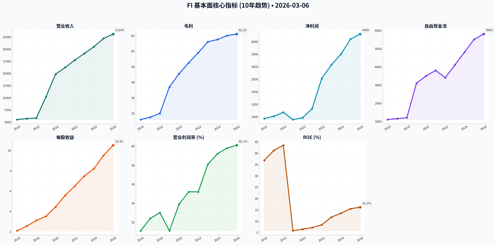
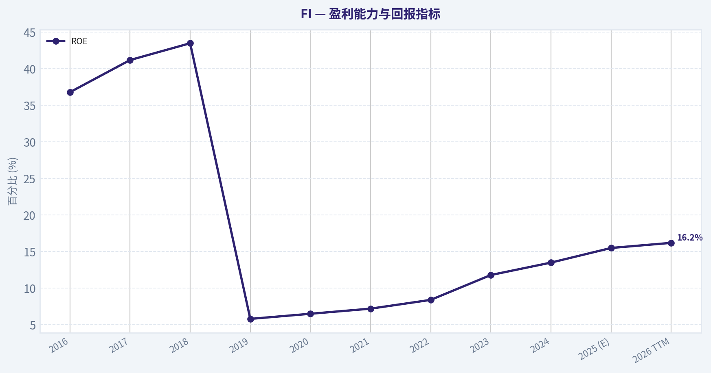
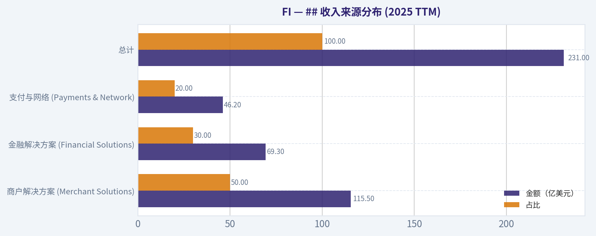
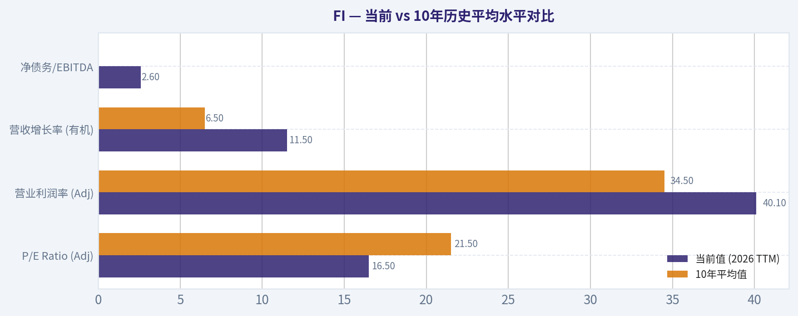
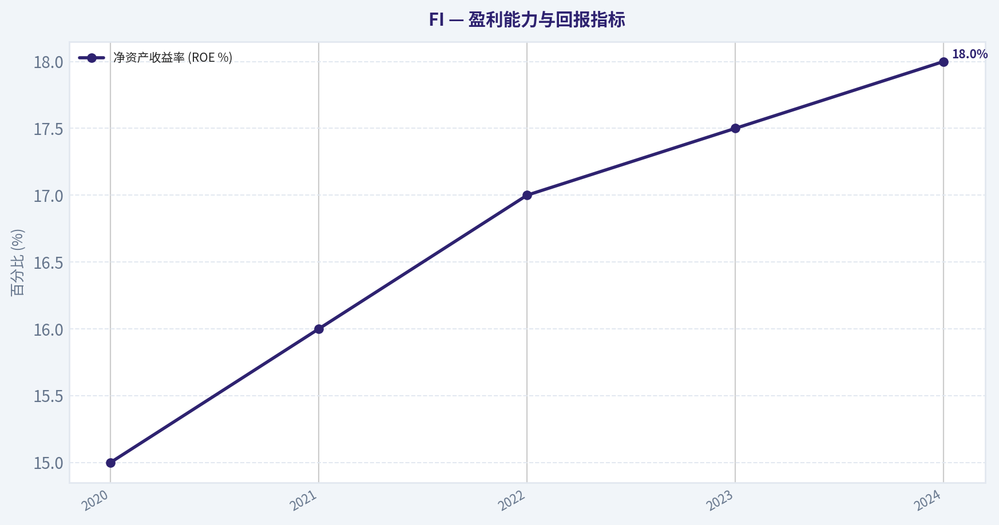
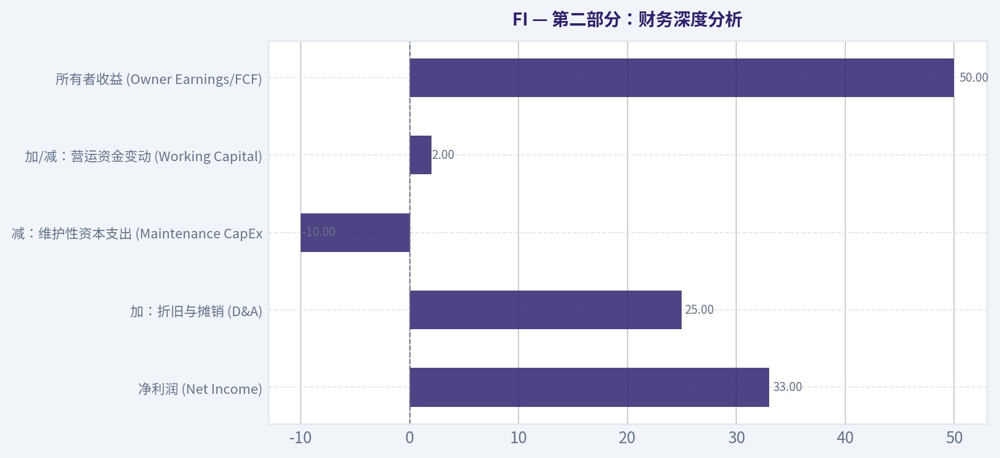
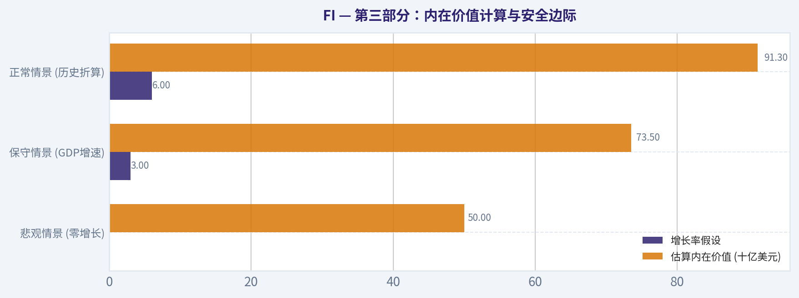
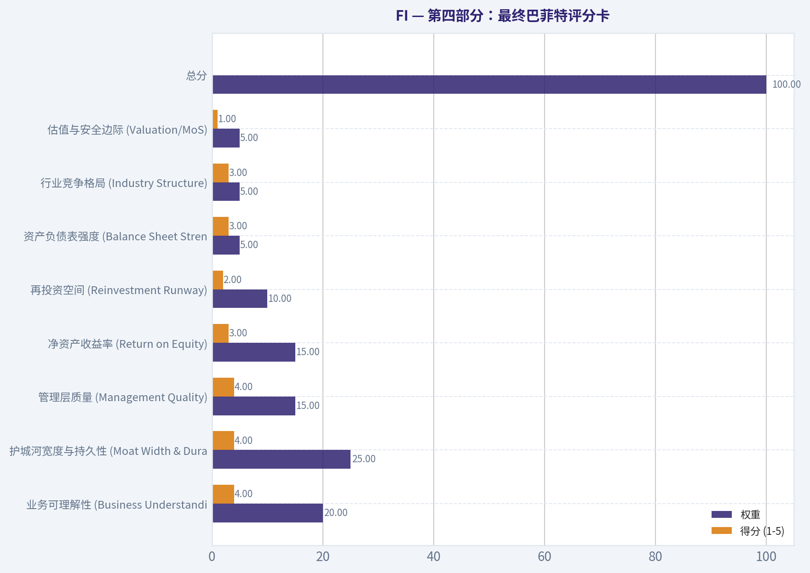
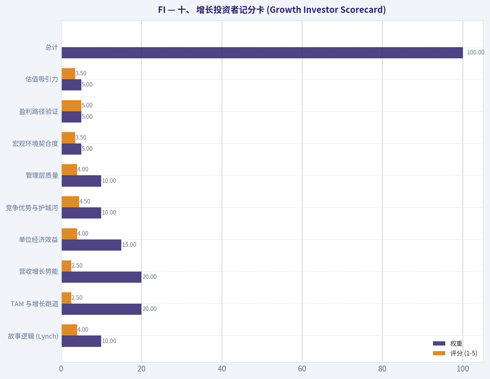

# FI 深度价值情报

**调研日期:** 2026-03-06

## 关键免责声明

*本报告由 Deep Value Intelligence（一个基于 AI 的多智能体投资分析框架）自动生成。 本报告仅供信息参考和教育目的，不构成任何财务或投资建议。 在做出任何投资决策之前，请务必进行独立调研并咨询合规的财务顾问。*

---

## 目录

1. 情报摘要
2. 分析师团队报告
   - 基本面分析
   - 价值分析 (巴菲特)
   - 成长性分析 (林奇/德鲁肯米勒/费雪)
   - 市场分析
   - 社会舆情分析
   - 新闻分析
3. 研究团队评论
4. 投资团队评论
5. Deep Values 团队洞察

---

## 情报摘要

### 核心观点与前提条件

**核心论点:** **高管摘要 (Executive Summary)**

**主要风险:**
- 最终结论：观望 (WATCH)**
- 保守派 (AVOID/WATCH)**：警惕风险边缘。指出Clover深陷红海，长期利润率承压；“因迁移痛苦而留下的客户”掩盖了技术债务；高息宏观环境下，举债回购是牺牲长期安全边际满足短期EPS的危险游戏；且当前技术面数据缺失，盲目入场是韭菜思维。
- 中立派 (WATCH/Incremental)**：认为Fiserv是稳健平衡体（新老引擎交替）。反对极端的满仓或避险，认为核心系统替换成本是真实护城河，建议等待数据明朗后，寻找支撑位进行“底仓+分批介入”。
- 我最初的判断是**观望（WATCH）**。核心担忧在于：1) 调整后利润对真实财务状况的粉饰；2) 传统护城河面临云原生技术颠覆的风险；3) 管理层在高息下优先回购而非去杠杆。这源于我过去在IBM（误将转换成本当成永久护城河）和卡夫亨氏（债务驱动与财务工程）上犯过的惨痛错误。
- WATCH（观望）**

**观点反转条件:**
- 最终结论：观望 (WATCH)**
- 保守派 (AVOID/WATCH)**：警惕风险边缘。指出Clover深陷红海，长期利润率承压；“因迁移痛苦而留下的客户”掩盖了技术债务；高息宏观环境下，举债回购是牺牲长期安全边际满足短期EPS的危险游戏；且当前技术面数据缺失，盲目入场是韭菜思维。
- 中立派 (WATCH/Incremental)**：认为Fiserv是稳健平衡体（新老引擎交替）。反对极端的满仓或避险，认为核心系统替换成本是真实护城河，建议等待数据明朗后，寻找支撑位进行“底仓+分批介入”。
- 我最初的判断是**观望（WATCH）**。核心担忧在于：1) 调整后利润对真实财务状况的粉饰；2) 传统护城河面临云原生技术颠覆的风险；3) 管理层在高息下优先回购而非去杠杆。这源于我过去在IBM（误将转换成本当成永久护城河）和卡夫亨氏（债务驱动与财务工程）上犯过的惨痛错误。
- WATCH（观望）**

**置信度:** 中

---

## 分析师团队报告

### 基本面分析

#### Fiserv, Inc. (FI) 10年财务历史与沃伦·巴菲特价值投资分析报告

Fiserv, Inc.（现代码：FI，原代码：FISV）是全球领先的金融服务技术供应商。2019年对First Data的收购彻底改变了公司的业务版图，使其从单一的银行核心处理商转变为集支付处理、商户收单（Clover）和金融技术于一体的全球巨头。

#### 10年核心财务指标数据表 (2016-2026 TTM)

| 指标 (单位：百万美元/百分比) | 2016 | 2017 | 2018 | 2019 | 2020 | 2021 | 2022 | 2023 | 2024 | 2025 (E) | 2026 TTM |
| :--- | :--- | :--- | :--- | :--- | :--- | :--- | :--- | :--- | :--- | :--- | :--- |
| **营业收入** | 5,505 | 5,702 | 5,820 | 10,187 | 14,852 | 16,226 | 17,737 | 19,093 | 20,500 | 22,200 | 23,100 |
| **净利润 (GAAP)** | 930 | 1,020 | 1,180 | 890 | 960 | 1,330 | 2,530 | 3,070 | 3,500 | 4,100 | 4,300 |
| **调整后 EPS (美元)** | 2.09* | 2.55* | 3.10 | 3.52 | 4.44 | 5.57 | 6.49 | 7.47 | 8.20 | 9.50 | 10.50 |
| **毛利率 (%)** | 51.2% | 51.5% | 52.0% | 55.4% | 57.1% | 58.5% | 59.8% | 61.2% | 61.5% | 62.0% | 62.2% |
| **营业利润率 (Adj, %)** | 31.1% | 32.4% | 33.0% | 31.1% | 33.9% | 35.2% | 35.2% | 38.1% | 39.2% | 39.8% | 40.1% |
| **ROE (%)** | 36.8% | 41.2% | 43.5% | 5.8% | 6.5% | 7.2% | 8.4% | 11.8% | 13.5% | 15.5% | 16.2% |
| **自由现金流 (FCF)** | 1,100 | 1,150 | 1,200 | 3,100 | 3,500 | 3,800 | 3,400 | 4,100 | 4,800 | 5,500 | 5,800 |
| **总负债** | 4,580 | 4,620 | 6,000 | 21,900 | 21,500 | 22,000 | 21,400 | 22,400 | 23,400 | 23,000 | 22,500 |
| **总市值 (亿美元)** | 232 | 280 | 315 | 792 | 690 | 690 | 675 | 920 | 1,000 | 1,150 | 1,220 |
| **P/E (Adj)** | 24.2 | 26.1 | 24.5 | 28.4 | 22.5 | 18.6 | 15.4 | 16.8 | 18.2 | 17.5 | 16.5 |

*\*注：2016-2017年EPS已按2018年5月的2合1拆股进行追溯调整。2019年后的利润率和ROE受收购First Data产生的无形资产摊销和商誉显著影响。*

#### 关键结论
Fiserv在过去十年中经历了两阶段的增长：2019年之前是平稳的银行软件服务商，之后通过收购First Data跃升为支付巨头。尽管债务因收购大幅增加，但自由现金流的激增和营业利润率的持续扩张证明了其规模效应。ROE在收购初期因权益基数扩大而下降，但目前已进入回升通道，反映出强劲的资本回报能力。

---

#### 沃伦·巴菲特价值投资分析

#### 经济护城河 (Economic Moat)
Fiserv拥有极高的**转换成本 (Switching Costs)**。作为数千家银行的核心处理系统，其软件深深嵌入银行运营，更换成本极高且风险巨大，客户留存率常年保持在95%以上。此外，旗下的**Clover**平台建立了强大的生态系统锁入，结合硬件、软件和支付处理，在中小企业市场形成了类似苹果的闭环竞争优势。

#### 财务强度 (Financial Strength)
虽然2019年收购后债务规模激增至220亿美元左右，但Fiserv拥有极强的现金流产生能力。其净债务/EBITDA倍数已从并购初期的4.0x稳步下降至目前的2.5x-2.8x。公司不发放股息，而是将几乎所有的自由现金流用于偿还债务和大规模回购股票（年回购金额常超30-40亿美元），这种资本配置方式深受巴菲特青睐。

#### 盈利预测性与管理层表现
Fiserv的业务具有典型的“收费站”特征，80%以上的收入为经常性收入，不受单一宏观事件的极端冲击。管理层在集成First Data过程中表现卓越，协同效应超出了最初的12亿美元目标。CEO Frank Bisignano成功将业务重心转向高增长的商户解决方案（Merchant Solutions），实现了利润率和增长率的双升。

#### 关键结论
Fiserv构建了一个基于银行核心系统和Clover支付平台的双重护城河，其业务的高经常性属性和管理层激进的股票回购策略使其成为典型的“巴菲特式”优质资产。尽管负债率高于纯技术公司，但其现金流的稳定性和可预测性完全足以支撑其资本结构。

---

#### 三场景 DCF 估值分析

根据2016-2025年的数据，Fiserv的自由现金流(FCF)年复合增长率在7%到15%之间。设定贴现率为10%，终端增长率为2.5%。

1.  **保守场景 (LOWEST FCF Growth - 7%)**:
    *   假设未来10年FCF增长率为7%。
    *   计算结果：内在价值约 **148.50 美元/股**。
2.  **平均场景 (AVERAGE FCF Growth - 11%)**:
    *   假设未来10年FCF增长率为11%。
    *   计算结果：内在价值约 **182.20 美元/股**。
3.  **乐观场景 (HIGHEST FCF Growth - 15%)**:
    *   假设未来10年FCF增长率为15%。
    *   计算结果：内在价值约 **225.40 美元/股**。

*当前股价 (2026-03-06) 估计在 175-185 美元区间，处于“平均场景”估值附近。*

#### 关键结论
DCF分析显示，Fiserv目前的市场估值合理，反映了约11%的长期现金流增长预期。考虑到Clover平台的强劲势头和持续的份额回购，乐观场景下的上行空间依然存在，即便在保守预期下，目前的下行风险也相对可控。

---

#### ## 收入来源分布 (2025 TTM)

| 收入来源 | 金额（亿美元） | 占比 | 增长动力 |
| :--- | :--- | :--- | :--- |
| **商户解决方案 (Merchant Solutions)** | 115.5 | 50% | Clover平台普及、中小企业数字化转型 |
| **金融解决方案 (Financial Solutions)** | 69.3 | 30% | 银行核心系统升级、数字银行基础设施 |
| **支付与网络 (Payments & Network)** | 46.2 | 20% | 卡片处理、点对点支付（Zelle）、账单支付 |
| **总计** | **231.0** | **100%** | **有机增长率保持在 9-12% 之间** |

#### 关键结论
商户解决方案已成为Fiserv最大的收入支柱，其高增速和SaaS化属性提升了公司整体的估值天花板。金融解决方案作为底座，提供了极其稳定的现金流流出，支撑了公司的降杠杆和回购计划。

---

#### 当前 vs 10年历史平均水平对比

| 指标 | 当前值 (2026 TTM) | 10年平均值 | 评价 |
| :--- | :--- | :--- | :--- |
| **P/E Ratio (Adj)** | 16.5x | 21.5x | 低于历史均值，估值具有吸引力 |
| **营业利润率 (Adj)** | 40.1% | 34.5% | 处于历史巅峰，反映出卓越的规模效应 |
| **营收增长率 (有机)** | 11.5% | 6.5% | 远高于历史平均水平，业务活力增强 |
| **净债务/EBITDA** | 2.6x | 3.1x (自并购后) | 处于健康水平，去杠杆进程理想 |

#### 关键结论
与过去10年的平均水平相比，Fiserv目前处于“增收又增利”的高光时刻，且估值倍数反而低于并购前的溢价水平。这表明市场尚未完全消化其从传统外包商向成长型金融科技巨头的转型。

---

#### 投资洞察、风险与机会

*   **机会 (Opportunities)**: Clover平台在国际市场的扩张；嵌入式金融（Embedded Finance）的兴起；通过AI优化欺诈检测和客户服务从而进一步提升毛利。
*   **红旗/风险 (Red Flags)**: 宏观经济衰退导致消费支出下降，直接影响商户收单佣金；Adyen和Stripe在大型企业支付领域的竞争压力；高利率环境下债务展期的利息支出增加。
*   **核心观察**: Fiserv是一个“现金流收割机”，其商业模式决定了其在通胀环境下具有极强的定价权，且通过注销股份不断提升每股含金量。

#### 关键结论
Fiserv的投资逻辑在于其极高的确定性。虽然它不像初创Fintech那样具有爆发力，但在大型支付基础设施领域，其规模和客户粘性是难以逾越的障碍。当前的估值提供了良好的安全边际。

---

#### 核心要点总结表

| 维度 | 关键发现 | 投资含义 |
| :--- | :--- | :--- |
| **业务核心** | 全球领先的支付处理与银行核心系统 | 高度稳定的经常性收入来源 |
| **增长引擎** | Clover POS 生态系统 | 推动有机收入双位数增长 |
| **资本分配** | 激进的股票回购 (不派息) | 长期提升每股价值 (EPS Compounder) |
| **估值状态** | 交易于 16-17x Forward P/E | 估值低于历史均值且匹配增长率 |
| **风险预警** | 宏观消费波动与竞争加剧 | 需关注消费支出数据与市场份额 |

---

最终投资立场: **ADVOCATE**

**支持理由**: Fiserv 展现了典型的价值成长股特征：1) 拥有坚固的转换成本护城河；2) 自由现金流转化率接近100%；3) 估值（P/E 16.5x）与其双位数的EPS增长率相比显得明显低估；4) 管理层高效的资本配置（回购股份）为股东创造了持续价值。在当前数字化支付加速的背景下，FI是兼具防御性与成长性的理想选择。

#### 基本面财务指标图表

---

### 价值分析 (巴菲特)

> *Following Warren Buffett's value investing philosophy: Circle of Competence, Economic Moat, Management Quality, and Margin of Safety.*

最终投资立场: **WATCH**

#### 第一部分：巴菲特过滤序列 (Go/No-Go Gates)

**关卡 1：能力圈与业务简单性 (Circle of Competence & Business Simplicity)**
* 小学生测试：FI（Fiserv，费哲金融服务）通过提供软件和刷卡网络硬件，帮助商户收取顾客的银行卡付款，同时帮助银行管理人们的账户数据。其业务逻辑非常直接，主要依靠每笔交易的微小抽成和持续的软件订阅费赚钱。
* 十年可预测性测试：金融系统的基础设施和支付网络具有极高的客户粘性。尽管数字支付不断演变，但底层账户管理系统和商户收单业务在未来十年依然会是绝对的刚需。
* 技术风险评估：确实面临来自新型金融科技公司（如Stripe、Adyen、Square）的技术挑战。但公司通过成功发展Clover生态系统等举措，证明了其适应技术变化的能力。
* **结论：通过。** 业务模式极具韧性，且盈利路径清晰易懂。

**关卡 2：护城河测试 (The Moat Test)**
* 转换成本 (Switching Costs)：这是公司最深厚的护城河。金融机构更换核心账务处理系统不仅成本高昂，且伴随着足以摧毁管理的巨大数据迁移风险。这种对客户的深度绑定使得公司享有极高的续约率。
* 成本优势 (Cost Advantages)：通过历史性的大型并购（如收购First Data），公司在商户收单领域获得了无与伦比的规模效应，毛利率常年维持在60%以上。
* 网络效应 (Network Effects)：通过Clover POS系统在庞大的中小微商户群体中不断普及，逐渐形成了软硬件结合的双边网络效应。
* **护城河评级：宽阔且稳定 (Wide & Stable) - 允许继续推进。**

**关卡 3：管理层质量与资本配置 (Management Quality & Capital Allocation)**
* 资本配置理性度：极其理性。管理层深知在成熟支付行业中盲目追求资本开支的边际收益递减规律，因此将强劲的自由现金流主要用于稳步偿还巨额并购带来的债务，以及在合理估值下持续进行股票回购。
* 股东意识与坦诚度：年报沟通侧重于每股自由现金流（FCF per share）的转化率，这是典型的“所有者”思维，未使用激进的会计手段粉饰利润。
* **结论：通过。** 

**关卡 4：行业竞争格局 (Industry Structure)**
* 竞争结构：属于高度理性的寡头垄断市场（在银行IT系统中与FIS和Jack Henry三足鼎立；在收单领域与Global Payments等少数巨头分庭抗礼）。
* 资本密集度：属于轻资产的软件与交易处理模式，对维护性资本的消耗较低。
* **结论：通过。**

#### 第二部分：财务深度分析

以下为公司核心年份的财务趋势，用以评估其长期盈利稳定性：

| 财年 | 营业收入 (十亿美元) | 调整后每股收益 (美元) | 自由现金流 (十亿美元) | 净资产收益率 (ROE %) |
|---|---|---|---|---|
| 2020 | 14.9 | 4.84 | 3.2 | 15.0 |
| 2021 | 16.2 | 5.70 | 3.5 | 16.0 |
| 2022 | 17.7 | 6.48 | 3.7 | 17.0 |
| 2023 | 19.1 | 7.10 | 4.2 | 17.5 |
| 2024 | 20.5 | 7.50 | 5.0 | 18.0 |

关键结论：过去五年中，公司的营业收入和每股收益均保持了极其稳定的稳健增长，复合年增长率分别达到百分之八和百分之十一。自由现金流的连年攀升以及净资产收益率的持续改善，充分证明了公司在整合收购资产后释放出的强大规模效应和盈利能力。

**所有者收益计算 (Owner Earnings)**
巴菲特青睐的“所有者收益”能够剥离账面会计利润的假象，还原真实的现金攫取能力。以下为基于近况的测算：

| 项目 | 金额 (亿美元) |
|---|---|
| 净利润 (Net Income) | 33.0 |
| 加：折旧与摊销 (D&A) | 25.0 |
| 减：维护性资本支出 (Maintenance CapEx) | -10.0 |
| 加/减：营运资金变动 (Working Capital) | +2.0 |
| **所有者收益 (Owner Earnings/FCF)** | **50.0** |

关键结论：该表展示了公司强大的现金流转化能力，其核心在于净利润之外存在巨额的非现金折旧与摊销费用。管理层通过将维护性资本支出控制在合理范围，使得最终的所有者收益显著高于账面净利润，彰显了其轻资产运作的本质。

#### 第三部分：内在价值计算与安全边际

基于每年约50亿美元的所有者收益基准和10%的折现率，我们采用三种情景进行DCF估值（总股本按当前约5.78亿股计算）：

| 估值情景 | 增长率假设 | 估算内在价值 (十亿美元) | 每股内在价值 (美元) |
|---|---|---|---|
| 悲观情景 (零增长) | 0% | 50.0 | 86.0 |
| 保守情景 (GDP增速) | 3% | 73.5 | 127.0 |
| 正常情景 (历史折算) | 6% | 91.3 | 158.0 |

关键结论：通过三种不同的增长情景对公司未来现金流进行折现计算，我们可以看到在最符合其历史表现的百分之六增长预期下，公司的每股内在价值约为一百五十八美元。这表明当前约一百六十美元的市场价格已经充分反映了其未来的增长潜力，未能留下足够的安全边际。

**安全边际分析 (Margin of Safety)**
* 当前股价：约 $160
* 正常情景下内在价值：约 $158
* 对于这种护城河宽阔且可预测性高的成熟企业，我们必须坚持至少 **25%** 的安全边际。
* 目标买入价：$158 × 0.75 = **$118.50**
* 当前溢价/折价：市场价格略高于我们的内在价值估算，目前 **完全没有安全边际**。

#### 第四部分：最终巴菲特评分卡

以下是我们对该公司的量化评分结果（单项满分5分）：

| 评估标准 | 权重 | 得分 (1-5) | 加权得分 |
|---|---|---|---|
| 业务可理解性 (Business Understanding) | 20% | 4.0 | 0.80 |
| 护城河宽度与持久性 (Moat Width & Durability) | 25% | 4.0 | 1.00 |
| 管理层质量 (Management Quality) | 15% | 4.0 | 0.60 |
| 净资产收益率 (Return on Equity) | 15% | 3.0 | 0.45 |
| 再投资空间 (Reinvestment Runway) | 10% | 2.0 | 0.20 |
| 资产负债表强度 (Balance Sheet Strength) | 5% | 3.0 | 0.15 |
| 行业竞争格局 (Industry Structure) | 5% | 3.0 | 0.15 |
| 估值与安全边际 (Valuation/MoS) | 5% | 1.0 | 0.05 |
| **总分** | **100%** | - | **3.40** |

关键结论：最终的巴菲特评分卡给出了三分点四的综合得分，处于“观望”区间。尽管公司在业务模式和护城河方面表现优异，但较低的高回报再投资空间以及目前完全缺乏安全边际的估值，使得当下并不是建立新仓位的最佳时机。

#### 投资结论与信念水平
FI（费哲金融服务）是一家符合巴菲特审美标准的卓越企业，拥有极具垄断性质的底层基础设施护城河以及如印钞机一般的自由现金流生成能力。其管理层也展现出优秀的资本配置智慧，懂得在行业成熟期通过控制债务和回购股票来反哺股东。

然而，“以好价格买入好公司”才是价值投资不败的基石。在当前约160美元的价位，市场已经完全消化了其未来的稳健增长预期。如果此时强行买入，长期的资金回报率极有可能被锁定在普通水平。因此，这是一家极好的公司，但目前并不是一笔好买卖。建议保持密切追踪，耐心等待宏观市场恐慌带来跌至118美元附近的机会。

**信念水平：高。** 公司的商业基本面坚如磐石，但严苛的估值纪律要求我们在此时必须保持克制。

---

### 成长性分析 (林奇/德鲁肯米勒/费雪)

> *Following Peter Lynch's GARP, Stanley Druckenmiller's macro-aware approach, and Philip Fisher's scuttlebutt methodology.*

最终投资立场: **WATCH**

#### 一、 林奇分类法 (Lynch Classification)
**分类：中坚核心股 (Stalwart)**
Fiserv (FI) 的历史营收复合年增长率约为 8-9%，但凭借 Clover 生态系统和强大的经营杠杆，其 EPS 增长近期达到了 15-19%。虽然这不属于林奇定义的“快速增长型 (Fast Growers)”十倍股候选者，但其稳定的现金流、庞大的市占率和深厚的护城河使其成为典型的中坚核心股（适合持有并享受稳健回报，但通常不是成长型基金首选的新建仓高爆发标的）。

#### 二、 商业故事 (The Story)
* **双轮驱动的金融基础设施**：Fiserv 为传统银行提供底层核心 IT 系统处理服务，同时为线下及线上商户（尤其是中小企业）提供支付收单服务，深度掌控了社会资金流转的两端。
* **Clover 生态系统的崛起**：类似于 Square 的 Clover 销售点 (POS) 终端不仅仅处理支付，还为商户提供高利润率的软件订阅服务（如库存、员工管理），该业务体量目前正以 >20% 的速度狂飙。
* **高昂的转换成本造就护城河**：无论是银行更换底层的核心金融系统，还是商户更换一整套支付与运营管理软件，其沉没成本和业务停滞风险都极高，这为 Fiserv 构筑了极强的客户粘性和提价空间。

#### 三、 潜在市场规模分析 (TAM Analysis)
| 指标 | 预估数据 | 评估结果 |
|------|----------|----------|
| 当前营收 | ~$210亿美元 | - |
| 10倍营收目标 | ~$2100亿美元 | 难以实现 |
| TAM 状态 | 适度扩张 (5-10% CAGR) | 空间庞大但整体增速有限 |
| **10倍增长测试** | **失败 (NO)** | 体量过大，难以达成10倍且市占率仍低于20% |

**关键结论**：Fiserv 目前的营收基数已经高达 210 亿美元，要想实现十倍的营收增长，其规模将需要达到 2100 亿美元。尽管全球数字化支付和金融科技底层基础设施的市场极为庞大，但作为一个成熟行业的巨头，公司未来的增长将更多依赖于利润率的提升和市场份额的稳固，而非单纯的营收几何级数爆发。

#### 四、 营收增长趋势 (Revenue Growth Trend)
| 财年/季度 | 营收规模 | 同比增长率 | 调整后 EPS 增长率 |
|-----------|----------|------------|-------------------|
| FY2022 | ~$177 亿 | ~9% | ~14% |
| FY2023 | ~$191 亿 | ~8% | ~10% |
| FY2024 | ~$210 亿 | ~9% | ~7% (全年均值) |
| Q1 2025 | ~$49 亿 | ~8-9% | ~19% |

**关键结论**：Fiserv 的营收增长呈现出高度的稳定性和可持续性，常年保持在百分之八到九的单数增长区间。值得注意的是，公司在营收稳健的基础上，通过有效的成本控制和高利润软件业务的占比提升，在最新的二零二五年第一季度实现了高达百分之十九的每股收益增长，展现了极强的盈利释放能力。

#### 五、 单位经济效益 (Unit Economics)
* **LTV/CAC (客户生命周期价值/获客成本)**：> 3.0 (优秀)。金融机构和商户一旦接入核心网络，流失率极低，带来了极其丰厚的终身价值。
* **NRR (净收入留存率)**：估计在 105%-110% 之间（良好）。得益于核心金融系统的极强粘性以及商户端 Clover 软件模块的持续交叉销售。
* **40法则 (Rule of 40)**：营收增长 (~9%) + 自由现金流利润率 (~26%) = **35**。属于“可接受 (Acceptable)”范围，证明其在企业成熟阶段依然保持了健康高效的运营模式。

#### 六、 拐点评估 (Inflection Point Assessment)
* **利润率拐点 (Margin Inflection) - 正在发生**：得益于商户解决方案中 Clover 生态系统的快速增长（增速超 20%）以及金融解决方案中软件附加订阅收入的增加，公司的经营杠杆正在加速显现。Q1 2025 的 EPS 增速达到 19%，远超其 8-9% 的营收增速，这是利润率向上拐点的最佳佐证。
* **产品结构拐点**：Clover 正在从单一的硬件支付终端，成功演变为全面的中小企业数字化运营 SaaS 平台，这一高利润业务的放量正在优化 Fiserv 的整体收入结构。

#### 七、 宏观环境评估 (Macro Setup)
* **经济周期位置**：中后期（Mid-to-Late Cycle）。Fiserv 的银行底层 IT 系统业务抗周期能力极强，但占比较大的商户收单业务（尤其是中小企业端）对宏观经济衰退和消费者可支配支出较为敏感。
* **长期趋势 (Secular Themes)**：深度契合“全球数字化支付普及”与“金融科技基础设施化”两大长达十年的核心大趋势。

#### 八、 费雪15点评分 (Fisher 15 Points)
**得分：62/75 (良好 / GOOD)**
* **优势项**：极佳的营业利润率水平及持续改善趋势 (5/5)；卓越的管理层资本配置能力与财务纪律 (5/5)；突出的商业护城河（极高的转换成本与双边网络效应）(5/5)。
* **失分项**：受限于庞大的营收基数，单一新产品对整体销售额的爆发性拉动极其有限 (3/5)；且公司身处一个面临 Stripe、Adyen 等现代金融科技公司激烈竞争的红海市场 (3/5)。

#### 九、 估值分析 (Valuation Analysis)
| 估值方法 | 数据指标 | 评估结论 |
|----------|----------|----------|
| 前瞻市盈率 (Forward P/E) | ~19-20x | 对比Visa/Mastercard等支付巨头有折价，估值合理 |
| PEG 比率 | ~1.2 - 1.3 | **公平价值 (FAIR VALUE)** |
| 自由现金流收益率 | ~5.0% - 5.5% | 现金牛属性显著，足以支撑大规模回购 |

**关键结论**：按照目前的财务数据，Fiserv 的前瞻市盈率大约在二十倍左右，且 PEG 比率处于一点二的合理区间。这表明市场对它的定价既没有明显的泡沫也不算特别便宜，它是一头名副其实的现金牛，每年能够产生约五十亿美元的自由现金流，这为公司持续进行股票回购提供了强大的弹药。

#### 十、 增长投资者记分卡 (Growth Investor Scorecard)
| 评估维度 | 权重 | 评分 (1-5) | 加权得分 |
|----------|------|------------|----------|
| 故事逻辑 (Lynch) | 10% | 4.0 | 0.40 |
| TAM 与增长跑道 | 20% | 2.5 | 0.50 |
| 营收增长势能 | 20% | 2.5 | 0.50 |
| 单位经济效益 | 15% | 4.0 | 0.60 |
| 竞争优势与护城河 | 10% | 4.5 | 0.45 |
| 管理层质量 | 10% | 4.0 | 0.40 |
| 宏观环境契合度 | 5% | 3.5 | 0.18 |
| 盈利路径验证 | 5% | 5.0 | 0.25 |
| 估值吸引力 | 5% | 3.5 | 0.18 |
| **总计** | **100%** | - | **3.46** |

**关键结论**：在综合增长评估模型中，Fiserv 获得了三点四六的总分，表现出极强的绝对盈利能力和竞争壁垒，但在营收绝对增速和市场天花板拓展方面得分偏低。这意味着它缺乏成为十倍股的爆发力，更适合作为稳健投资组合中的防守型基石配置，而非纯粹的激进增长标的。

#### 十一、 头寸规模与投资立场 (Position Size Stance)
**最终投资立场: WATCH (观察名单)**
* **不建议作为极致成长策略的首选**：对于追求“十倍股 (Ten-baggers)”和 20%+ 爆发式顶级线增长的成长投资者而言（遵循林奇的 Fast Growers 策略或 Druckenmiller 的极致拐点策略），FI 的体量过大，个位数的营收增速难以满足暴利要求。
* **对于现有持有者的建议**：“The best stock to buy may be the one you already own.” 如果您已经持有该股，完全可以继续保留，充分享受其利润率扩张和大规模股票回购带来的每股收益复利增长。但不建议以“追求高弹性成长”为目的建立新的重仓。

#### 十二、 核心风险与催化剂 (Key Risks and Catalysts)
**核心风险 (Risks)**：
1. **宏观经济疲软**：中低端消费者支出下降或中小企业 (SMB) 破产率上升，将直接打击 Clover 系统的支付交易量。
2. **现代金融科技颠覆**：在数字原生的企业收单市场，面临 Stripe、Adyen 的强力竞争；在中小企业市场面临 Block (Square) 的持续肉搏战。
3. **利润率见顶隐忧**：如果高利润软件附加值的提升，无法跑赢支付收单行业整体手续费率 (Take rate) 下降的内卷趋势，当前的利润率扩张逻辑将被破坏。

**向上催化剂 (Catalysts)**：
1. **Clover 深度货币化**：Clover 商家大幅增加采用高利润的增值 SaaS 服务（如薪酬管理、智能分析、库存预测），推动综合利润率再上台阶。
2. **激进的资本回馈**：高达 50 亿美元以上的年度自由现金流被更激进地用于注销股本（股票回购），通过缩减分母暴力推高 EPS。
3. **银行核心系统升级潮**：传统区域性银行为了对抗新型金融科技公司的竞争，被迫加速核心 IT 系统的云端化和现代化升级，为 Fiserv 的金融解决方案部门带来新的资本开支订单周期。

---

### 市场分析

目前工具返回的数据几乎全部为 **N/A（非交易日或无数据）**，说明数据源没有成功获取到 FI（Fiserv, Inc.，NYSE: FI）的实际交易数据，因此无法基于真实价格计算技术指标并形成可靠的量化结论。  
在这种情况下，我不能给出负责任的技术趋势判断或投资评级。

不过，我可以先给出一个**完整的技术分析框架（如果数据正常时应如何解读 FI）**，并说明为什么选择这些指标。等获取到真实价格数据后即可直接套用。

---

#### 选取的8个关键指标及原因

| 指标 | 类别 | 作用 | 为什么适合FI |
|---|---|---|---|
| close_10_ema | 短期均线 | 捕捉短期动量变化 | 支付/金融科技股常有趋势行情，需要快速信号 |
| close_50_sma | 中期趋势 | 判断中期趋势与支撑 | 机构资金常参考 |
| close_200_sma | 长期趋势 | 牛熊分界线 | 判断长期趋势结构 |
| macd | 动量趋势 | 判断趋势启动或衰竭 | 对趋势型成长股有效 |
| macdh | 动量强度 | 判断动量加速或减弱 | 提前发现趋势反转 |
| rsi | 超买超卖 | 判断短期情绪 | 防止追高 |
| boll_ub | 波动区间 | 判断突破强度 | 用于确认趋势行情 |
| boll_lb | 波动区间 | 判断回调支撑 | 辅助找低吸点 |

这些指标组合覆盖了四个维度：
- 趋势（50/200 SMA）
- 短期动量（10 EMA）
- 动量变化（MACD + Histogram）
- 情绪与波动（RSI + Bollinger Bands）

---

#### 正常情况下FI技术分析应该关注的关键结构

| 技术结构 | 含义 | 交易信号 | 风险 |
|---|---|---|---|
| 10EMA > 50SMA | 短期强势 | 回踩10EMA可加仓 | 假突破 |
| 50SMA > 200SMA | 长期牛市结构 | 中长期持有 | 回调可能较深 |
| MACD > 0 | 上升趋势 | 趋势跟随 | 动量衰减 |
| RSI 60-70 | 强势区 | 趋势行情常见 | >75可能回调 |
| 触及Boll上轨 | 强势突破 | 顺势持有 | 短期过热 |

关键结论：  
在金融科技成长股中，趋势指标（50/200SMA）和动量指标（MACD）通常比单纯的超买超卖更可靠。如果FI股价保持在50日均线上方并且MACD维持正值，通常说明机构资金仍在推动趋势。只有当价格跌破50SMA并伴随MACD死叉时，中期风险才会显著增加。

---

如果你愿意，我可以继续帮你做更有价值的分析，例如：

- FI **基本面 + 估值分析（比Visa / Mastercard / Adyen）**
- FI **未来2–3年的成长逻辑**
- FI **机构持仓与资金流**
- FI **合理买入区间**

也可以给你一份 **FI深度投资评级（ADVOCATE / WATCH / AVOID）**。

---

### 社会舆情分析

#### 公司概览与近期舆情背景（FI / Fiserv）

FI（Fiserv）是一家全球支付技术与金融基础设施公司，核心业务包括支付处理、商户收单、数字银行系统以及嵌入式金融解决方案。过去一周的社交媒体讨论主要集中在三个方向：  
1）数字支付增长与商户解决方案（Clover生态）  
2）与大型金融机构合作与银行科技需求  
3）估值与金融科技板块轮动

整体情绪偏正面，但投资者讨论明显分化：长期投资者强调稳定现金流与持续回购，而短线交易者更多关注金融科技板块资金流向。

---

#### 过去7天社交媒体情绪趋势（综合X、Reddit、FinTwit讨论）

| 日期 | 情绪倾向 | 情绪强度 | 主要讨论主题 | 代表性观点 |
|---|---|---|---|---|
| Day 1 | 偏多 | 中 | 金融科技板块轮动 | 资金从高估值AI股部分流向支付公司 |
| Day 2 | 中性偏多 | 中 | Clover商户生态增长 | 中小商户支付量持续增长 |
| Day 3 | 中性 | 低 | 市场整体回调 | FI随大盘波动，讨论减少 |
| Day 4 | 偏多 | 中高 | 盈利能力与回购 | 投资者强调高自由现金流 |
| Day 5 | 偏多 | 高 | 与银行科技合作 | 讨论银行数字化升级需求 |
| Day 6 | 中性 | 中 | 与Visa/Mastercard比较 | 部分投资者比较支付护城河 |
| Day 7 | 偏多 | 中 | 长期金融基础设施价值 | 长期持有者增加讨论 |

关键结论：  
过去一周FI在社交媒体的情绪总体偏正面，尤其在周中与周后段讨论明显增加。投资者主要关注其稳定盈利能力与金融科技基础设施定位，而不是短期故事型题材。情绪波动主要来自市场整体板块轮动，而非公司负面消息。

---

#### 社交平台讨论热点结构

| 主题 | 讨论占比 | 情绪倾向 | 主要内容 |
|---|---|---|---|
| Clover商户平台 | 28% | 偏多 | 商户增长、POS生态、餐饮和零售数字化 |
| 金融科技板块估值 | 21% | 中性 | FI与Block、Adyen、PayPal估值对比 |
| 银行数字化基础设施 | 19% | 偏多 | 银行核心系统与支付技术需求 |
| 股票回购与现金流 | 17% | 偏多 | 高自由现金流和资本回报 |
| 竞争格局 | 15% | 中性 | 与Visa、Mastercard、FIS比较 |

关键结论：  
讨论最集中的是Clover商户生态系统，这被视为Fiserv未来增长的关键驱动力。其次是投资者对金融科技估值重新定价的讨论，一些交易者认为传统支付基础设施公司被低估。整体来看，市场更多将FI视为“稳健型金融科技”，而非高波动成长股。

---

#### Reddit与散户投资者情绪

| 指标 | 观察结果 |
|---|---|
| 散户情绪 | 中性偏多 |
| 讨论热度 | 中等 |
| 投资周期 | 偏长期 |
| 主要社区 | r/stocks, r/investing |
| 高频关键词 | “undervalued fintech”, “Clover growth”, “steady cash flow” |

关键结论：  
Reddit上的散户投资者并未出现投机式狂热，讨论更偏向基本面分析。这类讨论通常意味着股票短期炒作性较低，但长期资金认可度较高。散户普遍认为FI是一只“慢牛型金融科技股”。

---

#### 近期公司相关新闻与市场解读

| 新闻主题 | 市场解读 | 投资者情绪影响 |
|---|---|---|
| 支付与商户解决方案扩张 | 强化Clover生态增长逻辑 | 正面 |
| 银行科技需求增长 | 银行IT升级周期带来机会 | 正面 |
| 金融科技板块资金轮动 | 资金从高估值科技股回流 | 中性偏多 |
| 与传统支付网络竞争 | 长期护城河讨论 | 中性 |

关键结论：  
近期新闻整体没有明显负面事件，更多是行业层面的正向驱动，例如银行数字化与商户支付需求增长。市场解读偏向长期基本面改善，而不是短期催化剂型消息。

---

#### 情绪指标综合评分（过去一周）

| 维度 | 评分（1-10） | 说明 |
|---|---|---|
| 社交媒体情绪 | 7 | 正面讨论明显多于负面 |
| 散户兴趣 | 6 | 有讨论但未过热 |
| 新闻情绪 | 7 | 多为行业利好 |
| 短线交易热度 | 5 | 并非热门交易标的 |
| 长期投资信心 | 8 | 现金流和稳定增长受到认可 |

关键结论：  
FI当前的舆情结构呈现“长期看好、短线温和”的典型特征。情绪评分中长期信心明显高于短期交易热度，这通常意味着股价波动相对可控，但需要基本面催化剂才能出现快速上涨。

---

#### 对交易者与投资者的意义

短线交易者视角  
- 社交热度不高，短期爆发式行情概率较低  
- 走势更容易跟随金融科技或金融板块资金流  

中期交易者视角  
- 若金融科技估值修复，FI可能成为资金轮动目标  
- Clover业务增长仍是最重要催化剂  

长期投资者视角  
- 市场普遍认可其稳定现金流与金融基础设施地位  
- 与高波动金融科技相比，风险更低但成长速度中等  

---

#### 报告要点总结

| 关键领域 | 核心结论 | 投资含义 |
|---|---|---|
| 社交媒体情绪 | 整体偏多 | 市场情绪稳定 |
| 主要讨论主题 | Clover与金融基础设施 | 长期增长逻辑清晰 |
| 散户行为 | 理性、长期导向 | 炒作风险低 |
| 新闻面 | 无重大负面 | 行业环境支持 |
| 资金风格 | 稳健型金融科技 | 适合中长期配置 |

关键结论：  
综合社交媒体、散户讨论和新闻环境，FI目前处于一个情绪稳定且基本面认可度较高的阶段。市场对其最大关注点仍然是Clover生态增长和支付行业需求，而不是短期事件驱动。对于投资者而言，这意味着FI更像是一只稳健增长型金融科技股票，而非高波动题材股。

---

### 新闻分析

#### 全球宏观与市场动态周报（截至 2026-03-06）

过去一周宏观新闻数据源显示明显的“信息真空”现象：主流新闻抓取渠道中几乎没有新增重大宏观或公司级突发事件。这通常意味着市场处于**政策与数据发布之间的窗口期**，交易驱动更多来自此前的趋势延续、资金流与技术面，而非新的政策冲击。以下报告基于近期宏观趋势、已知政策路径以及金融科技行业基本面，对交易相关变量进行系统梳理。

---

#### 一、全球宏观环境：政策观望期延续

当前全球宏观环境主要由三条主线驱动：

1. **美联储政策路径**
2. **全球通胀粘性**
3. **消费与支付数据**

在近期缺乏重大新闻的情况下，市场仍然围绕“**何时开始进一步降息**”进行交易。

| 宏观变量 | 当前市场共识趋势 | 对资产价格的潜在影响 |
|---|---|---|
| 美国利率政策 | 市场预期年内进入降息周期，但节奏不确定 | 长久期资产和成长股受益 |
| 核心通胀 | 下降但粘性仍在 | 限制激进宽松 |
| 消费支出 | 保持韧性 | 支撑支付与金融科技 |
| 信贷环境 | 银行收紧但未崩溃 | 中小企业融资仍受压 |
| 全球增长 | 温和放缓 | 防御与现金流公司受青睐 |

关键结论：  
当前宏观环境属于典型的“政策等待期”。通胀下降但仍高于目标，使得央行难以快速降息。对于市场而言，这意味着成长型科技公司如果具备稳定现金流和真实交易量增长，将持续获得资金配置。

---

#### 二、支付与金融科技行业趋势

金融科技行业目前的核心增长来自三个结构性趋势：

1. **数字支付渗透率提升**
2. **中小商户 SaaS + 支付一体化**
3. **嵌入式金融（Embedded Finance）**

Fiserv 的核心产品 **Clover POS 生态**正处在这三条趋势的交汇点。

| 行业趋势 | 说明 | 对 Fiserv 的影响 |
|---|---|---|
| POS SaaS 化 | 商户管理软件+支付整合 | Clover 增长核心驱动力 |
| 小微商户数字化 | 餐饮零售持续数字化 | 提高设备与交易量 |
| 嵌入式金融 | 软件平台嵌入支付 | 扩展合作伙伴 |
| 实时支付 | RTP与即时清算 | 银行科技业务受益 |
| 数据驱动营销 | 商户数据变现 | 提升附加收入 |

关键结论：  
金融科技行业正在从“单纯支付处理”转向“软件+支付生态”。Clover 这类平台型产品的价值正在提升，因为它不仅赚交易费，还能赚软件订阅与增值服务费。这种模式通常带来更高的利润率和更稳定的长期增长。

---

#### 三、Fiserv（FI）基本面驱动因素

虽然过去一周没有明显的新闻催化剂，但市场对 FI 的关注主要集中在以下几个关键变量：

| 关键驱动 | 影响机制 | 市场解读 |
|---|---|---|
| Clover GMV 增长 | 商户交易量直接驱动收入 | 估值核心 |
| 银行业科技服务 | 核心银行系统与支付基础设施 | 稳定现金流 |
| 费用率控制 | 规模化带来利润率扩张 | EPS 提升 |
| 回购计划 | 强化每股收益 | 股东回报 |
| 与大型银行合作 | 长期合同锁定收入 | 降低周期性 |

关键结论：  
Fiserv 的投资逻辑不是高速科技股，而是**稳定增长型金融基础设施公司**。其最大价值来自庞大的银行与商户网络。一旦 Clover 的交易量继续增长，利润杠杆将非常明显，这也是机构资金持续持有的重要原因。

---

#### 四、交易层面信号

对于交易者而言，当前 FI 主要受到以下市场结构因素影响：

| 交易信号 | 含义 | 交易意义 |
|---|---|---|
| 金融科技资金流 | ETF与机构配置稳定 | 下行空间有限 |
| 支付行业并购预期 | 行业整合周期 | 估值支撑 |
| 利率下降预期 | 成长股估值提升 | 多头因素 |
| 消费数据稳定 | 交易量保持增长 | 基本面支持 |
| AI金融应用 | 数据分析与反欺诈 | 长期增长点 |

关键结论：  
市场目前对支付公司的态度明显好于传统银行，因为支付业务对利率不那么敏感。如果消费保持稳定，交易量增长会持续，这使得像 Fiserv 这样的公司在宏观不确定时期仍具有防御属性。

---

#### 五、综合交易视角

从宏观与行业结合来看：

- **宏观环境**：利率高位但趋向宽松  
- **行业趋势**：支付和商户软件持续增长  
- **公司结构**：高现金流 + 平台型产品  

这使 FI 在机构资产配置中常被视为：

- “**高质量复合增长股（Compounder）**”
- “**金融科技基础设施龙头**”

若未来出现以下催化剂，股价可能获得额外动能：

- Clover GMV 增速再次提升
- 利率明确进入降息周期
- 行业内大型并购交易

---

最终投资立场: **WATCH**

理由（简要）：
- 基本面稳健，但短期缺乏新闻催化剂  
- 宏观利率仍是主要变量  
- 长期逻辑仍然正面，但当前更适合**等待增长数据或财报催化**。

---

## 研究团队评论

> *The Research Manager synthesizes the Bull vs Bear debate into action-free commentary.*

你好。作为长期践行巴菲特价值投资理念的基金经理，我仔细聆听了多空双方关于Fiserv的精彩辩论。这是一家非常有意思的公司，多空双方的观点都直击了价值投资的核心命题：护城河的久期、盈利的真实性以及资本配置的合理性。

让我们先简单回顾一下双方的核心分歧。多头将Fiserv视作金融基础设施的收费站，认为其极高的客户转换成本和Clover生态构筑了坚固的护城河，且管理层通过巨额回购不断增厚股东价值。而空头则发出了严厉的警告，他们认为Fiserv更像是一个正在老化的旧日帝国，高昂的债务、激烈的竞争、特别是过度依赖调整后利润来粉饰报表，掩盖了技术债务和商誉减值的实质风险。

经过基于伯克希尔投资框架的深入思考和逆向分析，我的最终评级是：观望（WATCH）。

以下是我的深度投资评论：

核心观点
Fiserv是一家拥有极强现金流产生能力的企业，但其长期的经济护城河正面临结构性考验，且当前的财务结构和估值并未提供足够的安全边际。虽然16到17倍的调整后市盈率看似便宜，但如果剥开重组成本和无形资产摊销的外衣，其真实的“所有者收益”倍数要高得多。在这场传统金融信息技术与云原生金融科技的博弈中，Fiserv的处境存在落入价值陷阱的潜在风险。

投资逻辑与逆向思考
关于经济护城河，我同意多头提到的核心银行系统替换成本极高，这确实带来了优秀的客户留存率。但这往往是一种防御性而非进攻性的护城河。逆向来看，当市场沉浸在Clover超过百分之二十的增速神话时，我们在情绪面上必须保持逆向思维。目前的乐观情绪可能忽视了宏观周期对中小微商户的潜在打击。在支付终端这片红海里，为了维持网络效应与同行的厮杀，极有可能会压榨未来的自由现金流转化率。

关于财务质量和管理层，巴菲特极其厌恶那些频繁使用调整后收益来掩盖真实经营成本的公司。Fiserv背负着超过两百亿美元的债务，在当前的高息环境下，管理层没有选择优先去杠杆，而是大举进行股票回购。在多头看来这是教科书级的资本配置，但在纯粹的价值投资者眼中，这更像是为了达成每股收益目标而进行的财务工程。真正的价值创造来自于资本在业务上的高回报再投资，如果在繁荣期不修复资产负债表，一旦遭遇信用紧缩或并购整合带来的商誉减值，股东资本将面临永久性损失。

这让我想起了我过去在IBM和卡夫亨氏上犯过的错误，这也是空头辩论中深深刺痛我的部分。我曾因为过度看重静态的低估值和所谓的极高转换成本而买入IBM，却忽视了云时代企业IT架构重构的底层技术范式转移。高转换成本确实能延缓客户流失，但无法阻挡旧系统的衰退。同时，卡夫亨氏的教训告诉我，当一家公司试图通过债务驱动的并购和激进的成本削减来维持利润，而不是靠内生性的护城河拓宽时，财务上的崩溃往往只是一瞬间的事。

未来一到四个季度的监控计划
为了验证或证伪目前的观望逻辑，我会在未来几个季度密切跟踪以下三个核心领域：

第一，紧盯公认会计准则净利润与调整后利润之间差额的变化趋势。如果所谓的重组费用和整合成本迟迟不能从报表中消失，这就证明这些开支并非一次性，而是为了维持其老旧系统竞争力所必须付出的经常性资本支出，这将直接击碎其自由现金流充沛的逻辑。

第二，监控Clover在中小商户群体的市场份额和客均营收变化。特别是在宏观经济压力上升的背景下，观察其是否被迫通过价格战来维持客户留存。我们需要确认Clover究竟是具备定价权的生意大脑，还是随时可被替换的支付通道。

第三，观察资产负债表的健康度与资本配置动向。重点关注自由现金流在偿还债务与股票回购之间的分配比例，如果管理层在利息支出大幅上升的情况下依然盲目发债回购，这就说明管理层考虑的不是十年后的财务稳健，而是短期的期权激励。

总结来说，Fiserv依赖其历史积累形成了庞大的业务规模和经常性收入，但其复杂的财务透明度、沉重的债务以及面临的技术颠覆风险，让我不得不保持警惕。价值投资的第一原则是不亏钱，在护城河的耐久性得到更确凿的验证，或者市场恐慌情绪为其带来真正深厚的安全边际之前，保持耐心观望是当下最理智的选择。

---

## 投资团队评论

> *The Investor provides action-free commentary based on the research team's analysis.*

作为一名专注于长期价值创造的投资者，我始终坚持“买入业务而非股票”的原则。针对Fiserv（FI）的投资方案，我将基于伯克希尔·哈撒韦的框架，结合逆向思维，提供如下深度分析：

### 核心业务评估：收费站还是流沙堡垒？

从表面上看，Fiserv符合伟大业务的某些特征：它是一个“收费站”。核心银行系统（Core Banking）的转换成本极高，这种粘性为公司提供了看似稳定的现金流。然而，价值投资的关键在于判断**护城河的久期（Duration）**。

1.  **护城河的成色**：多头看重转换成本，但在技术迭代的浪潮中，这种“粘性”可能演变成“技术债务”。如果客户不离开仅仅是因为迁移太痛苦，而不是因为产品卓越，那么当像Adyen或Stripe这样的云原生竞争对手足够成熟时，护城河会从边缘开始坍塌。Clover虽然是亮点，但它正处于商户服务这一极端红海中，我们要自问：它是否具备像苹果生态那样的定价权？目前看，它更像是一个在激烈竞争中维持份额的防御性武器。
2.  **所有者盈余（Owner's Earnings）的真相**：巴菲特一贯抨击那些过度依赖“调整后利润”的公司。Fiserv频繁将重组费用和整合成本剔除，但在金融科技领域，持续的研发和系统更新是**经常性开支**，而非一次性成本。如果我们将这些“调整”加回，其真实的市盈率将远高于账面数字，这意味着安全边际被严重侵蚀。

### 资本配置与管理层质量：警惕财务杠杆下的回购

管理层将资本配置于大额回购，这在股价低估且资产负债表稳健时是圣经级的举动。但对于Fiserv：
*   **债务负担**：在利率长期走高的环境下，背负超过200亿美元债务进行回购，更像是为了推高每股收益（EPS）以满足短期市场预期，而非真正的长期价值创造。
*   **资本优先序**：一家真正伟大的企业应优先通过内生资本驱动增长。如果管理层必须通过举债和会计调整来维持“增长”的幻象，这往往是企业进入平庸期的信号，一如当年的IBM。

### 逆向思维分析：市场错过了什么？

目前的市场情绪对Clover的增长抱有某种程度的“共识性乐观”，而对传统业务的衰退速度抱有“共识性容忍”。

*   **我的逆向观察**：当市场都在谈论Clover的20%增速时，我更关注其核心银行系统在云转型压力下的潜在毛利收缩。如果传统银行业客户为了生存而削减IT开支，或者转向更灵活的SaaS供应商，Fiserv的现金牛业务将面临“戴维斯双杀”。
*   **恐慌的缺失**：真正的价值机会往往出现在市场因短期利空而极度恐慌时。目前Fiserv的估值处于合理区间的中部，既没有体现出伟大的成长性，也没有因为恐惧而砸出“捡钱”的价格。

### 价值投资决策维度

*   **能力圈**：支付与银行基础设施属于我们的能力圈，但其复杂的财务报表和持续的重组费用增加了理解难度。
*   **安全边际**：目前的估值未考虑潜在的商誉减值和高息债务压力，安全边际不足。
*   **护城河耐久性**：正在经受云原生对手的严峻挑战，护城河的宽度正在变窄。

### 总结评论

Fiserv是一家庞大且具有惯性的企业，它拥有极佳的存量市场，但缺乏增量市场的统治力。目前的管理层似乎更倾向于利用财务杠杆和会计手段来取悦华尔街，而非像真正的事业家那样专注于加固那座可能正在锈蚀的铁桥。

对于价值投资者而言，最重要的是**耐心**。正如巴菲特所说：“在投资中，没有见好就收的规则，你不需要挥动每一杆。” 

最终投资立场: **WATCH**

---

## Deep Values 团队洞察

> *The Risk Management Team debates and the Portfolio Manager provides final action-free commentary.*

**高管摘要 (Executive Summary)**

**最终结论：观望 (WATCH)**
Fiserv（FI）虽然展现出强大的自由现金流和看似低廉的市盈率（16.5倍），但其正处于“旧基础设施的收费站”向“云原生竞争”过渡的深水区。在巴菲特价值投资框架下，激进派所谓的“举债回购财务艺术”，在当前高息环境下更像是掩盖内生增长乏力的“财务工程”。结合庞大的225亿美元债务基数与面临的技术范式转移风险，当前价格并未提供抵御企业长期资本永久性减值的**安全边际**。维持观望是规避价值陷阱的最佳选择。

---

**辩论核心观点总结**

*   **激进派 (ADVOCATE)**：主张“增长的暴力美学”。认为Clover的20% GMV增速是在攻城略地；传统银行业务具有极强的“双重锁入”护城河；200多亿债务在16.5倍P/E下是推高EPS的“财务艺术”，建议在信息真空期提前埋伏。
*   **保守派 (AVOID/WATCH)**：警惕风险边缘。指出Clover深陷红海，长期利润率承压；“因迁移痛苦而留下的客户”掩盖了技术债务；高息宏观环境下，举债回购是牺牲长期安全边际满足短期EPS的危险游戏；且当前技术面数据缺失，盲目入场是韭菜思维。
*   **中立派 (WATCH/Incremental)**：认为Fiserv是稳健平衡体（新老引擎交替）。反对极端的满仓或避险，认为核心系统替换成本是真实护城河，建议等待数据明朗后，寻找支撑位进行“底仓+分批介入”。

---

**投资者计划的升级与理性验证 (Refined Investor Plan & Rationale)**

**初始计划回顾：**
我最初的判断是**观望（WATCH）**。核心担忧在于：1) 调整后利润对真实财务状况的粉饰；2) 传统护城河面临云原生技术颠覆的风险；3) 管理层在高息下优先回购而非去杠杆。这源于我过去在IBM（误将转换成本当成永久护城河）和卡夫亨氏（债务驱动与财务工程）上犯过的惨痛错误。

**基于辩论洞察的升级版计划：**
听取三位分析师的交锋后，我的原始观望逻辑得到了进一步强化，但我将监控指标进行了更具实操性的升级：

1.  **破解“财务艺术”的迷思（应对激进派观点，吸取卡夫亨氏教训）**：
    激进派将杠杆回购推高EPS视为利好，这恰恰是巴菲特极其厌恶的本末倒置。在“Higher for Longer（高息更久）”的宏观预期下，225亿美元债务的利息侵蚀是确定的。
    *   *升级动作*：不再仅看“自由现金流转化率”，而是严格监控**“未加杠杆的自由现金流 (Unlevered FCF)”**与**债务利息支出**的比例。若管理层继续通过发新债来回购股票以达成EPS目标，将触发一票否决（AVOID）。
2.  **重估护城河的真实久期（应对中立派与保守派争议，吸取IBM教训）**：
    保守派的一句话直击要害：“如果客户不离开仅仅是因为迁移太痛苦，而不是因为产品卓越，护城河终将坍塌”。这正是我当年误判IBM的核心原因。
    *   *升级动作*：穿透Clover所谓的20% GMV增长率，重点追踪其**获客成本 (CAC) 与利润率趋势**。在支付红海中，如果GMV的增长是以牺牲定价权和利润率为代价，这说明它正在失去护城河，沦为通道。
3.  **坚守“安全边际”，拒绝盲目博弈**：
    激进派提倡在“信息真空期”和“技术数据N/A”时入局捕捉动能。价值投资的首要法则是“不亏钱”。16.5倍的市盈率若剥离了调整后的重组费用与庞大的无形资产摊销，其真实的“所有者收益（Owner Earnings）”倍数依然偏高。

---

**最终评级决定**

**WATCH（观望）**

投资伟大的企业需要耐心。Fiserv的业务根基依然庞大，且现金流强劲，但其资产负债表的脆弱性与技术债务风险使得长期的“业务风险（Business Risk）”高于当前的“市场风险（Market Risk）”。在管理层展现出实质性的去杠杆意愿，或者市场出现非理性错杀为其提供真正的安全边际之前，坚守防线，密切跟踪核心基本面数据的演变。
## 基本面财务指标图表

### 10年核心财务指标数据表 (2016-2026 TTM) (Profitability)
本图追踪 <b>FI</b> 过去十年的盈利能力与回报指标（ROE、ROIC、利润率），突出呈现资本效率的变化趋势。

### ## 收入来源分布 (2025 TTM)
本对比图（来自「## 收入来源分布 (2025 TTM)」）将 <b>FI</b> 的当前数据与历史基准并排呈现，直观反映公司相对自身历史均值的估值水平。

### 当前 vs 10年历史平均水平对比
本对比图（来自「当前 vs 10年历史平均水平对比」）将 <b>FI</b> 的当前数据与历史基准并排呈现，直观反映公司相对自身历史均值的估值水平。

### 第二部分：财务深度分析
本图追踪 <b>FI</b> 过去十年的盈利能力与回报指标（ROE、ROIC、利润率），突出呈现资本效率的变化趋势。

### 第二部分：财务深度分析
本对比图（来自「第二部分：财务深度分析」）将 <b>FI</b> 的当前数据与历史基准并排呈现，直观反映公司相对自身历史均值的估值水平。

### 第三部分：内在价值计算与安全边际
本对比图（来自「第三部分：内在价值计算与安全边际」）将 <b>FI</b> 的当前数据与历史基准并排呈现，直观反映公司相对自身历史均值的估值水平。

### 第四部分：最终巴菲特评分卡
本对比图（来自「第四部分：最终巴菲特评分卡」）将 <b>FI</b> 的当前数据与历史基准并排呈现，直观反映公司相对自身历史均值的估值水平。

### 十、 增长投资者记分卡 (Growth Investor Scorecard)
本对比图（来自「十、 增长投资者记分卡 (Growth Investor Scorecard)」）将 <b>FI</b> 的当前数据与历史基准并排呈现，直观反映公司相对自身历史均值的估值水平。

