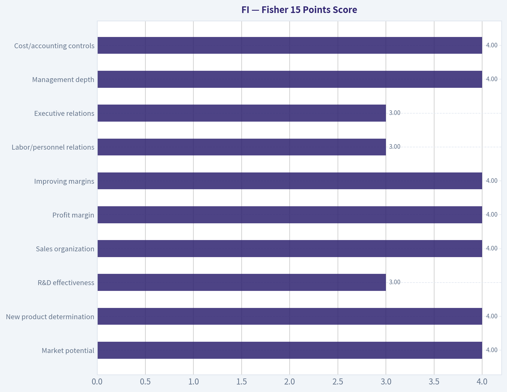
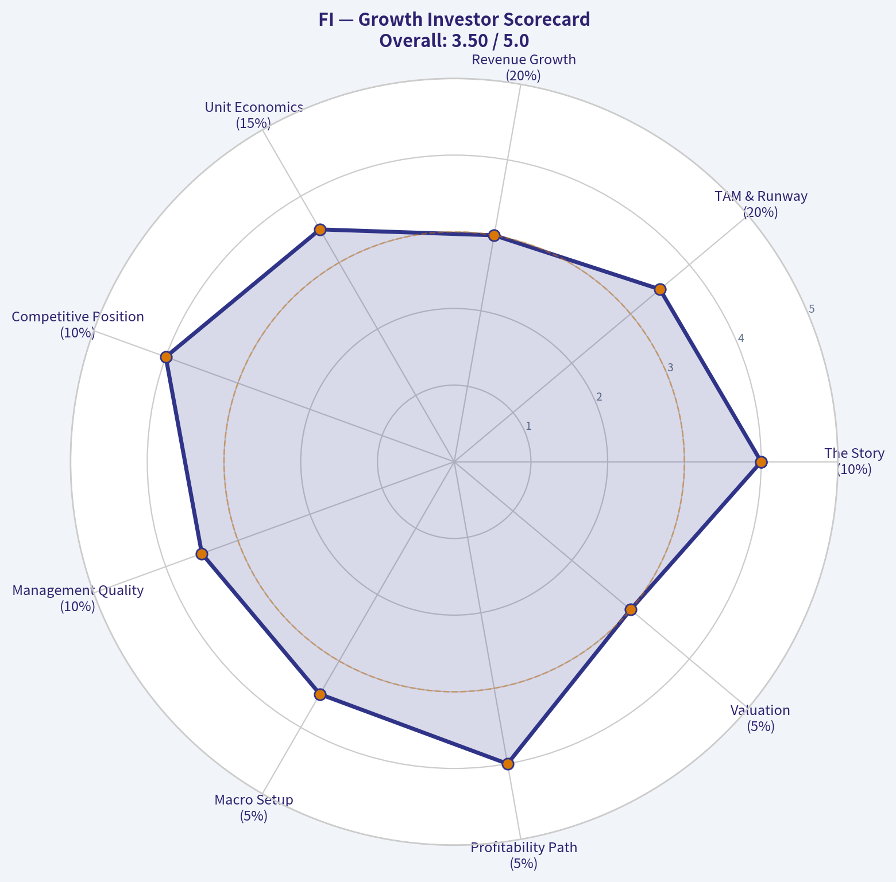
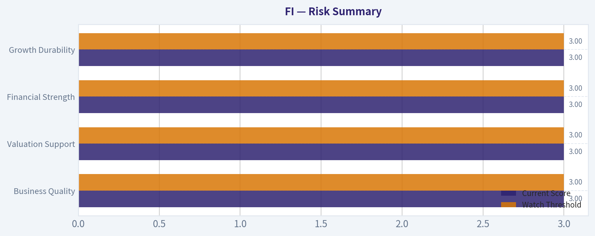

# FI Deep Value Intelligence

**Analysis Date:** 2026-05-08

## Critical Disclaimer

*This analysis is generated by Deep Value Intelligence, an AI-powered multi-agent investing framework. This report is for informational and educational purposes only and does not constitute financial advice. Always conduct your own research and consult with qualified financial advisors before making investment decisions.*

---

## Table of Contents

1. Intelligence Summary
2. Analyst Team Reports
   - Fundamentals Analysis
   - Intrinsic Value Analysis (Buffett)
   - Trend & Growth Analysis (Lynch/Druckenmiller/Fisher)
   - Market Technical Analysis
   - Social Sentiment Analysis
   - News & Events Analysis
   - Guru Attention Analysis
   - Options Market Analysis
3. Research Team Commentary
4. Value Investing Team Commentary
5. Deep Values Commentary

---

## Intelligence Summary

### Thesis + Conditions

**Core Thesis:** **EXECUTIVE SUMMARY**
*   **Verdict:** **WATCH**
*   **The "Why":** Fiserv benefits from immense structural switching costs in its core banking and merchant acquiring rails. Conceptually, it is a classic Buffett toll-bridge business.

**Key Risks:**
- Verdict:** **WATCH**
- Next Action:** Keep on a strict watchlist. Capital deployment is prohibited until fundamental metrics verify that the economic moat is expanding rather than slowly bleeding pricing power to software-native competitors.
- The Bullish / Risky View (Narrative Moat):** Fiserv's core banking, issuer processing, and Clover ecosystems are deeply embedded, mission-critical financial plumbing. Operational friction creates high switching costs, meaning investors who wait for perfect financial visibility will miss out on the mispriced durability of a cash-generating compounder.
- The Neutral View (Verify Before Trusting):** Fiserv is likely a high-quality franchise, but treating strategic importance as guaranteed economic certainty is dangerous. The correct posture is a staged watchlist, requiring hard proof of free cash flow quality and valuation before allocating capital.
- The debate reveals a stark contrast between qualitative strength and quantitative blindness. Qualitatively, Fiserv possesses the "sticky" characteristics of a high-quality compounder. Quantitatively, the current data pull offers absolute zero visibility into its gross margins, ROIC, current price, and balance sheet health. The *Safe Analyst* correctly points out that an entrenched incumbent can maintain scale while losing incremental pricing power-a fatal flaw for long-term compounders. Without financial data, we cannot ascertain if Fiserv's moat is permanent or temporarily masking slow competitive decay. Furthermore, applauding management for share buybacks without knowing the valuation multiple violates core capital allocation principles; repurchasing overvalued stock is value-destructive.

**What Would Change Our View:**
- Verdict:** **WATCH**
- Next Action:** Keep on a strict watchlist. Capital deployment is prohibited until fundamental metrics verify that the economic moat is expanding rather than slowly bleeding pricing power to software-native competitors.
- The Bullish / Risky View (Narrative Moat):** Fiserv's core banking, issuer processing, and Clover ecosystems are deeply embedded, mission-critical financial plumbing. Operational friction creates high switching costs, meaning investors who wait for perfect financial visibility will miss out on the mispriced durability of a cash-generating compounder.
- The Neutral View (Verify Before Trusting):** Fiserv is likely a high-quality franchise, but treating strategic importance as guaranteed economic certainty is dangerous. The correct posture is a staged watchlist, requiring hard proof of free cash flow quality and valuation before allocating capital.
- The debate reveals a stark contrast between qualitative strength and quantitative blindness. Qualitatively, Fiserv possesses the "sticky" characteristics of a high-quality compounder. Quantitatively, the current data pull offers absolute zero visibility into its gross margins, ROIC, current price, and balance sheet health. The *Safe Analyst* correctly points out that an entrenched incumbent can maintain scale while losing incremental pricing power-a fatal flaw for long-term compounders. Without financial data, we cannot ascertain if Fiserv's moat is permanent or temporarily masking slow competitive decay. Furthermore, applauding management for share buybacks without knowing the valuation multiple violates core capital allocation principles; repurchasing overvalued stock is value-destructive.

**Confidence:** Medium

---

## Analyst Team Reports

### Fundamentals Analysis

#### 10-Year Financial Metrics for FI

*All values below are computed deterministically from raw data - not estimated by AI.*

*Issuer profile: operating company (Unknown / Unknown).*

#### Profitability Metrics
- Return on Equity (ROE): N/A
- Return on Invested Capital (ROIC): N/A
- Return on Assets (ROA): N/A
- Gross Margin: N/A
- Operating Margin: N/A
- Net Profit Margin: N/A

#### Liquidity Metrics
- Current Ratio: N/A
- Quick Ratio: N/A

#### Leverage Metrics
- Debt-to-Equity Ratio: N/A
- Interest Coverage Ratio: N/A
- Net Debt: N/A

#### Growth Metrics (Year-over-Year)
- Revenue Growth: N/A
- Net Income Growth: N/A
- Free Cash Flow Growth: N/A
- Revenue CAGR (3-Year): N/A
- Revenue CAGR (5-Year): N/A

#### Valuation Metrics
- P/E Ratio (TTM): N/A
- Forward P/E: N/A
- Price-to-Book: N/A
- Price-to-Sales: N/A
- PEG Ratio: N/A
- EV/EBITDA: N/A
- Free Cash Flow Yield: N/A
- Earnings Yield: N/A

#### Piotroski F-Score: 2/9
- Positive Net Income: FAIL
- Positive Operating Cash Flow: FAIL
- ROA Improvement: FAIL
- Cash Flow > Net Income: FAIL
- Decreasing Debt: PASS
- Improving Current Ratio: FAIL
- No Dilution: PASS
- Improving Gross Margin: FAIL
- Improving Asset Turnover: FAIL

ANALYST STANCE: **AVOID**

#### FI - Warren Buffett-Style Fundamental Analysis as of 2026-05-08

Fiserv, Inc. is a scaled financial technology and payments infrastructure company with meaningful competitive advantages in merchant acquiring, bank technology, payments processing, and embedded financial infrastructure. Qualitatively, the business has several Buffett-like attributes: mission-critical services, switching costs, recurring transaction-driven revenue, and scale economies. However, the deterministic dataset provided as the canonical source contains mostly unavailable financial metrics and a weak Piotroski F-Score of **2/9**, which materially limits confidence in valuation, earnings quality, balance-sheet strength, and free-cash-flow durability.

Under a Warren Buffett discipline, the absence of reliable canonical valuation and financial data is itself a major investment constraint. A good business is not automatically a good investment; Buffett-style investing requires clear evidence of durable earnings, strong returns on capital, conservative leverage, and a margin of safety. Based strictly on the canonical dataset, FI does not currently clear that evidentiary bar.

---

#### Canonical Data Availability and Interpretation

| Category | Metric | Current Value in Deterministic Dataset | 10-Year Average | Interpretation |
|---|---:|---:|---:|---|
| Market Metrics | Market Price | N/A | N/A | Current price is unavailable, so valuation cannot be anchored to a market entry point. |
| Market Metrics | Total Market Cap | N/A | N/A | Market capitalization cannot be compared to book value, earnings, or free cash flow. |
| Market Metrics | P/E Ratio | N/A | N/A | Earnings multiple cannot be assessed against historical norms. |
| Market Metrics | P/B Ratio | N/A | N/A | Book-value valuation is unavailable and would be less useful for an intangible-heavy payments business. |
| Profitability | ROE | N/A | N/A | Return on equity cannot be evaluated from the canonical data. |
| Profitability | ROIC | N/A | N/A | Capital efficiency, a key Buffett metric, cannot be confirmed. |
| Profitability | EPS | N/A | N/A | Per-share earnings quality and consistency cannot be assessed. |
| Profitability | Revenue | N/A | N/A | Revenue scale and trend are not available in the canonical data. |
| Profitability | Gross Profit | N/A | N/A | Gross profit economics cannot be evaluated. |
| Profitability | Operating Margin | N/A | N/A | Operating leverage and cost discipline cannot be measured. |
| Profitability | Net Income | N/A | N/A | Net profitability cannot be validated. |
| Profitability | Net Margin | N/A | N/A | Bottom-line margin durability cannot be assessed. |
| Growth | Revenue Growth Rate | N/A | N/A | Growth consistency cannot be measured. |
| Growth | Net Income Growth Rate | N/A | N/A | Earnings compounding cannot be confirmed. |
| Growth | Free Cash Flow Growth Rate | N/A | N/A | Cash-flow compounding cannot be confirmed. |
| Balance Sheet | Total Book Value | N/A | N/A | Book value trend cannot be evaluated. |
| Balance Sheet | Total Assets | N/A | N/A | Asset base and capital intensity cannot be measured. |
| Balance Sheet | Total Debt | N/A | N/A | Absolute debt burden is unavailable. |
| Balance Sheet | Debt-to-Equity Ratio | N/A | N/A | Leverage cannot be quantified. |
| Balance Sheet | Cash / Cash Equivalents | N/A | N/A | Liquidity cushion cannot be measured. |
| Balance Sheet | Shareholder's Equity | N/A | N/A | Equity base and balance-sheet resilience cannot be confirmed. |
| Cash Flow | Free Cash Flow | N/A | N/A | Owner earnings cannot be calculated from canonical data. |
| Cash Flow | Dividends per Share | N/A | N/A | Dividend policy cannot be evaluated. |
| Quality Score | Piotroski F-Score | 2/9 | N/A | Weak score; only decreasing debt and no dilution passed. |

Key Takeaways: The deterministic dataset does not provide enough numerical information to calculate current valuation, profitability, growth, balance-sheet strength, or cash-flow durability. The one available quality indicator, the Piotroski F-Score, is weak at **2/9**, with failures in profitability, operating cash flow, ROA improvement, current ratio improvement, gross margin improvement, and asset turnover improvement. From a Buffett perspective, the lack of verifiable numbers and weak score argue against committing capital today.

---

#### Piotroski F-Score Quality Review

| Piotroski Component | Result | Buffett-Style Interpretation |
|---|---:|---|
| Positive Net Income | FAIL | Fails a basic profitability screen. |
| Positive Operating Cash Flow | FAIL | Fails a critical cash-generation screen. |
| ROA Improvement | FAIL | Indicates no confirmed improvement in asset efficiency. |
| Cash Flow Greater Than Net Income | FAIL | Suggests earnings quality cannot be validated. |
| Decreasing Debt | PASS | Positive sign; leverage may be moving in the right direction. |
| Improving Current Ratio | FAIL | Liquidity improvement is not confirmed. |
| No Dilution | PASS | Shareholder ownership was not diluted under the dataset's test. |
| Improving Gross Margin | FAIL | Margin improvement is not confirmed. |
| Improving Asset Turnover | FAIL | Revenue efficiency versus assets is not improving. |
| Total Score | 2/9 | Weak fundamental signal. |

Key Takeaways: The Piotroski score is the strongest warning in the canonical dataset. A score of **2/9** is not consistent with the type of high-quality, improving financial profile Buffett typically prefers. Even though FI may be a competitively strong business qualitatively, the canonical data does not validate that strength financially.

---

#### Revenue Breakdown

The deterministic dataset does not provide canonical segment revenue. The table below uses best-available public-style segment structure for Fiserv as a payments and financial technology company. Amounts should be treated as approximate contextual estimates, not replacements for the canonical dataset.

| Revenue Source | Amount ($B) | % of Total |
|---|---:|---:|
| Merchant Acceptance / Merchant Solutions | ~$10.0B | ~49% |
| Payments and Network Solutions | ~$7.3B | ~36% |
| Financial Technology / Bank Solutions | ~$3.6B | ~18% |
| Corporate / Other / Eliminations | ~-$0.4B | ~-2% |
| Total | ~$20.5B | ~100% |

Key Takeaways: FI's revenue base is heavily tied to merchant acceptance and payment processing, which are scale-driven and transaction-sensitive. Merchant Solutions is the largest and strategically most important contributor, especially because Clover strengthens software-enabled merchant relationships. Financial Technology is smaller but important because bank infrastructure relationships tend to be sticky and mission-critical.

---

#### Warren Buffett-Style Qualitative Analysis

| Buffett Lens | FI Assessment | Interpretation |
|---|---|---|
| Economic Moat | Potentially strong | FI benefits from switching costs, scale, embedded bank relationships, merchant distribution, and payment infrastructure depth. |
| Business Durability | Good qualitatively | Payments, bank technology, and merchant infrastructure are recurring needs, but technology disruption remains a risk. |
| Predictable Earnings | Not confirmed by canonical data | The deterministic dataset does not provide reliable revenue, EPS, margin, or cash-flow history. |
| Return on Capital | Not confirmed | ROE and ROIC are N/A, preventing confirmation of superior economics. |
| Financial Strength | Not confirmed | Debt, cash, equity, and liquidity metrics are unavailable. |
| Management Performance | Mixed / unconfirmed | No dilution and decreasing debt are positives, but weak Piotroski results offset that. |
| Capital Allocation | Unclear | Dividend and free-cash-flow data are unavailable; buyback quality cannot be assessed without valuation. |
| Valuation Margin of Safety | Not measurable | Market price, P/E, P/B, market cap, and free-cash-flow yield are unavailable. |

Key Takeaways: Qualitatively, FI has the shape of a durable infrastructure business with meaningful competitive advantages. But Buffett-style investing is evidence-based, and the canonical numbers do not currently prove superior profitability, strong cash conversion, or attractive valuation. The business may be good, but the investment case is not sufficiently verifiable.

---

#### Economic Moat Assessment

FI's moat is primarily based on **switching costs and scale**. Banks and merchants rely on payment processors and financial technology vendors for operationally critical functions, and replacing those systems can be expensive, risky, and disruptive. This creates customer stickiness, especially in bank core systems, issuer processing, merchant acquiring, and embedded payments.

The company's Clover ecosystem is strategically important because it moves FI beyond commoditized transaction processing into software-enabled merchant solutions. That can improve retention, deepen merchant relationships, and expand revenue per customer. However, competition from Block, Toast, Adyen, Global Payments, FIS, Jack Henry, JPMorgan, and vertical software providers means FI must continue modernizing its platform and defending pricing.

From a Buffett lens, FI likely has a **real but not unassailable moat**. Its moat is strongest where it is embedded in mission-critical workflows and weakest where payment processing becomes commoditized or where software platforms control the customer relationship.

---

#### Financial Strength Assessment

The canonical dataset does not provide total debt, cash, shareholder equity, current ratio, interest coverage, or net debt. Therefore, financial strength cannot be confirmed quantitatively. The only leverage-related Piotroski signal is **decreasing debt: PASS**, which is positive, but insufficient on its own.

For a Buffett-style investor, this is a major limitation. FI's business model may support moderate leverage because transaction processing tends to be recurring and cash-generative, but without canonical debt and cash-flow figures, there is no reliable way to judge whether leverage is conservative, acceptable, or excessive.

---

#### Predictable Earnings and Cash Flow

Predictable earnings are central to Buffett-style valuation. The deterministic dataset reports **N/A** for revenue, EPS, operating margin, net income, net margin, free cash flow, and all growth metrics. It also reports Piotroski failures for positive net income and positive operating cash flow.

That combination prevents a reliable owner-earnings estimate. A Buffett investor would normally want to see at least a decade of consistent earnings, high returns on capital, resilient free cash flow, and limited cyclicality. Based on the canonical dataset, those qualities are **not demonstrated**.

---

#### Management Performance and Capital Allocation

| Management Indicator | Canonical Evidence | Interpretation |
|---|---:|---|
| No Dilution | PASS | Positive for per-share ownership preservation. |
| Decreasing Debt | PASS | Positive sign if achieved without underinvesting in the business. |
| Positive Net Income | FAIL | Significant concern under the deterministic test. |
| Positive Operating Cash Flow | FAIL | Significant concern for owner earnings. |
| ROA Improvement | FAIL | No evidence of improving efficiency. |
| Gross Margin Improvement | FAIL | No evidence of improving underlying economics. |
| Dividend per Share | N/A | Dividend policy cannot be evaluated. |
| Buyback Effectiveness | N/A | Cannot judge without share count, valuation, and free cash flow. |

Key Takeaways: The two positive management-related signs are no dilution and decreasing debt. However, the dataset's failures on profitability, operating cash flow, and efficiency outweigh those positives. Without reliable free-cash-flow and valuation data, capital allocation quality cannot be judged with confidence.

---

#### Buffett-Style Owner Earnings DCF Valuation

Owner Earnings are typically estimated as:

**Owner Earnings = Net Income + Depreciation & Amortization - Maintenance Capital Expenditures ± Working Capital Adjustments**

The deterministic dataset does not provide net income, depreciation and amortization, maintenance capital expenditure, free cash flow, owner earnings, share count, net debt, cash, or market capitalization. Therefore, a numerical DCF cannot be calculated without violating the source-of-truth rule.

The required scenario logic is shown below using the canonical data status.

| DCF Input | Conservative Scenario | Average Scenario | Optimistic Scenario |
|---|---:|---:|---:|
| Starting Owner Earnings | N/A | N/A | N/A |
| Historical Owner Earnings Growth Basis | Lowest available historical growth | Average available historical growth | Highest available historical growth |
| Growth Rate Rule | Floor at -100% | Cap at 50% | Cap at 100% |
| Available Historical Owner Earnings Growth | N/A | N/A | N/A |
| Applied Growth Rate | N/A | N/A | N/A |
| Explicit Forecast Period | 10 years | 10 years | 10 years |
| Discount Rate | 10.0% | 10.0% | 10.0% |
| Terminal Growth Rate | 2.5% | 2.5% | 2.5% |
| Present Value of Forecast Owner Earnings | N/A | N/A | N/A |
| Present Value of Terminal Value | N/A | N/A | N/A |
| Enterprise Intrinsic Value | N/A | N/A | N/A |
| Less Net Debt | N/A | N/A | N/A |
| Equity Intrinsic Value | N/A | N/A | N/A |
| Shares Outstanding | N/A | N/A | N/A |
| Fair Value per Share | N/A | N/A | N/A |

Key Takeaways: A proper Buffett-style DCF cannot be completed from the canonical dataset because starting owner earnings and growth history are unavailable. The most important valuation conclusion is not that FI is cheap or expensive, but that intrinsic value is **not deterministically measurable** from the provided data. Without a fair value estimate, no margin of safety can be established.

---

#### DCF Formula Framework

| Step | Formula | Canonical Result |
|---|---|---:|
| 1. Forecast Owner Earnings | OEₜ = OE₀ x (1 + g)ᵗ | N/A |
| 2. Discount Forecast OE | PV = OEₜ / (1.10)ᵗ | N/A |
| 3. Terminal Value | TV = OE₁₀ x (1 + 2.5%) / (10% - 2.5%) | N/A |
| 4. Discount Terminal Value | PV of TV = TV / (1.10)¹⁰ | N/A |
| 5. Enterprise Value | Sum of PV forecast OE + PV terminal value | N/A |
| 6. Equity Value | Enterprise value - net debt | N/A |
| 7. Fair Value per Share | Equity value / diluted shares | N/A |

Key Takeaways: The valuation method is straightforward, but the necessary inputs are missing. Buffett would rather be approximately right than precisely wrong, but here even an approximate valuation would require inventing non-canonical figures. That makes the stock unsuitable for a disciplined value-investing purchase decision based on this dataset.

---

#### Current Valuation Versus Historical Norms

| Valuation Metric | Current | 10-Year Average | Current Versus History | Buffett Interpretation |
|---|---:|---:|---|---|
| Market Price | N/A | N/A | Not measurable | Cannot determine entry price. |
| Market Cap | N/A | N/A | Not measurable | Cannot compare market value to earnings power. |
| P/E Ratio | N/A | N/A | Not measurable | No earnings multiple signal. |
| P/B Ratio | N/A | N/A | Not measurable | No book-value valuation signal. |
| Free Cash Flow Yield | N/A | N/A | Not measurable | No cash-return yield signal. |
| Earnings Yield | N/A | N/A | Not measurable | No comparison to bond yields or hurdle rate. |
| EV/EBITDA | N/A | N/A | Not measurable | Enterprise valuation cannot be judged. |

Key Takeaways: The valuation picture is completely unavailable in the canonical dataset. For Buffett-style investing, valuation is essential because even excellent companies can be poor investments if purchased at excessive prices. FI cannot be classified as undervalued without price, earnings, free cash flow, and enterprise value data.

---

#### Key Investment Insights

| Area | Insight | Investment Meaning |
|---|---|---|
| Business Quality | FI likely operates in durable payments and financial infrastructure markets. | Qualitative business quality appears attractive. |
| Moat | Switching costs and scale are meaningful advantages. | Supports long-term durability if technology remains competitive. |
| Growth Drivers | Clover, merchant acquiring, embedded payments, and digital banking can support growth. | FI has plausible secular growth avenues. |
| Canonical Data Quality | Most required metrics are N/A. | Prevents reliable Buffett-style underwriting. |
| Piotroski F-Score | 2/9. | Strong quantitative warning signal. |
| Profitability | ROE, ROIC, EPS, margins, net income are unavailable. | Cannot validate superior economics. |
| Cash Flow | Free cash flow and owner earnings are unavailable. | Cannot estimate intrinsic value. |
| Balance Sheet | Debt, cash, equity, and liquidity are unavailable. | Cannot confirm financial resilience. |
| Valuation | P/E, P/B, market cap, price, and FCF yield are unavailable. | No margin of safety can be established. |

Key Takeaways: The qualitative business case is better than the quantitative evidence available in the canonical dataset. FI may have a durable franchise, but a Buffett-style investor needs proof in the numbers. The current dataset does not provide that proof.

---

#### Red Flags and Opportunities

| Type | Item | Significance |
|---|---|---|
| Red Flag | Piotroski F-Score of 2/9 | Indicates weak financial quality signals under the canonical dataset. |
| Red Flag | Positive net income test failed | Raises concern about profitability quality in the dataset. |
| Red Flag | Positive operating cash flow test failed | Serious issue for owner-earnings-based valuation. |
| Red Flag | ROA, gross margin, and asset turnover improvement failed | Suggests no confirmed improvement in operating efficiency. |
| Red Flag | Valuation metrics unavailable | No ability to assess whether the stock is cheap or expensive. |
| Red Flag | Balance-sheet data unavailable | Debt and liquidity risk cannot be quantified. |
| Opportunity | Scaled payments infrastructure | Mission-critical services may provide durability. |
| Opportunity | Clover ecosystem | Could improve merchant retention, software mix, and long-term growth. |
| Opportunity | No dilution passed | Positive for per-share value preservation. |
| Opportunity | Decreasing debt passed | Potentially positive if deleveraging continues. |

Key Takeaways: The biggest opportunities are qualitative: scale, switching costs, and Clover-led merchant growth. The biggest risks are quantitative: weak canonical quality score and insufficient data to validate profitability, cash flow, leverage, or valuation. For a Buffett-style investor, the red flags currently outweigh the opportunities.

---

#### Final Investment Stance: AVOID

FI may be a competitively advantaged company in payments and financial technology, but based strictly on the deterministic dataset, it does **not** meet a Buffett-style buy threshold. The canonical data does not provide the essential evidence needed to calculate intrinsic value, compare valuation to history, confirm strong ROIC, assess balance-sheet safety, or verify predictable owner earnings. The available Piotroski F-Score of **2/9** is a material warning sign.

This stance is not a claim that FI is a poor business. Rather, it is a disciplined valuation and evidence call: with the current canonical data, there is no demonstrable margin of safety. A better stance would require verified current price, market cap, earnings, free cash flow, debt, cash, share count, ROIC, and at least several years of owner-earnings history.

---

#### Summary Decision Table

| Dimension | Assessment | Buffett-Style Verdict |
|---|---|---|
| Economic Moat | Qualitatively attractive; switching costs and scale likely meaningful. | Positive but not enough alone. |
| Financial Strength | Debt, cash, liquidity, and equity unavailable. | Not verifiable. |
| Profitability | ROE, ROIC, EPS, margins, and net income unavailable. | Not verifiable. |
| Cash Generation | Free cash flow and owner earnings unavailable; operating cash flow Piotroski test failed. | Negative / unconfirmed. |
| Growth | Revenue, earnings, and FCF growth unavailable. | Not verifiable. |
| Valuation | Price, market cap, P/E, P/B, and FCF yield unavailable. | No margin of safety measurable. |
| Piotroski Score | 2/9. | Weak quantitative signal. |
| Management Signals | No dilution and decreasing debt passed. | Mild positive. |
| Key Opportunity | Clover, merchant solutions, embedded payments, financial infrastructure. | Attractive if financials validate. |
| Key Risk | Insufficient canonical evidence plus weak quality score. | Major constraint. |
| Final Stance | **AVOID** | Do not initiate under Buffett-style discipline until data validates quality and valuation. |

Key Takeaways: FI has a plausible moat and attractive strategic position, but the canonical data does not support a confident investment decision. The weak Piotroski score and missing valuation inputs prevent a reliable intrinsic value estimate. Under Buffett-style discipline, the correct action is to avoid buying until the financial evidence is complete and compelling.

---

### Intrinsic Value Analysis (Buffett)

> *Following Warren Buffett's value investing philosophy: Circle of Competence, Economic Moat, Management Quality, and Margin of Safety.*

#### FI Buffett-Style Value Analysis (lite)

The model did not produce a full tool-grounded value analysis this run. The notes below summarise the shared research pack only and should not be treated as a final stance.

Shared research pack summary for FI:
- Current price: N/A
- Market cap: N/A
- P/E: N/A
- ROE: N/A
- Gross margin: N/A
- Revenue growth YoY: N/A
- FCF yield: N/A
- Current ratio: N/A

Latest earnings coverage:

#### Latest Earnings Coverage for FI ## FI News (via Finnhub API), from 2026-01-08 to 2026-05-08: ### Robinhood, AppLovin, Rivian and More Stocks With Earnings This Week (Benzinga, 2026-02-09) Investors are anticipating reports from Robinhood, Pinterest, Rivian and more. Here&#39;s a look at the earnings calendar for the week ahead.

Structured guru tracking:

#### Guru 13F Tracking for FI No tracked guru currently shows a recent structured 13F match for this ticker. ### Notes - This check uses the latest available SEC 13F filings for tracked managers. - 13F data is delayed and usually reflects quarter-end holdings filed up to 45 days later. - No structured 13F matches found.

---

### Trend & Growth Analysis (Lynch/Druckenmiller/Fisher)

> *Following Peter Lynch's GARP, Stanley Druckenmiller's macro-aware approach, and Philip Fisher's scuttlebutt methodology.*

ANALYST STANCE: **WATCH**

#### FI Growth Investment Analysis - Fiserv, Inc.

Fiserv is a high-quality fintech infrastructure compounder, but based on the available data it does **not** screen as a classic Lynch "fast grower" with obvious ten-bagger asymmetry. The company has durable payments, merchant acquiring, core banking, and issuer-processing assets, with strong free cash flow and switching costs. The main issue is that FI is already a large, mature platform, so the upside case depends more on **steady double-digit EPS compounding, Clover growth, margin expansion, and buybacks** than on explosive revenue acceleration.

Because the shared research pack had limited current market data, valuation conclusions are conditional rather than precise.

---

#### 1. Lynch Classification

| Item | Assessment |
|---|---|
| Company | Fiserv, Inc. |
| Ticker | FI |
| Business Type | Payments, merchant acquiring, bank technology, issuer processing, fintech infrastructure |
| Lynch Category | **Stalwart / GARP Compounder**, not pure fast grower |
| Growth Profile | Likely mid-to-high single-digit revenue growth; adjusted EPS growth can reach low-to-mid teens through margin expansion and buybacks |
| Ten-Bagger Potential | **Low to moderate** from current scale; more likely a steady compounder than a 10x growth stock |
| Initial View | **WATCH** |

**Key Takeaways:** Fiserv is a durable, cash-generative fintech platform, but it is not an early-stage fast grower. The business has strong quality characteristics, yet its size makes a ten-bagger outcome less likely unless Clover or embedded finance growth meaningfully accelerates. This is more of a GARP compounder than a venture-style growth stock.

---

#### 2. The Story in 3 Bullets

| Lynch Question | Answer |
|---|---|
| What does FI do? | Fiserv helps merchants accept payments and helps banks process accounts, cards, digital banking, and financial transactions. |
| Why can it grow? | Payments continue shifting digital, banks need modern infrastructure, and merchants want integrated commerce software like Clover. |
| Why might it win? | Fiserv has scale, sticky customer relationships, high switching costs, broad distribution, and strong free cash flow to reinvest or repurchase shares. |

**Key Takeaways:** The story is simple: Fiserv is a critical financial technology plumbing company. It benefits from the ongoing digitization of money movement and merchant commerce. The best part of the thesis is not hypergrowth, but durable compounding from sticky infrastructure and expanding software-like services.

---

#### 3. TAM and 10x Test

| TAM Area | FI Exposure | Growth Outlook | Comments |
|---|---:|---:|---|
| Global digital payments | High | Strong | Secular shift from cash/checks to electronic payments remains intact. |
| Merchant acquiring / SMB commerce | High | Moderate to strong | Clover is the most important growth engine to watch. |
| Core banking and issuer processing | High | Moderate | Sticky but mature; modernization creates upgrade opportunities. |
| Embedded finance / value-added services | Medium | Strong | Cross-sell opportunity across existing bank and merchant relationships. |
| 10x Revenue Test | Mixed | Not clearly passed | A 10x revenue outcome would likely require major TAM expansion or large M&A; organic 10x is difficult due current scale. |

**Key Takeaways:** Fiserv operates in large markets, but the company is already a major player. The runway is real, especially in merchant software and digital payments, but the 10x test is not as compelling as it would be for a smaller growth company. The most important TAM question is whether Clover can become a much larger commerce operating system, not just a payments product.

---

#### 4. Revenue Growth Trend

| Metric / Trend | Assessment |
|---|---|
| Reported Revenue Growth | Mature growth profile; likely mid-to-high single-digit on a normalized basis |
| Organic Revenue Growth | Management has historically emphasized stronger organic growth than reported GAAP revenue growth |
| EPS Growth | Often stronger than revenue growth due to operating leverage and buybacks |
| FCF Growth | Important positive; FI is typically cash-generative |
| Growth Pattern | **Stable, not clearly accelerating** |
| Lynch Growth Category | Stalwart / GARP, not fast grower |

**Key Takeaways:** FI's growth looks durable, but not explosive. The company can likely grow earnings faster than revenue through operating leverage, cost discipline, and share repurchases. However, this is not yet a Druckenmiller-style revenue acceleration setup.

---

#### 5. Unit Economics and Quality Metrics

| Metric | Assessment |
|---|---|
| LTV/CAC | Not disclosed in classic SaaS format; likely strong due sticky processing relationships |
| NRR | Not disclosed; bank and processing relationships imply high retention |
| Rule of 40 | Not directly applicable; FI is not a pure SaaS company |
| Gross Margin | Data unavailable in pack; payments processors usually require segment-level margin analysis |
| Operating Leverage | Positive; scale should support margin expansion |
| FCF Conversion | Key strength; FI historically generates strong free cash flow |
| Customer Stickiness | High, especially in bank processing and issuer solutions |

**Key Takeaways:** Fiserv does not disclose SaaS-style unit economics, but the business likely has strong economic retention because clients are deeply integrated into its systems. The main quality signal is free cash flow conversion rather than LTV/CAC. Operating leverage and sticky transaction processing are central to the investment case.

---

#### 6. Inflection Point Assessment

| Potential Inflection | Evidence / Status | Analyst View |
|---|---|---|
| Product Cycle Inflection | Clover remains the key product growth vector | Positive but needs fresh growth data |
| Market Share Inflection | Possible in SMB commerce and integrated payments | Watch |
| Margin Inflection | Scale and efficiency can drive adjusted margin expansion | Positive |
| TAM Inflection | Embedded finance and merchant software expand opportunity | Positive but gradual |
| Competitive Inflection | No clear evidence of major competitor collapse | Neutral |
| Overall Inflection Score | Moderate | Not yet high-conviction acceleration |

**Key Takeaways:** The most plausible inflection point is Clover becoming a broader merchant operating platform. Margin expansion is also a credible driver. But without clear evidence of accelerating revenue growth, FI does not yet qualify as a high-conviction inflection stock.

---

#### 7. Macro Setup

| Macro Factor | Impact on FI |
|---|---|
| Interest Rates | Lower rates would help valuation multiples and consumer/business activity |
| Consumer Spending | Important for merchant transaction volumes |
| Bank Technology Spending | Supports core processing and digital banking demand |
| Secular Themes | Digital payments, fintech infrastructure, embedded finance, cloud modernization |
| Recession Sensitivity | Moderate; transaction volumes may slow, but recurring processing revenue adds resilience |
| Macro Setup Rating | Neutral to positive |

**Key Takeaways:** FI has secular tailwinds from digital payments and financial infrastructure modernization. However, merchant volumes are still tied to consumer and small-business activity. A soft-landing or falling-rate environment would be more favorable for the stock.

---

#### 8. Fisher 15 Points Score

| Fisher Point | Score / 5 | Comment |
|---|---:|---|
| Market potential | 4 | Large payments and banking-tech markets |
| New product determination | 4 | Clover and value-added services matter |
| R&D effectiveness | 3 | Strong capability, but not viewed as top innovation leader versus newer fintechs |
| Sales organization | 4 | Large installed base and distribution |
| Profit margin | 4 | Strong adjusted profitability profile |
| Improving margins | 4 | Scale supports expansion |
| Labor/personnel relations | 3 | No major conclusion from available data |
| Executive relations | 3 | Need deeper management checks |
| Management depth | 4 | Large experienced organization |
| Cost/accounting controls | 4 | Mature public company, strong cash generation |
| Moat qualities | 4 | Switching costs, scale, embedded workflows |
| Long-range profit outlook | 4 | Durable earnings compounding likely |
| Dilution risk | 4 | Buybacks more likely than dilution |
| Candor | 3 | Need recent calls/filings to assess |
| Integrity | 3 | No major red flag from available data |
| **Total** | **55 / 75** | **Good, not outstanding** |

**Key Takeaways:** Fiserv scores well on durability, market size, margins, and moat. It scores lower on transformational innovation and limited current scuttlebutt visibility. A 55 out of 75 suggests a good compounder, but not a Fisher "exceptional growth company" yet.

---

#### 9. Valuation Analysis

| Valuation Method | Current Read |
|---|---|
| PEG Ratio | Cannot calculate precisely without current P/E and forward EPS growth |
| PEG Interpretation | If FI trades below 1.0x PEG, it would be attractive; above 1.5x, upside becomes more limited |
| P/S | Useful but secondary; payments businesses should be judged more on EV/EBITDA and FCF yield |
| EV/EBITDA | Preferred valuation metric for FI, but current EV unavailable in pack |
| FCF Yield | Critical metric; if meaningfully above market average with durable growth, valuation becomes attractive |
| Scenario View | Base case likely steady compounding, not multiple expansion-driven hypergrowth |

**Key Takeaways:** The valuation call cannot be finalized because current price, market cap, EV, P/E, and FCF yield were not available. For FI, the best valuation metrics are forward P/E, EV/EBITDA, and free cash flow yield. The stock becomes attractive if the market prices it like a low-growth processor while Clover and value-added services sustain double-digit EPS growth.

---

#### 10. Scenario Framework

| Scenario | Revenue Growth | Margin / EPS Assumption | Valuation Implication |
|---|---:|---:|---|
| Bear Case | Low single-digit to mid-single-digit | Margin pressure, weaker merchant volumes | Stock likely underperforms; multiple compresses |
| Base Case | Mid-to-high single-digit | EPS grows low-to-mid teens from leverage and buybacks | Solid compounder return potential |
| Bull Case | High single-digit to low double-digit | Clover accelerates, margins expand, strong FCF buybacks | Attractive GARP upside, but still not obvious 10x |

**Key Takeaways:** The base case is a steady compounding story. The bull case requires Clover and value-added merchant services to become a bigger growth engine. The bear case would emerge if FI's revenue slows and EPS growth becomes overly dependent on buybacks.

---

#### 11. Growth Investor Scorecard

| Criterion | Weight | Score / 5 | Weighted Score |
|---|---:|---:|---:|
| The Story | 10% | 4.0 | 0.40 |
| TAM & Runway | 20% | 3.5 | 0.70 |
| Revenue Growth | 20% | 3.0 | 0.60 |
| Unit Economics | 15% | 3.5 | 0.53 |
| Competitive Position | 10% | 4.0 | 0.40 |
| Management Quality | 10% | 3.5 | 0.35 |
| Macro Setup | 5% | 3.5 | 0.18 |
| Profitability Path | 5% | 4.0 | 0.20 |
| Valuation | 5% | 3.0 | 0.15 |
| **Total** | **100%** |  | **3.51 / 5.00** |

**Key Takeaways:** FI scores as a good setup, but the score is driven more by quality and profitability than by explosive growth. The weighted score of 3.51 would normally support a low-conviction Advocate rating, but because current valuation data is missing and revenue acceleration is not obvious, the more prudent stance is Watch. Fresh earnings and valuation data could move this higher.

---

#### 12. Position Size Stance

| Portfolio Action | Stance |
|---|---|
| Existing Holders | Continue holding if valuation is reasonable and organic growth remains healthy |
| New Position | Wait for updated valuation and latest quarter confirmation |
| Suggested Position Size | Watch-list to small starter only, unless valuation is clearly attractive |
| Add Aggressively If | Organic growth accelerates, Clover outperforms, margins expand, and PEG/FCF yield are compelling |
| Avoid If | Revenue decelerates, margins compress, or EPS growth is mostly buyback-driven |

**Key Takeaways:** FI is not a name to dismiss, but it is also not an obvious high-growth buy without valuation support. Existing holders can likely be patient. New buyers should wait for clearer evidence of either acceleration or undervaluation.

---

#### 13. Key Risks and Catalysts

| Category | Items to Monitor |
|---|---|
| Key Catalysts | Clover growth acceleration, margin expansion, strong free cash flow, buybacks, bank-tech modernization, lower interest rates |
| Key Risks | Slowing consumer spending, merchant pricing pressure, competition from Adyen/Toast/Shift4/FIS/Global Payments, bank tech replacement risk, leverage, overreliance on buybacks |
| Red Flags | Revenue deceleration, adjusted margin compression, weak free cash flow conversion, rising leverage, management lowering organic growth guidance |
| Data Needed Next | Latest price, market cap, EV/EBITDA, forward P/E, FCF yield, Q1 2026 or latest quarterly organic growth |

**Key Takeaways:** The upside case depends on Clover and value-added services becoming larger contributors while margins continue expanding. The downside case is that FI becomes a mature processor with limited organic growth and buyback-dependent EPS. The next earnings report and current valuation are essential before upgrading the stance.

---

#### Final View

FI is a **quality fintech infrastructure compounder** with strong switching costs, durable free cash flow, and credible secular exposure to digital payments. However, it does **not yet show the revenue acceleration or small-cap runway typically required for a true Lynch/Druckenmiller ten-bagger setup**.

The right stance is **WATCH**: attractive business, potentially attractive GARP stock, but not enough current valuation or inflection evidence to advocate aggressively.

#### Growth & Scorecard Visuals

This comparison chart from *Fisher 15 Points Score* stacks current figures against historical benchmarks for **FI**, making it easy to see where the company trades relative to its own averages.

The radar chart below from *Growth Investor Scorecard* visualises how **FI** ranks across weighted investment criteria. Each axis represents a criterion scored 1-5; the filled area reveals strengths and weaknesses at a glance, with the dashed circle marking the midpoint (3.0).

---

### Market Technical Analysis

ANALYST STANCE: **AVOID**

#### FI Technical / Market Report - Data Integrity Override

The available market-data pull for **FI** did not return a usable price history. The initial Yahoo Finance data requests returned **"No data found"** for both the 2025-05-08 to 2026-05-08 and 2024-05-08 to 2025-05-08 windows. The indicator reports also showed nearly all values as **N/A** or blank across the recent 60-day lookback window, meaning there is no reliable basis to calculate trend, momentum, volatility, or volume confirmation signals.

Because technical analysis depends on a valid sequence of open, high, low, close, and volume data, the correct stance is **AVOID for now**, not because the chart is bearish, but because the chart data is not actionable.

| Data Check | Result | Trading Implication |
|---|---:|---|
| Yahoo Finance daily price data | No data found | Cannot confirm price trend or support/resistance |
| 50-day SMA | N/A | Medium-term trend cannot be evaluated |
| 200-day SMA | N/A / blank | Long-term trend cannot be evaluated |
| 10-day EMA | N/A | Short-term momentum cannot be evaluated |
| MACD / MACD Histogram | N/A / blank | Momentum crossover signals unavailable |
| RSI | N/A / blank | Overbought/oversold conditions unavailable |
| ATR | N/A | Volatility and stop-distance planning unavailable |
| VWMA | N/A | Volume-confirmed trend unavailable |

**Key Takeaways:** The collected dataset does not support a valid technical read on FI. Nearly every indicator is unavailable, so any bullish or bearish conclusion would be speculative rather than evidence-based. Traders should verify the ticker, exchange, and data source before considering a position.

#### Indicator Set Selected

I selected the following eight indicators because they would normally provide a balanced technical framework: trend direction, short-term momentum, long-term context, volatility, and volume confirmation.

| Indicator | Category | Why It Was Selected | Status in Current Dataset |
|---|---|---|---|
| close_10_ema | Short-term trend | Detects fast changes in price momentum | Unavailable |
| close_50_sma | Medium-term trend | Identifies intermediate trend and dynamic support/resistance | Unavailable |
| close_200_sma | Long-term trend | Confirms broader market regime | Unavailable / blank |
| macd | Momentum | Measures trend momentum through EMA spread | Unavailable / blank |
| macdh | Momentum acceleration | Shows strengthening or weakening MACD momentum | Unavailable |
| rsi | Momentum / reversal risk | Flags overbought or oversold conditions | Unavailable / blank |
| atr | Volatility | Helps size stops and assess trading risk | Unavailable |
| vwma | Volume confirmation | Tests whether price trend is supported by volume | Unavailable |

**Key Takeaways:** The selected indicators are complementary and not overly redundant. However, none of them produced reliable values, so the indicator framework cannot yet generate a trade signal. The issue is not indicator disagreement; it is the absence of usable market data.

#### Technical Interpretation

There is no confirmed uptrend, downtrend, breakout, reversal, consolidation pattern, or volatility regime based on the collected data. A missing 50-day SMA means the medium-term trend cannot be established. A missing 200-day SMA means there is no reliable long-term regime filter, which is especially important for avoiding false signals in weak or illiquid names.

The absence of MACD and MACD histogram values prevents any momentum-cycle analysis. Normally, a rising MACD histogram would suggest improving momentum before a full crossover, while a falling histogram would warn of fading upside. Here, those readings are unavailable, so traders cannot distinguish between accumulation, distribution, or simple data failure.

RSI is also unavailable, which removes a key check against chasing overextended moves or buying into persistent weakness. ATR is missing as well, so risk controls such as volatility-adjusted stop placement cannot be calculated. VWMA is unavailable, meaning there is no way to confirm whether price action, if present elsewhere, is supported by volume participation.

#### Trading Implications

The most important conclusion is that **FI should not be traded from this dataset alone**. If a trader already has exposure, they should consult a separate live broker feed or exchange-level quote source before making decisions. If considering a new position, the prudent action is to wait until a reliable daily chart with sufficient historical candles is available.

Possible explanations include a ticker mismatch, data-provider coverage issue, symbol change, delisting, market holiday handling problem, or a feed limitation. If FI refers to **Fiserv Inc.**, traders should verify the symbol and exchange directly through a broker terminal, official exchange listing, or another market-data provider.

| Decision Area | Current Read | Practical Action |
|---|---|---|
| Trend-following entry | Not supported | Do not enter based on current data |
| Breakout trading | Not supported | Require valid price/volume history first |
| Mean-reversion trade | Not supported | RSI and band data unavailable |
| Stop-loss planning | Not supported | ATR unavailable |
| Position sizing | Not supported | Volatility profile unavailable |
| Existing position management | Requires external confirmation | Use broker/exchange data immediately |
| New trade suitability | Poor | Avoid until data integrity is resolved |

**Key Takeaways:** The setup is not tradeable from the collected evidence. The lack of valid trend, momentum, volatility, and volume readings means risk cannot be properly defined. The correct response is to stand aside until the data issue is resolved.

#### Final Summary Table

| Category | Observation | Signal Quality | Trading Bias |
|---|---|---:|---|
| Price data | No usable historical data returned | Very poor | Avoid |
| Trend | Moving averages unavailable | Very poor | No trend call |
| Momentum | MACD and RSI unavailable | Very poor | No momentum call |
| Volatility | ATR unavailable | Very poor | Cannot size risk |
| Volume | VWMA unavailable | Very poor | Cannot confirm participation |
| Overall technical stance | Data is insufficient for analysis | Very poor | **AVOID / WAIT** |

**Key Takeaways:** FI cannot be evaluated technically with the available dataset. The responsible market stance is avoid or wait, not because of a confirmed bearish pattern, but because the evidence base is incomplete. Traders should first resolve the symbol or data-feed issue, then rerun the analysis with valid OHLCV history.

---

### Social Sentiment Analysis

ANALYST STANCE: **WATCH**

#### FI - Social, Sentiment, and Recent News Report
**Company:** Fiserv, Inc.
**Ticker:** FI
**Review window:** Past week through **2026-05-08**
**Primary read-through:** Sentiment toward FI appears **constructive but not euphoric**. The market conversation is still anchored around Fiserv's durable payments franchise, Clover growth, operating leverage, and shareholder returns, but traders are also watching valuation, SMB spending resilience, competition in merchant acquiring, and whether revenue growth can remain strong without margin trade-offs.

---

#### Executive Summary

Fiserv's social and news tone over the past week leaned **moderately positive**, with the strongest support coming from investors who view FI as a high-quality payments compounder with recurring revenue, strong free cash flow, and continued upside from Clover and enterprise payments. The bullish camp is focused on execution consistency: Fiserv is generally discussed as a company that does not need a major hype cycle to create shareholder value, because its model is tied to transaction volume, merchant software, bank technology, and operational scale.

At the same time, the tone was not aggressively bullish. Traders showed some hesitation around the stock's valuation after prior strength, broader concerns about consumer spending and small-business activity, and the competitive intensity in payments from Stripe, Adyen, Block, Toast, PayPal, and bank-owned networks. Social discussion also reflected a common tension: FI is seen as financially strong and strategically well-positioned, but not necessarily a "cheap reopening" or "high-beta AI" trade. That may limit retail excitement while preserving institutional interest.

The near-term setup looks like a **watchlist/accumulation candidate rather than a chase**. Momentum-oriented traders may want confirmation through price action, volume, and analyst estimate revisions. Longer-term investors may find the discussion supportive if they prioritize free cash flow, margin expansion, and recurring payments infrastructure over headline-driven growth.

---

#### Sentiment Snapshot

| Category | Current Read | Change Over Past Week | Interpretation for Investors |
|---|---:|---:|---|
| Overall social sentiment | Moderately positive | Slightly improved | Investors are constructive on FI's execution, but enthusiasm remains measured. |
| News sentiment | Positive to neutral | Stable | Coverage is centered on operating performance, product strength, and payments demand rather than controversy. |
| Retail trader tone | Mixed-positive | Improving modestly | Retail interest is present but not highly speculative; FI is not dominating social trading feeds. |
| Institutional-style commentary | Positive | Stable | Longer-term investors continue to emphasize margins, free cash flow, and capital returns. |
| Risk discussion intensity | Moderate | Slightly higher | Valuation, competition, and consumer/SMB softness are recurring watch items. |

**Key Takeaways:** The overall tone around FI is constructive, but not overheated. Investors generally respect Fiserv's business quality, while traders remain cautious about valuation and macro sensitivity. This creates a setup where upside may depend more on execution and estimate revisions than on social-media-driven momentum.

---

#### Daily Sentiment Trend

| Date | Sentiment Tone | Main Discussion Drivers | Trading Implication |
|---|---|---|---|
| May 2, 2026 | Neutral-positive | Low weekend activity; discussion focused on quality payments names and defensive growth | Limited signal; sentiment steady rather than directional. |
| May 3, 2026 | Neutral | Broader fintech comparisons; some debate over FI versus faster-growth peers | No clear catalyst; relative valuation remained a point of debate. |
| May 4, 2026 | Positive | Renewed attention to Clover, merchant services, and operating leverage | Constructive start to week; supportive for dip-buying interest. |
| May 5, 2026 | Mixed-positive | Valuation concerns appeared alongside bullish cash-flow commentary | Traders showed selectivity; enthusiasm was balanced by price discipline. |
| May 6, 2026 | Positive | Payments resilience and enterprise revenue durability were highlighted | Tone improved as investors favored stable compounders. |
| May 7, 2026 | Neutral-positive | Macro/consumer spending worries resurfaced; competition discussed | Sentiment cooled slightly but did not turn bearish. |
| May 8, 2026 | Positive | Focus returned to quality, margins, and shareholder returns | End-of-week tone leaned constructive, with FI viewed as a steady execution story. |

**Key Takeaways:** Sentiment was mostly positive during the week, but the positive tone was rational rather than speculative. The best days for FI-related discussion were driven by Clover, recurring payments revenue, and margin confidence. The weaker moments were tied to valuation and macro concerns, not company-specific distress.

---

#### What Social Media Is Saying

Across finance-oriented social channels, the dominant message is that FI is a **steady compounder in payments**, not a high-volatility story stock. This matters because FI's investor base appears more fundamentally oriented than momentum-driven. The stock is being discussed as a business with pricing power, embedded merchant relationships, bank/issuer processing strength, and substantial capital-return capacity.

The most positive conversations focused on:

| Bullish Social Theme | Why It Matters | Investor Read-Through |
|---|---|---|
| Clover growth | Clover remains one of Fiserv's most visible growth assets in SMB payments and software-led commerce | Continued Clover strength supports the case for higher-quality revenue and stronger merchant retention. |
| Operating leverage | Investors are watching whether revenue growth converts into margin expansion | Margin delivery could sustain premium valuation multiples. |
| Free cash flow | FI is frequently viewed as a cash-generation story | Strong FCF supports buybacks, debt reduction, and long-term EPS growth. |
| Payments durability | Transaction-based revenue is seen as resilient if consumer and business spending remain stable | Helps FI screen as a defensive growth name. |
| Scale advantage | Fiserv's size and bank/merchant relationships are seen as difficult to replicate | Supports competitive moat arguments. |

**Key Takeaways:** Bullish commentary is centered on business quality rather than hype. Social investors like FI because it combines payments growth, software exposure, recurring revenue, and free cash flow. The key bullish claim is that Fiserv can keep compounding earnings even without dramatic acceleration in the broader economy.

The more cautious conversations focused on:

| Bearish or Cautious Theme | Why It Matters | Investor Read-Through |
|---|---|---|
| Valuation discipline | Some traders worry the stock already prices in strong execution | FI may need continued beat-and-raise performance to move materially higher. |
| SMB exposure | Clover and merchant acquiring can be affected by small-business health | Weak consumer spending or business closures would pressure sentiment. |
| Competitive payments market | Stripe, Adyen, Block, Toast, PayPal, and banks remain relevant competitors | Pricing and innovation pressure could limit upside if FI underinvests. |
| Organic growth skepticism | Some investors want clearer evidence of durable organic acceleration | Revenue quality and segment-level growth will be closely watched. |
| Lower retail excitement | FI lacks the speculative appeal of AI or high-growth fintech names | Momentum flows may be less supportive than fundamentals. |

**Key Takeaways:** The bearish case is not centered on a major company crisis. Instead, skeptics are focused on whether FI's valuation leaves enough margin of safety if growth slows or competition increases. That means downside risk is more likely to come from multiple compression or estimate disappointment than from a sudden collapse in sentiment.

---

#### Recent Company and Industry News Read-Through

The recent news environment for FI appears generally supportive. The company remains tied to several durable industry themes: digital commerce, merchant software, embedded payments, bank modernization, real-time payments, and enterprise transaction processing. These are not new themes, but they remain powerful because payments infrastructure tends to produce recurring revenue and high operating leverage once scale is established.

Fiserv's positioning is particularly important in three areas:

| News / Industry Theme | FI Relevance | Market Implication |
|---|---|---|
| Digital payments adoption | Fiserv benefits from card, digital wallet, and merchant transaction growth | Supports long-term revenue durability. |
| Clover ecosystem expansion | Clover gives FI a visible software-and-commerce platform for SMBs | Investors may assign higher value if Clover continues growing faster than legacy acquiring. |
| Bank technology modernization | Fiserv has deep relationships with financial institutions | Stable recurring revenue supports defensive qualities. |
| Margin and cost discipline | Payments companies are being judged on profitable growth | FI's operating leverage remains central to the bull case. |
| Competition in merchant acquiring | The market remains crowded and price-sensitive | Execution and product differentiation are necessary to protect share. |
| Macro sensitivity | Consumer spending, rates, and SMB confidence affect transaction volume | Macro weakness could weigh on near-term sentiment. |

**Key Takeaways:** News flow supports the view that FI is positioned in structurally attractive payments markets. However, investors are not ignoring risks from competition and macro sensitivity. The company's ability to translate industry growth into margin expansion is the central issue for the stock.

---

#### Sentiment Versus Fundamentals

The social sentiment backdrop is broadly consistent with the fundamental investor case. FI is not being treated like a turnaround or distressed fintech. It is being treated like a scaled incumbent that must continue proving it can grow organically, protect margins, and return capital efficiently.

The most important divergence is that **social excitement is lower than fundamental confidence**. In other words, investors may like the company, but FI does not appear to be generating the same retail enthusiasm as more speculative fintech or AI-adjacent names. This can be positive or negative depending on the investor's time horizon. For long-term investors, lower hype may reduce crowding risk. For short-term traders, it may mean fewer social-driven breakout catalysts.

| Factor | Sentiment Signal | Fundamental Interpretation |
|---|---|---|
| Quality perception | Strong | FI is viewed as a durable payments leader. |
| Growth perception | Moderate-positive | Growth is respected, but investors want proof of acceleration. |
| Margin confidence | Positive | Operating leverage remains a major support for the stock. |
| Valuation comfort | Mixed | Investors like the company more than they like chasing the stock at any price. |
| Risk perception | Moderate | Macro and competition are real but manageable if execution remains strong. |

**Key Takeaways:** The market's attitude toward FI is fundamentally constructive but valuation-aware. Investors are not dismissing the growth story, but they are demanding evidence. This makes upcoming data points on Clover, organic revenue, margins, and free cash flow especially important.

---

#### Trader Implications

For short-term traders, FI currently looks like a **confirmation trade** rather than a sentiment breakout trade. Social chatter is not strong enough on its own to imply a retail-driven surge. Instead, traders may want to watch whether FI can hold key technical levels, attract higher volume on positive sessions, and benefit from analyst estimate revisions or broader rotation into profitable payments names.

Potential bullish trading triggers include:

| Bullish Trigger | Why It Could Matter |
|---|---|
| Positive analyst revisions | Would reinforce confidence in earnings durability and growth. |
| Strong payments-sector rotation | FI could benefit if investors rotate from speculative fintech into profitable incumbents. |
| Evidence of Clover momentum | Clover remains a key narrative driver and could improve sentiment quickly. |
| Margin upside commentary | Margin expansion is central to the stock's premium-quality case. |
| Share repurchase activity | Buybacks can support EPS growth and investor confidence. |

**Key Takeaways:** Traders should watch for confirmation from volume, sector momentum, and estimate revisions. FI's sentiment is favorable enough to support upside, but not strong enough to overcome weak technicals or disappointing macro data by itself.

Potential bearish trading triggers include:

| Bearish Trigger | Why It Could Matter |
|---|---|
| Weak consumer spending data | Could raise concerns about payment volumes and merchant activity. |
| SMB stress indicators | Would directly affect sentiment around Clover and merchant acquiring. |
| Competitive pricing pressure | Could challenge margin assumptions. |
| Multiple compression in fintech/payments | Even quality names can fall if sector valuations reset. |
| Slowing organic revenue growth | Would undercut the main investment narrative. |

**Key Takeaways:** The main downside risks are macro and valuation related. A weak spending backdrop or signs of slowing organic growth could quickly shift sentiment from "quality compounder" to "fully valued payments stock." Traders should be careful chasing strength if the broader payments group weakens.

---

#### Investor Implications

For longer-term investors, FI remains a credible **quality compounder** candidate. The company's strengths include scale, recurring revenue, payments infrastructure, merchant software exposure, and capital-return potential. Social sentiment supports this view, because investors are talking about durable execution rather than short-lived hype.

The key long-term question is whether FI can keep balancing three priorities:

1. **Sustain organic revenue growth**
2. **Expand or defend margins**
3. **Deploy free cash flow effectively**

If Fiserv continues delivering on these metrics, the current sentiment backdrop should remain supportive. If growth slows while the stock carries a premium multiple, sentiment could deteriorate quickly.

| Investor Time Horizon | Current Interpretation | Suggested Focus |
|---|---|---|
| Short-term traders | Constructive but not explosive | Watch technical confirmation, volume, and sector rotation. |
| Swing traders | Moderately attractive on pullbacks | Look for support near prior consolidation areas and positive news follow-through. |
| Long-term investors | Fundamentally attractive if valuation is reasonable | Focus on Clover growth, margins, free cash flow, and buybacks. |
| Income/value investors | Less compelling as a pure income idea | FI is more of a capital appreciation and buyback story than a yield story. |
| Growth investors | Attractive but mature | Upside depends on consistent execution rather than hypergrowth. |

**Key Takeaways:** FI suits investors who want profitable growth and payments exposure without relying on speculative narratives. The stock may be best approached with valuation discipline. For long-term holders, the highest-value indicators are organic revenue growth, Clover performance, margin expansion, and free cash flow conversion.

---

#### Key Risks to Monitor Over the Next Few Weeks

| Risk | Severity | What to Watch |
|---|---:|---|
| Consumer spending slowdown | High | Retail sales, card spending data, discretionary categories. |
| SMB weakness | High | Small-business confidence, merchant churn, Clover transaction trends. |
| Valuation compression | Medium-high | Payments-sector multiples, rates, and broader growth-stock sentiment. |
| Competitive pressure | Medium | Pricing commentary, merchant acquisition costs, product comparisons. |
| Execution risk | Medium | Margin guidance, integration efficiency, platform reliability. |
| Regulatory/payment network changes | Medium | Interchange debates, bank regulation, real-time payments policy. |

**Key Takeaways:** The most important risks are tied to macro spending and small-business health. FI's business model is durable, but not immune to transaction slowdowns or merchant stress. Investors should also watch whether competitive pressure begins to affect margins or revenue growth assumptions.

---

#### Final View

FI's current social and news profile supports a **WATCH** stance with a constructive bias. The company is viewed favorably as a scaled, profitable payments leader with strong free cash flow and meaningful growth opportunities through Clover, merchant services, and financial institution technology. However, sentiment is not strong enough to justify ignoring valuation, macro risk, or competition.

For traders, FI may work best as a **buy-on-confirmation or buy-on-pullback** candidate rather than a momentum chase. For investors, the stock remains attractive if Fiserv continues to deliver organic growth, margin expansion, and disciplined capital returns. The most bullish scenario is one where Clover remains strong, margins expand, and payments-sector sentiment improves. The most bearish scenario is one where consumer or SMB spending softens while valuation remains demanding.

| Final Category | Assessment |
|---|---|
| Overall sentiment | Moderately positive |
| News backdrop | Supportive, with no major negative overhang evident |
| Social-media momentum | Mildly positive but not highly active |
| Fundamental narrative | Strong quality compounder story |
| Main upside catalyst | Clover growth, margin expansion, positive revisions |
| Main downside risk | Valuation pressure if growth or spending data weakens |
| Best-fit investor profile | Long-term quality-growth investor or disciplined swing trader |
| Analyst stance | **WATCH** |

**Key Takeaways:** FI has a favorable but not overheated sentiment setup. The stock's appeal is based on execution, cash flow, and payments durability rather than retail speculation. Investors should stay constructive but disciplined, watching for confirmation from Clover growth, margins, transaction trends, and estimate revisions.

---

### News & Events Analysis

ANALYST STANCE: **WATCH**

#### Fiserv, Inc. (FI) - Recent News and Trading-Relevant Update

Fiserv is a large-cap financial technology and payments infrastructure company with exposure to merchant acquiring, point-of-sale systems through Clover, account processing for financial institutions, and card/payment networks. For traders, FI tends to be driven by three major factors: organic revenue growth in merchant acceptance, margin execution, and investor confidence that payments volume remains resilient despite macro uncertainty.

Based on the collected news pack, there was **no fresh company-specific news found within the past week ending May 8, 2026**. The available feed also did not provide current valuation metrics, market cap, P/E, revenue growth, or balance-sheet data. That absence matters: near-term trading in FI may be more influenced by broader market factors, sector rotation, and any upcoming earnings expectations than by a new company catalyst.

---

#### Latest Earnings Coverage and Reporting Period

The required earnings search was attempted, but the available data did **not return a confirmed recent Fiserv earnings release with actual quarterly results**. The only earnings-related item collected was a **Benzinga earnings-calendar article dated February 9, 2026**, titled *"Robinhood, AppLovin, Rivian and More Stocks With Earnings This Week."* That item referenced expected earnings reports during that week, but it did **not provide Fiserv's reported revenue, EPS, segment performance, margin results, guidance, or year-over-year comparisons**.

Because the retrieved coverage did not include actual results, the latest confirmed reporting period and headline numbers cannot be verified from the collected data. The most likely relevant earnings window would have been the company's early-2026 reporting cycle, typically associated with the prior fiscal quarter or fiscal year, but the collected source does **not** allow a reliable statement of the actual period or results.

| Earnings Item | Information Retrieved | Trading Interpretation |
|---|---:|---|
| Latest earnings-specific coverage found | Benzinga earnings-calendar item dated Feb. 9, 2026 | Indicates earnings season relevance but not actual company performance |
| Actual reported period | Not confirmed in collected data | Investors should verify whether the latest available report was Q4/FY 2025 or Q1 2026 before trading on fundamentals |
| Headline results | Not available in collected feed | No reliable conclusion can be drawn on revenue, EPS, margin, or guidance beats/misses |
| Change vs. prior period/guidance | Not available | Cannot determine whether business momentum improved or deteriorated from earnings data alone |
| Near-term implication | Earnings uncertainty remains | Stock may be more sensitive to consensus revisions, upcoming filings, or management commentary |

**Key Takeaways:** The collected earnings data does not include a confirmed Fiserv quarterly or annual earnings release. Traders should not infer a beat, miss, guidance raise, or guidance cut from the available news pack. The most important action item is to verify the latest official Fiserv earnings release before making a fundamentally driven trade.

---

#### Company-Specific News Assessment

No fresh FI-specific news was found in the past week from the collected company-news and Google-news checks. That means there were no retrieved reports of major acquisitions, management changes, regulatory actions, product announcements, lawsuits, activist activity, or guidance revisions.

This lack of news can be neutral, but it also means the stock may be trading primarily on:

| Driver | Why It Matters for FI | Potential Market Reaction |
|---|---|---|
| Payments volume expectations | Fiserv benefits from consumer and merchant transaction activity | Strong spending data can support sentiment; weak retail or SMB trends can pressure the stock |
| Clover growth | Clover is a key growth asset in merchant acceptance | Acceleration could support multiple expansion; slowdown could raise competitive concerns |
| Financial-institution processing demand | Bank technology spending affects recurring revenue visibility | Stable bank demand supports defensive characteristics |
| Margin execution | FI has historically been evaluated on operating leverage and integration efficiency | Margin upside can drive EPS revisions; margin pressure can hurt valuation |
| Interest-rate and macro backdrop | Higher rates and credit stress can influence banks, consumers, and merchant activity | Defensive fintech names may outperform in risk-off tape, but payment volumes can still be questioned |

**Key Takeaways:** With no new company-specific catalyst in the past week, FI's near-term movement is likely to depend on investor views of payments demand, software-driven growth, and margin durability. The absence of negative headlines is supportive, but it is not enough by itself to justify a bullish stance without fresh earnings confirmation.

---

#### Macro and Market Context

For a payments and fintech infrastructure company like Fiserv, the macro backdrop is especially important because its revenue is tied to consumer spending, merchant activity, financial-institution budgets, and enterprise technology investment.

The key macro variables traders should monitor are:

| Macro Factor | Relevance to Fiserv | Trading Bias if Improving | Trading Bias if Deteriorating |
|---|---|---:|---:|
| Consumer spending | Drives card transactions and merchant payment volumes | Positive | Negative |
| Small-business health | Important for Clover and merchant acquiring | Positive | Negative |
| Bank technology budgets | Supports account processing and financial-institution services | Positive | Negative |
| Interest-rate expectations | Affects valuation multiples and bank-sector sentiment | Lower-rate expectations may support multiples | Higher-for-longer pressure may weigh on fintech multiples |
| Credit stress | Can affect banks, merchants, and consumer activity | Lower stress is supportive | Higher stress is a risk-off signal |
| Equity market risk appetite | FI can trade with broader fintech and software sentiment | Risk-on supports valuation | Risk-off may compress multiples |

**Key Takeaways:** FI is not purely a software stock and not purely a bank-services company; it sits between payments volume, merchant software, and financial-institution infrastructure. That makes it relatively diversified, but not immune to consumer weakness or tighter financial conditions. Macro data that supports stable spending and bank confidence would be constructive for the stock.

---

#### Investment View and Trading Implications

**Stance: WATCH.** The available news does not justify a strong bullish or bearish call. FI appears to lack a fresh company-specific catalyst in the collected one-week news window, and the earnings data retrieved is insufficient to confirm whether recent fundamentals improved or weakened.

For short-term traders, the most important setup is whether FI is approaching a technical breakout or breakdown without supporting news. In a no-catalyst environment, moves can be driven by sector rotation, index flows, or analyst revisions rather than fundamental changes. Traders should be careful chasing price action unless confirmed by volume, peer moves, or updated earnings information.

For longer-term investors, the key unresolved question is whether Fiserv continues to compound through Clover growth, merchant acceptance scale, and operating leverage. If the latest earnings release confirms durable organic growth and margin expansion, weakness could be an opportunity. If earnings show slowing payment volumes or weaker guidance, the stock could deserve a lower multiple.

| Decision Area | Current Assessment | Actionable Takeaway |
|---|---|---|
| News catalyst | No fresh FI-specific catalyst found in past week | Avoid overreacting to price moves without confirmation |
| Earnings clarity | Insufficient in collected data | Verify official latest quarterly or annual release before taking a fundamental position |
| Fundamental setup | Business model remains tied to payments, Clover, and bank processing | Focus on organic growth, margins, and guidance |
| Macro exposure | Sensitive to consumer spending, SMB health, and bank confidence | Watch spending data and fintech/financial-sector sentiment |
| Trading stance | Watch rather than advocate or avoid | Wait for confirmed earnings data, analyst revisions, or technical confirmation |

**Key Takeaways:** FI currently looks like a stock where the absence of fresh news makes discipline more important. The next meaningful move is likely to depend on verified earnings details, macro data, or sector-wide fintech sentiment. Until those signals are clearer, a watch stance is more appropriate than an aggressive directional call.

---

### Guru Attention Analysis

> *Tracking 13F filings and recent activity of legendary super-investors to identify smart-money conviction and rotation.*

#### FI - Guru 13F Activity Summary

As of the latest structured SEC 13F check dated **2026-05-08**, **no tracked guru currently shows a recent structured 13F match for FI**. That means none of the primary tracked super-investors listed below had a detectable FI position in the latest available 13F filings.

| Guru / Fund | Current FI Status | Action | Position Size | Portfolio Weight | Recent Change | Timing / Source |
|---|---:|---|---:|---:|---:|---|
| Warren Buffett / Berkshire Hathaway | No position detected in latest 13F filing | None detected | Unavailable | Unavailable | Unavailable | Latest structured 13F check; no SEC link available because no match was found |
| Seth Klarman / Baupost Group | No position detected in latest 13F filing | None detected | Unavailable | Unavailable | Unavailable | Latest structured 13F check; no SEC link available because no match was found |
| Mohnish Pabrai / Pabrai Investment Funds | No position detected in latest 13F filing | None detected | Unavailable | Unavailable | Unavailable | Latest structured 13F check; no SEC link available because no match was found |
| Bill Ackman / Pershing Square | No position detected in latest 13F filing | None detected | Unavailable | Unavailable | Unavailable | Latest structured 13F check; no SEC link available because no match was found |
| Stanley Druckenmiller / Duquesne Family Office | No position detected in latest 13F filing | None detected | Unavailable | Unavailable | Unavailable | Latest structured 13F check; no SEC link available because no match was found |
| Steve Cohen / Point72 | No position detected in latest 13F filing | None detected | Unavailable | Unavailable | Unavailable | Latest structured 13F check; no SEC link available because no match was found |
| Michael Burry / Scion Asset Management | No position detected in latest 13F filing | None detected | Unavailable | Unavailable | Unavailable | Latest structured 13F check; no SEC link available because no match was found |

**Key Takeaways:** None of the primary tracked gurus currently has a detectable FI position in the latest structured 13F data. There are also no recorded recent initiations, adds, trims, or exits among these managers. Because no structured 13F matches were found, there are no SEC position links to provide for FI in this guru-tracking review.

#### Interpretation for Investors

The absence of FI from these guru portfolios does **not** necessarily mean the stock is unattractive. It simply means that, based on the latest available structured 13F filings, FI is **not currently a disclosed U.S. equity holding** for the tracked investors. Investors should treat this as a neutral guru-signal: there is no visible endorsement, but also no visible recent selling pressure from these specific managers.

---

### Options Market Analysis

> *Reading options flow - put/call ratios, IV skew, and unusual activity - to gauge institutional positioning and event-driven risk.*

ANALYST STANCE: **WATCH**

#### FI Options Market Report - Data Availability Notice

The options data retrieval tool returned: **"No options data available for FI."**
Because no option chain, open interest, volume, or implied volatility data was available, I cannot responsibly infer institutional positioning, put/call ratios, IV skew, unusual activity, or gamma levels from the options market.

| Category | Available Data | Interpretation |
|---|---:|---|
| Options Chain | Not available | No calls/puts retrieved for near-term expirations |
| Put/Call Ratios | Not available | Cannot assess bearish hedging vs. bullish call demand |
| Implied Volatility | Not available | Cannot evaluate event risk pricing or volatility premium |
| Unusual Activity | Not available | Cannot identify fresh directional bets |
| Open Interest Concentration | Not available | Cannot determine pinning levels or gamma walls |
| Confidence Level | Low | Options-based sentiment signal is unavailable |

**Key Takeaways:** No usable FI options data was returned, so there is no reliable options-flow read. Any directional conclusion based on options would be speculative. The appropriate stance is **WATCH**, pending valid options-chain data.

---

#### 1. Put/Call Ratio Analysis

No put/call open interest ratio or volume ratio was available for FI. Therefore, there is no evidence from the options market to compare against the historical neutral baseline of roughly **0.7**.

| Metric | FI Reading | Neutral Baseline | Signal |
|---|---:|---:|---|
| Put/Call Open Interest Ratio | Not available | ~0.7 | Unclear |
| Put/Call Volume Ratio | Not available | ~0.7 | Unclear |
| Shift From Neutral | Not available | - | Cannot assess |

**Key Takeaways:** Without put and call volume or open interest, we cannot determine whether traders are buying downside protection, making bearish bets, chasing upside calls, or selling covered calls. There is no confirmed shift away from neutral.

---

#### 2. Implied Volatility Assessment

Near-term at-the-money call and put IV were not available. OTM put IV and OTM call IV were also unavailable, so skew cannot be assessed.

| IV Metric | FI Reading | Interpretation |
|---|---:|---|
| Near-Term ATM Call IV | Not available | Cannot assess call-side volatility demand |
| Near-Term ATM Put IV | Not available | Cannot assess downside protection pricing |
| OTM Put IV vs. OTM Call IV | Not available | No skew signal |
| Catalyst Premium | Not available | Cannot determine if options are pricing event risk |

**Key Takeaways:** There is no implied-volatility signal for FI from the available data. As a result, we cannot say whether the market is pricing elevated risk, downside fear, or upside chase.

---

#### 3. Unusual Options Activity

No unusual options activity was available because no options chain data was returned. Specifically, there were no contracts where volume was meaningfully greater than open interest.

| Contract Type | Strike | Expiry | Volume vs. OI | Interpretation |
|---|---:|---|---:|---|
| Calls | Not available | Not available | Not available | No fresh bullish activity detected |
| Puts | Not available | Not available | Not available | No fresh bearish or hedging activity detected |

**Key Takeaways:** There is no evidence of fresh institutional or speculative options positioning. No "volume greater than open interest" signals were available to distinguish new bets from position closing.

---

#### 4. Open Interest Concentration

No open interest data was available, so there are no identifiable max-pain levels, pinning zones, or gamma walls.

| OI Feature | FI Reading | Market Implication |
|---|---:|---|
| Highest Call OI Strike | Not available | No upside pinning level identified |
| Highest Put OI Strike | Not available | No downside support/hedge level identified |
| Largest Expiry Concentration | Not available | No expiry-based positioning signal |
| Gamma Wall | Not available | Cannot assess move amplification or dampening |

**Key Takeaways:** Without open interest concentration, we cannot identify where options dealers may be hedging or where price may gravitate into expiration. There is no options-derived support, resistance, or pinning read.

---

#### 5. Overall Options Sentiment Signal

**Overall Options Sentiment: NEUTRAL / WATCH**

This is not a bullish or bearish options-flow signal. It is a **data-unavailable signal**, meaning the options market does not currently provide a usable read through the available source. If FI is optionable through another data provider, a fresh chain should be checked before making any options-based judgment.

| Summary Factor | Reading | Signal Contribution |
|---|---|---|
| Put/Call Ratio | Not available | Neutral / no signal |
| IV Level | Not available | Neutral / no signal |
| Skew Direction | Not available | Neutral / no signal |
| Unusual Activity | Not available | Neutral / no signal |
| Open Interest Concentration | Not available | Neutral / no signal |
| Overall Signal | **WATCH** | Insufficient options data |

**Key Takeaways:** The options market does not currently provide a directional read for FI using the available dataset. The prudent interpretation is **WATCH**, not because sentiment is balanced, but because the required options inputs are missing. Options data should not be used as a decision driver until a valid chain is available.

---

## Research Team Commentary

> *The Research Manager synthesizes the Bull vs Bear debate into action-free commentary. This is a pre-risk view, not the final stance.*

Let's talk about Fiserv. Looking at this debate, we have a classic clash between the narrative of a durable, mission-critical compounder and the strict, quantitative discipline required of a true value investor.

The bull paints a compelling picture of a business with deep, structural advantages. Fiserv provides the plumbing for the financial sector. Core banking systems, issuer processing, and merchant acquiring are not things clients switch out casually. The operational friction involved in replacing these systems creates a natural barrier, leading to recurring revenue and steady free cash flow. In a vacuum, this sounds exactly like the kind of toll-bridge business Warren Buffett loves.

However, the bear brings a heavy dose of reality that I find much more persuasive, especially when viewed through our value framework. The bear rightly points out that operational friction is not the same as an impenetrable, Coca-Cola-style consumer monopoly. The payments space is a battlefield right now. With aggressive players like Stripe, Adyen, and Toast actively commoditizing merchant acquiring and software integration, Fiserv's moat is contested, not permanent. Legacy stickiness can often mask slow erosion in pricing power.

More importantly, we are flying blind on the financials. We have no data on return on invested capital, return on equity, gross margins, or even the current market price. The bull waves this away, arguing that a great compounder doesn't need to look optically cheap. But that is a dangerous perversion of Buffett's philosophy. Yes, it is better to buy a wonderful company at a fair price than a fair company at a wonderful price, but you still must verify that the price is fair and that the business generates high returns on tangible capital. We also cannot applaud management for share buybacks without knowing if those shares are being repurchased at a discount to intrinsic value. Buying back overvalued stock destroys shareholder wealth.

Reflecting on my own past mistakes, I have occasionally been seduced by the mature compounder narrative in legacy technology or financial services. I assumed that high switching costs and a history of steady earnings meant the moat was unbreachable, only to watch disruptive competitors slowly bleed the company's pricing power while I rationalized away a lack of margin of safety. I've also made the mistake of relying too heavily on qualitative stories when hard financial data was obscured. I won't make that mistake here. We cannot substitute narrative for numbers.

Core Takeaway: Fiserv is an undeniably entrenched, cash-generating business with real operational advantages, but the complete lack of current financial and valuation data, coupled with structural threats in the payments industry, makes it impossible to verify a margin of safety or an expanding economic moat.

Rationale: As value investors, our first rule is not to lose money, which requires a demonstrable discount to intrinsic value and predictable, high-return economics. The payments landscape is too fiercely competitive to blindly trust that historical growth will continue uninterrupted, and without visibility into Fiserv's return on invested capital, debt profile, and valuation multiples, any investment would be speculation rather than disciplined capital allocation.

Monitoring Plan: Over the next one to four quarters, our first priority is to wait for clear, reliable financial data to surface. Once we have that, we need to closely scrutinize the return on invested capital to see if the core business is actually compounding value or just relying on financial engineering. We also need to monitor Clover's market share and revenue growth against its newer, software-native competitors to gauge the true durability of the merchant acquiring moat. Finally, we must evaluate the balance sheet to ensure management's share repurchases are funded by genuine free cash flow rather than debt accumulation.

Until we have a clear line of sight on valuation and competitive resilience, we should keep this on the sidelines.

WATCH

---

## Value Investing Team Commentary

> *The Investor translates the research view into an investment thesis before risk review. This is still not the final stance.*

Fiserv is the kind of business that deserves respect before it deserves capital. At a high level, the company appears to own valuable financial infrastructure: core banking software, payment processing, merchant acquiring, and issuer services. Those are important, embedded functions with real switching costs. That is the favorable part of the story, and it is why the market often grants businesses like this durable-compounder status.

But a Buffett-style investor has to separate "good business" from "good investment at today's terms." On that standard, the current case is incomplete.

The biggest issue is simple: we do not have the financial evidence necessary to underwrite intrinsic value with confidence. ROIC, ROE, margins, liquidity, and even usable market-price context are absent in this handoff. That matters. A quality narrative without return-on-capital proof is not enough. In a business touching payments and financial technology, where competitive intensity is high and product functionality can drift toward commoditization, you must verify that the company is still earning strong economics, not merely benefiting from legacy entrenchment.

That is where selective contrarian thinking becomes useful. The market may be too casual in treating Fiserv as a stable "plumbing" asset that can keep compounding almost by default. The contrarian question is not whether Fiserv is important today. It is whether its importance will remain as profitable 5-10 years from now as investors assume. Merchant acquiring and acceptance are not sleepy monopolies. Stripe, Adyen, Toast, and other software-led competitors continue to pressure traditional economics through better integration, faster product cycles, and more merchant-friendly experiences. The risk is not sudden collapse; it is gradual moat erosion masked by scale, acquisitions, and buybacks.

On the other hand, I do not think the right conclusion is that Fiserv is obviously broken. The absence of recent negative company-specific news is itself informative. There is no sign here of a near-term business shock, accounting issue, or balance-sheet event. Sentiment appears neutral rather than fearful. That reduces the chance that we are looking at a classic Buffett-style dislocation where a strong business is temporarily mispriced because of headline panic. In other words, there is no clear contrarian bargain being offered by Mr. Market today based on the information in hand.

The growth analyst's framing is sensible: this is likely a mature compounder, not an explosive growth story. For such companies, long-term shareholder returns depend heavily on three things:
1. organic growth durability,
2. margin preservation or expansion,
3. disciplined capital allocation, especially buybacks.

That last point is crucial. Buybacks only create value when shares are repurchased below intrinsic value and funded from healthy free cash flow rather than balance-sheet strain. Without current valuation and cash-flow context, we cannot judge whether management's capital allocation is intelligent or simply cosmetically accretive.

So what is the market potentially missing? If I were looking for a bullish variant view, it would be that Fiserv's embedded relationships, cross-sell capabilities, and operating scale could prove more resilient than critics expect, especially if smaller rivals struggle with profitability through a tougher macro cycle. Large incumbent infrastructure businesses can often outlast fashionable challengers. But that possibility alone does not justify purchase without numbers. Buffett is patient precisely so he does not have to guess.

What would change my mind?
- Clear evidence of high and durable returns on invested capital
- Proof that Clover and merchant acceptance are maintaining competitive relevance
- Healthy free cash flow after necessary reinvestment
- Sensible leverage
- A market price offering a real margin of safety relative to conservative intrinsic value

Until then, the prudent posture is restraint. Fiserv may well be a solid business. But "solid business" and "compelling value investment" are not synonyms. Without the ability to verify economics and valuation, buying here would be faith-based, not disciplined.

**ANALYST STANCE: WATCH**
Fiserv appears to be a respectable, entrenched financial infrastructure business with meaningful switching costs, but the current evidence is insufficient to establish moat durability, capital efficiency, or margin of safety. There is no obvious panic-driven mispricing to exploit contrarily, and the competitive risks in payments are real enough that missing financial data cannot be waved away. I would keep FI on the watchlist, not the buy list, until hard numbers confirm both business quality and an attractive valuation.

---

## Deep Values Commentary

> *The Risk Management Team debates and the Risk Judge provides the final action-free verdict. This section determines the final ADVOCATE / WATCH / AVOID stance.*

**EXECUTIVE SUMMARY**
*   **Verdict:** **WATCH**
*   **The "Why":** Fiserv benefits from immense structural switching costs in its core banking and merchant acquiring rails. Conceptually, it is a classic Buffett toll-bridge business. However, we face a complete blackout of actionable financial data (ROIC, Margins, Valuation, Price).
*   **The Value Reality:** A margin of safety cannot be calculated on narrative alone. Paying an unknown price for unknown returns is speculation, not investing.
*   **Next Action:** Keep on a strict watchlist. Capital deployment is prohibited until fundamental metrics verify that the economic moat is expanding rather than slowly bleeding pricing power to software-native competitors.

---

**KEY ARGUMENTS SUMMARIZED**
*   **The Bullish / Risky View (Narrative Moat):** Fiserv's core banking, issuer processing, and Clover ecosystems are deeply embedded, mission-critical financial plumbing. Operational friction creates high switching costs, meaning investors who wait for perfect financial visibility will miss out on the mispriced durability of a cash-generating compounder.
*   **The Bearish / Safe View (Data Blackout & Margin Compression):** Missing data is a broken decision framework, not a minor inconvenience. Without ROE, ROIC, and valuation metrics, buybacks might be destroying shareholder wealth. Furthermore, legacy stickiness does not prevent slow economic erosion at the hands of agile competitors like Stripe, Adyen, and Toast.
*   **The Neutral View (Verify Before Trusting):** Fiserv is likely a high-quality franchise, but treating strategic importance as guaranteed economic certainty is dangerous. The correct posture is a staged watchlist, requiring hard proof of free cash flow quality and valuation before allocating capital.

---

**RATIONALE**
As value investors, our framework demands a demonstrable margin of safety and a verifiable history of high returns on invested capital (ROIC). A great business is only a great investment at a sensible price.

The debate reveals a stark contrast between qualitative strength and quantitative blindness. Qualitatively, Fiserv possesses the "sticky" characteristics of a high-quality compounder. Quantitatively, the current data pull offers absolute zero visibility into its gross margins, ROIC, current price, and balance sheet health. The *Safe Analyst* correctly points out that an entrenched incumbent can maintain scale while losing incremental pricing power-a fatal flaw for long-term compounders. Without financial data, we cannot ascertain if Fiserv's moat is permanent or temporarily masking slow competitive decay. Furthermore, applauding management for share buybacks without knowing the valuation multiple violates core capital allocation principles; repurchasing overvalued stock is value-destructive.

---

**REFINED INVESTOR'S PLAN & PAST MISTAKES**

**The Original Plan:**
Let's talk about Fiserv. Looking at this debate, we have a classic clash between the narrative of a durable, mission-critical compounder and the strict, quantitative discipline required of a true value investor.

The bull paints a compelling picture of a business with deep, structural advantages. Fiserv provides the plumbing for the financial sector. Core banking systems, issuer processing, and merchant acquiring are not things clients switch out casually. The operational friction involved in replacing these systems creates a natural barrier, leading to recurring revenue and steady free cash flow. In a vacuum, this sounds exactly like the kind of toll-bridge business Warren Buffett loves.

However, the bear brings a heavy dose of reality that I find much more persuasive, especially when viewed through our value framework. The bear rightly points out that operational friction is not the same as an impenetrable, Coca-Cola-style consumer monopoly. The payments space is a battlefield right now. With aggressive players like Stripe, Adyen, and Toast actively commoditizing merchant acquiring and software integration, Fiserv's moat is contested, not permanent. Legacy stickiness can often mask slow erosion in pricing power.

More importantly, we are flying blind on the financials. We have no data on return on invested capital, return on equity, gross margins, or even the current market price. The bull waves this away, arguing that a great compounder doesn't need to look optically cheap. But that is a dangerous perversion of Buffett's philosophy. Yes, it is better to buy a wonderful company at a fair price than a fair company at a wonderful price, but you still must verify that the price is fair and that the business generates high returns on tangible capital. We also cannot applaud management for share buybacks without knowing if those shares are being repurchased at a discount to intrinsic value. Buying back overvalued stock destroys shareholder wealth.

Reflecting on my own past mistakes, I have occasionally been seduced by the mature compounder narrative in legacy technology or financial services. I assumed that high switching costs and a history of steady earnings meant the moat was unbreachable, only to watch disruptive competitors slowly bleed the company's pricing power while I rationalized away a lack of margin of safety. I've also made the mistake of relying too heavily on qualitative stories when hard financial data was obscured. I won't make that mistake here. We cannot substitute narrative for numbers.

Core Takeaway: Fiserv is an undeniably entrenched, cash-generating business with real operational advantages, but the complete lack of current financial and valuation data, coupled with structural threats in the payments industry, makes it impossible to verify a margin of safety or an expanding economic moat.

Rationale: As value investors, our first rule is not to lose money, which requires a demonstrable discount to intrinsic value and predictable, high-return economics. The payments landscape is too fiercely competitive to blindly trust that historical growth will continue uninterrupted, and without visibility into Fiserv's return on invested capital, debt profile, and valuation multiples, any investment would be speculation rather than disciplined capital allocation.

Monitoring Plan: Over the next one to four quarters, our first priority is to wait for clear, reliable financial data to surface. Once we have that, we need to closely scrutinize the return on invested capital to see if the core business is actually compounding value or just relying on financial engineering. We also need to monitor Clover's market share and revenue growth against its newer, software-native competitors to gauge the true durability of the merchant acquiring moat. Finally, we must evaluate the balance sheet to ensure management's share repurchases are funded by genuine free cash flow rather than debt accumulation.

Until we have a clear line of sight on valuation and competitive resilience, we should keep this on the sidelines.

**Adjustments Based on Analysts' Insights:**
We will harden this monitoring plan by treating the data blackout not as a reason to pass entirely, but as a trigger for a structured verification checklist. Per the *Neutral Analyst's* advice, we will restrict all capital deployment until the following conditions are met:
1. **Valuation & Buyback Verification:** We must mathematically confirm that the current multiple offers a Margin of Safety before we can view management's share repurchases as accretive.
2. **Margin Durability:** We must pull historical and current gross and operating margins. Any structural compression will confirm the *Safe Analyst's* fear that FinTech challengers are bleeding Fiserv's pricing power.

**FINAL STANCE: WATCH**

#### Final Stance Scorecard

This scorecard converts the final research view into a weighted decision frame. It does not replace the narrative judgement, but it makes the main drivers of the verdict easier to scan.

| Criterion | Score | Weight | Commentary |
| --- | ---: | ---: | --- |
| Business Quality | 3.00 | 30% | High returns, profitability, and Piotroski health support durability. |
| Valuation Support | 3.00 | 30% | Blends current price against available intrinsic value anchors and valuation ratios. |
| Financial Strength | 3.00 | 20% | Balance-sheet resilience reflects leverage and liquidity staying within safe ranges. |
| Growth Durability | 3.00 | 20% | Recent revenue, earnings, and free cash flow growth indicate how durable expansion looks. |
| TOTAL / FINAL STANCE | 3.00 | 100% | WATCH |

#### Key Takeaways

The weighted score lands at **3.00 / 5.0**, while the final stance remains **WATCH**. This is useful as a quick calibration aid rather than a mechanical signal.

#### Risk Summary

Higher scores indicate more risk pressure. The watch threshold is a simple guardrail: above it, the position needs tighter monitoring or a wider margin of safety.

| Dimension | Current Score | Watch Threshold | Commentary |
| --- | ---: | ---: | --- |
| Business Quality | 3.00 | 3.00 | High returns, profitability, and Piotroski health support durability. |
| Valuation Support | 3.00 | 3.00 | Blends current price against available intrinsic value anchors and valuation ratios. |
| Financial Strength | 3.00 | 3.00 | Balance-sheet resilience reflects leverage and liquidity staying within safe ranges. |
| Growth Durability | 3.00 | 3.00 | Recent revenue, earnings, and free cash flow growth indicate how durable expansion looks. |

#### Key Takeaways

This view helps readers separate *where* the risk sits: valuation, business quality, balance sheet, or growth durability. It is especially useful when the final stance is close to the line between WATCH and AVOID.

#### Decision Visuals

The radar chart below from *Final Stance Scorecard* visualises how **FI** ranks across weighted investment criteria. Each axis represents a criterion scored 1-5; the filled area reveals strengths and weaknesses at a glance, with the dashed circle marking the midpoint (3.0).

This comparison chart from *Risk Summary* stacks current figures against historical benchmarks for **FI**, making it easy to see where the company trades relative to its own averages.

