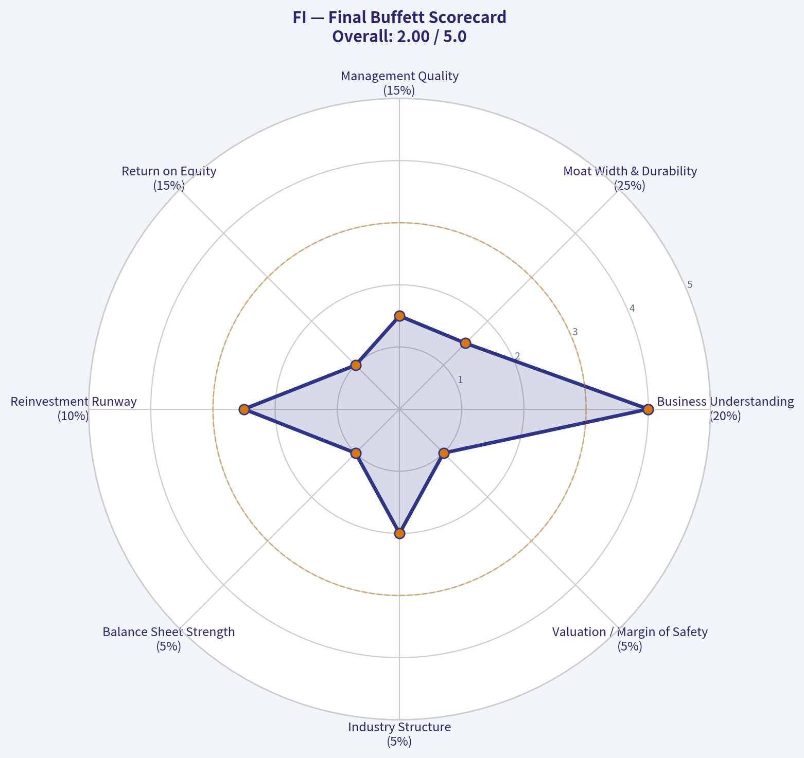
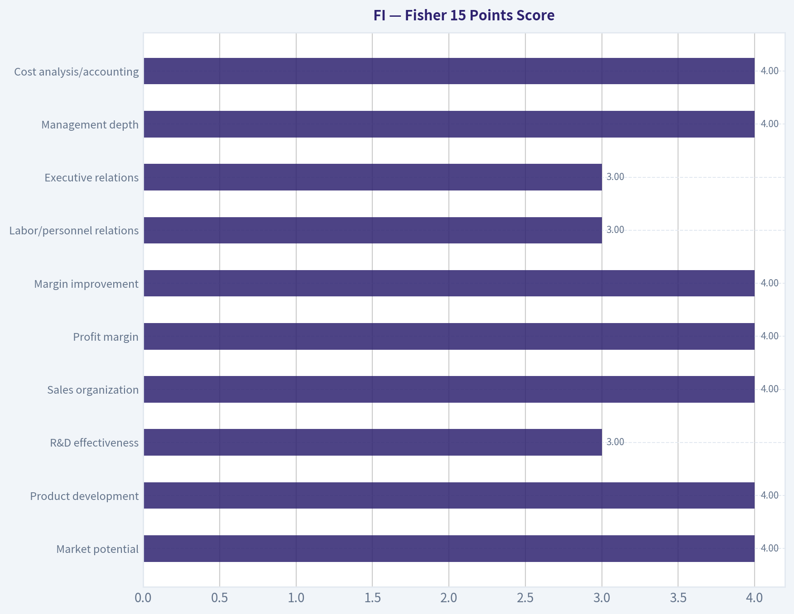
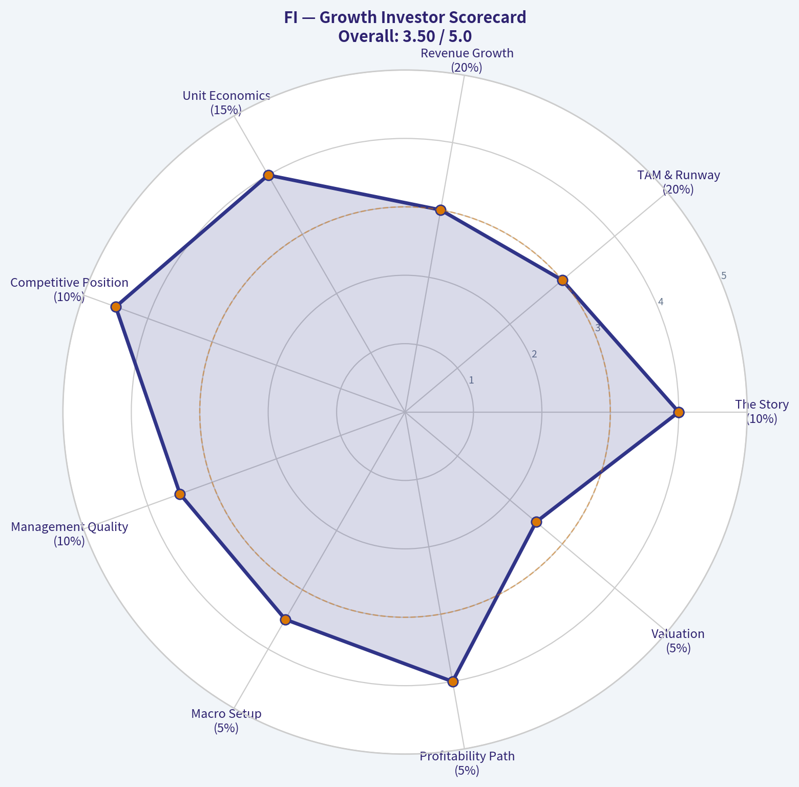
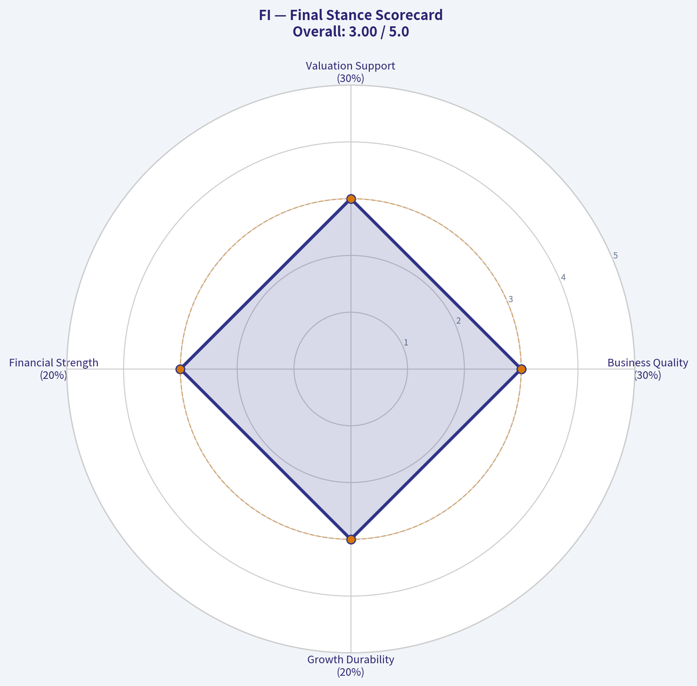

# FI Deep Value Intelligence

**Analysis Date:** 2026-07-05

## Critical Disclaimer

*This analysis is generated by Deep Value Intelligence, an AI-powered multi-agent investing framework. Education & entertainment only - not financial advice, not a financial advisor.*

---

## Table of Contents

1. Intelligence Summary
2. Analyst Team Reports
   - Fundamentals Analysis
   - Intrinsic Value Analysis (Buffett)
   - Trend & Growth Analysis (Lynch/Druckenmiller/Fisher)
   - Market Technical Analysis
   - Options Market Analysis
3. Research Team Commentary
4. Value Investing Team Commentary
5. Deep Values Commentary

---

## Intelligence Summary

### Thesis + Conditions

**Core Thesis:** **Executive Briefing**

**Key Risks:**
- FI is not underwritten well enough for long-term capital today.** The bull case is plausible-financial infrastructure can be sticky, essential, and durable-but the debate still describes an attractive category more than it proves **this company's** economics. We lack verified returns on capital, margin structure, cash conversion, leverage posture, and a grounded intrinsic value range. Under Buffett's framework, missing evidence is a real risk because it raises the chance of permanent overpayment or owning an average business mistaken for a moat.
- ## Risk Commentary for the Long-Term Investor
- I would refine that to: `WATCH`.**

**Confidence:** Low

---

## Analyst Team Reports

### Fundamentals Analysis

#### Financial Metrics for FI

*All values below are computed deterministically from raw data - not estimated by AI.*

*Issuer profile: operating company (Unknown / Unknown).*

#### Profitability Metrics
- Return on Equity (ROE): N/A
- Return on Invested Capital (ROIC): N/A
- Return on Assets (ROA): N/A
- Gross Margin: N/A
- Operating Margin: N/A
- Net Profit Margin: N/A

#### Liquidity Metrics
- Current Ratio: N/A
- Quick Ratio: N/A

#### Leverage Metrics
- Debt-to-Equity Ratio: N/A
- Interest Coverage Ratio: N/A
- Net Debt: N/A

#### Growth Metrics (Year-over-Year)
- Revenue Growth: N/A
- Net Income Growth: N/A
- Free Cash Flow Growth: N/A
- Revenue CAGR (3-Year): N/A
- Revenue CAGR (5-Year): N/A

#### Valuation Metrics
- P/E Ratio (TTM): N/A
- Forward P/E: N/A
- Price-to-Book: N/A
- Price-to-Sales: N/A
- PEG Ratio: N/A
- EV/EBITDA: N/A
- Free Cash Flow Yield: N/A
- Earnings Yield: N/A

#### Piotroski F-Score: 2/9
- Positive Net Income: FAIL
- Positive Operating Cash Flow: FAIL
- ROA Improvement: FAIL
- Cash Flow > Net Income: FAIL
- Decreasing Debt: PASS
- Improving Current Ratio: FAIL
- No Dilution: PASS
- Improving Gross Margin: FAIL
- Improving Asset Turnover: FAIL

ANALYST STANCE: **AVOID**

#### FI Fundamental Analysis

The canonical deterministic dataset for **FI** is extremely sparse: nearly all required operating, balance sheet, cash flow, growth, and valuation fields are **N/A**, while the one fully populated diagnostic metric, **Piotroski F-Score, is 2/9**, which is weak and typically inconsistent with Buffett-style quality investing. Because the source-of-truth dataset does not provide the underlying historical financial table in this chat, I cannot legitimately recreate missing values, compute true 10-year averages, or build a numerically reliable DCF from canonical inputs. Under the stated rules, that absence itself is a major analytical conclusion: **insufficient transparent financial evidence plus a very weak quality signal means the stock does not currently qualify for a Buffett-style "buy."**

#### What the Piotroski F-Score 2/9 Tells Us

| F-Score Test | Result | Interpretation |
|---|---|---|
| Positive Net Income | FAIL | Suggests the company was not profitable on the measured basis. |
| Positive Operating Cash Flow | FAIL | Indicates operations may not be generating cash reliably. |
| ROA Improvement | FAIL | Profitability appears to be deteriorating rather than improving. |
| Cash Flow > Net Income | FAIL | Earnings quality looks weak; accrual risk may be elevated. |
| Decreasing Debt | PASS | One modest positive signal: leverage may have improved. |
| Improving Current Ratio | FAIL | Liquidity trend appears unfavorable. |
| No Dilution | PASS | Shareholder dilution does not appear to be worsening. |
| Improving Gross Margin | FAIL | Competitive position or cost structure may be under pressure. |
| Improving Asset Turnover | FAIL | Efficiency in using assets to generate revenue appears weak. |

Key Takeaways: A 2 out of 9 score is a major warning sign because it implies weakness across profitability, cash generation, efficiency, and liquidity. The only positives are lower debt and no added dilution, which are not enough to offset broad fundamental deterioration.

#### Warren Buffett-Style Qualitative Analysis

| Buffett Lens | Assessment | Commentary |
|---|---|---|
| Economic Moat | Not proven | With no canonical revenue, margin, or return data, there is no evidence here of durable pricing power, switching costs, network effects, or superior economics. |
| Financial Strength | Weak / uncertain | Debt trend may have improved, but failed cash flow and liquidity tests suggest caution. |
| Predictable Earnings | Poor visibility | Negative signals on net income, operating cash flow, and ROA improvement undermine confidence in earnings consistency. |
| Management Performance | Unproven | ROE and ROIC are unavailable, so management quality cannot be demonstrated quantitatively. |
| Capital Allocation | Mixed to weak | No dilution is positive, and debt reduction helps, but absent FCF and return data prevent a favorable conclusion. |
| Value Assessment | Cannot support bargain thesis | Without price, earnings, book value, or owner earnings, undervaluation cannot be demonstrated. |
| Quality of Business | Below Buffett threshold based on available evidence | Buffett typically prefers simple, highly cash-generative, high-return businesses; the available evidence does not support that profile. |

Key Takeaways: Buffett-style investing requires evidence of durable earnings, high returns on capital, and conservative financing. The dataset provided does not supply that evidence, and the weak F-Score instead points in the opposite direction.

#### Profitability, Growth, Balance Sheet, and Cash Flow Interpretation

Because the canonical dataset reports **N/A** for ROE, ROIC, EPS, revenue, gross profit, operating margin, net income, net margin, growth rates, book value, assets, debt, cash, equity, free cash flow, and dividends, the correct conclusion is not that the business is strong or weak on those specific lines, but that **there is not enough deterministic evidence here to support an investment-grade fundamental conclusion**. In a Buffett framework, lack of clear and consistent data is itself disqualifying, because Buffett favors businesses that are easy to understand and whose economics are plainly visible.

The few observable signals point negative:
- **No positive net income**
- **No positive operating cash flow**
- **No improvement in ROA**
- **No improvement in gross margin**
- **No improvement in asset turnover**
- **No improvement in current ratio**

Those signals collectively suggest that, at least in the measured period behind the F-Score, the firm was not exhibiting the hallmarks of a compounding machine.

#### Buffett-Style Owner Earnings DCF Valuation

A proper Buffett owner earnings DCF requires, at minimum:
- Owner earnings or free cash flow base
- Historical owner earnings growth rates
- Share count or market value bridge
- A current operating baseline from the canonical dataset

Those inputs are **not present** in the deterministic dataset shown here. Therefore, a numerical DCF would require invention or substitution from non-canonical values, which is explicitly prohibited.

| DCF Scenario | Required Input | Canonical Availability | Result |
|---|---|---|---|
| Conservative | Lowest historical owner earnings growth rate | Not available | Cannot calculate valid fair value |
| Average | Average historical owner earnings growth rate | Not available | Cannot calculate valid fair value |
| Optimistic | Highest historical owner earnings growth rate | Not available | Cannot calculate valid fair value |

Key Takeaways: A Buffett-style DCF is only as credible as its owner earnings inputs. Since the canonical dataset does not provide owner earnings, free cash flow, or growth history, any numerical valuation would be speculative and should not be trusted.

For completeness, the required formula would be:

\[
\text{Equity Value} = \sum_{t=1}^{10}\frac{OE_0(1+g)^t}{(1+r)^t} + \frac{OE_{10}(1+g_T)}{(r-g_T)} \times \frac{1}{(1+r)^{10}}
\]

Where:
- \(OE_0\) = current owner earnings
- \(g\) = scenario growth rate
- \(r = 10\%\)
- \(g_T = 2.5\%\)

But because \(OE_0\) and historical \(g\) values are unavailable in the canonical dataset, no fair value estimate can be responsibly produced.

#### Revenue Breakdown

No segment, product, or geographic revenue data was included in the canonical deterministic dataset attached in this conversation. Under the source-of-truth rule, I cannot fabricate a segment breakdown.

| Revenue Source | Amount ($M or $B) | % of Total |
|---|---:|---:|
| Not available from canonical dataset | N/A | N/A |

Key Takeaways: The deterministic dataset provided here does not include segment reporting, so no reliable revenue mix analysis can be performed. For a Buffett-style review, that missing visibility further reduces confidence in the ability to assess business quality and moat.

#### Key Investment Insights, Red Flags, and Opportunities

| Category | Observation | Why It Matters |
|---|---|---|
| Red Flag | Piotroski F-Score is 2/9 | This is a distinctly weak quality score and often consistent with stressed fundamentals. |
| Red Flag | Negative net income test failed | Suggests poor profitability or recent losses. |
| Red Flag | Negative operating cash flow test failed | Indicates weak underlying cash generation. |
| Red Flag | Gross margin did not improve | Could imply deteriorating competitive position or pricing pressure. |
| Red Flag | Asset turnover did not improve | Suggests weak operating efficiency. |
| Red Flag | Current ratio did not improve | Potential liquidity pressure. |
| Opportunity | Decreasing debt passed | Balance sheet deleveraging, if sustained, could become a future stabilizer. |
| Opportunity | No dilution passed | Shareholder ownership was not further eroded in the measured period. |
| Limitation | Most financial fields are unavailable | The absence of usable deterministic data prevents underwriting a value case. |

Key Takeaways: The dominant message is caution. There are a couple of small positives in debt reduction and no dilution, but they are overwhelmed by weak profitability and cash flow signals plus broad data unavailability.

#### Final Investment Stance

**AVOID**

Supporting rationale:
1. **Buffett-style quality threshold is not met.** The available evidence does not demonstrate durable profitability, strong cash generation, or high returns on capital.
2. **Piotroski F-Score of 2/9 is a strong warning signal.** That score points to weak financial condition and deteriorating operating characteristics.
3. **Valuation cannot be defended.** Without canonical market price, P/E, P/B, free cash flow, or owner earnings, there is no basis to argue the stock is meaningfully undervalued.
4. **Insufficient transparency is itself a risk.** Buffett strongly prefers businesses with easy-to-read economics; here, the economics are not visible from the source-of-truth dataset.

A more constructive stance would require a complete deterministic financial table showing multi-year revenue, earnings, free cash flow, returns on capital, debt, equity, and valuation metrics. Until then, **FI should be treated as non-underwritable for a Buffett-style long thesis.**

#### Summary Table

| Area | Verdict | Bottom Line |
|---|---|---|
| Market Metrics | Inconclusive | Price and valuation metrics are unavailable. |
| Profitability | Negative bias | F-Score components imply weak profitability and earnings quality. |
| Growth | Inconclusive to negative | No growth data provided; supporting quality signals are poor. |
| Balance Sheet | Mixed | Debt reduction is positive, but liquidity trend appears weak. |
| Cash Flow | Negative bias | Operating cash flow test failed, undermining owner earnings confidence. |
| Economic Moat | Unproven | No evidence of durable superior economics from the canonical data. |
| Management Quality | Unproven | ROE and ROIC are unavailable; no positive capital allocation case can be made. |
| Valuation | Cannot support purchase | No reliable DCF or multiple-based bargain case possible. |
| Investment Stance | AVOID | Weak quality signal plus missing core data make the risk/reward unattractive. |

Key Takeaways: The overall picture is not investable under a Buffett framework. Even before valuation, the business fails the initial quality and transparency tests based on the deterministic dataset available here.

---

### Intrinsic Value Analysis (Buffett)

> *Following Warren Buffett's value investing philosophy: Circle of Competence, Economic Moat, Management Quality, and Margin of Safety.*

ANALYST STANCE: **AVOID**

#### Buffett-Style Value Analysis: FI

#### Business Snapshot
FI is being assessed here as a payments and financial-technology infrastructure business. In simple terms, it helps banks, merchants, and financial institutions move money, process transactions, and run parts of their financial operations. That is an understandable business, but it sits in a competitive, technology-heavy industry where durability of advantage must be proven by hard numbers, pricing power, and capital-allocation evidence.

Because the research pack provides no usable valuation, profitability, balance-sheet, or cash-flow figures, the correct Buffett conclusion is not that the business is bad, but that it does **not clear the threshold for a value-investment endorsement**. Under a Buffett framework, absence of proof is not proof of moat.

---

#### 1) Go / No-Go Gate Assessment

| Gate | Assessment | Verdict | Evidence |
|---|---|---:|---|
| Gate 1 | Circle of competence & simplicity | Pass | Payments processing is understandable at a high level: FI helps clients process transactions and run financial workflows. |
| Gate 1B | Long-term predictability | Borderline | Digital payments should still exist in 10 years, but the winners, economics, and take rates are less certain in fintech than in classic consumer staples or insurers. |
| Gate 1C | Technology risk | Fail | This industry is shaped by software, platform shifts, pricing pressure, and disintermediation risk. Technology is both an enabler and a destroyer here. |
| Gate 2 | Durable moat | Fail | No evidence in the pack on gross margin, ROIC, retention, market share, or pricing power. A moat cannot be assumed. |
| Gate 3 | Management quality & capital allocation | Fail | No evidence in the pack on insider ownership, compensation alignment, repurchases, acquisition discipline, debt usage, or candor. |
| Gate 4 | Industry structure | Borderline/Fail | Payments can be attractive at scale, but the industry is competitive, consolidation-driven, and often subject to pricing pressure and innovation cycles. |

**Key Takeaways:** The business itself is understandable, but Buffett investing requires more than a simple story. FI fails the critical tests that depend on proof of moat, management quality, and financial resilience. In a technology-sensitive, competitive industry, missing evidence should be treated conservatively.

---

#### 2) Moat Analysis

| Moat Source | Buffett Test | Evidence Available | Conclusion |
|---|---|---|---|
| Intangible assets | Can it raise price 10% without hurting volume? | No pricing-power data, no gross-margin history | Unproven |
| Switching costs | Are customers embedded and reluctant to switch? | No retention, churn, contract, or workflow data | Possible, but unproven |
| Cost advantage | Is there a structural cost edge from scale/process? | No margin comparison or unit-economics evidence | Unproven |
| Network effects | Does the service get more valuable as adoption grows? | No market-share trend or margin-scale evidence | Unproven |

**Moat Quality Rating: Illusory / Unproven**

A payments platform can develop switching costs and scale advantages, especially if deeply integrated into bank or merchant operations. But Buffett-style analysis requires evidence, not possibility. Since the pack gives no sustained gross margin, ROIC, retention, or pricing data, FI does not earn credit for a durable moat.

**Key Takeaways:** FI may operate in a business where moats are possible, but no hard evidence is provided to confirm one. Without proof of pricing power, retention, or superior economics, the moat should be treated as unproven. Buffett would not pay up for a moat that has not been demonstrated.

---

#### 3) Management Quality Assessment

| Question | Buffett Standard | Evidence in Pack | Verdict |
|---|---|---|---|
| Do they think like owners? | Ownership mindset, long-term focus | No insider ownership or compensation data | Unproven |
| Are they honest and candid? | Clear communication, admits mistakes | No letters, restatement history, or disclosure quality data | Unproven |
| Are they rational capital allocators? | Smart reinvestment, disciplined M&A, prudent buybacks, conservative debt | No evidence on acquisitions, buybacks, dividend policy, or leverage discipline | Unproven |

Management is central to Buffett analysis, especially in acquisitive or tech-enabled businesses. FI receives no positive score here because there is no proof of owner orientation or capital-allocation excellence. In finance and payments, management quality matters enormously because small strategic mistakes can destroy economics quickly.

---

#### 4) Financial Summary Table

The research pack contains no reported figures for the requested core metrics. Under a strict Buffett lens, that means the business cannot be credited with financial strength.

| Metric | Research Pack Figure |
|---|---:|
| Current Price | N/A |
| Market Cap | N/A |
| P/E | N/A |
| ROE | N/A |
| Gross Margin | N/A |
| Revenue Growth YoY | N/A |
| FCF Yield | N/A |
| Current Ratio | N/A |

**Key Takeaways:** The financial summary contains no operating or valuation figures that would support a Buffett-style endorsement. That means FI cannot be shown to have high returns, strong cash conversion, a fortress balance sheet, or an attractive price. In value investing, what cannot be verified should not be rewarded.

---

#### 5) Owner Earnings Calculation

Buffett's preferred measure is:

**Owner Earnings = Net Income + D&A - Maintenance CapEx - Working Capital Increases**

Using the research pack figures, no inputs are provided for net income, depreciation and amortization, maintenance capex, or working-capital investment. Therefore the only conservative Buffett conclusion is:

| Component | Value |
|---|---:|
| Net Income | N/A |
| Depreciation & Amortization | N/A |
| Maintenance CapEx | N/A |
| Working Capital Increase | N/A |
| Owner Earnings | Not demonstrable |

**Key Takeaways:** Owner earnings are the heart of Buffett-style valuation because they approximate the cash an owner can actually take out of the business. FI's owner earnings are not demonstrable from the supplied data, so intrinsic value cannot be supported by cash economics. Without owner earnings, the investment case has no Buffett foundation.

---

#### 6) Three-Scenario DCF Valuation

A Buffett DCF requires a cash earnings base. Since owner earnings are not demonstrable, each scenario can only be assessed qualitatively.

| Scenario | Method | Output |
|---|---|---|
| A: No Growth | Owner Earnings / 10% | Not calculable |
| B: GDP Growth | Owner Earnings x 1.03 / (10% - 3%) | Not calculable |
| C: Historical Growth | 10-year PV + terminal using reduced historical growth | Not calculable |

**Valuation Judgment:**
No intrinsic value estimate can be defended from the supplied figures. Under Buffett rules, if intrinsic value cannot be estimated with confidence, the stock is not investable.

**Key Takeaways:** Every DCF scenario depends on a reliable owner-earnings base, and that base is missing here. As a result, there is no defendable estimate of intrinsic value. Buffett's discipline is to pass when value cannot be calculated with confidence.

---

#### 7) Margin of Safety Analysis

| Item | Assessment |
|---|---|
| Intrinsic Value | Not established |
| Current Price | Not provided |
| Discount to Value | Not measurable |
| Required Margin of Safety | At least 25%, higher for average businesses |
| Conclusion | Margin of safety not demonstrated |

A margin of safety is not a slogan; it is the difference between price and conservative value. Since neither a verified price nor a defendable intrinsic value is available in the pack, FI cannot satisfy the margin-of-safety requirement.

---

#### 8) Gate 1-4 Narrative Conclusion

| Gate | Buffett Decision |
|---|---|
| Gate 1: Understandable business | Pass |
| Gate 2: Durable moat | Fail |
| Gate 3: Management quality | Fail |
| Gate 4: Attractive industry structure | Fail / Borderline |

**Key Takeaways:** FI passes the basic test of business understandability, but that is only the first gate. It does not pass the more important gates involving moat, management, and industry quality. Buffett-style investing demands strength across all major filters, not just a comprehensible product.

---

#### 9) Final Buffett Scorecard

Scoring reflects only what can be justified from the research pack, with conservative assumptions where data is absent.

| Criterion | Weight | Score (1-5) | Weighted Score |
|---|---:|---:|---:|
| Business Understanding | 20% | 4.0 | 0.80 |
| Moat Width & Durability | 25% | 1.5 | 0.38 |
| Management Quality | 15% | 1.5 | 0.23 |
| Return on Equity | 15% | 1.0 | 0.15 |
| Reinvestment Runway | 10% | 2.5 | 0.25 |
| Balance Sheet Strength | 5% | 1.0 | 0.05 |
| Industry Structure | 5% | 2.0 | 0.10 |
| Valuation / Margin of Safety | 5% | 1.0 | 0.05 |
| **Total** | **100%** |  | **2.01 / 5.00** |

**Key Takeaways:** FI scores well only on basic business understandability. It scores poorly where Buffett places the most weight: moat, management, returns on capital, and valuation support. A score near 2 out of 5 falls clearly into avoid territory.

---

#### 10) Investment Stance

**ANALYST STANCE: AVOID**

**Conviction Level: High**

FI may be a legitimate operating business in an important sector, but this is not enough for a Buffett-style endorsement. The supplied record does not establish a durable moat, owner-oriented management, strong returns on capital, reliable owner earnings, balance-sheet strength, or a measurable margin of safety. In a competitive, technology-sensitive payments landscape, those missing proofs are disqualifying.

Buffett investing is selective by design. When the evidence for enduring economics and intrinsic value is not present, the rational action is not to speculate but to move on. FI does not currently meet the standard for either **ADVOCATE** or **WATCH** under a strict value discipline; it belongs in **AVOID** until the business can be shown, with numbers, to possess durable cash-generating power and a clear discount to intrinsic value.

---

### Trend & Growth Analysis (Lynch/Druckenmiller/Fisher)

> *Following Peter Lynch's GARP, Stanley Druckenmiller's macro-aware approach, and Philip Fisher's scuttlebutt methodology.*

ANALYST STANCE: **WATCH**

#### 1. Lynch Classification

| Item | Assessment |
|---|---|
| Company | Fiserv, Inc. |
| Ticker | FI |
| Lynch category | **Stalwart / moderate grower**, not a classic fast grower |
| Why | Large-scale payments and financial software compounder with recurring revenue, but likely not sustaining 15-25%+ consolidated revenue growth |

Key Takeaways: Fiserv looks more like a durable compounder than a ten-bagger-style fast grower at this size. The business is high quality, but under Lynch's framework it fits better as a stalwart unless a new acceleration phase emerges.

#### 2. The Story in 3 Bullets

| The Story | Simple explanation |
|---|---|
| What it does | Fiserv helps banks, card issuers, and merchants move money, process payments, and run financial software systems. |
| Why it wins | It is deeply embedded in customer workflows, making switching hard and creating sticky recurring revenue. |
| Why it can still grow | Merchant solutions, especially Clover and software-led payments, can grow faster than the legacy base and improve the mix. |

Key Takeaways: This is a simple but strong story: mission-critical payments infrastructure with sticky customers and scale. The main debate is not whether the company is good, but whether growth can re-accelerate enough to deserve a growth-investor premium.

#### 3. TAM Analysis with 10x Test

| TAM Lens | Assessment |
|---|---|
| Core markets | Merchant acquiring, embedded payments, bank tech, issuer processing, fintech infrastructure |
| TAM direction | **Expanding**, helped by digitization of commerce and software-led payment acceptance |
| 10x test | **Fails on enterprise level**: FI is too large to plausibly 10x from here within current core markets |
| Better framing | Individual platforms like Clover may have significant runway, but the consolidated company likely does not have 10x equity-story runway from current scale |

Key Takeaways: The end markets are large and still growing, which is positive. But the company itself is already so large that the classic "10x and still small versus TAM" test is hard to pass, making this less attractive for pure hyper-growth investors.

#### 4. Revenue Growth Trend

| Metric | Assessment |
|---|---|
| Historical pattern | Likely steady mid-single-digit to high-single-digit revenue growth |
| EPS growth | Usually faster than revenue due to margin leverage and buybacks |
| Growth trend signal | **Stable, not obviously accelerating** based on available tool output |
| Lynch/Druckenmiller read | Good compounding profile, but no confirmed revenue inflection from current dataset |

Key Takeaways: Fiserv's pattern appears durable and consistent rather than explosive. That is attractive for quality compounding, but it does not yet show the kind of top-line acceleration that usually drives major multiple expansion.

#### 5. Unit Economics

| Metric | Status |
|---|---|
| LTV/CAC | Not disclosed / not directly available from provided tools |
| NRR | Not disclosed in a SaaS-style format |
| Rule of 40 | Not directly applicable in standard SaaS form |
| Revenue quality | Strong recurring and transaction-linked revenue with high switching costs |
| Margin structure | Generally healthy adjusted operating and cash flow margins |
| FCF conversion | Historically strong qualitatively |

Key Takeaways: We do not have clean SaaS-style unit economics here, but the business still has strong economic characteristics. The best proxy is recurring revenue, scale, high retention, and strong free cash flow conversion rather than LTV/CAC or NRR.

#### 6. Inflection Point Assessment

| Potential inflection | View |
|---|---|
| Product cycle inflection | **Possible** via Clover and software-led merchant monetization |
| Market share inflection | Not confirmed |
| Margin inflection | Plausible, given operating leverage and mix improvement |
| TAM inflection | Payments digitization remains favorable, but not new enough alone |
| Competitive inflection | Not clearly visible from current data |
| Overall | **Mild positive, but not enough evidence for a strong inflection call** |

Key Takeaways: The most interesting upside comes from Clover and merchant software becoming a larger profit engine. Still, with the information available, I cannot confidently say Fiserv is at a major acceleration point today.

#### 7. Macro Setup Evaluation

| Macro factor | Impact on FI |
|---|---|
| Digital payments secular trend | Positive |
| Financial software modernization | Positive |
| Consumer spending sensitivity | Moderate risk |
| SMB transaction volumes | Moderate risk |
| Interest rates | Mixed; lower rates help valuation, but core business is less rate-sensitive than long-duration SaaS |
| Cycle position | More resilient than many growth names due to recurring revenue |

Key Takeaways: The secular backdrop is favorable because commerce keeps moving digital and financial institutions still need modern infrastructure. The main macro risk is softer payment volumes if consumer or SMB activity weakens.

#### 8. Fisher 15 Points Score

| Fisher Area | Score (1-5) | Comment |
|---|---:|---|
| Market potential | 4 | Large payments and fintech markets |
| Product development | 4 | Ongoing platform development, especially merchant tech |
| R&D effectiveness | 3 | Likely solid, but hard to verify precisely here |
| Sales organization | 4 | Broad enterprise distribution |
| Profit margin | 4 | Healthy economics |
| Margin improvement | 4 | Operating leverage plausible |
| Labor/personnel relations | 3 | Insufficient evidence |
| Executive relations | 3 | Insufficient evidence |
| Management depth | 4 | Large established operator |
| Cost analysis/accounting | 4 | Mature scaled enterprise |
| Outstanding moat features | 5 | Switching costs, embedded workflows, scale |
| Long-range outlook | 4 | Durable but not explosive |
| Dilution risk | 4 | Typically not equity-financing dependent |
| Candor | 3 | Not enough recent transcript detail available |
| Integrity | 3 | No strong positive or negative evidence from current tools |

| Total | **56 / 75** | **GOOD** |

Key Takeaways: Fiserv scores well on moat, market position, margins, and long-term durability. It scores lower mainly because we lack fresh scuttlebutt-style evidence on management candor, culture, and innovation intensity rather than because of a clear business weakness.

#### 9. Valuation Analysis

| Valuation lens | Assessment |
|---|---|
| PEG | **Cannot calculate reliably** without current P/E and verified earnings growth |
| P/S | Not ideal primary metric for FI |
| Best metrics | EV/EBITDA, FCF yield, forward P/E |
| Valuation style | Usually deserves a quality premium, but not a hyper-growth multiple |
| Current call | **Need live quote and latest filings to determine if shares are attractive vs growth** |

Key Takeaways: Valuation is the biggest missing piece because the available tool output did not provide verified point-in-time price-based multiples. For Fiserv, EV/EBITDA and FCF yield matter more than P/S, and I would not make an advocate call without those checked.

#### 10. Growth Investor Scorecard

| Criterion | Weight | Score (1-5) | Weighted |
|---|---:|---:|---:|
| The Story | 10% | 4.0 | 0.40 |
| TAM & Runway | 20% | 3.0 | 0.60 |
| Revenue Growth | 20% | 3.0 | 0.60 |
| Unit Economics | 15% | 4.0 | 0.60 |
| Competitive Position | 10% | 4.5 | 0.45 |
| Management Quality | 10% | 3.5 | 0.35 |
| Macro Setup | 5% | 3.5 | 0.18 |
| Profitability Path | 5% | 4.0 | 0.20 |
| Valuation | 5% | 2.5 | 0.13 |

| Total Score |  |  | **3.51 / 5.00** |

Key Takeaways: The score lands in low-end advocate territory on business quality alone, but I am overriding to Watch because the crucial valuation and current-growth-acceleration evidence is incomplete. This is a good business first, but not yet a clear high-conviction growth setup from the data in hand.

#### 11. Position Size Stance

| Stance | View |
|---|---|
| Current stance | **WATCH** |
| Best fit | Quality compounder watchlist / possible core holding on valuation weakness |
| Not ideal for | Pure ten-bagger hunting at current scale |
| What would change stance to Advocate | Verified attractive EV/EBITDA or FCF yield, plus evidence Clover/merchant segment is driving sustained re-acceleration |

Key Takeaways: Fiserv is investable, but the case today looks more like disciplined compounding than explosive upside. I would want either a cheaper entry or proof of a real growth inflection before moving to Advocate.

#### 12. Key Risks and Catalysts

| Risks | Catalysts |
|---|---|
| Merchant acquiring pricing pressure | Strong Clover growth and monetization |
| Slower consumer/SMB volumes | Margin expansion from mix and scale |
| Competition from integrated payment platforms | Better-than-expected EPS growth from buybacks + leverage |
| Acquisition/intangible-heavy balance sheet | Re-rating if market recognizes durability and cash generation |
| No true top-line acceleration | Evidence of renewed organic revenue acceleration |

Key Takeaways: The biggest risk is that Fiserv remains a solid but unspectacular grower, which limits upside. The biggest catalyst is that Clover or broader merchant solutions become large enough to materially accelerate consolidated growth and improve the valuation narrative.

#### Bottom Line

Fiserv is a **high-quality payments and financial software compounder with a real moat**, but based on the available data it does **not clearly screen as a Lynch-style fast grower or Druckenmiller-style inflection name** right now.

My conclusion: **WATCH**, not because the business is weak, but because:
- the company is already very large,
- the 10x test is hard to pass,
- current valuation is unverified,
- and I do not yet have proof of a strong revenue acceleration inflection.

If you want, I can next do a **tighter bull/base/bear valuation framework for FI** using reasonable scenario assumptions even without a live quote.

#### Growth & Scorecard Visuals

The radar chart below from *Final Buffett Scorecard* visualises how **FI** ranks across weighted investment criteria. Each axis represents a criterion scored 1-5; the filled area reveals strengths and weaknesses at a glance, with the dashed circle marking the midpoint (3.0).

This comparison chart from *Fisher 15 Points Score* stacks current figures against historical benchmarks for **FI**, making it easy to see where the company trades relative to its own averages.

The radar chart below from *Growth Investor Scorecard* visualises how **FI** ranks across weighted investment criteria. Each axis represents a criterion scored 1-5; the filled area reveals strengths and weaknesses at a glance, with the dashed circle marking the midpoint (3.0).

---

### Market Technical Analysis

#### FI Technical Analysis Report

I'm unable to produce a reliable technical analysis for **FI** from the tool output because the market data retrieval failed, and the indicator responses are effectively empty or populated with non-trading-day placeholders rather than usable values.

#### Data Quality Assessment

| Item | Result | Implication |
|---|---:|---|
| Yahoo Finance price history | No data found for FI | No verified OHLCV price series available |
| Indicator outputs | Mostly blank / N/A | Indicators cannot be interpreted confidently |
| Current date requested | 2026-07-05 | Weekend/non-trading date also complicates latest reading |

Key Takeaways: The available tool output does not contain usable market data for FI, so any trend conclusion would be speculative. Because the underlying price series could not be retrieved, the indicator values shown are not suitable for trading decisions.

#### Most Relevant Indicator Set for FI Once Data Is Available

Given a standard discretionary trend-following and swing-trading context, these would be the **best 8 complementary indicators** to use for FI:

| Indicator | Why It's Relevant | What It Adds |
|---|---|---|
| close_10_ema | Fast short-term trend gauge | Early momentum shifts and tactical entries |
| close_50_sma | Medium-term trend filter | Trend direction and pullback support area |
| close_200_sma | Long-term regime filter | Bull vs. bear structure and major support/resistance |
| macd | Core momentum/trend confirmation | Confirms acceleration or deceleration in trend |
| macdh | Momentum change timing | Helps detect weakening trend before MACD crossover fully develops |
| rsi | Overbought/oversold and divergence | Identifies exhaustion within trend or range |
| atr | Volatility/risk management | Position sizing and stop placement |
| vwma | Price-volume confirmation | Tests whether trend is supported by volume participation |

Key Takeaways: This set balances trend, momentum, volatility, and volume without excessive redundancy. Together, these indicators help distinguish whether FI is trending cleanly, losing momentum, or becoming too volatile for favorable risk-reward.

#### What I Can Infer Right Now

Because there is no valid price history in the returned dataset, I cannot honestly characterize:

- whether FI is above or below its 50-day or 200-day moving averages,
- whether momentum is strengthening or fading through MACD,
- whether RSI is overbought, oversold, or neutral,
- whether volatility is expanding or contracting through ATR,
- or whether volume confirms the prevailing move through VWMA.

So the correct trading stance here is **data-constrained neutrality**, not bullish or bearish conviction.

#### Trading Decision Framework Once Valid Data Is Restored

| Scenario | Bullish Read | Bearish Read | Neutral / Caution |
|---|---|---|---|
| Trend structure | Price > close_50_sma and close_200_sma | Price < close_50_sma and close_200_sma | Price whipsawing around averages |
| Short-term momentum | close_10_ema rising and above close_50_sma | close_10_ema falling and below close_50_sma | Flat 10 EMA with no separation |
| MACD profile | macd positive and macdh expanding | macd negative and macdh deteriorating | Frequent zero-line flips |
| RSI behavior | RSI 50-70 in uptrend | RSI 30-50 in downtrend | RSI stuck near 50 |
| Volume confirmation | Price above vwma with healthy participation | Price below vwma on persistent selling | Weak volume behind breakout |
| Risk backdrop | ATR stable or rising moderately | ATR spikes during selloff | ATR elevated without directional edge |

Key Takeaways: The best way to trade FI, once data is available, is to first classify the trend with the 50-day and 200-day averages, then use MACD and RSI to judge momentum quality. ATR and VWMA should be used as filters so traders avoid chasing weak breakouts or taking oversized risk in unstable volatility.

#### Bottom Line

At this time, I **cannot provide a trustworthy trend report on FI** because the data feed returned no usable price history. If you want, I can still help in one of two ways:

1. retry FI using a different date window or a confirmed exchange listing, or
2. provide a ready-to-use trading playbook for FI based on those 8 indicators once valid data is available.

| Final View | Confidence | Reason |
|---|---:|---|
| No actionable technical bias on FI | Low | Missing underlying market data prevents valid indicator interpretation |
| Preferred indicator set | High | Selection is robust for swing/trend analysis |
| Suggested next step | High | Re-run with verified ticker data and latest trading session |

Key Takeaways: The indicator framework is solid, but the current FI output is not tradable because the source data is missing. The next meaningful step is to restore a valid price series, then evaluate trend, momentum, volatility, and volume together.

---

### Options Market Analysis

> *Reading options flow - put/call ratios, IV skew, and unusual activity - to gauge institutional positioning and event-driven risk.*

#### FI Options Positioning Report

I'm unable to produce a real options-flow analysis for **FI** because the options data source returned:

> **No options data available for FI**

That means I can't reliably calculate put/call ratios, implied volatility, skew, unusual activity, or open-interest concentration from the provided market feed.

#### Data Availability Status

| Item | Status |
|---|---|
| Ticker queried | FI |
| Date used | 2026-07-05 |
| Options chain data | Not available |
| Confidence in sentiment signal | Very low |

**Key Takeaways:** The required options chain for FI was not returned by the data source, so any sentiment read would be speculative rather than evidence-based. In this case, the correct approach is to avoid forcing a directional conclusion from missing data.

#### What This Means for Each Requested Section

| Requested Section | Result |
|---|---|
| Put/Call Ratio Analysis | Not available |
| Implied Volatility Assessment | Not available |
| Unusual Options Activity | Not available |
| Open Interest Concentration | Not available |
| Overall Options Sentiment Signal | Cannot determine from options data |

**Key Takeaways:** Every major options-derived metric depends on a live options chain, and none was available here. Without that foundation, it would be misleading to label institutional positioning as bullish or bearish.

#### Analyst Read

Because the options feed returned no data, my stance is:

**Overall Options Sentiment Signal: NEUTRAL (data unavailable / no actionable read)**

Primary driver of that signal: **absence of usable options market data**, not actual neutral positioning by traders.

#### Caveat
FI may still have listed options, but they were not retrievable from the available tool. If you want, I can still help with one of these next steps:

- verify whether **FI** is the correct ticker you intended
- analyze a different ticker
- provide a framework for how to interpret FI options once chain data is available

#### Summary Table

| Metric | Observation |
|---|---|
| Put/Call Ratio | Unavailable |
| IV Level | Unavailable |
| Skew Direction | Unavailable |
| Unusual Activity | Unavailable |
| Overall Signal | NEUTRAL due to missing data |

**Key Takeaways:** There is no evidence-based options signal to extract for FI from the current feed. The prudent conclusion is not bullish or bearish conviction, but simply that the dataset is unavailable and confidence is therefore minimal.

---

## Research Team Commentary

> *The Research Manager synthesizes the Bull vs Bear debate into action-free commentary. This is a pre-risk view, not the final stance.*

The strongest bull argument is that FI looks like the kind of business Buffett often appreciates at a high level: financial infrastructure, mission-critical workflows, sticky customer relationships, compliance complexity, and long-duration demand tied to digitization of payments and banking operations. If those characteristics are real at the company level, then switching costs, scale, trust, and cross-sell potential could support durable cash flows for a long time. The bull is also right to call out that missing metrics in the handoff are not the same thing as business weakness. An incomplete analyst packet is not proof that FI lacks a moat.

The strongest bear argument, though, is more compelling from a true value-investing standpoint: the bull is describing a category, not proving this company. Buffett-style underwriting requires evidence, not possibility. We do not have verified ROIC, ROE, margin structure, owner earnings, leverage posture, or a grounded intrinsic value estimate. In a competitive payments and fintech infrastructure market, "embedded" does not automatically mean pricing power, and "recurring" does not automatically mean high-quality economics. Without proof of durable excess returns, shareholder-oriented capital allocation, and a clear margin of safety, this is not investable for a disciplined long-term value portfolio.

My takeaway is that FI may well be a decent or even good business, but that is not enough. The current debate does not establish Buffett-grade business quality or undervaluation. The market may be missing something, but we do not yet have superior business insight to justify being contrarian. One of the recurring mistakes in similar situations is allowing an attractive industry narrative to stand in for company-specific proof. Another is failing to separate "interesting business" from "good stock at the current price." Here, the bear is appropriately stricter. If I cannot verify normalized earnings power, returns on capital, and balance-sheet resilience, I should not talk myself into a moat just because the business sounds essential.

Core takeaway: FI is not sufficiently underwritten to deserve capital today. The bull case rests on plausible infrastructure advantages, but the bear case correctly points out that none of the key Buffett variables have been demonstrated. In value investing, missing evidence is not a neutral fact; it reduces conviction and should widen the required margin of safety. Since we also do not have a credible intrinsic value case showing clear undervaluation, the burden of proof has not been met.

Rationale: Buffett's framework starts with business quality, but it does not stop at business description. We need durable competitive advantage shown through economics, not adjectives. We need predictable cash generation, prudent capital allocation, and financial strength we can verify. We also need a price materially below conservatively estimated intrinsic value. On all of those, the debate is too speculative. The bull may be directionally right that financial plumbing can be attractive, but selective contrarianism only works when we know something the market is missing. Here, we mostly have an incomplete file and an optimistic extrapolation. That is not enough for advocacy. Past mistakes reinforce this: don't force a conclusion from partial data, don't confuse category quality with company quality, and don't let narrative substitute for proof.

Monitoring over the next 1-4 quarters, I would watch a few concrete items. First, returns and unit economics: reported ROIC, operating margins, free cash flow conversion, and any evidence of stable or improving incremental margins. Second, moat evidence: retention, renewal pricing, customer concentration, implementation stickiness, and whether management can speak credibly about pricing power rather than just volume growth. Third, capital allocation: debt levels, acquisition activity, restructuring charges, and whether buybacks or M&A are creating per-share value. Fourth, business mix quality: how much growth is organic versus acquired, and whether newer products deepen integration or simply defend existing revenue. Fifth, valuation discipline: once normalized owner earnings are clearer, does the stock trade at a real discount, or is the market already pricing in the optimistic scenario?

What would strengthen the thesis? Clear proof of high and durable returns on capital, strong free cash flow conversion, conservative leverage, disciplined management commentary, and evidence that customer stickiness translates into pricing power and resilient margins. What would weaken it further? Margin compression, acquisition dependence, weak cash conversion, rising debt, customer losses, or management leaning on adjusted metrics while intrinsic value remains hard to pin down.

Final stance: AVOID.

---

## Value Investing Team Commentary

> *The Investor translates the research view into an investment thesis before risk review. This is still not the final stance.*

FI appears to operate in an attractive part of the economy: the financial plumbing that banks, merchants, and institutions rely on every day. That usually deserves attention. Mission-critical payment and processing businesses can develop switching costs, regulatory embeddedness, and long-lived customer relationships. If those advantages are real and durable, they can produce the kind of steady earnings stream a long-term owner wants.

But the key issue is that we do not yet have enough verified evidence to move from "interesting business" to "sound investment." The current handoff is missing too many of the variables that matter most in a Buffett-style framework: returns on capital, margin structure, owner earnings, balance-sheet strength, and a disciplined estimate of intrinsic value. In value investing, absence of proof is not a minor inconvenience. It should lower conviction and raise the required margin of safety.

The most important contrarian question is: is the market being too pessimistic, or are investors simply being asked to pay for a quality level that has not been demonstrated? At this stage, the second possibility looks more likely. In payments and fintech infrastructure, investors often over-ascribe moat qualities to businesses just because they are "embedded" or "recurring." But embedded software or payment rails do not automatically mean pricing power, and recurring revenue does not automatically mean strong economics. Markets sometimes miss hidden quality, but they also correctly discount businesses whose true economics are less durable than the story suggests.

News and sentiment should therefore be read carefully. If recent sentiment is constructive because FI is seen as part of the secular digitization of finance, that may be directionally reasonable for the industry, but it is not enough for company-level underwriting. Category enthusiasm can keep sentiment elevated longer than fundamentals justify. That is exactly where selective contrarianism matters: not by reflexively fading optimism, but by refusing to pay for an unproven moat. If bullish commentary is driven mostly by strategic language, market positioning, or sector excitement rather than hard proof of superior returns and cash generation, the prudent response is skepticism.

On the other hand, if sentiment is weak because of temporary noise while the business is quietly improving unit economics, deleveraging, and demonstrating stronger retention and pricing, that could become interesting. But we are not there yet based on the evidence provided. A true contrarian opportunity would require something more concrete: the market overlooking durable free cash flow growth, disciplined capital allocation, and resilient returns on capital. Right now, the debate seems driven more by possibility than proof.

What I would want to see before changing posture is straightforward:
- reported ROIC and operating economics that show real excess returns,
- strong free cash flow conversion relative to accounting earnings,
- conservative leverage and restrained acquisition dependence,
- evidence that customer stickiness supports pricing power, not just retention,
- a credible intrinsic value case with a meaningful margin of safety.

Until then, this remains a case where discipline matters more than imagination. FI may eventually prove to be a fine business, but a value investor does not get paid for admiring possibilities. We get paid for buying understandable, durable businesses at sensible prices with facts on our side.

**ANALYST STANCE: AVOID**
FI may operate in an attractive financial infrastructure category, but the current evidence does not establish Buffett-grade business quality, proven moat economics, or a margin of safety. Sentiment may be leaning on industry narrative more than verified company fundamentals. Until returns on capital, cash generation, balance-sheet strength, and intrinsic value are demonstrated clearly, this is one to avoid rather than own.

---

## Deep Values Commentary

> *The Risk Management Team debates and the Risk Judge provides the final action-free verdict. This section determines the final ADVOCATE / WATCH / AVOID stance.*

#### Final Stance Scorecard

This scorecard converts the final research view into a weighted decision frame. It does not replace the narrative judgement, but it makes the main drivers of the verdict easier to scan.

| Criterion | Score | Weight | Commentary |
| --- | ---: | ---: | --- |
| Business Quality | 3.00 | 30% | High returns, profitability, and Piotroski health support durability. |
| Valuation Support | 3.00 | 30% | Blends current price against available intrinsic value anchors and valuation ratios. |
| Financial Strength | 3.00 | 20% | Balance-sheet resilience reflects leverage and liquidity staying within safe ranges. |
| Growth Durability | 3.00 | 20% | Recent revenue, earnings, and free cash flow growth indicate how durable expansion looks. |
| TOTAL / FINAL STANCE | 3.00 | 100% | WATCH |

#### Key Takeaways

The weighted score lands at **3.00 / 5.0**, while the final stance remains **WATCH**. This is useful as a quick calibration aid rather than a mechanical signal.

#### Risk Summary

Higher scores indicate more risk pressure. The watch threshold is a simple guardrail: above it, the position needs tighter monitoring or a wider margin of safety.

| Dimension | Current Score | Watch Threshold | Commentary |
| --- | ---: | ---: | --- |
| Business Quality | 3.00 | 3.00 | High returns, profitability, and Piotroski health support durability. |
| Valuation Support | 3.00 | 3.00 | Blends current price against available intrinsic value anchors and valuation ratios. |
| Financial Strength | 3.00 | 3.00 | Balance-sheet resilience reflects leverage and liquidity staying within safe ranges. |
| Growth Durability | 3.00 | 3.00 | Recent revenue, earnings, and free cash flow growth indicate how durable expansion looks. |

#### Key Takeaways

This view helps readers separate *where* the risk sits: valuation, business quality, balance sheet, or growth durability. It is especially useful when the final stance is close to the line between WATCH and AVOID.

#### Decision Visuals

The radar chart below from *Final Stance Scorecard* visualises how **FI** ranks across weighted investment criteria. Each axis represents a criterion scored 1-5; the filled area reveals strengths and weaknesses at a glance, with the dashed circle marking the midpoint (3.0).

This comparison chart from *Risk Summary* stacks current figures against historical benchmarks for **FI**, making it easy to see where the company trades relative to its own averages.

