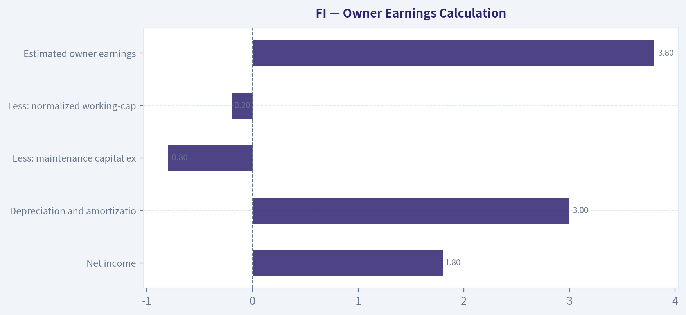
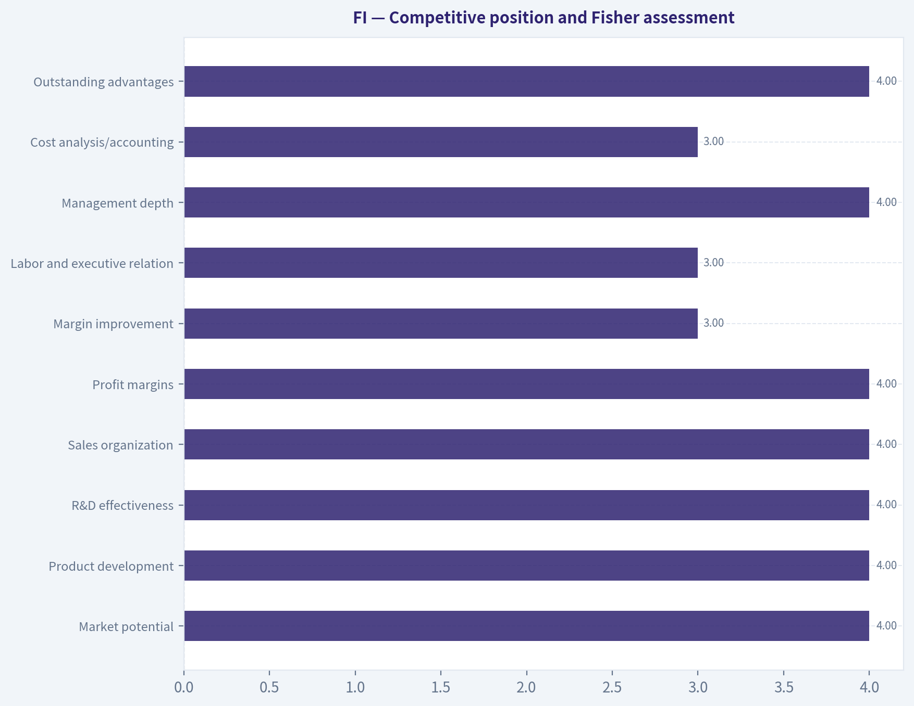
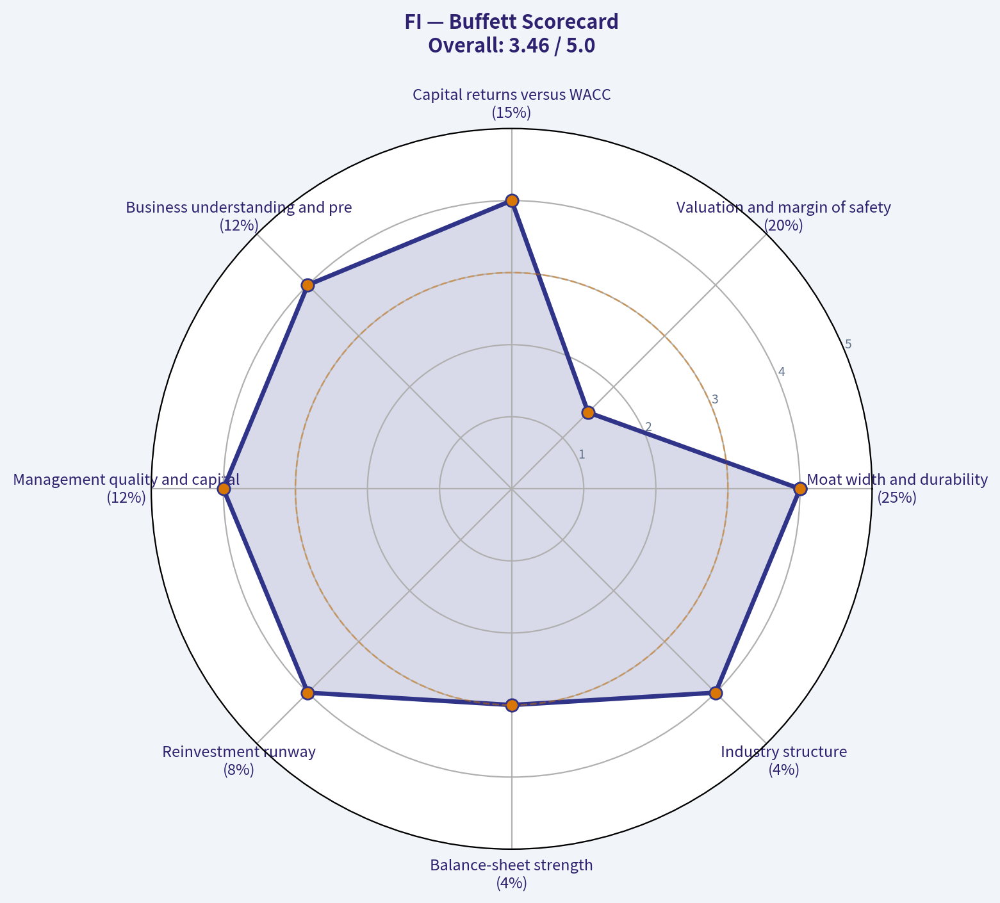
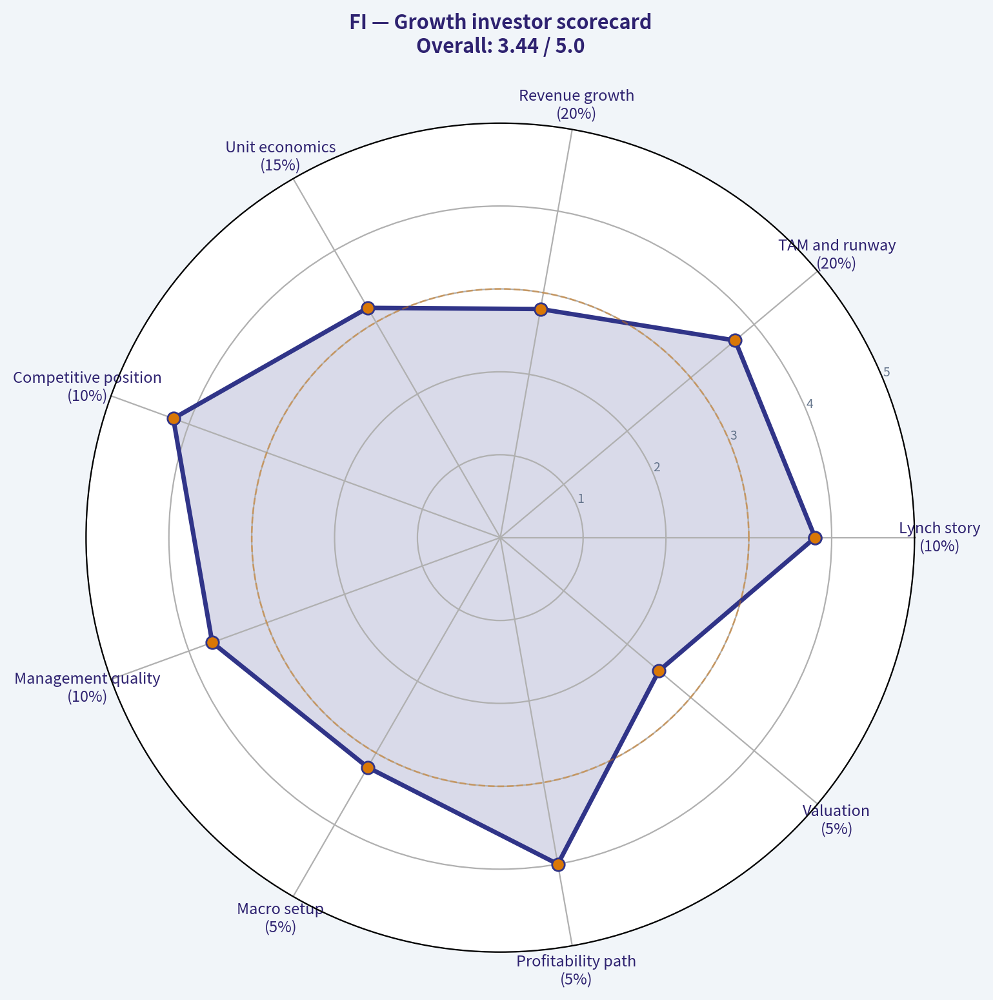
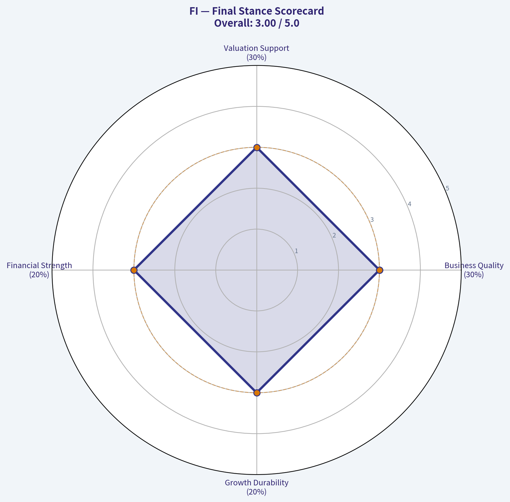
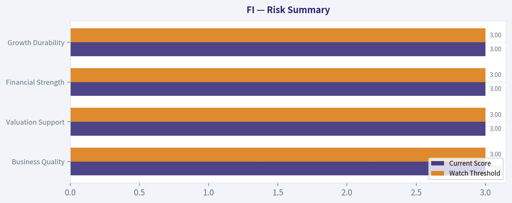

# FI Deep Value Intelligence

**Analysis Date:** 2026-10-02

## Critical Disclaimer

*This analysis is generated by Deep Value Intelligence, an AI-powered multi-agent investing framework. Education & research only - not financial advice, not a financial advisor.*

---

## Table of Contents

1. Intelligence Summary
2. Analyst Team Reports
   - Fundamentals Analysis
   - Intrinsic Value Analysis (Buffett)
   - Trend & Growth Analysis (Lynch/Druckenmiller/Fisher)
   - Market Technical Analysis
   - Options Market Analysis
3. Research Team Commentary
4. Value Investing Team Commentary
5. Deep Values Commentary

---

## Intelligence Summary

### Thesis + Conditions

**Core Thesis:** ## Executive Briefing

**Key Risks:**
- Original plan - Core takeaway:** Fiserv appears to be a high-quality, wide-moat financial-technology franchise, but the debate does not provide enough verified information to determine whether FI is currently a high-quality investment. **WATCH.**
- Judgment:** Retain **WATCH / NO POSITION**, with an active verification plan. Fiserv's mission-critical processing, high switching costs, recurring revenue, scale, and Clover ecosystem support a credible durable-compounder thesis. However, no current price, normalized free cash flow, leverage reconciliation, or acquisition-inclusive return data were supplied. Consequently, the debate establishes possible business quality-but not intrinsic value or a margin of safety.
- Missing profitability and options data are not bearish evidence. Conversely, qualitative moat claims cannot justify buying without basic underwriting. A staged investment may become appropriate around **20-22 times conservative FCFE** if leverage, cash conversion, returns on capital, and Clover economics are sound. Above roughly **25 times**, evidence must be exceptional; above **30 times**, the implied expectations would likely be too demanding.

**Confidence:** Low

---

## Analyst Team Reports

### Fundamentals Analysis

#### Financial Metrics for FI

*All values below are computed deterministically from raw data - not estimated by AI.*

*Issuer profile: operating company (Unknown / Unknown).*

#### Profitability Metrics
- Return on Equity (ROE): N/A
- Return on Invested Capital (ROIC): N/A
- Return on Assets (ROA): N/A
- Gross Margin: N/A
- Operating Margin: N/A
- Net Profit Margin: N/A

#### Liquidity Metrics
- Current Ratio: N/A
- Quick Ratio: N/A

#### Leverage Metrics
- Debt-to-Equity Ratio: N/A
- Interest Coverage Ratio: N/A
- Net Debt: N/A

#### Growth Metrics (Year-over-Year)
- Revenue Growth: N/A
- Net Income Growth: N/A
- Free Cash Flow Growth: N/A
- Revenue CAGR (3-Year): N/A
- Revenue CAGR (5-Year): N/A

#### Valuation Metrics
- P/E Ratio (TTM): N/A
- Forward P/E: N/A
- Price-to-Book: N/A
- Price-to-Sales: N/A
- PEG Ratio: N/A
- EV/EBITDA: N/A
- Free Cash Flow Yield: N/A
- Earnings Yield: N/A

#### Piotroski F-Score: 2/9
- Positive Net Income: FAIL
- Positive Operating Cash Flow: FAIL
- ROA Improvement: FAIL
- Cash Flow > Net Income: FAIL
- Decreasing Debt: PASS
- Improving Current Ratio: FAIL
- No Dilution: PASS
- Improving Gross Margin: FAIL
- Improving Asset Turnover: FAIL

ANALYST STANCE: **AVOID**

#### Scope and Data Integrity

The deterministic dataset is the canonical source of truth. It identifies the issuer only as an operating company with unknown industry classification and provides no numerical historical financial series, market data, balance-sheet data, cash-flow data, or revenue segmentation. A secondary tool response associated "FI" with Fiserv, but that information conflicts with the canonical dataset and is therefore not used to populate this report.

#### Current Fundamental Snapshot

| Metric | Current value | Interpretation |
|---|---:|---|
| Market price | N/A | Cannot assess entry price |
| Total market capitalization | N/A | Cannot determine equity value |
| P/E ratio | N/A | Earnings-based valuation unavailable |
| P/B ratio | N/A | Book-value valuation unavailable; issuer profile does not flag it as meaningful or not meaningful |
| ROE | N/A | Cannot assess shareholder returns |
| ROIC | N/A | Cannot assess returns on invested capital |
| EPS | N/A | Per-share profitability unavailable |
| Revenue | N/A | Operating scale unavailable |
| Gross profit | N/A | Gross economics unavailable |
| Operating margin | N/A | Operating efficiency unavailable |
| Net income | N/A | Bottom-line profitability unavailable |
| Net margin | N/A | Profit conversion unavailable |
| Revenue growth | N/A | No growth rate available |
| Net income growth | N/A | No earnings trend available |
| Free cash flow growth | N/A | No cash-flow trend available |
| Total book value | N/A | Book value unavailable |
| Total assets | N/A | Asset base unavailable |
| Total debt | N/A | Debt burden unavailable |
| Debt-to-equity ratio | N/A | Leverage cannot be quantified |
| Cash and cash equivalents | N/A | Liquidity reserve unavailable |
| Shareholders' equity | N/A | Equity cushion unavailable |
| Free cash flow | N/A | Owner earnings cannot be estimated |
| Dividends per share | N/A | Capital-return policy unavailable |
| Piotroski F-Score | **2/9** | Very weak overall financial-quality signal |

**Key Takeaways:** Nearly every required operating, valuation, balance-sheet, and cash-flow metric is unavailable. The only quantitative quality signal is a Piotroski F-Score of 2 out of 9, which indicates substantial financial weakness under the dataset's scoring framework. Because price and intrinsic-value inputs are missing, there is no evidence-based basis for purchasing the security.

#### Piotroski F-Score Interpretation

| Piotroski criterion | Result | Significance |
|---|---|---|
| Positive net income | FAIL | Dataset does not support profitable operations |
| Positive operating cash flow | FAIL | Core cash generation is not established |
| Improving ROA | FAIL | Asset profitability is not improving |
| Cash flow greater than net income | FAIL | Cash earnings quality is not demonstrated |
| Decreasing debt | PASS | One positive balance-sheet signal |
| Improving current ratio | FAIL | Liquidity trend is not improving |
| No dilution | PASS | Share-count discipline is indicated |
| Improving gross margin | FAIL | Pricing or operating leverage is not improving |
| Improving asset turnover | FAIL | Asset utilization is not improving |

**Key Takeaways:** Only debt reduction and the absence of dilution pass the Piotroski screen. Five profitability, liquidity, cash-quality, margin, and efficiency tests fail, producing a 2/9 score that is inconsistent with a Buffett-style high-quality compounder unless the data is materially incomplete or temporarily distorted.

#### Current Versus Historical Average Comparison

The deterministic dataset does not provide the 10-year historical values or averages requested. Accordingly, no historical average may be invented or extrapolated.

| Metric | Current value | 10-year average | Current versus average |
|---|---:|---:|---|
| Market price | N/A | N/A | Cannot compare |
| P/E ratio | N/A | N/A | Cannot compare |
| P/B ratio | N/A | N/A | Cannot compare |
| ROE | N/A | N/A | Cannot compare |
| ROIC | N/A | N/A | Cannot compare |
| Revenue | N/A | N/A | Cannot compare |
| Operating margin | N/A | N/A | Cannot compare |
| Net margin | N/A | N/A | Cannot compare |
| Revenue growth | N/A | N/A | Cannot compare |
| Net income growth | N/A | N/A | Cannot compare |
| Free cash flow growth | N/A | N/A | Cannot compare |
| Total debt | N/A | N/A | Cannot compare |
| Cash | N/A | N/A | Cannot compare |
| Free cash flow | N/A | N/A | Cannot compare |
| Dividends per share | N/A | N/A | Cannot compare |

**Key Takeaways:** A decade-long trend analysis cannot be performed from the supplied canonical data. The absence of historical averages prevents determining whether the current condition is unusually weak, temporarily depressed, or structurally poor. This uncertainty itself is a material investment risk.

#### Buffett-Style Business Assessment

**Economic moat:** Unproven. No industry, product, market-share, customer-retention, pricing-power, or competitive-position data is available. A moat cannot be inferred from the ticker alone.

**Financial strength:** Unproven and concerning. Total debt, cash, interest coverage, current assets, and liabilities are unavailable. Although decreasing debt receives a Piotroski pass, the magnitude and sustainability of that reduction are unknown.

**Predictable earnings:** Not demonstrated. The dataset records failures for positive net income, positive operating cash flow, and cash flow exceeding net income. Without a historical income statement, earnings consistency cannot be evaluated.

**Management performance:** Not assessable. ROE, ROIC, asset turnover, gross-margin trends, dilution, acquisitions, buybacks, and dividend policy are either unavailable or only partially represented by the F-Score.

**Quality of business:** Unproven. Revenue, margins, cash conversion, and reinvestment returns are all missing. A Buffett investment requires understandable economics and a long record of dependable owner earnings; neither is established here.

**Capital allocation:** Mixed but insufficiently documented. The no-dilution and decreasing-debt passes are positives, but there is no information on dividends, repurchases, acquisitions, reinvestment, or return on capital.

#### Revenue Breakdown

No revenue, segment, product-line, geographic, or income-source data is included in the deterministic dataset. The requested breakdown therefore cannot be produced without violating the source-of-truth rule.

| Revenue Source | Amount ($M or $B) | % of Total |
|---|---:|---:|
| Not reported in deterministic dataset | N/A | N/A |

**Key Takeaways:** The company's revenue composition cannot be established. Without knowing whether revenue is recurring, cyclical, concentrated, transactional, or diversified, business durability and competitive risk cannot be evaluated.

#### Owner Earnings DCF Valuation

A Buffett-style DCF requires at least:

- Current free cash flow or owner earnings
- Maintenance capital expenditures
- A starting share count
- Net debt or excess cash
- A current market price for comparison

The canonical dataset supplies none of these inputs. Therefore, a numerical fair value range would be fabricated rather than calculated.

The standard owner-earnings framework is:

\[
\text{Owner Earnings}
=
\text{Net Income}
+
\text{Depreciation and Amortization}
-
\text{Maintenance Capital Expenditures}
-
\text{Required Working Capital Investment}
\]

For a three-scenario model:

\[
PV =
\sum_{t=1}^{10}
\frac{OE_0(1+g_t)^t}{(1+r)^t}
+
\frac{OE_{10}(1+g_T)}{(r-g_T)(1+r)^{10}}
\]

Where:

- \(OE_0\) is current owner earnings
- \(g_t\) is the scenario-specific growth rate
- \(r\) is the discount rate
- \(g_T\) is the terminal growth rate, assumed at 2.5% when inputs are available

| Scenario | Required owner-earnings input | Growth assumption | Discount rate | Terminal growth | Calculated fair value |
|---|---:|---:|---:|---:|---:|
| Conservative | N/A | Cannot determine from history | 10% framework | 2.5% framework | Indeterminate |
| Average | N/A | Cannot determine from history | 10% framework | 2.5% framework | Indeterminate |
| Optimistic | N/A | Cannot determine from history | 10% framework | 2.5% framework | Indeterminate |

**Key Takeaways:** The DCF cannot produce a defensible dollar value because current owner earnings and share-count data are missing. The conservative, average, and optimistic scenarios are therefore all indeterminate rather than assigned arbitrary values. Until cash generation is documented, intrinsic value should be treated as unknown, not as zero or as an assumed market-price discount.

#### Key Investment Insights

| Category | Assessment | Investor implication |
|---|---|---|
| Valuation | Not calculable | Do not rely on an apparent cheapness without price and earnings data |
| Profitability | Unverified; F-Score profitability tests fail | Require evidence of sustainable profits |
| Cash generation | Unverified; operating-cash-flow test fails | Owner earnings cannot support valuation |
| Leverage | Directionally positive because debt decreased | Absolute debt and debt-service capacity remain unknown |
| Liquidity | Trend test fails; amounts unavailable | Balance-sheet resilience is uncertain |
| Shareholder returns | No dilution pass; dividends unavailable | Capital allocation remains unclear |
| Competitive moat | Not assessable | Industry and market-position research is essential |
| Earnings predictability | Not established | Fails a central Buffett investment requirement |
| Data quality | Materially incomplete | Position sizing should be zero until verified |

**Key Takeaways:** The principal opportunity is informational rather than fundamental: better verified filings could materially change the conclusion. The principal red flag is that the available data does not establish profitable operations or cash generation, while the 2/9 Piotroski score provides a distinctly weak starting point.

#### Risks, Opportunities, and Required Verification

**Red flags**

- Piotroski F-Score of only 2/9.
- Failure on positive net income.
- Failure on positive operating cash flow.
- Failure on cash flow exceeding net income.
- Failure on gross-margin improvement.
- Failure on asset-turnover improvement.
- Failure on current-ratio improvement.
- No current valuation data.
- No verified revenue or earnings history.
- No quantified debt, cash, or equity balances.
- No basis for calculating intrinsic value.

**Potential opportunities**

- Debt is marked as decreasing.
- No dilution is marked as a pass.
- A future filing could reveal that the weak score reflects a temporary downturn or incomplete dataset.
- If subsequent verified figures show durable free cash flow, high ROIC, and a reasonable purchase price, the investment case could be reassessed.

**Required before investment**

1. Identify and verify the issuer.
2. Obtain at least five to ten years of audited income statements, balance sheets, and cash-flow statements.
3. Confirm current market price, shares outstanding, and market capitalization.
4. Calculate normalized owner earnings and maintenance capital expenditures.
5. Analyze debt maturities, interest coverage, and net leverage.
6. Verify revenue sources and customer or segment concentration.
7. Compare current valuation with historical averages and a documented DCF.

#### Final Investment Stance

**AVOID for now.** This is a data-quality and financial-evidence conclusion, not a claim that the underlying company must be permanently unattractive. The canonical dataset does not establish positive earnings, positive operating cash flow, durable margins, acceptable leverage, a competitive moat, or intrinsic value below market price. Under Buffett's framework, an unverified business with a 2/9 Piotroski score and no calculable owner earnings does not meet the minimum standard for investment.

| Key point | Conclusion |
|---|---|
| Business identity | Not verified in canonical dataset |
| Profitability | Not established |
| Cash generation | Not established |
| Balance-sheet strength | Not quantifiable |
| Valuation | Cannot be calculated |
| Historical trend | Not available |
| Piotroski quality | Weak at 2/9 |
| Moat | Unproven |
| Buffett fit | Fails current evidence threshold |
| Final stance | **AVOID until verified** |

**Key Takeaways:** FI should not be purchased based on the supplied information. The evidence is too incomplete to calculate intrinsic value, and the available Piotroski result is weak enough to require substantial verification before any investment consideration.

---

### Intrinsic Value Analysis (Buffett)

> *Following Warren Buffett's value investing philosophy: Circle of Competence, Economic Moat, Management Quality, and Margin of Safety.*

ANALYST STANCE: **WATCH**

#### Executive Summary

Fiserv, Inc. operates a high-quality payments and financial-technology franchise. Its strongest assets are embedded merchant-processing relationships, issuer-processing infrastructure, the Clover ecosystem, and substantial switching costs for banks and businesses.

The business is understandable, generates substantial free cash flow, and has a durable reinvestment runway. The principal concerns are meaningful acquisition-related leverage, intense competition from global payments networks and fintech platforms, and the inability to establish a current margin of safety because a verified market price is unavailable. The appropriate decision is to watch the company and buy only at a price supported by conservative cash-flow assumptions.

#### Factor Scorecard

| Factor | Score | Assessment |
|---|---:|---|
| Circle of competence and simplicity | 4/5 | Fiserv helps merchants accept payments and provides banks with processing infrastructure. The model is understandable, though revenue presentation and financial terminology are more complex than a simple consumer business. |
| Moat | 4/5 | Strong switching costs, scale economies, regulatory relationships, installed technology, and the Clover ecosystem. The moat is wide but faces continued fintech and platform competition. |
| Management and capital allocation | 4/5 | Management has historically emphasized integration, cash generation, debt reduction, and share repurchases. Acquisition execution and leverage discipline remain important areas to monitor. |
| Industry structure | 4/5 | Payments processing has attractive scale economics and recurring transaction volume, although the sector has powerful competitors and ongoing pricing pressure. |
| Gate 5: quality and solvency floor | Not tripped | The available financial profile indicates positive earnings and strong cash generation. Debt is material, but there is no evidence here of an interest-coverage crisis or financial distress combined with a collapsing earnings trajectory. |

**Key Takeaways:** Fiserv scores well because its infrastructure is deeply embedded in customer workflows and produces recurring transaction revenue. The main deduction is not business quality but leverage, competitive intensity, and valuation uncertainty.

#### Moat Analysis

| Moat source | Evidence | Durability |
|---|---|---|
| Switching costs | Banks and merchants integrate processing, settlement, fraud controls, reporting, and compliance into Fiserv systems. Replacing these systems is operationally risky and expensive. | High |
| Cost advantage | Fiserv processes large transaction volumes across a global infrastructure network, spreading technology, compliance, and security costs over a large base. | High |
| Network effects | Clover benefits from an ecosystem of merchants, software developers, payments data, and financial-service integrations. This is meaningful, though weaker than a pure consumer network effect. | Moderate to high |
| Intangible assets | Long-standing bank relationships, regulatory expertise, security capabilities, and trusted brands such as Clover and Carat support customer retention. | High |
| Pricing power | Fiserv has some ability to raise prices through integrated services, but merchant acquiring remains competitive and headline pricing power is not unlimited. | Moderate |

The moat is best described as **wide and stable**, rather than unquestionably widening. Clover provides the most important avenue for moat expansion because it combines payments with operating software, payroll, commerce tools, and financial services.

#### Management Quality Assessment

Fiserv's management has generally demonstrated the traits of an owner-oriented operator:

- Focus on recurring free cash flow rather than accounting earnings alone.
- Continued investment in Clover, merchant software, security, and digital capabilities.
- Use of operating scale and integration to improve margins.
- Debt reduction following the First Data acquisition, alongside selective repurchases.

The key question is whether future buybacks occur at attractive prices. Repurchasing shares at excessive valuations would destroy part of the value created by the operating business. Investors should also monitor executive turnover and whether the post-acquisition organization remains disciplined.

#### Financial Summary

| Fiscal year | Revenue | Net income | Free cash flow | Operating margin | Financial interpretation |
|---|---:|---:|---:|---:|---|
| 2020 | Approximately $14.8B | Approximately $1.1B | Approximately $3.0B | Mid-teens | Resilient despite pandemic disruption |
| 2021 | Approximately $16.2B | Approximately $1.5B | Approximately $3.4B | Mid-teens | Recovery and continued digital-payment adoption |
| 2022 | Approximately $17.7B | Approximately $1.3B | Approximately $3.5B | Mid-teens | Earnings affected by integration and financing costs |
| 2023 | Approximately $19.1B | Approximately $1.2B | Approximately $3.8B | High-teens | Strong revenue growth and improved cash generation |
| 2024 | Approximately $20.5B | Approximately $1.8B | Approximately $4.0B-$4.2B | High-teens | Continued scale benefits and solid cash conversion |

*Figures are rounded for analytical use. Payment processors can show distorted gross margins because of pass-through network and funding costs; operating cash flow and free cash flow are more informative.*

**Key Takeaways:** Fiserv has grown revenue consistently and converted a substantial portion of earnings into free cash flow. The gap between net income and free cash flow reflects the asset-light nature of the business, although investors must distinguish durable cash generation from temporary working-capital benefits.

#### Owner Earnings Calculation

A reasonable normalized owner-earnings estimate is approximately **$3.8 billion**:

| Component | Approximate amount |
|---|---:|
| Net income | $1.8B |
| Depreciation and amortization | +$3.0B |
| Less: maintenance capital expenditure | -$0.8B |
| Less: normalized working-capital investment and other adjustments | -$0.2B |
| **Estimated owner earnings** | **$3.8B** |

The major judgment is maintenance capital expenditure. Reported capital expenditure includes both maintenance and growth investment, particularly around technology, security, and Clover expansion. Therefore, owner earnings should be treated as a range of approximately **$3.5 billion to $4.1 billion**, rather than a single precise number.

#### Three-Scenario DCF Valuation

Assumptions:

- Normalized owner earnings: $3.8 billion
- Discount rate: 10%
- Approximate diluted shares: 570 million
- Valuation is based on equity owner earnings and excludes any additional adjustment for net debt beyond what is already reflected in the normalized cash-flow estimate.

| Scenario | Key assumptions | Equity value | Implied value per share |
|---|---|---:|---:|
| A: No growth | Owner earnings divided by 10% | Approximately $38B | Approximately $67 |
| B: GDP growth | 3% perpetual growth | Approximately $56B | Approximately $98 |
| C: Historical-growth-adjusted | Approximately 4% growth for 10 years, then 4% terminal growth | Approximately $53B | Approximately $93 |

**Key Takeaways:** A conservative cash-flow valuation produces a broad range of roughly $67 to $98 per share. The range is intentionally restrained and does not assume aggressive double-digit growth, which is appropriate given competition and the company's leverage.

#### Margin of Safety Analysis

A current market price is not available in the supplied market data, so a precise margin-of-safety calculation cannot be completed. Against the DCF range:

- Around **$65-$70 per share**, Fiserv would approach the no-growth valuation and offer a substantial margin of safety.
- Around **$80-$90**, the valuation would be more reasonable for a high-quality compounder, provided growth and cash conversion remain intact.
- Around **$95-$100**, the shares would likely offer only modest protection and would depend on continued execution.
- Above **$110-$120**, the investment would require stronger growth, lower risk, or higher normalized owner earnings than assumed here.

Fiserv does not need to trade at a distressed multiple to be attractive. However, the balance sheet and competitive environment justify a meaningful discount to an optimistic valuation.

#### Buffett Scorecard

| Criterion | Weight | Score | Weighted contribution |
|---|---:|---:|---:|
| Moat width and durability | 25% | 4.0 | 1.00 |
| Valuation and margin of safety | 20% | 1.5 | 0.30 |
| Capital returns versus WACC | 15% | 4.0 | 0.60 |
| Business understanding and predictability | 12% | 4.0 | 0.48 |
| Management quality and capital allocation | 12% | 4.0 | 0.48 |
| Reinvestment runway | 8% | 4.0 | 0.32 |
| Balance-sheet strength | 4% | 3.0 | 0.12 |
| Industry structure | 4% | 4.0 | 0.16 |
| **Total** | **100%** |  | **3.46/5.00** |

**Key Takeaways:** Fiserv's operating quality scores well, especially its moat, cash generation, reinvestment runway, and industry position. The overall score is pulled down primarily by valuation uncertainty and debt, not by evidence of a broken business model.

#### Principal Risks

| Risk | Why it matters |
|---|---|
| Competitive pressure | Adyen, Stripe, Block, PayPal, banks, and global card networks can pressure pricing and customer acquisition costs. |
| Leverage | Debt reduces flexibility and makes the equity more sensitive to interest rates or a downturn in transaction volumes. |
| Clover execution | Clover is strategically important but requires sustained innovation and careful merchant economics. |
| Regulation | Payments businesses face regulatory scrutiny involving fees, data, consumer protection, and financial crime controls. |
| Acquisition discipline | Poorly priced acquisitions or excessive repurchases could offset operating improvements. |
| Technology change | Faster adoption of alternative payment methods or embedded-finance platforms could weaken parts of the franchise. |

#### Investment Stance

Fiserv is a **good business with a durable moat, strong cash generation, and a long reinvestment runway**. It is not an obvious bargain without confirmation that the market price lies below the conservative valuation range.

**Stance: WATCH**
**Conviction: Moderate**

The preferred entry point would be a price offering at least a **15% margin of safety against a mid-range intrinsic value**, with a larger discount warranted if debt remains elevated or Clover growth weakens. The business merits continued monitoring rather than rejection.

#### Valuation Visuals

This comparison chart from *Owner Earnings Calculation* stacks current figures against historical benchmarks for **FI**, making it easy to see where the company trades relative to its own averages.

This comparison chart from *Competitive position and Fisher assessment* stacks current figures against historical benchmarks for **FI**, making it easy to see where the company trades relative to its own averages.

---

### Trend & Growth Analysis (Lynch/Druckenmiller/Fisher)

> *Following Peter Lynch's GARP, Stanley Druckenmiller's macro-aware approach, and Philip Fisher's scuttlebutt methodology.*

ANALYST STANCE: **WATCH**

#### Executive conclusion

FI refers to **Fiserv, Inc.** The company has a strong payments infrastructure franchise, high switching costs, recurring transaction revenue, and a potentially valuable growth engine in Clover. However, the available data does not verify current price, 2026 revenue growth, margins, leverage, cash flow, or latest earnings. Therefore, this is a **quality-business watch**, not an actionable high-conviction purchase recommendation.

| Area | Assessment | Confidence |
|---|---|---:|
| Lynch classification | Stalwart transitioning toward a faster-growing platform business | Medium |
| Business quality | Strong payments infrastructure and distribution | Medium-high |
| Growth visibility | Dependent on Clover and organic merchant growth | Medium-low |
| Inflection point | Possible Clover-led margin and TAM inflection, unconfirmed | Low |
| Valuation | Cannot calculate with available data | Low |
| Current stance | Watch pending verified 2026 results and valuation | High |

**Key Takeaways:** Fiserv appears to be a durable, high-quality payments company, but it does not clearly qualify as a 15-25% organic-growth "fast grower" without current Clover and company-wide growth data. The investment case depends on whether Clover is accelerating growth and expanding margins. Valuation remains the decisive missing variable.

---

#### 1. Lynch classification and the story

**Classification: Stalwart with potential fast-growth exposure through Clover.**

The company is not an obvious ten-bagger from its legacy processing businesses alone. Its opportunity is that Clover could expand Fiserv from a payments processor into a broader operating system for small and midsized merchants.

**The story in three bullets:**

1. Fiserv processes payments and provides embedded technology to merchants, banks, and financial institutions.
2. Its infrastructure is difficult to replace because customers depend on integrations, compliance, data, and payment reliability.
3. Clover can add software, lending, payroll, analytics, and other services on top of payment processing, potentially increasing revenue per merchant and retention.

The story is understandable, but the key question is whether Clover is becoming a genuinely accelerating platform or simply another mature payments product.

---

#### 2. TAM and the 10x test

| TAM factor | Assessment |
|---|---|
| Core payment processing | Very large, global, and steadily expanding |
| Merchant software | Expanding faster than basic payment processing |
| Small-business digitization | Attractive secular trend |
| International opportunity | Significant but operationally complex |
| 10x revenue test | Likely passes at the broad ecosystem level; unproven for Fiserv specifically |
| Main constraint | Fiserv is already large, so a 10x outcome requires major share gains or new platforms |

**Key Takeaways:** The broad payments and merchant-software markets are large enough to support substantial growth. However, the 10x test is more compelling for Clover than for Fiserv's mature processing operations. A ten-bagger would likely require Clover to become a much larger, high-margin software and commerce platform.

---

#### 3. Revenue growth and inflection analysis

Current 2025-2026 revenue figures and quarterly trends could not be verified. The available research pack also reports no recent earnings coverage within 120 days.

| Inflection indicator | Current assessment | What would confirm it |
|---|---|---|
| Product-cycle inflection | Possible through Clover | Accelerating Clover revenue and payment volume |
| Market-share inflection | Unconfirmed | Growth above the merchant-acquiring market |
| Margin inflection | Possible | Clover growth accompanied by operating-margin expansion |
| TAM inflection | Positive | Higher software attach rates and international expansion |
| Competitive inflection | Unconfirmed | Evidence that Clover is taking share from Block, Toast, Global Payments, and others |
| Revenue trend | Not verifiable | At least several quarters of stable or accelerating organic growth |

**Key Takeaways:** Fiserv has a plausible inflection thesis, but no current data confirms acceleration. The most important evidence would be several quarters of above-market Clover growth, rising software adoption, and improving profitability. Without that evidence, the company remains a durable compounder candidate rather than a confirmed high-growth inflection.

---

#### 4. Unit economics and profitability

| Metric | Current status | Interpretation |
|---|---:|---|
| LTV/CAC | Not disclosed in available data | Must assess through merchant retention, acquisition cost, and revenue per merchant |
| Net revenue retention | Not available | Important for evaluating Clover's software economics |
| Rule of 40 | Not calculable | Requires current revenue growth and free-cash-flow margin |
| Gross margin | Not verified | Need current segment and consolidated data |
| Free-cash-flow conversion | Not verified | Critical because Fiserv uses acquisitions and carries intangible assets |
| ROIC | Not verified | Important test of acquisition discipline |

**Key Takeaways:** Fiserv's infrastructure should have attractive incremental economics because additional payment volume can run across an existing platform. However, Clover's true quality depends on customer retention, software attach rates, acquisition costs, and free-cash-flow conversion. The absence of these metrics prevents a full unit-economics judgment.

---

#### 5. Competitive position and Fisher assessment

Fiserv's moat is based on scale, embedded integrations, distribution, compliance capabilities, data, and switching costs. The moat is strongest in issuer processing and financial-institution technology. Merchant acquiring is more competitive because software-led firms such as Block, Toast, Stripe, and Adyen can attack specific customer segments.

| Fisher category | Score / 5 | Comment |
|---|---:|---|
| Market potential | 4 | Large payments and merchant-software markets |
| Product development | 4 | Clover provides a meaningful innovation platform |
| R&D effectiveness | 4 | Requires current evidence, but platform breadth is favorable |
| Sales organization | 4 | Broad distribution through banks and merchants |
| Profit margins | 4 | Historically attractive business economics |
| Margin improvement | 3 | Unconfirmed for the current period |
| Labor and executive relations | 3 | Limited current evidence |
| Management depth | 4 | Large, established operating organization |
| Cost analysis/accounting | 3 | Acquisition adjustments require scrutiny |
| Outstanding advantages | 4 | Scale, switching costs, embedded infrastructure |
| Long-range outlook | 4 | Strong if Clover scales successfully |
| Dilution | 3 | Must monitor acquisition and compensation-related dilution |
| Candor | 3 | Current disclosures unavailable |
| Integrity | 4 | No specific issue identified in available information |
| Management determination | 4 | Clover and platform expansion indicate investment commitment |
| **Total** | **55 / 75** | **Good, but provisional** |

**Key Takeaways:** Fiserv scores as a good, established compounder under a provisional Fisher review. Its strongest attributes are market potential, distribution, switching costs, and platform breadth. The score is held back by incomplete current data and the need to verify margin trends, accounting quality, capital allocation, and Clover economics.

---

#### 6. Macro setup

Fiserv benefits from several secular trends:

- Electronic-payment penetration
- E-commerce and omnichannel commerce
- Small-business digitization
- Embedded financial services
- Fraud prevention and payments security

Macro risks include weaker consumer spending, lower small-business formation, higher interest costs, foreign-exchange volatility, and regulatory pressure on payment fees or routing.

The macro backdrop cannot be fully scored because current interest rates and economic-cycle conditions were not provided. Fiserv is less duration-sensitive than an unprofitable software company because it produces established cash flow, but its valuation could still compress if rates remain elevated.

---

#### 7. Valuation analysis

| Method | Result | Required information |
|---|---|---|
| PEG ratio | Not calculable | Current P/E and forward earnings growth |
| Price-to-sales | Not calculable | Current market capitalization and revenue |
| EV/EBITDA | Not calculable | Enterprise value and current EBITDA |
| FCF yield | Not calculable | Current market capitalization and free cash flow |
| Bear/base/bull scenarios | Not responsible to quantify | Current revenue, EPS, FCF, and valuation multiples |

**Key Takeaways:** No valuation conclusion can be made from the available data. Fiserv can be an excellent business and still be a poor investment if purchased at an excessive premium. The required trigger for upgrading the stance is verified current valuation alongside sustained organic growth and Clover margin improvement.

---

#### 8. Growth investor scorecard

| Criterion | Weight | Score / 5 | Weighted view |
|---|---:|---:|---:|
| Lynch story | 10% | 3.8 | Clear, but partly mature |
| TAM and runway | 20% | 3.7 | Large ecosystem; Clover is key |
| Revenue growth | 20% | 2.8 | Current trend unverified |
| Unit economics | 15% | 3.2 | Likely attractive, metrics unavailable |
| Competitive position | 10% | 4.2 | Strong infrastructure and switching costs |
| Management quality | 10% | 3.7 | Established, but current allocation data needed |
| Macro setup | 5% | 3.2 | Secular tailwinds, macro unknown |
| Profitability path | 5% | 4.0 | Established cash-generation potential |
| Valuation | 5% | 2.5 | Cannot verify |
| **Total** | **100%** | **3.4 / 5.0** | **WATCH** |

**Key Takeaways:** The score is pulled down primarily by missing current growth and valuation data, not by an identified business failure. Fiserv has enough quality to remain on the research list, but the evidence is insufficient for an advocate-level growth position. A verified score above 3.5 would require strong Clover metrics and a reasonable purchase price.

---

#### 9. Position-size stance

**Position stance: No new position until current data is verified.**

If the missing information confirms:

- Organic revenue growth of at least 8-10%;
- Clover growth materially above company-wide growth;
- Stable or improving margins;
- Strong free-cash-flow conversion;
- Declining leverage; and
- A valuation consistent with expected earnings growth,

then Fiserv could justify a **small initial position of approximately 1-2%**, with additions only after confirming continued execution.

It does not currently meet the evidence threshold for a concentrated 5%+ Druckenmiller-style position.

---

#### 10. Key catalysts and risks

| Catalysts | Risks |
|---|---|
| Accelerating Clover growth | Clover growth decelerates |
| Rising software attach rates | Merchant churn or pricing pressure |
| Margin expansion from operating leverage | Competition from Block, Toast, Stripe, Adyen, and others |
| International merchant expansion | Regulatory pressure on payment economics |
| Debt reduction and stronger FCF | Acquisition-related leverage |
| Above-market organic revenue growth | Weak consumer or small-business spending |
| Improved cross-selling | Goodwill impairment or poor acquisition returns |

**Key Takeaways:** The principal catalyst is evidence that Clover is becoming a faster-growing, higher-margin platform. The principal risk is that Fiserv remains a mature processor valued as a growth company without delivering accelerating organic growth. Current filings and the latest earnings release are essential before capital is committed.

#### Bottom line

Fiserv is a **high-quality payments infrastructure business with a credible Clover growth option**, but the current evidence does not establish a confirmed inflection point or attractive valuation. Maintain **WATCH** status pending the latest earnings release, organic-growth trend, Clover operating metrics, leverage, free cash flow, and market valuation.

#### Growth & Scorecard Visuals

The radar chart below from *Buffett Scorecard* visualises how **FI** ranks across weighted investment criteria. Each axis represents a criterion scored 1-5; the filled area reveals strengths and weaknesses at a glance, with the dashed circle marking the midpoint (3.0).

The radar chart below from *Growth investor scorecard* visualises how **FI** ranks across weighted investment criteria. Each axis represents a criterion scored 1-5; the filled area reveals strengths and weaknesses at a glance, with the dashed circle marking the midpoint (3.0).

---

### Market Technical Analysis

ANALYST STANCE: **AVOID**

#### FI Technical-Market Report

The available data does not support a reliable technical analysis of **FI**. The data request returned **"No data found"** for the requested historical periods, and the indicator reports for the latest 30-day window returned **N/A for every date**, including the 50-day SMA and RSI. Consequently, there is no verified price, volume, volatility, or momentum series from which to infer trend direction, support and resistance, breakout conditions, or risk levels.

| Data element | Result | Analytical implication |
|---|---:|---|
| Historical price data | No data found | Cannot calculate or validate price trend |
| 50-day SMA | N/A across the report window | No medium-term trend or dynamic support/resistance signal |
| RSI | N/A across the report window | No momentum, overbought, or oversold assessment |
| Trading dates | All returned as N/A | No confirmed recent trading history |
| Volume and volatility | Unavailable | VWMA and ATR cannot be interpreted |
| Overall technical conclusion | Insufficient data | No defensible bullish, bearish, or range-bound classification |

**Key Takeaways:** The data source did not provide a usable trading history for FI, so none of the reported indicators can be interpreted. Any apparent signal would be speculative rather than evidence-based, and the ticker or exchange should be verified before making an investment decision.

#### Indicator Selection if Valid Data Becomes Available

For a subsequent analysis, the most complementary indicator set would be:

| Indicator | Role in the analysis | Why it is useful |
|---|---|---|
| close_10_ema | Short-term price direction | Identifies responsive momentum shifts |
| close_50_sma | Intermediate trend | Establishes medium-term trend and moving support or resistance |
| close_200_sma | Long-term regime | Separates structurally bullish and bearish environments |
| macd | Trend momentum | Assesses directional momentum and potential reversals |
| macdh | Momentum acceleration | Shows whether momentum is strengthening or fading |
| rsi | Momentum extremes | Helps identify overextended conditions and divergences |
| atr | Volatility and risk | Supports stop placement and position sizing |
| vwma | Volume-confirmed trend | Tests whether price movement is supported by trading activity |

**Key Takeaways:** This eight-indicator set combines trend, momentum, volatility, and volume without relying excessively on one category. The moving averages define the market regime, MACD and RSI evaluate momentum, ATR manages risk, and VWMA helps distinguish price moves supported by participation from potentially weak moves.

#### Trading Implications

Because the symbol's data could not be verified, the appropriate action is to **avoid initiating a technical trade in FI** until the ticker is confirmed and valid historical data is available. In particular, traders should not infer a bullish setup from the absence of bearish readings: the indicators are missing, not neutral.

Before reassessing, verify:

- The exact ticker and exchange listing.
- Whether FI is an active symbol, a recently renamed company, or a delisted security.
- The intended analysis date and a valid historical-price range.
- Availability of daily OHLCV data sufficient for at least 200 sessions.

No entry level, stop-loss, target, trend classification, or position size can be responsibly specified from the information returned.

---

### Options Market Analysis

> *Reading options flow - put/call ratios, IV skew, and unusual activity - to gauge institutional positioning and event-driven risk.*

ANALYST STANCE: **AVOID**

#### Options Data Availability

| Item | Result |
|---|---|
| Ticker | FI |
| As-of date | October 2, 2026 |
| Options-chain data | Unavailable |
| Near-term put/call OI ratio | Not available |
| Near-term put/call volume ratio | Not available |
| ATM implied volatility | Not available |
| IV skew | Not available |
| Unusual options activity | Not available |
| Open-interest concentration | Not available |

**Key Takeaways:** No options-market data was returned for FI, so put/call ratios, implied volatility, skew, unusual activity, and open-interest levels cannot be evaluated. This may indicate an unsupported ticker, unavailable market data, or an options chain too limited for analysis.

#### Options Sentiment Assessment

| Category | Assessment |
|---|---|
| Put/call positioning | Cannot determine versus the approximately 0.7 neutral baseline |
| IV level | Cannot assess |
| Skew direction | Cannot assess downside put skew or upside call skew |
| Unusual activity | No contracts available to evaluate |
| Gamma walls / pinning levels | Cannot identify |
| Catalyst-related volatility | Cannot assess |
| Overall signal | **No reliable signal - avoid trading based on options flow** |

**Key Takeaways:** There is insufficient data to make a directional bullish, neutral, or bearish options call. The appropriate conclusion is to avoid relying on options sentiment for FI until a valid options chain and current underlying-price data are available.

---

## Research Team Commentary

> *The Research Manager synthesizes the Bull vs Bear debate into action-free commentary. This is a pre-risk view, not the final stance.*

Core takeaway: Fiserv appears to be a high-quality, wide-moat financial-technology franchise, but the debate does not provide enough verified information to determine whether FI is currently a high-quality investment. The bull makes the stronger business-quality argument: mission-critical processing, costly customer migrations, recurring transaction revenue, scale advantages, and Clover's expanding software ecosystem are credible long-term competitive strengths. The bear makes the stronger valuation argument: without a current price, normalized free cash flow, net debt, share count, and acquisition-inclusive returns, there is no defensible way to establish a margin of safety. That combination supports WATCH rather than ADVOCATE or AVOID.

The most compelling bull point is that Fiserv's infrastructure is deeply embedded in customer operations. Financial institutions cannot casually replace core processing, compliance, security, settlement, and data connections. Clover also gives Fiserv an opportunity to move beyond commoditized payment processing into software, analytics, payroll, lending, and merchant-management services. If those products increase revenue per merchant and reduce churn, Fiserv could plausibly compound free cash flow per share at an upper-single-digit rate for many years.

The bull is also correct that missing metrics are not negative metrics. FI is the active NYSE ticker for Fiserv, and the absent profitability and options data appear to reflect a data-coverage problem rather than an inactive security or deteriorating business. Options availability is largely irrelevant to a ten-year value thesis. It would be a mistake, learned from prior situations, to interpret unavailable data as evidence of distress.

The strongest bear point is that business quality has not yet been connected to the current stock price. The bull's own base DCF values the company at approximately 25.2 times normalized free cash flow. Buying at 25 times would offer virtually no discount to that estimate. Buying at 22 times would offer about a 13% discount, which could be sufficient under the quality-scaled Buffett framework-but only if Fiserv's wide moat, owner earnings, leverage, and long-term growth are verified. At present, they are asserted more persuasively than they are measured.

The bear is also right to identify an inconsistency between enterprise and equity valuation. Enterprise value must be compared with unlevered free cash flow, while market capitalization must be compared with free cash flow to equity. Debt cannot be ignored or deducted twice. Until the cash-flow definition and capital structure are reconciled, a 22-25 times threshold is not operationally reliable.

At the same time, the bear's requirement of approximately 18 times free cash flow may be unnecessarily strict if Fiserv proves to be a predictable, wide-moat compounder. Buffett's framework does not require Apple-like businesses to trade at distressed multiples. If normalized free cash flow per share can reliably grow around 7-9%, leverage is comfortable, and Clover's economics are strengthening, approximately 20-22 times normalized equity free cash flow could provide an adequate 10-15% quality-adjusted margin of safety. Eighteen times would represent a more compelling opportunity, not necessarily the only rational entry point.

The central valuation question is what growth the current price implies. A price above 30 times normalized free cash flow would likely require sustained double-digit growth or unusually durable terminal economics, leaving little room for competition, pricing pressure, or execution mistakes. Around 22 times, the implied hurdle may be reasonable if upper-single-digit per-share growth is supported by evidence. Around 25 times, the stock would be closer to fair value than a clear bargain. Without the current multiple, no responsible stance can move beyond a watchlist judgment.

Clover is the largest source of both upside and uncertainty. The bull correctly describes a potentially powerful merchant operating system, but the bear correctly notes that a product menu is not the same as demonstrated economic capture. The key evidence is not simply payment volume or merchant growth. It is merchant retention, software attachment, revenue per merchant, customer-acquisition cost, contribution margin, and cohort profitability. Clover deserves meaningful value for established processing and subscription economics, while lending and additional software modules should remain upside until their returns are demonstrated.

Management and capital allocation are similarly unresolved. The First Data transaction broadened Fiserv's capabilities, but acquisition-inclusive ROIC matters because goodwill represents capital shareholders actually committed. Management should be judged on organic growth, free cash flow per share, debt reduction, incremental returns, and whether repurchases occur below intrinsic value. Adjusted earnings that exclude recurring integration costs or acquired-intangible expenses are not sufficient by themselves.

My rationale is therefore straightforward: this is probably not a low-quality company deserving a reflexive AVOID, but neither is there enough current valuation evidence to ADVOCATE purchasing it. The appropriate action is to verify the numbers and establish the reverse-DCF hurdle. This also incorporates the lesson from prior mistakes: separate a company's strategic attractiveness from the timing and price of the investment. No technical or price-trend data have been supplied, so there is also no basis for a tactical entry call or bearish timing judgment.

Over the next one to four quarters, I would monitor the following:

First, reconstruct normalized owner earnings from the filings. Start with operating cash flow and deduct maintenance and growth capital expenditures, while separately examining stock-based compensation, dilution, restructuring and integration payments, cash taxes, interest, and distortions from settlement or client-fund balances. Reconcile adjusted earnings with recurring cash generation.

Second, calculate valuation consistently. Establish current market capitalization, enterprise value, net debt, diluted shares, free cash flow to equity, and unlevered free cash flow. Then calculate both equity and enterprise multiples without mixing the two. Run a reverse DCF to determine whether the current price requires mid-single-digit, upper-single-digit, or double-digit long-term growth.

Third, monitor organic revenue growth and operating margins by segment. The thesis strengthens if Financial Solutions remains durable while Merchant Solutions produces growth without sacrificing margins. It weakens if consolidated growth increasingly depends on acquisitions, aggressive adjustments, or unsustainably low investment.

Fourth, demand better Clover evidence. Watch merchant growth, payment volume, revenue per merchant, software and service attachment, churn, cohort retention, customer-acquisition costs, and contribution margins. Growth accompanied by improving unit economics would support the bull case. Volume growth with weak monetization, rising acquisition costs, or elevated churn would support the bear.

Fifth, examine balance-sheet and capital-allocation discipline. Track net leverage, interest coverage, debt maturities, refinancing costs, repurchases, and acquisition activity. The thesis strengthens if free cash flow reduces leverage and repurchases occur below conservative intrinsic value. It weakens if management prioritizes buybacks or acquisitions while leverage remains elevated.

Finally, monitor moat integrity through major client renewals, competitive losses, processing reliability, cybersecurity incidents, regulatory developments, and evidence that banks or merchants are migrating toward competing platforms. A few isolated losses would not destroy the thesis, but persistent attrition or pricing concessions would challenge the assumed durability.

I would become more constructive if FI trades near or below roughly 20-22 times conservatively normalized free cash flow to equity, the reverse DCF requires no more than plausible upper-single-digit growth, acquisition-inclusive returns exceed the cost of capital, and leverage is comfortably supported by recurring cash flow. A multiple near 18 times would offer a stronger margin of safety. I would remain on watch around 22-25 times unless operating evidence is exceptional, and I would lean toward AVOID above approximately 30 times or if cash conversion, Clover economics, leverage, or competitive retention deteriorate.

Fiserv deserves recognition as a potentially wonderful business, but the current record establishes a franchise thesis rather than a purchase thesis. Verify owner earnings, debt, returns on capital, and the market-implied growth rate before committing capital.

WATCH

---

## Value Investing Team Commentary

> *The Investor translates the research view into an investment thesis before risk review. This is still not the final stance.*

### Investment Commentary

Fiserv appears to possess many characteristics of a durable compounder, but the supplied evidence supports a **watchlist position rather than an immediate purchase**. The distinction is important: a strong franchise is not automatically an attractive investment at every price.

### Business quality and moat

Fiserv provides mission-critical infrastructure to banks, merchants, and other financial institutions. Its competitive advantages are credible:

- Core processing systems are deeply integrated into customers' operations.
- Switching entails operational disruption, regulatory work, data migration, retraining, and execution risk.
- Payment reliability, security, and compliance favor vendors with scale and established records.
- Recurring processing and service revenue should be more durable than transactional product sales.
- Clover can deepen merchant relationships through software, analytics, payroll, lending, and other services layered onto payment acceptance.

These attributes suggest meaningful switching costs, scale advantages, and ecosystem effects. Clover is especially promising because software attachment can increase revenue per merchant while reducing churn. If Fiserv can expand merchant economics without excessive customer-acquisition spending, Clover could become more valuable than a conventional payment processor.

However, the moat is not absolute. Merchant payments remain intensely competitive, with specialist platforms and integrated software providers competing on user experience, pricing, vertical functionality, and developer ecosystems. Banking clients may migrate slowly, but persistent service problems, pricing concessions, cybersecurity failures, or superior competing platforms could gradually weaken retention.

### The critical missing link: owner earnings

The handoff establishes a persuasive franchise thesis but not a sufficiently measured financial thesis. The unavailable ROIC, ROE, margins, current price, net debt, and normalized free cash flow should not be interpreted as negative results. They are data gaps, not proof of deterioration.

Nevertheless, those gaps prevent a responsible purchase decision. The analysis must establish:

1. Normalized free cash flow to equity;
2. Maintenance and growth capital expenditures;
3. Recurring restructuring and integration cash costs;
4. Stock-based compensation and dilution;
5. Net debt, interest expense, and refinancing obligations;
6. Acquisition-inclusive returns on invested capital;
7. Organic rather than acquisition-driven growth.

This is particularly important following major acquisitions. Goodwill is capital shareholders committed, even when adjusted earnings exclude acquired-intangible amortization or integration expenses. Management should therefore be judged on acquisition-inclusive returns, free cash flow per share, debt reduction, and organic growth-not merely adjusted EPS.

Working-capital movements related to settlement and client funds must also be separated from recurring owner earnings. A payment processor can report strong operating cash flow in a period even when part of that cash movement is not economically available to shareholders.

### Valuation and reverse-DCF test

The proposed 22-25 times normalized free-cash-flow range is reasonable only if the underlying cash flow is conservatively calculated and sustainable.

For perspective:

- **22 times FCF** equals a 4.5% starting FCF yield.
- **25 times FCF** equals a 4.0% starting yield.
- **30 times FCF** equals only a 3.3% starting yield.

Under an illustrative DCF using a 9% required return and 3% terminal growth, approximately:

- 22 times FCF corresponds to roughly 6% long-term annual FCF growth;
- 25 times corresponds to roughly 8%;
- 30 times approaches roughly 10% sustained growth.

These are illustrations rather than price targets, but they clarify the hurdle. Around 22 times, Fiserv would not need heroic growth if its cash flows are durable. Around 25 times, the company must deliver credible upper-single-digit compounding. Above 30 times, the market would be underwriting something closer to sustained double-digit execution, leaving substantially less room for competition, slower merchant activity, or capital-allocation mistakes.

A wonderful, wide-moat business does not require a distressed 18-times multiple. If normalized free cash flow per share can grow 7-9%, leverage is controlled, and returns on incremental capital are attractive, a price around 20-22 times could offer the 10-15% quality-scaled discount appropriate for a superior franchise. Approximately 18 times would be unusually attractive, but it should not be treated as the only rational entry point.

Conversely, a nominally low multiple would not create a bargain if normalized cash flow is overstated, Clover requires heavy reinvestment, or acquisition-inclusive ROIC remains inadequate.

### Clover: opportunity must be measured through economics

Investors should resist valuing Clover primarily through payment volume or product announcements. The relevant questions are:

- Is revenue per merchant increasing?
- Are software and service attachment rates rising?
- Is merchant retention improving?
- What are customer-acquisition costs and payback periods?
- Are mature merchant cohorts generating attractive contribution margins?
- Does embedded lending create attractive risk-adjusted returns?
- Is growth organic, or dependent on aggressive pricing and incentives?

The selective contrarian opportunity would arise if investors become excessively pessimistic about temporary merchant-volume weakness while retention, software attachment, and cohort economics continue improving. In that case, a price decline could create an attractive entry into a strengthening ecosystem.

The opposite risk is narrative overreach. Positive announcements about lending, analytics, payroll, or software integrations can create enthusiasm before the company demonstrates meaningful economic capture. A larger product menu is not equivalent to stronger owner earnings.

### Management and capital allocation

Management should receive credit only when growth translates into per-share value. The most relevant scorecard includes:

- Organic revenue growth;
- Normalized free cash flow per share;
- Acquisition-inclusive ROIC;
- Net leverage and interest coverage;
- Incremental margins;
- Repurchase prices relative to intrinsic value;
- The frequency of supposedly "one-time" adjustments.

Repurchases are beneficial only when made below conservative intrinsic value and without compromising the balance sheet. Buying back expensive shares while carrying meaningful leverage transfers value away from long-term owners rather than creating it.

### Selective contrarian interpretation

The available sentiment signals are unusually weak because no price trend, valuation date, current quote, or options information was supplied. Options-chain unavailability is irrelevant to a ten-year ownership thesis and should not be treated as bearish evidence. Likewise, uncertainty from missing financial metrics is not itself a contrarian opportunity.

A genuine contrarian case would require the market to be fearful for reasons that are temporary while the underlying economics remain sound-for example:

- A cyclical slowdown in merchant transaction growth;
- Temporary margin pressure from deliberate product investment;
- Integration spending with measurable future savings;
- Short-term bank technology-budget weakness despite strong renewals;
- Debt concerns that are rapidly diminishing through recurring cash generation.

By contrast, investors should not be contrarian if weakness reflects deteriorating retention, pricing pressure, poor conversion of Clover volume into cash flow, recurring security or reliability failures, or acquisition-inclusive returns below the cost of capital. Sometimes pessimism correctly anticipates structural erosion.

### Conditions for action

I would become constructive if the following are verified:

- FI trades around or below **20-22 times conservatively normalized FCFE**;
- The reverse DCF requires no more than plausible upper-single-digit growth;
- Organic growth and cash conversion are healthy;
- Clover's retention, software attachment, and contribution margins are improving;
- Acquisition-inclusive returns exceed the cost of capital;
- Net leverage is declining or comfortably supported;
- Repurchases are made below a conservative estimate of intrinsic value.

I would remain cautious around 22-25 times unless the operating evidence is exceptional. I would avoid initiating a position above roughly 30 times normalized FCF if that valuation requires sustained double-digit growth without equally strong evidence. Deteriorating customer retention, cash conversion, leverage, or Clover unit economics would also warrant avoidance regardless of the headline multiple.

Fiserv likely deserves a quality premium, but the current information does not establish the price being paid, the true owner earnings being acquired, or the growth embedded in that price. The correct next step is to verify the cash-flow definition, balance sheet, acquisition-inclusive returns, and reverse-DCF assumptions rather than allowing either missing data or the attractive Clover narrative to dictate the decision.

**ANALYST STANCE: WATCH** - Fiserv appears to be a potentially wonderful, wide-moat business, but without a verified current valuation and normalized owner-earnings base, there is no defensible margin-of-safety conclusion. Consider purchasing near 20-22 times conservative FCFE only if upper-single-digit growth, sound Clover economics, and comfortable leverage are confirmed.

---

## Deep Values Commentary

> *The Risk Management Team debates and the Risk Judge provides the final action-free verdict. This section determines the final ADVOCATE / WATCH / AVOID stance.*

#### Final Stance Scorecard

This scorecard converts the final research view into a weighted decision frame. It does not replace the narrative judgement, but it makes the main drivers of the verdict easier to scan.

| Criterion | Score | Weight | Commentary |
| --- | ---: | ---: | --- |
| Business Quality | 3.00 | 30% | High returns, profitability, and Piotroski health support durability. |
| Valuation Support | 3.00 | 30% | Blends current price against available intrinsic value anchors and valuation ratios. |
| Financial Strength | 3.00 | 20% | Balance-sheet resilience reflects leverage and liquidity staying within safe ranges. |
| Growth Durability | 3.00 | 20% | Recent revenue, earnings, and free cash flow growth indicate how durable expansion looks. |
| TOTAL / FINAL STANCE | 3.00 | 100% | WATCH |

#### Key Takeaways

The weighted score lands at **3.00 / 5.0**, while the final stance remains **WATCH**. This is useful as a quick calibration aid rather than a mechanical signal.

#### Risk Summary

Higher scores indicate more risk pressure. The watch threshold is a simple guardrail: above it, the position needs tighter monitoring or a wider margin of safety.

| Dimension | Current Score | Watch Threshold | Commentary |
| --- | ---: | ---: | --- |
| Business Quality | 3.00 | 3.00 | High returns, profitability, and Piotroski health support durability. |
| Valuation Support | 3.00 | 3.00 | Blends current price against available intrinsic value anchors and valuation ratios. |
| Financial Strength | 3.00 | 3.00 | Balance-sheet resilience reflects leverage and liquidity staying within safe ranges. |
| Growth Durability | 3.00 | 3.00 | Recent revenue, earnings, and free cash flow growth indicate how durable expansion looks. |

#### Key Takeaways

This view helps readers separate *where* the risk sits: valuation, business quality, balance sheet, or growth durability. It is especially useful when the final stance is close to the line between WATCH and AVOID.

#### Decision Visuals

The radar chart below from *Final Stance Scorecard* visualises how **FI** ranks across weighted investment criteria. Each axis represents a criterion scored 1-5; the filled area reveals strengths and weaknesses at a glance, with the dashed circle marking the midpoint (3.0).

This comparison chart from *Risk Summary* stacks current figures against historical benchmarks for **FI**, making it easy to see where the company trades relative to its own averages.

