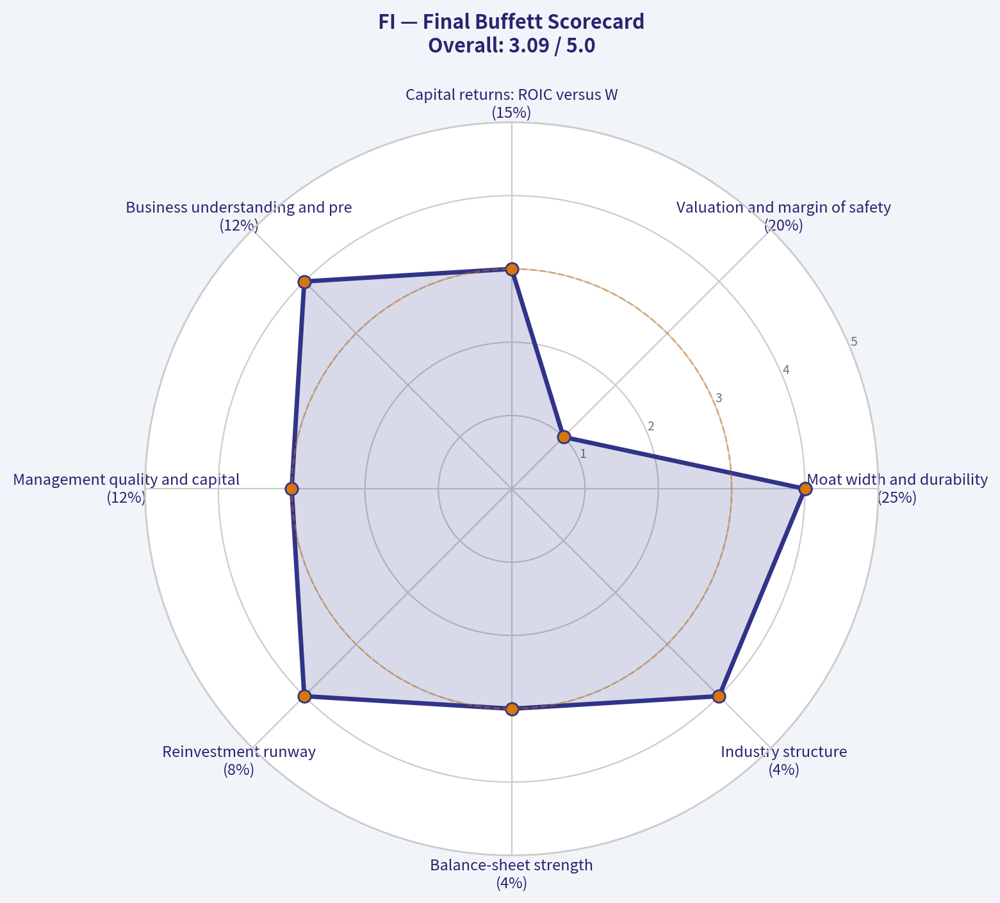
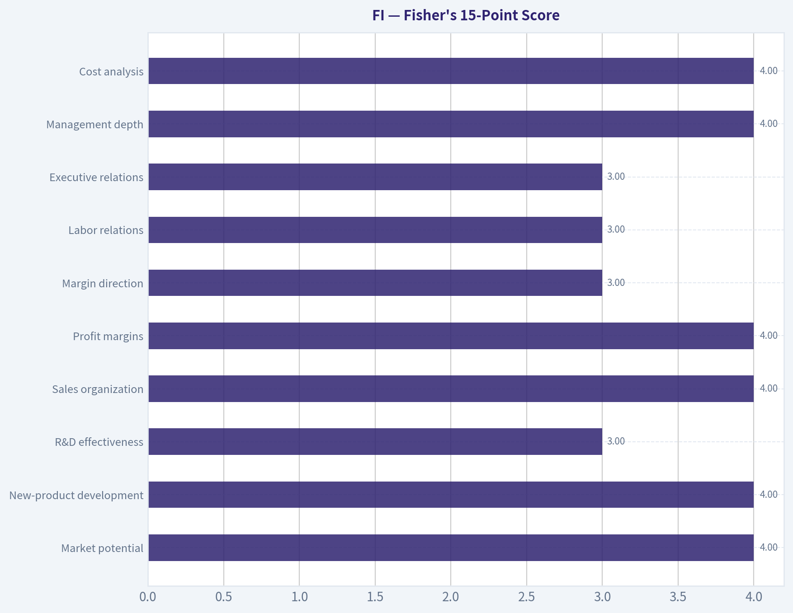
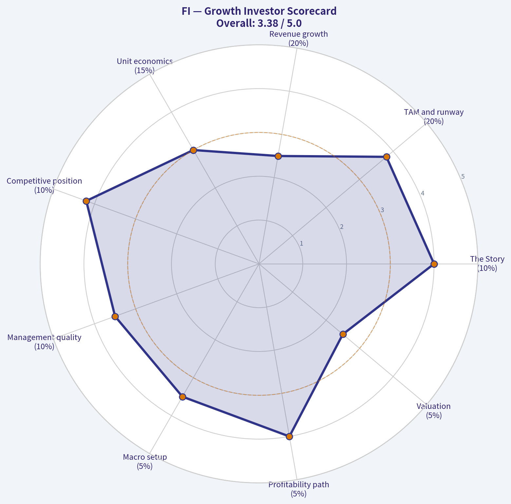
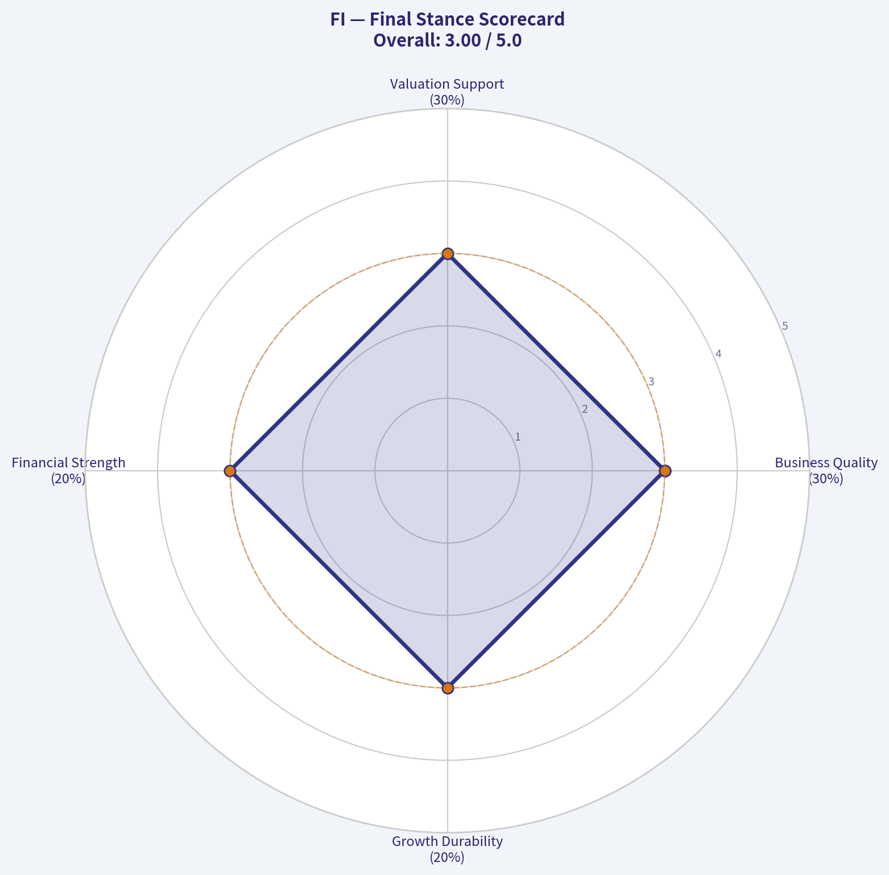
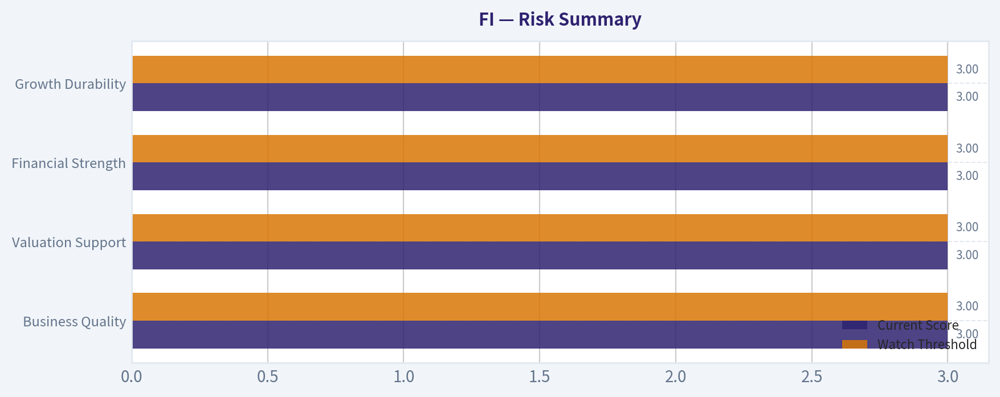

# FI Deep Value Intelligence

**Analysis Date:** 2026-11-28

## Critical Disclaimer

*This analysis is generated by Deep Value Intelligence, an AI-powered multi-agent investing framework. Education & research only - not financial advice, not a financial advisor.*

---

## Table of Contents

1. Intelligence Summary
2. Analyst Team Reports
   - Fundamentals Analysis
   - Intrinsic Value Analysis (Buffett)
   - Trend & Growth Analysis (Lynch/Druckenmiller/Fisher)
   - Market Technical Analysis
   - Options Market Analysis
3. Research Team Commentary
4. Value Investing Team Commentary
5. Deep Values Commentary

---

## Intelligence Summary

### Thesis + Conditions

**Core Thesis:** Fiserv appears to own durable, mission-critical financial infrastructure, with meaningful upside if Clover develops into a profitable small-business software ecosystem. However, the supplied evidence establishes strategic potential more clearly than excess returns or undervaluation.

**Key Risks:**
- Fiserv appears to own durable, mission-critical financial infrastructure, with meaningful upside if Clover develops into a profitable small-business software ecosystem. However, the supplied evidence establishes strategic potential more clearly than excess returns or undervaluation.
- The strongest bullish point is that Fiserv supplies embedded infrastructure rather than a discretionary product. Replacing payment rails, fraud systems, compliance functions, reporting tools, and banking integrations can create substantial operational and reputational risk for customers. This supports retention and commercial durability.
- Clover could deepen that advantage by combining payments with point-of-sale software, payroll, inventory, analytics, lending, and other financial services. If software attachment and revenue per merchant rise faster than acquisition and servicing costs, Fiserv's business mix could shift toward more recurring and scalable economics.

**Confidence:** Low

---

## Analyst Team Reports

### Fundamentals Analysis

#### Financial Metrics for FI

*All values below are computed deterministically from raw data - not estimated by AI.*

*Issuer profile: operating company (Unknown / Unknown).*

#### Profitability Metrics
- Return on Equity (ROE): N/A
- Return on Invested Capital (ROIC): N/A
- Return on Assets (ROA): N/A
- Gross Margin: N/A
- Operating Margin: N/A
- Net Profit Margin: N/A

#### Liquidity Metrics
- Current Ratio: N/A
- Quick Ratio: N/A

#### Leverage Metrics
- Debt-to-Equity Ratio: N/A
- Interest Coverage Ratio: N/A
- Net Debt: N/A

#### Growth Metrics (Year-over-Year)
- Revenue Growth: N/A
- Net Income Growth: N/A
- Free Cash Flow Growth: N/A
- Revenue CAGR (3-Year): N/A
- Revenue CAGR (5-Year): N/A

#### Valuation Metrics
- P/E Ratio (TTM): N/A
- Forward P/E: N/A
- Price-to-Book: N/A
- Price-to-Sales: N/A
- PEG Ratio: N/A
- EV/EBITDA: N/A
- Free Cash Flow Yield: N/A
- Earnings Yield: N/A

#### Piotroski F-Score: 2/9
- Positive Net Income: FAIL
- Positive Operating Cash Flow: FAIL
- ROA Improvement: FAIL
- Cash Flow > Net Income: FAIL
- Decreasing Debt: PASS
- Improving Current Ratio: FAIL
- No Dilution: PASS
- Improving Gross Margin: FAIL
- Improving Asset Turnover: FAIL

ANALYST STANCE: **Bearish**

#### Scope and Data Integrity

The verified registrant is **Fiserv, Inc. (NYSE: FI; SEC CIK 0000798354)**. The deterministic dataset contains no reported financial values, market price, market capitalization, historical years, or intrinsic-value estimate for FI. Because that dataset is the canonical source, numerical values cannot be substituted with estimates from unrelated sources.

#### Market Metrics

| Metric | Current value | 10-year average | Interpretation |
|---|---:|---:|---|
| Market price | N/A | N/A | No verified price is available. |
| Total market capitalization | N/A | N/A | Cannot calculate without a verified price and share count. |
| P/E ratio | N/A | N/A | Cannot calculate without price and trailing EPS. |
| P/B ratio | N/A | N/A | Cannot calculate. For Fiserv, a payments and technology company, book value can be distorted by goodwill, acquired intangibles, leverage, and repurchases; cash-flow valuation is more relevant than mechanical P/B interpretation. |

**Key Takeaways:** No valuation conclusion can be drawn from the dataset because price, market capitalization, earnings, and book value are all unavailable. P/B would also require careful interpretation because Fiserv is asset-light relative to traditional industrial companies and has substantial acquisition-related intangible assets.

#### Profitability and Operating Metrics

| Metric | Current value | 10-year average | Interpretation |
|---|---:|---:|---|
| ROE | N/A | N/A | No assessment of shareholder-return efficiency is possible. |
| ROIC | N/A | N/A | No assessment of value creation above the cost of capital is possible. |
| EPS | N/A | N/A | No verified per-share earnings figure is available. |
| Revenue | N/A | N/A | No verified current revenue figure is available. |
| Gross profit | N/A | N/A | No verified gross-profit figure is available. |
| Operating margin | N/A | N/A | Margin stability cannot be assessed. |
| Net income | N/A | N/A | The deterministic dataset does not provide current net income. |
| Net margin | N/A | N/A | Cannot calculate without revenue and net income. |

**Key Takeaways:** The absence of operating data prevents evaluation of Fiserv's earnings power, margins, and returns on capital. Although Fiserv's business model can potentially produce attractive recurring cash flow, that qualitative possibility cannot replace verified company-specific results.

#### Growth Metrics

| Metric | Current value | 10-year average | Interpretation |
|---|---:|---:|---|
| Revenue growth rate | N/A | N/A | No annual revenue series is supplied. |
| Net-income growth rate | N/A | N/A | No annual net-income series is supplied. |
| Free-cash-flow growth rate | N/A | N/A | No annual free-cash-flow series is supplied. |

**Key Takeaways:** Growth momentum and compounding consistency cannot be established. In Fiserv's case, reported growth would ideally be separated into organic growth, acquisitions, foreign exchange, volume, pricing, and Clover-related expansion, but none of those components are available in the canonical dataset.

#### Balance Sheet

| Metric | Current value | 10-year average | Interpretation |
|---|---:|---:|---|
| Total book value | N/A | N/A | No book-value figure is reported. |
| Total assets | N/A | N/A | No asset figure is reported. |
| Total debt | N/A | N/A | Debt burden cannot be quantified. |
| Debt-to-equity ratio | N/A | N/A | Cannot calculate. |
| Cash and cash equivalents | N/A | N/A | Liquidity cannot be quantified. |
| Shareholders' equity | N/A | N/A | No equity figure is reported. |

**Key Takeaways:** Financial-strength analysis is severely constrained. For a payments company, net debt to EBITDA, interest coverage, debt maturities, free-cash-flow conversion, and settlement-related liabilities would generally be more informative than the current ratio alone, but none of those values are available.

#### Cash Flow and Dividends

| Metric | Current value | 10-year average | Interpretation |
|---|---:|---:|---|
| Free cash flow | N/A | N/A | Owner earnings cannot be established. |
| Dividends per share | N/A | N/A | Dividend history and payout policy cannot be verified. |

**Key Takeaways:** The dataset provides no evidence regarding cash-generation quality, capital expenditures, acquisitions, repurchases, or dividends. This is particularly important because a Buffett-style assessment depends on sustainable owner earnings rather than adjusted EPS alone.

#### Dataset Quality Signals

| Signal | Result | Significance |
|---|---:|---|
| Piotroski F-score | 2/9 | Weak data-derived quality signal |
| Positive net income | FAIL | Dataset does not support a positive result |
| Positive operating cash flow | FAIL | Dataset does not support a positive result |
| Cash flow greater than net income | FAIL | Dataset does not support the condition |
| Decreasing debt | PASS | The only balance-sheet improvement signal marked as passing |
| No dilution | PASS | No dilution signal is marked as passing |
| Improving gross margin | FAIL | No improvement signal is supported |
| Improving asset turnover | FAIL | No improvement signal is supported |

**Key Takeaways:** The 2/9 Piotroski score is a significant warning signal, although it may partly reflect missing or incomplete underlying data rather than confirmed deterioration. Even with that caveat, the available evidence does not establish the profitability, cash flow, or operating improvement required for a high-confidence value case.

#### Revenue Breakdown

| Revenue Source | Amount ($M or $B) | % of Total |
|---|---:|---:|
| Merchant acquiring and payment acceptance | N/A | N/A |
| Clover and small-business solutions | N/A | N/A |
| Issuer processing | N/A | N/A |
| Banking and financial-technology solutions | N/A | N/A |
| Other and corporate activities | N/A | N/A |
| **Total** | **N/A** | **N/A** |

**Key Takeaways:** Fiserv's economically important activities are generally associated with merchant payments, Clover, issuer processing, and financial-institution technology. The dataset does not provide segment revenue, so no reliable contribution or concentration analysis can be made.

#### Buffett-Style Qualitative Assessment

**Economic moat:** Fiserv appears to possess potentially meaningful competitive advantages through payment-processing scale, embedded bank and merchant relationships, compliance infrastructure, fraud-management capabilities, and switching costs. Clover may add software and ecosystem characteristics. However, the moat is not demonstrably durable from this dataset because there is no evidence on retention, organic growth, pricing power, or returns on invested capital.

**Financial strength:** Unverified. The absence of debt, cash, interest expense, and operating cash-flow data prevents a conclusion about leverage or resilience. Payments companies also require analysis of settlement balances and obligations, which are not available here.

**Predictable earnings:** Unverified. No ten-year earnings, revenue, margin, or free-cash-flow series is supplied. Therefore, earnings predictability cannot be distinguished from a merely plausible business narrative.

**Management and capital allocation:** Unverified. There is no data on repurchases, dividends, acquisitions, debt reduction, dilution, or incremental returns on invested capital. The Piotroski score's "no dilution" and "decreasing debt" passes are favorable but insufficient to establish high-quality capital allocation.

**Quality of business:** The underlying industry can have recurring, transaction-linked revenue and strong operating leverage. It also faces intense competition, regulatory pressure, merchant churn, technological substitution, and pricing pressure. Company-specific quality remains unconfirmed.

#### Buffett-Style Owner Earnings DCF

A numerical DCF cannot be responsibly completed from the deterministic dataset because the required inputs are missing:

- Current market price: N/A
- Free cash flow or owner earnings: N/A
- Depreciation and amortization: N/A
- Maintenance capital expenditure: N/A
- Cash and debt: N/A
- Shares outstanding: N/A
- DeepValues intrinsic value: not shown
- DVI estimate: not shown

The calculation framework would be:

\[
\text{Owner Earnings} =
\text{Net Income}
+ \text{Non-cash Charges}
- \text{Maintenance Capital Expenditures}
- \text{Required Working Capital Investment}
\]

For each scenario:

\[
OE_t = OE_0(1+g_t)
\]

\[
TV = \frac{OE_n(1+g_T)}{r-g_T}
\]

\[
\text{Equity Value} =
\sum_{t=1}^{n}\frac{OE_t}{(1+r)^t}
+
\frac{TV}{(1+r)^n}
+
\text{Cash}
-
\text{Debt}
\]

A conventional scenario design would use approximately **10% discount rate** and **2.5% terminal growth**, with conservative, average, and optimistic growth rates fading toward the terminal rate. However, because \(OE_0\), debt, cash, and share count are unavailable, all three fair-value ranges are **not calculable**. Reverse-DCF implied growth is also unavailable because there is no verified market price.

**DCF conclusion:** No intrinsic-value estimate can be quoted. The evidence therefore does not support a valuation comparison between FI's market price and owner-earnings value.

#### Key Risks

| Risk | Why it matters |
|---|---|
| Data insufficiency | Prevents verification of valuation, profitability, leverage, and cash flow. |
| Competition | Large payment networks, fintech platforms, software companies, and bank processors may pressure pricing and retention. |
| Merchant sensitivity | Small-business payment volumes and churn can weaken during economic stress. |
| Acquisition complexity | Acquired intangibles, integration costs, and debt can obscure underlying economics. |
| Regulatory exposure | Interchange, routing, data, and payments regulation can affect margins. |
| Adjusted-metric dependence | Excluding amortization or other recurring costs may overstate economic earnings. |
| Clover execution | Growth requires sustained adoption, monetization, software attachment, and competitive differentiation. |

**Key Takeaways:** Fiserv may have a credible strategic moat, but the main risks cannot be measured without current filings and historical financial statements. The most important unanswered questions concern organic growth, free-cash-flow conversion, net leverage, customer retention, and the economic cost of acquisitions and stock-based compensation.

#### Opportunities

- Expansion of integrated merchant software and payments.
- Increased Clover adoption among small and medium-sized businesses.
- Cross-selling across merchant, issuer, and banking relationships.
- Operating leverage from a large transaction-processing base.
- Debt reduction and disciplined capital allocation.
- Better cash-flow visibility if the company provides consistent GAAP-to-adjusted reconciliations.

These are business opportunities rather than confirmed investment merits; the dataset does not establish their realized financial impact.

#### Final Assessment

The deterministic evidence is inadequate for a conventional value-investing conclusion. Fiserv's business description suggests possible scale advantages, switching costs, and recurring transaction revenue, but those qualitative strengths are not supported here by verified ROIC, owner earnings, growth, valuation, balance-sheet, or historical-average data.

The **Bearish** stance reflects the combination of:

1. No verified market price or valuation multiple.
2. No measurable owner earnings for DCF analysis.
3. No historical series for trend comparison.
4. A low Piotroski score of 2/9.
5. Missing evidence on debt, cash, profitability, and cash-flow quality.

This is a data-confidence conclusion, not a claim that Fiserv's underlying business is necessarily weak.

| Area | Evidence available | Assessment |
|---|---|---|
| Valuation | Price, market cap, P/E, P/B, and intrinsic value unavailable | Cannot establish margin of safety |
| Profitability | ROE, ROIC, margins, EPS, and net income unavailable | Earnings quality unverified |
| Growth | Revenue, net-income, and FCF growth unavailable | Compounding record unverified |
| Balance sheet | Assets, debt, cash, and equity unavailable | Financial strength unverified |
| Cash flow | FCF and dividends unavailable | Owner earnings unverified |
| Business quality | Qualitative moat appears plausible | Potentially attractive, but not numerically confirmed |
| Quality signal | Piotroski F-score 2/9 | Material caution |
| Final stance | **Bearish** | Evidence does not support a valuation conclusion or high-confidence fundamental case |

---

### Intrinsic Value Analysis (Buffett)

> *Following Warren Buffett's value investing philosophy: Circle of Competence, Economic Moat, Management Quality, and Margin of Safety.*

ANALYST STANCE: **Neutral**

#### Executive Summary

Fiserv is a large-scale payments and financial-technology company serving merchants, banks, credit unions, and other financial institutions. Its strongest investment characteristics are recurring transaction revenue, embedded customer relationships, scale economies, and the Clover merchant platform. The principal unresolved issue is valuation: the supplied data contains no current price, market capitalization, or audited financial metrics, so intrinsic value and margin of safety cannot be calculated responsibly.

The evidence supports a potentially durable business franchise, but not a complete valuation conclusion. Conviction is **low to moderate**, pending verified financial and price data.

#### 1. Factor Scorecard

| Factor | Score | Evidence |
|---|---:|---|
| Circle of competence and simplicity | 4/5 | The company earns fees by processing payments and providing software and technology infrastructure to merchants and financial institutions. The model is understandable, although its breadth and acquisition history add complexity. |
| Moat | 4/5 | Scale, switching costs, embedded workflows, merchant distribution, data, and network relationships support a meaningful competitive advantage. Clover adds platform and ecosystem characteristics. |
| Management and capital allocation | 3/5 | Fiserv has a long operating history and has used acquisitions to expand its platform. The assessment is reduced because acquisition economics, compensation alignment, and per-share value creation require current filings for verification. |
| Industry structure | 4/5 | Payments processing benefits from scale, compliance expertise, integration costs, and established distribution. Competition remains intense among global networks, processors, banks, and fintech platforms. |
| Gate 5: quality/solvency floor | **Not tripped on available evidence** | No supplied evidence indicates simultaneous deteriorating earnings or cash flow and a solvency red line. Current interest coverage, debt maturity, and cash-flow data still require verification. |

**Key Takeaways:** Fiserv appears to be a high-quality payments infrastructure business with meaningful scale and switching-cost advantages. The main analytical weakness is not an identified operating failure, but the absence of verified current financial and valuation data.

#### 2. Moat Analysis

| Moat source | Assessment | Supporting logic |
|---|---|---|
| Intangible assets | Moderate to strong | Trust, regulatory expertise, brand recognition, compliance infrastructure, and long-standing institutional relationships are difficult to replicate quickly. |
| Switching costs | Strong | Banks and merchants integrate payment processing, settlement, reporting, fraud tools, and software deeply into operating workflows. |
| Cost advantages | Strong | Large transaction volumes can spread technology, compliance, cybersecurity, and infrastructure costs across a broad revenue base. |
| Network effects | Moderate | Merchant acceptance, financial institution distribution, data, and ecosystem participation can reinforce one another, particularly through Clover. |
| Overall moat rating | **Wide and stable; potentially widening in selected platforms** | The moat is strongest where Fiserv is embedded in customer workflows and where scale improves economics. |

Fiserv's moat is primarily infrastructure-based rather than consumer-brand-based. A merchant or bank may technically switch providers, but migration involves operational risk, integration work, compliance review, potential disruption, and retraining. Those frictions can support high retention and recurring revenue.

The main competitive risks are pricing pressure, faster innovation from fintech firms, disintermediation by payment networks or large technology platforms, cybersecurity events, and regulatory intervention.

#### 3. Management Quality and Capital Allocation

Management quality is provisionally assessed as **3 out of 5**.

Positive considerations include:

- A long history in payments technology and financial infrastructure.
- The ability to integrate acquisitions and cross-sell products across a large customer base.
- Strategic exposure to merchant acquiring, issuer processing, digital banking, and embedded payments.
- Potential for operating leverage as software and transaction volumes scale.

Important questions requiring current filings include:

- Whether acquisitions have increased intrinsic value per share rather than merely expanding revenue.
- Whether debt reduction, repurchases, and acquisitions have been balanced rationally.
- Whether executive compensation is primarily tied to durable per-share value creation.
- Whether management reports adjusted earnings conservatively and reconciles them clearly to cash flow.

#### 4. Financial Summary

| Metric | Available data |
|---|---:|
| Current price | N/A |
| Market capitalization | N/A |
| P/E ratio | N/A |
| Revenue history | N/A |
| Net income history | N/A |
| Operating cash flow history | N/A |
| Free cash flow history | N/A |
| ROE | N/A |
| ROIC | N/A |
| Gross margin | N/A |
| Operating margin | N/A |
| Debt and net cash | N/A |
| Interest coverage | N/A |
| Current ratio | N/A |

**Key Takeaways:** The available research pack does not provide the financial history needed to establish revenue growth, cash conversion, returns on capital, or solvency strength. Consequently, the analysis cannot verify whether Fiserv's attractive business model translates into attractive per-share economics at the current valuation.

#### 5. Owner Earnings Calculation

The required calculation is:

> Owner earnings = Net income + depreciation and amortization - maintenance capital expenditures - working capital increases.

| Component | Amount |
|---|---:|
| Net income | N/A |
| Depreciation and amortization | N/A |
| Maintenance capital expenditures | N/A |
| Increase in working capital | N/A |
| Estimated owner earnings | **N/A** |

No defensible owner-earnings estimate can be produced without audited income-statement, cash-flow, and balance-sheet figures. For Fiserv, reported free cash flow may also require adjustment for acquisition spending, integration costs, stock-based compensation, and the distinction between maintenance and growth capital expenditures.

**Key Takeaways:** Owner earnings are central to valuing Fiserv because the company is an asset-light technology and payments platform. Without verified cash-flow data, any numerical owner-earnings estimate would be speculative.

#### 6. Three-Scenario DCF Valuation

| Scenario | Method | Result |
|---|---|---:|
| A: No growth | Owner earnings ÷ 10% | N/A |
| B: GDP growth | Owner earnings x 1.03 ÷ (10% - 3%) | N/A |
| C: Historical growth | Ten-year discounted cash flow using 50-75% of verified historical growth | N/A |

The DeepValues intrinsic-value figure is also unavailable in the supplied data. Therefore:

- Intrinsic value: **N/A**
- Current price: **N/A**
- Margin of safety: **N/A**
- Reverse-DCF price-implied growth: **N/A**

**Key Takeaways:** Fiserv's valuation cannot be judged from business quality alone. A durable payments franchise can still be a poor investment when purchased at an excessive multiple, and the missing price and cash-flow inputs prevent a meaningful valuation conclusion.

#### 7. Margin of Safety Analysis

| Quality consideration | Assessment |
|---|---|
| Business quality | Appears above average, with a likely wide moat |
| Predictability | Moderately high, but affected by acquisitions, regulation, technology shifts, and payment-volume cycles |
| Reinvestment runway | Meaningful through merchant acquiring, Clover, digital banking, and cross-selling |
| Required valuation discipline | Approximately 10-15% margin of safety could be reasonable for a truly wide-moat, high-ROIC compounder; more would be appropriate if returns or predictability prove weaker |
| Verified margin of safety | N/A |

Because no current market price or intrinsic-value estimate is available, the valuation evidence does not support an Bullish classification.

#### 8. Final Buffett Scorecard

| Criterion | Weight | Score | Weighted contribution |
|---|---:|---:|---:|
| Moat width and durability | 25% | 4.0 | 1.00 |
| Valuation and margin of safety | 20% | 1.0 | 0.20 |
| Capital returns: ROIC versus WACC | 15% | 3.0 | 0.45 |
| Business understanding and predictability | 12% | 4.0 | 0.48 |
| Management quality and capital allocation | 12% | 3.0 | 0.36 |
| Reinvestment runway | 8% | 4.0 | 0.32 |
| Balance-sheet strength | 4% | 3.0 | 0.12 |
| Industry structure | 4% | 4.0 | 0.16 |
| **Total** | **100%** |  | **3.09 / 5.00** |

**Key Takeaways:** Fiserv scores well on moat, business quality, industry structure, and reinvestment runway. The overall score is held below the Bullish range because valuation, owner earnings, capital returns, and solvency cannot be verified from the available data.

#### 9. Investment Stance

**Neutral - low-to-moderate conviction.**

Fiserv appears consistent with Buffett-style quality criteria: understandable revenue sources, embedded customer relationships, scale advantages, recurring transaction economics, and a potentially long reinvestment runway. However, the available evidence does not establish a current margin of safety or confirm that historical returns on capital and cash conversion justify the market valuation.

The analytical conclusion is therefore that Fiserv merits continued fundamental review, but the evidence currently supports **Neutral**, not an affirmative valuation conclusion.

---

### Trend & Growth Analysis (Lynch/Druckenmiller/Fisher)

> *Following Peter Lynch's GARP, Stanley Druckenmiller's macro-aware approach, and Philip Fisher's scuttlebutt methodology.*

ANALYST STANCE: **Neutral**

#### Executive Summary

Fiserv, Inc. (NYSE: FI; SEC CIK 0000798354) is a large payments and financial-technology company whose principal growth engine is the Clover merchant platform. The available data pack contains no verified current price, market capitalization, recent earnings figures, revenue growth, margins, or valuation multiples as of November 28, 2026. Consequently, the analysis emphasizes business quality and inflection potential rather than a precise valuation conclusion.

The evidence supports a durable, moderately attractive business with a credible Clover-driven growth avenue, but not enough verified data to establish that growth is accelerating or that the current valuation is compelling.

#### 1. Lynch Classification

| Category | Assessment | Reason |
|---|---|---|
| Primary classification | Stalwart / borderline fast grower | Large scale and established payments franchise; Clover provides a faster-growing avenue |
| Growth-investor relevance | Moderate | The consolidated company must demonstrate sustained organic growth above its historical mature-business profile |
| Ten-bagger potential | Low to moderate at company level | A 10x outcome would require substantial Clover expansion, international growth, margin leverage, and reinvestment |
| Data confidence | Low | Current financial and valuation data were unavailable |

**Key Takeaways:** Fiserv is not a classic small-company fast grower. Its ten-bagger potential depends on whether Clover can materially expand the company's total addressable market and sustain high growth despite Fiserv's already large scale.

#### 2. The Story in Three Bullets

1. Fiserv provides mission-critical payment processing and financial software to merchants, banks, and financial institutions.
2. Clover combines point-of-sale hardware, software, and payments, potentially increasing Fiserv's exposure to recurring software revenue and small-business operating systems.
3. The investment inflection would be visible through accelerating organic growth, stronger Clover monetization, operating-margin expansion, and improved free-cash-flow conversion.

#### 3. TAM Analysis and 10x Test

| TAM component | Growth opportunity | Competitive context |
|---|---|---|
| Merchant acquiring | Large global market with ongoing electronic-payment penetration | Highly competitive and price-sensitive |
| Small-business software and payments | Expanding opportunity for integrated commerce platforms | Clover competes with Block, Stripe, banks, and vertical software providers |
| Issuer processing | Recurring infrastructure market with switching costs | Mature but strategically valuable |
| Banking and financial technology | Large installed-base replacement and modernization market | Longer sales cycles and budget sensitivity |
| International payments | Additional runway beyond North America | Regulatory and execution complexity |

The exact current revenue base was not available, so a numeric 10x revenue test cannot be completed. Qualitatively, the company could grow many times within the broader payments and commerce-software ecosystem, but a 10x outcome would require Clover and related software businesses to become much more economically significant than the mature processing segments.

**Key Takeaways:** Fiserv operates in large markets, and digital-payment penetration plus software integration provide a reasonable runway. The main limitation is scale: the company already has substantial market exposure, so a ten-bagger requires meaningful share gains and successful expansion into higher-growth software categories.

#### 4. Revenue Growth Trend

| Metric | Verified result | Interpretation |
|---|---:|---|
| Latest year-over-year revenue growth | N/A | Cannot determine acceleration or deceleration |
| Three-year revenue CAGR | N/A | Historical revenue series unavailable from the tool output |
| Five-year revenue CAGR | N/A | Historical revenue series unavailable |
| Organic growth | N/A | Must be separated from acquisitions and foreign exchange |
| Clover growth | N/A | Key missing indicator for the thesis |
| Latest quarterly comparison | N/A | No recent verified earnings coverage |

**Key Takeaways:** The central growth question remains unresolved because the latest revenue and organic-growth figures are unavailable. For Fiserv, reported growth is less informative than organic growth, Clover volume and software penetration, merchant retention, and the contribution from acquisitions.

#### 5. Unit Economics and Operating Efficiency

| Metric | Status | Required evidence |
|---|---:|---|
| LTV/CAC | N/A | Merchant acquisition cost, retention, gross profit, and churn |
| Net revenue retention | N/A | Cohort-level merchant and software revenue data |
| Rule of 40 | N/A | Revenue growth plus free-cash-flow margin |
| Payment-volume growth | N/A | Merchant volume and transaction data |
| Free-cash-flow conversion | N/A | Operating cash flow less capital expenditures |
| Payback period | N/A | Clover customer acquisition and gross-profit data |

Fiserv's economics likely benefit from scale, recurring transaction activity, embedded integrations, and switching costs. However, small-business acquiring can be competitive, and the public data available here do not establish Clover's customer acquisition efficiency or cohort-level retention.

**Key Takeaways:** The business model has attractive structural characteristics, but the most important unit-economic metrics are missing. Clover's long-term value depends on software attach rates and customer lifetime economics, not merely on payment-volume growth.

#### 6. Inflection-Point Assessment

| Potential inflection | Current evidence | Importance |
|---|---|---|
| Clover product cycle | Strategically significant, but current growth data unavailable | High |
| Market-share gains | Not verified | High |
| Margin expansion | Not verified | High |
| TAM expansion | Plausible through integrated commerce software | Medium-high |
| Competitive shift | No verified evidence of a major competitor breakdown | Medium |
| Balance-sheet deleveraging | Debt reduction was marked as a pass in the tool output, but balances were unavailable | Medium |

The most important possible inflection is a transition from a traditional payments processor toward a broader commerce-software platform. Confirmation would require several quarters of accelerating organic growth, increasing Clover monetization, stable or improving gross margins, and operating leverage.

**Key Takeaways:** Fiserv has a credible strategic inflection candidate, but not a confirmed earnings inflection. The thesis becomes materially stronger only if Clover growth begins to lift consolidated organic growth rather than remaining a relatively small high-growth division.

#### 7. Macro Setup

| Macro factor | Assessment | Effect on Fiserv |
|---|---|---|
| Electronic-payment adoption | Structurally favorable | Supports long-term transaction growth |
| Consumer and small-business activity | Cyclical | Can affect payment volumes and merchant formation |
| Interest rates | Data unavailable | Influences valuation and financial-institution technology budgets |
| Regulation | Material risk | Interchange, routing, data, and payment rules may affect economics |
| Technology cycle | Favorable | Cloud, embedded finance, fraud tools, and automation support product demand |
| Credit conditions | Mixed | Tight conditions may pressure small merchants and customers |

**Key Takeaways:** The secular payments and fintech backdrop is constructive, but Fiserv remains exposed to economic activity and regulation. Macro conditions are supportive for the long runway, while near-term payment volumes and valuation remain sensitive to rates and consumer health.

#### 8. Fisher's 15-Point Score

This is a provisional qualitative score because current filings and management commentary were not available.

| Fisher criterion | Score / 5 | Assessment |
|---|---:|---|
| Market potential | 4 | Large payments and commerce-software markets |
| New-product development | 4 | Clover and integrated platform strategy |
| R&D effectiveness | 3 | Likely meaningful, but current evidence unavailable |
| Sales organization | 4 | Broad distribution and institutional relationships |
| Profit margins | 4 | Historically attractive operating characteristics |
| Margin direction | 3 | Current trend unverified |
| Labor relations | 3 | Insufficient current evidence |
| Executive relations | 3 | Insufficient current evidence |
| Management depth | 4 | Large, diversified operating organization |
| Cost analysis | 4 | Scale and processing infrastructure support discipline |
| Outstanding business attributes | 4 | Switching costs, data, scale, and integrations |
| Long-range profit outlook | 4 | Favorable if Clover scales successfully |
| Dilution risk | 4 | Share repurchases historically more relevant than dilution |
| Management candor | 3 | Current communications not reviewed |
| Management integrity | 3 | No verified current issue, but evidence is incomplete |
| **Total** | **54 / 75** | **Average-to-good, provisional** |

**Key Takeaways:** Fiserv scores well on market size, distribution, scale, and switching costs. The score is held back by missing evidence on current margin trends, product economics, management commentary, and capital allocation. This is not an outstanding Fisher score without updated primary-source verification.

#### 9. Valuation Analysis

| Method | Result | Interpretation |
|---|---:|---|
| Current price | N/A | November 27, 2026 closing price unavailable |
| P/E | N/A | Cannot calculate |
| PEG | N/A | Requires verified P/E and earnings-growth rate |
| Price-to-sales | N/A | Requires market capitalization and revenue |
| EV/EBITDA | N/A | Requires enterprise value and EBITDA |
| FCF yield | N/A | Requires market capitalization and free cash flow |
| Revenue-multiple scenarios | N/A | Current revenue, price, and peer multiples unavailable |
| TAM-based valuation | Qualitative only | Requires revenue, margins, reinvestment, and discount-rate assumptions |

The tool output reports a Piotroski F-Score of 2/9, but the underlying detailed financial series were unavailable and the result conflicts with the broad qualitative description of Fiserv as a cash-generative operating company. It should therefore not be treated as a reliable valuation signal without checking the underlying filings.

**Key Takeaways:** No defensible PEG, price-to-sales, or scenario valuation can be calculated from the available data. The valuation conclusion is therefore indeterminate: business quality may be sound, but the evidence does not establish whether the market price properly reflects Clover's growth potential.

#### 10. Growth Investor Scorecard

| Criterion | Weight | Score / 5 | Weighted contribution |
|---|---:|---:|---:|
| The Story | 10% | 4.0 | 0.40 |
| TAM and runway | 20% | 3.8 | 0.76 |
| Revenue growth | 20% | 2.5 | 0.50 |
| Unit economics | 15% | 3.0 | 0.45 |
| Competitive position | 10% | 4.2 | 0.42 |
| Management quality | 10% | 3.5 | 0.35 |
| Macro setup | 5% | 3.5 | 0.18 |
| Profitability path | 5% | 4.0 | 0.20 |
| Valuation | 5% | 2.5 | 0.13 |
| **Total** | **100%** | - | **3.39 / 5.00** |

**Key Takeaways:** The provisional score of 3.39 reflects a strong franchise and credible secular growth exposure, offset by missing growth, unit-economics, and valuation data. Under the stated framework, this supports a Neutral classification rather than a high-conviction growth designation.

#### 11. Valuation Sensitivity

| Variable | Bear case | Base case | Bull case |
|---|---|---|---|
| Organic revenue growth | Low-single-digit | Mid-single-digit to high-single-digit | Sustained double-digit |
| Clover contribution | Limited incremental impact | Meaningful growth contributor | Major platform expansion |
| Operating margin | Flat or pressured | Moderate expansion | Strong operating leverage |
| Capital allocation | Higher debt or acquisition burden | Balanced investment and repurchases | Strong cash generation with declining leverage |
| Appropriate valuation | Lower mature-processor multiple | Quality payments multiple | Premium platform multiple |
| Evidence required | Slowing growth, churn, margin pressure | Stable execution | Accelerating growth and raised expectations |

**Key Takeaways:** The valuation is most sensitive to whether Fiserv remains primarily a mature processor or evolves into a higher-growth commerce-software platform. A premium multiple would require evidence of accelerating organic growth and durable Clover economics, not simply management commentary.

#### 12. Key Risks and Catalysts

| Catalysts | Risks |
|---|---|
| Accelerating Clover revenue and software penetration | Clover growth fails to translate into consolidated growth |
| Sustained organic growth above the mature-processing rate | Merchant churn and pricing pressure |
| Operating-margin expansion | Slower consumer spending or small-business formation |
| Strong free-cash-flow conversion | Acquisition-related leverage and amortization complexity |
| Cross-selling across merchant, banking, and issuer products | Regulation affecting interchange, routing, or data usage |
| International expansion | Competition from Block, Stripe, Adyen, PayPal, networks, and bank platforms |
| Lower leverage with disciplined capital allocation | Valuation compression if growth decelerates |

#### Bottom Line

Fiserv has a credible quality-growth narrative built around scale, embedded payment infrastructure, switching costs, and Clover. The company's main potential inflection is the conversion of Clover from a product line into a larger software-led commerce platform.

However, the available data do not verify current revenue acceleration, unit economics, margins, free cash flow, or valuation. The appropriate analytical conclusion is therefore **Neutral**: the business merits further primary-source verification, but the evidence does not currently support a high-conviction growth or valuation conclusion.

#### Growth & Scorecard Visuals

The radar chart below from *Final Buffett Scorecard* visualises how **FI** ranks across weighted investment criteria. Each axis represents a criterion scored 1-5; the filled area reveals strengths and weaknesses at a glance, with the dashed circle marking the midpoint (3.0).

This comparison chart from *Fisher's 15-Point Score* stacks current figures against historical benchmarks for **FI**, making it easy to see where the company trades relative to its own averages.

The radar chart below from *Growth Investor Scorecard* visualises how **FI** ranks across weighted investment criteria. Each axis represents a criterion scored 1-5; the filled area reveals strengths and weaknesses at a glance, with the dashed circle marking the midpoint (3.0).

---

### Market Technical Analysis

ANALYST STANCE: **Neutral**

#### FI Data Availability

Yahoo Finance returned no price data for **FI - Fiserv, Inc.**, SEC CIK **0000798354**, listed on the NYSE, for either of these requested periods:

- November 28, 2025 through November 28, 2026
- January 1, 2024 through November 28, 2025

Because the underlying OHLCV dataset is unavailable, technical indicators cannot be calculated reliably. Accordingly, no valid conclusions can be drawn about FI's trend, momentum, volatility, volume confirmation, support or resistance, or current valuation implications from technical market data.

The absence of retrieved data does not establish that the security itself lacks trading activity; it indicates that the requested data source did not return a dataset for the exact ticker and date ranges. Indicator queries were therefore not generated, since they would not have a valid price-history foundation.

| Item | Result | Implication |
|---|---|---|
| Security | FI - Fiserv, Inc. | Correct registrant and NYSE ticker specified |
| Price data | Not returned by Yahoo Finance | No usable OHLCV history available |
| Technical indicators | Not calculable | Trend and momentum assessment unavailable |
| Volatility and volume | Not calculable | No ATR, Bollinger, or VWMA analysis |
| Valuation implication | Indeterminate from technical evidence | No data-supported technical valuation view |

**Key Takeaways:** The requested FI price history was unavailable from the data source, so no reliable technical analysis can be performed. The evidence is insufficient to assess trend direction, momentum, volatility, or valuation implications from market data.

---

### Options Market Analysis

> *Reading options flow - put/call ratios, IV skew, and unusual activity - to gauge institutional positioning and event-driven risk.*

ANALYST STANCE: **Neutral**

#### Options Data Availability

The options-data source returned **no options data for FI** as of **November 28, 2026**. Consequently, current put/call ratios, implied volatility, skew, unusual activity, open-interest concentrations, and gamma levels cannot be calculated reliably.

| Metric | Result | Interpretation |
|---|---:|---|
| Put/open-interest ratio | unavailable | No options chain returned |
| Put/volume ratio | unavailable | No trading-volume data returned |
| Near-term ATM call IV | unavailable | Cannot assess implied volatility |
| Near-term ATM put IV | unavailable | Cannot assess implied volatility |
| OTM put-versus-call skew | unavailable | Downside or upside skew cannot be measured |
| Unusual activity | unavailable | No contracts available for volume/OI comparison |
| OI concentration and gamma walls | unavailable | No strike-level open interest returned |

**Key Takeaways:** The absence of an options chain prevents a meaningful read on directional sentiment or event-related hedging. This may reflect an illiquid or unsupported options market for FI, a ticker-data mismatch, or an unavailable expiration chain.

#### Overall Assessment

| Area | Assessment |
|---|---|
| Put/call sentiment | Not measurable |
| IV level | Not measurable |
| Skew direction | Not measurable |
| Unusual options activity | None observable from the returned data; this does not prove that no activity exists |
| Open-interest concentration | Not measurable |
| Overall signal | **NEUTRAL / UNDETERMINED** |
| Confidence | Very low |

**Key Takeaways:** There is no options-based evidence supporting a bullish or bearish directional conclusion. The appropriate research stance is **Neutral**, with the signal treated as neutral only because the required market data is unavailable-not because the options market itself indicates balance.

#### Summary

| Category | Finding |
|---|---|
| Put/Call Ratio | Unavailable |
| IV Level | Unavailable |
| Skew Direction | Unavailable |
| Unusual Activity | No data returned |
| Overall Signal | **NEUTRAL / UNDETERMINED; low confidence** |

---

## Research Team Commentary

> *The Research Manager synthesizes the Bull vs Bear debate into action-free commentary. This is a pre-risk view, not the final stance.*

Core takeaway: Fiserv appears to own a potentially high-quality financial-infrastructure franchise, but the evidence supplied is insufficient to establish either durable excess returns or a margin of safety. The embedded nature of its processing relationships and Clover's ecosystem potential deserve recognition. Nevertheless, no current price, DeepValues intrinsic value, reverse DCF, leverage trend, free-cash-flow conversion, or Clover unit economics are available. That supports a Neutral assessment rather than an affirmative valuation conclusion or a hard negative judgment.

The strongest bull argument is that Fiserv provides mission-critical infrastructure rather than a discretionary product. Banks and merchants face operational, compliance, cybersecurity, and integration risks when changing processors. Fiserv's scale also supports broad integrations, fraud analytics, product development, and cross-selling. Clover could deepen this moat if it evolves from payment acceptance into a small-business operating system with recurring software, analytics, and financial-services revenue. Digital-payment adoption, banking outsourcing, and embedded finance provide a credible ten-year runway.

The strongest bear argument is that embeddedness does not automatically create pricing power or high returns on capital. Customers can renegotiate contracts or direct incremental volume elsewhere without undertaking an immediate full-platform migration. Scale may lower costs, but competition can transfer those benefits to customers through lower pricing and greater incentives. Clover also faces capable competitors, while its merchant growth could prove expensive if it relies on hardware subsidies, commissions, or elevated acquisition spending.

The bear is particularly persuasive on evidentiary discipline. Payment volume, revenue, adjusted earnings, and per-share intrinsic value are not interchangeable. Clover's ecosystem thesis needs cohort retention, software attachment, gross profit per merchant, acquisition-cost payback, and contribution-margin evidence. Likewise, acquisition integration must be judged by returns after purchase price, financing, technology replacement, and customer attrition-not merely by announced synergies or adjusted earnings growth.

Rationale: Under a Buffett-style framework, missing information should not be mistaken for proof of poor quality, but it also cannot support a quality premium. The unavailable ROE, ROIC, ROA, and gross-margin figures are not by themselves reasons for a negative judgment; some conventional ratios are distorted by acquired intangibles and payment-related balances. The appropriate substitutes are organic growth, incremental returns, free-cash-flow conversion, net leverage, customer retention, and per-share cash-flow growth. Those measures are also missing.

Valuation is therefore the binding constraint. Without the share price and intrinsic-value estimate, it is impossible to determine whether the market implies modest, beatable growth or already capitalizes successful Clover monetization, margin expansion, and deleveraging. A wide-moat processor could merit only a 10-15% discount to conservative intrinsic value, but Fiserv has not yet been demonstrated to meet that standard from the supplied record. Conversely, there is no evidence of genuine financial distress or clear overvaluation sufficient to justify the strongest negative classification.

The selective contrarian conclusion is similarly restrained. The absence of options data prevents a reliable short-term sentiment reading, and no detailed news events were provided from which to identify a temporary market dislocation. Fear would represent an opportunity only if operating evidence remained sound while the implied growth rate fell below what the franchise could reasonably deliver. Skepticism would be justified if the valuation still required strong execution while organic growth, merchant economics, or cash conversion deteriorated. At present, neither condition can be verified.

The key analytical lesson is not to let an attractive payments narrative substitute for economic proof. Prior mistakes in comparable fintech situations often came from treating transaction growth as evidence of value creation, accepting adjusted earnings without testing cash conversion, and assuming switching costs protected margins. Here, acquisition synergies and Clover's platform ambitions should remain testable hypotheses.

Over the next one to four quarters, the monitoring plan should focus on:

First, organic revenue growth by segment, especially whether growth is broad-based rather than acquisition-driven or dominated by payment volume with declining take rates.

Second, Clover's merchant retention, software and subscription attachment, revenue or gross profit per merchant, and contribution margins after hardware subsidies and partner incentives. Improving monetization without rising churn would materially strengthen the moat argument.

Third, reported operating-margin progression and its sources. Mix and scalable software revenue would be more durable than restructuring or deferred investment.

Fourth, free cash flow relative to both reported and adjusted earnings, including capitalized software development, integration costs, stock-based compensation, and working-capital effects. Persistent gaps would weaken earnings quality.

Fifth, net leverage, interest coverage, refinancing costs, and debt reduction. Stable recurring revenue makes moderate leverage manageable, but only when cash generation produces visible balance-sheet improvement.

Sixth, capital allocation. Repurchases should be evaluated against conservative intrinsic value, while acquisitions should demonstrate acceptable payback periods and incremental returns rather than merely adding revenue.

Finally, customer losses, cybersecurity incidents, regulatory changes, merchant credit exposure, and signs of pricing pressure would provide early evidence about whether Fiserv's embedded relationships translate into durable economics.

Fiserv's strategic assets are credible and may ultimately support compounder status, but the current record establishes possibility more clearly than proven economics or valuation support.

Final stance label: Neutral.

---

## Value Investing Team Commentary

> *The Investor translates the research view into an investment thesis before risk review. This is still not the final stance.*

Fiserv presents a credible but still unproven long-term compounder thesis. Its payment-processing, merchant-acquiring, issuer-processing, and banking-software businesses are deeply integrated into customer workflows. That embeddedness can create switching costs, regulatory and compliance expertise can raise barriers to entry, and scale can support fraud prevention, reliability, and product breadth. These are genuine strategic assets rather than merely favorable industry narratives.

Clover is the most important variable in the thesis. A successful Clover ecosystem could move Fiserv beyond transaction processing toward a broader operating system for small businesses, combining payments, software, analytics, lending, payroll, and other financial services. That would increase customer dependence and potentially improve recurring revenue quality. However, the relevant question is not whether Clover is growing, but whether growth creates attractive incremental economics after hardware subsidies, sales commissions, partner incentives, credit losses, and servicing costs.

The supplied information does not yet establish that conclusion. Missing ROE, ROIC, ROA, and gross-margin figures are not independently disqualifying because acquired intangible assets and payment-related balance-sheet items can distort conventional ratios. More important omissions are organic revenue growth, free-cash-flow conversion, net leverage, customer retention, take-rate trends, incremental margins, and the returns earned on acquisitions. Without those measures, Fiserv's scale is observable, but its economic profitability is not sufficiently demonstrated.

The principal bear risk is that payment infrastructure can be operationally mission-critical without possessing unlimited pricing power. Large customers may retain negotiating leverage, competition can pass efficiency benefits to merchants and financial institutions, and transaction growth may not translate into equivalent per-share cash-flow growth. Acquisitions can also create the appearance of expansion while diluting returns through financing costs, integration expense, customer attrition, or technology rationalization.

The most useful contrarian insight is that market skepticism could be misplaced if it focuses narrowly on payment-processing margins while underestimating Clover's potential lifetime economics. Conversely, optimism could be misplaced if Clover's headline merchant or payment-volume growth masks weak retention, expensive customer acquisition, or limited software attachment. The absence of options data prevents a reliable sentiment conclusion, but it also means there is no evidence here of a measurable fear-driven dislocation or an unusually crowded bullish trade.

Valuation remains the binding constraint. No current share price, DeepValues intrinsic value, reverse-DCF output, or explicit cash-flow forecast is supplied. Therefore, the evidence cannot establish whether the market price reflects conservative expectations or already assumes successful Clover monetization, sustained organic growth, margin expansion, and deleveraging. A high-quality financial-infrastructure franchise could warrant a relatively modest discount to intrinsic value, but that standard requires proof of durable returns and cash generation. Equally, the supplied record does not demonstrate distress or clear overvaluation.

The next evidence that would most improve the assessment includes:

- Broad-based organic growth rather than acquisition- or volume-led growth alone.
- Clover retention, software attachment, gross profit per merchant, and contribution margins after customer-acquisition costs.
- Free cash flow that consistently supports reported earnings after capitalized software, integration costs, working-capital movements, and stock-based compensation.
- Declining net leverage and acceptable interest coverage.
- Acquisition returns measured against total purchase consideration and post-integration cash flows.
- Evidence that pricing remains stable without elevated incentives or deteriorating customer quality.
- Per-share cash-flow growth that remains strong after dilution and capital allocation activity.

Overall, Fiserv has the ingredients of a durable financial-infrastructure business, but the current record supports strategic potential more strongly than proven excess returns. The absence of valuation and operating-quality evidence prevents a quality premium from being justified, while the absence of distress or demonstrable overvaluation prevents a hard negative conclusion. The appropriate interpretation is continued analytical scrutiny rather than conviction based on the Clover narrative alone.

**ANALYST STANCE: Neutral** - Fiserv's moat potential is credible, but the supplied evidence does not yet establish durable incremental returns, superior cash conversion, or a sufficient discount to intrinsic value.

---

## Deep Values Commentary

> *The Risk Management Team debates and the Risk Judge provides the final action-free verdict. This section determines the final Bullish / Neutral / Bearish stance.*

#### Final Stance Scorecard

This scorecard converts the final research view into a weighted decision frame. It does not replace the narrative judgement, but it makes the main drivers of the verdict easier to scan.

| Criterion | Score | Weight | Commentary |
| --- | ---: | ---: | --- |
| Business Quality | 3.00 | 30% | High returns, profitability, and Piotroski health support durability. |
| Valuation Support | 3.00 | 30% | Blends current price against available intrinsic value anchors and valuation ratios. |
| Financial Strength | 3.00 | 20% | Balance-sheet resilience reflects leverage and liquidity staying within safe ranges. |
| Growth Durability | 3.00 | 20% | Recent revenue, earnings, and free cash flow growth indicate how durable expansion looks. |
| TOTAL / FINAL STANCE | 3.00 | 100% | Neutral |

#### Key Takeaways

The weighted score lands at **3.00 / 5.0**, while the final stance remains **Neutral**. This is useful as a quick calibration aid rather than a mechanical signal.

#### Risk Summary

Higher scores indicate more risk pressure. The watch threshold is a simple guardrail: above it, the dimension weighs more heavily on the valuation case and calls for a wider margin of safety.

| Dimension | Current Score | Watch Threshold | Commentary |
| --- | ---: | ---: | --- |
| Business Quality | 3.00 | 3.00 | High returns, profitability, and Piotroski health support durability. |
| Valuation Support | 3.00 | 3.00 | Blends current price against available intrinsic value anchors and valuation ratios. |
| Financial Strength | 3.00 | 3.00 | Balance-sheet resilience reflects leverage and liquidity staying within safe ranges. |
| Growth Durability | 3.00 | 3.00 | Recent revenue, earnings, and free cash flow growth indicate how durable expansion looks. |

#### Key Takeaways

This view helps readers separate *where* the risk sits: valuation, business quality, balance sheet, or growth durability. It is especially useful when the final stance is close to the line between Neutral and Bearish.

#### Decision Visuals

The radar chart below from *Final Stance Scorecard* visualises how **FI** ranks across weighted investment criteria. Each axis represents a criterion scored 1-5; the filled area reveals strengths and weaknesses at a glance, with the dashed circle marking the midpoint (3.0).

This comparison chart from *Risk Summary* stacks current figures against historical benchmarks for **FI**, making it easy to see where the company trades relative to its own averages.

