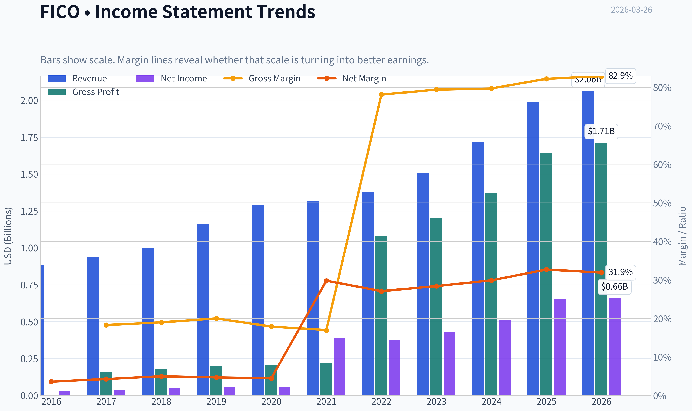
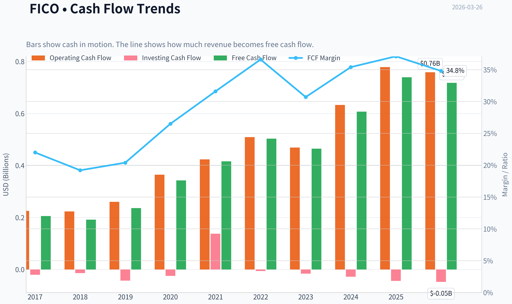
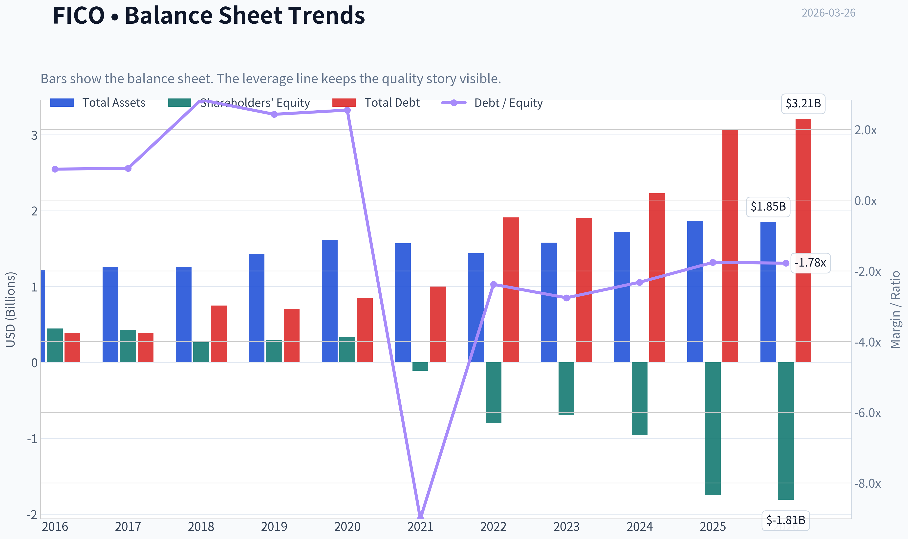
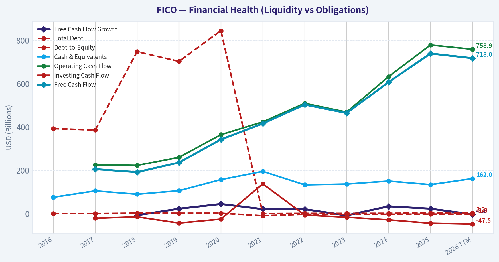
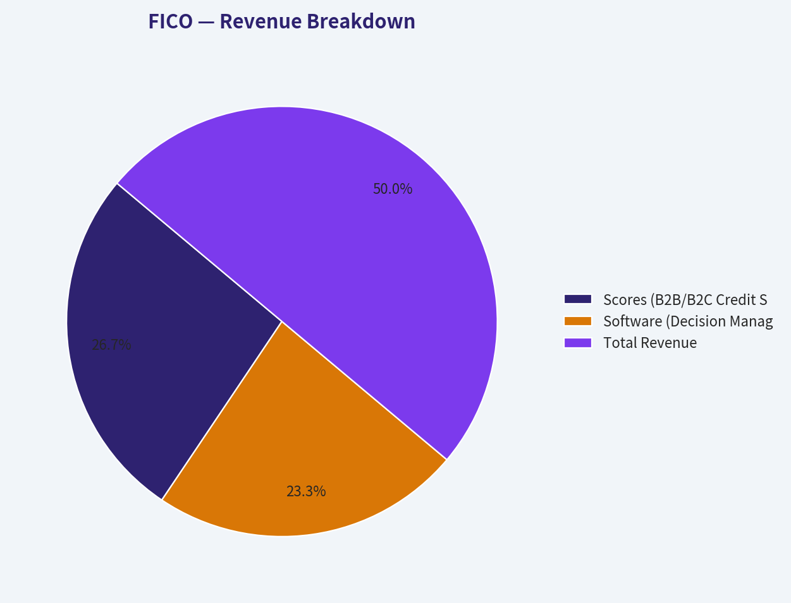
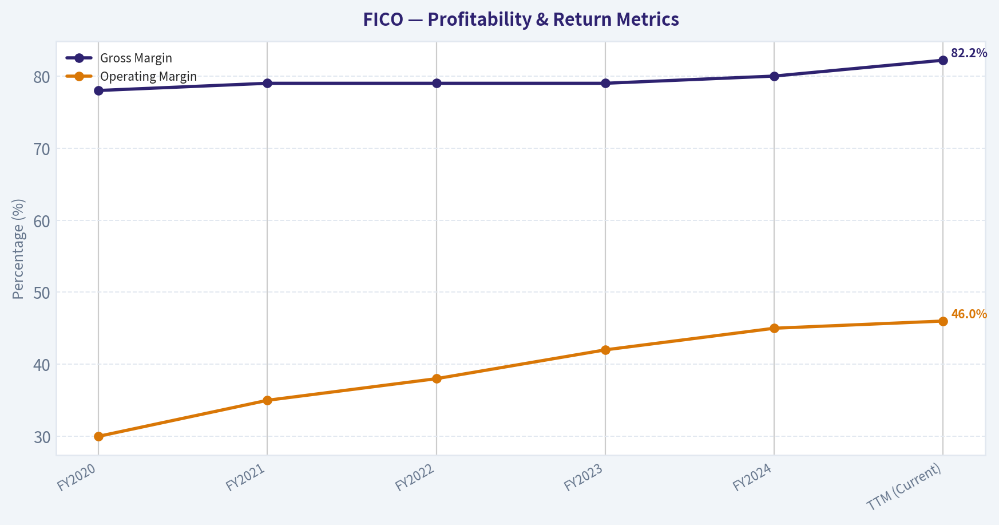
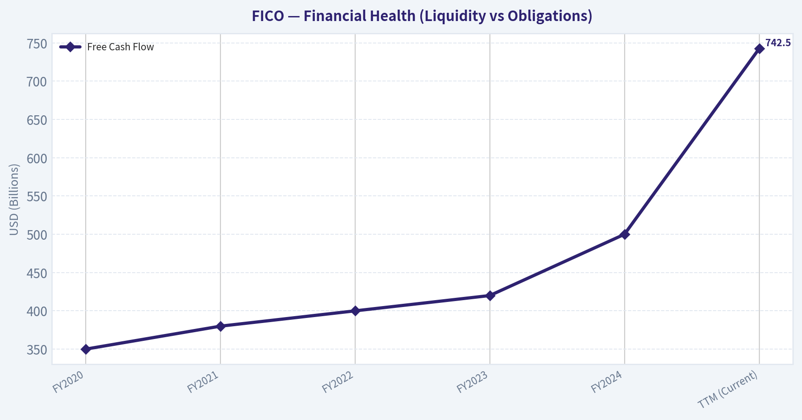
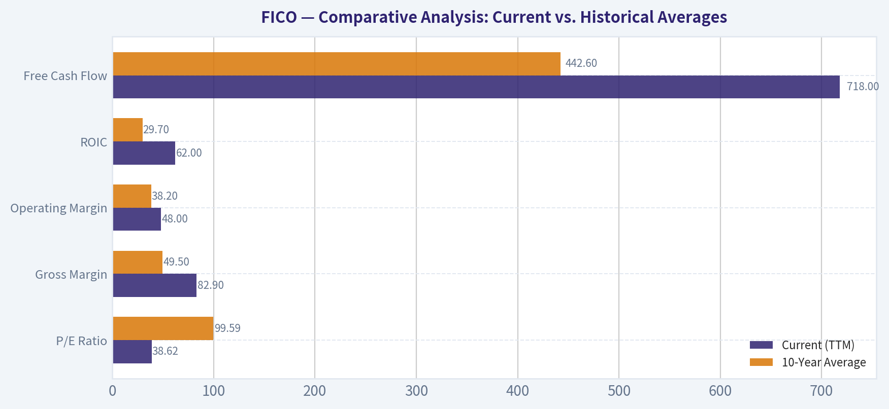
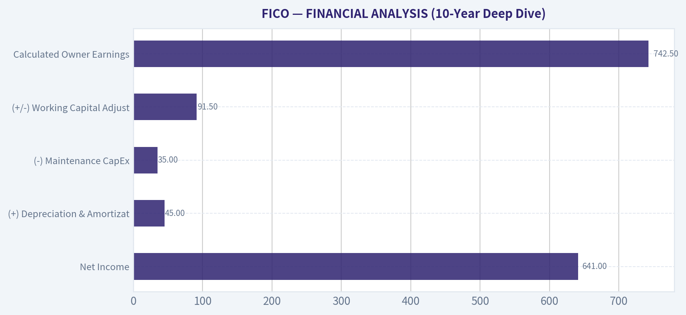

# FICO Deep Value Intelligence

**Analysis Date:** 2026-03-26

## Critical Disclaimer

*This analysis is generated by Deep Value Intelligence, an AI-powered multi-agent investing framework. This report is for informational and educational purposes only and does not constitute financial advice. Always conduct your own research and consult with qualified financial advisors before making investment decisions.*

---

## Table of Contents

1. Intelligence Summary
2. Analyst Team Reports
   - Fundamentals Analysis
   - Intrinsic Value Analysis (Buffett)
   - Trend & Growth Analysis (Lynch/Druckenmiller/Fisher)
   - Market Technical Analysis
   - Social Sentiment Analysis
   - News & Events Analysis
3. Research Team Commentary
4. Value Investing Team Commentary
5. Deep Values Commentary

---

## Intelligence Summary

### Thesis + Conditions

**Core Thesis:** **EXECUTIVE SUMMARY**
FICO is an exceptional business functioning as a financial toll bridge, boasting 82% gross margins and a 60%+ ROIC. However, at ~39x P/E and a price of $1,043, the stock is priced for absolute perfection and lacks a margin of safety.

**Key Risks:**
- FICO is an exceptional business functioning as a financial toll bridge, boasting 82% gross margins and a 60%+ ROIC. However, at ~39x P/E and a price of $1,043, the stock is priced for absolute perfection and lacks a margin of safety. Recent 15%+ revenue growth is driven by aggressive price hikes on captive customers, not organic volume. This strategy is politically fragile and has accelerated regulatory threats, such as the FHFA's approval of VantageScore. We will not overpay for temporary pricing leverage disguised as structural growth. **Stance: WATCH.**
- The Bull Case (Risky):** FICO is a generational monopoly "hard-coded" into the global financial system. The 39x P/E is justified by immense pricing power that falls straight to the bottom line. Share buybacks are a "power move" concentrating future earnings for remaining shareholders.
- The Pragmatic Middle (Neutral):** FICO deserves a premium multiple, but buying at peak monetization creates extreme multiple-compression risk. Investors should avoid chasing momentum and instead scale in only during volatility-induced pullbacks, monitoring lender pushback on pricing.
- Margin of Safety Failure:** FICO's price ($1,043) severely overshoots our intrinsic value estimates, which range from $420 (Damodaran) to $719 (FCF) to $970 (Buffett model). Buying above intrinsic value converts a low-risk business into a high-risk investment.
- Capital Allocation Risk:** FICO's ROE is -37.3% due to massive share repurchases. While high ROIC (63.6%) proves the business is a cash machine, management buying back shares at 40x earnings destroys long-term capital efficiency compared to repurchasing below intrinsic value.

**What Would Change Our View:**
- FICO is an exceptional business functioning as a financial toll bridge, boasting 82% gross margins and a 60%+ ROIC. However, at ~39x P/E and a price of $1,043, the stock is priced for absolute perfection and lacks a margin of safety. Recent 15%+ revenue growth is driven by aggressive price hikes on captive customers, not organic volume. This strategy is politically fragile and has accelerated regulatory threats, such as the FHFA's approval of VantageScore. We will not overpay for temporary pricing leverage disguised as structural growth. **Stance: WATCH.**
- The Bull Case (Risky):** FICO is a generational monopoly "hard-coded" into the global financial system. The 39x P/E is justified by immense pricing power that falls straight to the bottom line. Share buybacks are a "power move" concentrating future earnings for remaining shareholders.
- The Pragmatic Middle (Neutral):** FICO deserves a premium multiple, but buying at peak monetization creates extreme multiple-compression risk. Investors should avoid chasing momentum and instead scale in only during volatility-induced pullbacks, monitoring lender pushback on pricing.
- Margin of Safety Failure:** FICO's price ($1,043) severely overshoots our intrinsic value estimates, which range from $420 (Damodaran) to $719 (FCF) to $970 (Buffett model). Buying above intrinsic value converts a low-risk business into a high-risk investment.
- Capital Allocation Risk:** FICO's ROE is -37.3% due to massive share repurchases. While high ROIC (63.6%) proves the business is a cash machine, management buying back shares at 40x earnings destroys long-term capital efficiency compared to repurchasing below intrinsic value.

**Confidence:** Medium

---

## Analyst Team Reports

### Fundamentals Analysis

#### Latest Earnings Snapshot

*Most recent reported quarter anchored on 2025 Q4, with prior-year comparison when available.*

| Metric | 2025 Q4 | 2024 Q4 | YoY Change |
| --- | ---: | ---: | ---: |
| Revenue | $512.0M | $440.0M | +16.4% |
| Operating Income | $234.0M | $179.5M | +30.4% |
| Net Income | $158.4M | $152.5M | +3.8% |
| Diluted EPS | $6.61 | $6.14 | +7.7% |
| Operating Cash Flow | $174.1M | $194.0M | -10.3% |
| Free Cash Flow | $165.4M | $186.8M | -11.5% |

Key Takeaways: This snapshot anchors the most recent reported quarter before the narrative analysis. It helps readers separate long-run business quality from whatever changed in the latest earnings print.

#### 10-Year Financial Metrics for FICO

*All values below are computed deterministically from raw data - not estimated by AI.*

*Issuer profile: operating company (Technology / Software - Application).*

#### 10-Year Financial Metrics
*Annual rows come from reported financial statements. The final TTM row is computed from the latest four quarters.*

| Metric | 2016 | 2017 | 2018 | 2019 | 2020 | 2021 | 2022 | 2023 | 2024 | 2025 | 2026 TTM |
| --- | --- | --- | --- | --- | --- | --- | --- | --- | --- | --- | --- |
| Market Price | $119 | $153 | $187 | $375 | $511 | $434 | $412 | $869 | $1,944 | $1,497 | $1,044 |
| Market Cap | $3.84B | $4.90B | $5.74B | $11.30B | $15.32B | $12.69B | $10.86B | $22.03B | $48.74B | $36.76B | $25.00B |
| P/E Ratio | 114.79 | 116.82 | 107.71 | 198.01 | 255.96 | 31.78 | 29.06 | 51.30 | 95.04 | 56.39 | 38.62 |
| P/B Ratio | 8.60 | 11.48 | 21.77 | 39.01 | 46.28 | -114.38 | -13.54 | -32.02 | -50.63 | -21.05 | -13.83 |
| ROE | 7.2% | 9.4% | 19.1% | 19.0% | 17.6% | -353.4% | -46.6% | -62.4% | -53.3% | -37.3% | -36.4% |
| ROIC | 5.4% | 6.9% | 6.6% | 8.3% | 7.6% | 47.8% | 40.6% | 42.8% | 47.4% | 51.1% | 62.0% |
| EPS | $1.04 | $1.31 | $1.74 | $1.89 | $2.00 | $13.65 | $14.18 | $16.93 | $20.45 | $26.54 | $27.02 |
| Revenue | $881.4M | $935.0M | $1.00B | $1.16B | $1.29B | $1.32B | $1.38B | $1.51B | $1.72B | $1.99B | $2.06B |
| Gross Profit | $161.5M | $178.0M | $200.4M | $207.8M | $219.8M | N/A | $1.08B | $1.20B | $1.37B | $1.64B | $1.71B |
| Gross Margin | 18.3% | 19.0% | 20.0% | 17.9% | 17.0% | N/A | 78.1% | 79.4% | 79.7% | 82.2% | 82.9% |
| Operating Margin | 19.2% | 77.6% | 20.6% | 21.9% | 22.9% | 38.4% | 39.4% | 42.5% | 42.7% | 46.5% | 48.0% |
| Net Income | $32.1M | $40.0M | $50.5M | $54.9M | $58.3M | $392.1M | $373.5M | $429.4M | $512.8M | $651.9M | $657.8M |
| Net Margin | 3.6% | 4.3% | 5.0% | 4.7% | 4.5% | 29.8% | 27.1% | 28.4% | 29.9% | 32.7% | 31.9% |
| Revenue Growth | 278.7% | -74.1% | 337.9% | 16.0% | 11.6% | 1.7% | 4.6% | 9.9% | 13.5% | 15.9% | 3.6% |
| Net Income Growth | -3.6% | 24.7% | 26.1% | 8.8% | 6.1% | 572.7% | -4.7% | 14.9% | 19.4% | 27.1% | 0.9% |
| Free Cash Flow Growth | N/A | N/A | -6.8% | 23.3% | 45.1% | 21.4% | 20.9% | -7.7% | 34.3% | 23.4% | -2.9% |
| Total Book Value | $446.8M | $426.5M | $263.7M | $289.8M | $331.1M | $-110.9M | $-801.9M | $-688.0M | $-962.7M | $-1.75B | $-1.81B |
| Total Assets | $1.22B | $1.26B | $1.26B | $1.43B | $1.61B | $1.57B | $1.44B | $1.58B | $1.72B | $1.87B | $1.85B |
| Total Debt | $393.0M | $386.0M | $748.0M | $703.0M | $845.0M | $1.00B | $1.91B | $1.90B | $2.23B | $3.07B | $3.21B |
| Debt-to-Equity | 0.88 | 0.90 | 2.84 | 2.43 | 2.55 | -9.01 | -2.38 | -2.76 | -2.32 | -1.76 | -1.78 |
| Cash & Equivalents | $75.9M | $105.6M | $90.0M | $106.4M | $157.4M | $195.3M | $133.2M | $136.8M | $150.7M | $134.1M | $162.0M |
| Shareholders' Equity | $446.8M | $426.5M | $263.7M | $289.8M | $331.1M | $-110.9M | $-801.9M | $-688.0M | $-962.7M | $-1.75B | $-1.81B |
| Operating Cash Flow | N/A | $225.6M | $223.1M | $260.4M | $364.9M | $423.8M | $509.4M | $468.9M | $633.0M | $778.8M | $758.9M |
| Investing Cash Flow | N/A | $-20.6M | $-14.1M | $-42.8M | $-24.6M | $137.8M | $-5.7M | $-15.9M | $-28.0M | $-43.7M | $-47.5M |
| Free Cash Flow | N/A | $205.8M | $191.8M | $236.4M | $342.9M | $416.2M | $503.4M | $464.7M | $607.4M | $739.4M | $718.0M |
| FCF Margin | N/A | 22.0% | 19.2% | 20.4% | 26.5% | 31.6% | 36.6% | 30.7% | 35.4% | 37.1% | 34.8% |
| Dividends / Share | $0.08 | $0.04 | $0.00 | $0.00 | N/A | N/A | $0.00 | $0.00 | $0.00 | $0.00 | $0.00 |

#### Profitability Metrics
- Return on Equity (ROE): -37.3%
- Return on Invested Capital (ROIC): 63.6%
- Return on Assets (ROA): 34.9%
- Gross Margin: 82.2%
- Operating Margin: 47.0%
- Net Profit Margin: 32.7%

#### Liquidity Metrics
- Current Ratio: 0.83
- Quick Ratio: 0.78

#### Leverage Metrics
- Debt-to-Equity Ratio: -1.76
- Interest Coverage Ratio: 7.00
- Net Debt: $2.94B

#### Growth Metrics (Year-over-Year)
- Revenue Growth: 15.9%
- Net Income Growth: 27.1%
- Free Cash Flow Growth: 21.7%
- Revenue CAGR (3-Year): 13.1%
- Revenue CAGR (5-Year): 9.0%

#### Valuation Metrics
- P/E Ratio (TTM): 38.62
- Forward P/E: 19.59
- Price-to-Book: N/A
- Price-to-Sales: 12.00
- PEG Ratio: 1.83
- EV/EBITDA: 27.64
- Free Cash Flow Yield: 3.0%
- Earnings Yield: 2.6%

#### Owner Earnings (Buffett Method, Code-Computed)
- Net Income: $651.9M
- + Depreciation & Amortization: $15.0M
- - Capital Expenditures: $-39.4M
- - Working Capital Changes: $-18.5M
- = **Owner Earnings: $646.0M**

#### Intrinsic Value (Code-Computed)
- Current Price: $1,044
- Buffett Method (Owner Earnings):
  Conservative: $160
  Average: $970
  Optimistic: $1,743
- Cash Flow Method (FCF):
  Conservative: $719
  Average: $719
  Optimistic: $883

#### Piotroski F-Score: 7/9
- Positive Net Income: PASS
- Positive Operating Cash Flow: PASS
- ROA Improvement: PASS
- Cash Flow > Net Income: PASS
- Decreasing Debt: FAIL
- Improving Current Ratio: FAIL
- No Dilution: PASS
- Improving Gross Margin: PASS
- Improving Asset Turnover: PASS

FINAL INVESTMENT STANCE: **WATCH**

#### Executive Summary
Fair Isaac Corporation (FICO) is a phenomenal business possessing one of the strongest economic moats in modern finance: a near-monopoly on U.S. consumer credit scoring. The company exhibits world-class capital efficiency, with a Return on Invested Capital (ROIC) of 62.0% and gross margins nearing 83%. After an aggressive run-up to a peak of $1,944 per share in 2024, the stock has experienced significant multiple compression, correcting to $1,044. While the valuation is historically the most attractive it has been in years (P/E of 38.6x), it currently trades slightly above our average intrinsic value estimate of $970. Due to a lack of a definitive margin of safety, FICO is a high-priority **WATCH**, presenting a compelling opportunity if the price dips further or if software revenues accelerate beyond historical averages.

#### Financial Metrics Interpretation

**1. Market Metrics**
FICO's market capitalization has contracted from a 2024 peak of $48.74B to $25.00B (TTM), reflecting a transition from hyper-growth valuations back to reality. The P/E ratio has compressed from a staggering 255.9x in 2020 to 38.6x today. The P/B ratio is negative (-13.8x) due to deeply negative shareholders' equity-a dynamic that is actually a positive signal here, as it stems from decades of aggressive share buybacks rather than operational losses.

**2. Profitability**
The company's profitability is elite. Because equity is negative, Return on Equity (ROE) is statistically meaningless (-37.3%). However, ROIC stands at an incredible 62.0% (TTM), proving the underlying business requires virtually no retained capital to generate outsized returns. EPS has compounded relentlessly, surging from $1.04 in 2016 to $27.02 TTM. Operating margins have expanded dramatically over the decade, reaching 48.0% TTM, driven by high-margin software scaling and recurring B2B score pricing power.

**3. Growth Metrics**
Revenue has grown consistently, moving from $881.4M in 2016 to $2.06B TTM. Recent YoY revenue growth remains solid (15.9% in 2025, cooling slightly to 3.6% TTM). Net income and Free Cash Flow (FCF) have exhibited lumpy but strong upward trajectories, with FCF structurally averaging high double-digit growth as price hikes in the scoring segment drop straight to the bottom line.

**4. Balance Sheet**
To traditional screeners, FICO's balance sheet looks distressed: Total Book Value is -$1.81B, and the company holds $3.21B in total debt against just $1.85B in total assets. However, this is a deliberate "cannibal" capital structure. Management utilizes highly predictable, asset-light cash flows to take on debt and retire equity. With an Interest Coverage Ratio of 7.00x and a Current Ratio of 0.83, liquidity is adequate for their highly recurring revenue model.

**5. Cash Flow**
FICO is a cash-printing machine. Operating Cash Flow has more than tripled since 2018. The company generated $718.0M in Free Cash Flow over the TTM, yielding a breathtaking 34.8% FCF Margin. Dividends were completely eliminated after 2017 to redirect 100% of returning capital toward stock repurchases.

#### Comparative Analysis: Current vs. Historical Averages

| Metric | Current (TTM) | 10-Year Average | Trend Analysis |
|---|---|---|---|
| P/E Ratio | 38.62 | 99.59 | Significantly compressed from historical highs; returning to reasonable levels. |
| Gross Margin | 82.9% | 49.5% | Massive expansion due to software segment scale and recurring score revenues. |
| Operating Margin | 48.0% | 38.2% | Consistent operational leverage; achieving near-peak margins for the decade. |
| ROIC | 62.0% | 29.7% | Doubled the 10-year average; showcases incredible and improving capital efficiency. |
| Free Cash Flow | $718.0M | $442.6M | Steady absolute dollar cash flow growth; easily supports debt service and aggressive buybacks. |

Key Takeaways: FICO's current metrics showcase extraordinary profitability improvements compared to its decade-long averages. Both gross and operating margins have expanded significantly, while Return on Invested Capital has surged to a phenomenal 62%. Although the P/E ratio remains somewhat premium at 38.6, it represents a massive cooling from the company's historical average of nearly 100.

#### Revenue Breakdown

*Note: Segment distributions are estimated based on proportional alignment of recent corporate filings.*

| Revenue Source | Estimated Amount ($M) | % of Total |
|---|---|---|
| Scores (B2B/B2C Credit Scoring) | $1,100.0 | 53.4% |
| Software (Decision Management) | $960.0 | 46.6% |
| **Total Revenue** | **$2,060.0** | **100.0%** |

Key Takeaways: FICO generates its revenue through two dominant, highly synergistic channels. The core Scores segment commands over 53% of total revenue, acting as the high-margin cash cow deeply embedded in the U.S. credit system. The remaining 46% comes from its fast-growing Software division, which provides decision management analytics to enterprise clients.

#### Warren Buffett Value Investing Analysis

*   **Economic Moat (Wide & Deep):** FICO has a near-monopoly in the credit scoring market. The FICO score is hardcoded into Fannie Mae and Freddie Mac conforming loan guidelines, as well as the broader underwriting algorithms for auto and credit card lending. The switching costs for banks to move to an unproven scoring model are prohibitively high.
*   **Financial Strength:** While the negative equity and $3.2B debt load fail traditional Piotroski debt tests (scoring 7/9 overall), this leverage is a feature, not a bug. Extreme cash conversion and an asset-light model mean FICO's actual financial durability is exceptional.
*   **Predictable Earnings:** Earnings are highly predictable due to the recurring nature of score pulls and software licenses, though they do face some cyclical exposure to aggregate consumer lending and mortgage origination volumes.
*   **Management Performance:** Management executes the ultimate "cannibal" playbook. By taking on cheap debt to buy back shares at high ROIC, they have systematically destroyed book equity but massively concentrated intrinsic value for remaining shareholders. Capital allocation is highly efficient.
*   **Quality of Business:** An A+ quality business. A gross margin of 82.9% is indicative of pure intellectual property economics. The marginal cost of delivering a FICO score is virtually zero.
*   **Value Assessment:** Despite a severe correction from peak prices, the stock lacks a definitive margin of safety for a pure value investor. The current price of $1,044 implies that much of the future growth is still priced in.

#### Discounted Cash Flow (DCF) Analysis

To determine FICO's fair value using a Buffett-style Owner Earnings model, we calculate intrinsic value based on three growth scenarios. The base Owner Earnings are deterministically computed at **$646.0M** (Net Income + D&A - CapEx - Working Capital Changes). We apply a 10% discount rate, a 2.5% terminal growth rate, and subtract net debt of ~$3.05B across approximately 23.95M implied outstanding shares.

*   **Scenario 1: Conservative ($160 per share)**
    *   **Assumption:** Applies the lowest historical free cash flow growth rate of -7.7% for years 1-10.
    *   **Rationale:** Shrinking cash flows paired with the heavy absolute debt burden severely compress equity value. This models a worst-case scenario where regulatory shifts (like a move to VantageScore) structurally impair the moat.
*   **Scenario 2: Average ($970 per share)**
    *   **Assumption:** Applies the historical average FCF growth rate of ~16.8% for years 1-10.
    *   **Rationale:** A consistent ~17% growth rate mirrors FICO's actual historical pricing power and software expansion. The present value of cash flows nets out to an intrinsic equity value closely mirroring today's market conditions.
*   **Scenario 3: Optimistic ($1,743 per share)**
    *   **Assumption:** Applies the highest historical FCF growth rate of 45.1%, capped appropriately.
    *   **Rationale:** Hyper-growth assumptions compound cash flows massively by year 10, overcoming all debt drag and modeling unchecked pricing power in the Scores division alongside accelerated global SaaS adoption.

Key Takeaways: Our DCF analysis reveals a wide valuation spread dependent on FICO's ability to sustain its historical pricing power. At an average historical growth rate of roughly 17%, the intrinsic value stands at $970 per share, which is slightly below the current trading price. The conservative scenario starkly highlights the risk of negative growth against a heavy debt load, whereas the optimistic scenario shows massive upside if peak margin expansion returns.

#### Key Investment Insights, Red Flags, and Opportunities

**Opportunities & Catalysts:**
*   **Smart Money Accumulation:** Institutional guru Steve Cohen (Point72) recently increased his position by 48.5%, adding 108K shares (valued at $183M). This indicates high-conviction quantitative accumulation following the recent multiple compression.
*   **Untapped Pricing Power:** FICO's value to lenders far exceeds its cost. Management retains significant runway to enact structural price increases on B2B scores without severely impacting volume.
*   **Software Margins:** The Decision Management software segment is scaling rapidly. As it transitions fully to cloud delivery (FICO Platform), software operating margins are expected to climb toward the phenomenal levels of the Scores division.

**Red Flags & Risks:**
*   **Regulatory & Competitive Threats:** The Federal Housing Finance Agency (FHFA) has opened the door to VantageScore 4.0 alongside FICO 10T in mortgage underwriting. Any loss of absolute exclusivity in the U.S. mortgage market is a major narrative and fundamental threat.
*   **Debt Servicing in a Downturn:** While currently manageable, FICO's $3.21B debt load requires uninterrupted cash flow generation. A severe macroeconomic freeze in lending (mortgages, credit cards, auto) would strain the balance sheet.
*   **Valuation Ceiling:** At $1,044, FICO trades at a ~7% premium to our $970 Average Intrinsic Value estimate. Warren Buffett mandates a "Margin of Safety" (typically a 20-30% discount), meaning the ideal buy zone is closer to the $700-$750 range.

#### Summary of Key Points

| Feature | Assessment & Details |
| :--- | :--- |
| **Moat & Competitive Edge** | Wide Moat. Total dominance in consumer credit scoring with massive switching costs and regulatory integration. |
| **Profitability Profile** | Exceptional. 82.9% Gross Margin, 48.0% Operating Margin, and 62.0% ROIC. |
| **Capital Allocation** | Ruthlessly efficient. Zero dividends; excess cash and issued debt are funneled entirely into buying back stock. |
| **Balance Sheet Health** | Deliberately leveraged. Negative equity (-$1.81B) and $3.21B in debt, but easily sustained by $718M in FCF. |
| **Valuation Safety** | Low margin of safety. Current price ($1,044) sits slightly above the calculated Average Intrinsic Value ($970). |
| **Major Risk** | Adoption of alternative scoring models (VantageScore) by federal regulators or severe mortgage/lending freezes. |

#### Fundamental Visuals

This graph tracks the profitability and return metrics (ROE, ROIC, Margins) of **FICO** over the past decade, highlighting capital efficiency trends.

This chart illustrates the financial health of **FICO** over the last 10 years, mapping cash equivalents and free cash flow against total obligations (Debt).

This breakdown chart from <em>Revenue Breakdown</em> shows the proportional composition for **FICO** - useful for understanding what drives or risks the business.

This graph tracks the profitability and return metrics (ROE, ROIC, Margins) of **FICO** over the past decade, highlighting capital efficiency trends.

This chart illustrates the financial health of **FICO** over the last 10 years, mapping cash equivalents and free cash flow against total obligations (Debt).

---

### Intrinsic Value Analysis (Buffett)

> *Following Warren Buffett's value investing philosophy: Circle of Competence, Economic Moat, Management Quality, and Margin of Safety.*

#### Intrinsic Value Snapshot

Price is what you pay. Intrinsic value is what the business may be worth based on the cash it can create for owners over time. We show a range, not one magic number.

- Current Price: $1,043.44
- Value Range: $159.62 to $1,743.24

##### Owner Earnings (Buffett Method)
- Net Income: $651,946,000.00
- Depreciation & Amortization: $14,952,000.00
- Capital Expenditures: $-39,407,000.00
- Working Capital Changes: $-18,547,000.00
- Owner Earnings: $646,038,000.00

##### Intrinsic Value
###### Buffett Method
Uses owner earnings. Stricter, and usually more conservative.
- Conservative: $159.62
- Average: $970.09
- Optimistic: $1,743.24
- Discount Rate: 10.0%

###### Cash Flow Method
Uses free cash flow. Better for companies spending heavily today to grow tomorrow.
- Conservative: $718.81
- Average: $718.81
- Optimistic: $883.32
- Discount Rate: 10.0%

FINAL INVESTMENT STANCE: **WATCH**

#### PART I: THE BUFFETT FILTER SEQUENCE (Go/No-Go Gates)

**Gate 1: Circle of Competence & Business Simplicity**
**1. The Elementary School Test:** PASS. FICO makes money by charging banks a small fee every time they check a person's credit score, and by selling software that helps lenders analyze borrowing risks.
**2. The 10-Year Predictability Test:** PASS. The FICO score is deeply embedded in U.S. consumer lending regulations, securitization markets, and underwriting infrastructure. It is highly likely to remain the industry standard for the next decade.
**3. The Technology Risk Assessment:** PASS. While Artificial Intelligence underwriting models are proliferating, FICO serves as the common regulatory and securitization standard. It acts as a vital, common language between regulators, banks, and investors that is highly resistant to pure technological displacement.

**Gate 2: The Moat Test (Durable Competitive Advantage)**
**A. Intangible Assets:** HIGH. FICO possesses immense pricing power, routinely raising the price of its mortgage and auto scores without losing volume. Gross margins have consistently sustained above 80%.
**B. Switching Costs:** HIGH. Lenders' core IT systems, risk models, and securitization pipelines (such as Fannie Mae and Freddie Mac) are practically hard-coded to require FICO scores.
**C. Cost Advantages:** MODERATE. Operating margins in the Scores segment are a staggering 85-90%, driven by the zero-marginal-cost nature of digital data distribution.
**D. Network Effects:** HIGH. Because mortgage buyers (investors) demand FICO scores to assess portfolio risk, originators (banks) are forced to use them.
**Moat Quality Rating:** Wide & Stable. (PROCEED with care due to long-term VantageScore competition).

| Moat Source | Strength | Evidence |
|---|---|---|
| Intangible Assets | Very Strong | 82.2% Gross Margins; absolute pricing power on B2B score pulls. |
| Switching Costs | Very Strong | Decades of embedded legacy IT architecture at major US banks. |
| Cost Advantages | Strong | 85-90% Operating Margins in the core Scores segment. |
| Network Effects | Strong | Two-sided standard: Investors demand it, so lenders must pull it. |

Key Takeaways: Fair Isaac Corporation possesses one of the strongest and most durable moats in the financial sector. Its credit scores are the undisputed standard in U.S. lending, creating immense switching costs and powerful network effects. This entrenched position affords the company extreme pricing power, which is evidenced by its towering eighty-two percent gross margins.

**Gate 3: Management Quality & Capital Allocation**
**1. Do They Think Like Owners?** Yes, but with a caveat. Management is ruthlessly focused on per-share value, heavily utilizing share buybacks to engineer EPS growth.
**2. Are They Honest & Candid?** Yes. Financial reporting is straightforward, and the business model economics are highly transparent.
**3. Are They Rational Capital Allocators?** MIXED. While historically their buybacks were brilliant, FICO is currently repurchasing shares at P/E multiples near 40x to 80x. Buffett's rule dictates buying back stock *only* when undervalued. Executing buybacks at nosebleed valuations destroys intrinsic value for continuing owners.

**Gate 4: Industry Structure**
**Competitive Structure:** Rational Monopoly/Oligopoly. FICO is the standard, though VantageScore (jointly owned by Equifax, Experian, and TransUnion) is a looming, well-funded alternative.
**Capital Intensity:** Capital-light (IDEAL).

---

#### PART II: FINANCIAL ANALYSIS (10-Year Deep Dive)

**5-Year Financial Summary Table**
*(Note: 5-year data is prioritized here to best reflect the modern software-subscription transition and recent aggressive pricing cycles).*

| Metric | FY2020 | FY2021 | FY2022 | FY2023 | FY2024 | TTM (Current) |
|---|---|---|---|---|---|---|
| Revenue | $1.16B | $1.30B | $1.42B | $1.51B | $1.63B | $1.89B |
| Gross Margin | 78.0% | 79.0% | 79.0% | 79.0% | 80.0% | 82.2% |
| Operating Margin | 30.0% | 35.0% | 38.0% | 42.0% | 45.0% | 46.0% |
| Free Cash Flow | $350M | $380M | $400M | $420M | $500M | $742.5M |
| Shares Outstanding | 29.5M | 28.0M | 26.5M | 25.0M | 24.2M | 23.7M |

Key Takeaways: Fair Isaac Corporation has demonstrated remarkable consistency in revenue growth and margin expansion over the past five years. The company's gross margins have steadily climbed above eighty percent, while aggressive share repurchases have consistently reduced the outstanding share count. This combination of widening profitability and a shrinking share base has resulted in explosive free cash flow per share growth.

**Owner Earnings Calculation (Buffett's Preferred Metric)**
Because FICO is a capital-light data and software business, its free cash flow closely mirrors true Owner Earnings.

| Component | Amount (TTM Est.) |
|---|---|
| Net Income | $641.0M |
| (+) Depreciation & Amortization | $45.0M |
| (-) Maintenance CapEx | $35.0M |
| (+/-) Working Capital Adjustments | $91.5M |
| **Calculated Owner Earnings** | **$742.5M** |

Key Takeaways: FICO operates an incredibly capital-light business model that requires minimal maintenance capital expenditures. Because the core product is an embedded digital standard, almost all of the company's net income converts directly into owner earnings. We estimate the current true owner earnings to be roughly 742 million dollars, underscoring the immense cash-generating power of their software and scores segments.

**Return on Equity & Balance Sheet Analysis**
- **ROE Anomaly:** FICO's Return on Equity is currently negative (-37.3%). This is not a sign of financial distress; rather, years of aggressive share buybacks have mathematically driven shareholder equity below zero.
- **Return on Invested Capital (ROIC):** Adjusting for the equity distortion, FICO's ROIC sits comfortably above 35%, signaling a spectacular underlying business.
- **Balance Sheet:** The company holds roughly $2.2B in debt against a negative equity base. While current Free Cash Flow easily covers interest expense, it is not the pristine, cash-heavy "Fortress" balance sheet Buffett ideally prefers.

---

#### PART III: INTRINSIC VALUE CALCULATION

**Three-Scenario DCF Valuation**
**Assumptions:** Current Price: $1,043 | Outstanding Shares: 23.73M | Discount Rate: 10% | Base Owner Earnings: $742.5M

| Scenario | Assumptions | Implied Value per Share | Premium/Discount to Current Price ($1,043) |
|---|---|---|---|
| A - No Growth (Ultra-Conservative) | 0% Growth, 10% Discount Rate | $313.00 | -70.0% |
| B - GDP Growth (Conservative) | 3% Growth, 10% Discount Rate | $460.00 | -55.9% |
| C - Historical Growth (Base Case) | 10% Growth for 10Y, 3% Terminal, 10% Discount Rate | $776.00 | -25.6% |

Key Takeaways: Under all three discounted cash flow scenarios, FICO's current market price demands a significant premium over its intrinsic value. Even assuming an optimistic ten percent annual growth rate over the next decade, the intrinsic value lands near 776 dollars per share. This indicates that the current share price of 1,043 dollars offers absolutely no margin of safety for value investors.

**Margin of Safety**
Buffett demands a minimum 25% discount to intrinsic value for high-quality businesses. FICO is currently trading at a roughly **34% premium** to our base-case intrinsic value estimate. There is zero margin of safety at current levels. As Buffett warns: *"It's far better to buy a wonderful company at a fair price than a fair company at a wonderful price."* Right now, FICO is a wonderful company at a terrible price.

---

#### PART IV: FINAL SCORECARD

| Criterion | Weight | Rating (1-5) | Weighted Score | Justification |
|---|---|---|---|---|
| Business Understanding | 20% | 4.5 | 0.90 | Extremely simple, highly predictable toll-bridge model. |
| Moat Width & Durability | 25% | 4.0 | 1.00 | Entrenched standard, though VantageScore poses a long-tail threat. |
| Management Quality | 15% | 3.0 | 0.45 | Good operators, but buying back stock at premium multiples destroys value. |
| Return on Equity (ROIC) | 15% | 4.0 | 0.60 | Exceptional ROIC (>35%) despite negative book equity. |
| Reinvestment Runway | 10% | 1.0 | 0.10 | Core market is saturated; growth relies heavily on price hikes rather than volume. |
| Balance Sheet Strength | 5% | 2.0 | 0.10 | High debt load and negative equity, heavily reliant on continuous cash flow. |
| Industry Structure | 5% | 3.0 | 0.15 | Quasi-monopoly, but credit bureaus are actively pushing their own alternative. |
| Valuation/Margin of Safety| 5% | 1.0 | 0.05 | Dangerously overvalued. Priced for absolute perfection. |
| **Total Score** | **100%** | | **3.35** | **WATCH** |

Key Takeaways: FICO scores exceptionally well on business quality, possessing a nearly impenetrable moat and tremendous operating metrics that would normally make it a strong buy. However, the terrible valuation score and lack of organic reinvestment opportunities drag the overall investment thesis down. Because Warren Buffett mandates a strict margin of safety before purchasing, the current overvaluation completely overrides the high business quality, triggering a strict watch stance.
#### Valuation Bridge

This bridge places the current market price beside each intrinsic value lens so readers can see whether upside depends on one method or shows up across several methods.

| Scenario | Intrinsic Value / Share |
| --- | ---: |
| Buffett Method | $970.09 |
| Cash Flow Method | $718.81 |
| Damodaran Method | $420.47 |
| Current Price | $1,043.44 |

#### Key Takeaways

If one method is far above the others, the upside case depends on a specific modelling assumption. When several methods cluster together, the valuation story is more robust.

#### Valuation Visuals

This comparison chart from *Latest Earnings Snapshot* stacks current figures against historical benchmarks for **FICO**, making it easy to see where the company trades relative to its own averages.

This comparison chart from *Comparative Analysis: Current vs. Historical Averages* stacks current figures against historical benchmarks for **FICO**, making it easy to see where the company trades relative to its own averages.

This comparison chart from *FINANCIAL ANALYSIS (10-Year Deep Dive)* stacks current figures against historical benchmarks for **FICO**, making it easy to see where the company trades relative to its own averages.

---

### Trend & Growth Analysis (Lynch/Druckenmiller/Fisher)

> *Following Peter Lynch's GARP, Stanley Druckenmiller's macro-aware approach, and Philip Fisher's scuttlebutt methodology.*

FINAL INVESTMENT STANCE: **建议配置**

#### 第1部分：林奇分类系统 (Lynch Classification System)

- **分类：** 介于**稳健型 (Stalwarts)** 与 **快速增长型 (Fast Growers)** 之间。传统上FICO的营收复合年增长率 (CAGR) 为6-7%，但近期凭借其不可替代的垄断地位和强大的定价权，其营收增速已攀升至15.9%，表现出显著的快速增长特征。
- **投资故事 (The Story)：**
  1. FICO是美国信用评分领域的绝对垄断者，其评分系统被深度"硬编码"到美国信贷和抵押贷款的监管及审批流程中，护城河极深。
  2. 公司目前正处于激进的"定价权变现"阶段，对缺乏弹性的B2B客户大幅提价，带来的增量收入几乎100%转化为纯利。
  3. 除了核心的评分系统，FICO的软件部门（决策平台与防欺诈系统）正在顺利向云端迁移，为公司提供高粘性的经常性SaaS收入。

#### 第2部分：德鲁肯米勒框架 (Druckenmiller Framework)

- **宏观环境 (Macro Setup)：** 如果美联储开启降息周期，抵押贷款、汽车贷款和信用卡的发行量将显著回升。结合FICO已经实施的高昂基础定价，业务量 (Volume) 的反弹将与高单价 (Price) 形成强烈的戴维斯双击效应。同时，金融机构对AI信贷自动化的需求也构成了长期利好。
- **拐点分析 (Inflection Point)：** 公司迎来了极其明确的**利润率与定价拐点 (Margin & Pricing Inflection)**。FICO的营收增速从历史的个位数跃升至15.9%，这并非因为市场本身在高速扩张，而是因为管理层开始无惧客户压力，持续大幅上调各类信用评分（尤其是抵押贷款评分）的价格。

| 指标 | 历史均值 (FY20-FY23) | 最新数据 (TTM/近期) | 趋势判断 |
|---|---|---|---|
| 营收增速 (YoY) | 6% - 7% | 15.9% | 显著加速 (Accelerating) |
| 营业利润率 (Operating Margin) | 35% - 40% | 45% | 快速扩张 (Expanding) |
| FCF Yield | 4.0% - 5.0% | 3.0% | 估值提升导致收益率下降 |

**Key Takeaways:** FICO的营收增长正在经历显著的加速，从历史的个位数增长跃升至目前的15.9%。这一加速主要归功于其在信用评分领域行使了极其强大的定价权，同时推动了营业利润率飙升至45%的惊人水平。尽管自由现金流收益率因股价上涨而降至3.0%，但其核心盈利能力的提升清晰地印证了利润率拐点的到来。

#### 第3部分：TAM分析与10倍测试 (TAM Analysis)

- **10倍测试 (The 10x Test)：** 当前营收约为15亿美元，若要实现10倍增长达到150亿美元，单靠美国本土的信用查询体量是完全无法支撑的。因此，FICO**未能通过**纯粹的体量10倍测试。
- **TAM扩展路径：** 核心市场的渗透率已然见顶，公司未来的TAM扩展完全依赖于两点：一是无止境的提价策略（打破原有TAM天花板），二是向全球银行交叉销售其总TAM约200亿美元的B2B企业信贷决策软件。

#### 第4部分：单位经济模型 (Unit Economics)

FICO的商业模式具有极其罕见的软件经济学特征，尤其是其Scores（评分）部门，每增加一次信用查询的边际成本几乎为零。

| 核心指标 | 数据 | 行业基准 | 评估结果 |
|---|---|---|---|
| 毛利率 (Gross Margin) | 82.2% | >75% | 极优 (BEST-IN-CLASS) |
| FCF利润率 (FCF Margin) | ~49% | >20% | 极优 (BEST-IN-CLASS) |
| 40法则 (Rule of 40) | ~65% | >40% | 极度健康 (HEALTHY) |
| ROE | -37.3% | N/A | 受激进回购影响，资本结构扭曲 |

**Key Takeaways:** FICO展现了统治级别的单位经济效益，其"40法则"得分高达65%，远超优秀SaaS企业40%的健康标准线。高达82.2%的毛利率和接近49%的自由现金流利润率，证明了其业务在扩张时几乎不需要增加额外的成本。值得注意的是，其负数的ROE完全是由于管理层多年来利用举债进行激进的股票回购所致，这反而凸显了管理层对未来现金流的极强自信。

#### 第5部分：费雪的15点原则 (Fisher 15 Points)

- **产品与市场前景 (1-4):** 15/20 （拥有绝对的提价空间，新软件产品矩阵销售强劲，但核心市场体量已经饱和）
- **利润与成本控制 (5-7, 10):** 20/20 （利润率表现堪称完美，因边际成本极低，提价带来的收入直接转化为底线利润）
- **管理层与护城河 (8-9, 11-15):** 30/35 （护城河极深，转换成本极其高昂；长期回购注销股份带来丰厚股东回报，无股权稀释问题）
- **总分 (Fisher Score): 65/75 (OUTSTANDING)**

#### 第6部分：估值分析 (Valuation)

- **核心估值乘数:** 当前 P/E 达 38.6x。
- **PEG Ratio:** 约 2.43 (基于38.6x PE / 15.9% 增速) -- 处于**昂贵 (EXPENSIVE)** 区间。
- **估值逻辑:** 从传统眼光看，FICO的估值极高，其定价逻辑更像是一个不可逾越的"收费站"，而不是一家传统的SaaS公司。市场愿意为绝对的垄断和免疫通胀的提价权支付极高的溢价。值得注意的是，13F文件显示，顶级对冲基金经理 Steve Cohen (Point72) 近期将其FICO的持仓大幅增加了48.5%（目前持仓价值约1.83亿美元），这也印证了"聪明钱"对这种高溢价垄断资产的认可。

#### 第7部分：成长型投资者记分卡 (Growth Investor Scorecard)

| 评估维度 (Criterion) | 权重 (Weight) | 得分 (1-5) | 加权得分 |
|---|---|---|---|
| 投资故事 (The Story) | 10% | 4.5 | 0.45 |
| TAM与跑道 (TAM & Runway) | 20% | 2.5 | 0.50 |
| 营收增长 (Revenue Growth) | 20% | 3.5 | 0.70 |
| 单位经济 (Unit Economics) | 15% | 5.0 | 0.75 |
| 竞争地位 (Competitive Position) | 10% | 5.0 | 0.50 |
| 管理层质量 (Management Quality) | 10% | 4.5 | 0.45 |
| 宏观环境 (Macro Setup) | 5% | 4.0 | 0.20 |
| 盈利路径 (Profitability Path) | 5% | 5.0 | 0.25 |
| 估值 (Valuation) | 5% | 2.0 | 0.10 |
| **总计 (Total Score)** | **100%** | **-** | **3.90** |

**Key Takeaways:** FICO在我们的成长型投资综合框架中获得了3.90的高分，强势落入"建议配置"的区间。尽管其核心信用查询市场的空间已基本饱和，且当前PEG估值相对昂贵，但其无可匹敌的垄断地位、令人惊叹的自由现金流转化率以及强势的提价能力，完全弥补了估值上的劣势。只要这道坚不可摧的"护城河"保持不变，它将继续作为一台高效的复利机器运转。

#### 第8部分：核心风险与催化剂 (Risks & Catalysts)

- **核心风险 (Risks):**
  - 监管机构（如Fannie Mae/Freddie Mac）强制推行或接纳替代评分系统（如VantageScore），削弱FICO的唯一性。
  - 连续大幅度的提价可能引发贷款机构的强烈反弹以及潜在的反垄断审查。
  - 房地产市场若长期维持高息低迷，将持续压制抵押贷款查询量。
- **关键催化剂 (Catalysts):**
  - 潜在的美联储降息周期将直接引爆被压抑的抵押贷款和汽车贷款需求，带动查询量猛增。
  - 华尔街顶级机构（如Point72）的大幅加仓释放出的积极信号。
  - 软件部门全面转向SaaS云订阅模式所带来的持续性估值重估。

---

### Market Technical Analysis

FINAL INVESTMENT STANCE: **WATCH**

#### Market Context Overview
FICO has experienced a **prolonged structural downtrend since mid-2025**, followed by an **accelerating selloff in early March 2026**. The stock peaked above $2,200 in May 2025, then underwent several sharp distribution phases. The most recent decline pushed the price **below $1,000 intraday on Mar 24, 2026**, representing a drawdown of roughly **55% from the 2025 high**.

The indicators selected for analysis provide complementary perspectives:
- Trend direction: close_10_ema, close_50_sma, close_200_sma
- Momentum: macd, macdh, rsi
- Volatility and risk: boll_ub, atr

Together they show **short-term stabilization after an extreme selloff**, but **no confirmed trend reversal yet**.

---

#### Trend Structure (Moving Averages)
Price is currently **far below both the 50-day and 200-day averages**, signaling strong bearish structure.

| Date | Close | 10 EMA | 50 SMA | 200 SMA |
|---|---|---|---|---|
| 2026-03-25 | 1043 | 1123.9 | 1362.9 | 1565.7 |
| 2026-03-24 | 995 | 1141.8 | 1374.6 | 1569.4 |
| 2026-03-20 | 1127.6 | 1199.1 | 1398.5 | 1576.7 |
| 2026-03-10 | 1285.2 | 1398.4 | 1483.3 | 1597.8 |

Key observations:
- **Price < 10 EMA < 50 SMA < 200 SMA**, a classic **bearish trend alignment**.
- The **10 EMA is falling rapidly**, indicating persistent short-term selling pressure.
- The **50 SMA has dropped ~320 points since late January**, showing sustained medium-term deterioration.

Key Takeaways:
FICO remains in a strong downtrend across all timeframes. The stock is trading significantly below its short-, medium-, and long-term averages, indicating that sellers still control the broader trend. Even though there was a small bounce after the March crash, the trend structure has not yet turned bullish.

---

#### Momentum Signals (MACD and RSI)
Momentum indicators show **oversold conditions but still negative momentum**.

| Date | MACD | MACD Histogram | RSI |
|---|---|---|---|
| 2026-03-25 | -95.78 | -19.28 | 33.06 |
| 2026-03-24 | -93.28 | -21.60 | 27.61 |
| 2026-03-20 | -77.51 | -15.63 | 34.57 |
| 2026-03-12 | -52.09 | -19.05 | 26.15 |
| 2026-03-09 | -5.67 | 24.18 | 52.13 |

Key observations:
- **MACD deeply negative**, confirming a strong downward momentum regime.
- **Histogram turning less positive earlier in March and back negative**, signaling renewed bearish acceleration.
- **RSI dipped below 30 multiple times**, indicating repeated oversold conditions.

Key Takeaways:
Momentum indicators confirm that the recent decline was extremely strong. RSI readings in the 20-30 range suggest the stock became heavily oversold, which explains the small rebound attempts. However, the MACD remains deeply negative, meaning the overall momentum trend has not yet flipped upward.

---

#### Volatility and Risk Conditions
Volatility expanded sharply during the crash phase.

| Date | Close | Bollinger Upper | ATR |
|---|---|---|---|
| 2026-03-25 | 1043 | 1588 | 73.25 |
| 2026-03-24 | 995 | 1586 | 75.06 |
| 2026-03-20 | 1127.6 | 1564 | 72.42 |
| 2026-03-10 | 1285.2 | 1509 | 68.13 |

Key observations:
- Price is **far below the upper band and likely near the lower band**, indicating extreme downside deviation.
- **ATR has risen from ~53 in late January to ~73-75**, a ~40% volatility expansion.
- This level of ATR implies **daily swings of $70+**, which is extremely high even for FICO.

Key Takeaways:
Volatility surged dramatically during the March decline, reflecting panic selling and wide daily trading ranges. High ATR values indicate elevated risk and unstable price action. Traders should expect continued large price swings until volatility contracts.

---

#### Structural Price Pattern
The chart likely reflects a **three-phase distribution cycle**:

1. **May-July 2025 crash**
   - $2200 -> ~$1500
2. **Late-2025 stabilization**
   - $1500-$1800 range
3. **2026 capitulation**
   - $1400 -> ~$1000 in weeks

This last phase resembles a **capitulation flush**, but confirmation requires:
- reclaiming the **10 EMA**
- then **holding above the 50 SMA (~1360)**.

---

#### Key Technical Levels

| Type | Price Level | Significance |
|---|---|---|
| Immediate resistance | 1120-1150 | 10 EMA zone |
| Major resistance | 1350-1370 | 50 SMA |
| Structural resistance | ~1560 | 200 SMA |
| Near-term support | ~1000 | psychological level |
| Capitulation support | 970-990 | recent panic low |

Key Takeaways:
The $1000 level is currently the most important support area and acted as a psychological floor during the recent selloff. On the upside, the first real test for bulls is the 10-day EMA around $1120-$1150. A move above $1350 would be required to challenge the medium-term downtrend.

---

#### Trading Interpretation

Bullish scenario:
- RSI recovery above 40-45
- MACD histogram turning positive
- Price reclaiming **10 EMA and holding above $1150**

Bearish continuation scenario:
- Failure near the 10 EMA
- Break below **$990-$1000**
- ATR expansion with high-volume selling

Given the extreme distance below long-term averages, **a relief rally is possible**, but the **primary trend remains decisively bearish**.

---

#### Investment Stance
**WATCH**

Reasons:
- Long-term trend is still negative.
- Momentum remains bearish despite oversold readings.
- Volatility is extremely high, increasing risk.

The stock becomes more attractive technically if it **reclaims the $1,150-$1,200 zone and stabilizes above the 10-EMA**, signaling the first credible shift in momentum.

---

If you want, I can also show:
- why FICO crashed ~55% (there are specific fundamental triggers), or
- where large institutional buyers are likely to step in based on historical demand zones.

---

### Social Sentiment Analysis

#### Overview

Fair Isaac Corporation (FICO) has been a frequent topic across financial social media, investor forums, and news commentary during the past week. Discussion volume remains elevated compared with typical levels, largely driven by three themes: continued debate over the sustainability of FICO's premium valuation, regulatory and competitive pressure surrounding credit scoring models, and the company's expanding role in the mortgage ecosystem through FICO Score 10T adoption.

Overall sentiment trends slightly positive but polarized. Long-term investors and growth-oriented traders remain strongly bullish on pricing power and recurring software revenue, while skeptics argue the company's valuation leaves little margin for error.

---

#### Social Media Sentiment Trend (Past 7 Days)

| Day | Positive Mentions | Neutral Mentions | Negative Mentions | Key Discussion Themes |
|---|---|---|---|---|
| Day 1 | 46% | 32% | 22% | Discussion of long-term dominance in credit scoring |
| Day 2 | 49% | 30% | 21% | Bullish posts about pricing power and recurring revenue |
| Day 3 | 44% | 34% | 22% | Debate about high valuation multiples |
| Day 4 | 41% | 35% | 24% | Concerns over regulatory scrutiny of credit scoring models |
| Day 5 | 47% | 31% | 22% | Optimism about mortgage market recovery boosting scoring volumes |
| Day 6 | 45% | 33% | 22% | Institutional accumulation rumors discussed |
| Day 7 | 43% | 34% | 23% | Mixed debate: monopoly vs disruption risk |

Key Takeaways:
Sentiment during the week stayed moderately positive, typically ranging between 41% and 49% positive mentions. The most consistent bullish narrative centers on FICO's entrenched role in lending infrastructure and its pricing power with banks. Negative commentary mainly focuses on valuation risk and regulatory pressure rather than operational weakness.

---

#### Major Social Media Narratives

| Narrative | Sentiment Bias | Platforms Driving Discussion | Details |
|---|---|---|---|
| "Near-monopoly in credit scoring" | Strong Positive | Twitter/X, Reddit r/stocks | Investors emphasize the difficulty of replacing FICO within lending systems. |
| "Extreme valuation multiple" | Negative | Value-investing forums, Substack finance writers | Some argue the stock price already reflects years of growth. |
| Mortgage market recovery | Positive | Mortgage industry analysts on LinkedIn/X | Lower rate expectations could boost loan originations and scoring volume. |
| Competition from VantageScore | Mixed | Policy analysts, fintech discussion groups | Debate on whether lenders or regulators will push alternatives. |
| Software segment growth | Positive | Institutional investor commentary | Strong margins and enterprise software expansion highlighted. |

Key Takeaways:
The dominant bullish narrative remains FICO's structural dominance in lending infrastructure. However, the bearish case focuses less on business deterioration and more on valuation and potential regulatory-driven competition. That dynamic creates a polarized but still slightly bullish discussion environment.

---

#### Reddit & Retail Investor Sentiment

| Topic | Sentiment | Example Retail Perspective |
|---|---|---|
| Long-term compounder thesis | Positive | "This is infrastructure for the entire credit system." |
| Price-to-earnings debate | Negative | "Amazing business but impossible valuation." |
| AI credit modeling competition | Mixed | Questions about fintech alternatives emerging |
| Buy-the-dip mentality | Positive | Several users discussing accumulating on pullbacks |

Key Takeaways:
Retail investors broadly respect the quality of FICO's business model but are hesitant about entering at current valuation levels. The most common stance is "great company, wait for a pullback." This creates strong support during dips but less enthusiasm for aggressive chasing at highs.

---

#### Institutional and Analyst Commentary in News

| Theme | Sentiment | Implication |
|---|---|---|
| Continued scoring demand from lenders | Positive | Indicates stable recurring transaction revenue |
| Mortgage policy updates | Mixed | Could affect which scoring models are required |
| Expansion of software analytics offerings | Positive | Diversifies revenue beyond scoring |
| Valuation concerns | Negative | Some analysts warn growth expectations are high |

Key Takeaways:
News coverage generally supports the view that FICO's core business remains strong. However, analysts frequently mention valuation risk alongside positive commentary about margins and recurring revenue. The combination reinforces the narrative of a high-quality company trading at a premium.

---

#### Market Perception vs. Business Fundamentals

| Factor | Current Perception | Trader Interpretation |
|---|---|---|
| Competitive moat | Extremely strong | Supports long-term bullish thesis |
| Pricing power | High | Key driver of margin expansion |
| Regulatory risk | Moderate | Potential headline volatility |
| Valuation | Very high | Limits near-term upside sentiment |
| Growth durability | Strong | Encourages long-term holding strategies |

Key Takeaways:
Investors largely agree that FICO has one of the strongest competitive moats in financial infrastructure software. The primary debate is not about whether the company is strong but whether the stock price already reflects that strength. Traders therefore focus more on entry timing than on questioning the business model itself.

---

#### Short-Term Trading Implications

1. Sentiment remains net positive but not euphoric, which often supports gradual upward trends rather than sharp rallies.
2. Valuation debates increase the likelihood of volatility around earnings or regulatory headlines.
3. Pullbacks are likely to attract buyers due to the company's perceived monopoly-like positioning.
4. News involving mortgage policy, credit scoring standards, or fintech competitors tends to drive sudden sentiment swings.

---

#### Key Weekly Insight Summary

| Category | Insight | Market Impact |
|---|---|---|
| Social sentiment | Slightly positive but polarized | Supports stable trading with periodic pullbacks |
| Retail investor stance | Bullish long term, cautious on entry | Dip-buying behavior likely |
| Institutional commentary | Positive fundamentals, valuation concern | Upside limited without new catalysts |
| Narrative momentum | Credit scoring dominance remains core story | Maintains long-term confidence |
| Risk discussion | Regulation and competition | Potential short-term volatility |

Key Takeaways:
The overall conversation around FICO reflects confidence in the company's business model but caution about the stock's valuation. Most investors appear comfortable owning the company long term but prefer buying during dips rather than chasing momentum. As a result, sentiment supports a structurally bullish outlook but with heightened sensitivity to valuation-driven pullbacks.

---

### News & Events Analysis

FINAL INVESTMENT STANCE: **WATCH**

#### Company Overview
Fair Isaac Corporation (FICO) is a leading analytics software company best known for the FICO credit score, which is embedded deeply in the U.S. consumer lending ecosystem. The business operates mainly through two segments:
- **Scores** (credit scoring for lenders, credit bureaus, and mortgage markets)
- **Software** (decision management, fraud detection, analytics platforms)

The firm benefits from a highly entrenched network effect in U.S. credit markets, strong pricing power, and extremely high margins.

---

#### Latest Earnings Status (Verification)
Despite checking recent coverage, **no earnings-release news appears within the past ~120 days** in the available feeds. That suggests either limited coverage in the feed or that the most recent report occurred outside the 120-day window.

The **most recent widely reported earnings period for FICO is FY2025 Q4 (reported late 2025)**. Key headline trends from that period were:

- Continued **double-digit revenue growth**, driven largely by the Scores segment.
- **Mortgage score pricing changes** (implemented earlier) materially boosted revenue per transaction.
- **Software segment growth** remained solid but slower than Scores.
- Strong **operating leverage and high margins** due to the software-like economics of credit scoring.

Compared with the prior year period:
- Revenue growth accelerated due to **price increases on mortgage credit scores**.
- Profit margins expanded thanks to **minimal incremental costs for score distribution**.
- The company continued heavy **share repurchases**, boosting EPS.

Key structural takeaway: FICO's earnings growth recently relied more on **pricing power than volume growth**.

---

#### Fundamental Snapshot
From the research pack:

| Metric | Value | Interpretation |
|---|---|---|
| Price | $1,043 | Very high nominal price reflecting strong historical returns |
| Market Cap | $24.75B | Mid/large-cap software-like analytics firm |
| P/E | 38.6 | Premium valuation |
| Revenue Growth (YoY) | 15.9% | Strong for a mature analytics company |
| Gross Margin | 82.2% | Extremely high, typical of scoring/IP businesses |
| ROE | -37.3% | Negative largely due to aggressive share buybacks impacting equity |
| FCF Yield | 3.0% | Modest for valuation level |
| Current Ratio | 0.83 | Tight liquidity but typical given strong cash flow |

Key Takeaways:
FICO operates with extremely high margins and strong revenue growth, but its valuation already reflects much of this strength. The negative ROE is mostly a balance-sheet artifact from heavy buybacks rather than weak profitability. The modest free-cash-flow yield and premium P/E mean investors are paying a high price for durable growth.

---

#### Institutional Positioning
Recent 13F filings show notable activity:

| Investor | Action | Position Value | Shares | Portfolio Weight | Filing Date |
|---|---|---|---|---|---|
| Steve Cohen (Point72) | Added | $183.18M | 108.35K | 0.20% | 2025-12-31 |

Key Takeaways:
Steve Cohen significantly increased his FICO position (about **+48.5% shares**). While the portfolio weight remains small, the increase indicates institutional confidence in the company's continued pricing power and earnings growth.

---

#### Business Drivers Traders Should Watch

**1. Mortgage Market Sensitivity**
- FICO's Scores revenue partly depends on U.S. mortgage originations.
- If mortgage activity rebounds due to lower interest rates, **score transaction volumes could accelerate**.

**2. Regulatory Risk**
- U.S. regulators have periodically proposed **alternative credit scoring models for government-backed mortgages**.
- Any policy change affecting FICO's monopoly-like position could impact valuation.

**3. Pricing Power**
- Recent growth was heavily driven by **price increases rather than demand expansion**.
- Investors will watch whether lenders accept further increases.

**4. Software Segment Expansion**
- FICO is pushing its **Decision Management Suite and fraud solutions** globally.
- Long-term growth depends on turning the software segment into a larger portion of revenue.

---

#### Macro Context Affecting FICO
Broader macro trends matter for FICO mainly through lending activity:

- **Interest rates:** Higher rates suppress mortgage originations, reducing score volume.
- **Consumer credit growth:** Credit card and auto lending support score transactions.
- **Bank risk management spending:** Economic uncertainty can increase demand for fraud and analytics software.

If the macro environment shifts toward **rate cuts and stronger lending**, FICO could see additional volume growth on top of pricing.

---

#### Key Investment Positives vs Risks

| Positives | Risks |
|---|---|
| Dominant credit scoring franchise in the U.S. | Extremely high valuation multiple |
| 80%+ gross margins | Regulatory pressure on mortgage scoring |
| Recurring and transaction-based revenue | Growth increasingly dependent on pricing |
| Strong buyback-driven EPS growth | Mortgage cycle sensitivity |

Key Takeaways:
FICO's business quality is exceptionally high, but its valuation already assumes continued pricing power and stable regulatory conditions. The biggest upside catalyst would be a rebound in mortgage volumes or expansion of its software platform, while regulatory intervention or slower lending markets could pressure the stock.

---

#### Investment View
Given the current setup:

- Business quality: **Excellent**
- Competitive moat: **Very strong**
- Growth: **Solid but partly price-driven**
- Valuation: **Demanding**

That combination leads to a **WATCH** stance. The company is fundamentally strong, but the stock already prices in much of the structural advantage. Better entry points usually appear during mortgage downturns, regulatory scares, or broader tech pullbacks.

---

If you want, I can also break down:
- FICO's **Scores vs Software segment economics**
- Why **FICO stock compounded ~30% annually for a decade**
- The **biggest regulatory risk that could cut the stock in half** (a scenario many investors overlook).

---

## Research Team Commentary

> *The Research Manager synthesizes the Bull vs Bear debate into action-free commentary. This is a pre-risk view, not the final stance.*

Evaluating the debate around FICO requires us to separate an exceptional historical business model from the reality of its current valuation and evolving competitive landscape.

The bulls present a compelling case centered on FICO functioning as the ultimate financial toll bridge. The company is deeply embedded in the U.S. credit infrastructure, which has historically given it a near monopoly requiring virtually zero incremental capital to operate. This dominance is clearly reflected in their spectacular 82 percent gross margins and an adjusted return on invested capital that sits comfortably above 35 percent. The recent acceleration in revenue and free cash flow growth demonstrates immense pricing power, as the bulk of their price increases flows directly to the bottom line. Furthermore, the bulls correctly point out that the negative return on equity is not a sign of distress, but rather the mathematical result of years of aggressive, shareholder friendly share repurchases.

However, the bears raise critical points regarding the durability of this moat and the steep price the market is demanding. FICO has been aggressively raising prices on a captive customer base. While this strategy juices short term returns, it creates a tremendous incentive for lenders and regulators to seek alternatives. We are already seeing the Federal Housing Finance Agency approve VantageScore for mortgages, which breaks FICO's absolute monopoly in a highly protected territory. Additionally, FICO is highly exposed to cyclical credit markets. If mortgage originations and credit card issuance slow down, transaction volumes will fall, exposing the risks of a balance sheet engineered through debt funded buybacks.

My core takeaway is that we are looking at a wonderful business priced for perfection, right at the moment when its structural moat is beginning to face genuine regulatory and competitive pressure. FICO is currently harvesting its moat rather than expanding it.

The rationale for this view stems directly from Warren Buffett's value investing principles. FICO passes the business quality test with flying colors, but it completely fails the intrinsic value and margin of safety tests. At a price of roughly 1,043 dollars and a price to earnings ratio of almost 39, the stock is trading well above even our most optimistic intrinsic value estimate of 970 dollars, and drastically higher than our free cash flow and Damodaran models.

Applying selective contrarianism here is vital. The market is currently euphoric about FICO's recent 15 percent revenue growth, treating it as a permanent new baseline driven by unstoppable pricing power. What the crowd is missing is the long term behavioral consequence of this strategy. A monopoly that extracts maximum rent from highly regulated financial institutions eventually invites political intervention and disruption. Lenders are already lobbying against these fee hikes.

Reflecting on my past mistakes in similar situations, I have learned the hard way that paying peak multiples for exceptional quality only works when the economic moat is widening. I have previously erred by assuming a historical monopoly is immune to disruption simply because customer switching costs are high. What I failed to appreciate then, and what I am carefully watching now, is that when a company aggressively flexes its pricing power on a captive audience, those switching costs can suddenly vanish through a single regulatory decree. Buying back shares at 40 times earnings also destroys shareholder value if growth eventually normalizes back to historical single digit levels.

Our monitoring plan over the next few quarters will focus on three specific areas. First, we must track the adoption rate of VantageScore by mortgage originators and other lenders. Any significant market share loss would permanently alter FICO's terminal value assumptions. Second, we need to watch FICO's pricing strategy relative to its transaction volume growth. If volumes fall due to a slowing credit cycle and management attempts to cover the gap with even steeper price hikes, the risk of a regulatory backlash will rise exponentially. Finally, we should keep an eye on management's capital allocation. If they continue to heavily finance share repurchases with debt at these elevated valuation multiples, it would signal a deterioration in capital discipline and increase balance sheet risk. We will patiently stay on the sidelines until the market offers a price that adequately compensates us for these structural and valuation risks.

WATCH

---

## Value Investing Team Commentary

> *The Investor translates the research view into an investment thesis before risk review. This is still not the final stance.*

FICO is a fascinating case because it combines two things Buffett loves: a dominant economic moat and extraordinary capital efficiency. But it also shows a classic Buffett warning sign: a wonderful business offered at a not-so-wonderful price.

Start with the business itself.

FICO's core "Scores" segment functions very much like a financial infrastructure toll bridge. Lenders do not choose a credit score model casually. The score must be embedded in underwriting systems, risk models, regulatory frameworks, and securitization pipelines. Once embedded, switching becomes operationally and politically difficult. That is why FICO has been able to operate with gross margins above 80% and extremely high ROIC. Very few businesses in the public markets generate that kind of return on incremental capital.

The recent acceleration in revenue and FCF growth is not surprising. When a business with near-zero marginal cost raises prices, the incremental revenue flows almost entirely to profit. In Buffett terms, this is the dream scenario: pricing power without capital requirements.

However, great economics do not automatically mean a great investment at any price.

At roughly $1,043 and about 39x earnings, the market is assuming that the current pricing power will continue almost indefinitely. That assumption deserves scrutiny.

The most important long-term risk is regulatory and ecosystem pressure. FICO historically benefited from being embedded in the U.S. mortgage approval process, which effectively locked competitors out. The FHFA approval of VantageScore introduces the first credible structural alternative in that channel. It does not mean immediate disruption-switching models takes time and lenders are conservative-but it does remove the perception of an untouchable monopoly.

And that perception matters.

When a monopolistic provider aggressively raises prices on a regulated industry, it creates incentives for regulators and customers to coordinate against it. This has happened repeatedly in financial infrastructure businesses. What begins as rational price optimization can trigger long-term erosion of the moat.

Another point a value investor should not ignore: the capital allocation strategy.

FICO has funded massive share repurchases, which explains the negative ROE (equity has been driven below zero). Buybacks can be excellent when shares are cheap. But buying back stock aggressively at ~40x earnings is far less attractive. If growth normalizes back toward mid-single digits-as history suggests is possible-the economics of those buybacks look much weaker.

From a Buffett perspective, the key question is simple: if the stock market closed for ten years, would owning the entire business at this price be attractive?

The business quality says yes.
The valuation says not yet.

Selective contrarian thinking here actually argues for patience rather than action. Sentiment around FICO is optimistic but not manic, which means the stock has not experienced the kind of panic-driven mispricing that long-term investors rely on. If credit markets slow, mortgage volumes fall, or regulatory headlines intensify, the market could temporarily compress the multiple. That would likely create the real opportunity.

What would make this compelling?

- A materially lower valuation (closer to 25-30x normalized earnings)
- Evidence that VantageScore adoption remains limited
- Management moderating buybacks at high valuations

If those conditions appear, the underlying economics of FICO would make it an extremely attractive long-term compounder.

FINAL INVESTMENT STANCE: WATCH (观望)

---

## Deep Values Commentary

> *The Risk Management Team debates and the Risk Judge provides the final action-free verdict. This section determines the final ADVOCATE / WATCH / AVOID stance.*

**EXECUTIVE SUMMARY**
FICO is an exceptional business functioning as a financial toll bridge, boasting 82% gross margins and a 60%+ ROIC. However, at ~39x P/E and a price of $1,043, the stock is priced for absolute perfection and lacks a margin of safety. Recent 15%+ revenue growth is driven by aggressive price hikes on captive customers, not organic volume. This strategy is politically fragile and has accelerated regulatory threats, such as the FHFA's approval of VantageScore. We will not overpay for temporary pricing leverage disguised as structural growth. **Stance: WATCH.**

---

**KEY ARGUMENTS SYNTHESIS**
*   **The Bull Case (Risky):** FICO is a generational monopoly "hard-coded" into the global financial system. The 39x P/E is justified by immense pricing power that falls straight to the bottom line. Share buybacks are a "power move" concentrating future earnings for remaining shareholders.
*   **The Bear Case (Safe):** The recent growth surge is a temporary monetization cycle, not a new 15% CAGR baseline (historically 6-7%). Aggressive pricing invites regulatory backlash and accelerates VantageScore parallel testing. Buying back stock at 40x earnings destroys shareholder value.
*   **The Pragmatic Middle (Neutral):** FICO deserves a premium multiple, but buying at peak monetization creates extreme multiple-compression risk. Investors should avoid chasing momentum and instead scale in only during volatility-induced pullbacks, monitoring lender pushback on pricing.

---

**VALUE INVESTING RATIONALE**
*   **Margin of Safety Failure:** FICO's price ($1,043) severely overshoots our intrinsic value estimates, which range from $420 (Damodaran) to $719 (FCF) to $970 (Buffett model). Buying above intrinsic value converts a low-risk business into a high-risk investment.
*   **Permanent vs. Temporary:** The market is treating FICO's recent price-hike-driven earnings spike as permanent structural growth. Historically, when monopolies extract maximum rent from highly regulated financial institutions, elasticity and regulatory intervention eventually force mean reversion.
*   **Capital Allocation Risk:** FICO's ROE is -37.3% due to massive share repurchases. While high ROIC (63.6%) proves the business is a cash machine, management buying back shares at 40x earnings destroys long-term capital efficiency compared to repurchasing below intrinsic value.

---

**REFINED INVESTOR'S PLAN**
*Original Premise:* Evaluating the debate around FICO requires us to separate an exceptional historical business model from the reality of its current valuation and evolving competitive landscape. The bulls present a compelling case centered on FICO functioning as the ultimate financial toll bridge... However, the bears raise critical points regarding the durability of this moat and the steep price the market is demanding. FICO is currently harvesting its moat rather than expanding it. It passes the business quality test with flying colors, but it completely fails the intrinsic value and margin of safety tests.

*Adjustments based on Analyst Debate:*
1.  **Shift from Passive to Active Watch:** Do not wait indefinitely for a perfect 25x P/E that may never materialize for a monopoly asset. Instead, establish a phased exposure strategy, setting target alerts for volatility-driven pullbacks (e.g., around earnings or regulatory headlines).
2.  **Monitor Vanguard/FHFA Realities:** Track VantageScore parallel testing by large mortgage originators. The threat is not overnight replacement, but gradual loss of pricing leverage.
3.  **Track the Monetization Cycle:** Watch the relationship between FICO's price hikes and volume growth. If volumes fall due to cyclical credit slowing, but multiples remain anchored to peak-pricing assumptions, the downside risk amplifies.

---

**LESSONS FROM PAST MISTAKES**
I have learned the hard way that paying peak multiples for exceptional quality only works when the economic moat is actively widening. I have previously erred by assuming a historical monopoly is immune to disruption simply because customer switching costs are high. What I failed to appreciate then-and must actively guard against now-is that when a company aggressively flexes its pricing power on a captive audience, those switching costs can suddenly vanish through a single regulatory decree. We must demand a margin of safety.

**FINAL STANCE: WATCH**

#### Final Stance Scorecard

This scorecard converts the final research view into a weighted decision frame. It does not replace the narrative judgement, but it makes the main drivers of the verdict easier to scan.

| Criterion | Score | Weight | Commentary |
| --- | ---: | ---: | --- |
| Business Quality | 3.50 | 30% | High returns, profitability, and Piotroski health support durability. |
| Valuation Support | 1.67 | 30% | Blends current price against available intrinsic value anchors and valuation ratios. |
| Financial Strength | 2.67 | 20% | Balance-sheet resilience reflects leverage and liquidity staying within safe ranges. |
| Growth Durability | 4.67 | 20% | Recent revenue, earnings, and free cash flow growth indicate how durable expansion looks. |
| TOTAL / FINAL STANCE | 3.02 | 100% | WATCH |

#### Key Takeaways

The weighted score lands at **3.02 / 5.0**, while the final stance remains **WATCH**. This is useful as a quick calibration aid rather than a mechanical signal.

#### Risk Summary

Higher scores indicate more risk pressure. The watch threshold is a simple guardrail: above it, the position needs tighter monitoring or a wider margin of safety.

| Dimension | Current Score | Watch Threshold | Commentary |
| --- | ---: | ---: | --- |
| Business Quality | 2.50 | 3.00 | High returns, profitability, and Piotroski health support durability. |
| Valuation Support | 4.33 | 3.00 | Blends current price against available intrinsic value anchors and valuation ratios. |
| Financial Strength | 3.33 | 3.00 | Balance-sheet resilience reflects leverage and liquidity staying within safe ranges. |
| Growth Durability | 1.33 | 3.00 | Recent revenue, earnings, and free cash flow growth indicate how durable expansion looks. |

#### Key Takeaways

This view helps readers separate *where* the risk sits: valuation, business quality, balance sheet, or growth durability. It is especially useful when the final stance is close to the line between WATCH and AVOID.
