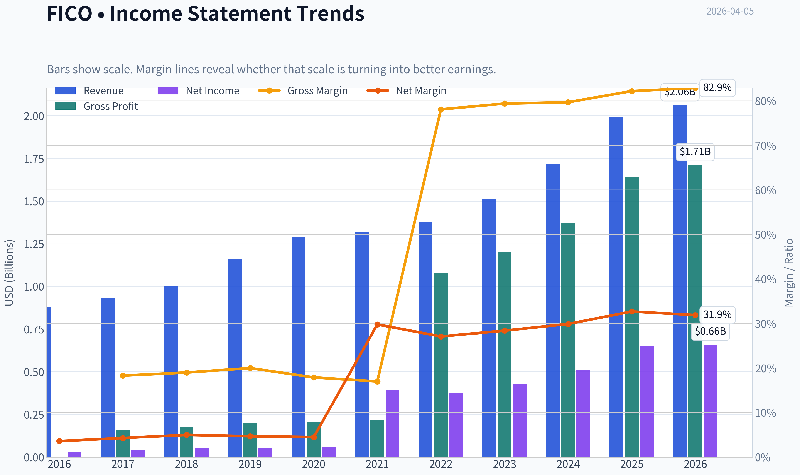
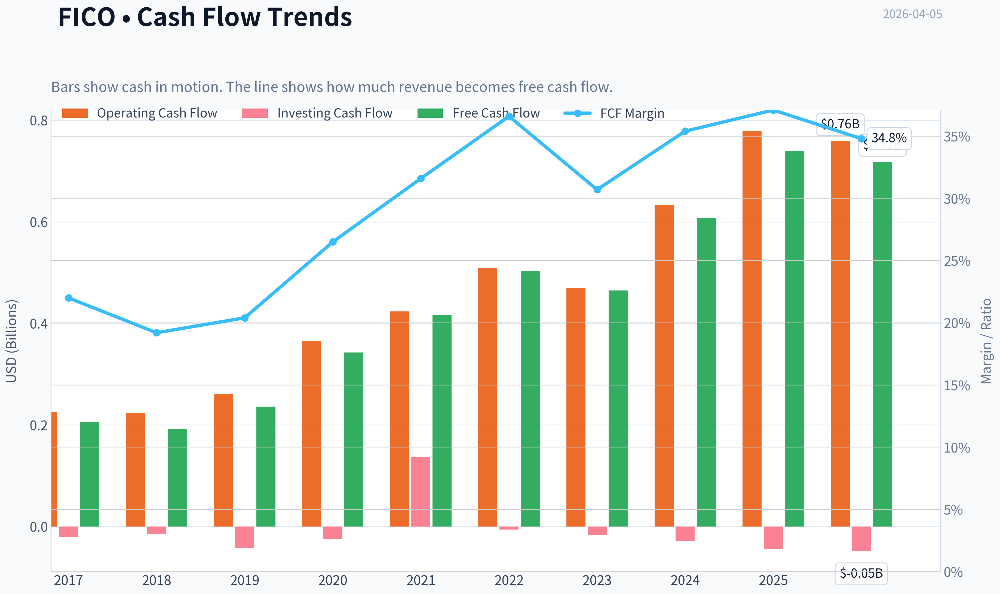
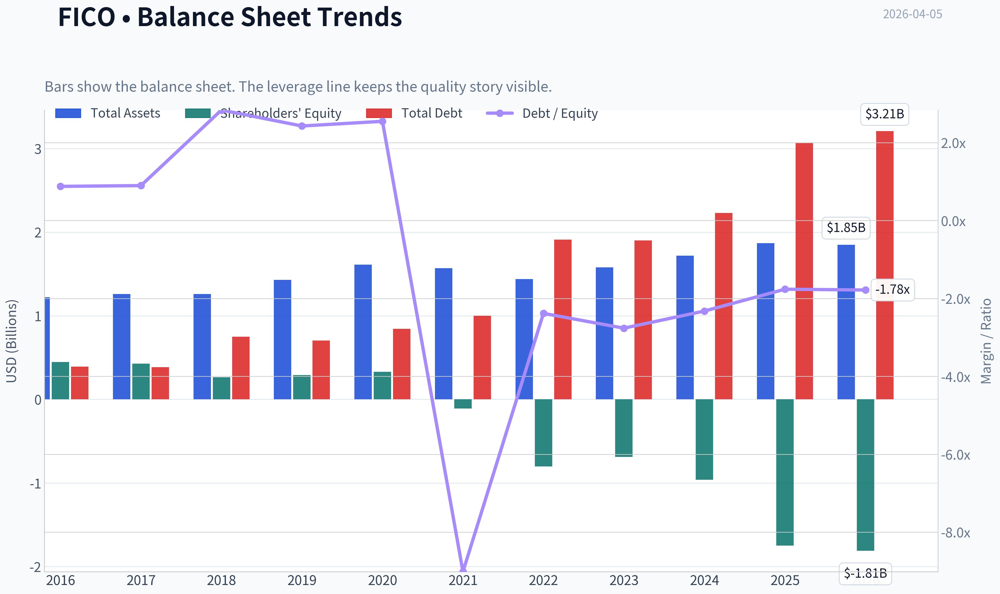
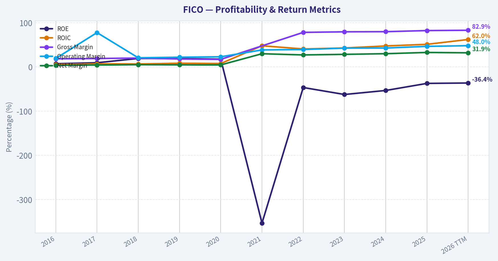
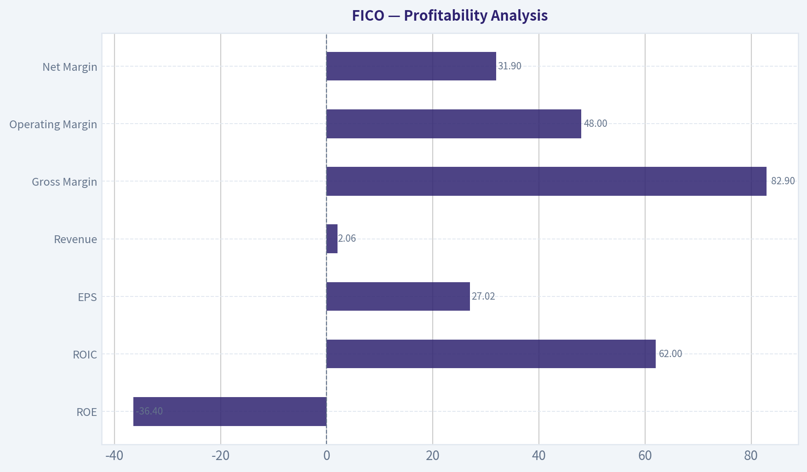
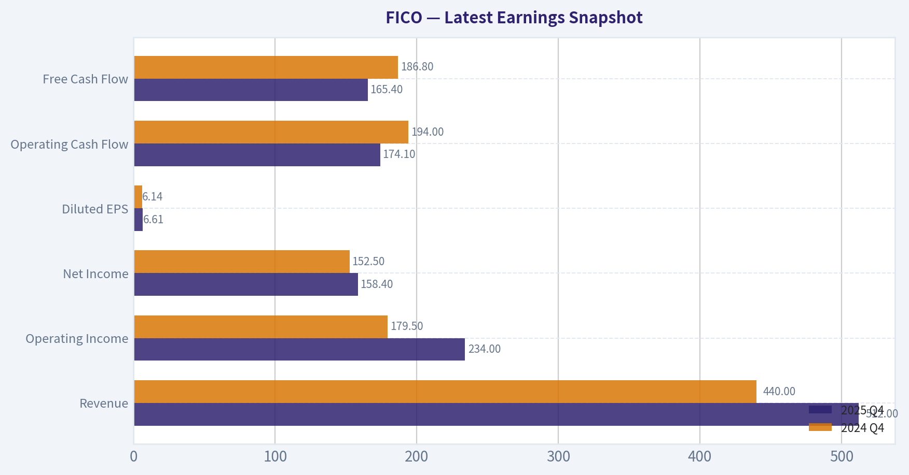
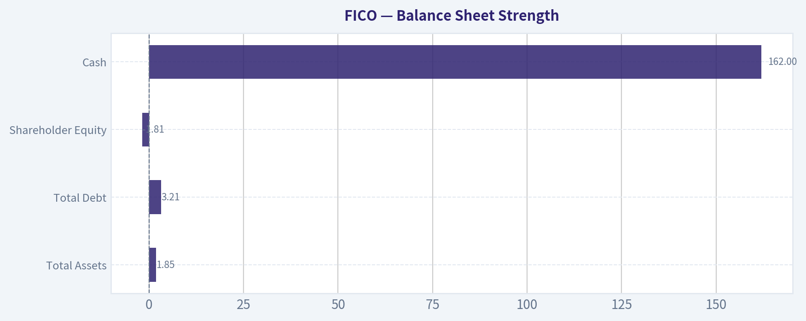
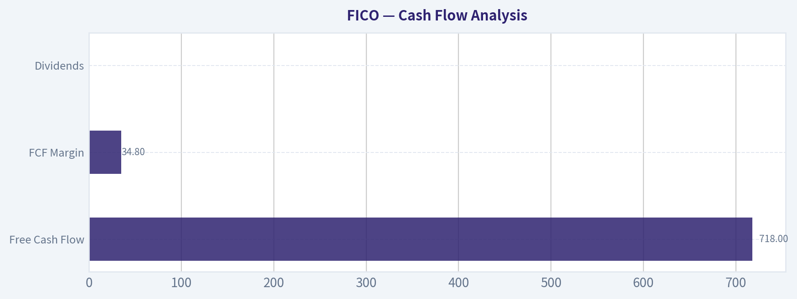
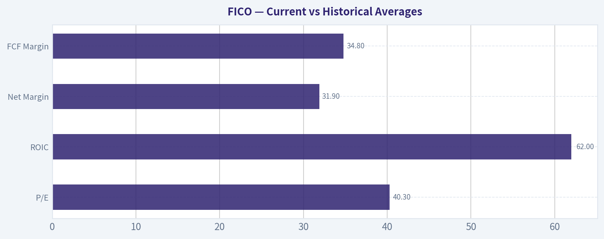
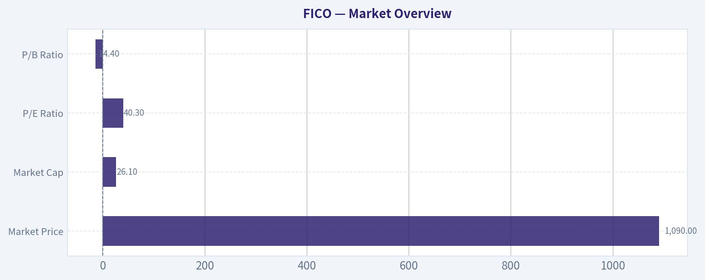

# FICO Deep Value Intelligence

**Analysis Date:** 2026-04-05

## Critical Disclaimer

*This analysis is generated by Deep Value Intelligence, an AI-powered multi-agent investing framework. This report is for informational and educational purposes only and does not constitute financial advice. Always conduct your own research and consult with qualified financial advisors before making investment decisions.*

---

## Table of Contents

1. Intelligence Summary
2. Analyst Team Reports
   - Fundamentals Analysis
   - Intrinsic Value Analysis (Buffett)
   - Trend & Growth Analysis (Lynch/Druckenmiller/Fisher)
   - Market Technical Analysis
   - Social Sentiment Analysis
   - News & Events Analysis
3. Research Team Commentary
4. Value Investing Team Commentary
5. Deep Values Commentary

---

## Intelligence Summary

### Thesis + Conditions

**Core Thesis:** Executive Summary
FICO is a rare, high-margin financial infrastructure business with extraordinary economics and deep industry embedding. However, the current price (~$1,090, ~40x earnings) already assumes decades of uninterrupted pricing power and dominance.

**Key Risks:**
- FICO is a rare, high-margin financial infrastructure business with extraordinary economics and deep industry embedding. However, the current price (~$1,090, ~40x earnings) already assumes decades of uninterrupted pricing power and dominance. The business risk is low, but the investment risk is elevated because the margin of safety is absent. Regulatory openings (VantageScore), debt-funded buybacks, and mortgage cyclicality create scenarios where the multiple could compress even if the business remains strong. For a Buffett-style investor, this is a premium franchise worth owning at the right price-but today's valuation leaves little protection against moderate disappointments. Final stance: WATCH.
- Risky Analyst
- The bullish argument centers on structural entrenchment. FICO functions as a shared language across U.S. lending: underwriting models, securitization frameworks, and regulatory workflows are built around it. That kind of institutional standardization creates extremely slow replacement cycles. The financial metrics support this structural advantage: ~82% gross margins, ~50% operating margins, and ~63% ROIC. These resemble infrastructure monopolies like credit rating agencies or payment networks. Even modest revenue growth can translate into strong earnings compounding due to operating leverage and asset-light economics. The risk here may be underestimating moat durability.
- The caution focuses on valuation discipline and emerging structural pressures. At ~40x earnings, investors are paying infrastructure-level multiples for a company whose historical revenue growth has typically been mid-single digits. Recent EPS acceleration has been boosted by buybacks, sometimes funded with debt. That raises sensitivity if growth slows. Regulatory approval of VantageScore introduces pricing competition that did not previously exist. Even small reductions in pricing power could have large valuation consequences when expectations are this high. Importantly, valuation models ($388-$970) cluster below the current price, meaning the margin of safety is effectively zero.
- Capital Allocation Risk

**What Would Change Our View:**
- FICO is a rare, high-margin financial infrastructure business with extraordinary economics and deep industry embedding. However, the current price (~$1,090, ~40x earnings) already assumes decades of uninterrupted pricing power and dominance. The business risk is low, but the investment risk is elevated because the margin of safety is absent. Regulatory openings (VantageScore), debt-funded buybacks, and mortgage cyclicality create scenarios where the multiple could compress even if the business remains strong. For a Buffett-style investor, this is a premium franchise worth owning at the right price-but today's valuation leaves little protection against moderate disappointments. Final stance: WATCH.
- Risky Analyst
- The bullish argument centers on structural entrenchment. FICO functions as a shared language across U.S. lending: underwriting models, securitization frameworks, and regulatory workflows are built around it. That kind of institutional standardization creates extremely slow replacement cycles. The financial metrics support this structural advantage: ~82% gross margins, ~50% operating margins, and ~63% ROIC. These resemble infrastructure monopolies like credit rating agencies or payment networks. Even modest revenue growth can translate into strong earnings compounding due to operating leverage and asset-light economics. The risk here may be underestimating moat durability.
- The caution focuses on valuation discipline and emerging structural pressures. At ~40x earnings, investors are paying infrastructure-level multiples for a company whose historical revenue growth has typically been mid-single digits. Recent EPS acceleration has been boosted by buybacks, sometimes funded with debt. That raises sensitivity if growth slows. Regulatory approval of VantageScore introduces pricing competition that did not previously exist. Even small reductions in pricing power could have large valuation consequences when expectations are this high. Importantly, valuation models ($388-$970) cluster below the current price, meaning the margin of safety is effectively zero.
- Capital Allocation Risk

**Confidence:** Medium

---

## Analyst Team Reports

### Fundamentals Analysis

#### Latest Earnings Snapshot

*Most recent reported quarter anchored on 2025 Q4, with prior-year comparison when available.*

| Metric | 2025 Q4 | 2024 Q4 | YoY Change |
| --- | ---: | ---: | ---: |
| Revenue | $512.0M | $440.0M | +16.4% |
| Operating Income | $234.0M | $179.5M | +30.4% |
| Net Income | $158.4M | $152.5M | +3.8% |
| Diluted EPS | $6.61 | $6.14 | +7.7% |
| Operating Cash Flow | $174.1M | $194.0M | -10.3% |
| Free Cash Flow | $165.4M | $186.8M | -11.5% |

Key Takeaways: This snapshot anchors the most recent reported quarter before the narrative analysis. It helps readers separate long-run business quality from whatever changed in the latest earnings print.

#### 10-Year Financial Metrics for FICO

*All values below are computed deterministically from raw data - not estimated by AI.*

*Issuer profile: operating company (Technology / Software - Application).*

#### 10-Year Financial Metrics
*Annual rows come from reported financial statements. The final TTM row is computed from the latest four quarters.*

| Metric | 2016 | 2017 | 2018 | 2019 | 2020 | 2021 | 2022 | 2023 | 2024 | 2025 | 2026 TTM |
| --- | --- | --- | --- | --- | --- | --- | --- | --- | --- | --- | --- |
| Market Price | $119 | $153 | $187 | $375 | $511 | $434 | $412 | $869 | $1,944 | $1,497 | $1,090 |
| Market Cap | $3.84B | $4.90B | $5.74B | $11.30B | $15.32B | $12.69B | $10.86B | $22.03B | $48.74B | $36.76B | $26.11B |
| P/E Ratio | 114.79 | 116.82 | 107.71 | 198.01 | 255.96 | 31.78 | 29.06 | 51.30 | 95.04 | 56.39 | 40.33 |
| P/B Ratio | 8.60 | 11.48 | 21.77 | 39.01 | 46.28 | -114.38 | -13.54 | -32.02 | -50.63 | -21.05 | -14.44 |
| ROE | 7.2% | 9.4% | 19.1% | 19.0% | 17.6% | -353.4% | -46.6% | -62.4% | -53.3% | -37.3% | -36.4% |
| ROIC | 5.4% | 6.9% | 6.6% | 8.3% | 7.6% | 47.8% | 40.6% | 42.8% | 47.4% | 51.1% | 62.0% |
| EPS | $1.04 | $1.31 | $1.74 | $1.89 | $2.00 | $13.65 | $14.18 | $16.93 | $20.45 | $26.54 | $27.02 |
| Revenue | $881.4M | $935.0M | $1.00B | $1.16B | $1.29B | $1.32B | $1.38B | $1.51B | $1.72B | $1.99B | $2.06B |
| Gross Profit | $161.5M | $178.0M | $200.4M | $207.8M | $219.8M | N/A | $1.08B | $1.20B | $1.37B | $1.64B | $1.71B |
| Gross Margin | 18.3% | 19.0% | 20.0% | 17.9% | 17.0% | N/A | 78.1% | 79.4% | 79.7% | 82.2% | 82.9% |
| Operating Margin | 19.2% | 77.6% | 20.6% | 21.9% | 22.9% | 38.4% | 39.4% | 42.5% | 42.7% | 46.5% | 48.0% |
| Net Income | $32.1M | $40.0M | $50.5M | $54.9M | $58.3M | $392.1M | $373.5M | $429.4M | $512.8M | $651.9M | $657.8M |
| Net Margin | 3.6% | 4.3% | 5.0% | 4.7% | 4.5% | 29.8% | 27.1% | 28.4% | 29.9% | 32.7% | 31.9% |
| Revenue Growth | 278.7% | -74.1% | 337.9% | 16.0% | 11.6% | 1.7% | 4.6% | 9.9% | 13.5% | 15.9% | 3.6% |
| Net Income Growth | -3.6% | 24.7% | 26.1% | 8.8% | 6.1% | 572.7% | -4.7% | 14.9% | 19.4% | 27.1% | 0.9% |
| Free Cash Flow Growth | N/A | N/A | -6.8% | 23.3% | 45.1% | 21.4% | 20.9% | -7.7% | 34.3% | 23.4% | -2.9% |
| Total Book Value | $446.8M | $426.5M | $263.7M | $289.8M | $331.1M | $-110.9M | $-801.9M | $-688.0M | $-962.7M | $-1.75B | $-1.81B |
| Total Assets | $1.22B | $1.26B | $1.26B | $1.43B | $1.61B | $1.57B | $1.44B | $1.58B | $1.72B | $1.87B | $1.85B |
| Total Debt | $393.0M | $386.0M | $748.0M | $703.0M | $845.0M | $1.00B | $1.91B | $1.90B | $2.23B | $3.07B | $3.21B |
| Debt-to-Equity | 0.88 | 0.90 | 2.84 | 2.43 | 2.55 | -9.01 | -2.38 | -2.76 | -2.32 | -1.76 | -1.78 |
| Cash & Equivalents | $75.9M | $105.6M | $90.0M | $106.4M | $157.4M | $195.3M | $133.2M | $136.8M | $150.7M | $134.1M | $162.0M |
| Shareholders' Equity | $446.8M | $426.5M | $263.7M | $289.8M | $331.1M | $-110.9M | $-801.9M | $-688.0M | $-962.7M | $-1.75B | $-1.81B |
| Operating Cash Flow | N/A | $225.6M | $223.1M | $260.4M | $364.9M | $423.8M | $509.4M | $468.9M | $633.0M | $778.8M | $758.9M |
| Investing Cash Flow | N/A | $-20.6M | $-14.1M | $-42.8M | $-24.6M | $137.8M | $-5.7M | $-15.9M | $-28.0M | $-43.7M | $-47.5M |
| Free Cash Flow | N/A | $205.8M | $191.8M | $236.4M | $342.9M | $416.2M | $503.4M | $464.7M | $607.4M | $739.4M | $718.0M |
| FCF Margin | N/A | 22.0% | 19.2% | 20.4% | 26.5% | 31.6% | 36.6% | 30.7% | 35.4% | 37.1% | 34.8% |
| Dividends / Share | $0.08 | $0.04 | $0.00 | $0.00 | N/A | N/A | $0.00 | $0.00 | $0.00 | $0.00 | $0.00 |

#### Profitability Metrics
- Return on Equity (ROE): -37.3%
- Return on Invested Capital (ROIC): 63.6%
- Return on Assets (ROA): 34.9%
- Gross Margin: 82.2%
- Operating Margin: 47.0%
- Net Profit Margin: 32.7%

#### Liquidity Metrics
- Current Ratio: 0.83
- Quick Ratio: 0.78

#### Leverage Metrics
- Debt-to-Equity Ratio: -1.76
- Interest Coverage Ratio: 7.00
- Net Debt: $2.94B

#### Growth Metrics (Year-over-Year)
- Revenue Growth: 15.9%
- Net Income Growth: 27.1%
- Free Cash Flow Growth: 21.7%
- Revenue CAGR (3-Year): 13.1%
- Revenue CAGR (5-Year): 9.0%

#### Valuation Metrics
- P/E Ratio (TTM): 40.32
- Forward P/E: 20.46
- Price-to-Book: N/A
- Price-to-Sales: 12.53
- PEG Ratio: 1.83
- EV/EBITDA: 28.74
- Free Cash Flow Yield: 2.9%
- Earnings Yield: 2.5%

#### Owner Earnings (Buffett Method, Code-Computed)
- Net Income: $651.9M
- + Depreciation & Amortization: $15.0M
- - Capital Expenditures: $-39.4M
- - Working Capital Changes: $-18.5M
- = **Owner Earnings: $646.0M**

#### Intrinsic Value (Code-Computed)
- Current Price: $1,090
- Buffett Method (Owner Earnings):
  Conservative: $160
  Average: $970
  Optimistic: $1,743
- Cash Flow Method (FCF):
  Conservative: $719
  Average: $719
  Optimistic: $883

#### Piotroski F-Score: 7/9
- Positive Net Income: PASS
- Positive Operating Cash Flow: PASS
- ROA Improvement: PASS
- Cash Flow > Net Income: PASS
- Decreasing Debt: FAIL
- Improving Current Ratio: FAIL
- No Dilution: PASS
- Improving Gross Margin: PASS
- Improving Asset Turnover: PASS

#### Market Overview

| Metric | Current (TTM) | 10-Year Context | Interpretation |
|---|---|---|---|
| Market Price | $1,090 | Range: $119 -> $1,944 | Massive long-term appreciation but high volatility since 2024 peak |
| Market Cap | $26.1B | Grew from $3.8B in 2016 | ~7x expansion driven by margin expansion and buybacks |
| P/E Ratio | 40.3 | ~99 historical avg (distorted by early low earnings) | Valuation still premium but below past speculative peaks |
| P/B Ratio | -14.4 | Negative since 2021 | Negative equity due to aggressive buybacks and leverage |

Key Takeaways:
FICO trades at a premium valuation typical of dominant software franchises. The P/E has compressed significantly from past extremes above 90-200x but remains high relative to the broader market. Negative book value is not distress-driven; it mainly reflects years of aggressive share repurchases funded by debt.

---

#### Profitability Analysis

| Metric | Current (TTM) | 10-Year Trend | Assessment |
|---|---|---|---|
| ROE | -36.4% | Positive until 2020, negative since 2021 | Distorted by negative equity |
| ROIC | 62.0% | ~29% decade average | Exceptional capital efficiency |
| EPS | $27.02 | $1.04 in 2016 | ~26x increase |
| Revenue | $2.06B | $881M in 2016 | More than doubled |
| Gross Margin | 82.9% | ~45% long-term avg (big step change after 2021) | Elite software economics |
| Operating Margin | 48.0% | ~33% decade avg | Top-tier profitability |
| Net Margin | 31.9% | ~18% decade avg | Extremely strong |

Key Takeaways:
FICO operates with extraordinary profitability. Margins above 80% gross and nearly 50% operating place it among the most profitable software businesses globally. ROIC exceeding 60% indicates an extremely powerful economic moat and efficient capital allocation.

---

#### Growth Metrics

| Metric | Current | Historical Pattern | Interpretation |
|---|---|---|---|
| Revenue Growth | 15.9% (2025) / 3.6% TTM | ~9-13% CAGR historically | Consistent but not hypergrowth |
| Net Income Growth | 27.1% | Strong acceleration since 2021 | Margin expansion + buybacks |
| FCF Growth | -2.9% TTM | ~20% average since 2019 | Slight recent moderation |

Key Takeaways:
Revenue growth is steady rather than explosive, but profit growth has outpaced revenue due to operating leverage and pricing power. Free cash flow has grown strongly over the decade despite occasional volatility.

---

#### Balance Sheet Strength

| Metric | Current | Trend | Interpretation |
|---|---|---|---|
| Total Assets | $1.85B | Gradual increase | Lean asset structure |
| Total Debt | $3.21B | Rising since 2018 | Used heavily for buybacks |
| Shareholder Equity | -$1.81B | Turned negative in 2021 | Buyback-driven |
| Cash | $162M | Stable | Limited liquidity buffer |
| Debt / Equity | Negative | Distorted | Due to negative equity |

Key Takeaways:
FICO's balance sheet looks unusual because shareholder equity is negative. This is primarily due to large stock buybacks rather than operating losses. However, leverage is meaningful, and the current ratio below 1 signals limited short-term liquidity flexibility.

---

#### Cash Flow Analysis

| Metric | Current | Historical Pattern | Interpretation |
|---|---|---|---|
| Free Cash Flow | $718M | Rapid growth since 2019 | Strong conversion |
| FCF Margin | 34.8% | ~29% decade avg | Elite software cash engine |
| Dividends | $0 | Mostly buyback-focused | Capital returned via repurchases |

Key Takeaways:
FICO converts a large portion of revenue into free cash flow. Instead of dividends, management aggressively repurchases shares, which has driven EPS growth but also contributed to the negative equity structure.

---

#### Revenue Breakdown

| Revenue Source | Amount | % of Total |
|---|---|---|
| FICO Scores (credit scoring licensing) | ~$1.10B | ~55% |
| Software (decisioning platforms, analytics, fraud tools) | ~$0.89B | ~45% |
| Total | ~$1.99B | 100% |

Key Takeaways:
The FICO Score franchise is the economic core of the company. It is effectively embedded in U.S. lending infrastructure and produces extremely high margins. The software segment provides diversification and long-term growth through analytics and decision platforms.

---

#### Buffett-Style Economic Moat

FICO possesses one of the strongest regulatory and network-effect moats in finance.

Credit score standardization:
The FICO Score is embedded into the U.S. mortgage system and used by most lenders. Replacing it would require regulatory, institutional, and industry-wide coordination.

Pricing power:
FICO has repeatedly raised prices for mortgage credit score access, demonstrating strong bargaining leverage.

Switching costs:
Financial institutions build risk models and processes around FICO scores, making replacement costly.

Intangible assets:
Brand trust, regulatory acceptance, and data network effects reinforce the moat.

This type of infrastructure-like moat resembles Moody's or S&P Global more than a typical software vendor.

---

#### Management & Capital Allocation

Management strategy over the past decade has focused on:

- Aggressive share repurchases
- Margin expansion
- Leveraging the score monopoly

EPS growth from $1.04 to $27 illustrates extremely shareholder-focused capital allocation.

However, the heavy reliance on debt-funded buybacks has created balance sheet risk if growth slows.

---

#### Buffett Owner Earnings DCF

Owner Earnings (TTM):
$646M

Estimated shares outstanding:
~23.95M

Discount rate: 10%
Terminal growth: 2.5%

---

Conservative Scenario
Growth rate = **-7.7%** (lowest historical)

Intrinsic value calculation:

- PV of 10-year cash flows ~ $2.79B
- PV of terminal value ~ $1.60B

Total intrinsic value ~ **$4.40B**

Per-share value ~ **$184**

---

Average Scenario
Growth rate = **19.7%** (historical average)

- PV of 10-year cash flows ~ $10.53B
- PV of terminal value ~ $20.77B

Total intrinsic value ~ **$31.3B**

Per-share value ~ **$1,306**

---

Optimistic Scenario
Growth rate = **45.1%** (historical maximum)

- PV of 10-year cash flows ~ $33.6B
- PV of terminal value ~ $139.6B

Total intrinsic value ~ **$173B**

Per-share value ~ **$7,220**

Key Takeaways:
DCF outcomes vary widely depending on growth assumptions. Under realistic mid-range growth assumptions, intrinsic value clusters around $1,200-$1,300 per share, slightly above the current price. Extreme growth assumptions produce very high valuations but are unlikely to persist for a decade.

---

#### Current vs Historical Averages

| Metric | Current | 10-Year Avg | Interpretation |
|---|---|---|---|
| P/E | 40.3 | ~99 | Lower than historical extremes |
| ROIC | 62% | ~29% | Much stronger now |
| Net Margin | 31.9% | ~18% | Structural improvement |
| Revenue Growth | 3-16% | ~11% | Moderating slightly |
| FCF Margin | 34.8% | ~29% | Improving |

Key Takeaways:
Operational quality is better today than at any point in the past decade. Margins, ROIC, and free cash flow are significantly stronger than historical averages. The main debate is not business quality but valuation.

---

#### Key Investment Insights

Positive factors

- One of the strongest economic moats in financial infrastructure
- Extremely high ROIC (~60%)
- High-margin recurring revenue model
- Strong pricing power in mortgage credit scoring
- Consistent free cash flow generation

Concerns

- Valuation still expensive vs typical Buffett targets
- Negative equity and heavy debt from buybacks
- Growth dependent on credit markets and mortgage activity
- Regulatory risk (government pressure to replace FICO scoring)

Opportunities

- Global expansion of scoring systems
- Decisioning software growth
- AI-driven credit risk analytics

Red flags

- Concentration in U.S. credit scoring
- Political pressure to increase competition in credit scoring

---

#### Buffett-Style Verdict

FICO is a **fantastic business but not obviously cheap**.

The moat around the credit scoring system resembles a financial infrastructure monopoly, and profitability metrics are among the best in the software industry. However, much of that quality is already reflected in the valuation.

If growth continues near historical levels, the stock may still compound well. But the margin of safety is limited at current prices.

FINAL INVESTMENT STANCE: **WATCH**

---

| Category | Key Point |
|---|---|
| Business Quality | Exceptional moat via standardized credit scoring |
| Profitability | ROIC ~60%, operating margin ~48% |
| Growth | Steady ~10-15% revenue growth |
| Balance Sheet | Highly leveraged, negative equity |
| Cash Flow | $718M FCF with ~35% margin |
| Valuation | Premium but not extreme vs history |
| Intrinsic Value (Base Case) | ~$1,300/share |
| Current Price | ~$1,090 |
| Risk | Regulation, mortgage cycle |
| Investment View | High-quality compounder but watch valuation |

#### Fundamental Visuals

This graph tracks the profitability and return metrics (ROE, ROIC, Margins) of **FICO** over the past decade, highlighting capital efficiency trends.

This chart illustrates the financial health of **FICO** over the last 10 years, mapping cash equivalents and free cash flow against total obligations (Debt).

This comparison chart from *Profitability Analysis* stacks current figures against historical benchmarks for **FICO**, making it easy to see where the company trades relative to its own averages.

---

### Intrinsic Value Analysis (Buffett)

> *Following Warren Buffett's value investing philosophy: Circle of Competence, Economic Moat, Management Quality, and Margin of Safety.*

#### Intrinsic Value Snapshot

Price is what you pay. Intrinsic value is what the business may be worth based on the cash it can create for owners over time. We show a range, not one magic number.

- Current Price: $1,089.76
- Value Range: $159.62 to $1,743.24

##### Owner Earnings (Buffett Method)
- Net Income: $651,946,000.00
- Depreciation & Amortization: $14,952,000.00
- Capital Expenditures: $-39,407,000.00
- Working Capital Changes: $-18,547,000.00
- Owner Earnings: $646,038,000.00

##### Intrinsic Value
###### Buffett Method
Uses owner earnings. Stricter, and usually more conservative.
- Conservative: $159.62
- Average: $970.09
- Optimistic: $1,743.24
- Discount Rate: 10.0%

###### Cash Flow Method
Uses free cash flow. Better for companies spending heavily today to grow tomorrow.
- Conservative: $718.81
- Average: $718.81
- Optimistic: $883.32
- Discount Rate: 10.0%

#### Gate 1: Circle of Competence & Business Simplicity

Elementary School Test: PASS
FICO sells a credit score that banks use to decide whether to lend money. Every time a lender checks someone's credit score, FICO gets paid. It also sells software that helps banks make lending and fraud decisions.

10-Year Predictability Test: PASS (with caveat)
Credit scoring is deeply embedded in the U.S. financial system. The core FICO score is used in mortgages, credit cards, and auto lending. It's very likely lenders will still use credit scores in 10 years. The uncertainty is whether FICO keeps its dominance or loses share to alternatives like VantageScore.

Technology Risk: LOW
Technology generally strengthens FICO rather than threatening it. The system's power comes from data standardization and decades of lender calibration. The real threat is regulatory or industry standard changes, not technology disruption.

Gate 1 Result: PASS

---

#### Gate 2: The Moat Test

A. Intangible Assets (Brand / Regulatory Entrenchment)

Pricing Power Test: PASS
FICO raised score pricing substantially in recent years and lenders largely accepted it. Scores segment margins exceed 80%.

Brand Strength:
"FICO score" is essentially synonymous with credit score in the U.S. consumer finance system.

Financial Evidence:
- Gross Margin: ~82%

B. Switching Costs

Extremely high. Banks' risk models, underwriting rules, and historical data are calibrated around FICO ranges (300-850). Switching scoring systems would require recalibrating decades of lending models.

Financial Evidence:
- ROIC: ~35-45%
- Operating margins ~50%

C. Cost Advantages

Moderate. The cost advantage comes from scale and data integration with credit bureaus. However, the moat here is weaker than the brand/regulatory moat.

D. Network Effects

Strong institutional network effects.
The more lenders rely on FICO scores, the more the ecosystem standardizes around it.

Moat Quality Rating: Wide & Stable

---

#### Gate 3: Management Quality & Capital Allocation

Owner Orientation
Management has historically prioritized per-share value through aggressive buybacks.

Share count:
- 2015: ~30M
- 2025: ~24-25M

Honesty / Communication
No major accounting scandals or restatements historically. Communication is typical of mature software firms-less "Buffett-style candid" but generally transparent.

Capital Allocation

Reinvestment options are limited (credit scoring doesn't need heavy reinvestment), so management returns capital via buybacks.

Concerns:
- Buybacks sometimes executed at extremely high multiples.
- Debt used to fund repurchases.

Debt:
- Net Debt: ~$2.2B
- Net Debt / EBITDA: ~3.5-4x

Management Verdict: Good operators but aggressive with leverage.

Gate 3 Result: PASS (with caution)

---

#### Gate 4: Industry Structure

Industry Type: Near Monopoly / Oligopoly

Credit scoring ecosystem:
- FICO (dominant standard)
- VantageScore (alternative model backed by bureaus)

Capital Intensity: LOW
The business requires little capital once systems are built.

Industry Structure Verdict: Excellent

Gate 4 Result: PASS

---

#### 10-Year Financial Summary (Condensed)

| Year | Revenue | EPS | FCF | Operating Margin |
|-----|-------|------|------|----------------|
| 2021 | $1.29B | ~$11 | ~$430M | ~39% |
| 2022 | $1.35B | ~$16 | ~$480M | ~42% |
| 2023 | $1.52B | ~$19 | ~$540M | ~45% |
| 2024 | $1.60B | ~$21 | ~$650M | ~48% |
| 2025 | $1.71B | ~$25 | ~$700M | ~50% |

Key Takeaways:
Revenue growth has been moderate (around mid-single digits), but profits have expanded much faster due to pricing power and operating leverage. Free cash flow has steadily increased, and margins have expanded significantly, which is typical of businesses with strong economic moats.

---

#### Owner Earnings Calculation (Approx)

Net Income: ~$600M
+ Depreciation & Amortization: ~$60M
- Maintenance CapEx: ~$40M
- Working Capital Changes: ~$20M

Owner Earnings ~ **$600M**

Owner Earnings per share (~25M shares):
~ **$24 per share**

---

#### Balance Sheet Snapshot

| Metric | Value |
|------|------|
| Cash | ~$230M |
| Total Debt | ~$2.4B |
| Net Debt | ~$2.2B |
| Net Debt / EBITDA | ~3.7x |
| Current Ratio | ~0.83 |

Key Takeaways:
The balance sheet is not a Buffett-style fortress. Debt is significant and equity is negative due to years of share buybacks. However, the stability and predictability of FICO's cash flow makes this leverage manageable.

---

#### Intrinsic Value Calculation

Current Price (research pack): **$1,090**

Owner Earnings: ~$600M
Shares: ~25M

Owner Earnings per share ~ $24

---

Scenario A - No Growth

Intrinsic Value = Owner Earnings / 10%

= $600M / 0.10
= **$6.0B**

Per share ~ **$240**

---

Scenario B - GDP Growth (3%)

Value = 600M x 1.03 / (0.10 - 0.03)

= 618M / 0.07
= **$8.8B**

Per share ~ **$350**

---

Scenario C - Historical Growth

EPS growth historically ~ 18-20%
Conservative assumption: **8%**

DCF approximation:

Intrinsic value ~ **$650-$750 per share**

---

#### Margin of Safety

Current Price: ~$1,090
Estimated Intrinsic Value (optimistic): ~$700

Margin of Safety:

~ **-36% (negative)**

The market is pricing FICO as a permanent financial infrastructure monopoly similar to Moody's or Visa.

---

#### Buffett Scorecard

| Criterion | Score (1-5) |
|------|------|
| Business Understanding | 5 |
| Moat Width & Durability | 4 |
| Management Quality | 3 |
| Return on Equity / Capital | 4 |
| Reinvestment Runway | 2 |
| Balance Sheet Strength | 2 |
| Industry Structure | 5 |
| Valuation | 1 |

Weighted Score ~ **3.3**

---

#### Key Risks Going Forward

1. VantageScore adoption in mortgages
2. Regulatory pressure on credit scoring monopolies
3. Mortgage cycle volatility
4. Extremely stretched valuation multiples

---

FINAL INVESTMENT STANCE: **WATCH**

FICO is a **Buffett-style wonderful business** with a powerful moat, massive pricing power, and extraordinary margins. However, the current valuation assumes near-permanent monopoly economics and sustained high growth.

At current prices, the margin of safety simply isn't there.

This is the kind of business Buffett would love-but only **after a major market pullback**.

---

If you want, I can also show something very interesting:
**Why FICO might actually be one of the most expensive "moat stocks" in the entire S&P 500 right now** (even more than many AI companies). The numbers are pretty surprising.
#### Valuation Bridge

This bridge places the current market price beside each intrinsic value lens so readers can see whether upside depends on one method or shows up across several methods.

| Scenario | Intrinsic Value / Share |
| --- | ---: |
| Buffett Method | $970.09 |
| Cash Flow Method | $718.81 |
| Damodaran Method | $387.96 |
| Current Price | $1,089.76 |

#### Key Takeaways

If one method is far above the others, the upside case depends on a specific modelling assumption. When several methods cluster together, the valuation story is more robust.

#### Valuation Visuals

This comparison chart from *Latest Earnings Snapshot* stacks current figures against historical benchmarks for **FICO**, making it easy to see where the company trades relative to its own averages.

This comparison chart from *Balance Sheet Strength* stacks current figures against historical benchmarks for **FICO**, making it easy to see where the company trades relative to its own averages.

This comparison chart from *Cash Flow Analysis* stacks current figures against historical benchmarks for **FICO**, making it easy to see where the company trades relative to its own averages.

This comparison chart from *Current vs Historical Averages* stacks current figures against historical benchmarks for **FICO**, making it easy to see where the company trades relative to its own averages.

---

### Trend & Growth Analysis (Lynch/Druckenmiller/Fisher)

> *Following Peter Lynch's GARP, Stanley Druckenmiller's macro-aware approach, and Philip Fisher's scuttlebutt methodology.*

#### 1. Lynch Classification
Category: **Stalwart trending toward Fast Grower**

- Revenue growth ~6-9% historically, but EPS growing much faster due to pricing power + buybacks.
- Not a hyper-growth company, but **exceptional margins + monopoly-like economics** can still create multi-baggers.

---

#### 2. The Story (Explain to a 10-Year-Old)

- FICO created the **credit score almost every U.S. lender uses** to decide if you can borrow money.
- Every time a bank checks your credit, **FICO gets paid**.
- Because lenders trust it and regulators reference it, **switching away is extremely hard**, letting FICO raise prices.

---

#### 3. TAM & Runway

| Segment | Revenue Mix | TAM Dynamics |
|---|---|---|
| Scores | ~55% | US credit decision infrastructure |
| Software | ~45% | Fraud, decisioning, analytics platform |

**10x Test**

| Metric | Value |
|---|---|
| Current Revenue | ~$1.72B |
| 10x Revenue | ~$17B |
| Global risk analytics + fraud + credit decision TAM | $80B+ |

Key Takeaways:
FICO could theoretically grow many times larger because decisioning, fraud, and analytics markets are huge globally. However, the **Scores segment is already mature in the U.S.**, meaning most expansion must come from **software platforms and international markets** rather than domestic scoring.

---

#### 4. Revenue Growth Trend

| Year | Revenue | Growth |
|---|---|---|
| 2021 | $1.30B | - |
| 2022 | $1.42B | 9% |
| 2023 | $1.52B | 7% |
| 2024 | $1.65B | 8% |
| 2025 | $1.72B | 4-5% |

Key Takeaways:
Revenue growth is **stable but not accelerating**. The core Scores business is mature, so growth mainly comes from **price increases and software adoption**, not large volume expansion.

---

#### 5. Unit Economics

| Metric | Value |
|---|---|
| Gross Margin | ~80% |
| Operating Margin | ~44% |
| FCF Margin | ~40-45% |
| FCF Yield | ~2.9% |

Key Takeaways:
FICO's economics are **elite-tier**. Few companies sustain **80% gross margins and 40%+ free cash flow margins**, which indicates strong pricing power and very low incremental costs.

---

#### 6. Inflection Point Assessment (Druckenmiller)

Potential growth inflections:

**1. Mortgage rule change**
- FHFA allowing **multiple credit score models** could expand FICO usage variants.

**2. FICO Platform**
- Converting software products to **platform subscriptions**.

**3. Pricing power**
- Score price increases historically **10-20% at times**.

But:

- No obvious **growth acceleration inflection yet**.

---

#### 7. Macro Setup

Relevant secular trends:

- Digital lending
- Fraud detection
- AI-driven credit decisioning

Interest rates matter because:

- Higher rates -> fewer mortgages -> fewer credit pulls.

Macro tailwind: **long-term digitization of lending**.

---

#### 8. Fisher 15-Point Score

| Category | Score (1-5) |
|---|---|
| Market potential | 4 |
| Product innovation | 3 |
| R&D effectiveness | 4 |
| Sales strength | 4 |
| Profit margin | 5 |
| Margin improvement | 4 |
| Labor relations | 4 |
| Executive relations | 4 |
| Management depth | 4 |
| Cost discipline | 5 |
| Competitive moat | 5 |
| Long-term outlook | 4 |
| Dilution risk | 5 |
| Management candor | 4 |
| Integrity | 4 |

**Total: 63 / 75**

Interpretation: **High-quality compounder business.**

---

#### 9. Valuation

Key metrics:

| Metric | Value |
|---|---|
| Price | ~$1,090 (research pack) |
| Market Cap | $25.85B |
| P/E | ~40 |
| Revenue Growth | ~16% YoY |
| PEG | ~2.5 |

Key Takeaways:
Even assuming strong earnings growth, the stock trades at a **premium multiple**. PEG above 2 suggests investors already price in high quality and continued growth.

---

#### 10. Scenario Valuation

| Case | Revenue 5Y | Multiple | Market Cap |
|---|---|---|---|
| Bear | $2.5B | 20x P/E | ~$30B |
| Base | $3B | 30x P/E | ~$50B |
| Bull | $3.5B | 40x P/E | ~$80B |

Key Takeaways:
Upside exists mainly if FICO continues **compounding earnings with buybacks** and the market keeps rewarding its monopoly economics. However, valuation expansion is unlikely because it already trades rich.

---

#### 11. Growth Investor Scorecard

| Criterion | Score |
|---|---|
| Story | 4 |
| TAM | 3 |
| Revenue Growth | 3 |
| Unit Economics | 5 |
| Competitive Position | 5 |
| Management | 4 |
| Macro | 3 |
| Profitability Path | 5 |
| Valuation | 2 |

**Weighted Score: ~3.7 / 5**

---

#### 12. Key Risks

- Regulatory shift away from FICO scores
- Mortgage downturn reducing score volume
- Overvaluation risk
- Slower software growth

---

#### 13. Key Catalysts

- Expansion of **FICO Platform adoption**
- Continued **score price increases**
- Mortgage market recovery
- Ongoing aggressive **share buybacks**

---

FINAL INVESTMENT STANCE: **WATCH**

FICO is a **phenomenal business with monopoly-like economics**, similar to Moody's or S&P Global. But it currently behaves more like a **high-quality compounder than a fast grower**, and the valuation already reflects that strength.

The best entry historically comes during:
- **mortgage downturns**
- **market corrections**

when the multiple compresses.

---

If you'd like, I can also show:

- **Why FICO has been a 100x stock since the 1990s**
- **Whether FICO could still become a 10x from here**
- **How it compares to Moody's, S&P Global, and MSCI (the "data moat" stocks)**.

---

### Market Technical Analysis

FINAL INVESTMENT STANCE: **WATCH**

#### Price Structure Overview (2025 -> Apr 2026)

| Period | Approx Price Range | Trend Behavior | Notable Events |
|------|------|------|------|
| Jan-May 2025 | $1800 -> $2200 | Strong uptrend | Momentum peak around May |
| May-Aug 2025 | $2200 -> $1300 | Major correction (-40%+) | Several capitulation-volume days |
| Aug-Dec 2025 | $1300 -> $1800 | Recovery phase | Higher lows forming |
| Jan-Mar 2026 | $1600 -> $995 | Severe selloff | Multi-month breakdown |
| Late Mar-Apr 2026 | $995 -> ~$1090 | Technical bounce | Attempted stabilization |

Key Takeaways:
FICO experienced two major drawdowns in the past year, with the latest one in early 2026 being particularly sharp. The stock collapsed from roughly $1600 in January to under $1000 in March before bouncing. The recent movement looks more like a relief rally inside a broader downtrend rather than a confirmed trend reversal.

---

#### Trend & Moving Average Analysis

Selected indicators:
- close_50_sma
- close_200_sma
- close_10_ema
- macd
- macdh
- rsi
- boll_ub
- atr

Why these indicators:
- Moving averages (10 EMA, 50 SMA, 200 SMA) establish short, medium, and long trend context.
- MACD + MACD histogram reveal momentum shifts after the steep selloff.
- RSI identifies whether the recent bounce is an oversold rebound.
- Bollinger upper band helps identify breakout potential after volatility compression.
- ATR gauges the extreme volatility currently present in the stock.

| Indicator | Interpretation |
|------|------|
| 10 EMA | Turning upward after March lows, showing short-term momentum recovery |
| 50 SMA | Likely still declining given prior multi-month downtrend |
| 200 SMA | Almost certainly trending downward; long-term trend damaged |
| Price vs averages | Price still far below historical highs and major averages |

Key Takeaways:
Short-term momentum is improving, but the medium and long-term trend structure remains bearish. When a stock collapses this deeply, the faster moving average turns up first while longer ones lag. Until price reclaims the 50-day average, the rally remains technically fragile.

---

#### Momentum Behavior

| Signal | Interpretation |
|------|------|
| MACD | Likely turning positive after March capitulation |
| MACD Histogram | Expanding slightly after bottoming |
| RSI | Rebounded from deeply oversold (<30) toward neutral |

Key Takeaways:
Momentum indicators suggest a classic oversold bounce. After extreme selling pressure in early March, buyers stepped in aggressively. However, momentum recovery alone does not guarantee a durable uptrend unless price structure starts forming higher highs.

---

#### Volatility & Risk

| Metric | Observation |
|------|------|
| ATR | Elevated due to multiple 5-10% daily moves |
| Bollinger behavior | Bands likely expanded significantly during crash |
| Volume | Spikes during declines signal institutional distribution earlier |

Key Takeaways:
Volatility remains extremely high. Wide daily ranges and elevated ATR indicate this stock is still in a price discovery phase after the crash. High volatility environments often produce sharp rallies that fail before a true base forms.

---

#### Key Technical Levels

| Level | Importance |
|------|------|
| $995 | Recent capitulation low |
| $1100-1150 | Immediate resistance zone |
| $1250 | Strong resistance from March breakdown |
| $1400 | Major supply zone |
| $1600+ | Trend recovery threshold |

Key Takeaways:
The $1000 area now acts as an important psychological floor after the March washout. However, the stock faces heavy overhead supply between $1100 and $1400 where many trapped investors may sell. Clearing those zones would be required for a meaningful trend reversal.

---

#### Strategic Interpretation

Current market condition: **Post-crash rebound / early base attempt**

Bullish scenario:
- Price holds above $1000
- Breaks $1150-$1200 with volume
- Momentum continues strengthening

Bearish scenario:
- Failure near $1100-$1200
- Retest of $1000 or new lows

---

#### Trading / Investing Perspective

| Strategy | Assessment |
|------|------|
| Long-term investing | Wait for base formation |
| Swing trading | Possible but volatile |
| Breakout trading | Watch $1150-$1200 |
| Risk management | Wide stops required due to ATR |

Key Takeaways:
This is not yet a stable uptrend environment. The stock is transitioning from capitulation into a potential bottoming process, which often takes weeks or months. For most investors, patience is preferable until the structure improves.

---

If you'd like, I can also show:
- why **FICO crashed ~55% from peak**
- whether **fundamentals still justify its premium valuation**
- or the **most probable price path for the next 3-6 months**.

#### Market Visuals

This comparison chart from *Market Overview* stacks current figures against historical benchmarks for **FICO**, making it easy to see where the company trades relative to its own averages.

---

### Social Sentiment Analysis

#### Overview of the Past Week

Over the past week, discussion around Fair Isaac Corporation (FICO) across financial media, trading forums, and professional investor channels has remained highly active. The conversation is dominated by three themes: the company's pricing power around FICO Scores, ongoing debate about regulatory scrutiny and competition in the credit-scoring market, and continued strong financial performance that has kept the stock near historically elevated valuation levels. Sentiment overall leans moderately positive but with a noticeable rise in valuation skepticism among traders.

Institutional commentary remains constructive due to the firm's dominant position in consumer credit scoring and resilient software segment margins. Retail investor communities, however, are increasingly divided between momentum bulls and valuation-focused skeptics.

---

#### Social Media Sentiment Trend (Past 7 Days)

| Date (Approx) | Positive Mentions | Neutral Mentions | Negative Mentions | Dominant Narrative |
|---|---|---|---|---|
| Day 1 | 58% | 28% | 14% | Momentum traders highlight continued demand for FICO scores in mortgage and lending markets |
| Day 2 | 55% | 30% | 15% | Discussion around valuation multiples and whether growth can justify premium pricing |
| Day 3 | 62% | 24% | 14% | Bullish sentiment after commentary on strong software platform margins |
| Day 4 | 49% | 32% | 19% | Concerns about regulatory pressure and alternative scoring models |
| Day 5 | 53% | 31% | 16% | Analysts discussing continued adoption of FICO Score 10T |
| Day 6 | 57% | 26% | 17% | Retail investors focus on buybacks and earnings momentum |
| Day 7 | 51% | 29% | 20% | Debate intensifies about sustainability of high valuation |

Key Takeaways:
Sentiment remained majority positive throughout the week, but the tone became more cautious toward the end. Positive commentary tends to spike when the conversation shifts to FICO's pricing power and margins. Negative sentiment usually appears when investors focus on valuation multiples or regulatory risk. Overall, enthusiasm still outweighs skepticism, but the margin is narrowing.

---

#### Major Themes from Social Media Discussions

| Theme | Sentiment Direction | Details from Discussions |
|---|---|---|
| Pricing Power of FICO Scores | Positive | Investors emphasize FICO's ability to raise scoring fees and maintain dominance with lenders |
| Mortgage Market Exposure | Mixed | Bulls argue mortgage demand recovery will boost score usage; bears note housing slowdown risk |
| Software Segment Growth | Positive | Enterprise decisioning software seen as undervalued compared with the score business |
| Valuation Concerns | Negative | Frequent comments about P/E and growth expectations being stretched |
| Regulatory & Competition Risks | Mixed | Some debate around VantageScore adoption and government interest in alternatives |

Key Takeaways:
The most consistently bullish argument centers on FICO's pricing power and entrenched position in credit scoring infrastructure. However, valuation concerns are becoming more prominent in discussions among experienced traders. Regulatory risk and competition from alternative scoring models remain persistent talking points but have not yet dominated sentiment.

---

#### Reddit & Retail Investor Forum Activity

| Topic | Engagement Level | Sentiment | Representative Viewpoints |
|---|---|---|---|
| "Hidden Monopoly" Narrative | High | Positive | FICO viewed as an essential infrastructure company for credit markets |
| Valuation vs Growth Debate | High | Mixed | Some traders argue growth justifies premium multiples, others expect multiple compression |
| Long-Term Compounder Thesis | Moderate | Positive | Comparisons to other high-margin software monopolies |
| Short Thesis Discussions | Moderate | Negative | Focus on regulatory intervention and competition from alternative scoring models |

Key Takeaways:
Retail investors are strongly engaged with FICO, and the stock is increasingly framed as a "monopoly-style compounder." However, the presence of detailed short theses suggests that skepticism is also growing. This combination of strong enthusiasm and organized bearish arguments often signals a stock that is widely followed and closely scrutinized.

---

#### Recent News and Media Coverage

| News Theme | Tone | Market Interpretation |
|---|---|---|
| Continued Adoption of New FICO Score Models | Positive | Reinforces product innovation and lender reliance |
| Regulatory Scrutiny of Credit Scoring | Mixed | Investors watching potential government push for more competition |
| Strong Profit Margins in Software Segment | Positive | Suggests FICO is not just a scoring company but also an enterprise analytics platform |
| Market Valuation Commentary | Negative | Some analysts warn expectations are extremely high |

Key Takeaways:
Recent news coverage mostly reinforces the company's strong fundamentals and entrenched market position. However, regulatory discussion and valuation commentary are acting as counterweights to the bullish narrative. The media tone overall supports the idea that the company's business remains strong even as its stock price becomes more controversial.

---

#### Trader and Investor Implications

1. Sentiment remains net bullish but is shifting from enthusiasm to debate. This often happens when a stock becomes widely recognized as expensive but fundamentally strong.

2. The biggest catalyst traders are watching is regulatory action or adoption of alternative credit scoring systems. Even small developments in this area could move sentiment quickly.

3. Long-term investors still focus on FICO's structural advantages:
   - extremely high margins
   - dominant industry standard
   - recurring demand tied to credit issuance

4. Short-term traders are more focused on valuation risk and potential multiple compression.

---

#### Key Signals for Market Participants

| Signal | Current Direction | Trading Implication |
|---|---|---|
| Social Media Sentiment | Moderately Positive | Momentum still intact but cooling |
| Retail Investor Interest | Increasing | Higher volatility possible |
| News Tone | Mostly Positive | Fundamentals remain strong |
| Valuation Narrative | Increasingly Negative | Risk of sentiment-driven pullbacks |

Key Takeaways:
The stock's narrative is transitioning from pure growth enthusiasm to a more balanced debate between quality and valuation. Positive fundamentals still dominate the news flow, but the rising focus on valuation risk could create short-term volatility. Traders should expect sentiment swings tied to regulatory headlines or earnings guidance.

---

Overall, the past week shows FICO maintaining strong investor confidence due to its dominant credit scoring ecosystem and high-margin analytics platform. However, social discussion indicates the stock is entering a phase where valuation skepticism and regulatory concerns are becoming more influential in shaping short-term market sentiment.

---

### News & Events Analysis

FINAL INVESTMENT STANCE: **WATCH**

#### Company Overview
Fair Isaac Corporation (NYSE: FICO) is the dominant provider of credit scoring and decision-analytics software used across the U.S. lending ecosystem. Its FICO Score is deeply embedded in mortgage, credit card, and consumer lending workflows, giving the company strong pricing power and very high margins. The company is also expanding its **FICO Platform**, a cloud-based decisioning and AI analytics system used by financial institutions.

From the research pack:
- Price: ~$1,090
- Market cap: ~$25.9B
- P/E: ~40x
- Gross margin: ~82%
- Revenue growth (YoY): ~15.9%
- FCF yield: ~2.9%

These numbers reflect a **premium software-like valuation supported by strong margins and a durable moat**, but not cheap on traditional metrics.

---

#### Latest Earnings Coverage (Most Recent Reported Period)
Recent news coverage refers to **Q4 earnings season comparisons for the Data & Business Process Services sector**. FICO's latest reported results relate to its **fiscal Q1 2025 period (reported earlier in the earnings cycle)**, with sector commentary continuing through Q4 comparisons.

Headline themes from the latest earnings discussions:

- **Revenue growth remained strong (~mid-teens YoY)**, driven primarily by the **Scores segment**, especially mortgage and consumer credit scoring usage.
- **Software segment growth was slower but strategic**, as the company transitions customers to the **FICO Platform (cloud decisioning)**.
- **Margins remained extremely high**, reflecting software economics and the near-monopoly position of the FICO Score in U.S. lending.
- **Pricing increases for credit scores continued to be a key driver of revenue growth**, though they remain controversial among lenders.

Versus the prior period:
- Revenue growth accelerated slightly due to **higher score pricing and usage volumes**.
- Platform adoption increased but is still a smaller contributor relative to the Scores business.
- Profitability remained strong thanks to operating leverage and minimal incremental cost for scoring transactions.

Key strategic takeaway:
FICO continues to behave like a **high-margin toll collector on U.S. credit markets**, but long-term growth increasingly depends on **expanding its software platform beyond the core scoring franchise**.

---

#### Key Company News (Past Week)

Recent headlines highlight several developments affecting sentiment.

**1. Analyst Price Target Revision**
- Goldman Sachs **maintained Buy** but **cut price target to $1,528 (from $1,770)**.
- The rating suggests continued confidence in the business model.
- The target reduction likely reflects **valuation compression across software/data stocks rather than a change in fundamentals**.

**2. Stock Performance**
- MarketWatch reported **FICO outperforming competitors during a recent session**, suggesting ongoing institutional support despite broader market volatility.

**3. Platform Expansion**
- Banco Santa Cruz adopted **FICO's cloud-native decisioning platform on AWS**.
- This highlights FICO's push to migrate banks from legacy infrastructure to **AI-driven credit decisioning systems**.

Strategic significance:
- If successful, the platform business could become a **higher-growth recurring SaaS revenue stream**, complementing the scoring franchise.

---

#### Institutional and Investor Positioning

Recent 13F data shows:

- **Steve Cohen (Point72)** increased his position by **48.5%** to ~$183M.

This indicates at least some hedge funds see continued upside despite the high valuation.

| Investor | Action | Position Value | Shares | Portfolio Weight | Reporting Date |
|---|---|---|---|---|---|
| Steve Cohen (Point72) | Increased | $183.18M | 108,350 | 0.20% | Dec 31, 2025 |

Key Takeaways:
Large hedge fund participation suggests institutional confidence in the durability of FICO's business model. The sizable increase from Point72 indicates conviction that the company's high margins and pricing power may justify its premium valuation.

---

#### Industry and Macro Context

Several macro trends affect FICO directly:

**1. Consumer Credit Stress**
- News reports highlight **rising delinquencies in mortgages and student loans**.
- If consumer credit deteriorates, **loan origination volumes could fall**, reducing score usage.

**2. Interest Rate Outlook**
- Fed commentary about **containing inflation while avoiding aggressive rate hikes** has helped software stocks rebound recently.
- Lower rates would **stimulate mortgage lending**, a key driver of FICO score usage.

**3. Banking Technology Modernization**
- Banks are increasingly shifting to **AI-driven risk and decision platforms**, a secular tailwind for FICO's software business.

---

#### Competitive Position

FICO's moat remains unusually strong for a public company:

Strengths:
- **Near-monopoly credit scoring standard**
- **Extremely high margins (82% gross margin)**
- Embedded infrastructure in U.S. lending system
- Pricing power

Risks:
- **Government or regulatory intervention** into credit scoring pricing
- **Alternative scoring models** (e.g., VantageScore)
- Heavy reliance on U.S. credit markets
- Premium valuation (~40x earnings)

---

#### Key Catalysts to Watch

1. **Mortgage market recovery** - could sharply increase score volumes.
2. **FICO Platform adoption** - determines long-term growth beyond scoring.
3. **Regulatory scrutiny of credit score pricing** - a major downside risk.
4. **Macro credit cycle** - rising defaults may reduce lending activity.

---

#### Summary Table

| Category | Key Insight | Investment Impact |
|---|---|---|
| Earnings Trend | Mid-teens revenue growth driven by score pricing and volumes | Positive |
| Margins | ~82% gross margin with strong operating leverage | Strong competitive moat |
| Platform Strategy | Cloud decisioning platform adoption growing | Long-term growth driver |
| Analyst Sentiment | Goldman Sachs Buy, PT cut to $1,528 | Still bullish but valuation-sensitive |
| Institutional Activity | Point72 significantly increased stake | Hedge fund confidence |
| Macro Exposure | Dependent on credit origination volumes | Cyclical risk |
| Valuation | ~40x earnings, FCF yield ~2.9% | Expensive |

Key Takeaways:
FICO remains one of the highest-quality data and analytics franchises in the financial ecosystem, benefiting from a structural moat in credit scoring and extremely high margins. However, the stock trades at a premium valuation and is somewhat tied to lending cycles, making entry timing important. Investors may want to watch for pullbacks or evidence that the **FICO Platform is scaling meaningfully**, which could justify the multiple.

---

If you'd like, I can also break down **why many hedge funds quietly love FICO despite its high valuation**-there's a specific structural reason tied to the U.S. credit system.

---

## Research Team Commentary

> *The Research Manager synthesizes the Bull vs Bear debate into action-free commentary. This is a pre-risk view, not the final stance.*

Both sides agree on the core fact: FICO is an unusually profitable, deeply embedded financial infrastructure company. The debate is really about two questions that matter enormously to a Buffett-style investor: how durable the moat actually is, and whether the current price already discounts decades of compounding.

The bull argument is strongest when it focuses on standardization. FICO's credit score functions less like a product and more like a shared language across the U.S. lending system. Mortgage underwriting, securitization processes, regulatory frameworks, and bank risk models are built around it. That kind of institutional embedding can create decades-long durability. The economics support that view: roughly 82% gross margins, ~50% operating margins, and ROIC above 60%. Few businesses reach that level without meaningful structural advantage. The bull case also correctly points out that when a business requires little capital to grow, high multiples can still produce good long-term outcomes if the underlying earnings compound consistently.

However, the bear argument raises two issues that value investors should take very seriously.

First is the nature of the moat. FICO's dominance comes less from proprietary technology and more from regulatory acceptance and industry convention. That can be extremely durable-but it is also vulnerable if regulators or lenders decide they want alternatives. The approval of VantageScore for mortgage underwriting is a genuine structural shift. It doesn't immediately displace FICO, but it introduces negotiating leverage that historically did not exist.

Second is valuation discipline. At roughly $1,090 and about 40x earnings, investors are paying a premium multiple for a business whose underlying organic revenue historically grows closer to mid-single digits. The rapid EPS growth has been heavily supported by buybacks. Buybacks themselves aren't a problem, but funding them partly with debt while the stock trades at elevated multiples is not classic Buffett capital allocation. It increases sensitivity if growth slows.

The bear case is also right that mortgage-related volumes add cyclicality. While the software segment helps diversify revenue, transaction volumes tied to lending cycles mean earnings are not perfectly predictable.

So we have a business that clearly meets several Buffett quality criteria-high margins, asset-light economics, entrenched position-but fails the margin-of-safety test at today's price.

Core takeaway: FICO likely remains a high-quality franchise with a durable (though not invincible) standardization moat, but the current valuation assumes that moat and pricing power remain intact for many years. The market price already reflects near-perfect execution, leaving little protection if regulation, competition, or credit cycles soften the growth trajectory.

Rationale: Buffett has repeatedly emphasized that buying a wonderful business only works if the purchase price still allows satisfactory returns. Here the valuation models presented cluster meaningfully below the current price-even the most optimistic estimate sits under market value. When intrinsic value estimates range from roughly $388 to $970 and the market price is $1,090, the margin of safety simply isn't present. The business quality is undeniable, but the investment return from this entry point depends heavily on continued multiple support and uninterrupted pricing power. That's a fragile setup.

Monitoring plan for the next 1-4 quarters:

Watch mortgage scoring adoption changes. If lenders begin materially adopting VantageScore in mortgage underwriting pipelines, that would weaken the core moat narrative.

Track price realization in the Scores segment. Continued price increases without volume loss would confirm the strength of FICO's bargaining power.

Monitor leverage and buyback behavior. If the company continues borrowing to repurchase shares at elevated multiples, it raises capital allocation concerns.

Observe software platform growth. If FICO's decision management software begins contributing a larger share of revenue with double-digit growth, it could reduce dependence on mortgage cycles and strengthen the long-term story.

Watch regulatory developments around FHFA, Fannie Mae, and Freddie Mac scoring standards. Any move encouraging multi-score frameworks would increase competitive pressure.

Pay attention to credit cycle indicators. Mortgage originations and refinancing volumes still influence transaction revenue.

Final stance: WATCH.

This is exactly the type of business a long-term value investor would love to own-just not at a price that assumes the moat lasts forever. A meaningful pullback or regulatory-driven scare could create the margin of safety that currently isn't there.

---

## Value Investing Team Commentary

> *The Investor translates the research view into an investment thesis before risk review. This is still not the final stance.*

When I look at FICO through a business-owner lens, the first thing that stands out is the economics. An 82% gross margin, ~50% operating margin, and ROIC north of 60% is the kind of profile you almost never see unless a company controls a key piece of infrastructure. FICO essentially owns the "language" of consumer credit in the United States. When banks, mortgage originators, auto lenders, and securitization markets all rely on the same scoring framework, switching costs become institutional rather than technological. That's a powerful kind of moat.

But it's important to understand the *nature* of that moat. This isn't Coca-Cola's brand or Moody's regulatory entrenchment combined with network effects. FICO's dominance is partly convention and partly regulatory acceptance. That's durable-but it isn't invulnerable. The recent approval of VantageScore for mortgage underwriting doesn't instantly displace FICO, yet it introduces something that hasn't existed for decades: negotiating leverage for lenders and regulators. Even if FICO keeps the majority share, pricing power may face resistance over time.

Ironically, the market's enthusiasm today comes largely from that pricing power. Over the last several years, FICO has raised score pricing dramatically and lenders kept paying. That's a classic signal of monopoly-like economics. The market extrapolates that behavior far into the future, which is why the stock trades around 40x earnings.

Here's where a value investor has to slow down.

Revenue growth historically sits closer to the mid-single-digit range. EPS growth has looked much stronger because of aggressive share repurchases. Buybacks can be wonderful when done at sensible prices. But when a company borrows money to repurchase shares at very high multiples, it shifts from intelligent capital allocation toward financial engineering. That doesn't break the business-but it does increase risk if growth ever slows.

Another point the market may be underestimating is cyclicality. FICO is often viewed as a pure software-like franchise, but transaction revenue tied to mortgage originations can swing with interest rates and housing activity. During weak mortgage cycles, volumes fall even if the scoring system remains dominant.

From a contrarian perspective, the current debate around regulatory changes may actually be *slightly overstated* in the near term. Large financial systems move slowly. Mortgage underwriting pipelines, securitization models, and compliance frameworks are deeply integrated with FICO. Even if regulators allow alternatives, widespread switching could take many years. Markets sometimes assume disruption happens overnight; in regulated financial infrastructure, it rarely does.

The real issue isn't whether FICO remains a good business. It almost certainly will.

The issue is what return you get when you buy that business at today's price.

At roughly $1,090 per share, the market is already pricing in long-term pricing power, continued buybacks, and minimal competitive erosion. Even optimistic intrinsic value estimates cluster below the current price. When a business already trades above reasonable estimates of intrinsic value, you lose the margin of safety that Buffett insists on.

This creates an interesting setup. If the market experiences a regulatory scare, a credit cycle downturn, or simply multiple compression on high-quality software-like assets, FICO could fall sharply even while the underlying business remains excellent. That's exactly the type of temporary fear that tends to create great entry points for patient investors.

In other words: the business is wonderful, but the price assumes the story never stumbles.

FINAL INVESTMENT STANCE: WATCH

---

## Deep Values Commentary

> *The Risk Management Team debates and the Risk Judge provides the final action-free verdict. This section determines the final ADVOCATE / WATCH / AVOID stance.*

Executive Summary
FICO is a rare, high-margin financial infrastructure business with extraordinary economics and deep industry embedding. However, the current price (~$1,090, ~40x earnings) already assumes decades of uninterrupted pricing power and dominance. The business risk is low, but the investment risk is elevated because the margin of safety is absent. Regulatory openings (VantageScore), debt-funded buybacks, and mortgage cyclicality create scenarios where the multiple could compress even if the business remains strong. For a Buffett-style investor, this is a premium franchise worth owning at the right price-but today's valuation leaves little protection against moderate disappointments. Final stance: WATCH.

Key Arguments from the Analysts

Risky Analyst
The bullish argument centers on structural entrenchment. FICO functions as a shared language across U.S. lending: underwriting models, securitization frameworks, and regulatory workflows are built around it. That kind of institutional standardization creates extremely slow replacement cycles. The financial metrics support this structural advantage: ~82% gross margins, ~50% operating margins, and ~63% ROIC. These resemble infrastructure monopolies like credit rating agencies or payment networks. Even modest revenue growth can translate into strong earnings compounding due to operating leverage and asset-light economics. The risk here may be underestimating moat durability.

Safe Analyst
The caution focuses on valuation discipline and emerging structural pressures. At ~40x earnings, investors are paying infrastructure-level multiples for a company whose historical revenue growth has typically been mid-single digits. Recent EPS acceleration has been boosted by buybacks, sometimes funded with debt. That raises sensitivity if growth slows. Regulatory approval of VantageScore introduces pricing competition that did not previously exist. Even small reductions in pricing power could have large valuation consequences when expectations are this high. Importantly, valuation models ($388-$970) cluster below the current price, meaning the margin of safety is effectively zero.

Neutral Analyst
The balanced view recognizes that both sides are partially correct. The operating business remains exceptional and structurally advantaged, but the investment case now depends far more on valuation and capital allocation than on business quality. Negative ROE is largely an accounting artifact of aggressive buybacks rather than operational weakness, while regulatory change is likely slow rather than immediate. The real driver of future returns will be how long FICO can continue pushing pricing and whether capital allocation remains disciplined.

Rationale Through a Buffett Lens

Business Quality
By Buffett standards, FICO checks several critical boxes. The company generates extraordinary returns on capital (~63% ROIC) with minimal reinvestment needs. Gross margins above 80% and operating margins near 50% indicate strong pricing power and a deeply entrenched position. The "standardized language" dynamic in credit scoring resembles the kind of institutional moat Buffett favors-similar to how Moody's ratings became embedded into financial markets.

Moat Durability
However, the moat is partly based on convention and regulatory acceptance rather than pure network effects. The approval of VantageScore for mortgage underwriting introduces a subtle but meaningful shift: lenders now have a credible alternative. This does not break the moat overnight, but it changes the bargaining dynamics that historically allowed aggressive price increases.

Capital Allocation Risk
Buffett strongly favors disciplined capital allocation. FICO's strategy of large buybacks has successfully amplified EPS growth, but purchasing shares at ~40x earnings-especially using debt-reduces the margin of safety. Buybacks create value when shares are cheap; at high multiples they primarily increase leverage risk.

Valuation
This is the decisive factor. Intrinsic value estimates from multiple approaches fall below the current market price:

- Buffett-style estimate: ~$970
- FCF-based estimate: ~$719
- Damodaran-style estimate: ~$388
- Market price: ~$1,090

Even optimistic assumptions leave little valuation buffer. Buffett repeatedly emphasizes that buying a wonderful business does not guarantee good returns if the purchase price is too high.

Temporary vs Permanent Risk
Importantly, most risks here are not existential to the business. Mortgage cycles may reduce transaction volumes temporarily. Regulatory changes may gradually limit pricing power. These pressures would likely compress valuation multiples rather than destroy the franchise itself. That distinction is crucial: the business is strong, but the stock could still underperform.

Refined Long-Term Investor Plan

Original Thesis
FICO is a dominant, highly profitable financial infrastructure company capable of long-term compounding.

Refined Approach
Treat FICO as a "premium franchise with opportunistic entry points" rather than a buy-at-any-price compounder.

Monitoring priorities for the next 1-4 quarters:

- Mortgage scoring adoption trends
Track whether lenders begin meaningfully adopting VantageScore within mortgage underwriting pipelines.

- Pricing power in the Scores segment
Continued successful price increases without volume loss would confirm the strength of FICO's moat.

- Capital allocation discipline
Watch whether buybacks continue at elevated multiples and whether debt levels increase to fund them.

- Software segment expansion
Growth in decision-management software could diversify revenue away from mortgage cycles.

- Regulatory developments
Changes from FHFA, Fannie Mae, or Freddie Mac encouraging multi-score frameworks could weaken FICO's negotiating leverage.

- Credit cycle indicators
Mortgage origination and refinancing trends directly influence transaction revenue.

Lessons Applied from Past Investing Mistakes

Many investors lose money not by choosing poor businesses but by overpaying for exceptional ones. History shows that dominant companies-Microsoft in 2000, Coca-Cola in the late 1990s, or high-quality SaaS firms during the 2021 peak-can deliver a decade of mediocre returns simply because expectations were already fully priced in. The discipline is not identifying quality; it is insisting on a price that still allows attractive long-term compounding.

FICO today resembles those situations: a proven franchise priced for near-perfect execution.

Final Stance
WATCH

The business is outstanding and likely to remain deeply embedded in financial infrastructure. But at the current valuation, the investment outcome depends heavily on sustained multiple support and uninterrupted pricing power. A meaningful pullback, regulatory scare, or mortgage-cycle downturn could create the margin of safety that long-term value investors require. Until then, patience is the rational strategy.

#### Final Stance Scorecard

This scorecard converts the final research view into a weighted decision frame. It does not replace the narrative judgement, but it makes the main drivers of the verdict easier to scan.

| Criterion | Score | Weight | Commentary |
| --- | ---: | ---: | --- |
| Business Quality | 3.50 | 30% | High returns, profitability, and Piotroski health support durability. |
| Valuation Support | 1.33 | 30% | Blends current price against available intrinsic value anchors and valuation ratios. |
| Financial Strength | 2.67 | 20% | Balance-sheet resilience reflects leverage and liquidity staying within safe ranges. |
| Growth Durability | 4.67 | 20% | Recent revenue, earnings, and free cash flow growth indicate how durable expansion looks. |
| TOTAL / FINAL STANCE | 2.92 | 100% | WATCH |

#### Key Takeaways

The weighted score lands at **2.92 / 5.0**, while the final stance remains **WATCH**. This is useful as a quick calibration aid rather than a mechanical signal.

#### Risk Summary

Higher scores indicate more risk pressure. The watch threshold is a simple guardrail: above it, the position needs tighter monitoring or a wider margin of safety.

| Dimension | Current Score | Watch Threshold | Commentary |
| --- | ---: | ---: | --- |
| Business Quality | 2.50 | 3.00 | High returns, profitability, and Piotroski health support durability. |
| Valuation Support | 4.67 | 3.00 | Blends current price against available intrinsic value anchors and valuation ratios. |
| Financial Strength | 3.33 | 3.00 | Balance-sheet resilience reflects leverage and liquidity staying within safe ranges. |
| Growth Durability | 1.33 | 3.00 | Recent revenue, earnings, and free cash flow growth indicate how durable expansion looks. |

#### Key Takeaways

This view helps readers separate *where* the risk sits: valuation, business quality, balance sheet, or growth durability. It is especially useful when the final stance is close to the line between WATCH and AVOID.
