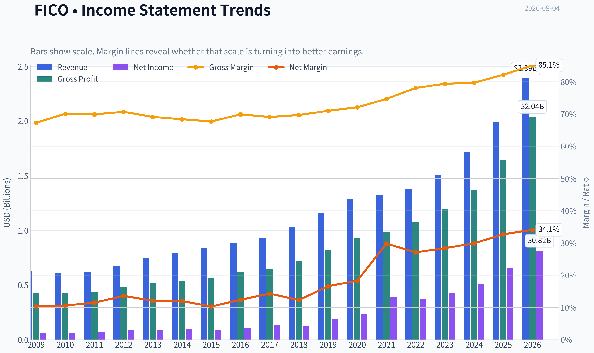
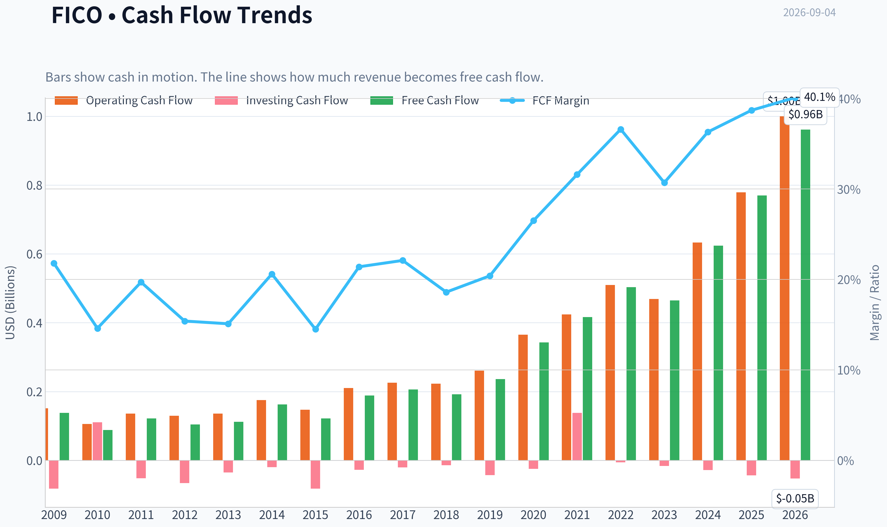
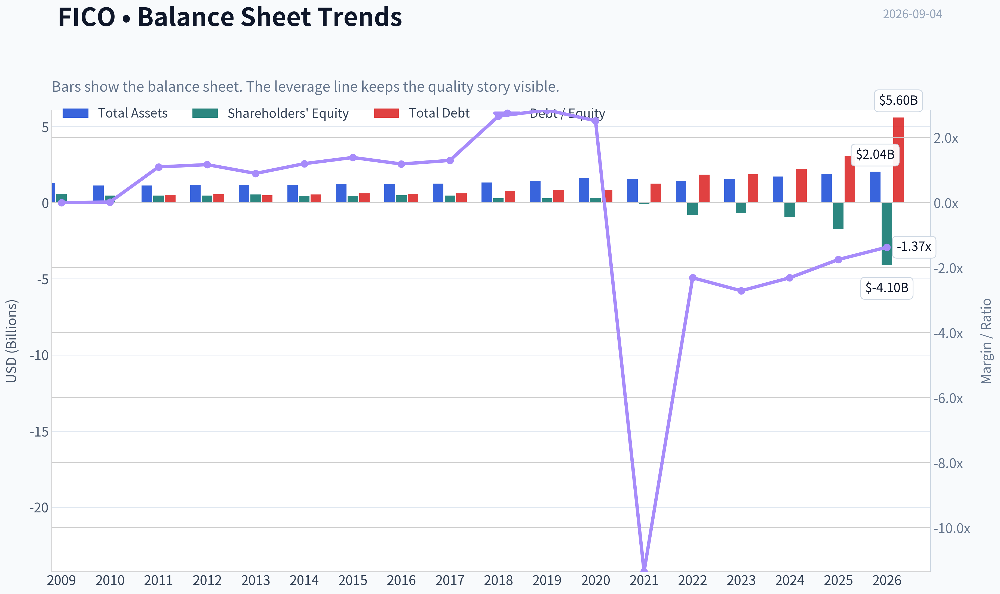
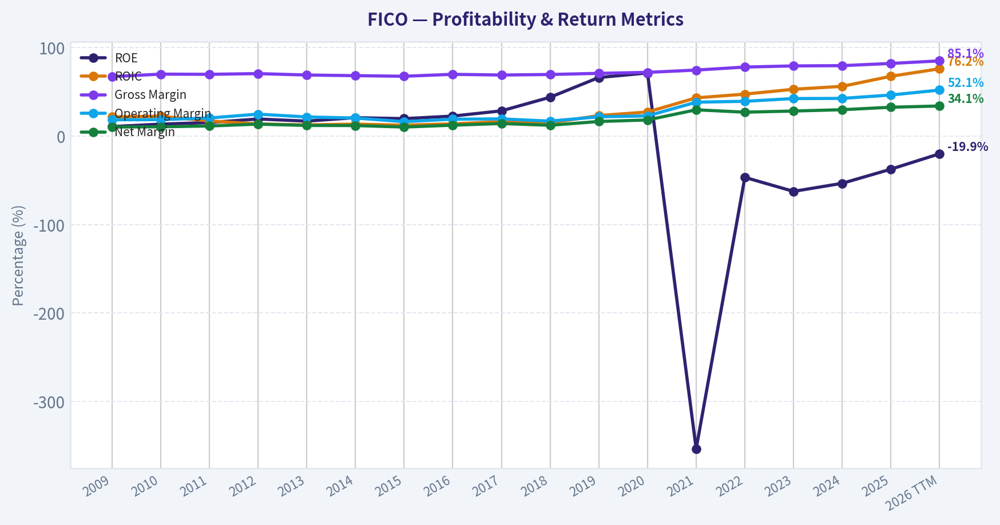
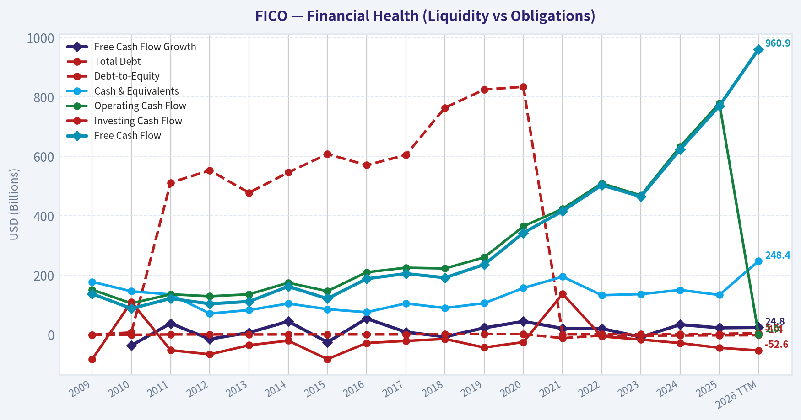
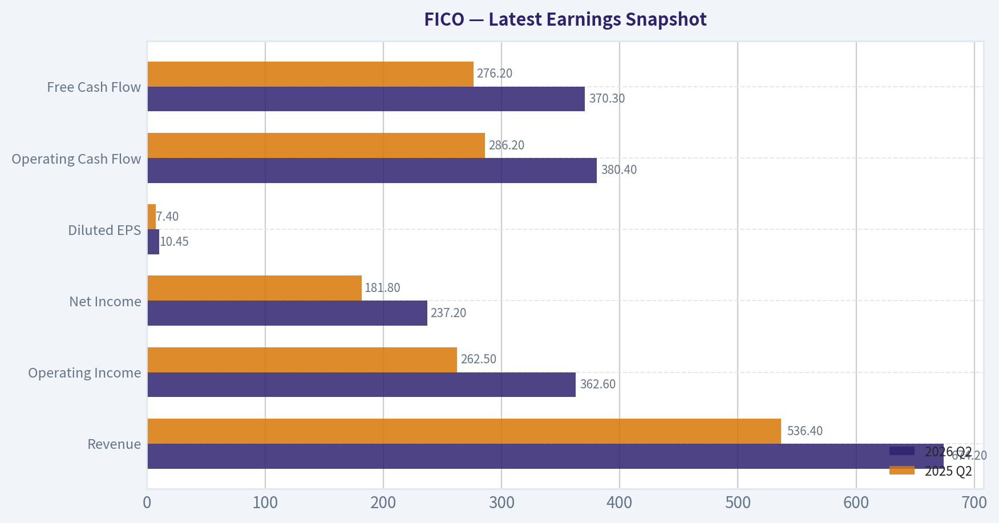
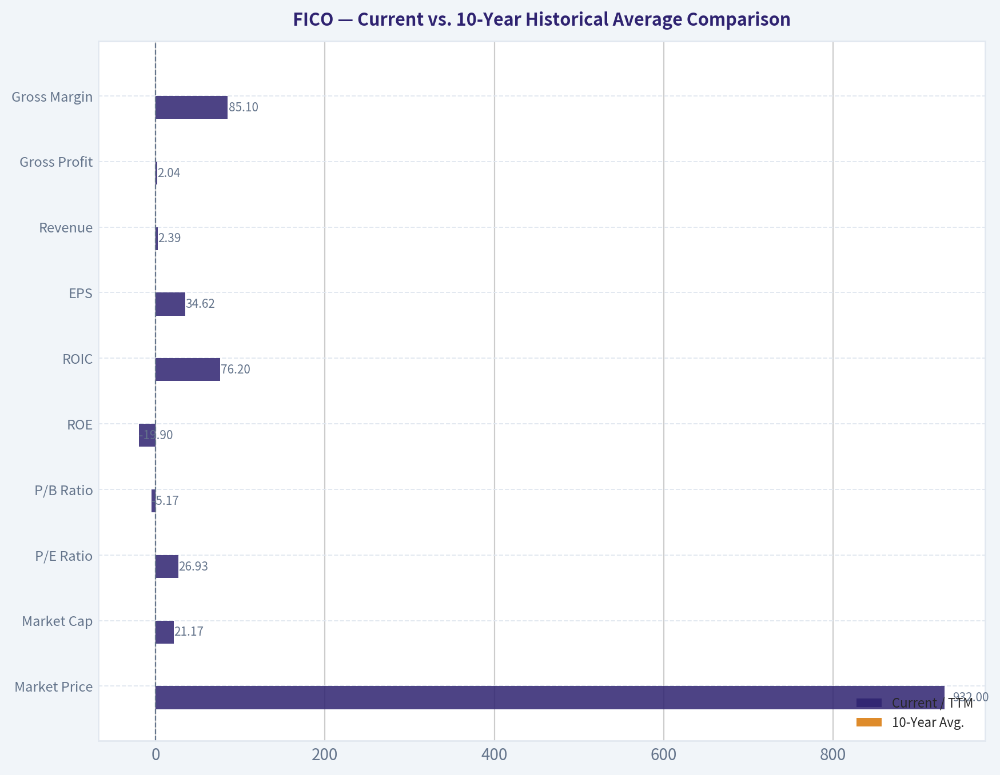
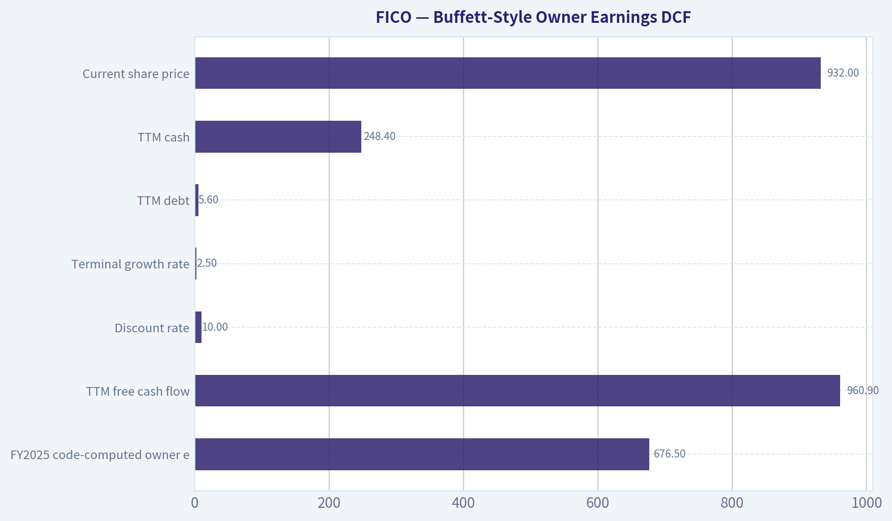
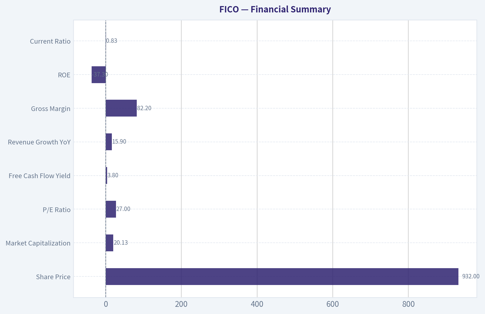
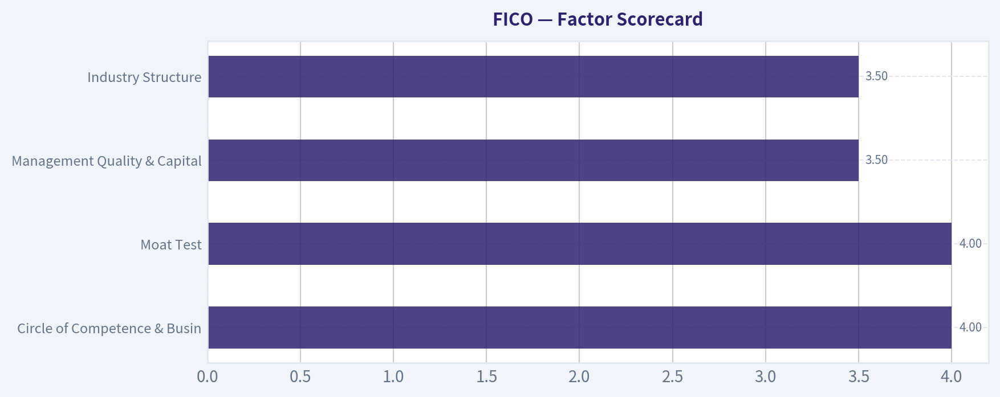

# FICO Deep Value Intelligence

**Analysis Date:** 2026-09-04

## Critical Disclaimer

*This analysis is generated by Deep Value Intelligence, an AI-powered multi-agent investing framework. Education & research only - not financial advice, not a financial advisor.*

---

## Table of Contents

1. Intelligence Summary
2. Analyst Team Reports
   - Fundamentals Analysis
   - Intrinsic Value Analysis (Buffett)
   - Trend & Growth Analysis (Lynch/Druckenmiller/Fisher)
   - Market Technical Analysis
   - Options Market Analysis
3. Research Team Commentary
4. Value Investing Team Commentary
5. Deep Values Commentary

---

## Intelligence Summary

### Thesis + Conditions

**Core Thesis:** **EXECUTIVE SUMMARY**
FICO is a textbook elite compounder-boasting 82% gross margins and 64% ROIC-currently transitioning from a pure monopoly to a potential duopoly due to the FHFA's VantageScore mandate. While its negative ROE is a mathematical byproduct of aggressive share buybacks rather than financial distress, a 27x P/E multiple leaves a thin margin of safety given the structural regulatory headwinds and unconfirmed technical recovery (trading below its 200-day moving average).

**Key Risks:**
- FICO is a textbook elite compounder-boasting 82% gross margins and 64% ROIC-currently transitioning from a pure monopoly to a potential duopoly due to the FHFA's VantageScore mandate. While its negative ROE is a mathematical byproduct of aggressive share buybacks rather than financial distress, a 27x P/E multiple leaves a thin margin of safety given the structural regulatory headwinds and unconfirmed technical recovery (trading below its 200-day moving average). We are applying the recent lesson learned from Moody's (MCO): **do not chase premium multiples during an unconfirmed technical breakdown, but do not demand absolute deep-value prices for elite toll bridges.** Stance: **WATCH**, awaiting technical trend reclaim or valuation compression.
- The Bull (Risky):** FICO is the entrenched plumbing of global credit. The -37.3% ROE is a badge of exceptional capital allocation (buybacks), not a solvency issue. A 27x P/E is cheap for 64% ROIC, and the VantageScore threat is overstated because switching costs for lenders are systemic nightmares.
- The Pragmatist (Neutral):** FICO remains elite, but its valuation must now account for a "duopoly discount." The most prudent action is to wait for evidence-monitoring upcoming pricing realization and software margins-before deploying capital.

**Confidence:** Medium

---

## Analyst Team Reports

### Fundamentals Analysis

#### Latest Earnings Snapshot

*Most recent reported quarter anchored on 2026 Q2, with prior-year comparison when available.*

| Metric | 2026 Q2 | 2025 Q2 | YoY Change |
| --- | ---: | ---: | ---: |
| Revenue | $674.2M | $536.4M | +25.7% |
| Operating Income | $362.6M | $262.5M | +38.1% |
| Net Income | $237.2M | $181.8M | +30.5% |
| Diluted EPS | $10.45 | $7.40 | +41.2% |
| Operating Cash Flow | $380.4M | $286.2M | +32.9% |
| Free Cash Flow | $370.3M | $276.2M | +34.1% |

Key Takeaways: This snapshot anchors the most recent reported quarter before the narrative analysis. It helps readers separate long-run business quality from whatever changed in the latest earnings print.

#### 17-Year Financial Metrics for FICO

*All values below are computed deterministically from raw data - not estimated by AI.*

*Issuer profile: operating company (Technology / Software - Application).*

#### 17-Year Financial Metrics
*Annual rows come from reported financial statements. The final TTM row is computed from the latest four quarters.*

| Metric | 2009 | 2010 | 2011 | 2012 | 2013 | 2014 | 2015 | 2016 | 2017 | 2018 | 2019 | 2020 | 2021 | 2022 | 2023 | 2024 | 2025 | 2026 TTM |
| --- | --- | --- | --- | --- | --- | --- | --- | --- | --- | --- | --- | --- | --- | --- | --- | --- | --- | --- |
| Market Price | $21 | $24 | $22 | $44 | $55 | $55 | $84 | $125 | $140 | $229 | $304 | $425 | $398 | $412 | $869 | $1,944 | $1,497 | $932 |
| Market Cap | $1.05B | $1.12B | $873.0M | $1.60B | $2.01B | $1.92B | $2.76B | $4.03B | $4.53B | $7.13B | $9.19B | $12.73B | $11.64B | $10.86B | $22.03B | $48.74B | $36.75B | $21.17B |
| P/E Ratio | 16.16 | 17.37 | 12.20 | 17.36 | 22.29 | 20.26 | 31.89 | 36.75 | 33.94 | 56.29 | 47.87 | 53.85 | 29.70 | 29.06 | 51.30 | 95.04 | 56.39 | 26.93 |
| P/B Ratio | 1.75 | 2.35 | 1.88 | 3.36 | 3.78 | 4.23 | 6.31 | 8.36 | 9.72 | 24.79 | 31.73 | 38.45 | -104.95 | -13.54 | -32.03 | -50.63 | -21.05 | -5.17 |
| ROE | 10.8% | 13.6% | 15.4% | 19.4% | 17.0% | 20.9% | 19.8% | 22.7% | 28.6% | 44.0% | 66.3% | 71.4% | -353.4% | -46.6% | -62.4% | -53.3% | -37.3% | -19.9% |
| ROIC | 21.8% | 22.5% | 17.2% | 13.8% | 12.7% | 13.6% | 12.4% | 13.9% | 16.4% | 15.0% | 23.3% | 27.3% | 43.3% | 47.5% | 53.0% | 56.3% | 67.7% | 76.2% |
| EPS | $1.33 | $1.42 | $1.79 | $2.55 | $2.48 | $2.72 | $2.65 | $3.39 | $4.14 | $4.06 | $6.34 | $7.90 | $13.40 | $14.18 | $16.93 | $20.45 | $26.54 | $34.62 |
| Revenue | $630.7M | $605.6M | $619.7M | $676.4M | $743.4M | $789.0M | $838.8M | $881.4M | $932.2M | $1.03B | $1.16B | $1.29B | $1.32B | $1.38B | $1.51B | $1.72B | $1.99B | $2.39B |
| Gross Profit | $424.3M | $424.7M | $433.2M | $478.5M | $514.0M | $539.7M | $568.2M | $616.2M | $644.6M | $719.6M | $823.2M | $933.4M | $984.1M | $1.08B | $1.20B | $1.37B | $1.64B | $2.04B |
| Gross Margin | 67.3% | 70.1% | 69.9% | 70.7% | 69.1% | 68.4% | 67.7% | 69.9% | 69.1% | 69.7% | 71.0% | 72.1% | 74.7% | 78.1% | 79.4% | 79.7% | 82.2% | 85.1% |
| Operating Margin | 18.5% | 18.7% | 20.5% | 24.9% | 21.7% | 20.5% | 16.4% | 19.2% | 19.5% | 17.0% | 21.9% | 22.9% | 38.4% | 39.4% | 42.5% | 42.7% | 46.5% | 52.1% |
| Net Income | $65.1M | $64.5M | $71.6M | $92.0M | $90.1M | $94.9M | $86.5M | $109.4M | $133.4M | $126.5M | $192.1M | $236.4M | $392.1M | $373.5M | $429.4M | $512.8M | $651.9M | $815.0M |
| Net Margin | 10.3% | 10.6% | 11.5% | 13.6% | 12.1% | 12.0% | 10.3% | 12.4% | 14.3% | 12.3% | 16.6% | 18.3% | 29.8% | 27.1% | 28.4% | 29.9% | 32.7% | 34.1% |
| Revenue Growth | N/A | -4.0% | 2.3% | 9.2% | 9.9% | 6.1% | 6.3% | 5.1% | 5.8% | 10.8% | 12.4% | 11.6% | 1.7% | 4.6% | 9.9% | 13.5% | 15.9% | 20.2% |
| Net Income Growth | N/A | -1.0% | 11.0% | 28.6% | -2.1% | 5.3% | -8.8% | 26.5% | 21.9% | -5.2% | 51.9% | 23.1% | 65.8% | -4.7% | 14.9% | 19.4% | 27.1% | 25.0% |
| Free Cash Flow Growth | N/A | -35.8% | 38.3% | -14.6% | 7.4% | 45.1% | -25.0% | 54.6% | 9.3% | -6.8% | 23.3% | 45.1% | 21.4% | 20.9% | -7.7% | 34.3% | 23.4% | 24.8% |
| Total Book Value | $600.3M | $474.9M | $465.5M | $474.4M | $530.7M | $454.6M | $437.0M | $481.3M | $466.2M | $287.4M | $289.8M | $331.1M | $-110.9M | $-801.9M | $-688.0M | $-962.7M | $-1.75B | $-4.10B |
| Total Assets | $1.30B | $1.12B | $1.13B | $1.16B | $1.16B | $1.19B | $1.23B | $1.22B | $1.26B | $1.33B | $1.43B | $1.61B | $1.57B | $1.44B | $1.58B | $1.72B | $1.87B | $2.04B |
| Total Debt | $0 | $8.0M | $512.0M | $553.0M | $478.0M | $546.0M | $608.0M | $570.6M | $604.8M | $763.9M | $824.8M | $834.4M | $1.26B | $1.85B | $1.86B | $2.22B | $3.06B | $5.60B |
| Debt-to-Equity | 0.00 | 0.02 | 1.10 | 1.17 | 0.90 | 1.20 | 1.39 | 1.19 | 1.30 | 2.66 | 2.85 | 2.52 | -11.35 | -2.31 | -2.71 | -2.31 | -1.75 | -1.37 |
| Cash & Equivalents | $178.2M | $146.2M | $135.8M | $71.6M | $83.2M | $105.1M | $86.1M | $75.9M | $105.6M | $90.0M | $106.4M | $157.4M | $195.4M | $133.2M | $136.8M | $150.7M | $134.1M | $248.4M |
| Shareholders' Equity | $600.3M | $474.9M | $465.5M | $474.4M | $530.7M | $454.6M | $437.0M | $481.3M | $466.2M | $287.4M | $289.8M | $331.1M | $-110.9M | $-801.9M | $-688.0M | $-962.7M | $-1.75B | $-4.10B |
| Operating Cash Flow | $151.6M | $105.8M | $136.2M | $129.7M | $136.1M | $175.0M | $146.8M | $210.3M | $225.6M | $223.1M | $260.4M | $364.9M | $423.8M | $509.4M | $468.9M | $633.0M | $778.8M | $1.00B |
| Investing Cash Flow | $-81.9M | $110.6M | $-51.7M | $-65.7M | $-35.0M | $-19.8M | $-81.9M | $-27.6M | $-20.6M | $-14.1M | $-42.8M | $-24.6M | $137.8M | $-5.7M | $-16.0M | $-28.0M | $-43.7M | $-52.6M |
| Free Cash Flow | $137.7M | $88.3M | $122.1M | $104.3M | $112.0M | $162.4M | $121.8M | $188.3M | $205.8M | $191.8M | $236.4M | $342.9M | $416.2M | $503.4M | $464.7M | $624.1M | $769.9M | $960.9M |
| FCF Margin | 21.8% | 14.6% | 19.7% | 15.4% | 15.1% | 20.6% | 14.5% | 21.4% | 22.1% | 18.6% | 20.4% | 26.5% | 31.6% | 36.6% | 30.7% | 36.3% | 38.7% | 40.1% |
| Dividends / Share | $0.00 | $0.00 | $0.00 | $0.00 | $0.00 | $0.00 | $0.00 | $0.00 | $0.00 | $0.00 | $0.00 | $0.00 | $0.00 | $0.00 | $0.00 | $0.00 | $0.00 | $0.00 |

#### Profitability Metrics
- Return on Equity (ROE): -37.3%
- Return on Invested Capital (ROIC): 63.9%
- Return on Assets (ROA): 34.9%
- Gross Margin: 82.2%
- Operating Margin: 46.5%
- Net Profit Margin: 32.7%

#### Liquidity Metrics
- Current Ratio: 0.83
- Quick Ratio: 0.78

#### Leverage Metrics
- Debt-to-Equity Ratio: -1.75
- Interest Coverage Ratio: 6.92
- Net Debt: $2.92B

#### Growth Metrics (Year-over-Year)
- Revenue Growth: 15.9%
- Net Income Growth: 27.1%
- Free Cash Flow Growth: 23.4%
- Revenue CAGR (3-Year): 13.1%
- Revenue CAGR (5-Year): 9.0%

#### Valuation Metrics
- P/E Ratio (TTM): 26.97
- Forward P/E: 17.57
- Price-to-Book: N/A
- Price-to-Sales: 8.41
- PEG Ratio: 0.78
- EV/EBITDA: 20.17
- Free Cash Flow Yield: 3.8%
- Earnings Yield: 3.7%

#### Owner Earnings (Buffett Method, Code-Computed)
- Net Income: $651.9M
- + Depreciation & Amortization: $15.0M
- - Capital Expenditures: $-8.9M
- - Working Capital Changes: $-18.5M
- = **Owner Earnings: $676.5M**

#### Intrinsic Value (Code-Computed)
- Current Price: $932
- **Headline Intrinsic Value (business-model routed): $459**
  Business model: asset light platform - weighted blend [Damodaran FCFF + reverse-DCF fair + owner-earnings DCF] (asset_light_platform)
  Model spread (min-max across DCFs): $102 - $626
  Margin of safety vs. price (headline): -103.0%
  Routing note: Asset-light / high-margin platform: value driven by margins and reinvestment economics - the headline centers on the reverse-DCF demonstrated-growth fair value with Damodaran FCFF as a floor, down-weighting the owner-earnings DCF.
- Buffett Method (Owner Earnings):
  Conservative: $242
  Average: $626
  Optimistic: $899
- Cash Flow Method (FCF):
  Conservative: $169
  Average: $562
  Optimistic: $1,581
- Damodaran FCFF (WACC + margins + reinvestment):
  Conservative: $41
  Average: $102
  Optimistic: $454
  Monte Carlo band (P10-P90): $76 - $314 (median $170)
  P(intrinsic value > price): 0.0%
- Reverse-DCF: price implies ~26.3%/yr owner-earnings growth for 10y; trailing 3y was 16.9%, 5y 25.8%.

#### Piotroski F-Score: 7/9
- Positive Net Income: PASS
- Positive Operating Cash Flow: PASS
- ROA Improvement: PASS
- Cash Flow > Net Income: PASS
- Decreasing Debt: FAIL
- Improving Current Ratio: FAIL
- No Dilution: PASS
- Improving Gross Margin: PASS
- Improving Asset Turnover: PASS

ANALYST STANCE: **WATCH**

#### FICO Fundamental Analysis - Warren Buffett-Style View

Fair Isaac Corporation, or FICO, is an exceptional asset-light, high-margin software and data platform business, but the stock still embeds demanding expectations even after the decline to **$932**. The deterministic dataset shows a business with accelerating revenue, expanding margins, very high ROIC, and powerful free cash flow conversion. However, the balance sheet has become materially more leveraged, shareholder equity is negative due largely to buybacks and leverage, and the market price remains above the model-routed intrinsic value estimate of **about $459 per share**.

For a Buffett-style investor, FICO is a high-quality business but not yet a clear bargain. The appropriate stance is **WATCH**, not ADVOCATE, because the moat is real but the valuation still requires sustained high growth and regulatory risk around credit-score competition has increased.

---

#### Revenue Breakdown

| Revenue Source | Amount | % of Total |
|---|---:|---:|
| Scores | ~$1.30B | ~65% |
| Software | ~$0.69B | ~35% |
| **Total FY2025 Revenue** | **$1.99B** | **100%** |

Key Takeaways: FICO's economics are increasingly driven by the Scores segment, which carries powerful pricing power, recurring demand, and high incremental margins. Software remains meaningful, but the investment debate is dominated by whether FICO can preserve pricing power in credit scores, especially in mortgage and consumer-lending workflows.

---

#### Current vs. 10-Year Historical Average Comparison

| Metric | Current / TTM | 10-Year Avg. | Interpretation |
|---|---:|---:|---|
| Market Price | $932 | ~$634 | Still ~47% above the 10-year average despite falling sharply from the 2024 peak of $1,944. |
| Market Cap | $21.17B | ~$16.76B | Above the 10-year average, but down materially from the 2024-2025 valuation highs. |
| P/E Ratio | 26.93x | ~49.02x | Below the 10-year average because earnings have surged and the stock has derated. On P/E alone, valuation looks less extreme than recent history. |
| P/B Ratio | -5.17x | Not meaningful | P/B is **not meaningful** for FICO because it is an asset-light software/data company with negative book equity caused by leverage and repurchases. Valuation should be anchored on cash flows, not book value. |
| ROE | -19.9% | Not meaningful | ROE is distorted by negative shareholder equity. It should not be interpreted as poor profitability; ROIC and margins are more informative. |
| ROIC | 76.2% | ~36.4% | Exceptional and far above history, showing very strong incremental returns on capital. |
| EPS | $34.62 | ~$11.73 | Nearly 3x the 10-year average, reflecting margin expansion, revenue growth, and share repurchases. |
| Revenue | $2.39B | ~$1.32B | About 81% above the 10-year average; growth has accelerated recently. |
| Gross Profit | $2.04B | ~$1.00B | More than double the 10-year average, helped by scale and mix shift toward higher-margin Scores revenue. |
| Gross Margin | 85.1% | ~74.1% | Structurally improved; FICO now resembles a premium data/software royalty business. |
| Operating Margin | 52.1% | ~31.0% | Dramatically above historical levels; operating leverage has been very strong. |
| Net Income | $815.0M | ~$315.8M | More than 2.5x the 10-year average. |
| Net Margin | 34.1% | ~22.2% | Current profitability is far above the long-term norm. |
| Revenue Growth | 20.2% | ~9.1% | Current growth is more than double the 10-year average. |
| Net Income Growth | 25.0% | ~24.1% | Current growth is close to the historical average, but the quality of earnings has improved due to higher margins. |
| Free Cash Flow Growth | 24.8% | ~21.8% | Strong and slightly above the already high historical average. |
| Total Book Value | -$4.10B | ~-$245.8M | Book value has deteriorated sharply because of leverage and buybacks; not a useful valuation anchor. |
| Total Assets | $2.04B | ~$1.50B | Assets have grown modestly relative to revenue and cash flow, confirming asset-light economics. |
| Total Debt | $5.60B | ~$1.38B | Debt is over 4x the 10-year average and is the clearest balance-sheet red flag. |
| Debt-to-Equity | -1.37x | Not meaningful | Negative equity makes this ratio mechanically misleading. Debt should be judged against FCF and interest coverage instead. |
| Cash & Equivalents | $248.4M | ~$128.6M | Cash is above historical average, but small relative to total debt. |
| Shareholders' Equity | -$4.10B | ~-$245.8M | Negative equity reflects capital allocation choices, not operating weakness, but it reduces financial flexibility. |
| Operating Cash Flow | $1.00B | ~$409.8M | Cash generation is very strong and more than double the 10-year average. |
| Free Cash Flow | $960.9M | ~$394.4M | FCF is about 144% above the 10-year average. |
| FCF Margin | 40.1% | ~28.3% | Outstanding cash conversion; FICO's model has become much more profitable. |
| Dividends / Share | $0.00 | $0.00 | FICO returns capital through buybacks, not dividends. |

Key Takeaways: FICO's operating performance is outstanding: revenue, margins, EPS, ROIC, and free cash flow are all far above their 10-year averages. However, the balance sheet has become much more leveraged, and accounting measures tied to book value, such as P/B, ROE, and debt-to-equity, are not useful because shareholder equity is negative. The right valuation framework is cash-flow-based intrinsic value, not book multiples.

---

#### Market Metrics Interpretation

FICO trades at **$932**, with a deterministic TTM market cap of **$21.17B**. The stock is well below its 2024 peak of **$1,944**, but still above its 10-year average price. This reflects a business that has genuinely improved, but also a market that still assigns a premium multiple.

The **P/E ratio of 26.93x** is below the 10-year average of roughly **49x**, which could look superficially attractive. But that lower P/E comes after an unusually strong period of margin expansion and earnings acceleration. If margins are near peak levels, the current P/E may understate risk.

The **P/B ratio is negative and not meaningful**. FICO is an asset-light software and scoring platform with little need for tangible book capital. Buybacks and leverage have pushed equity negative, so book value does not represent economic value. A Buffett-style investor should focus on owner earnings, pricing power, reinvestment economics, and durability of the moat.

---

#### Profitability and Business Quality

FICO's profitability is elite. TTM **gross margin is 85.1%**, **operating margin is 52.1%**, and **net margin is 34.1%**. These are not ordinary software margins; they reflect a quasi-standardized, deeply embedded data and analytics franchise.

The most important profitability metric is **ROIC**, not ROE. ROIC reached **76.2% TTM**, far above the 10-year average of roughly **36.4%**. This indicates that FICO earns extraordinary returns on incremental capital. In Buffett terms, this is the hallmark of a high-quality business: it can grow without requiring heavy reinvestment.

EPS has increased from **$3.39 in 2016** to **$34.62 TTM**, reflecting organic growth, margin expansion, and aggressive share repurchases. Net income has also scaled meaningfully, reaching **$815.0M TTM** versus a 10-year average of about **$315.8M**.

The main caveat is that current profitability may be cyclically or structurally elevated. Margins above 50% operating profit are extraordinary, but they also attract regulatory and competitive scrutiny.

---

#### Growth Metrics Interpretation

FICO's recent growth is stronger than its long-term record. TTM revenue growth of **20.2%** compares with a 10-year average of about **9.1%**. Free cash flow growth of **24.8%** also remains above the historical average.

This acceleration is impressive, but a Buffett-style analyst must separate durable growth from extrapolation risk. FICO's trailing 5-year implied owner-earnings growth was around **25.8%**, while the reverse DCF indicates the current market price still implies about **26.3% annual owner-earnings growth for 10 years**. That is a high bar, especially when regulatory pressure is rising.

The growth runway remains attractive, but the stock price still assumes that FICO can sustain something close to its recent high-growth trajectory for a long period.

---

#### Balance Sheet and Financial Strength

FICO's operating business is financially powerful, but the balance sheet has become more aggressive. TTM total debt is **$5.60B**, while cash is only **$248.4M**, leaving substantial net debt. Total debt is over 4x the 10-year average.

Because shareholder equity is **negative $4.10B**, traditional debt-to-equity is not meaningful. The better test is debt versus free cash flow. With TTM FCF of **$960.9M**, gross debt is roughly **5.8x FCF**, while net debt is roughly **5.6x FCF**. That is manageable only if cash flows remain durable and interest costs remain controlled.

The interest coverage ratio of **6.92x** is acceptable but not conservative. Buffett generally prefers businesses that can withstand stress without depending on capital markets. FICO's cash flow quality helps, but leverage reduces the margin of safety.

---

#### Cash Flow and Capital Allocation

FICO generated **$960.9M of TTM free cash flow**, with an excellent **40.1% FCF margin**. This is one of the strongest parts of the investment case. The company requires limited capital expenditures, so a high percentage of earnings converts into cash.

FICO pays **no dividend**. Capital returns have historically come through buybacks. Buybacks can be highly value-accretive when shares are undervalued, but destructive if conducted at excessive valuations. Given the stock traded as high as **$1,944** in 2024, investors should scrutinize whether repurchases were made at attractive prices.

The negative equity position suggests buybacks and leverage have meaningfully reshaped the balance sheet. That does not undermine the core business, but it makes valuation discipline more important.

---

#### Buffett-Style Owner Earnings DCF

Assumptions used for the hand DCF sanity check:

| Input | Assumption |
|---|---:|
| FY2025 code-computed owner earnings | $676.5M |
| TTM free cash flow | $960.9M |
| Normalized current owner earnings base | ~$818.7M |
| Discount rate | 10.0% |
| Terminal growth rate | 2.5% |
| TTM debt | $5.60B |
| TTM cash | $248.4M |
| Net debt used | ~$5.35B |
| Estimated diluted share count | ~22.7M |
| Current share price | $932 |

Key Takeaways: The DCF uses a normalized owner-earnings base between reported FY2025 owner earnings and TTM free cash flow to avoid relying entirely on either a stale annual number or a potentially elevated TTM run rate. The model also subtracts current net debt, which materially lowers equity value because FICO's leverage has increased.

| Scenario | Growth Assumption | PV of Explicit Cash Flows | PV of Terminal Value | Enterprise Value | Equity Value After Net Debt | Fair Value / Share |
|---|---|---:|---:|---:|---:|---:|
| Conservative | ~3% fading to 2.5% | ~$5.74B | ~$5.80B | ~$11.54B | ~$6.19B | **~$273** |
| Average / Base Case | 15% near term, fading to 2.5% | ~$8.27B | ~$9.19B | ~$17.46B | ~$12.11B | **~$533** |
| Optimistic | 25% near term, fading to 2.5% | ~$11.09B | ~$13.77B | ~$24.86B | ~$19.51B | **~$859** |

Key Takeaways: Even under an optimistic growth path, the hand DCF value is slightly below the current market price of $932. The base case is much lower, around $533 per share, which is broadly consistent with the research pack's cash-flow-based caution. This suggests the market is still pricing in a very strong decade of execution.

The research pack's model-based intrinsic value provides the stronger anchor:

| Valuation Model | Fair Value / Share |
|---|---:|
| Headline business-model-routed intrinsic value | **$459** |
| Owner Earnings DCF - Conservative | $242 |
| Owner Earnings DCF - Average | $626 |
| Owner Earnings DCF - Optimistic | $899 |
| FCF DCF - Conservative | $169 |
| FCF DCF - Average | $562 |
| FCF DCF - Optimistic | $1,581 |
| Damodaran FCFF - Average | $102 |
| Damodaran FCFF Monte Carlo P10-P90 | $76 - $314 |
| Reverse DCF implied growth at current price | ~26.3% annually for 10 years |

Key Takeaways: The valuation spread is wide because FICO is highly sensitive to growth, margins, and terminal assumptions. The headline intrinsic value of about $459 is far below the current price, and the reverse DCF requires growth roughly in line with the company's strongest recent period. That leaves little room for disappointment.

---

#### Economic Moat Assessment

FICO has a powerful moat built on several reinforcing advantages:

| Moat Factor | Assessment |
|---|---|
| Brand and standardization | FICO scores are deeply embedded in consumer credit decisions, especially lending and mortgage workflows. |
| Data and analytics expertise | Decades of credit-risk modeling create credibility and customer trust. |
| Switching costs | Lenders, regulators, underwriting systems, and risk models are often built around FICO-based processes. |
| Pricing power | The Scores business has demonstrated exceptional margin expansion and revenue growth. |
| Asset-light economics | High incremental margins and low capital intensity create outstanding ROIC. |
| Regulatory risk | Recent pressure to approve VantageScore in mortgage channels directly challenges part of FICO's historical moat. |

Key Takeaways: FICO's moat is real and economically valuable, but it is not immune to regulatory pressure. The key question is whether FICO remains the default credit-risk standard or becomes one of several accepted scoring vendors. Even a small loss of monopoly-like pricing power could materially affect intrinsic value.

---

#### Key Investment Insights, Red Flags, and Opportunities

| Category | Key Points |
|---|---|
| Major Strength | Extraordinary ROIC, high gross margins, strong free cash flow conversion, and durable embedded position in credit infrastructure. |
| Major Valuation Issue | Current price of $932 remains above headline intrinsic value of ~$459 and above the hand DCF base case of ~$533. |
| Growth Opportunity | Continued pricing power in Scores, expansion of analytics/software products, and high incremental margins. |
| Balance Sheet Red Flag | Debt has risen to $5.60B TTM, while cash is only $248.4M. Net debt is significant relative to historical levels. |
| Accounting Caveat | Negative equity makes P/B, ROE, and debt-to-equity mechanically misleading. |
| Regulatory Red Flag | FHFA-related moves supporting VantageScore in mortgage markets may reduce FICO's pricing power and perceived exclusivity. |
| Capital Allocation Question | Buybacks have helped EPS, but repurchases at high valuations may not create value. |
| Buffett-Style View | Wonderful business, but currently not at a wonderful price. |

Key Takeaways: FICO is a rare high-quality compounder, but several risks now matter more than they did when the moat looked unchallenged. The balance sheet is more leveraged, valuation remains demanding, and regulatory pressure could weaken the Scores segment's economics. The business deserves close monitoring, but the stock does not yet offer a clear margin of safety.

---

#### Final Investment Stance: WATCH

FICO is a high-quality, asset-light business with exceptional margins, strong free cash flow, and one of the best ROIC profiles in the market. From a Buffett perspective, the company has many desirable traits: predictable demand, pricing power, low capital intensity, and a long history of compounding earnings.

However, the stock does not currently offer enough margin of safety. The headline intrinsic value estimate is **$459**, compared with a current price of **$932**, implying the stock is still roughly double the model-routed fair value. The optimistic owner-earnings DCF case approaches the current price but does not provide a comfortable discount. Meanwhile, debt has increased substantially, and regulatory developments around VantageScore introduce a new risk to FICO's most valuable franchise.

The stance is therefore **WATCH**. FICO should remain on a high-quality compounder watchlist, but a Buffett-style buyer would likely wait for either a lower price, clearer evidence that regulatory risk is manageable, or a valuation that offers a more explicit margin of safety.

| Final Summary Point | Assessment |
|---|---|
| Business Quality | Excellent |
| Economic Moat | Strong but facing greater regulatory challenge |
| Profitability | Exceptional |
| Cash Flow Quality | Excellent |
| Balance Sheet | More leveraged than ideal |
| Valuation | Still demanding |
| Margin of Safety | Insufficient |
| Suitable Action | Watchlist candidate, not a fresh Buffett-style buy |
| Final Stance | **WATCH** |

Key Takeaways: FICO is a wonderful business, but the current price still assumes a great deal of future success. The moat, margins, and cash generation are outstanding, yet leverage and regulatory risk reduce the margin of safety. A disciplined value investor should watch closely rather than chase the stock at the current valuation.

#### Fundamental Visuals

This graph tracks the profitability and return metrics (ROE, ROIC, Margins) of **FICO** over the past decade, highlighting capital efficiency trends.

This chart illustrates the financial health of **FICO** over the last 10 years, mapping cash equivalents and free cash flow against total obligations (Debt).

---

### Intrinsic Value Analysis (Buffett)

> *Following Warren Buffett's value investing philosophy: Circle of Competence, Economic Moat, Management Quality, and Margin of Safety.*

#### Intrinsic Value Snapshot

Price is what you pay. Intrinsic value is what the business may be worth based on the cash it can create for owners over time. We show a range, not one magic number.

- Current Price: $932.26
- Value Range (conservative to optimistic across both DCF methods): $169.33 to $1,580.52

##### Owner Earnings (Buffett Method)
- Net Income: $651,946,000.00
- Depreciation & Amortization: $14,952,000.00
- Capital Expenditures: $-8,922,000.00
- Working Capital Changes: $-18,547,000.00
- Owner Earnings: $676,523,000.00

##### Intrinsic Value
###### Buffett Method
Uses owner earnings. Stricter, and usually more conservative.
- Conservative: $241.54
- Average: $626.30
- Optimistic: $898.98
- Discount Rate: 10.0%

###### Cash Flow Method
Uses free cash flow. Better for companies spending heavily today to grow tomorrow.
- Conservative: $169.33
- Average: $562.09
- Optimistic: $1,580.52
- Discount Rate: 10.0%

ANALYST STANCE: **WATCH**

#### FICO - Buffett-Style Value Investment Report

Fair Isaac is a wonderful, high-margin, asset-light franchise with one of the most embedded brands in U.S. consumer credit. The FICO Score remains deeply woven into lender workflows, underwriting models, regulatory standards, and consumer credit language. However, at **$932 per share**, the stock still prices in very high future growth while the company's most valuable moat - its mortgage credit-score position - is facing fresh regulatory and competitive pressure from VantageScore approval at Fannie Mae and Freddie Mac.

The business quality is high; the price and moat-risk balance are not yet attractive enough.

---

#### 1. Factor Scorecard

| Factor | Score / 5 | Evidence |
|---|---:|---|
| Circle of Competence & Business Simplicity | 4.0 | FICO makes money by selling credit scores and decisioning software to lenders, financial institutions, and enterprises. The model is understandable, recurring, and asset-light. Predictability is strong but now reduced by regulatory pressure in mortgage scoring. |
| Moat Test | 4.0 | Gross margin of **82.2%** indicates exceptional intangible-asset economics. FICO has brand, regulatory embeddedness, lender workflow integration, and data/model trust. The moat is still wide, but recent VantageScore developments suggest it may no longer be unchallenged in mortgage. |
| Management Quality & Capital Allocation | 3.5 | Management has created substantial per-share value through pricing, software growth, and buybacks. However, aggressive capital return has contributed to negative equity, and pricing power may have attracted political/regulatory backlash. |
| Industry Structure | 3.5 | Credit analytics and decisioning software are attractive, high-margin markets. The credit-score market has been highly concentrated, but mortgage-score competition could become more rationally contested if VantageScore gains institutional acceptance. |
| Gate 5: Quality / Solvency Hard Floor | Not Tripped | Revenue is growing **15.9% YoY**, free cash flow remains positive, and there is no evidence of combined deteriorating cash flow and insolvency. Negative ROE appears driven by negative book equity rather than operating collapse. |

**Key Takeaways:** FICO remains a high-quality, understandable, asset-light business with exceptional margins and a historically powerful moat. The main issue is not business failure; it is whether the current valuation adequately compensates investors for new competitive and regulatory pressure around credit scoring.

---

#### 2. Moat Analysis

| Moat Source | Strength | Evidence | Current Risk |
|---|---:|---|---|
| Brand / Intangible Asset | Very High | "FICO Score" is synonymous with consumer creditworthiness in the U.S. The brand has decades of lender trust and consumer recognition. | Political scrutiny over pricing and perceived monopoly power. |
| Regulatory / Institutional Embeddedness | High | FICO scores have long been embedded in mortgage underwriting, lender models, securitization processes, and credit workflows. | FHFA-directed approval of VantageScore for Fannie Mae and Freddie Mac weakens exclusivity. |
| Switching Costs | High | Lenders, banks, and insurers build models, compliance systems, and risk processes around FICO outputs. Switching requires validation, governance, retraining, and risk acceptance. | Switching becomes easier if regulators and GSEs actively support alternatives. |
| Pricing Power | Historically Very High | Gross margin of **82.2%** and strong revenue growth suggest meaningful pricing power. | Pricing power may be curtailed if customers and regulators view score fees as excessive. |
| Network Effects / Data Trust | Moderate to High | The more widely used the score is, the more accepted and benchmarked it becomes across credit markets. | VantageScore can gain credibility if adoption becomes mandated or encouraged. |

**Key Takeaways:** FICO's moat is real and has historically been very powerful. The concern is that part of the moat depended not only on brand and model quality, but also on institutional gatekeeping in mortgage credit - and that gatekeeping is now being challenged.

---

#### 3. Management Quality Assessment

| Dimension | Assessment |
|---|---|
| Owner Orientation | Management has been highly focused on per-share economics, margin expansion, pricing, and buybacks. |
| Capital Allocation | Buybacks have likely been accretive over long periods, but the balance sheet now shows negative equity, suggesting aggressive repurchases and leverage. |
| Strategic Execution | FICO has expanded beyond scores into analytics and decisioning software, strengthening its platform characteristics. |
| Candor / Risk Management | The key test now is whether management can defend the franchise without provoking further customer or regulatory pushback. |
| Buffett View | Strong operators, but the best capital allocator would be careful not to over-monetize a regulated-adjacent monopoly to the point of inviting attack. |

**Key Takeaways:** Management has created meaningful shareholder value, but the business may now be paying the price for pushing pricing power too far. For a Buffett-style investor, the question is whether the moat has been harvested rationally or over-harvested politically.

---

#### 4. Financial Summary

| Metric | Current / Latest |
|---|---:|
| Share Price | **$932** |
| Market Capitalization | **$20.13B** |
| P/E Ratio | **27.0x** |
| Free Cash Flow Yield | **3.8%** |
| Estimated Free Cash Flow | **~$765M** |
| Revenue Growth YoY | **15.9%** |
| Gross Margin | **82.2%** |
| ROE | **-37.3%** |
| Current Ratio | **0.83x** |
| Headline Intrinsic Value Estimate | **$459.13/share** |
| 3-Model Value Spread | Owner Earnings: **$626.30**; FCF: **$562.09**; Damodaran FCFF: **$101.55** |
| Reverse DCF Implied Growth | **~26.3% annually for 10 years** |
| Trailing Growth Reference | 3-year: **16.9%**; 5-year: **25.8%** |

**Key Takeaways:** FICO's financial profile is excellent on margins and cash generation, but the valuation is demanding. The market is asking investors to believe in very high growth for a long period, even as the company faces new uncertainty around one of its most important profit pools.

---

#### 5. Owner Earnings Calculation

Using free cash flow as a practical proxy for owner earnings:

| Item | Estimate |
|---|---:|
| Market Capitalization | **$20.13B** |
| Free Cash Flow Yield | **3.8%** |
| Estimated Owner Earnings / FCF | **~$765M** |
| Estimated Shares Outstanding | **~21.6M** |
| Owner Earnings Per Share | **~$35.42** |

**Key Takeaways:** FICO produces real cash, not just accounting earnings. At today's price, investors are paying roughly **26.3x owner earnings**, which is acceptable only if the company can continue compounding at high rates with minimal moat erosion.

---

#### 6. Three-Scenario DCF Valuation

Assumptions: owner earnings per share of **$35.42**, discount rate of **10%**, and long-term terminal growth of **3%** where applicable.

| Scenario | Method | Intrinsic Value / Share | Margin of Safety vs. $932 |
|---|---|---:|---:|
| A - No Growth | Owner earnings / 10% | **$354** | **-163%** |
| B - GDP Growth | Perpetuity growing at 3% | **$521** | **-79%** |
| C - Historical Growth Case | 10 years at capped 10% growth, then 3% terminal growth | **$875** | **-7%** |
| Headline Research-Pack Value | Business-model routed blend | **$459** | **-103%** |

**Key Takeaways:** FICO only approaches today's price under a strong-growth case that assumes sustained 10% owner-earnings growth for a decade. The more conservative no-growth and GDP-growth cases are far below the current share price, leaving little room for disappointment.

---

#### 7. Margin of Safety Analysis

| Valuation Lens | Interpretation |
|---|---|
| Absolute DCF | Current price is above conservative intrinsic value estimates. |
| Quality-Scaled Margin of Safety | FICO deserves a smaller required discount than an average business because of its margin structure, brand, and embeddedness. Still, a wonderful business is not automatically attractive at any price. |
| Reverse DCF | The stock implies roughly **26.3% annual growth for 10 years**, which is aggressive relative to trailing 3-year growth of **16.9%** and now-rising regulatory risk. |
| Business Risk Adjustment | The VantageScore/FHFA news lowers confidence in long-term monopoly-like economics in mortgage scoring. |
| Buffett View | This is closer to "wonderful business, not obviously fair price" than "wonderful business at a fair price." |

**Key Takeaways:** FICO's quality earns it the right to trade at a premium, but the current price still appears to demand too much certainty. The margin of safety is insufficient because the market is pricing in durability just as a key durability question has become more visible.

---

#### 8. Final Buffett Scorecard

| Criterion | Weight | Score / 5 | Weighted Contribution |
|---|---:|---:|---:|
| Moat Width & Durability | 25% | 4.0 | 1.00 |
| Valuation / Margin of Safety | 20% | 2.0 | 0.40 |
| Capital Returns - ROIC vs. WACC | 15% | 4.5 | 0.68 |
| Business Understanding & Predictability | 12% | 4.0 | 0.48 |
| Management Quality & Capital Allocation | 12% | 3.5 | 0.42 |
| Reinvestment Runway | 8% | 3.5 | 0.28 |
| Balance Sheet Strength | 4% | 2.5 | 0.10 |
| Industry Structure | 4% | 3.5 | 0.14 |
| **Total** | **100%** |  | **3.50 / 5.00** |

**Key Takeaways:** FICO scores well because the business is genuinely excellent. The score is held back by valuation, negative book equity from capital structure choices, and rising competitive/regulatory pressure. The result is a high-quality watchlist candidate, not yet a clear Buffett-style purchase.

---

#### 9. Investment Stance

| Stance | Conviction | Rationale |
|---|---|---|
| **WATCH** | Medium-High | FICO is a wide-moat, high-margin, asset-light compounder, but the current valuation requires very strong growth and assumes limited moat erosion. Recent VantageScore developments reduce confidence in the durability of mortgage-score economics. |

FICO belongs on a quality watchlist. I would become more constructive if either:
1. the price fell meaningfully toward a level with at least a modest quality-adjusted margin of safety, or
2. the company demonstrated that VantageScore approval does not materially impair FICO's pricing power, volume, or lender adoption.

At **$932**, the business is excellent, but the stock is not cheap enough relative to the risks now emerging.
#### Valuation Bridge

This bridge places the current market price beside each intrinsic value lens so readers can see whether upside depends on one method or shows up across several methods.

| Scenario | Intrinsic Value / Share |
| --- | ---: |
| Buffett Method | $626.30 |
| Cash Flow Method | $562.09 |
| Damodaran Method | $101.55 |
| Current Price | $932.26 |

#### Key Takeaways

If one method is far above the others, the upside case depends on a specific modelling assumption. When several methods cluster together, the valuation story is more robust.

#### Valuation Visuals

This comparison chart from *Latest Earnings Snapshot* stacks current figures against historical benchmarks for **FICO**, making it easy to see where the company trades relative to its own averages.

This comparison chart from *Current vs. 10-Year Historical Average Comparison* stacks current figures against historical benchmarks for **FICO**, making it easy to see where the company trades relative to its own averages.

This comparison chart from *Buffett-Style Owner Earnings DCF* stacks current figures against historical benchmarks for **FICO**, making it easy to see where the company trades relative to its own averages.

This comparison chart from *Buffett-Style Owner Earnings DCF* stacks current figures against historical benchmarks for **FICO**, making it easy to see where the company trades relative to its own averages.

This comparison chart from *Financial Summary* stacks current figures against historical benchmarks for **FICO**, making it easy to see where the company trades relative to its own averages.

---

### Trend & Growth Analysis (Lynch/Druckenmiller/Fisher)

> *Following Peter Lynch's GARP, Stanley Druckenmiller's macro-aware approach, and Philip Fisher's scuttlebutt methodology.*

ANALYST STANCE: **WATCH**

#### FICO Growth Investment Report - Fair Isaac Corp.

FICO is a superb, asset-light, high-margin franchise, but the current setup is no longer a clean growth-stock inflection. The company has strong recurring economics, pricing power, and a durable brand in credit scoring, yet the latest FHFA/Fannie/Freddie mandate to approve VantageScore directly attacks one of FICO's most valuable monopolistic profit pools. At ~$932 per share, valuation is more reasonable after the selloff, but still not obviously cheap given the new competitive/regulatory risk.

| Item | Current Snapshot |
|---|---:|
| Price | ~$932 |
| Market Cap | ~$20.1B |
| P/E | ~27.0x |
| Revenue Growth YoY | ~15.9% |
| Gross Margin | ~82.2% |
| FCF Yield | ~3.8% |
| Current Ratio | ~0.83x |
| ROE | Negative, due largely to negative equity/buybacks |
| Headline Intrinsic Value Estimate | ~$459 |
| Reverse DCF Implied Growth | ~26.3% annually for 10 years |

**Key Takeaways:** FICO remains a very high-quality business with exceptional gross margins and solid free cash flow generation. However, the stock still prices in a long runway of strong growth, while recent regulatory actions may weaken the company's pricing power in mortgage credit scoring. The business is excellent, but the risk/reward is no longer clearly favorable.

---

#### 1. Lynch Classification

| Lynch Category | Assessment |
|---|---|
| Classification | **Stalwart / Borderline Fast Grower** |
| Growth Profile | Revenue growth near 16%, below the preferred 20%+ fast-grower threshold |
| Ten-Bagger Potential | Limited from current scale and valuation |
| Lynch View | Great business, but not an obvious GARP bargain today |

**Key Takeaways:** FICO is not a slow grower, but it is also not a classic early-stage fast grower. It is closer to a high-quality stalwart with pricing power and software-like margins. For Lynch-style investing, the key question is whether growth can reaccelerate above 20% without regulatory pressure damaging the scoring business.

#### 2. The Story in 3 Bullets

- FICO sells the credit scores and decisioning software that banks, lenders, insurers, and financial institutions use to evaluate risk.
- The business is asset-light, deeply embedded in lending workflows, and historically had enormous pricing power because FICO scores were the industry standard.
- The risk is that VantageScore approval by Fannie Mae and Freddie Mac weakens FICO's mortgage scoring monopoly and forces lower pricing or share loss over time.

#### 3. TAM and 10x Test

| TAM Factor | Assessment |
|---|---:|
| Estimated Current Revenue Base | About ~$2.0B to ~$2.2B |
| 10x Revenue Target | ~$20B+ |
| Relevant TAM | Credit scoring, decisioning analytics, fraud, risk software, lending automation |
| Estimated TAM Range | Roughly ~$30B to ~$50B today, potentially larger with global expansion |
| 10x Test | **Mixed / Does Not Clearly Pass** |
| Reason | At 10x revenue, FICO would likely be a very large share of today's TAM unless the market expands meaningfully |

**Key Takeaways:** FICO has a long runway, but not an unlimited one. The company can continue compounding through pricing, international expansion, and software growth, but a true 10x revenue outcome would require major TAM expansion. From a ten-bagger lens, the runway is less obvious than it is for earlier-stage growth companies.

#### 4. Revenue Growth Trend

| Metric | Interpretation |
|---|---|
| Current YoY Revenue Growth | ~15.9% |
| 3-Year Historical Growth Reference | ~16.9% implied/trailing |
| 5-Year Historical Growth Reference | ~25.8% implied/trailing |
| Pattern | Moderating from prior high-growth levels |
| Growth Quality | Strong, but now facing regulatory uncertainty |
| Inflection Direction | **Potential negative inflection** in mortgage scoring |

**Key Takeaways:** FICO is still growing at a healthy mid-teens rate, but the growth rate appears lower than its strongest historical period. The most important change is not just slower growth, but the possibility that a protected profit pool may become more competitive. That makes this a watch-list stock rather than a high-conviction growth buy.

#### 5. Unit Economics and Rule of 40

| Unit Economics Metric | FICO Assessment |
|---|---:|
| LTV/CAC | Not disclosed; likely strong due to embedded enterprise workflows |
| NRR | Not disclosed; software-like retention likely high |
| Gross Margin | ~82.2% |
| FCF Yield | ~3.8% |
| Estimated FCF Margin | Likely mid-30% range |
| Rule of 40 Estimate | ~50%+ |
| Unit Economics Quality | **Excellent** |

**Key Takeaways:** FICO's unit economics are one of the strongest parts of the investment case. High gross margins and strong free cash flow suggest the company converts growth into economic value efficiently. The concern is not operating efficiency; it is whether competitive and regulatory pressure reduce future pricing power.

#### 6. Inflection Point Assessment

| Inflection Type | Current Signal | Investment Read |
|---|---|---|
| Product Cycle Inflection | FICO Platform and software analytics remain growth drivers | Positive |
| Market Share Inflection | VantageScore approval may challenge scoring dominance | Negative |
| Margin Inflection | Already very high margin; limited upside from here | Neutral |
| TAM Inflection | Decisioning, AI analytics, fraud, and risk software expand TAM | Positive |
| Competitive Inflection | Mortgage score monopoly under attack | Negative |
| Overall Inflection | **Mixed, with near-term negative shock** | Watch |

**Key Takeaways:** The software platform remains attractive, but the scoring business faces a new and meaningful competitive/regulatory challenge. This is not a normal quarter-to-quarter issue; it could alter the economics of a historically protected franchise. The stock needs evidence that FICO can defend pricing, retain share, or offset pressure through software growth.

#### 7. Macro Setup

| Macro Factor | Impact on FICO |
|---|---|
| Interest Rates | Higher rates reduce mortgage/refinancing volumes; falling rates would help volumes |
| Credit Cycle | Weak consumer credit can raise demand for risk tools but reduce lending activity |
| AI / Analytics Theme | Positive, supports decisioning software demand |
| Regulatory Environment | Negative, especially around credit score pricing and competition |
| Housing / Mortgage Market | Important exposure through scores used in mortgage underwriting |
| Overall Macro Setup | Mixed |

**Key Takeaways:** FICO benefits from long-term digitization and analytics demand, but its mortgage-related scoring business is exposed to housing cycles and regulation. Falling rates would help transaction volumes, but regulatory pressure could offset that benefit. The macro backdrop is not a clear tailwind today.

---

#### 8. Fisher 15 Points Score

| Fisher Point | Score / 5 | Comment |
|---|---:|---|
| Products with market potential | 4 | Strong credit/risk analytics demand |
| Management product development | 4 | Platform strategy is credible |
| R&D effectiveness | 4 | Strong analytics and scoring IP |
| Sales organization | 4 | Deep enterprise relationships |
| Profit margin | 5 | Exceptional gross margin |
| Improving margins | 3 | Already high; upside limited |
| Labor/personnel relations | 3 | Limited visibility |
| Executive relations | 3 | Limited visibility |
| Management depth | 4 | Mature leadership structure |
| Cost analysis/accounting | 4 | Strong FCF discipline |
| Moat / switching costs | 4 | Historically excellent, now challenged |
| Long-range profit outlook | 3 | Still good, but less certain |
| Dilution risk | 4 | Buybacks more relevant than dilution |
| Candor in difficulties | 3 | Need more evidence post-regulatory shock |
| Integrity | 4 | No major concern flagged |
| **Total** | **56 / 75** | **Good, not outstanding** |

**Key Takeaways:** FICO scores well on margins, product relevance, and embedded customer relationships. The score is pulled down by limited visibility into personnel factors and, more importantly, the new uncertainty around the durability of the moat. Fisher would likely admire the business but demand more scuttlebutt before adding aggressively after a regulatory shock.

#### 9. Valuation Analysis

| Valuation Metric | Current View |
|---|---:|
| P/E | ~27.0x |
| PEG Using ~16% Growth | ~1.7x |
| PEG Using ~20% Growth | ~1.35x |
| Estimated P/S | Around ~9x to ~10x |
| FCF Yield | ~3.8% |
| Headline Intrinsic Value | ~$459 |
| Owner Earnings Estimate | ~$626 |
| Reverse DCF Implied Growth | ~26.3% for 10 years |
| Valuation Verdict | Not extreme, but not cheap enough for new risk |

**Key Takeaways:** On earnings, FICO looks reasonably valued for a high-quality compounder, but not obviously cheap. The reverse DCF is the warning sign: the market still requires very strong long-term growth to justify the current price. Given regulatory uncertainty, a bigger margin of safety is needed.

#### 10. 3-Year Scenario Analysis

| Scenario | Revenue CAGR Assumption | Exit P/S | Implied Market Cap | Implied Price Direction |
|---|---:|---:|---:|---|
| Bear | ~8% | 6x | ~$15B to ~$16B | Down ~20% to ~25% |
| Base | ~12% | 8x | ~$23B | Up ~10% to ~20% |
| Bull | ~16% | 10x | ~$32B | Up ~50% to ~60% |

**Key Takeaways:** The upside is real if FICO sustains mid-teens growth and keeps premium software multiples. But the downside is also meaningful if mortgage scoring pricing power erodes and the market assigns a lower multiple. The base case is not compelling enough to justify a full-sized new position today.

#### 11. Growth Investor Scorecard

| Criterion | Weight | Score / 5 | Weighted Contribution |
|---|---:|---:|---:|
| The Story | 10% | 4.0 | 0.40 |
| TAM & Runway | 20% | 3.2 | 0.64 |
| Revenue Growth | 20% | 3.3 | 0.66 |
| Unit Economics | 15% | 4.7 | 0.71 |
| Competitive Position | 10% | 3.0 | 0.30 |
| Management Quality | 10% | 3.7 | 0.37 |
| Macro Setup | 5% | 2.8 | 0.14 |
| Profitability Path | 5% | 4.5 | 0.23 |
| Valuation | 5% | 2.6 | 0.13 |
| **Total Score** | **100%** |  | **3.58 / 5.0** |

**Key Takeaways:** FICO earns a strong score because the business quality is excellent, but the investment setup is not clean. Unit economics and profitability are elite, while valuation, macro, and competitive position are weaker. A 3.58 score supports a Watch stance, not an Avoid, but also not a high-conviction Advocate.

#### 12. Position Size Stance

| Investor Type | Stance |
|---|---|
| Existing Long-Term Holder | Hold a reduced/core position if thesis remains intact |
| New Investor | Wait for more clarity or a larger discount |
| Aggressive Growth Portfolio | Maximum small watch position, around 1% to 2% |
| Conservative Portfolio | Avoid new purchase until regulatory impact is quantified |
| Buy Zone Preference | More attractive below ~$650 to ~$700, or after proof of durable growth post-VantageScore approval |

**Key Takeaways:** FICO is good enough to keep on the watch list, but not cheap enough to ignore the new risks. Existing shareholders with low cost bases may continue holding, but new capital should demand either a better price or better evidence. The ideal setup would be a lower valuation plus confirmation that software growth can offset scoring pressure.

#### 13. Key Risks and Catalysts

| Category | Items to Monitor |
|---|---|
| Key Risks | VantageScore share gains, mortgage pricing pressure, regulatory scrutiny, slower lending volumes, multiple compression |
| Financial Risks | Current ratio below 1.0, negative equity from buybacks, valuation dependent on sustained growth |
| Competitive Risks | Loss of monopoly-like position in mortgage credit scoring |
| Catalysts | Falling interest rates, mortgage volume recovery, resilient score pricing, software platform acceleration, international growth |
| Confirmation Signal | Revenue growth stays mid-teens or better despite VantageScore approval |
| Breakdown Signal | Scoring revenue decelerates sharply or pricing concessions become visible |

**Key Takeaways:** The next few quarters matter more than usual because investors need to see whether the VantageScore change is symbolic or economically damaging. If FICO maintains pricing and growth, the selloff may become an opportunity. If the scoring business weakens, the market may re-rate FICO from monopoly compounder to merely high-quality software company.

#### Final View

FICO is a high-quality compounder with exceptional margins, embedded workflows, and strong free cash flow. But for a growth investor seeking inflection points and ten-bagger potential, this is not the ideal entry. The current inflection is more defensive than offensive: the company must prove that its moat remains durable after a direct challenge to its mortgage scoring monopoly.

**Stance: WATCH.** Keep FICO high on the quality-compounder watch list, but wait for either a better valuation or evidence that VantageScore approval does not materially impair growth, pricing, or margins.

#### Growth & Scorecard Visuals

This comparison chart from *Factor Scorecard* stacks current figures against historical benchmarks for **FICO**, making it easy to see where the company trades relative to its own averages.

---

### Market Technical Analysis

ANALYST STANCE: **WATCH**

#### FICO Technical Indicator Report - As of 2026-09-04

Yahoo Finance data retrieved through the latest available trading record, **2026-09-03**, with FICO closing at **$1,118.93**. The indicator feed reports 2026-09-04 values, but because no 2026-09-04 OHLC bar appeared in the downloaded price data, the latest actionable price reference is the **2026-09-03 close**.

FICO remains in a **damaged medium- to long-term technical structure** after a steep drawdown from late 2025 and early 2026 highs. The stock has stabilized meaningfully from its April 2026 panic lows, but the rebound is still not strong enough to confirm a durable uptrend. Current conditions favor a **watch-and-wait stance**: the stock is not deeply oversold, volatility is cooling, and price is attempting to base, but it remains below key moving-average resistance.

#### Selected Indicators and Latest Readings

| Indicator | Latest Value | Price Relationship / Signal | Interpretation |
|---|---:|---|---|
| Close | **$1,118.93** | Latest available close | Price is stabilizing above the Bollinger midline but remains below major trend averages. |
| close_10_ema | **$1,125.65** | Price is slightly below it | Short-term momentum is soft; buyers have not fully reclaimed near-term control. |
| close_50_sma | **$1,172.38** | Price is about **4.6% below** | Medium-term trend remains pressured; this is a key resistance zone. |
| close_200_sma | **$1,306.45** | Price is about **14.4% below** | Long-term trend is still bearish; institutions may remain cautious below this level. |
| macd | **-7.79** | Negative, but improved from August lows | Downside momentum has moderated, but bullish momentum has not yet been confirmed. |
| rsi | **47.60** | Neutral, slightly below 50 | Neither oversold nor overbought; momentum is balanced but not decisively bullish. |
| boll_ub / boll_lb | **$1,202.29 / $1,026.38** | Price sits near the middle of the band | Range is compressing; a directional move may be building. |
| atr | **44.46** | Falling from early-August levels | Volatility is cooling, which supports basing behavior but also signals reduced momentum. |

Key Takeaways: FICO is trading in a recovery-and-consolidation phase rather than a confirmed uptrend. The stock is slightly below its 10 EMA and materially below its 50-day and 200-day moving averages, which keeps the broader trend cautious. Momentum has improved from the August selloff, but RSI and MACD do not yet show enough strength to justify an aggressive bullish stance.

#### Why These Indicators Are Most Relevant

The chosen indicator set emphasizes **trend confirmation, momentum recovery, volatility compression, and actionable trading levels** without excessive redundancy.

- **close_10_ema** captures short-term shifts after FICO's sharp July-August breakdown.
- **close_50_sma** identifies the most important medium-term resistance area.
- **close_200_sma** confirms that the larger trend remains impaired.
- **macd** helps assess whether downside momentum is fading or reaccelerating.
- **rsi** shows whether the stock is oversold, overbought, or balanced.
- **boll_ub and boll_lb** define the current trading range and potential breakout/breakdown zones.
- **atr** is essential because FICO remains a high-priced, high-volatility stock where stop placement and position sizing matter.

#### Trend Structure

FICO's long-term chart is still under pressure. The stock remains well below the **200-day SMA at $1,306.45**, and the **50-day SMA at $1,172.38** is also below the 200-day SMA. That alignment reflects a bearish intermediate-to-long-term structure, even though the stock has recovered from its spring 2026 lows.

The most important technical issue is that FICO has not yet reclaimed the **$1,170-$1,205 zone**. This area contains the 50-day SMA near **$1,172**, recent August resistance near the upper part of the range, and the Bollinger upper band around **$1,202**. A close above this zone would materially improve the setup because it would show that buyers are absorbing overhead supply.

On the downside, the **$1,100 area** is a short-term pivot. FICO dipped to **$1,099.45** on 2026-09-02 and rebounded to **$1,118.93** on 2026-09-03, suggesting that buyers are defending the low-$1,100s for now. However, repeated tests of this zone without stronger upside follow-through would weaken the base.

#### Momentum Analysis

MACD has improved substantially from deeply negative August readings. It moved from around **-49.45 on 2026-08-12** to roughly **-2.98 on 2026-08-31**, showing that downside momentum had been fading. However, MACD has since slipped back to **-7.79**, which suggests the recovery impulse is losing some force.

RSI at **47.60** reinforces this view. It is not low enough to signal a strong oversold bounce opportunity, but it is also not high enough to confirm bullish momentum. The most constructive interpretation is that FICO is attempting to stabilize after a heavy decline. The less constructive interpretation is that the stock is pausing before another test of support.

For bullish traders, RSI reclaiming and holding above **50-55** would be an early sign that buyers are regaining control. For bearish traders, RSI rolling back toward **40** while price loses $1,100 would suggest downside momentum is returning.

#### Volatility and Range Behavior

ATR has declined to **44.46**, down sharply from the early-August area above **70**. This is important because FICO's July 30-August 4 selloff produced unusually wide daily ranges and heavy volatility. The current decline in ATR indicates that the panic phase has cooled.

The Bollinger Bands also show a meaningful change. The upper band has compressed toward **$1,202**, while the lower band has risen to **$1,026**. This creates a broad but tightening range. Price near **$1,119** is slightly above the implied Bollinger midpoint, which is mildly constructive, but not enough by itself to call the trend bullish.

A volatility contraction after a selloff can be constructive if price starts making higher lows and then breaks resistance. But it can also precede another expansion lower if support fails. For FICO, the key is whether compression resolves above **$1,200** or below **$1,100 / $1,026**.

#### Actionable Trading Levels

| Zone | Approximate Level | Technical Meaning | Trader Interpretation |
|---|---:|---|---|
| Immediate resistance | **$1,125-$1,130** | 10 EMA area | A reclaim would improve short-term tone but is not enough alone. |
| Major resistance | **$1,170-$1,205** | 50 SMA and Bollinger upper band zone | A close above this zone would signal a stronger recovery attempt. |
| Long-term resistance | **$1,300-$1,310** | 200 SMA area | Reclaiming this would be needed to repair the larger trend. |
| Near-term support | **$1,100** | Recent price pivot | Holding this keeps the base intact. |
| Secondary support | **$1,045-$1,030** | August support area and Bollinger lower band | A break here would raise risk of renewed downside. |
| Risk-control reference | **ATR ~ $44** | Current average true range | Stops may need to allow for wide daily movement. |

Key Takeaways: The most important upside test is the $1,170 to $1,205 resistance band, where several indicators converge. The most important downside level is $1,100, followed by the lower Bollinger region near $1,026. Traders should avoid using overly tight stops because FICO's current ATR still implies large daily swings.

#### Trading View

For **short-term traders**, FICO is a tactical range setup rather than a clean trend-following long. A move above the 10 EMA near **$1,126** could support a short-term bounce attempt, but the more meaningful confirmation would be a close above **$1,172-$1,205**. Without that, rallies may continue to face selling pressure.

For **swing traders**, the most attractive bullish setup would be a higher-low pattern above **$1,100**, followed by a breakout through the 50-day SMA. If that occurs alongside RSI moving above 50 and MACD continuing to improve, the probability of a larger recovery would increase.

For **risk-managed investors**, patience is still warranted. FICO remains below its 200-day SMA, and the 50-day SMA is still far beneath the 200-day average. That means the broader trend has not fully repaired. A long-term allocation signal would become more compelling only if price begins reclaiming the **$1,200-$1,300** zone with improving momentum.

#### Final Technical Summary

| Category | Current Reading | Bullish Evidence | Bearish / Caution Evidence | Practical Implication |
|---|---|---|---|---|
| Trend | Weak-to-stabilizing | Price has recovered from spring lows and is basing above $1,000 | Price remains below the 50 SMA and 200 SMA | Do not treat this as a confirmed uptrend yet. |
| Short-term momentum | Neutral-soft | MACD is far better than mid-August lows | MACD remains negative and price is below the 10 EMA | Wait for a reclaim of $1,126 and stronger follow-through. |
| Medium-term momentum | Cautious | RSI has recovered from weak August readings | RSI below 50 shows buyers lack dominance | Confirmation requires RSI above 50-55. |
| Volatility | Cooling | ATR is falling, suggesting panic selling has eased | Large price swings remain possible | Use wider stops and smaller position sizing. |
| Range | Compressing | Bollinger lower band is rising, showing support is firming | Upper band near $1,202 may cap rallies | Breakout above $1,205 or breakdown below $1,100 is key. |
| Overall stance | **WATCH** | Stabilization is visible | Trend repair is incomplete | Monitor for a confirmed breakout before turning bullish. |

Key Takeaways: FICO is showing signs of stabilization, but the stock has not yet reclaimed enough key technical levels to justify an aggressive bullish stance. The setup would improve materially above $1,170 to $1,205, while a break below $1,100 would shift the risk back toward downside continuation. For now, FICO is best classified as a watchlist candidate rather than a high-conviction buy.

---

### Options Market Analysis

> *Reading options flow - put/call ratios, IV skew, and unusual activity - to gauge institutional positioning and event-driven risk.*

ANALYST STANCE: **WATCH**

#### FICO Options Market Positioning Report - As of 2026-09-04

FICO options positioning leans **BEARISH**, but with **low-to-moderate confidence** due to relatively modest near-term options liquidity and no clear unusual-options trigger. The main bearish driver is an elevated near-term put/call open-interest ratio versus the historical neutral baseline of roughly **0.70**, especially in the September and October expirations.

---

#### 1. Put/Call Ratio Analysis

| Expiration | Call OI | Put OI | Put/Call OI Ratio | Call Volume | Put Volume | Put/Call Volume Ratio | Read |
|---|---:|---:|---:|---:|---:|---:|---|
| 2026-09-18 | 1,595 | 1,878 | 1.18 | 1,345 | 1,173 | 0.87 | Bearish / hedging-heavy |
| 2026-10-16 | 1,496 | 1,684 | 1.13 | 602 | 685 | 1.14 | Bearish / protective |
| 2026-11-20 | 1,623 | 947 | 0.58 | 523 | 319 | 0.61 | Bullish / call-heavy |
| Near-Term Total | 4,714 | 4,509 | 0.96 | 2,470 | 2,177 | 0.88 | Slightly bearish vs neutral |

**Key Takeaways:** FICO's total near-term put/call OI ratio of **0.96** is meaningfully above the historical neutral baseline near **0.70**, suggesting more downside protection or bearish positioning than usual. September and October are notably put-heavy, while November is call-heavy, creating a split-term structure. The volume ratio of **0.88** also leans more defensive than neutral, though not extremely bearish.

#### Interpretation

The options market is showing **above-neutral demand for puts**, especially in the front two expirations. That can reflect either outright bearish bets or institutional hedging against a pullback. Because the November expiration flips call-heavy, this does not look like a one-sided collapse trade; rather, traders appear cautious in the near term while leaving room for upside later.

---

#### 2. Implied Volatility Assessment

| Expiration | ATM Call IV | ATM Put IV | IV Difference | Read |
|---|---:|---:|---:|---|
| 2026-09-18 | 53.6% | 54.1% | Put IV +0.5 pts | Balanced, slight put premium |
| 2026-10-16 | 53.9% | 52.4% | Call IV +1.5 pts | Mild call-side premium |
| 2026-11-20 | 94.3% | 52.6% | Call IV +41.7 pts | Major call-IV anomaly / upside repricing |

**Key Takeaways:** September and October ATM IV are clustered around the low-to-mid **50%** range, with no extreme put skew at-the-money. The standout is the November chain, where call IV is dramatically higher than put IV, suggesting either aggressive upside demand, an event-related repricing, or a data anomaly. Because OTM skew data was not provided, the full downside-skew profile cannot be confirmed.

#### IV and Skew Read

Near-term IV is elevated in absolute terms, but without a historical IV percentile or confirmed catalyst calendar, it is difficult to label it definitively expensive. September and October do not show steep ATM put skew, which means the bearish signal is coming more from **open interest and volume ratios** than from panic-like volatility pricing.

The November call IV spike is important. If accurate, it may indicate traders are paying up for upside convexity farther out. However, because the call IV is far above the corresponding put IV, this should be treated cautiously; it could reflect a wide market, stale quote, or isolated demand in a high-priced, less liquid options chain.

---

#### 3. Unusual Options Activity

| Screen | Result | Interpretation |
|---|---|---|
| Contracts with volume greater than 5x open interest | None found | No clear evidence of fresh aggressive directional positioning |
| Near-term flow quality | Moderate / limited | Flow appears more positional than urgent |
| Smart-money signal | Not confirmed | No sweep-like or fresh-open activity detected from available data |

**Key Takeaways:** There were **no contracts where volume exceeded 5x open interest**, so the data does not show a strong fresh-options signal. That reduces conviction in any aggressive bullish or bearish interpretation. The bearish read comes from aggregate positioning, not from a standout institutional trade.

#### Unusual Activity Interpretation

The absence of unusual activity means there is no obvious "smoking gun" trade, such as a large put sweep or call-buying wave. For FICO, which can have relatively less liquid options due to its high share price, this matters. Thin activity can make put/call ratios and IV readings less reliable than they would be in highly liquid mega-cap names.

---

#### 4. Open Interest Concentration and Gamma Levels

| Data Category | Available? | Read |
|---|---|---|
| Highest-OI strikes | Not provided in retrieved data | Cannot identify precise pinning levels |
| Strike-level gamma walls | Not provided in retrieved data | Cannot confirm support/resistance gamma zones |
| Expiration-level OI concentration | Available | September and October lean put-heavy; November leans call-heavy |

**Key Takeaways:** The available data does not include strike-level open interest, so precise max-pain, pinning, or gamma-wall levels cannot be identified. At the expiration level, however, September and October have heavier put open interest, while November has heavier call open interest. That suggests near-term downside protection but some longer-dated upside interest.

#### Gamma / Pinning Interpretation

Without strike-level open interest, it is not possible to confidently identify where market makers may defend or accelerate price moves. The best conclusion from available data is that **front-month positioning is more defensive**, while November has more call exposure. If FICO approaches a major high-OI strike near expiry, pinning risk could become relevant, but that level is not available from the current dataset.

---

#### 5. Overall Options Sentiment Signal

| Signal Component | Directional Impact | Confidence |
|---|---|---|
| Put/Call OI ratio of 0.96 vs neutral ~0.70 | Bearish | Moderate |
| Put/Call volume ratio of 0.88 | Slightly bearish | Moderate |
| September and October put-heavy OI | Bearish | Moderate |
| November call-heavy OI | Bullish offset | Low-to-moderate |
| ATM IV profile | Neutral to slightly cautious | Low |
| Unusual options activity | Neutral | Low |
| Liquidity quality | Reduces confidence | Moderate |

**Key Takeaways:** The overall signal is **BEARISH**, but not aggressively so. The main driver is elevated put positioning in the nearer expirations, especially versus the neutral put/call baseline. The lack of unusual activity and the November call-IV anomaly keep this from being a high-conviction bearish signal.

#### Final Read: **BEARISH - Low-to-Moderate Conviction**

FICO's options market is pricing a more defensive stance than neutral, with put/call ratios above historical norms and near-term expirations showing heavier put open interest. This points to either institutional hedging or bearish positioning into the next several weeks.

However, the bearish signal is not overwhelming. There is no unusual-options activity, November positioning is more call-heavy, and the November call IV spike may reflect upside demand or a quote anomaly. Net-net, options flow says **respect downside risk in the near term**, but this is more of a cautious bearish hedge signal than a decisive institutional short signal.

---

#### Summary Table

| Category | Finding | Signal |
|---|---|---|
| Put/Call Ratio | Near-term total OI ratio **0.96** and volume ratio **0.88**, both above neutral ~0.70 | Bearish |
| IV Level | September/October ATM IV around **52%-54%**; November call IV unusually high at **94.3%** | Elevated / uneven |
| Skew Direction | No full OTM skew data; ATM skew mostly balanced except large November call premium | Mixed, slight upside anomaly |
| Unusual Activity | No contracts with volume greater than 5x OI | Neutral |
| Open Interest Concentration | Strike-level data unavailable; September/October put-heavy, November call-heavy | Near-term bearish, later offset |
| Overall Signal | Defensive positioning dominates, but no fresh unusual bearish flow | **BEARISH** |

**Key Takeaways:** FICO's options positioning is best read as **near-term bearish with caveats**. Elevated put/call ratios suggest traders are paying for protection or downside exposure, but the lack of unusual activity limits conviction. The appropriate stance is **WATCH**, with attention to whether put volume accelerates or November call demand proves persistent.

---

## Research Team Commentary

> *The Research Manager synthesizes the Bull vs Bear debate into action-free commentary. This is a pre-risk view, not the final stance.*

The debate over Fair Isaac Corporation presents a classic clash between exceptional business quality and shifting competitive dynamics.

The bull case centers on FICO being a quintessential Buffett toll bridge. FICO is the entrenched language of credit risk, boasting an incredible 64 percent return on invested capital and 82 percent gross margins. The bull correctly points out that amateur screeners might be spooked by a negative return on equity, but this is simply the mathematical result of FICO generating so much free cash flow that it has bought back enough stock to turn its book value negative, much like Apple or Domino's. Furthermore, the bull argues that a 27 multiple is entirely fair, as the implied 10 to 12 percent growth rate can be achieved almost entirely through consistent pricing power and aggressive share count reduction.

The bear case counters with a very real structural threat: the Federal Housing Finance Agency has mandated that Fannie Mae and Freddie Mac transition to a system that includes VantageScore. The bear argues this cracks FICO's decades-long government-sanctioned monopoly and will eventually erode its immense pricing power. The bear also highlights that FICO is trading below its 200-day moving average following a late summer breakdown, cautioning that buying an expensive stock with a damaged technical setup and looming regulatory headwinds offers absolutely zero margin of safety.

Core Takeaway

FICO is a textbook wide-moat compounder trading at a reasonable premium, but it is currently lacking the technical confirmation required to initiate a position. We are dealing with an elite business going through a period of narrative and technical transition. Therefore, my final stance is WATCH. We do not need to avoid it entirely, nor should we aggressively advocate buying into an unconfirmed recovery.

Rationale

Evaluating FICO requires applying the exact lessons we learned from our recent analysis of Moody's. In the Moody's case, the key takeaway was to separate business quality from entry quality. We learned not to chase premium valuations during unconfirmed technical recoveries, but we also learned not to demand a deep-value, bottom-barrel price that an elite oligopoly will likely never reach. FICO is essentially the Moody's of consumer credit. It commands a premium multiple because its switching costs are nearly insurmountable; adopting VantageScore is not a simple software update for lenders, it requires a massive overhaul of risk models across the entire secondary market.

At 27 times earnings, FICO is not in bubble territory. The reverse-DCF math provided by the bull is compelling. A business that retires 3 to 4 percent of its shares annually and commands inflationary-beating B2B pricing power can easily clear a 10 to 12 percent growth hurdle. However, our recent reflections on FIGR and Moody's taught us to respect technical damage. FICO is trading below its 200-day moving average. When a premium compounder loses momentum and faces headline risk regarding its core moat, the most disciplined approach is to use a tiered entry framework rather than rushing in. We wait for either valuation relief through a broader market pullback, or technical confirmation where the stock reclaims its long-term moving averages, proving that the market has digested the VantageScore news and resumed its accumulation.

Monitoring Plan

Over the next one to four quarters, there are several specific items we need to track to determine our entry.

First, we must monitor FICO's B2B pricing realization in the upcoming earnings cycles. If they can continue to successfully implement special royalty price increases without pushback or volume loss, it will prove the VantageScore threat is indeed a paper tiger in the near term.

Second, we need to watch the FHFA timeline and observe any early adoption metrics of VantageScore among non-conforming lenders. We want to see if the mandate triggers a broader behavioral shift in credit card and auto lending, which would materially weaken the moat.

Third, we must track the margins and return on invested capital of FICO's software platform segment. As they pivot toward becoming a broader decisioning software company, we need to ensure this segment does not dilute their elite legacy profitability.

Finally, we will strictly monitor the technical chart for a reclaim of the 200-day moving average on strong volume. Until price action confirms the fundamental resilience of the business, our capital is better protected on the sidelines.

Stance: WATCH

---

## Value Investing Team Commentary

> *The Investor translates the research view into an investment thesis before risk review. This is still not the final stance.*

In the spirit of partnership and long-term ownership, I have analyzed Fair Isaac Corporation (FICO) through the lens of a value investor. FICO represents one of the most resilient "toll bridge" businesses in the modern financial ecosystem. To own FICO is to own the primary language of credit risk in the Western world.

Here is my fundamental assessment and selective contrarian perspective:

### 1. The Quality of the Business: A Premier Toll Bridge
FICO possesses the characteristics of a "wonderful business" that would catch the eye of any disciplined owner. An **82% gross margin** and a **64% Return on Invested Capital (ROIC)** are not just numbers; they are evidence of a massive economic moat.

Most investors are distracted by the **negative Return on Equity (ROE)**. As a business owner, I ignore this "accounting ghost." This negative equity is the result of management aggressively returning capital to shareholders through buybacks, exhausting the book value of equity while the underlying earnings power grows. Like Apple or Moody's, FICO generates more cash than the business requires for operations, allowing it to systematically shrink its share count.

### 2. The VantageScore Threat: Structural Moat vs. Regulatory Headline
The market is currently pricing in fear regarding the FHFA mandate to include VantageScore in the mortgage process. A selective contrarian view suggests the market may be overestimating the *speed* and *impact* of this transition.
*   **The Stickiness of "FICO":** Lenders, insurers, and secondary market investors have built decades of historical data, risk models, and regulatory compliance around FICO scores. Swapping FICO for VantageScore is not a simple "software update"; it is a systemic overhaul of the credit plumbing.
*   **Pricing Power as a Litmus Test:** FICO's true moat is its pricing power. The cost of a FICO score is a negligible fraction of the total cost of a mortgage or auto loan, yet it is the most critical component for the decision. This allows FICO to implement "special royalty" price increases-inflationary-beating hikes that lenders must accept because the alternative (switching models) is too costly and risky.

### 3. Valuation and the Quality-Scaled Margin of Safety
A **P/E of ~27** for a business with a 64% ROIC is what we call a "fair price for a wonderful business." Using a reverse-DCF lens, the market is pricing in roughly 10-12% annual earnings growth.
*   **The Math of Compounding:** If FICO continues to retire 3-4% of its shares annually and achieves mid-to-high single-digit revenue growth through its software transition and pricing power, hitting the 12% hurdle is highly probable.
*   **The Safety Ladder:** While a 27x multiple is fair, our framework requires a "quality-scaled margin of safety." Because FICO is a wide-moat compounder, we don't need a 40% discount, but we do need the price to stop declining. The fact that the stock is below its **200-day SMA** indicates the market is currently in a "show me" mode regarding the VantageScore integration.

### 4. Contrarian Critical Questions
*   **What is the market missing?** The market assumes VantageScore is a zero-sum game where FICO loses. However, if the transition to "bi-merged" scores (using both FICO and VantageScore) leads to more complex lending environments, FICO's Decision Management Suite (Software segment) may actually see *increased* demand as lenders seek more sophisticated tools to navigate the dual-score reality.
*   **Is the sentiment rational?** The late-summer breakdown suggests technical damage and euphoria cooling. This is precisely when a value investor should pay the closest attention.

### 5. Management and Capital Allocation
FICO's management treats shareholders like partners. Their focus on the "Software" segment as a recurring revenue engine, combined with a relentless share cannibalization strategy, aligns perfectly with long-term wealth creation. We must, however, verify that the pivot to software does not dilute the elite margins of the legacy scoring business.

### Conclusion
FICO is an elite business at a reasonable price, but the regulatory headline creates a "damaged chart" that provides us the luxury of patience. We do not chase; we wait for the price to stabilize or for management to prove that their pricing power remains unblemished despite the FHFA mandate.

ANALYST STANCE: **WATCH**

---

## Deep Values Commentary

> *The Risk Management Team debates and the Risk Judge provides the final action-free verdict. This section determines the final ADVOCATE / WATCH / AVOID stance.*

#### Final Stance Scorecard

This scorecard converts the final research view into a weighted decision frame. It does not replace the narrative judgement, but it makes the main drivers of the verdict easier to scan.

| Criterion | Score | Weight | Commentary |
| --- | ---: | ---: | --- |
| Business Quality | 3.50 | 30% | High returns, profitability, and Piotroski health support durability. |
| Valuation Support | 2.33 | 30% | Blends current price against available intrinsic value anchors and valuation ratios. |
| Financial Strength | 2.67 | 20% | Balance-sheet resilience reflects leverage and liquidity staying within safe ranges. |
| Growth Durability | 4.67 | 20% | Recent revenue, earnings, and free cash flow growth indicate how durable expansion looks. |
| TOTAL / FINAL STANCE | 3.22 | 100% | WATCH |

#### Key Takeaways

The weighted score lands at **3.22 / 5.0**, while the final stance remains **WATCH**. This is useful as a quick calibration aid rather than a mechanical signal.

#### Risk Summary

Higher scores indicate more risk pressure. The watch threshold is a simple guardrail: above it, the position needs tighter monitoring or a wider margin of safety.

| Dimension | Current Score | Watch Threshold | Commentary |
| --- | ---: | ---: | --- |
| Business Quality | 2.50 | 3.00 | High returns, profitability, and Piotroski health support durability. |
| Valuation Support | 3.67 | 3.00 | Blends current price against available intrinsic value anchors and valuation ratios. |
| Financial Strength | 3.33 | 3.00 | Balance-sheet resilience reflects leverage and liquidity staying within safe ranges. |
| Growth Durability | 1.33 | 3.00 | Recent revenue, earnings, and free cash flow growth indicate how durable expansion looks. |

#### Key Takeaways

This view helps readers separate *where* the risk sits: valuation, business quality, balance sheet, or growth durability. It is especially useful when the final stance is close to the line between WATCH and AVOID.
