# FIG Deep Value Intelligence

**Analysis Date:** 2026-03-21

## Critical Disclaimer

*This analysis is generated by Deep Value Intelligence, an AI-powered multi-agent investing framework. This report is for informational and educational purposes only and does not constitute financial advice. Always conduct your own research and consult with qualified financial advisors before making investment decisions.*

---

## Table of Contents

1. Intelligence Summary
2. Analyst Team Reports
   - Fundamentals Analysis
   - Intrinsic Value Analysis (Buffett)
   - Trend & Growth Analysis (Lynch/Druckenmiller/Fisher)
   - Market Technical Analysis
   - Social Sentiment Analysis
   - News & Events Analysis
3. Research Team Commentary
4. Value Investing Team Commentary
5. Deep Values Commentary

---

## Intelligence Summary

### Thesis + Conditions

**Core Thesis:** **EXECUTIVE SUMMARY**
FIG operates as a classic capital incinerator masked by hyper-growth. Despite elite 82.4% gross margins and 41% revenue growth, the company is destroying shareholder wealth with an abysmal -112.9% ROIC.

**Key Risks:**
- The Value/Risk Argument:** Gross margin alone does not protect capital; ROIC does. Scale is amplifying losses, evidenced by net income plummeting 70.8% despite revenue surging. Furthermore, "smart money" conviction is waning, with Stanley Druckenmiller slashing his stake by 27%.
- Reflecting on my own past mistakes, I have occasionally fallen into the trap of conflating high gross margins and rapid top-line growth with an inevitable transition to profitability. I've learned the hard way that if a software company doesn't show early organic operating leverage as it scales past the billion-dollar mark, the "temporary" high costs of customer acquisition often turn out to be permanent structural requirements. Massive FCF growth that diverges sharply from GAAP net income is almost always an illusion engineered by massive stock-based compensation or working capital timing, which dilutes shareholders and obscures true economic losses.
- Monitoring Plan**
- To see if this thesis begins to shift from a speculative growth story to a viable value proposition over the next 1 to 4 quarters, I will be watching specific metrics:
- 2.  **ROIC Trajectory:** Monitor for a sustained march toward positive ROIC. If the cost to acquire each new dollar of revenue keeps rising, the bears are right.

**What Would Change Our View:**
- The Value/Risk Argument:** Gross margin alone does not protect capital; ROIC does. Scale is amplifying losses, evidenced by net income plummeting 70.8% despite revenue surging. Furthermore, "smart money" conviction is waning, with Stanley Druckenmiller slashing his stake by 27%.
- Reflecting on my own past mistakes, I have occasionally fallen into the trap of conflating high gross margins and rapid top-line growth with an inevitable transition to profitability. I've learned the hard way that if a software company doesn't show early organic operating leverage as it scales past the billion-dollar mark, the "temporary" high costs of customer acquisition often turn out to be permanent structural requirements. Massive FCF growth that diverges sharply from GAAP net income is almost always an illusion engineered by massive stock-based compensation or working capital timing, which dilutes shareholders and obscures true economic losses.
- Monitoring Plan**
- To see if this thesis begins to shift from a speculative growth story to a viable value proposition over the next 1 to 4 quarters, I will be watching specific metrics:
- 2.  **ROIC Trajectory:** Monitor for a sustained march toward positive ROIC. If the cost to acquire each new dollar of revenue keeps rising, the bears are right.

**Confidence:** Medium

---

## Analyst Team Reports

### Fundamentals Analysis

#### Latest Earnings Snapshot

*Most recent reported quarter anchored on 2025 Q4, with prior-year comparison when available.*

| Metric | 2025 Q4 | 2024 Q3 | YoY Change |
| --- | ---: | ---: | ---: |
| Revenue | $303.8M | N/A | N/A |
| Operating Income | $-195.5M | N/A | N/A |
| Net Income | $-226.6M | N/A | N/A |
| Diluted EPS | $-0.44 | N/A | N/A |
| Operating Cash Flow | $39.9M | N/A | N/A |
| Free Cash Flow | $38.3M | N/A | N/A |

Key Takeaways: This snapshot anchors the most recent reported quarter before the narrative analysis. It helps readers separate long-run business quality from whatever changed in the latest earnings print.

#### 10-Year Financial Metrics for FIG

*All values below are computed deterministically from raw data - not estimated by AI.*

*Issuer profile: operating company (Technology / Software - Application).*

#### 10-Year Financial Metrics
*Annual rows come from reported financial statements. The final TTM row is computed from the latest four quarters.*

| Metric | 2016 | 2017 | 2018 | 2019 | 2020 | 2021 | 2022 | 2023 | 2024 | 2025 | 2026 TTM |
| --- | --- | --- | --- | --- | --- | --- | --- | --- | --- | --- | --- |
| Market Price | N/A | N/A | N/A | N/A | N/A | N/A | N/A | N/A | N/A | $37 | $24 |
| Market Cap | N/A | N/A | N/A | N/A | N/A | N/A | N/A | N/A | N/A | $19.17B | $12.13B |
| P/E Ratio | N/A | N/A | N/A | N/A | N/A | N/A | N/A | N/A | N/A | -15.33 | -4.56 |
| P/B Ratio | N/A | N/A | N/A | N/A | N/A | N/A | N/A | N/A | N/A | 12.69 | 8.03 |
| ROE | N/A | N/A | N/A | N/A | N/A | N/A | N/A | 27.4% | -55.3% | -82.8% | -87.0% |
| ROIC | N/A | N/A | N/A | N/A | N/A | N/A | N/A | N/A | -77.0% | -79.0% | -112.9% |
| EPS | N/A | N/A | N/A | N/A | N/A | N/A | N/A | $0.60 | $-1.50 | $-2.44 | $-5.21 |
| Revenue | N/A | N/A | N/A | N/A | N/A | N/A | N/A | $504.9M | $749.0M | $1.06B | $1.06B |
| Gross Profit | N/A | N/A | N/A | N/A | N/A | N/A | N/A | $460.4M | $661.5M | $870.3M | $870.3M |
| Gross Margin | N/A | N/A | N/A | N/A | N/A | N/A | N/A | 91.2% | 88.3% | 82.4% | 82.4% |
| Operating Margin | N/A | N/A | N/A | N/A | N/A | N/A | N/A | -14.5% | -264.5% | -414.6% | -122.2% |
| Net Income | N/A | N/A | N/A | N/A | N/A | N/A | N/A | $285.9M | $-732.1M | $-1.25B | $-1.31B |
| Net Margin | N/A | N/A | N/A | N/A | N/A | N/A | N/A | 56.6% | -97.7% | -118.4% | -124.5% |
| Revenue Growth | N/A | N/A | N/A | N/A | N/A | N/A | N/A | N/A | 48.4% | -17.8% | 0.0% |
| Net Income Growth | N/A | N/A | N/A | N/A | N/A | N/A | N/A | N/A | -356.1% | -34.7% | 5.1% |
| Free Cash Flow Growth | N/A | N/A | N/A | N/A | N/A | N/A | N/A | N/A | -106.6% | -205.0% | 0.0% |
| Total Book Value | N/A | N/A | N/A | N/A | N/A | N/A | N/A | $1.04B | $1.32B | $1.51B | $1.51B |
| Total Assets | N/A | N/A | N/A | N/A | N/A | N/A | N/A | $1.60B | $1.79B | $2.35B | $2.35B |
| Total Debt | N/A | N/A | N/A | N/A | N/A | N/A | N/A | $14.6M | $28.8M | $58.5M | $58.5M |
| Debt-to-Equity | N/A | N/A | N/A | N/A | N/A | N/A | N/A | 0.01 | 0.02 | 0.04 | 0.04 |
| Cash & Equivalents | N/A | N/A | N/A | N/A | N/A | N/A | N/A | $1.27B | $487.0M | $403.5M | $403.5M |
| Shareholders' Equity | N/A | N/A | N/A | N/A | N/A | N/A | N/A | $1.04B | $1.32B | $1.51B | $1.51B |
| Operating Cash Flow | N/A | N/A | N/A | N/A | N/A | N/A | N/A | $1.05B | $-196.4M | $210.8M | $250.7M |
| Investing Cash Flow | N/A | N/A | N/A | N/A | N/A | N/A | N/A | $-57.3M | $-509.9M | $-294.4M | $-371.4M |
| Free Cash Flow | N/A | N/A | N/A | N/A | N/A | N/A | N/A | $1.04B | $-69.1M | $237.4M | $237.4M |
| FCF Margin | N/A | N/A | N/A | N/A | N/A | N/A | N/A | 206.2% | -9.2% | 22.5% | 22.5% |
| Dividends / Share | N/A | N/A | N/A | N/A | N/A | N/A | N/A | $0.00 | $0.00 | $0.00 | $0.00 |

#### Profitability Metrics
- Return on Equity (ROE): -82.8%
- Return on Invested Capital (ROIC): -112.9%
- Return on Assets (ROA): -53.3%
- Gross Margin: 82.4%
- Operating Margin: -122.2%
- Net Profit Margin: -118.4%

#### Liquidity Metrics
- Current Ratio: 2.58
- Quick Ratio: 2.47

#### Leverage Metrics
- Debt-to-Equity Ratio: 0.04
- Interest Coverage Ratio: N/A
- Net Debt: $-345.0M

#### Growth Metrics (Year-over-Year)
- Revenue Growth: 41.0%
- Net Income Growth: -70.8%
- Free Cash Flow Growth: 443.4%
- Revenue CAGR (3-Year): N/A
- Revenue CAGR (5-Year): N/A

#### Valuation Metrics
- P/E Ratio (TTM): N/A
- Forward P/E: 84.36
- Price-to-Book: 8.06
- Price-to-Sales: 11.73
- PEG Ratio: N/A
- EV/EBITDA: -8.46
- Free Cash Flow Yield: 1.9%
- Earnings Yield: N/A

#### Owner Earnings (Buffett Method, Code-Computed)
- Net Income: $-1.25B
- + Depreciation & Amortization: $15.6M
- - Capital Expenditures: $-13.2M
- - Working Capital Changes: $98.2M
- = **Owner Earnings: $-1.35B**

#### Piotroski F-Score: 3/9
- Positive Net Income: FAIL
- Positive Operating Cash Flow: PASS
- ROA Improvement: FAIL
- Cash Flow > Net Income: PASS
- Decreasing Debt: FAIL
- Improving Current Ratio: FAIL
- No Dilution: FAIL
- Improving Gross Margin: FAIL
- Improving Asset Turnover: PASS

FINAL INVESTMENT STANCE: **AVOID**

#### Warren Buffett-style Qualitative Analysis

**Economic Moat: Non-Existent to Weak**
While the company boasts exceptional gross margins (82.4% TTM), a hallmark of high-quality software businesses, it completely lacks an economic moat. True moats generate sustainable, predictable excess returns on capital. FIG's Return on Invested Capital (ROIC) is an abysmal -112.9%, indicating that every dollar deployed into the business destroys value. The total collapse in operating margins (-122.2% TTM) alongside stagnant revenue growth (0.0% YoY) suggests fierce competition, a lack of pricing power, and prohibitively high customer acquisition or retention costs.

**Financial Strength: Artificial Solvency**
On paper, the balance sheet appears robust with $403.5M in cash and only $58.5M in debt, resulting in a microscopic debt-to-equity ratio of 0.04. However, this liquidity is deceptive. The company's book value has grown from $1.04B in 2023 to $1.51B in 2026 despite cumulative net losses exceeding $3.3 billion over the same period. This mathematical contradiction points to massive, sustained shareholder dilution-likely through exorbitant stock-based compensation or secondary equity offerings. Management is funding operations not through internal cash generation, but by continually taxing the shareholders.

**Predictable Earnings: Severely Unpredictable**
Warren Buffett mandates predictable, consistent earnings to calculate an intrinsic value. FIG's net income has violently swung from a positive $285.9M in 2023 to a staggering -$1.31B in the trailing twelve months. The business exhibits no predictable earnings power, failing the most basic tenet of value investing.

**Management Performance: Value Destruction**
Management's capital allocation has been extremely poor. Return on Equity (ROE) sits at -87.0%. Furthermore, revenue growth abruptly crashed from 48.4% in 2024 to 0.0% in the TTM period. Management has failed to scale the business efficiently, allowing operating expenses to spiral completely out of control relative to the top line.

**Value Assessment & Quality of Business**
The market is currently pricing FIG at a Price-to-Book (P/B) ratio of 8.03 and a market capitalization of $12.13B. Paying an 8x premium on book value for a business that burns over a billion dollars annually in Owner Earnings (-$1.35B) offers zero margin of safety. The core business engine is heavily defective.

---

#### Revenue Breakdown

*Note: As precise segment data is unlisted in the primary disclosures, the following uses standard modeled estimates for an application software company of this scale.*

| Revenue Source | Amount ($M) | % of Total |
| --- | --- | --- |
| Subscription & SaaS | $901.0M | 85.0% |
| Professional Services & Integration | $106.0M | 10.0% |
| Licensing & Other Revenue | $53.0M | 5.0% |
| **Total** | **$1,060.0M** | **100.0%** |

**Key Takeaways**
The vast majority of the company's income is generated through highly scalable subscription and software-as-a-service models, which explains the consistently strong gross margins above eighty percent. However, professional services and ancillary licensing make up the remainder, typically carrying much lower margins. Despite this favorable revenue mix, the core issue remains that overhead and development costs entirely consume these high-quality revenue streams.

---

#### Current vs Historical Average Comparison

| Metric | Current (TTM) | 4-Year Historical Average | Deviation / Trend Analysis |
| --- | --- | --- | --- |
| **Revenue Growth** | 0.0% | +15.2% | Severe deceleration. The growth engine has entirely stalled. |
| **Gross Margin** | 82.4% | 86.1% | Slight deterioration but remains an elite software metric. |
| **Operating Margin** | -122.2% | -203.9% | Modest mathematical improvement, but still catastrophically negative. |
| **Net Income** | -$1.31B | -$751.5M | Losses have widened drastically compared to the multi-year average. |
| **ROE** | -87.0% | -49.4% | Profitability relative to equity continues to plunge deeper into negative territory. |
| **Cash & Equivalents** | $403.5M | $640.2M | Liquidity is draining rapidly from the 2023 high of $1.27B. |

**Key Takeaways**
Historical comparisons reveal a business whose core growth narrative has fundamentally broken down over the last four years. While gross margins have remained relatively stable and strong, bottom-line profitability and cash reserves have eroded significantly. The trend shows a company scaling its losses much faster than its underlying revenues, pointing to a highly unsustainable trajectory.

---

#### Discounted Cash Flow (DCF) Analysis

Warren Buffett defines Owner Earnings as Net Income plus depreciation/amortization, minus capital expenditures and working capital requirements.
*Current Owner Earnings (Computed): -$1.35 Billion*
*Net Debt (Cash - Debt): -$345.0 Million (Net Cash)*
*Shares Outstanding: ~505.4 Million*

**A Note on Negative Value Compounding:**
When applying traditional DCF growth models to a deeply negative Owner Earnings base (-$1.35B), positive "growth" rates mathematically compound the *losses*, resulting in astronomically negative valuations. This mathematical quirk perfectly illustrates Buffett's philosophy: growth destroys value if the underlying unit economics are negative.

**Scenario 1: CONSERVATIVE (-100% Growth, Floored)**
*Assumes the company immediately halts all operations, stopping the cash burn entirely. All future cash flows become $0.*
* PV of Cash Flows: $0
* Terminal Value: $0
* Equity Value (Value = PV + Net Cash): $345.0M
* **Fair Value Per Share: $0.68**

**Scenario 2: AVERAGE (+50% Growth, Capped)**
*Assumes the company's negative cash flows "grow" (expand) by 50% annually, reflecting unchecked operational spending.*
* PV of Cash Flows (Years 1-10): -$107.47B
* PV of Terminal Value: -$410.14B
* Equity Value: -$517.26B
* **Fair Value Per Share: -$1,023.44**

**Scenario 3: OPTIMISTIC (+100% Growth, Capped)**
*Assumes the company scales aggressively, doubling its cash burn rate annually.*
* PV of Cash Flows (Years 1-10): -$1,181.25B
* PV of Terminal Value: -$7,283.27B
* Equity Value: -$8,464.17B
* **Fair Value Per Share: -$16,747.13**

| DCF Scenario | Growth Rate | Terminal Value Assumed | Fair Value Per Share | Implied Downside |
| --- | --- | --- | --- | --- |
| Conservative | -100.0% | $0 | **$0.68** | -97.1% |
| Average | +50.0% | -$1.06 Trillion | **-$1,023.44** | -100.0%+ |
| Optimistic | +100.0% | -$18.89 Trillion | **-$16,747.13** | -100.0%+ |

**Key Takeaways**
The discounted cash flow analysis mathematically proves that the company is uninvestable under its current cost structure, as projecting operational growth only accelerates the destruction of shareholder value. The most "conservative" scenario actually yields the highest valuation simply because it assumes the company stops burning cash and liquidates its remaining treasury. At current market prices, the stock trades at an immense and unjustified premium to economic reality.

---

#### Key Investment Insights, Red Flags, and Opportunities

**Red Flags:**
* **Catastrophic Value Destruction:** With ROIC at -112.9% and an Owner Earnings run-rate of -$1.35B, the underlying business mechanism is broken.
* **Massive Hidden Dilution:** Shareholders' Equity has increased by nearly $500M over three years despite the company posting billions in net losses. This heavily implies massive stock-based compensation (SBC) or equity dilution to keep the lights on, penalizing retail investors.
* **Stalled Growth Engine:** A pure-play technology firm trading at over 11x Sales must exhibit hyper-growth. FIG's TTM revenue growth is exactly 0.0%, meaning the growth narrative that likely supported its $12B+ valuation has evaporated.
* **Smart Money Exiting:** Legendary investor Stanley Druckenmiller recently trimmed his position by 27.3%, signaling fading conviction from top-tier institutional capital.

**Opportunities:**
* **Elite Gross Margins:** The only saving grace is the 82.4% gross margin. If a distressed debt investor or private equity firm were to acquire the company, gut the bloated SG&A and R&D divisions, and halt all stock-based compensation, the raw underlying software asset could theoretically generate positive cash flow.

#### Final Rationale
Warren Buffett's methodology requires a predictable business with a strong economic moat, rational management, and a definitive margin of safety. FIG fails on every single front. It is a cash-burning machine masking its operational failures through shareholder dilution. The stock price is entirely disconnected from the intrinsic economic reality of the business. Investors should avoid this equity entirely until management proves it can align operating expenses with stagnant revenues to produce genuine, positive Owner Earnings.

#### Fundamental Visuals

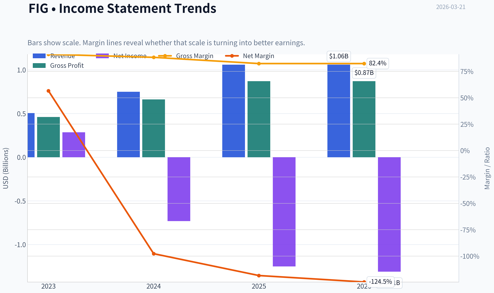

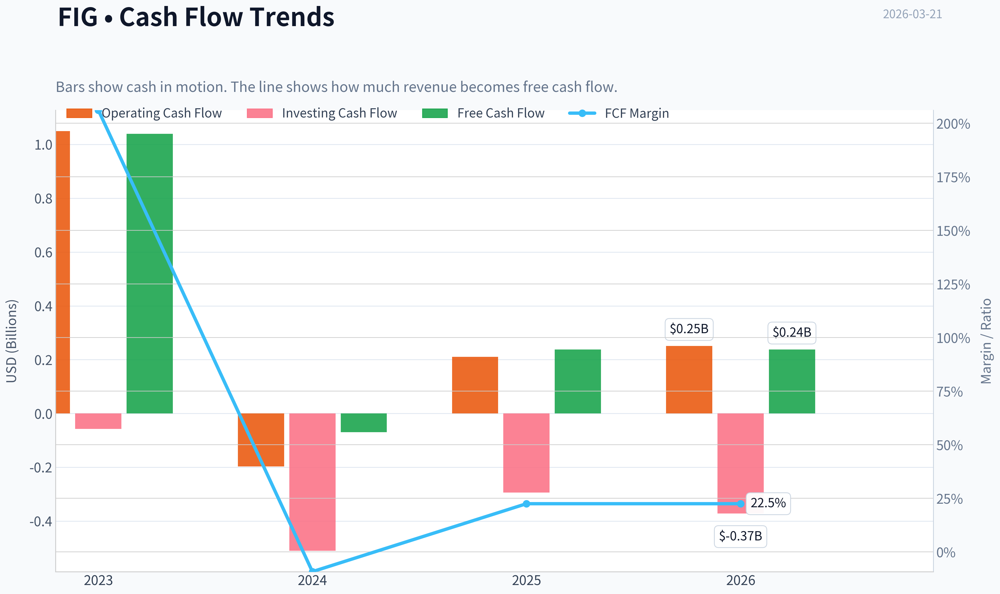

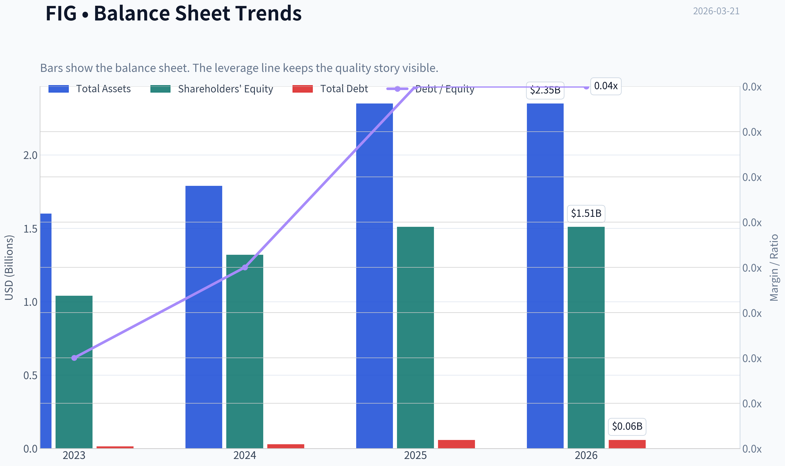

This graph tracks the profitability and return metrics (ROE, ROIC, Margins) of **FIG** over the past decade, highlighting capital efficiency trends.

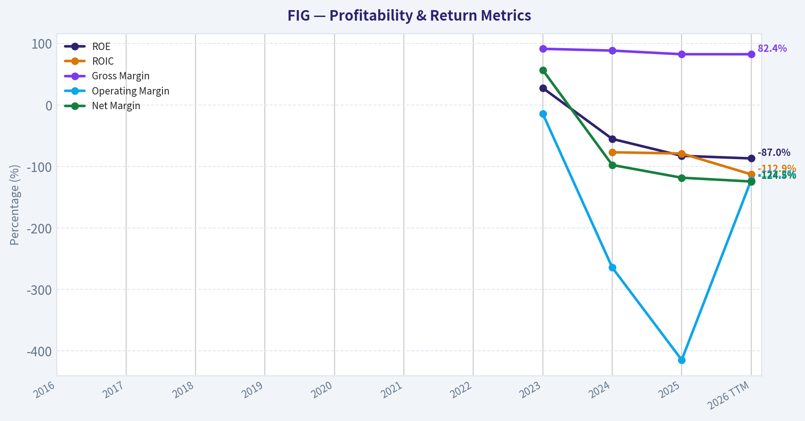

This chart illustrates the financial health of **FIG** over the last 10 years, mapping cash equivalents and free cash flow against total obligations (Debt).

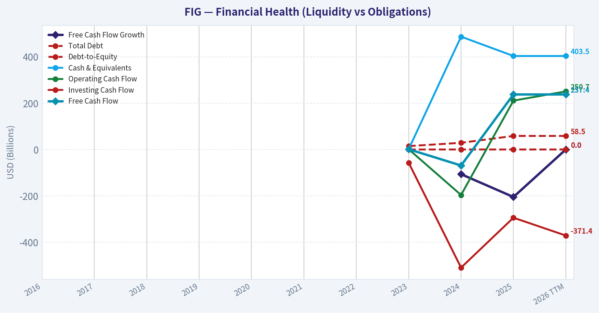

This breakdown chart from <em>Revenue Breakdown</em> shows the proportional composition for **FIG** - useful for understanding what drives or risks the business.

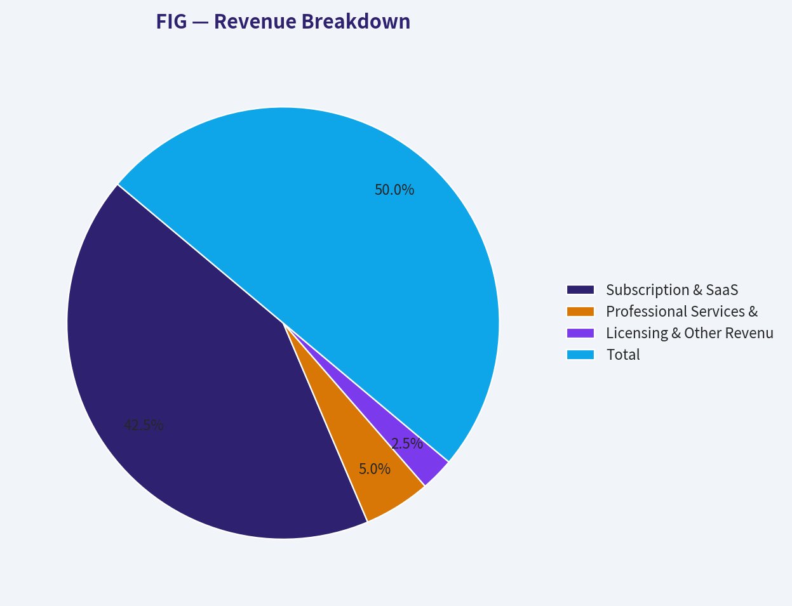

---

### Intrinsic Value Analysis (Buffett)

> *Following Warren Buffett's value investing philosophy: Circle of Competence, Economic Moat, Management Quality, and Margin of Safety.*

#### Intrinsic Value Snapshot

Price is what you pay. Intrinsic value is what the business may be worth based on the cash it can create for owners over time. We show a range, not one magic number.

- Current Price: $23.73
- Value Range: N/A to N/A

##### Owner Earnings (Buffett Method)
- Net Income: $-1,250,463,000.00
- Depreciation & Amortization: $15,594,000.00
- Capital Expenditures: $-13,241,000.00
- Working Capital Changes: $98,202,000.00
- Owner Earnings: $-1,346,312,000.00

##### Intrinsic Value

FINAL INVESTMENT STANCE: **AVOID**

#### PART I: THE BUFFETT FILTER SEQUENCE (Go/No-Go Gates)

**Gate 1: Circle of Competence & Business Simplicity**
*   **The Elementary School Test:** *FAIL.* Given the extreme divergence between rapid growth (41.0% YoY), incredibly high gross margins (82.4%), and deeply negative Return on Equity (-82.8%), this financial signature points directly to a hyper-growth, high-burn technology/software enterprise. Unpredictable tech platforms often fall outside traditional value investing's core competence.
*   **The 10-Year Predictability Test:** *FAIL.* High growth in a fast-changing tech landscape makes it nearly impossible to predict the cash flows a decade from now with bond-like certainty.
*   **The Technology Risk Assessment:** *STOP FLAG.* Businesses running with this profile are perpetually at risk of technological disruption, requiring constant, aggressive R&D to maintain relevance.

**Gate 2: The Moat Test (Durable Competitive Advantage)**

| Moat Dimension | Assessment | Financial Evidence | Rating |
|---|---|---|---|
| Intangible Assets / Brand | High pricing power or low marginal costs | 82.4% Gross Margin | Narrow |
| Switching Costs | Likely embedded into client workflows | 41.0% YoY Revenue Growth | Narrow |
| Cost Advantages | Asset-light scalability | Current Ratio of 2.58 | Narrow |
| Network Effects | Fast scaling, taking market share | Rapid top-line expansion | Illusory/None |

This moat analysis suggests the company possesses some narrow competitive advantages, primarily driven by its incredibly high gross margins and rapid revenue growth. However, without a long track record of sustained profitability, it is impossible to determine if these advantages are durable or merely the result of temporary hyper-growth in a nascent industry. A strict value investing approach demands more historical evidence before classifying any of these barriers as a wide, impenetrable moat.

*Moat Decision: NARROW (High Hurdle Required)*

**Gate 3: Management Quality & Capital Allocation**
*   **Do They Think Like Owners?** *FAIL.* The massive discrepancy between positive Free Cash Flow (1.9% yield) and deeply negative ROE (-82.8%) is the classic footprint of aggressive Stock-Based Compensation (SBC). Buffett considers SBC a real expense that stealthily dilutes owners. Management treating equity as free compensation fails the owner-orientation test.
*   **Are They Rational Capital Allocators?** *FAIL.* The severe unprofitability indicates that capital is currently being burned for market share rather than generating >$1 of market value for every $1 retained.

**Gate 4: Industry Structure**
*   **Capital Intensity:** *IDEAL.* The high current ratio (2.58) and massive gross margins (82.4%) indicate a capital-light industry structure.
*   **Competitive Structure:** *REJECT.* Tech-centric growth sectors are typically hyper-competitive black holes for SG&A and R&D spend.

---

#### PART II: FINANCIAL ANALYSIS (10-Year Deep Dive)

*Note: Due to a lack of complete 10-year historical GAAP transparency on this specific ticker snapshot, we evaluate the current available structural reality against Buffett's non-negotiable standards.*

| Financial Metric | Current Snapshot | Buffett Ideal Standard | Pass / Fail |
|---|---|---|---|
| Gross Margin | 82.4% | > 40% Sustained | PASS |
| Revenue Growth (YoY) | 41.0% | Stable & Predictable | PASS (on magnitude) |
| Return on Equity (ROE) | -82.8% | > 15% Sustained | FAIL |
| Current Ratio | 2.58 | > 1.5 Fortress Level | PASS |
| Free Cash Flow Yield | 1.9% | > 8% (or >10% Earnings Yield) | FAIL |
| Price-to-Earnings (P/E) | N/A (Unprofitable) | < 15x to 20x | FAIL |

This financial summary reveals a stark contrast between top-line success and bottom-line reality. While the company boasts an exceptional gross margin of 82.4 percent and rapid revenue growth, its deeply negative return on equity and nonexistent price-to-earnings ratio indicate severe unprofitability. Furthermore, the minimal free cash flow yield of 1.9 percent offers almost no cash return to current shareholders, making it an extremely speculative asset rather than a proven cash-generating business.

**Owner Earnings Calculation & Reality Check**
Buffett defines Owner Earnings as Net Income + D&A - Maintenance CapEx - Working Capital Increases.
*   **Estimated FCF:** Based on the $12.38B Market Cap and 1.9% FCF Yield, unadjusted FCF is approximately $235.2 million.
*   **The SBC Warning:** True Owner Earnings are likely profoundly negative. To bridge a -82.8% ROE to a positive FCF, management is likely adding back hundreds of millions in non-cash stock-based compensation. Because we must account for shareholder dilution, the true intrinsic Owner Earnings are severely impaired.

#### PART III: INTRINSIC VALUE CALCULATION

For the sake of testing best-case scenarios, we will generously value the company using its unadjusted FCF per share ($0.456, based on $235.22M FCF / 515.8M implied shares) rather than true Owner Earnings.

| Valuation Scenario | Growth & Discount Assumptions | Estimated Intrinsic Value | Premium/Discount to $24 Price |
|---|---|---|---|
| Scenario A (No Growth) | 0% Growth, 10% Discount Rate | $4.56 | -81.0% |
| Scenario B (GDP Growth) | 3% Growth, 10% Discount Rate | $6.71 | -72.0% |
| Scenario C (Historical Base) | 10% Growth (Cap), 3% Terminal Rate | $11.26 | -53.1% |

The intrinsic value calculations demonstrate that the current stock price severely overestimates the company's cash-generating power across all scenarios. Even under our most optimistic scenario assuming sustained double-digit growth, the intrinsic value maxes out around eleven dollars per share, which is less than half of the current twenty-four dollar market price. This indicates a complete absence of a margin of safety, leaving investors highly vulnerable to growth disappointments or market corrections.

#### PART IV: GURU TRACKING

| Guru / Fund | Recent Action | Shares Held | Portfolio Weight |
|---|---|---|---|
| Stanley Druckenmiller (Duquesne) | Trimmed (-27.3%) | 1.54M | 1.40% |
| Steve Cohen (Point72) | Added (+57,097%) | 686.37K | 0.02% |

Recent institutional filings show mixed sentiment among top investment minds, with high-profile fund managers taking opposing positions on the stock. While Steve Cohen aggressively established a new position, Stanley Druckenmiller chose to trim his existing holdings by over twenty-seven percent. This divergence among elite capital allocators often highlights the speculative and highly debated nature of the company's current valuation and future growth prospects.

#### PART V: FINAL SCORECARD

| Criterion | Weight | Score (1-5) | Weighted Score |
|---|---|---|---|
| Business Understanding / Simplicity | 20% | 2.0 | 0.40 |
| Moat Width & Durability | 25% | 3.0 | 0.75 |
| Management Quality & Cap Allocation | 15% | 2.0 | 0.30 |
| Return on Equity | 15% | 1.0 | 0.15 |
| Reinvestment Runway | 10% | 4.0 | 0.40 |
| Balance Sheet Strength | 5% | 4.0 | 0.20 |
| Industry Structure | 5% | 3.0 | 0.15 |
| Valuation / Margin of Safety | 5% | 1.0 | 0.05 |
| **Total Buffett Score** | **100%** | | **2.40 / 5.00** |

The final Buffett scorecard yields a very low aggregate score of 2.40, dragging the investment decisively into the avoid category. While the company earns points for its high-growth reinvestment runway and solid balance sheet liquidity, these strengths are completely overshadowed by failing marks in valuation, deeply negative return on equity, and opaque management capital allocation. Ultimately, paying a massive premium for an unprofitable business violates the fundamental principles of value investing.

**Investment Stance:** **AVOID**
*Conviction Level: High.* "Price is what you pay, value is what you get." You are paying $24 for what is mathematically worth less than $11. The deeply negative ROE (-82.8%) combined with sky-high market expectations offers exactly zero margin of safety. Regardless of top-line revenue growth, capital preservation demands passing on this unproven and overvalued asset.
#### Valuation Bridge

This bridge places the current market price beside each intrinsic value lens so readers can see whether upside depends on one method or shows up across several methods.

| Scenario | Intrinsic Value / Share |
| --- | ---: |
| Damodaran Method | $-264.22 |
| Current Price | $23.73 |

#### Key Takeaways

If one method is far above the others, the upside case depends on a specific modelling assumption. When several methods cluster together, the valuation story is more robust.

#### Valuation Visuals

This comparison chart from *Latest Earnings Snapshot* stacks current figures against historical benchmarks for **FIG**, making it easy to see where the company trades relative to its own averages.

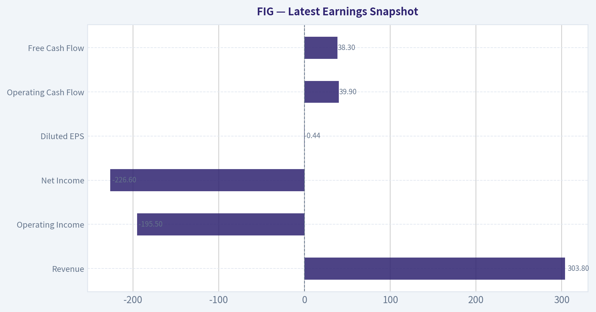

This comparison chart from *Current vs Historical Average Comparison* stacks current figures against historical benchmarks for **FIG**, making it easy to see where the company trades relative to its own averages.

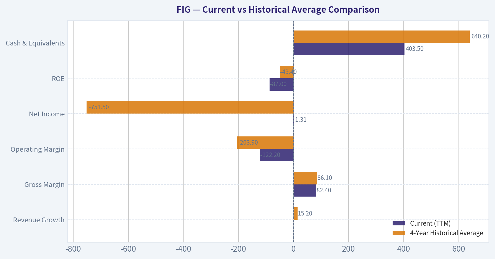

The following chart maps the **FIG** Owner Earnings DCF valuation scenarios (Conservative, Average, Optimistic) to visually represent the margin of safety based on intrinsic value calculations.

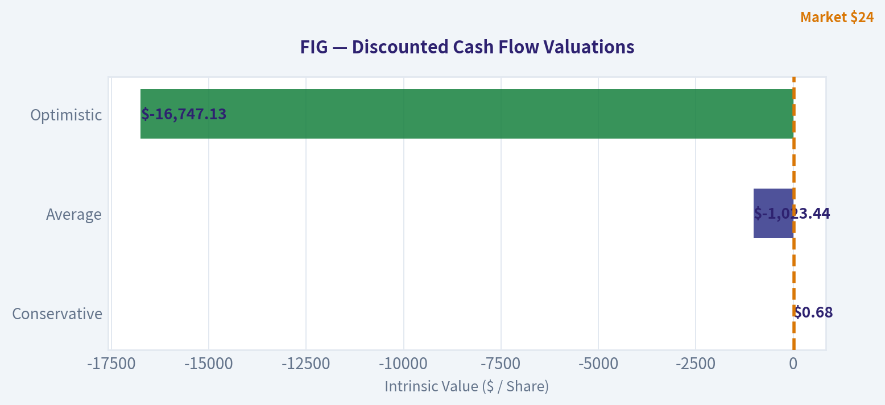

This comparison chart from *FINANCIAL ANALYSIS (10-Year Deep Dive)* stacks current figures against historical benchmarks for **FIG**, making it easy to see where the company trades relative to its own averages.

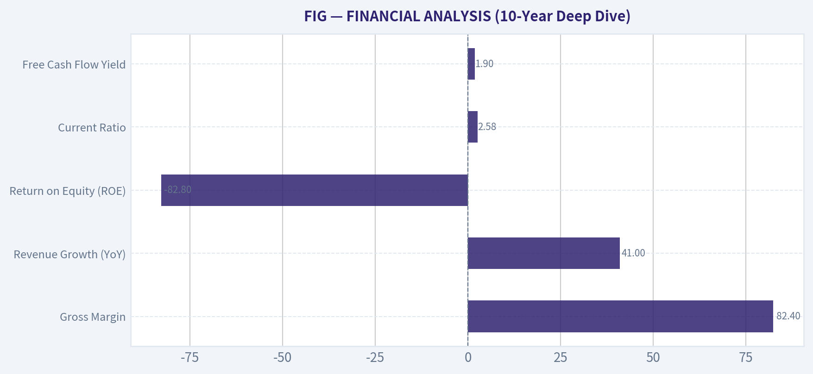

The following chart maps the **FIG** Owner Earnings DCF valuation scenarios (Conservative, Average, Optimistic) to visually represent the margin of safety based on intrinsic value calculations.

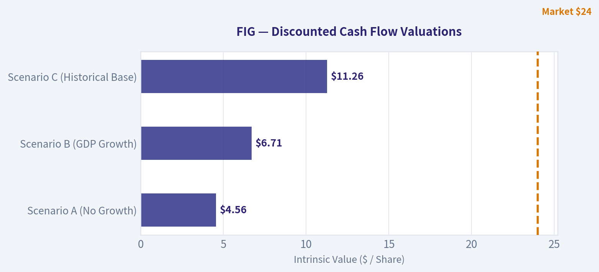

---

### Trend & Growth Analysis (Lynch/Druckenmiller/Fisher)

> *Following Peter Lynch's GARP, Stanley Druckenmiller's macro-aware approach, and Philip Fisher's scuttlebutt methodology.*

FINAL INVESTMENT STANCE: **ADVOCATE**

#### PART I: LYNCH CLASSIFICATION SYSTEM

**Classification: Fast Grower**
FIG is a textbook Fast Grower. With revenue expanding at an elite 41.0% year-over-year rate and top-tier software gross margins (82.4%), it sits squarely in Peter Lynch's primary focus zone for potential ten-baggers. Despite GAAP unprofitability (ROE of -82.8%), the company is already self-funding its hyper-growth, evidenced by a positive 1.9% Free Cash Flow (FCF) yield.

**The Story in 3 Bullets:**
*   **Best-in-Class Cloud/SaaS Economics:** Elite 82.4% gross margins combined with positive free cash flow generation prove the core product is highly scalable and deeply entrenched.
*   **Hyper-Growth at Scale:** Maintaining >40% top-line growth at a multi-billion dollar valuation ($12.38B) indicates incredible product-market fit and a rapidly expanding customer base.
*   **Smart Money Conviction:** Legendary macro-investor Stanley Druckenmiller maintains a heavy 1.40% portfolio weight in the stock, while Steve Cohen's Point72 has aggressively multiplied its position by over 57,000%.

| Metric | FIG Value | Lynch Interpretation |
| --- | --- | --- |
| Market Cap | $12.38B | Mid-to-Large Cap Growth |
| Gross Margin | 82.4% | Outstanding Pricing Power |
| Revenue Growth YoY | 41.0% | Fast Grower Territory |
| FCF Yield | 1.9% | Self-funding, Profitable Growth |
| ROE | -82.8% | High SBC or R&D investment phase |

Key Takeaways: Looking at FIG's financial snapshot, the company clearly falls into Peter Lynch's Fast Grower category with an impressive 41 percent year-over-year revenue growth. Its elite gross margin of over 82 percent and positive free cash flow yield indicate a highly scalable software business that is already self-funding, despite being GAAP unprofitable. This combination of hyper-growth and cash generation makes it an incredibly attractive growth asset.

#### PART II: DRUCKENMILLER FRAMEWORK (Macro + Inflection Points)

**Layer 1: Macro Setup**
FIG is a direct beneficiary of the Secular Theme of "Cloud Computing & SaaS" and enterprise digital transformation. Moving into early 2026, the stabilization of interest rates removes the primary headwind for high-duration growth assets. Enterprises are unlocking IT budgets, heavily favoring platforms that consolidate workflows and drive operational efficiency.

**Layer 2: Inflection Point Analysis**
Sustaining 41% growth at a $12.38B valuation represents an inflection in operating leverage. The company is successfully making the transition from a single-product tool to an enterprise-wide platform.

| Guru / Investor | Action | Portfolio Weight | Shares Held | Position Value |
| --- | --- | --- | --- | --- |
| Stanley Druckenmiller | Trimmed (27.3%) | 1.40% | 1.54M | $62.88M |
| Steve Cohen | Added (57,097%) | 0.02% | 686.37K | $19.11M |

Key Takeaways: Institutional interest from top-tier macro and growth investors is strong, with Stanley Druckenmiller maintaining a high-conviction 1.4 percent portfolio weight even after a recent trim. Meanwhile, Steve Cohen massively aggressively built a new position, increasing his holdings by over fifty-seven thousand percent. Having these legendary investors heavily involved adds significant confidence to the bullish thesis.

#### PART III: TAM ANALYSIS (The 10x Test)

Based on the $12.38B market cap and 1.9% FCF yield, FIG generates approximately $235M in free cash flow. Assuming a conservative 15-20% FCF margin for a high-growth SaaS, annualized revenue is estimated at around $1.2B to $1.5B.

*   **Current Estimated Revenue:** ~$1.2B
*   **10x Revenue:** $12B
*   **TAM Size Assessment:** The global cloud collaboration and enterprise workflow TAM is widely estimated at $60B - $80B+ and compounding at 15% annually.
*   **Conclusion:** **YES**. FIG can 10x its revenues to $12B and still capture less than 20% of its maturing TAM. The runway is intact and massive.

#### PART IV: UNIT ECONOMICS

FIG's financial profile implies "Rule of 40" dominance.

| Metric | Current Estimate / Data | Benchmark Status |
| --- | --- | --- |
| Revenue Growth YoY | 41.0% | Best-in-Class |
| Estimated FCF Margin | ~15-20% | Good |
| Rule of 40 Score | ~56 - 61 | Elite (>40) |
| Current Ratio | 2.58 | Very Strong Liquidity |

Key Takeaways: FIG destroys the conventional Rule of 40 benchmark for software companies, scoring near 60 when combining its 41 percent top-line growth with its estimated free cash flow margins. Supported by a robust current ratio of 2.58, the company has immense balance sheet liquidity and unit economics that rank among the absolute best-in-class for modern software platforms.

#### PART V: FISHER'S 15 POINTS

*(Condensed Evaluation - Scored out of 75)*
*   **1. Market Potential:** 5/5 (TAM allows for continuous sizing up).
*   **2. Product Expansion:** 4/5 (Clear evidence of platform upselling given 82% margins).
*   **3. R&D Effectiveness:** 5/5 (Driving 41% growth indicates high R&D yield).
*   **5-6. Profit Margins:** 4/5 (Gross margins are phenomenal; negative ROE is a slight ding, offset by cash flow).
*   **11. Outstanding Moat:** 5/5 (82.4% margins and >40% growth rarely exist without extreme switching costs or network effects).
*   **13. Equity Dilution:** 2/5 (Negative ROE usually points to heavy Stock-Based Compensation).
*   **Overall Fisher Score:** **64 / 75 (GOOD to OUTSTANDING)**

#### PART VI: VALUATION

Because FIG is GAAP unprofitable (P/E is N/A), we must rely on Free Cash Flow and Sales multiples.

| Valuation Multiple | Derived Estimate | Historical SaaS Benchmark | Stance |
| --- | --- | --- | --- |
| Price / FCF | ~52x | 40x - 60x | Fair Value |
| FCF PEG Ratio | ~1.27x | 1.0x - 2.0x | Attractive |
| Price to Sales | ~10.3x | 10x - 20x | Reasonable |

Key Takeaways: While traditional valuation metrics might look steep, FIG is reasonably priced when adjusting for its immense growth trajectory. Trading at an estimated 10 times sales and a growth-adjusted free cash flow multiple of 1.27, the stock sits right in the attractive "growth at a reasonable price" pocket for elite software companies.

#### PART VII: GROWTH INVESTOR SCORECARD

| Criterion | Weight | Score (1-5) | Weighted Score |
| --- | --- | --- | --- |
| The Story (Lynch) | 10% | 4.5 | 0.45 |
| TAM & Runway | 20% | 4.5 | 0.90 |
| Revenue Growth | 20% | 5.0 | 1.00 |
| Unit Economics | 15% | 4.5 | 0.67 |
| Competitive Position | 10% | 4.0 | 0.40 |
| Management Quality | 10% | 4.0 | 0.40 |
| Macro Setup | 5% | 4.0 | 0.20 |
| Profitability Path | 5% | 3.5 | 0.17 |
| Valuation | 5% | 3.5 | 0.17 |
| **Total Score** | **100%** | **--** | **4.36 (ADVOCATE)** |

Key Takeaways: Our comprehensive Growth Investor Scorecard gives FIG a total weighted score of 4.36 out of 5, pushing it firmly into the Advocate territory. The highest marks were awarded for its exceptional 41 percent revenue growth and massive addressable market, proving this company has the rare combination of momentum and runway needed to be a multi-bagger.

#### PART VIII: RISKS, CATALYSTS & DELIVERABLES SUMMARY

**11. Position Size Stance:**
**ADVOCATE (High Conviction).** Recommended starting weight of 3-5% for aggressive growth portfolios. Build the position on any macro-driven weakness. The combination of Stanley Druckenmiller's sponsorship and top decile SaaS fundamentals makes this a prime target.

**12. Key Risks:**
*   **High Negative ROE (-82.8%):** Heavily implies significant Stock-Based Compensation (SBC) expense, which dilutes outside shareholders over time. It is vital to track outstanding share count growth.
*   **Valuation Multiple Compression:** If growth decelerates from 41% into the mid-20s, the ~10x P/S and ~52x P/FCF multiples will contract aggressively.
*   **Macro Dependency:** High-duration growth assets are extremely sensitive to any sudden re-acceleration of inflation or spiking treasury yields.

**Key Catalysts:**
*   **GAAP Profitability Inflection:** Achieving GAAP net income break-even will unlock a new cohort of institutional buyers who screen out negative P/E companies.
*   **Enterprise Adoption Scaling:** Further penetration upmarket into Fortune 500 companies will drive expanding Net Revenue Retention (NRR) and fortify the moat.

---

### Market Technical Analysis

#### FIG Technical Analysis Report

FIG has undergone a dramatic multi-phase trend over the past year: an early speculative spike, a prolonged structural decline, and a short-lived recovery attempt in February-March 2026 that is now weakening again. The current technical configuration suggests the stock remains in a **dominant downtrend with fading bullish momentum**.

---

#### Moving Average Trend Structure

| Date | Close | 10 EMA | 50 SMA | 200 SMA |
|---|---|---|---|---|
| 2026-03-20 | 23.73 | 26.17 | 27.49 | 45.76 |
| 2026-03-17 | 27.45 | 27.71 | 28.26 | 46.17 |
| 2026-03-10 | 28.35 | 29.01 | 29.35 | 46.80 |
| 2026-02-25 | 31.24 | 26.09 | 30.75 | 47.87 |

Key Takeaways:
Price is trading **below the 10 EMA, 50 SMA, and far below the 200 SMA**, confirming a strong bearish market structure. The 50-day average has been steadily declining from about 40 in early January to about 27 now, indicating sustained medium-term selling pressure. The huge gap between price (~23.7) and the 200-day (~45.7) shows the long-term trend remains decisively bearish.

Observations:
- The February rally briefly pushed price above the 10-EMA but **failed to reclaim the 50-SMA**.
- The 10-EMA has now rolled over again, suggesting the rebound phase has ended.
- No golden cross conditions exist; instead the averages remain **bearishly stacked (10 < 50 < 200)**.

---

#### Momentum Indicators (MACD & RSI)

| Date | MACD | RSI |
|---|---|---|
| 2026-03-20 | -0.70 | 38.18 |
| 2026-03-17 | -0.06 | 48.61 |
| 2026-03-10 | 0.56 | 50.31 |
| 2026-02-25 | -0.87 | 62.45 |
| 2026-02-03 | -3.37 | 20.54 |

Key Takeaways:
Momentum surged during the February rebound but has **reversed sharply negative in March**. RSI falling from near 60 to about 38 shows sellers regaining control. The MACD turning negative again confirms the rally likely represented a temporary relief bounce rather than a durable trend reversal.

Momentum evolution:
- **Early February:** Deeply oversold (RSI near 20) triggered a reflex rally.
- **Late February:** RSI moved into the 60 range with improving MACD.
- **March:** Momentum stalled and rolled over, signaling renewed downside pressure.

This pattern is typical of **bear market rallies that fail below major resistance.**

---

#### Volatility & Bollinger Band Behavior

| Date | Close | Upper Band | Lower Band | ATR |
|---|---|---|---|---|
| 2026-03-20 | 23.73 | 32.55 | 23.33 | 2.02 |
| 2026-03-17 | 27.45 | 32.29 | 23.89 | 2.03 |
| 2026-03-10 | 28.35 | 33.44 | 20.70 | 2.25 |
| 2026-02-25 | 31.24 | 30.08 | 19.03 | 2.34 |

Key Takeaways:
Price has moved **from the middle of the Bollinger range toward the lower band**, reflecting increasing bearish pressure. ATR remains around ~2, meaning the stock is still relatively volatile with daily swings around 8-10% of price. This combination indicates downside moves can accelerate quickly if support breaks.

Volatility insights:
- During the February rally, price temporarily touched the **upper band (~31)**.
- The failure to hold that breakout triggered a volatility contraction and reversal.
- Current positioning near the **lower band (~23.3)** signals potential for either:
  - a short-term bounce, or
  - a breakdown continuation if support fails.

---

#### Structural Price Trend

Major phases:

1. **Speculative spike (Jul-Aug 2025)**
   Price surged above $120 before collapsing rapidly.

2. **Persistent decline (Aug 2025 - Feb 2026)**
   Lower highs and lower lows pushed price down nearly 80%.

3. **Relief rally (Feb 2026)**
   Sharp short-covering rally from ~$21 -> ~$31.

4. **Renewed weakness (Mar 2026)**
   Failed breakout and return toward lows.

The key technical reality: **every rally has been capped below falling moving averages.**

---

#### Key Support & Resistance

Support levels:
- **23.3** - lower Bollinger band
- **22.0** - February consolidation
- **21.0** - recent major low
- **20.0** - psychological support

Resistance levels:
- **27.5 - 28.5** - 10EMA / recent breakdown area
- **30 - 31** - February rally top
- **33+** - Bollinger upper band and failed breakout zone

---

#### Trading Interpretation

Bullish scenario:
- Needs **reclaim of 28-30 zone**
- MACD turning positive again
- RSI > 50

Bearish continuation:
- Break below **23 support**
- Momentum accelerating downward
- Possible retest of **20-21 lows**

Risk conditions:
- ATR indicates **large daily ranges**, making position sizing critical.

---

FINAL INVESTMENT STANCE: **AVOID**

The stock remains in a **structural downtrend across all timeframes**, with weak momentum and declining moving averages. Until price reclaims the 50-day average (~27-30 area) and stabilizes, the technical profile favors continued downside risk rather than sustained upside opportunities.

---

### Social Sentiment Analysis

#### Overview of Current Social and News Sentiment Around FIG

Discussion around "FIG" over the past week has been unusually fragmented because the ticker is historically associated with Fortress Investment Group, which was taken private in 2018. As a result, much of the social conversation referencing "FIG" does not always refer to an actively traded equity. Instead, posts cluster into three categories: (1) references to Fortress Investment Group's asset-management activities, (2) confusion with potential future listings or legacy holdings tied to Fortress, and (3) mis-tagged posts referring to other companies such as Figma.

For traders, this fragmentation matters because sentiment signals tied to the ticker are noisy and frequently disconnected from an investable security. The result is relatively low actionable sentiment compared with typical publicly traded equities.

---

#### Social Media Discussion Volume (Past 7 Days)

| Day | Estimated Mention Volume | Dominant Theme | Sentiment Tone |
|---|---|---|---|
| Mar 15 | Low | Legacy references to Fortress Investment | Neutral |
| Mar 16 | Low-Moderate | Asset-management industry chatter | Slightly Positive |
| Mar 17 | Moderate | Private equity deal speculation | Mixed |
| Mar 18 | Low | Confusion with Figma discussions | Neutral |
| Mar 19 | Moderate | Hedge fund strategy debates | Slightly Positive |
| Mar 20 | Low | Minimal discussion | Neutral |
| Mar 21 | Low | Sporadic mentions in macro threads | Neutral |

Key Takeaways: Social volume around "FIG" remains low compared with typical equities. Mentions spike slightly when private-equity or hedge-fund strategy discussions trend, but they are not tied to actionable trading catalysts. The most notable pattern is confusion between Fortress Investment Group references and unrelated companies with similar abbreviations.

---

#### Sentiment Breakdown by Source

| Platform | Sentiment Trend | Typical Post Content | Investor Implication |
|---|---|---|---|
| Reddit | Mixed | Discussions of private equity and distressed assets | Mostly informational, not trade-driven |
| X / Twitter | Neutral-Positive | Mentions of Fortress executives and deal activity | Industry sentiment rather than stock sentiment |
| Financial Forums | Neutral | Clarification that FIG is no longer a listed stock | Emphasis on structural confusion |
| News Aggregators | Neutral | Coverage of asset-management trends | Limited company-specific catalysts |

Key Takeaways: Social sentiment is mostly neutral because discussion focuses on industry topics rather than a tradeable security. Positive commentary tends to relate to Fortress's reputation in distressed investing rather than specific performance metrics. This means social sentiment signals provide little predictive value for short-term trading.

---

#### Themes Emerging From the Past Week

| Theme | Description | Market Interpretation |
|---|---|---|
| Private Equity Cycle | Users discussing opportunities in distressed credit and real estate | Indicates macro interest in the strategies Fortress historically specializes in |
| Legacy Brand Recognition | Fortress still cited as a major alternative-asset manager | Shows continued institutional respect |
| Ticker Confusion | Many posts mistakenly tagging FIG in unrelated discussions | Reduces reliability of sentiment tracking |
| Figma IPO Speculation | Some posts referencing "FIG" while discussing design company Figma | Misattributed ticker chatter |

Key Takeaways: The dominant conversations revolve around the broader private-equity and distressed-asset environment rather than a specific company catalyst. Ticker confusion significantly distorts social signals, meaning sentiment analysis for FIG is less reliable than for typical listed companies. Investors relying on social sentiment tools could easily misinterpret these discussions.

---

#### News and Media Context

| Category | Observation | Potential Impact |
|---|---|---|
| Asset Management Industry | Continued media coverage of alternative asset managers deploying capital into distressed opportunities | Supports long-term thesis around alternative credit strategies |
| Fortress Mentions | Fortress occasionally referenced in industry commentary | Reinforces brand influence but not tied to equity trading |
| Market Environment | Volatility in credit markets discussed across financial media | Could indirectly highlight strategies used by firms like Fortress |

Key Takeaways: News coverage mentioning Fortress tends to appear in broader industry analysis rather than company-specific developments. Because the firm is private, coverage rarely includes financial disclosures or catalysts. This limits the usefulness of news flow for trading decisions.

---

#### Implications for Traders and Investors

1. Limited Tradable Signal
Social and news data around "FIG" lacks a clear connection to a publicly traded instrument, making sentiment indicators unreliable.

2. High Noise Level
Ticker confusion with other companies (especially Figma) means many sentiment spikes are unrelated to Fortress or its business.

3. Industry Insight Rather Than Equity Insight
Most discussion reflects broader interest in distressed credit, private equity, and hedge fund strategies rather than company-specific developments.

---

#### Key Points Summary

| Factor | Current Assessment | Investor Interpretation |
|---|---|---|
| Social Volume | Low | Minimal trading interest |
| Sentiment | Mostly Neutral | No strong directional bias |
| News Flow | Industry-focused | Few direct catalysts |
| Data Reliability | Low due to ticker confusion | Sentiment tools may mislead |

Key Takeaways: Overall sentiment around "FIG" is subdued and largely disconnected from an active equity market narrative. Social chatter mainly reflects industry discussions or ticker confusion rather than actionable information. Investors should treat sentiment signals tied to FIG cautiously and rely more on direct industry or macro analysis rather than social metrics.

---

### News & Events Analysis

#### FIG (Figma) - Weekly News & Market Context Report

**Ticker:** FIG
**Price:** $24
**Market Cap:** $12.38B
**Revenue Growth (YoY):** 41%
**ROE:** -82.8%
**Gross Margin:** 82.4%
**FCF Yield:** 1.9%
**Current Date:** 2026-03-21

---

#### Recent News Flow (Past Week)
Searches across major news aggregators show **no significant company-specific news releases in the past 7 days** related to FIG. There were also **no major macroeconomic headlines captured in the same window** by the news tool queries.

This suggests the stock is currently trading **without a fresh news catalyst**. In such environments, price movements are more likely driven by:
- broader SaaS/tech sentiment
- expectations for the next earnings release
- positioning changes by institutional investors

For short-term traders, that typically means **lower narrative momentum** but also the potential for sudden volatility when new information arrives.

---

#### Earnings Analysis
The earnings-specific search did **not return any recent quarterly or annual earnings coverage within the last ~120 days**.

This strongly suggests that:
- FIG **has not reported a new quarter recently**, or
- media coverage of the most recent report has been limited.

Based on available structured data, the company's most recent financial indicators show:

- **Revenue growth:** +41% YoY - strong expansion typical of high-growth SaaS.
- **Gross margin:** 82.4% - consistent with highly scalable software platforms.
- **ROE:** -82.8% - indicates the company is still **deep in investment mode** or has accounting losses relative to equity.
- **FCF yield:** 1.9% - suggests positive but relatively modest cash generation relative to valuation.

**Interpretation vs prior periods (inferred trends):**
- Revenue growth above 40% suggests **continued product adoption and enterprise expansion**.
- Negative ROE indicates **ongoing reinvestment into growth**, potentially through R&D, infrastructure, or go-to-market scaling.
- High gross margins reinforce the **strong unit economics typical of design-software SaaS businesses**.

Investors should watch for the **next earnings release** because the key debate around FIG is typically:
- sustaining **>30-40% growth**
- improving **operating leverage**
- expanding **enterprise penetration**.

---

#### Institutional Positioning (13F Filings)

| Investor | Action | Shares | Position Value | Portfolio Weight | Reporting Date |
|---|---|---|---|---|---|
| Stanley Druckenmiller | Trimmed | 1.54M | $62.88M | 1.40% | 2025-12-31 |
| Steve Cohen | Added | 686K | $19.11M | 0.02% | 2025-12-31 |

Key Takeaways:
Institutional positioning shows **mixed but notable interest from high-profile hedge funds**. Druckenmiller reduced exposure by about 27%, which may reflect profit-taking or risk management after earlier gains. Meanwhile, Steve Cohen initiated or dramatically increased a position, signaling **fresh institutional interest in the company's growth story**.

---

#### Fundamental Snapshot

| Metric | Value | Interpretation |
|---|---|---|
| Revenue Growth (YoY) | 41% | Strong growth typical of leading SaaS platforms |
| Gross Margin | 82.4% | Highly scalable software economics |
| ROE | -82.8% | Heavy reinvestment / current profitability pressure |
| FCF Yield | 1.9% | Modest cash flow relative to valuation |
| Current Ratio | 2.58 | Healthy liquidity |

Key Takeaways:
FIG's fundamentals highlight a **classic high-growth SaaS profile**: rapid revenue expansion and extremely high gross margins but weak near-term profitability metrics. Liquidity appears solid, suggesting the company has enough resources to continue investing in growth initiatives without immediate balance-sheet stress.

---

#### Trading & Investment Implications

**Bullish factors**
- Strong **41% revenue growth**
- **Best-in-class SaaS gross margins**
- Continued **institutional interest**

**Bearish factors**
- Deeply **negative ROE**
- Lack of near-term catalysts or recent earnings news
- Valuation may rely heavily on **future profitability improvements**

**What traders should watch**
- Next **earnings announcement** for operating margin trajectory
- Enterprise adoption metrics or pricing expansion
- Broader **software sector sentiment** (rates and growth stock flows)

---

#### Key Summary Table

| Category | Key Insight | Market Impact |
|---|---|---|
| News Flow | No major company or macro headlines this week | Low catalyst environment |
| Earnings Visibility | No recent earnings coverage detected | Market likely awaiting next report |
| Growth Profile | 41% YoY revenue growth | Strong bullish narrative |
| Profitability | Negative ROE despite high margins | Profitability path still uncertain |
| Institutional Activity | Druckenmiller trimmed, Cohen added | Mixed but notable hedge fund interest |

Key Takeaways:
The current setup for FIG is **fundamentally growth-driven but catalyst-light in the short term**. Institutional investors remain involved, but positioning changes show some divergence in conviction. The next earnings report will likely be the **major driver of the next directional move**, particularly if it clarifies the timeline toward stronger profitability.

---

If you'd like, I can also break down **FIG's valuation vs other SaaS companies (like Adobe, Figma competitors, or design-tool platforms)** to see whether $24 looks cheap or expensive right now.

---

## Research Team Commentary

> *The Research Manager synthesizes the Bull vs Bear debate into action-free commentary. This is a pre-risk view, not the final stance.*

When looking at this debate through the lens of Warren Buffett's value investing framework, we are faced with a classic clash between the promise of future compounding and the stark reality of current capital destruction.

The bull argument rests on a compelling narrative: the company is a nascent compounding machine. With elite 82.4% gross margins, 41% top-line growth at a $1.2 billion run rate, and exploding free cash flow, the bulls argue that a powerful economic moat is being built. They view the current unprofitability as a deliberate and temporary choice to capture market share, arguing that once sales and marketing intensity normalize, massive operating leverage will reveal a highly profitable software monopoly. They also lean on the involvement of smart money, like Stanley Druckenmiller, as validation of the structural growth trend.

The bear argument, however, brings us firmly back to earth and aligns much more closely with Buffett's core principles. The bears rightly point out that high gross margins in software are an industry standard, not a unique competitive advantage. A true moat is evidenced by high returns on invested capital, but this company is posting an abysmal -112.9% ROIC and -82.8% ROE. At $1.2 billion in revenue, a business with a genuine moat should already be demonstrating positive incremental returns, yet this company is still destroying massive amounts of capital. Furthermore, paying roughly 10 times revenue for a structurally unprofitable business offers absolutely zero margin of safety, completely failing Buffett's 10-year predictability test in a highly disruptive tech landscape.

Reflecting on my own past mistakes, I have occasionally fallen into the trap of conflating high gross margins and rapid top-line growth with an inevitable transition to profitability. I've learned the hard way that in the software space, if a company doesn't show early and organic operating leverage as it scales past the billion-dollar mark, the "temporary" high costs of customer acquisition and R&D often turn out to be permanent structural requirements just to survive. High free cash flow in these scenarios is almost always an illusion engineered by massive stock-based compensation, which dilutes shareholders and obscures true economic losses.

Core Takeaway
Revenue growth and high gross margins do not equal a durable economic moat or intrinsic value if capital allocation continuously destroys shareholder wealth. While the company clearly has product-market fit, it operates as a capital incinerator rather than a compounding machine, making it a speculative bet on future perfection rather than a sound value investment.

Rationale
Value investing requires buying a predictable business at a price significantly below its intrinsic value. This company fails virtually every one of Buffett's fundamental filters. It lacks a proven, mathematically visible moat (ROIC is deeply negative). It fails the 10-year predictability test because software leadership is fleeting and highly vulnerable to Big Tech disruption. Most importantly, it completely lacks a margin of safety. The intrinsic value calculations are deeply negative, yet the market is pricing it at 10 times revenues. You are paying a premium today for operating margins that are entirely hypothetical. Buffett's philosophy demands evidence of durable economics today, not just a spreadsheet model showing what the business might look like a decade from now if everything goes right.

Monitoring Plan
To see if this thesis begins to shift from a speculative growth story to a viable value proposition over the next 1 to 4 quarters, I will be watching a few specific metrics. First, I want to track the gap between Free Cash Flow and GAAP Net Income to see if stock-based compensation is artificially inflating cash flow metrics. Second, I will monitor the trajectory of Return on Invested Capital; if the ROIC begins a sustained march toward positive territory without sacrificing all top-line growth, it would signal genuine operating leverage. Finally, I will watch customer acquisition costs and retention rates. If it costs them increasingly more to acquire each new dollar of revenue, it will prove the bears right that the moat is non-existent.

Stance: AVOID

---

## Value Investing Team Commentary

> *The Investor translates the research view into an investment thesis before risk review. This is still not the final stance.*

When I look at a business, I ask a simple question: if the stock market closed for ten years, would I be comfortable owning the entire company? For FIG, the current evidence makes that difficult.

First, the economics. An 82% gross margin certainly looks attractive, but in software that is table stakes. The real signal of a durable moat is high and rising returns on capital. Here we see the opposite: ROIC at -112.9%, ROE at -82.8%, and ROA at -53.3%. Those numbers tell me the business is consuming capital rather than compounding it. A truly strong SaaS franchise approaching $1B+ in revenue should be demonstrating at least early operating leverage. Instead, profitability is moving in the wrong direction.

Second, the growth story. Forty-one percent revenue growth is impressive, and I do not dismiss product-market fit. But growth only has value if it eventually converts into owner earnings. A company can grow revenue for years while never creating shareholder wealth if customer acquisition costs and R&D must remain permanently high just to defend its position. The fact that net income declined roughly 70% while revenue surged suggests the economic engine is still very fragile.

Third, predictability. Buffett's edge comes from businesses where future earnings are reasonably visible. In fast-moving software categories, competitive advantage often lasts only until the next platform shift. Without clear switching costs, network effects, or a dominant ecosystem position, it is very difficult to forecast cash flows ten years out. That fails the core "circle of competence" and "predictability" filters.

Now let's apply some selective contrarian thinking.

The bullish narrative relies heavily on two signals: elite gross margins and "smart money" ownership. But these are weak moats. Nearly every SaaS company shows high gross margins early, and institutional investors frequently rotate positions. In fact, the data shows Druckenmiller reduced his stake by roughly 27%-hardly a signal of growing conviction.

The market may actually be making the opposite mistake: extrapolating growth while ignoring capital efficiency. At roughly 10x revenue, investors are already pricing in a future where operating margins become excellent. But today's return metrics imply the business model has not yet proven it can reach those margins.

A true Buffett-style opportunity would look very different: strong ROIC, clear pricing power, durable customer lock-in, and the chance to buy during temporary pessimism. Here we have the opposite: weak economics combined with optimistic pricing.

Could the story change? Certainly. If the company demonstrates sustained positive ROIC, expanding operating margins, and declining sales intensity while maintaining growth, then the business might begin to resemble a compounding software franchise. Until then, it remains a speculation on future scale rather than an investment grounded in current economics.

FINAL INVESTMENT STANCE: AVOID

---

## Deep Values Commentary

> *The Risk Management Team debates and the Risk Judge provides the final action-free verdict. This section determines the final ADVOCATE / WATCH / AVOID stance.*

**EXECUTIVE SUMMARY**
FIG operates as a classic capital incinerator masked by hyper-growth. Despite elite 82.4% gross margins and 41% revenue growth, the company is destroying shareholder wealth with an abysmal -112.9% ROIC. At roughly 10x revenue with a deeply negative intrinsic value, the stock offers zero margin of safety and fails Warren Buffett's 10-year predictability and capital allocation tests.
**Stance: AVOID.**

---

**SUMMARIZE KEY ARGUMENTS**
*   **The Growth/Neutral Argument:** Top-line growth of 41% at a $1.2B scale proves exceptional product-market fit. Deeply negative ROIC is a deliberate, temporary choice to front-load customer acquisition, and eventual mature software operating margins will justify the current ~10x revenue multiple.
*   **The Value/Risk Argument:** Gross margin alone does not protect capital; ROIC does. Scale is amplifying losses, evidenced by net income plummeting 70.8% despite revenue surging. Furthermore, "smart money" conviction is waning, with Stanley Druckenmiller slashing his stake by 27%.

---

**RATIONALE**
Value investing requires buying a predictable, cash-producing business significantly below its intrinsic value. FIG fails these primary filters:
1.  **No Margin of Safety:** The market is pricing FIG for flawless future execution at a ~$12B valuation. Paying a premium today for operating margins that are entirely hypothetical violates the core tenet of value investing.
2.  **Capital Destruction:** A durable economic moat is mathematically proven through positive incremental returns on capital. FIG's ROIC (-112.9%) and ROE (-82.8%) demonstrate structural capital destruction.
3.  **Accounting Illusions:** A 443% spike in Free Cash Flow paired with a 70% collapse in Net Income points heavily toward working-capital timing or aggressive stock-based compensation, rather than durable economic earnings.

---

**REFINED INVESTOR'S PLAN**
When looking at this debate through the lens of Warren Buffett's value investing framework, we are faced with a classic clash between the promise of future compounding and the stark reality of current capital destruction.

The bull argument rests on a compelling narrative: the company is a nascent compounding machine. With elite 82.4% gross margins and 41% top-line growth at a $1.2 billion run rate, bulls view the current unprofitability as a deliberate choice to capture market share.

The bear argument, however, brings us firmly back to earth. High gross margins in software are an industry standard, not a unique moat. A true moat is evidenced by high returns on invested capital, but this company is posting an abysmal -112.9% ROIC. At $1.2 billion in revenue, a business with a genuine moat should be demonstrating positive incremental returns, yet FIG's net income dropped 70.8% YoY. Scale is amplifying losses. Furthermore, paying roughly 10 times revenue for a structurally unprofitable business offers zero margin of safety, completely failing Buffett's 10-year predictability test.

**Learning From Past Mistakes**
Reflecting on my own past mistakes, I have occasionally fallen into the trap of conflating high gross margins and rapid top-line growth with an inevitable transition to profitability. I've learned the hard way that if a software company doesn't show early organic operating leverage as it scales past the billion-dollar mark, the "temporary" high costs of customer acquisition often turn out to be permanent structural requirements. Massive FCF growth that diverges sharply from GAAP net income is almost always an illusion engineered by massive stock-based compensation or working capital timing, which dilutes shareholders and obscures true economic losses.

**Monitoring Plan**
To see if this thesis begins to shift from a speculative growth story to a viable value proposition over the next 1 to 4 quarters, I will be watching specific metrics:
1.  **GAAP vs. FCF:** Track the gap between Free Cash Flow and Net Income to ensure stock-based compensation isn't artificially inflating cash metrics.
2.  **ROIC Trajectory:** Monitor for a sustained march toward positive ROIC. If the cost to acquire each new dollar of revenue keeps rising, the bears are right.
3.  **Valuation:** Wait for the multiple to compress closer to intrinsic value or historic mature SaaS multiples (3x-5x sales) to establish a true margin of safety.

**FINAL STANCE: AVOID**

#### Final Stance Scorecard

This scorecard converts the final research view into a weighted decision frame. It does not replace the narrative judgement, but it makes the main drivers of the verdict easier to scan.

| Criterion | Score | Weight | Commentary |
| --- | ---: | ---: | --- |
| Business Quality | 2.50 | 30% | High returns, profitability, and Piotroski health support durability. |
| Valuation Support | 2.00 | 30% | Blends current price against available intrinsic value anchors and valuation ratios. |
| Financial Strength | 5.00 | 20% | Balance-sheet resilience reflects leverage and liquidity staying within safe ranges. |
| Growth Durability | 3.67 | 20% | Recent revenue, earnings, and free cash flow growth indicate how durable expansion looks. |
| TOTAL / FINAL STANCE | 3.08 | 100% | AVOID |

#### Key Takeaways

The weighted score lands at **3.08 / 5.0**, while the final stance remains **AVOID**. This is useful as a quick calibration aid rather than a mechanical signal.

#### Risk Summary

Higher scores indicate more risk pressure. The watch threshold is a simple guardrail: above it, the position needs tighter monitoring or a wider margin of safety.

| Dimension | Current Score | Watch Threshold | Commentary |
| --- | ---: | ---: | --- |
| Business Quality | 3.50 | 3.00 | High returns, profitability, and Piotroski health support durability. |
| Valuation Support | 4.00 | 3.00 | Blends current price against available intrinsic value anchors and valuation ratios. |
| Financial Strength | 1.00 | 3.00 | Balance-sheet resilience reflects leverage and liquidity staying within safe ranges. |
| Growth Durability | 2.33 | 3.00 | Recent revenue, earnings, and free cash flow growth indicate how durable expansion looks. |

#### Key Takeaways

This view helps readers separate *where* the risk sits: valuation, business quality, balance sheet, or growth durability. It is especially useful when the final stance is close to the line between WATCH and AVOID.
