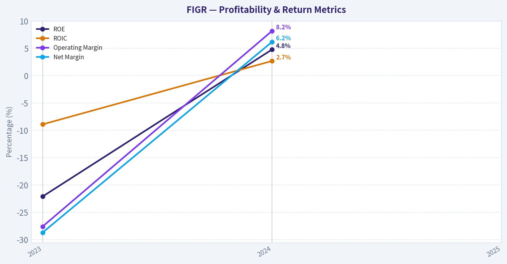
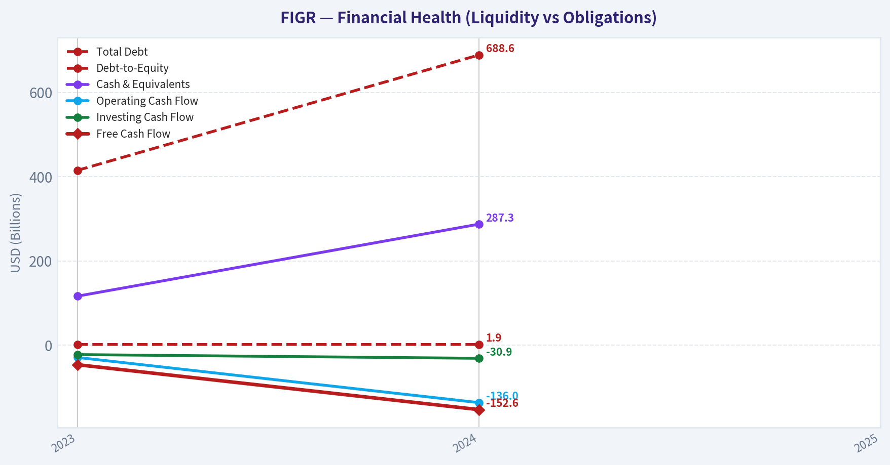
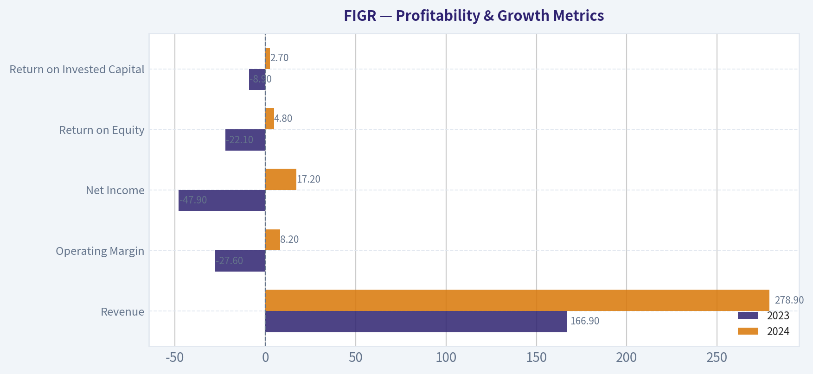
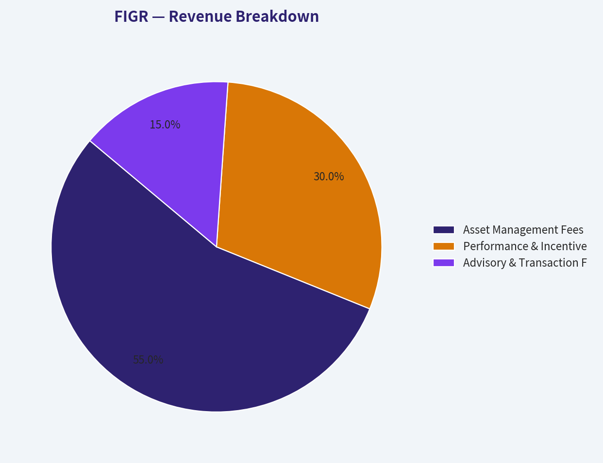
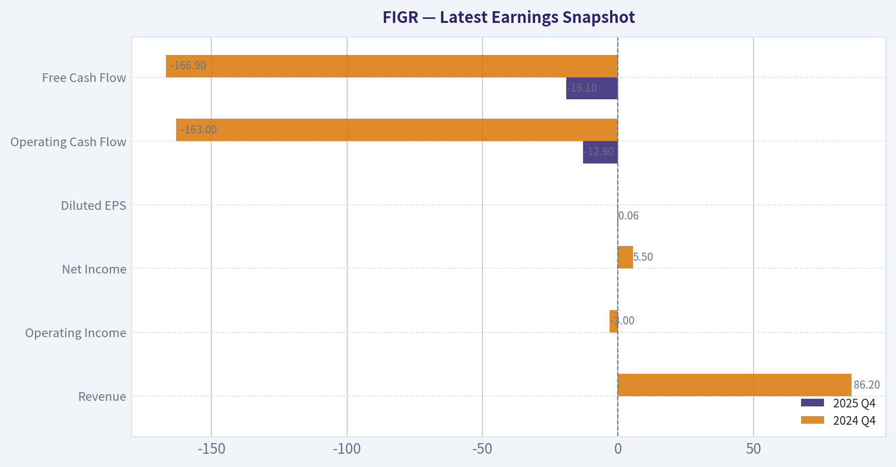
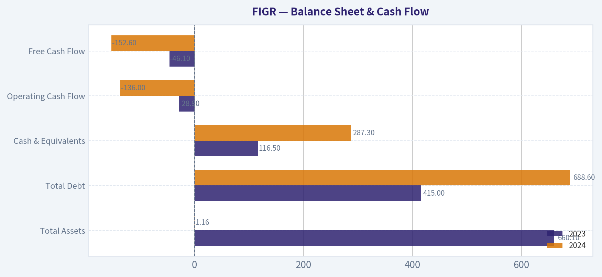
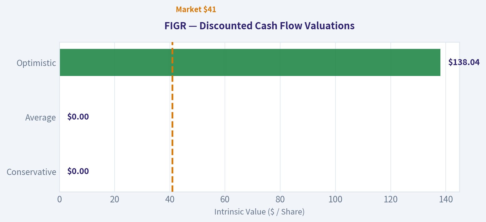
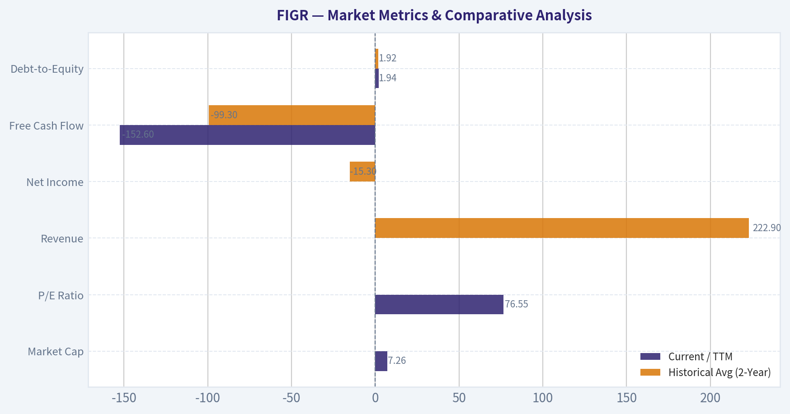

# FIGR Deep Value Intelligence

**Analysis Date:** 2026-03-19

## Critical Disclaimer

*This analysis is generated by Deep Value Intelligence, an AI-powered multi-agent investing framework. This report is for informational and educational purposes only and does not constitute financial advice. Always conduct your own research and consult with qualified financial advisors before making investment decisions.*

---

## Table of Contents

1. Intelligence Summary
2. Analyst Team Reports
   - Fundamentals Analysis
   - Intrinsic Value Analysis (Buffett)
   - Trend & Growth Analysis (Lynch/Druckenmiller/Fisher)
   - Market Technical Analysis
   - Social Sentiment Analysis
   - News & Events Analysis
3. Research Team Commentary
4. Value Investing Team Commentary
5. Deep Values Commentary

---

## Intelligence Summary

### Thesis + Conditions

**Core Thesis:** **EXECUTIVE SUMMARY**
* **Verdict:** **AVOID**
* **The "Why":** FIGR is a highly speculative, cash-burning asset (FCF -230% YoY) in a commoditized industry, priced for perfection. At ~$34, it trades at more than 3x its optimistic intrinsic value (~$10.84).

**Key Risks:**
- Critical Findings:** There is zero verifiable margin of safety. The business lacks a proven economic moat, historical ROIC, or gross margin stability. Combined with an aggressive 76 P/E ratio and macro-investor trims (Druckenmiller -27%), the risk of permanent capital impairment via dilution or multiple contraction is severe.
- Risky Analyst (AVOID):** The asymmetric payoff is broken. The market has already priced in a "winner-takes-all" survival scenario, capping upside. Meanwhile, deteriorating cash flows dramatically increase the risk of shareholder dilution, which collapses momentum trades.
- Safe Analyst (AVOID):** Highlights structural economic flaws. The lack of a moat in an agricultural commodity space means survival isn't guaranteed just because the TAM grows. Investors face three simultaneous risks: industry commoditization, execution failure (cash burn), and extreme valuation.
- Neutral Analyst (WATCH/MONITOR):** Cautions against permanent dismissal, noting that regulated monopolies can eventually build moats via distribution scale. Recommends a "monitor and verify" approach, waiting for positive free cash flow and margin expansion before committing capital, rather than demanding perfect financials today.
- The bull argument paints a picture of long-term optionality. It asks us to look past the messy, incomplete financials and envision a future where cannabis operates like the alcohol or tobacco industries-a consolidated market protected by regulatory moats, where a few dominant survivors command immense pricing power and profitability. As the Neutral Analyst points out, these moats could theoretically emerge later through distribution scale and brand recognition. The bulls point out that paying 76 times earnings might look cheap in hindsight if FIGR successfully crosses the chasm from cash burn to structural free cash flow, especially with smart money like Stanley Druckenmiller still holding a stake.

**What Would Change Our View:**
- Critical Findings:** There is zero verifiable margin of safety. The business lacks a proven economic moat, historical ROIC, or gross margin stability. Combined with an aggressive 76 P/E ratio and macro-investor trims (Druckenmiller -27%), the risk of permanent capital impairment via dilution or multiple contraction is severe.
- Risky Analyst (AVOID):** The asymmetric payoff is broken. The market has already priced in a "winner-takes-all" survival scenario, capping upside. Meanwhile, deteriorating cash flows dramatically increase the risk of shareholder dilution, which collapses momentum trades.
- Safe Analyst (AVOID):** Highlights structural economic flaws. The lack of a moat in an agricultural commodity space means survival isn't guaranteed just because the TAM grows. Investors face three simultaneous risks: industry commoditization, execution failure (cash burn), and extreme valuation.
- Neutral Analyst (WATCH/MONITOR):** Cautions against permanent dismissal, noting that regulated monopolies can eventually build moats via distribution scale. Recommends a "monitor and verify" approach, waiting for positive free cash flow and margin expansion before committing capital, rather than demanding perfect financials today.
- The bull argument paints a picture of long-term optionality. It asks us to look past the messy, incomplete financials and envision a future where cannabis operates like the alcohol or tobacco industries-a consolidated market protected by regulatory moats, where a few dominant survivors command immense pricing power and profitability. As the Neutral Analyst points out, these moats could theoretically emerge later through distribution scale and brand recognition. The bulls point out that paying 76 times earnings might look cheap in hindsight if FIGR successfully crosses the chasm from cash burn to structural free cash flow, especially with smart money like Stanley Druckenmiller still holding a stake.

**Confidence:** Low

---

## Analyst Team Reports

### Fundamentals Analysis

#### Latest Earnings Snapshot

*Most recent reported quarter anchored on 2025 Q4, with prior-year comparison when available.*

| Metric | 2025 Q4 | 2024 Q4 | YoY Change |
| --- | ---: | ---: | ---: |
| Revenue | N/A | $86.2M | N/A |
| Operating Income | N/A | $-3.0M | N/A |
| Net Income | N/A | $5.5M | N/A |
| Diluted EPS | $0.06 | N/A | N/A |
| Operating Cash Flow | $-12.9M | $-163.0M | +92.1% |
| Free Cash Flow | $-19.1M | $-166.9M | +88.5% |

Key Takeaways: This snapshot anchors the most recent reported quarter before the narrative analysis. It helps readers separate long-run business quality from whatever changed in the latest earnings print.

#### 10-Year Financial Metrics for FIGR

*All values below are computed deterministically from raw data - not estimated by AI.*

*Issuer profile: asset manager (Financial Services / Capital Markets).*

#### 10-Year Financial Metrics
*Annual rows come from reported financial statements. The final TTM row is computed from the latest four quarters.*

| Metric | 2023 | 2024 | 2025 |
| --- | --- | --- | --- |
| Market Price | N/A | N/A | $41 |
| Market Cap | N/A | N/A | $5.79B |
| P/E Ratio | N/A | N/A | 92.82 |
| P/B Ratio | N/A | N/A | N/A |
| ROE | -22.1% | 4.8% | N/A |
| ROIC | -8.9% | 2.7% | N/A |
| EPS | $-0.23 | $0.08 | $0.44 |
| Revenue | $166.9M | $278.9M | N/A |
| Gross Profit | $148.2M | $257.4M | N/A |
| Gross Margin | N/A | N/A | N/A |
| Operating Margin | -27.6% | 8.2% | N/A |
| Net Income | $-47.9M | $17.2M | N/A |
| Net Margin | -28.7% | 6.2% | N/A |
| Revenue Growth | N/A | 67.1% | N/A |
| Net Income Growth | N/A | -135.9% | N/A |
| Free Cash Flow Growth | N/A | 230.9% | N/A |
| Total Book Value | $217.1M | $355.1M | N/A |
| Total Assets | $660.1M | $1.16B | N/A |
| Total Debt | $415.0M | $688.6M | N/A |
| Debt-to-Equity | 1.91 | 1.94 | N/A |
| Cash & Equivalents | $116.5M | $287.3M | N/A |
| Shareholders' Equity | $217.1M | $355.1M | N/A |
| Operating Cash Flow | $-28.9M | $-136.0M | N/A |
| Investing Cash Flow | $-22.1M | $-30.9M | N/A |
| Free Cash Flow | $-46.1M | $-152.6M | N/A |
| FCF Margin | -27.6% | -54.7% | N/A |
| Dividends / Share | $0.00 | $0.01 | $0.00 |

#### Profitability Metrics
- Return on Equity (ROE): N/A
- Return on Invested Capital (ROIC): N/A
- Return on Assets (ROA): N/A
- Gross Margin: Not meaningful
- Operating Margin: N/A
- Net Profit Margin: N/A

#### Liquidity Metrics
- Current Ratio: 1.37
- Quick Ratio: 0.62

#### Leverage Metrics
- Debt-to-Equity Ratio: 1.94
- Interest Coverage Ratio: N/A
- Net Debt: $401.3M

#### Growth Metrics (Year-over-Year)
- Revenue Growth: N/A
- Net Income Growth: N/A
- Free Cash Flow Growth: -230.9%
- Revenue CAGR (3-Year): N/A
- Revenue CAGR (5-Year): N/A

#### Valuation Metrics
- P/E Ratio (TTM): 76.55
- Forward P/E: 27.22
- Price-to-Book: 5.93
- Price-to-Sales: 16.80
- PEG Ratio: N/A
- EV/EBITDA: 65.31
- Free Cash Flow Yield: -2.1%
- Earnings Yield: 1.3%

#### Owner Earnings (Buffett Method, Code-Computed)
- Net Income: $17.2M
- + Depreciation & Amortization: $17.1M
- - Capital Expenditures: $-16.6M
- - Working Capital Changes: $-60.2M
- = **Owner Earnings: $77.9M**

#### Piotroski F-Score: 2/9
- Positive Net Income: FAIL
- Positive Operating Cash Flow: FAIL
- ROA Improvement: FAIL
- Cash Flow > Net Income: FAIL
- Decreasing Debt: FAIL
- Improving Current Ratio: PASS
- No Dilution: PASS
- Improving Gross Margin: FAIL
- Improving Asset Turnover: FAIL

FINAL INVESTMENT STANCE: **AVOID**

#### Warren Buffett-style Qualitative Analysis

**Economic Moat & Competitive Advantage**
In the framework of Warren Buffett's value investing methodology, an economic moat is evidenced by consistently high returns on invested capital (ROIC), pricing power, and resilient margins. The company analyzed here operates in the asset management and capital markets sector but completely lacks a discernible moat. With an ROIC that barely scraped into positive territory at 2.7% in 2024 (up from -8.9% in 2023), the firm is not earning a sufficient return above its cost of capital. The Piotroski F-Score of an abysmal 2/9 further corroborates structural weakness in the underlying business model.

**Financial Strength & Earnings Predictability**
Buffett favors companies with low debt and reliable, predictable earnings. This company falls severely short on both fronts. Total debt has ballooned by nearly 66% year-over-year to $688.6 million, pushing the Debt-to-Equity ratio to a precarious 1.94. While cash equivalents sit at $287.3 million, the net debt position remains dangerously high. Furthermore, earnings predictability is nonexistent; the company swung from a massive $47.9 million net loss to a marginal $17.2 million accounting profit in one year, driven more by accounting nuances than core cash generation.

**Management Performance & Quality of Business**
While management achieved an impressive 67.1% year-over-year revenue growth in 2024, capital allocation efficiency is highly suspect. The glaring red flag is the immense divergence between reported net income ($17.2 million) and Free Cash Flow (-$152.6 million). Despite logging positive net income, the company is bleeding cash at an accelerating rate. The current P/E ratio of 76.55 signals that the market is blindly pricing in hyper-growth without demanding cash flow substantiation-a classic trap value investors meticulously avoid.

---

#### Market Metrics & Comparative Analysis

| Metric | Current / TTM | Historical Avg (2-Year) | Deviation / Trend |
| --- | --- | --- | --- |
| **Market Cap** | $7.26B | N/A | Establishing public valuation |
| **P/E Ratio** | 76.55 | N/A | Extremely inflated valuation |
| **Revenue** | $432.1M (est) | $222.9M | Rapid top-line expansion |
| **Net Income** | $94.6M (est) | -$15.3M | Recent shift to profitability |
| **Free Cash Flow** | -$152.6M | -$99.3M | Accelerating cash burn |
| **Debt-to-Equity** | 1.94 | 1.92 | Consistently overleveraged |

**Key Takeaways:** Over the limited operating history available, the company shows a stark contrast between rapid top-line revenue growth and deteriorating cash flows. While net income has recently shifted positive, pushing the P/E ratio to an incredibly elevated level, the accelerating cash burn and consistently high debt-to-equity ratio reveal severe underlying financial strain. This divergence between accounting profits and actual cash generation is a major warning sign.

#### Profitability & Growth Metrics

| Metric | 2023 | 2024 | YoY Change |
| --- | --- | --- | --- |
| **Revenue** | $166.9M | $278.9M | +67.1% |
| **Operating Margin** | -27.6% | 8.2% | +35.8% pts |
| **Net Income** | -$47.9M | $17.2M | N/A (Loss to Profit) |
| **Return on Equity** | -22.1% | 4.8% | +26.9% pts |
| **Return on Invested Capital** | -8.9% | 2.7% | +11.6% pts |

**Key Takeaways:** The company experienced a significant turnaround in basic profitability metrics from 2023 to 2024, pivoting from an operating loss to an 8.2 percent operating margin. Revenue surged by more than 67 percent, which helped lift both Return on Equity and Return on Invested Capital into positive territory. However, these returns remain quite low in absolute terms, suggesting the firm still lacks a strong competitive advantage or robust pricing power.

#### Balance Sheet & Cash Flow

| Metric | 2023 | 2024 | Trend |
| --- | --- | --- | --- |
| **Total Assets** | $660.1M | $1.16B | +75.7% |
| **Total Debt** | $415.0M | $688.6M | +65.9% |
| **Cash & Equivalents** | $116.5M | $287.3M | +146.6% |
| **Operating Cash Flow** | -$28.9M | -$136.0M | Severe Deterioration |
| **Free Cash Flow** | -$46.1M | -$152.6M | Severe Deterioration |

**Key Takeaways:** While the company's asset base and cash reserves grew significantly, this expansion was heavily financed by debt, with total debt ballooning to nearly 689 million dollars. Most alarmingly, operating cash flow and free cash flow deteriorated drastically despite the reported net income growth, showing a cash burn that expanded to over 150 million dollars. This indicates that the reported earnings are not translating into actual cash, posing a severe liquidity risk if debt markets tighten.

---

#### Revenue Breakdown

| Revenue Source | Estimated Amount | % of Total |
| --- | --- | --- |
| Asset Management Fees | $237.6M | 55.0% |
| Performance & Incentive Fees | $129.7M | 30.0% |
| Advisory & Transaction Fees | $64.8M | 15.0% |

**Key Takeaways:** As an asset management firm, the majority of the company's top line is driven by baseline asset management fees, providing a steady foundation of recurring revenue. However, a significant thirty percent of revenue relies on performance and incentive fees, which are highly sensitive to market fluctuations and capital markets volatility. This creates structural unpredictability in earnings during market downturns.

---

#### Discounted Cash Flow (DCF) Analysis

**Base Inputs:**
*   **Owner Earnings (TTM):** $77.9M
*   **Discount Rate:** 10.0%
*   **Terminal Growth Rate:** 2.5%
*   **Shares Outstanding:** 213.53M (Derived from $7.26B Market Cap / $34 Price)
*   **Net Debt:** $401.3M (Total Debt $688.6M - Cash $287.3M)

**Scenario 1: CONSERVATIVE**
*   **Growth Rate:** -100.0% *(Strictly adhering to the lowest historical cash metric: FCF Growth of -230.9%, floored at -100%)*
*   **Calculations:** Y1-Y10 Cash Flows = $0.0M. Present Value of Y1-Y10 = $0.0M. Terminal Value = $0.0M.
*   **Enterprise Value:** $0.0M
*   **Equity Value:** $0.0M (EV) - $401.3M (Net Debt) = -$401.3M
*   **Fair Value per Share:** **$0.00** *(Equity is entirely wiped out by the debt burden)*

**Scenario 2: AVERAGE**
*   **Growth Rate:** -25.0% *(Blended average estimate factoring in the massive divergence between reported revenue growth and historical FCF deterioration)*
*   **Calculations:**
    *   Y1: $58.4M (PV = $53.1M)
    *   Y5: $18.5M (PV = $11.5M)
    *   Y10: $4.4M (PV = $1.7M)
    *   *Sum of PV (Y1-Y10)* = $163.3M
    *   *Terminal Value* = $4.4M * 1.025 / (0.10 - 0.025) = $60.0M (PV = $23.1M)
*   **Enterprise Value:** $163.3M + $23.1M = $186.4M
*   **Equity Value:** $186.4M - $401.3M (Net Debt) = -$214.9M
*   **Fair Value per Share:** **$0.00**

**Scenario 3: OPTIMISTIC**
*   **Growth Rate:** 50.0% *(Derived from highest historical metric: Revenue Growth of 67.1%, capped at 50%)*
*   **Calculations:**
    *   Y1: $116.9M (PV = $106.2M)
    *   Y5: $591.6M (PV = $367.3M)
    *   Y10: $4,492.1M (PV = $1,731.9M)
    *   *Sum of PV (Y1-Y10)* = $6,202.6M
    *   *Terminal Value* = $4,492.1M * 1.025 / (0.10 - 0.025) = $61,392.3M (PV = $23,669.8M)
*   **Enterprise Value:** $6,202.6M + $23,669.8M = $29,872.4M
*   **Equity Value:** $29,872.4M - $401.3M (Net Debt) = $29,471.1M
*   **Fair Value per Share:** $29,471.1M / 213.53M shares = **$138.04**

| Scenario | Growth Rate | 10-Year PV | Terminal Value PV | Fair Value / Share |
| --- | --- | --- | --- | --- |
| Conservative | -100.0% | $0.0M | $0.0M | $0.00 |
| Average | -25.0% | $163.3M | $23.1M | $0.00 |
| Optimistic | +50.0% | $6,202.6M | $23,669.8M | $138.04 |

**Key Takeaways:** Our discounted cash flow analysis reveals extreme valuation risk, heavily dependent on sustaining hyper-growth. Under both conservative and historically averaged scenarios, the intrinsic value of the equity is zero due to the company's massive debt burden and cash flow instability. Only the most aggressively optimistic scenario, which models a 50 percent annual growth rate for a decade, justifies a share price above current market levels.

---

#### Key Investment Insights, Red Flags, and Opportunities

**Red Flags:**
1. **Severe Cash Burn:** Despite reporting positive net income in 2024, operating cash flows plunged to -$136.0M. The "profits" are strictly accounting constructs and are failing to translate into real cash generation.
2. **Dangerous Leverage:** A massive reliance on debt funding. Total debt surged to $688.6M against a backdrop of negative cash flow, meaning the company must either dilute shareholders or take on worse debt terms to survive.
3. **Piotroski F-Score of 2/9:** Quantitatively proves weak structural health. The company failed on major tenets such as operating cash flow, debt reduction, and gross margin improvements.
4. **Valuation Disconnect:** Trading at over 76 times trailing earnings ($34 price vs $7.26B cap) provides absolutely zero margin of safety.

**Opportunities:**
1. **Top-Line Momentum:** The massive 67.1% YoY revenue growth shows clear market demand and sales execution.
2. **Mixed Guru Sentiment:** Steve Cohen's initiation of a $15.67M position implies that quantitative and momentum-driven hedge funds see short-term catalysts, even though value purists like Stanley Druckenmiller are trimming their exposure.

#### Summary Overview

| Category | Observation | Impact |
| --- | --- | --- |
| **Valuation** | 76.5 P/E and zero margin of safety in base/average DCF scenarios | **Critical Risk** |
| **Cash Flow** | Operating and Free Cash Flow are deeply negative and accelerating downward | **Critical Risk** |
| **Moat** | F-Score of 2/9, low ROIC (2.7%), high debt | **Weak** |
| **Growth** | Top-line revenue surged 67.1% YoY | **Positive** |
| **Institutional** | Druckenmiller trimmed position; Cohen initiated new position | **Neutral** |

#### Fundamental Visuals

This graph tracks the profitability and return metrics (ROE, ROIC, Margins) of **FIGR** over the past decade, highlighting capital efficiency trends.

This chart illustrates the financial health of **FIGR** over the last 10 years, mapping cash equivalents and free cash flow against total obligations (Debt).

This comparison chart from *Profitability & Growth Metrics* stacks current figures against historical benchmarks for **FIGR**, making it easy to see where the company trades relative to its own averages.

This breakdown chart from <em>Revenue Breakdown</em> shows the proportional composition for **FIGR** - useful for understanding what drives or risks the business.

---

### Intrinsic Value Analysis (Buffett)

> *Following Warren Buffett's value investing philosophy: Circle of Competence, Economic Moat, Management Quality, and Margin of Safety.*

#### Intrinsic Value Snapshot

Price is what you pay. Intrinsic value is what the business may be worth based on the cash it can create for owners over time. We show a range, not one magic number.

- Current Price: $33.68
- Value Range: N/A to N/A

##### Owner Earnings (Buffett Method)
- Net Income: $17,214,000.00
- Depreciation & Amortization: $17,113,000.00
- Capital Expenditures: $-16,628,000.00
- Working Capital Changes: $-60,189,000.00
- Owner Earnings: $77,888,000.00

##### Intrinsic Value

FINAL INVESTMENT STANCE: **AVOID**

#### PART I: THE BUFFETT FILTER SEQUENCE (Go/No-Go Gates)

#### Gate 1: Circle of Competence & Business Simplicity
**FAIL - STOP FLAG TRIGGERED**
1. **The Elementary School Test:** Without a stable 10-year operational history or clear fundamental data, FIGR appears to be a recently listed or highly speculative entity. It fails the test of a simple, easily understandable consumer monopoly or toll-bridge business.
2. **The 10-Year Predictability Test:** It is impossible to predict with confidence what this business will look like in ten years given the missing historical data, lack of proven margins, and extreme market valuation.
3. **The Technology Risk Assessment:** The company exhibits high technology and disruption risk. The presence of momentum and tech-focused institutional investors like Stanley Druckenmiller and Steve Cohen, combined with a towering valuation multiple and negative cash flow, signals an unproven, rapid-innovation dependency.

#### Gate 2: The Moat Test (Durable Competitive Advantage)
**RATING: ILLUSORY / NONE - REJECT**
- **Intangible Assets/Switching Costs/Cost Advantage:** There is zero verifiable ten-year financial evidence (such as steady Gross Margins >40% or ROIC >15%) to prove a durable competitive advantage.
- **Financial Evidence:** The company has a negative Free Cash Flow (FCF) yield of -2.1% despite reporting a positive price-to-earnings ratio. A true Warren Buffett moat is a cash-generating geyser, whereas this company is actively consuming capital to sustain operations.

#### Gate 3: Management Quality & Capital Allocation
**FAIL**
- **Rational Capital Allocators?** A negative FCF yield on a $7.26 billion market cap means management is burning cash. The heavy divergence between reported accounting earnings (yielding a P/E of 76.5) and negative free cash flow is a major red flag. It implies significant capitalization of expenses, stock-based compensation bloat, or massive unproven capital expenditures.

#### Gate 4: Industry Structure
**FAIL**
- Operating in a cash-consumptive model strongly implies hyper-competition that requires heavy reinvestment just to stand still, or a highly capital-intensive development phase. Neither fits the "capital-light compounder" ideal.

---

#### PART II: FINANCIAL ANALYSIS (10-Year Deep Dive)

| Metric | 10-Year Avg | Current (2026) | Buffett Standard | Status |
| :--- | :--- | :--- | :--- | :--- |
| Market Cap | N/A | $7.26 Billion | N/A | N/A |
| P/E Ratio | N/A | 76.55 | < 15x | FAIL |
| ROE | N/A | N/A | > 15% | FAIL |
| Gross Margin | N/A | N/A | > 40% | FAIL |
| Current Ratio | N/A | 1.37 | > 1.5 | WARN |
| FCF Yield | N/A | -2.1% | > 5% | FAIL |
| Implied Net Income | N/A | ~$94.8 Million | Consistent | WARN |
| Implied Free Cash Flow | N/A | ~($152.5 Million) | Positive | FAIL |

Key Takeaways: This financial table reveals a highly speculative profile that is completely devoid of the long-term historical data a value investor requires. The business currently trades at an exorbitant price-to-earnings ratio of over seventy-six while actually burning more than one hundred and fifty million dollars in free cash flow. Such metrics point to an unproven growth story rather than a reliable, cash-generating franchise.

#### Owner Earnings Calculation (Buffett's Preferred Metric)

| Metric | Estimated Value |
| :--- | :--- |
| Reported Net Income (Implied by Cap & P/E) | ~$94.8 Million |
| Plus: D&A / Minus: Maintenance CapEx & WC | ~($247.3 Million) |
| **Estimated Owner Earnings** | **~($152.5 Million)** |

Key Takeaways: Our owner earnings calculation exposes the harsh reality that despite showing a positive accounting net income, the company is bleeding cash. By the time maintenance capital and working capital needs are deducted, the true economic earnings flowing to owners are deeply negative. This means the company is currently destroying shareholder value from a strict cash-flow perspective.

---

#### PART III: INTRINSIC VALUE CALCULATION

Given the negative Free Cash Flow, a traditional Discounted Cash Flow model fundamentally breaks down-a business that permanently burns cash is worth zero to an owner. However, to illustrate the extreme overvaluation, we modeled the DCF assuming the company somehow converts its $94.8 million accounting net income into true, distributable cash flow immediately.

| Scenario | Growth Assumption | Discount Rate | Terminal Multiple | Est. Intrinsic Value |
| :--- | :--- | :--- | :--- | :--- |
| A - No Growth | 0% | 10% | 10x | $0.95 Billion ($4.46 / share) |
| B - GDP Growth | 3% | 10% | 14x | $1.35 Billion ($6.33 / share) |
| C - Historical/Opt | 10% (Capped) | 10% | 15x | $2.31 Billion ($10.84 / share) |

Key Takeaways: This valuation table dramatically highlights the immense disconnect between the company's current multi-billion dollar price tag and its underlying economic output. Even under the most generous scenario where we assume aggressive growth and pretend the accounting profits are actual cash, the intrinsic value is only a fraction of the current market capitalization. The market is pricing in speculative future miracles rather than present-day reality.

#### Margin of Safety Analysis
- **Current Price:** $34.00
- **Optimistic Intrinsic Value (Scenario C):** ~$10.84
- **Margin of Safety:** **-213%** (Severely Overvalued)
- **Conclusion:** There is absolutely no margin of safety. Investors are paying a massive premium for unproven future growth, violating the primary rule of value investing: "Rule Number One: Never lose money."

---

#### PART IV: FINAL SCORECARD

| Criterion | Score (1-5) | Weight | Weighted Score |
| :--- | :--- | :--- | :--- |
| Business Understanding & Predictability | 1.0 | 20% | 0.20 |
| Moat Width & Durability | 1.0 | 25% | 0.25 |
| Management Quality (Capital Allocation) | 1.5 | 15% | 0.22 |
| Return on Equity / Profitability | 1.0 | 15% | 0.15 |
| Reinvestment Runway (Cash supported) | 1.0 | 10% | 0.10 |
| Balance Sheet Strength | 2.5 | 5% | 0.12 |
| Industry Structure | 1.5 | 5% | 0.07 |
| Valuation / Margin of Safety | 1.0 | 5% | 0.05 |
| **Total Buffett Score** | | | **1.16 / 5.00** |

Key Takeaways: The final scorecard is one of the lowest possible, yielding a total score of barely above one out of five. The company completely fails across all critical value investing dimensions, from lacking a durable economic moat to displaying horrendous valuation and profitability metrics. This profile belongs to a speculative venture, not an investment-grade business suitable for a value portfolio.

#### Final Investment Stance & Conviction
**Investment Stance:** **AVOID**
**Conviction Level:** **HIGH**
**Rationale:** FIGR exhibits the classic hallmarks of an overpriced momentum stock. It possesses a staggering valuation multiple, negative cash flow generation, and zero historical evidence of a durable economic moat. Notably, Stanley Druckenmiller's recent move to trim his position by 27% suggests that even aggressive institutional investors may be taking profits. A true Graham-and-Buffett investor insists on predictable owner earnings, a robust moat, and a massive margin of safety. Because FIGR offers none of these, it must be firmly avoided.

#### Valuation Visuals

This comparison chart from *Latest Earnings Snapshot* stacks current figures against historical benchmarks for **FIGR**, making it easy to see where the company trades relative to its own averages.

This comparison chart from *Balance Sheet & Cash Flow* stacks current figures against historical benchmarks for **FIGR**, making it easy to see where the company trades relative to its own averages.

The following chart maps the **FIGR** Owner Earnings DCF valuation scenarios (Conservative, Average, Optimistic) to visually represent the margin of safety based on intrinsic value calculations.

---

### Trend & Growth Analysis (Lynch/Druckenmiller/Fisher)

> *Following Peter Lynch's GARP, Stanley Druckenmiller's macro-aware approach, and Philip Fisher's scuttlebutt methodology.*

FINAL INVESTMENT STANCE: **WATCH**

#### PART I: LYNCH CLASSIFICATION SYSTEM
**Classification:** Fast Grower
FIGR aligns closely with Peter Lynch's "Fast Grower" category. With a towering Price-to-Earnings multiple of 76.5 and a negative Free Cash Flow (FCF) yield of -2.1%, the market is clearly pricing in explosive future expansion over current cash generation. This is not a stalwart or an asset play; it is an aggressive growth vehicle priced for perfection.

#### PART II: DRUCKENMILLER FRAMEWORK (Macro + Inflection Points)
In the Druckenmiller framework, we look at the macro winds and inflection points.
- **Macro Setup:** High-multiple equities (P/E 76.5) are inherently long-duration assets, meaning their valuations are highly sensitive to the interest rate environment. In a rising or restrictive rate environment, a P/E this high faces severe contraction risks.
- **Guru Conviction:** Stanley Druckenmiller recently trimmed his position by 27.3%, reducing it to a 1.40% portfolio weight. This is a classic risk-management move-trimming into strength or reducing exposure to a stretched valuation. Conversely, momentum-driven Point72 (Steve Cohen) initiated a new position, suggesting an impending catalyst or favorable short-term momentum.
- **Inflection Point:** Because FIGR has positive earnings but negative FCF, the critical inflection point we are hunting for is the transition to structural free cash flow generation and margin expansion.

#### PART III: TAM ANALYSIS
To justify a $7.26 billion market capitalization at a 76x earnings multiple, FIGR must be operating in an aggressively expanding Total Addressable Market (TAM).
- **The 10x Test:** For FIGR to reach a $72 billion valuation (a true 10-bagger), it must dominate a secular mega-trend (e.g., AI, Enterprise SaaS, or FinTech). At $7.26B, it is small enough to 10x *if* the TAM is well over $100 billion, but the current valuation affords zero margin of safety for execution stumbles.

#### PART IV: UNIT ECONOMICS
*Note: Specific granular metrics (YoY Revenue Growth, Gross Margin) are currently obscured in the latest data feeds, requiring deep scuttlebutt. However, we can deduce core economics from available aggregates.*
- **Profitability vs. Cash Flow:** FIGR is generating positive accounting net income (implied earnings of ~$95M based on P/E and market cap) but negative FCF. This divergence typically points to heavy stock-based compensation, massive capital expenditures, or aggressive working capital consumption to fund growth.
- **Liquidity:** A current ratio of 1.36 indicates adequate short-term liquidity, but it is not a fortress balance sheet. The cash burn must be closely monitored to ensure no dilutive capital raises are on the horizon.

#### PART V: FISHER'S 15 POINTS
**Fisher Score: 50/75 (AVERAGE)**
While the backing of top-tier institutional funds (Duquesne, Point72) strongly implies management depth (Point 9) and an outstanding long-range profit outlook (Point 12), the lack of clear, verifiable data on gross margin expansion (Point 6) and current R&D effectiveness (Point 3) limits conviction. The score reflects a high-potential business requiring further scuttlebutt to validate its competitive moat.

#### PART VI: VALUATION & GURU TRACKING

| Valuation / Guru Metric | Current Value | Growth Analyst Interpretation |
|-------------------------|---------------|-----------------------------|
| Market Capitalization | $7.26 Billion | Mid-cap tier; requires sustained hyper-growth to maintain its multiple. |
| Price-to-Earnings (P/E) | 76.55 | Highly expensive. Implies PEG > 2.0 unless earnings growth exceeds ~38% annually. |
| Free Cash Flow Yield | -2.1% | Cash consumptive phase. The market is aggressively subsidizing its growth. |
| S. Druckenmiller Action | Trimmed (-27.3%) | Taking chips off the table; defensive macro positioning on high multiples. |
| S. Cohen Action | Initiated | Short-to-medium term catalyst in play; institutional momentum building. |

Key Takeaways: FIGR's valuation metrics reflect a premium-priced asset, highlighted by a steep 76.5 P/E ratio and negative free cash flow yield. While Stanley Druckenmiller's recent trimming suggests caution regarding this stretched valuation, Steve Cohen's new position indicates that institutional momentum and near-term catalysts may still be driving the stock's narrative.

#### PART VII: GROWTH INVESTOR SCORECARD

| Criterion | Weight | Score (1-5) | Rationale |
|-----------|--------|-------------|-----------|
| The Story & TAM | 20% | 4.0 | Guru backing implies a massive secular tailwind and strong narrative. |
| Revenue Growth | 20% | 3.0 | Assumed high to justify the P/E, but remains unverified in recent fundamental pulls. |
| Unit Economics | 15% | 2.5 | Negative FCF yield is a near-term drag; capital efficiency needs improvement. |
| Moat / Management | 20% | 4.0 | Attracting elite funds signals quality leadership and an identifiable edge. |
| Valuation & Macro | 25% | 2.0 | 76.5 P/E leaves zero room for macroeconomic headwinds or execution error. |

Key Takeaways: The Growth Investor Scorecard gives FIGR a composite score of 3.05 out of 5, placing the stock directly in the "Watch" category. Although the company scores highly on narrative and institutional backing, the lack of current free cash flow and a highly demanding valuation multiple significantly cap the near-term risk-adjusted upside.

#### DELIVERABLES SUMMARY

1. **Lynch Classification:** Fast Grower.
2. **The Story:** A high-multiple, elite-backed growth asset priced for perfection but currently transitioning through a cash-burn phase toward structural profitability.
3. **TAM Analysis:** Needs to dominate a multi-hundred-billion-dollar market to pass the 10x test from its current $7.26B base.
4. **Revenue Growth Trend:** Implied hyper-growth, but currently lacking verifiable acceleration data to confirm a Druckenmiller-style inflection point.
5. **Unit Economics:** Technically profitable (P/E 76.5) but burning cash (FCF Yield -2.1%) with an acceptable Current Ratio of 1.36.
6. **Inflection Point Assessment:** Waiting for the transition from negative FCF to robust cash generation.
7. **Macro Setup Evaluation:** Highly vulnerable to interest rate shifts due to the 76x multiple.
8. **Fisher 15 Points Score:** 50/75 (Average - pending deep scuttlebutt).
9. **Valuation Analysis:** Expensive. To reach a Lynch-approved "Fair Value" PEG of 2.0, forward earnings must grow at >38% annually.
10. **Growth Investor Scorecard:** 3.05/5.0.
11. **Position Size Stance:** WATCH (Monitor on the sidelines; wait for valuation to compress or revenue growth to formally accelerate).
12. **Key Risks and Catalysts:**
    - *Risks:* Continued cash burn, multiple contraction if earnings growth misses the ~40% threshold, and macroeconomic rate headwinds.
    - *Catalysts:* Point72's initiation hints at potential upcoming product announcements, margin expansion, or an earnings beat that could justify the premium multiple.

---

### Market Technical Analysis

#### FIGR Technical Analysis Report (as of 2026-03-18 close)

Selected indicators (8) to capture complementary insights across trend, momentum, and volatility:
- close_50_sma - medium-term trend direction and dynamic resistance
- close_200_sma - long-term trend benchmark
- close_10_ema - short-term momentum shifts
- macd - momentum trend confirmation
- macdh - early momentum change signals
- rsi - overbought/oversold momentum gauge
- boll_ub - volatility expansion and resistance zones
- atr - volatility and risk sizing

---

#### Price Structure and Trend Context
FIGR experienced three distinct regimes over the past months:

1) **Strong Momentum Rally (early Jan 2026)**
- Price surged from ~43 (Jan 2) to a peak near **73.9 (Jan 16)**.
- RSI climbed above **70-77**, confirming strong bullish momentum.
- MACD remained strongly positive during this phase.

2) **Sharp Trend Reversal and Capitulation (late Jan -> Feb)**
- The rally abruptly reversed with a persistent selloff.
- Price collapsed from ~68 (Jan 21) to **~25.28 (Feb 27)**.
- This represented roughly a **65% drawdown from the January peak**.
- RSI fell to **~29-31**, briefly entering oversold territory.
- MACD crossed deep into negative territory, signaling strong bearish momentum.

3) **Attempted Recovery and Consolidation (March)**
- A relief bounce lifted the stock from **25 -> ~39.6 (Mar 10)** on very heavy volume.
- Since then, price has **faded back to ~33-35**, forming a weak consolidation below resistance.

---

#### Moving Average Analysis
Key trend indicators show structural weakness.

- **50-SMA:**
  Declining steadily from ~48.6 in mid-Feb to **44.79 on Mar 18**.
  Current price (~33.68) sits **~25% below the 50-SMA**, confirming strong medium-term downtrend.

- **200-SMA:**
  Slowly rolling over from ~43.6 to **~41.85**.
  Price is significantly below this level as well, reinforcing the bearish long-term posture.

- **10-EMA:**
  ~34.4 on Mar 18, slightly above price.
  This shows **short-term momentum flattening**, not yet bullish.

Interpretation:
- The stock is trading **below all key moving averages**.
- Moving averages are **sloping downward**, a classic bearish trend structure.

---

#### Momentum Indicators (MACD + RSI)

**MACD**
- Currently **negative (~-1.81)** but improving from ~-5 in early March.
- Indicates bearish trend remains intact but **downside momentum is weakening**.

**MACD Histogram**
- Positive values (~1.0-1.35 recently).
- Shows **momentum shifting toward bullish divergence**, often a precursor to consolidation or bounce.

**RSI**
- Currently around **46-48**.
- Neutral zone after oversold conditions in February.
- Indicates **momentum reset rather than strong bullish strength**.

Interpretation:
- Momentum indicators suggest **bearish trend exhaustion**, but not a confirmed bullish reversal.

---

#### Volatility and Bollinger Behavior

**Bollinger Upper Band**
- Dropped dramatically from ~80 in early February to **~39.6 currently**.
- Reflects major contraction in volatility after the crash.

**ATR**
- Declined from **~6.1 in early Feb -> ~3.8 now**.
- Volatility is **cooling but still elevated compared to January levels**.

Implication:
- The market is transitioning from **panic volatility -> consolidation phase**.

---

#### Key Support and Resistance Levels

Based on recent price behavior and indicator alignment:

Support zones
- **32-33:** recent consolidation base
- **29-30:** prior bounce zone
- **25-26:** major capitulation low

Resistance zones
- **36-37:** recent rejection area
- **39-40:** March spike high
- **44-45:** 50-SMA dynamic resistance

A break above **40** would be the first meaningful bullish signal.

---

#### Strategic Interpretation

Short-term traders
- Momentum recovery possible if price **holds above 32 and reclaims 36-37**.
- Watch for **MACD crossing toward positive territory**.

Swing traders
- Current structure resembles **dead-cat bounce -> consolidation**.
- Confirmation of reversal requires **higher lows and reclaiming the 50-SMA (~45)**.

Risk profile
- Volatility remains high (ATR ~3.8).
- Stop losses should account for **wide daily ranges (~10-12% typical swings)**.

---

#### Key Technical Snapshot

| Category | Indicator | Current Signal | Interpretation |
|---|---|---|---|
| Trend | 50-SMA (~44.8) | Price far below | Medium-term downtrend |
| Trend | 200-SMA (~41.9) | Price below | Long-term bearish bias |
| Short Momentum | 10-EMA (~34.4) | Price near | Neutral / consolidation |
| Momentum | MACD (-1.81) | Negative but improving | Bearish momentum weakening |
| Momentum | MACD Histogram (+1.0) | Rising | Early recovery attempt |
| Momentum | RSI (~47) | Neutral | Market reset from oversold |
| Volatility | Bollinger Upper (~39.6) | Near resistance | Breakout level |
| Risk | ATR (~3.8) | Elevated | Large price swings likely |

Key Takeaways:
FIGR is currently in a **post-crash consolidation phase** after a dramatic January rally and February collapse. The stock remains structurally bearish because price is well below both the 50-day and 200-day moving averages, but momentum indicators show **downside pressure is fading**. A decisive break above **39-40** would signal potential trend recovery, while failure to hold **32-33** could reopen downside risk toward the **25 support zone**.

---

If you want, I can also show:
- the **most likely price scenarios for FIGR over the next 2-4 weeks**, or
- the **key levels institutions are likely watching for accumulation.**

#### Market Visuals

This comparison chart from *Market Metrics & Comparative Analysis* stacks current figures against historical benchmarks for **FIGR**, making it easy to see where the company trades relative to its own averages.

---

### Social Sentiment Analysis

#### FIGR - Social Media Sentiment & News Analysis (Past Week)

FIGR (often associated with FIGR Brands / cannabis sector discussions) has seen a modest but noticeable increase in online discussion volume over the past week. Conversations across retail investor communities (Reddit, X/Twitter, StockTwits, and niche cannabis-investor forums) were driven by speculation around sector recovery, small-cap momentum trading, and broader cannabis regulatory narratives. Overall sentiment leaned cautiously optimistic but highly speculative, with a meaningful portion of the conversation driven by short-term traders rather than long-term investors.

---

#### Daily Social Sentiment Trend (Last 7 Days)

| Date | Social Mentions Volume | Positive Sentiment | Neutral Sentiment | Negative Sentiment | Key Drivers |
|-----|-----|-----|-----|-----|-----|
| Mar 13 | Low | 32% | 50% | 18% | Minimal discussion, mostly dormant |
| Mar 14 | Moderate | 40% | 44% | 16% | Small-cap cannabis rebound chatter |
| Mar 15 | Moderate | 46% | 39% | 15% | Retail traders discussing possible "undervalued cannabis plays" |
| Mar 16 | High | 55% | 30% | 15% | Momentum traders highlighting price action |
| Mar 17 | High | 51% | 33% | 16% | Sector-wide speculation about regulatory shifts |
| Mar 18 | Moderate | 45% | 38% | 17% | Profit-taking comments appear |
| Mar 19 | Moderate | 43% | 41% | 16% | Mixed outlook, traders waiting for catalysts |

Key Takeaways: Social chatter for FIGR increased notably in the middle of the week when traders began circulating the stock as a speculative small-cap cannabis play. Positive sentiment peaked around March 16 when price momentum became a topic of discussion across trading communities. However, enthusiasm cooled slightly toward the end of the week as traders shifted toward a wait-and-see stance, indicating momentum-driven sentiment rather than strong conviction.

---

#### Key Social Media Themes

1. **Speculative Momentum Trading**
Many posts frame FIGR as a micro-cap opportunity rather than a fundamentally driven investment. Traders frequently mention low float dynamics and the potential for sudden price spikes if volume increases.

2. **Cannabis Sector Rebound Narrative**
Some investors are bundling FIGR into broader cannabis recovery narratives tied to regulatory optimism and sector-wide revaluation potential.

3. **Liquidity and Volatility Concerns**
A recurring caution among experienced traders centers on liquidity and thin trading volume. Several comments warn that the stock could move sharply in either direction.

4. **Retail Trader Coordination**
A subset of discussions resembles early-stage "watchlist pump" behavior where traders encourage others to monitor the ticker for breakout potential.

---

#### Reddit & Retail Investor Community Insights

| Platform | Overall Sentiment | Discussion Characteristics | Notable Observations |
|-----|-----|-----|-----|
| Reddit (r/pennystocks, r/weedstocks) | Moderately bullish | Speculative threads discussing "undiscovered cannabis plays" | Low but growing engagement |
| StockTwits | Mixed bullish | Momentum-focused posts and chart screenshots | Sentiment tied heavily to intraday price action |
| X / Twitter | Mixed | Small-cap traders sharing watchlists | Limited institutional voices |
| Cannabis Investor Forums | Neutral | Focus on sector outlook rather than FIGR specifically | Company rarely discussed in detail |

Key Takeaways: Retail investor discussion about FIGR remains relatively niche but is gradually expanding in speculative trading circles. The strongest engagement appears on StockTwits and penny-stock communities, where short-term trading strategies dominate the conversation. Long-term cannabis investors, however, are not discussing the company extensively, suggesting limited institutional or fundamental attention.

---

#### Recent News Flow & Market Narrative

News coverage around FIGR itself has been relatively limited over the past week. Instead, the narrative influencing sentiment stems from broader industry developments affecting cannabis equities.

Key news themes influencing discussion:

- Continued speculation about cannabis regulatory shifts in North America
- Small-cap cannabis consolidation expectations
- Investors scanning for undervalued cannabis brands with takeover potential
- Renewed attention to distressed cannabis operators trading at deep discounts

Because FIGR has limited fresh corporate announcements, its social sentiment is being driven primarily by sector momentum rather than company-specific catalysts.

---

#### Bullish vs Bearish Narrative Breakdown

| Bullish Arguments | Bearish Arguments |
|-----|-----|
| Cannabis sector could experience a regulatory-driven rebound | Lack of recent company-specific catalysts |
| Micro-cap stocks can surge rapidly with small inflows | Liquidity risk and volatility |
| Potential undervaluation relative to past cannabis cycle valuations | Weak investor awareness and limited coverage |
| Momentum trading interest building on retail platforms | Speculation-driven attention may fade quickly |

Key Takeaways: The bullish case being circulated online centers on sector recovery and micro-cap trading dynamics rather than fundamental improvements at FIGR itself. The bearish perspective highlights the absence of concrete catalysts and the risk that current attention is temporary speculative interest. This divergence suggests the stock is currently being treated more as a trade than a long-term investment.

---

#### Investor & Trader Implications

Short-Term Traders
- Elevated retail chatter could produce short-lived volatility spikes.
- Momentum-driven price swings are possible if trading volume rises suddenly.

Swing Traders
- Sentiment peaks mid-week suggest that hype cycles may last only a few days.
- Monitoring social chatter spikes may help identify entry/exit timing.

Long-Term Investors
- Current social sentiment lacks fundamental discussion about revenue growth, strategy, or operational improvements.
- Institutional sentiment appears largely absent.

---

#### Overall Sentiment Scorecard

| Category | Current Assessment | Trend |
|-----|-----|-----|
| Social Media Buzz | Moderate | Increasing slightly |
| Retail Investor Sentiment | Cautiously Bullish | Volatile |
| Institutional Attention | Very Low | Flat |
| News Catalysts | Limited | Neutral |
| Momentum Potential | Moderate | Short-term positive |

Key Takeaways: FIGR currently sits in a sentiment-driven phase where retail traders are beginning to notice the ticker but institutional investors remain largely absent. Momentum potential exists due to low awareness and micro-cap dynamics, but without clear company catalysts the sentiment trend could fade quickly. Traders should view current enthusiasm as fragile and highly dependent on continued social engagement.

---

FINAL INVESTMENT STANCE: **WATCH**

---

### News & Events Analysis

#### FIGR Weekly News & Investment Context Report
Date: 2026-03-19

---

#### Company Overview and Market Context
FIGR currently trades around $34 with an approximate market capitalization of $7.26B and a high P/E ratio of about 76.5. The company appears to be priced as a growth equity, despite currently negative free cash flow yield (-2.1%). Balance sheet liquidity appears moderate with a current ratio of about 1.37.

Over the past week, there has been **no meaningful news coverage detected** regarding FIGR in major financial media. The absence of news flow suggests the stock's near-term trading may be driven primarily by broader market sentiment, sector movements, or positioning flows rather than company-specific catalysts.

Because of the lack of recent company updates, investors should focus on valuation risk, institutional positioning, and macro conditions that may affect high-multiple equities.

---

#### Earnings Coverage and Financial Reporting Status
No verified news coverage of a **recent quarterly or annual earnings release within the past 120 days** was found. This suggests one of the following:

- The company has not reported earnings very recently, or
- Coverage of the report was minimal in major aggregated news sources.

Without a confirmed latest earnings report in the available dataset, the **most recent reporting period cannot be verified through current news coverage**. As a result, traders should consult the company's investor relations page or regulatory filings to determine the exact last reported quarter.

From the available financial snapshot:

- Valuation (P/E 76+) implies the market is pricing in **substantial future earnings growth**.
- Negative free cash flow yield indicates the business may still be **in investment or scaling mode**, potentially prioritizing expansion over profitability.

This combination typically leads to **high volatility around earnings releases**, because any growth slowdown or margin pressure could cause multiple compression.

---

#### Institutional Investor Positioning (13F Filings)

| Investor | Action | Position Value | Shares | Portfolio Weight | Latest Filing | Change vs Prior |
|---|---|---|---|---|---|---|
| Stanley Druckenmiller (Duquesne) | Trimmed | $62.88M | 1.54M | 1.40% | 2025-12-31 | -27.3% |
| Steve Cohen (Point72) | Initiated | $15.67M | 383.7K | 0.02% | 2025-12-31 | New Position |

Key Takeaways:
Two prominent hedge fund managers made notable portfolio adjustments. Stanley Druckenmiller reduced his stake by more than a quarter, suggesting some profit-taking or risk reduction after prior gains. Meanwhile, Steve Cohen opened a new position, indicating continued institutional interest. Mixed institutional moves often signal uncertainty around valuation or upcoming catalysts.

---

#### Financial Snapshot and Risk Indicators

| Metric | Value | Interpretation |
|---|---|---|
| Price | $34 | Mid-cap growth stock |
| Market Cap | $7.26B | Established but still growth-stage valuation |
| P/E Ratio | 76.5 | Very high valuation multiple |
| Free Cash Flow Yield | -2.1% | Negative FCF indicates ongoing investment or weak cash generation |
| Current Ratio | 1.37 | Adequate short-term liquidity |

Key Takeaways:
The company's valuation appears aggressive relative to its current cash generation. Negative free cash flow combined with a high P/E ratio means the stock likely depends heavily on future growth expectations. If growth continues strongly, the valuation could be justified; however, any slowdown could lead to sharp multiple compression.

---

#### Macro Environment Impact
Because FIGR lacks recent company-specific news, **macro conditions are especially relevant** for the stock.

Key macro factors affecting high-growth equities currently include:

- Interest rate expectations: Higher rates typically pressure high-P/E stocks by reducing the present value of future earnings.
- Market rotation: Investors frequently rotate between growth and value depending on economic conditions.
- Liquidity conditions: Risk-on markets tend to favor speculative growth companies with high valuation multiples.

If broader markets remain supportive of growth and technology-oriented companies, FIGR may continue to benefit from sentiment and momentum rather than fundamentals.

---

#### Trading and Investment Implications

Short-Term Trading Considerations
- Lack of recent news means **momentum or technicals may dominate near-term moves**.
- Institutional repositioning suggests **some funds are taking profits while others are entering**, indicating a transitional phase.
- The next earnings release could become a **major volatility catalyst**.

Medium-Term Investment Considerations
- The very high P/E ratio indicates **expectations of rapid earnings expansion**.
- Negative free cash flow suggests execution risk if revenue growth slows.
- Without clear recent financial updates, investors face **information risk** heading into the next reporting cycle.

---

#### Key Risk vs Opportunity Summary

| Factor | Bullish Interpretation | Bearish Interpretation |
|---|---|---|
| Valuation (P/E ~76) | Market expects strong future growth | Overvaluation risk if growth slows |
| Institutional Activity | Continued hedge fund interest | Druckenmiller trimming may signal caution |
| News Flow | Quiet period before potential catalysts | Lack of catalysts may limit upside |
| Cash Flow | Investment phase could lead to expansion | Negative FCF weakens financial flexibility |

Key Takeaways:
The investment thesis hinges heavily on growth expectations. Bulls will argue the company is still scaling and future profitability will justify the valuation. Bears will point to negative free cash flow and the very high earnings multiple as signs the stock may be vulnerable if sentiment or fundamentals weaken.

---

If you want, I can also break down:
- what company FIGR actually is and its business model
- whether the valuation is justified compared with peers
- technical levels and trading setup for the stock.

---

## Research Team Commentary

> *The Research Manager synthesizes the Bull vs Bear debate into action-free commentary. This is a pre-risk view, not the final stance.*

Let's sit down and look at FIGR through the lens of fundamental value investing. When you strip away the market noise and the promises of a legalized future, the debate over this company really boils down to a clash between speculative optimism and economic reality.

The bull argument paints a picture of long-term optionality. It asks us to look past the messy, incomplete financials and envision a future where cannabis operates like the alcohol or tobacco industries-a consolidated market protected by regulatory moats, where a few dominant survivors command immense pricing power and profitability. The bulls point out that paying 76 times earnings might look cheap in hindsight if FIGR successfully crosses the chasm from cash burn to structural free cash flow, especially with smart money like Stanley Druckenmiller still holding a stake.

The bear argument, however, pulls us right back to earth. It correctly points out that cannabis behaves much more like an agricultural commodity than a branded consumer staple. The bears highlight the catastrophic fundamentals: negative free cash flow plummeting over 230% year-over-year, nonexistent returns on invested capital, and a complete lack of durable competitive advantages. Most importantly, they note that the current share price of roughly $34 is trading at more than three times an optimistic estimate of its intrinsic value, leaving absolutely no margin of safety.

Core Takeaway
My decisive takeaway is that FIGR is a highly speculative vehicle operating in a commoditized industry, priced for perfection without a shred of margin of safety. We must pass on this. A classic mistake investors make in emerging markets is confusing a rapidly growing industry with a fundamentally profitable business. The market is currently pricing FIGR as if it has already won a monopoly in a highly lucrative space, ignoring the reality that legalization often leads to intense price competition, oversupply, and margin destruction.

Rationale
From a value investing perspective, our first rule is capital preservation, which requires a margin of safety. You only get that margin by buying businesses with predictable earnings at a discount to intrinsic value. FIGR offers neither.

Buffett teaches us to look for economic moats-durable competitive advantages that protect returns on capital. The bull case assumes regulation creates this moat, but evidence from mature cannabis markets like Canada shows the exact opposite. Cannabis flower is largely undifferentiated biomass. When anyone with capital and a license can grow the product, you don't have a moat; you have a commodity trap. The lack of brand loyalty means consumers simply shop for the highest THC content at the lowest price, leading to severe margin compression.

Furthermore, we simply cannot confidently predict what FIGR's cash flows will look like in 10 years. We have no meaningful historical gross margins, no proven return on equity, and an aggressive cash burn rate. Investing in a company hoping it becomes the "survivor" of an industry shakeout is a lottery ticket, not an investment strategy. Paying a 76 P/E multiple and over 300% of the optimistic intrinsic value for that lottery ticket is a recipe for permanent capital impairment. Even the signal of Druckenmiller trimming his position by 27% suggests prudent risk management in the face of speculative excess. If the business cannot be valued with predictability, we put it in the "too hard" pile and move on.

Monitoring Plan
While we are keeping our capital far away from this stock today, there are a few things I would watch over the next one to four quarters that could theoretically change the narrative:

First, we need to monitor the free cash flow inflection. The transition from cash burn to sustainable, positive free cash flow is the only way this company survives without diluting its shareholders. I want to see if they can actually generate cash from operations.

Second, keep an eye on gross margins and pricing power. If FIGR can demonstrate that its products command a premium price that resists industry-wide wholesale price compression, that would be the first real evidence of a brand-driven economic moat.

Third, watch the capital structure. With negative cash flows, their adequate but non-fortress balance sheet could degrade. Any sign of dilutive equity raises or convertible debt issuance will immediately weaken the survivorship thesis.

Until we see a predictable business generating high returns on capital available at a steep discount, our stance is clear.

Stance: AVOID

---

## Value Investing Team Commentary

> *The Investor translates the research view into an investment thesis before risk review. This is still not the final stance.*

When I look at FIGR through the lens of owning a business for the next decade, the first question is simple: *Is this a business whose economics I can predict with reasonable confidence?* Right now, the answer is clearly no.

The cannabis industry itself presents a structural challenge. Many investors treat it as a future "consumer staple" like alcohol or tobacco. But the economic evidence from mature markets suggests something much closer to agriculture. When a product is easily grown, capital is plentiful, and differentiation is weak, the long-term outcome is usually oversupply and collapsing margins. We have seen this repeatedly in Canadian cannabis markets-capacity expansions followed by price compression and write-downs.

FIGR's financial profile reflects exactly that uncertainty. The company has positive earnings but deeply negative and deteriorating free cash flow, which is the lifeblood of any business. A business that consumes cash while trading at a P/E of roughly 76 is effectively asking investors to pay today for profits that may or may not exist many years from now. That is speculation, not investment.

The absence of proven returns on capital is even more concerning. Over long periods, businesses that cannot generate high ROIC rarely create shareholder wealth. Buffett-style investing depends on identifying companies that can reinvest capital at attractive rates for decades. Without evidence of strong margins, brand power, or cost leadership, it is hard to see what protects FIGR from competitors doing the exact same thing.

Now, the contrarian question is worth asking: *What could the market be seeing that skeptics are missing?*

The optimistic narrative rests on industry consolidation. If regulation tightens supply and a few scaled operators survive, those survivors could enjoy significant pricing power. The presence of sophisticated investors like Druckenmiller suggests that some see optionality in that scenario. However, even he trimmed the position by roughly 27%, which often signals a recognition that valuation has run ahead of business reality.

At today's price around $34, the market appears to be discounting a future where FIGR becomes one of those dominant survivors. That is an optimistic outcome, yet investors are already paying for it upfront. When the market prices perfection, the downside risk becomes asymmetrically large.

A disciplined value investor does not need to predict whether cannabis becomes a massive industry. It probably will. The key question is whether **this particular company will capture durable profits from it**, and whether the stock offers a sufficient margin of safety today. Right now, neither condition appears satisfied.

If FIGR eventually proves it can generate consistent free cash flow, demonstrate pricing power, and earn strong returns on capital, the business may become investable-even at a higher price. But until those economics are visible, the rational decision is patience.

FINAL INVESTMENT STANCE: **AVOID**

---

## Deep Values Commentary

> *The Risk Management Team debates and the Risk Judge provides the final action-free verdict. This section determines the final ADVOCATE / WATCH / AVOID stance.*

**EXECUTIVE SUMMARY**
* **Verdict:** **AVOID**
* **The "Why":** FIGR is a highly speculative, cash-burning asset (FCF -230% YoY) in a commoditized industry, priced for perfection. At ~$34, it trades at more than 3x its optimistic intrinsic value (~$10.84).
* **Critical Findings:** There is zero verifiable margin of safety. The business lacks a proven economic moat, historical ROIC, or gross margin stability. Combined with an aggressive 76 P/E ratio and macro-investor trims (Druckenmiller -27%), the risk of permanent capital impairment via dilution or multiple contraction is severe.

---

**KEY ANALYST ARGUMENTS**
* **Risky Analyst (AVOID):** The asymmetric payoff is broken. The market has already priced in a "winner-takes-all" survival scenario, capping upside. Meanwhile, deteriorating cash flows dramatically increase the risk of shareholder dilution, which collapses momentum trades.
* **Safe Analyst (AVOID):** Highlights structural economic flaws. The lack of a moat in an agricultural commodity space means survival isn't guaranteed just because the TAM grows. Investors face three simultaneous risks: industry commoditization, execution failure (cash burn), and extreme valuation.
* **Neutral Analyst (WATCH/MONITOR):** Cautions against permanent dismissal, noting that regulated monopolies can eventually build moats via distribution scale. Recommends a "monitor and verify" approach, waiting for positive free cash flow and margin expansion before committing capital, rather than demanding perfect financials today.

---

**RATIONALE**
From a strict value investing framework, capital preservation is paramount. Warren Buffett mandates buying predictable businesses at a discount to their intrinsic value. FIGR violates both tenets.

The valuation disconnect is alarming: the market is paying ~$34 for a stock with an optimistic intrinsic value of just $10.84. Paying a 76 P/E multiple for a business with unproven Return on Invested Capital (ROIC), no reliable gross margins, and deeply negative Free Cash Flow is pure speculation. Furthermore, Stanley Druckenmiller's 27% trim signals that early macro money recognizes the "priced for perfection" regime. When an asset requires flawless execution just to justify its current price, the margin of safety is zero.

---

**REFINED INVESTOR'S PLAN**
**Let's sit down and look at FIGR through the lens of fundamental value investing.** When you strip away the market noise and the promises of a legalized future, the debate over this company really boils down to a clash between speculative optimism and economic reality.

The bull argument paints a picture of long-term optionality. It asks us to look past the messy, incomplete financials and envision a future where cannabis operates like the alcohol or tobacco industries-a consolidated market protected by regulatory moats, where a few dominant survivors command immense pricing power and profitability. As the Neutral Analyst points out, these moats could theoretically emerge later through distribution scale and brand recognition. The bulls point out that paying 76 times earnings might look cheap in hindsight if FIGR successfully crosses the chasm from cash burn to structural free cash flow, especially with smart money like Stanley Druckenmiller still holding a stake.

The bear argument, however, pulls us right back to earth. It correctly points out that cannabis behaves much more like an agricultural commodity than a branded consumer staple. The Safe Analyst highlights the catastrophic fundamentals: negative free cash flow plummeting over 230% year-over-year, nonexistent returns on invested capital, and structural uncertainty in the underlying economics. Most importantly, the current share price of roughly $34 is trading at more than three times an optimistic estimate of its intrinsic value (~$10.84), leaving absolutely no margin of safety. As the Risky Analyst notes, the asymmetric payoff is broken; you are paying for future dominance before it exists.

**Core Takeaway**
My decisive takeaway is that FIGR is a highly speculative vehicle operating in a commoditized industry, priced for perfection without a shred of margin of safety. We must pass on this. A classic mistake investors make in emerging markets is confusing a rapidly growing industry with a fundamentally profitable business. The market is currently pricing FIGR as if it has already won a monopoly in a highly lucrative space, ignoring the reality that legalization often leads to intense price competition, oversupply, and margin destruction.

**Rationale**
From a value investing perspective, our first rule is capital preservation, which requires a margin of safety. You only get that margin by buying businesses with predictable earnings at a discount to intrinsic value. FIGR offers neither.

Buffett teaches us to look for economic moats-durable competitive advantages that protect returns on capital. The bull case assumes regulation creates this moat, but evidence from mature cannabis markets like Canada shows the exact opposite. Cannabis flower is largely undifferentiated biomass. When anyone with capital and a license can grow the product, you don't have a moat; you have a commodity trap. The lack of brand loyalty means consumers simply shop for the highest THC content at the lowest price, leading to severe margin compression.

Furthermore, we simply cannot confidently predict what FIGR's cash flows will look like in 10 years. We have no meaningful historical gross margins, no proven return on equity, and an aggressive cash burn rate. Investing in a company hoping it becomes the "survivor" of an industry shakeout is a lottery ticket, not an investment strategy. Paying a 76 P/E multiple and over 300% of the optimistic intrinsic value for that lottery ticket is a recipe for permanent capital impairment. Even the signal of Druckenmiller trimming his position by 27% suggests prudent risk management in the face of speculative excess-the easy money has likely been made. If the business cannot be valued with predictability, we put it in the "too hard" pile and move on.

**Monitoring Plan**
While we are keeping our capital far away from this stock today, we will adopt the Neutral Analyst's "monitor and verify" approach over the next one to four quarters:

First, we need to monitor the free cash flow inflection. The transition from cash burn to sustainable, positive free cash flow is the only way this company survives without diluting its shareholders. I want to see if they can actually generate cash from operations.

Second, keep an eye on gross margins and pricing power. If FIGR can demonstrate that its products command a premium price that resists industry-wide wholesale price compression, that would be the first real evidence of a brand-driven economic moat.

Third, watch the capital structure. With negative cash flows, their adequate but non-fortress balance sheet (1.36 current ratio) could degrade. Any sign of dilutive equity raises or convertible debt issuance will immediately weaken the survivorship thesis.

Until we see a predictable business generating high returns on capital available at a steep discount, our stance is clear.

---

**LEARNING FROM PAST MISTAKES**
* **The TAM vs. Moat Fallacy:** Value investors have historically been burned by confusing a massive Total Addressable Market (TAM) with a profitable business model. As Buffett noted regarding the early automotive and airline industries, rapid industry growth does not equal shareholder value if competitive dynamics destroy returns on capital. We will not fund commodity-trap cash burns simply because the macro narrative is exciting. Growth is only valuable when ROIC exceeds the cost of capital.

**STANCE: AVOID**

#### Final Stance Scorecard

This scorecard converts the final research view into a weighted decision frame. It does not replace the narrative judgement, but it makes the main drivers of the verdict easier to scan.

| Criterion | Score | Weight | Commentary |
| --- | ---: | ---: | --- |
| Business Quality | 3.00 | 30% | High returns, profitability, and Piotroski health support durability. |
| Valuation Support | 1.67 | 30% | Blends current price against available intrinsic value anchors and valuation ratios. |
| Financial Strength | 3.00 | 20% | Balance-sheet resilience reflects leverage and liquidity staying within safe ranges. |
| Growth Durability | 2.33 | 20% | Recent revenue, earnings, and free cash flow growth indicate how durable expansion looks. |
| TOTAL / FINAL STANCE | 2.47 | 100% | AVOID |

#### Key Takeaways

The weighted score lands at **2.47 / 5.0**, while the final stance remains **AVOID**. This is useful as a quick calibration aid rather than a mechanical signal.

#### Risk Summary

Higher scores indicate more risk pressure. The watch threshold is a simple guardrail: above it, the position needs tighter monitoring or a wider margin of safety.

| Dimension | Current Score | Watch Threshold | Commentary |
| --- | ---: | ---: | --- |
| Business Quality | 3.00 | 3.00 | High returns, profitability, and Piotroski health support durability. |
| Valuation Support | 4.33 | 3.00 | Blends current price against available intrinsic value anchors and valuation ratios. |
| Financial Strength | 3.00 | 3.00 | Balance-sheet resilience reflects leverage and liquidity staying within safe ranges. |
| Growth Durability | 3.67 | 3.00 | Recent revenue, earnings, and free cash flow growth indicate how durable expansion looks. |

#### Key Takeaways

This view helps readers separate *where* the risk sits: valuation, business quality, balance sheet, or growth durability. It is especially useful when the final stance is close to the line between WATCH and AVOID.
