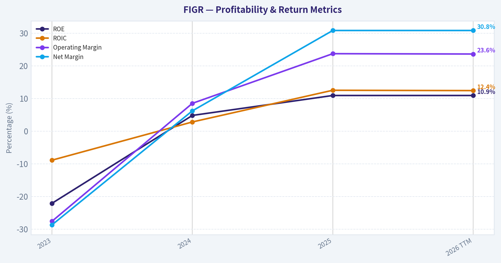
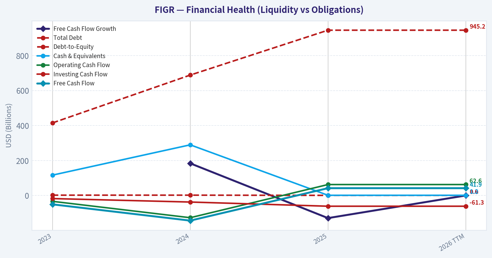
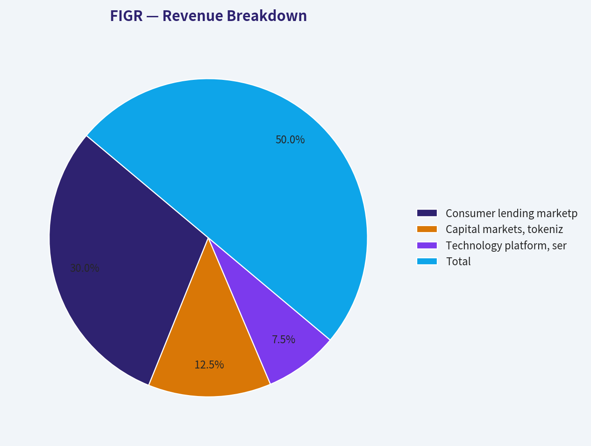
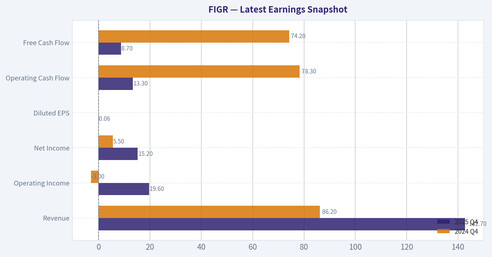
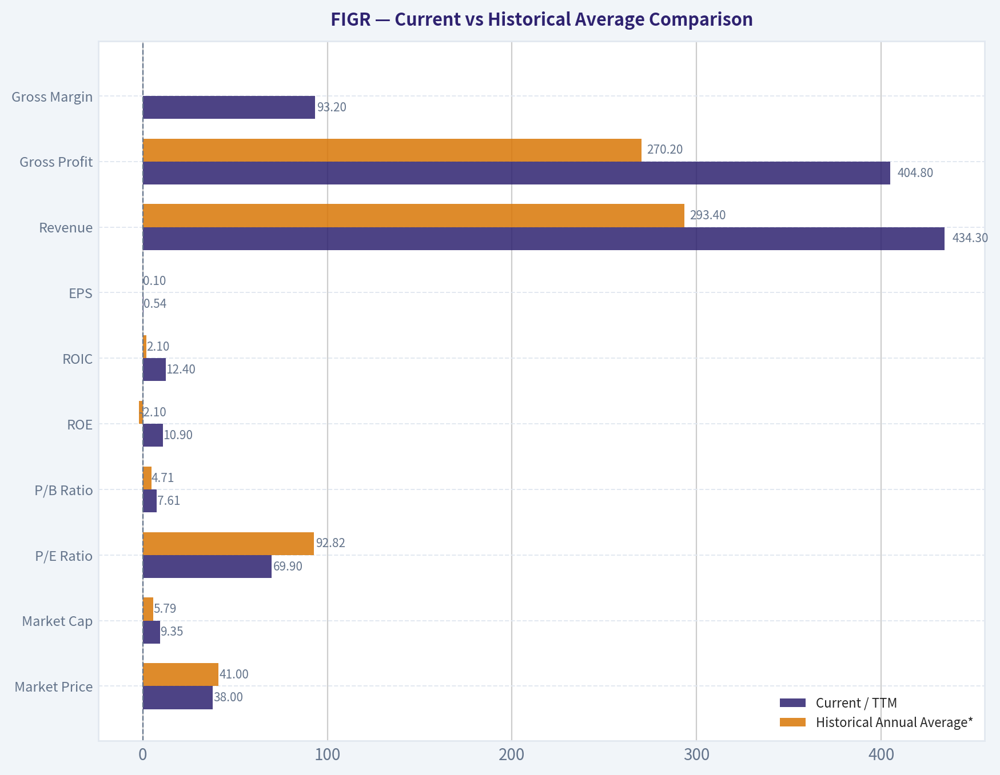
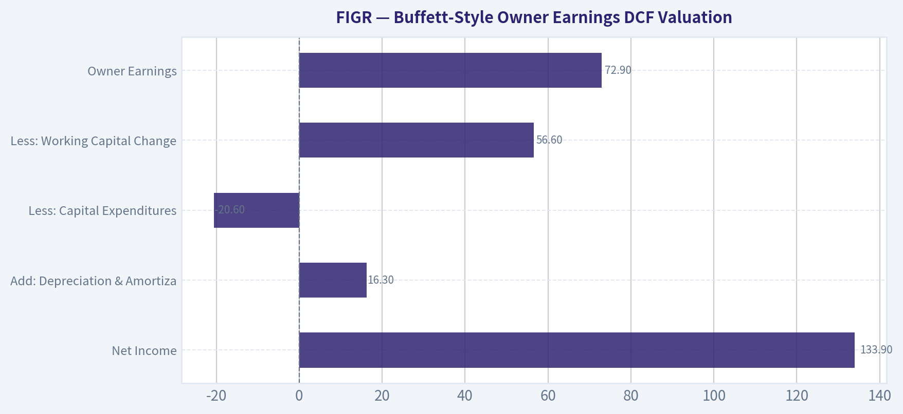
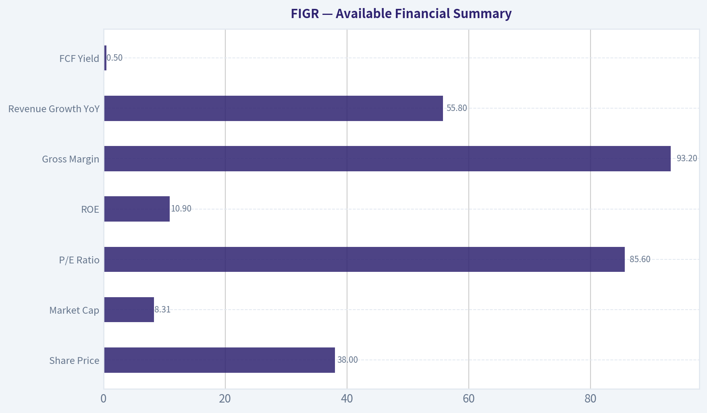

# FIGR Deep Value Intelligence

**Analysis Date:** 2026-05-08

## Critical Disclaimer

*This analysis is generated by Deep Value Intelligence, an AI-powered multi-agent investing framework. This report is for informational and educational purposes only and does not constitute financial advice. Always conduct your own research and consult with qualified financial advisors before making investment decisions.*

---

## Table of Contents

1. Intelligence Summary
2. Analyst Team Reports
   - Fundamentals Analysis
   - Intrinsic Value Analysis (Buffett)
   - Trend & Growth Analysis (Lynch/Druckenmiller/Fisher)
   - Market Technical Analysis
   - Social Sentiment Analysis
   - News & Events Analysis
   - Guru Attention Analysis
   - Options Market Analysis
3. Research Team Commentary
4. Value Investing Team Commentary
5. Deep Values Commentary

---

## Intelligence Summary

### Thesis + Conditions

**Core Thesis:** **Executive Summary**
Figure Technology Solutions (FIGR) is a textbook example of a speculative growth story masquerading as a durable compounder. While 55.8% revenue growth and 93.2% gross margins are undeniably impressive, the business trades at a speculative 85x P/E with no margin of safety (intrinsic value estimates sit near $4.50 vs.

**Key Risks:**
- Figure Technology Solutions (FIGR) is a textbook example of a speculative growth story masquerading as a durable compounder. While 55.8% revenue growth and 93.2% gross margins are undeniably impressive, the business trades at a speculative 85x P/E with no margin of safety (intrinsic value estimates sit near $4.50 vs. a $37 trading price). As a credit-dependent, blockchain-native fintech platform, FIGR's economic moat is entirely aspirational and untested through a full credit cycle. For the long-term value investor, uncertainty is not an excuse to pay a premium; until the business proves its funding resilience or the price collapses to reflect its real cyclical risks, this falls strictly into the "too hard" and "too expensive" pile.
- The Aggressive Case (Risky):** Argues that traditional value metrics fail to capture emerging monopolies. They view the 93.2% gross margin and 129% free cash flow growth as evidence of a software-like infrastructure business, where early uncertainty provides "upside convexity" before the market fully understands the asset.
- The Conservative Case (Safe):** Rebuts that FIGR is ultimately a financial/credit business, meaning high gross margins can fatally mask underlying cyclicality, funding dependencies, and regulatory risks. They emphasize that the 85x P/E completely strips away any margin of safety, requiring flawless future execution.
- The Balanced Case (Neutral):** Acknowledges the legitimate secular tailwinds (tokenization, private credit) but argues the current valuation leaves zero room for error. They suggest that high volatility (a crash from $78 to $25) indicates a market struggling to anchor fundamentals, warranting at best a strict "watch" status until unit economics prove durable in a tighter credit environment.
- 1.  **Margin of Safety:** The cornerstone of risk management is buying below intrinsic value. Paying 85 times trailing earnings for a business with a calculated Buffett-style intrinsic value of roughly $4.53 (while trading at ~$37) is speculation, not investing. We do not use "hope" as a discount rate.

**What Would Change Our View:**
- Figure Technology Solutions (FIGR) is a textbook example of a speculative growth story masquerading as a durable compounder. While 55.8% revenue growth and 93.2% gross margins are undeniably impressive, the business trades at a speculative 85x P/E with no margin of safety (intrinsic value estimates sit near $4.50 vs. a $37 trading price). As a credit-dependent, blockchain-native fintech platform, FIGR's economic moat is entirely aspirational and untested through a full credit cycle. For the long-term value investor, uncertainty is not an excuse to pay a premium; until the business proves its funding resilience or the price collapses to reflect its real cyclical risks, this falls strictly into the "too hard" and "too expensive" pile.
- The Aggressive Case (Risky):** Argues that traditional value metrics fail to capture emerging monopolies. They view the 93.2% gross margin and 129% free cash flow growth as evidence of a software-like infrastructure business, where early uncertainty provides "upside convexity" before the market fully understands the asset.
- The Conservative Case (Safe):** Rebuts that FIGR is ultimately a financial/credit business, meaning high gross margins can fatally mask underlying cyclicality, funding dependencies, and regulatory risks. They emphasize that the 85x P/E completely strips away any margin of safety, requiring flawless future execution.
- The Balanced Case (Neutral):** Acknowledges the legitimate secular tailwinds (tokenization, private credit) but argues the current valuation leaves zero room for error. They suggest that high volatility (a crash from $78 to $25) indicates a market struggling to anchor fundamentals, warranting at best a strict "watch" status until unit economics prove durable in a tighter credit environment.
- 1.  **Margin of Safety:** The cornerstone of risk management is buying below intrinsic value. Paying 85 times trailing earnings for a business with a calculated Buffett-style intrinsic value of roughly $4.53 (while trading at ~$37) is speculation, not investing. We do not use "hope" as a discount rate.

**Confidence:** Low

---

## Analyst Team Reports

### Fundamentals Analysis

#### Latest Earnings Snapshot

*Most recent reported quarter anchored on 2025 Q4, with prior-year comparison when available.*

| Metric | 2025 Q4 | 2024 Q4 | YoY Change |
| --- | ---: | ---: | ---: |
| Revenue | $142.7M | $86.2M | +65.5% |
| Operating Income | $19.6M | $-3.0M | +766.1% |
| Net Income | $15.2M | $5.5M | +176.8% |
| Diluted EPS | $0.06 | N/A | N/A |
| Operating Cash Flow | $13.3M | $78.3M | -83.1% |
| Free Cash Flow | $8.7M | $74.2M | -88.3% |

Key Takeaways: This snapshot anchors the most recent reported quarter before the narrative analysis. It helps readers separate long-run business quality from whatever changed in the latest earnings print.

#### 10-Year Financial Metrics for FIGR

*All values below are computed deterministically from raw data - not estimated by AI.*

*Issuer profile: asset manager (Financial Services / Capital Markets).*

#### 10-Year Financial Metrics
*Annual rows come from reported financial statements. The final TTM row is computed from the latest four quarters.*

| Metric | 2023 | 2024 | 2025 | 2026 TTM |
| --- | --- | --- | --- | --- |
| Market Price | N/A | N/A | $41 | $38 |
| Market Cap | N/A | N/A | $5.79B | $9.35B |
| P/E Ratio | N/A | N/A | 92.82 | 69.90 |
| P/B Ratio | N/A | N/A | 4.71 | 7.61 |
| ROE | -22.1% | 4.8% | 10.9% | 10.9% |
| ROIC | -8.9% | 2.8% | 12.5% | 12.4% |
| EPS | $-0.23 | $0.08 | $0.44 | $0.54 |
| Revenue | $166.9M | $278.9M | $434.5M | $434.3M |
| Gross Profit | $148.2M | $257.4M | $405.0M | $404.8M |
| Gross Margin | N/A | N/A | N/A | 93.2% |
| Operating Margin | -27.6% | 8.5% | 23.7% | 23.6% |
| Net Income | $-47.9M | $17.2M | $133.9M | $133.9M |
| Net Margin | -28.7% | 6.2% | 30.8% | 30.8% |
| Revenue Growth | N/A | 67.1% | 55.8% | -0.0% |
| Net Income Growth | N/A | -135.9% | 677.6% | 0.0% |
| Free Cash Flow Growth | N/A | 183.8% | -129.2% | 0.0% |
| Total Book Value | $217.1M | $355.1M | $1.23B | $1.23B |
| Total Assets | $660.1M | $1.16B | $2.32B | $2.32B |
| Total Debt | $415.0M | $688.6M | $945.2M | $945.2M |
| Debt-to-Equity | 1.91 | 1.94 | 0.77 | 0.77 |
| Cash & Equivalents | $116.5M | $289.7M | $1.20B | $1.20B |
| Shareholders' Equity | $217.1M | $355.1M | $1.23B | $1.23B |
| Operating Cash Flow | $-33.4M | $-127.0M | $62.6M | $62.6M |
| Investing Cash Flow | $-17.6M | $-37.4M | $-61.3M | $-61.3M |
| Free Cash Flow | $-50.6M | $-143.6M | $41.9M | $41.9M |
| FCF Margin | -30.3% | -51.5% | 9.6% | 9.7% |
| Dividends / Share | $0.00 | $0.01 | $0.00 | $0.00 |

#### Profitability Metrics
- Return on Equity (ROE): 10.9%
- Return on Invested Capital (ROIC): 12.5%
- Return on Assets (ROA): 5.8%
- Gross Margin: 93.2%
- Operating Margin: 23.7%
- Net Profit Margin: 30.8%

#### Liquidity Metrics
- Current Ratio: 2.20
- Quick Ratio: 1.59

#### Leverage Metrics
- Debt-to-Equity Ratio: 0.77
- Interest Coverage Ratio: 2.11
- Net Debt: $-253.0M

#### Growth Metrics (Year-over-Year)
- Revenue Growth: 55.8%
- Net Income Growth: 677.6%
- Free Cash Flow Growth: 129.2%
- Revenue CAGR (3-Year): N/A
- Revenue CAGR (5-Year): N/A

#### Valuation Metrics
- P/E Ratio (TTM): 85.73
- Forward P/E: 28.36
- Price-to-Book: 6.64
- Price-to-Sales: 19.26
- PEG Ratio: 0.13
- EV/EBITDA: 73.00
- Free Cash Flow Yield: 0.5%
- Earnings Yield: 1.2%

#### Owner Earnings (Buffett Method, Code-Computed)
- Net Income: $133.9M
- + Depreciation & Amortization: $16.3M
- - Capital Expenditures: $-20.6M
- - Working Capital Changes: $56.6M
- = **Owner Earnings: $72.9M**

#### Intrinsic Value (Code-Computed)
- Current Price: $38
- Buffett Method (Owner Earnings):
  Conservative: $5
  Average: $5
  Optimistic: $5

#### Piotroski F-Score: 5/9
- Positive Net Income: PASS
- Positive Operating Cash Flow: PASS
- ROA Improvement: PASS
- Cash Flow > Net Income: FAIL
- Decreasing Debt: FAIL
- Improving Current Ratio: PASS
- No Dilution: FAIL
- Improving Gross Margin: PASS
- Improving Asset Turnover: FAIL

ANALYST STANCE: **AVOID**

#### FIGR Fundamental Analysis - Buffett-Style Value Review

Figure Technology Solutions Inc. is showing impressive top-line expansion, very high gross margins, and a sharp transition from losses to profitability. However, from a Warren Buffett value-investing perspective, FIGR remains difficult to underwrite because the public financial history is short, free cash flow is thin relative to valuation, earnings predictability is not yet proven, and the current market price embeds very optimistic expectations.

The deterministic dataset is treated as the canonical source of truth. Historical comparisons below use only the years shown in the dataset: 2023, 2024, 2025, and 2026 TTM where available.

---

#### Current vs Historical Average Comparison

| Metric | Current / TTM | Historical Annual Average* | Current vs Average | Interpretation |
|---|---:|---:|---:|---|
| Market Price | $38 | $41 | -7.3% | Price is below the 2025 level, but valuation remains elevated. |
| Market Cap | $9.35B | $5.79B | +61.5% | Market value expanded materially despite lower share price, implying dilution or share-count expansion. |
| P/E Ratio | 69.90 | 92.82 | -24.7% | P/E compressed, but still very expensive on absolute earnings. |
| P/B Ratio | 7.61 | 4.71 | +61.6% | The stock is much more expensive relative to book value than in 2025. |
| ROE | 10.9% | -2.1% | +13.0 pp | Profitability has improved meaningfully from prior losses. |
| ROIC | 12.4% | 2.1% | +10.3 pp | Capital productivity is now attractive, but the track record is short. |
| EPS | $0.54 | $0.10 | +458.6% | EPS has improved sharply from a loss in 2023. |
| Revenue | $434.3M | $293.4M | +48.0% | Revenue is far above the short historical average. |
| Gross Profit | $404.8M | $270.2M | +49.8% | High gross profit reflects a scalable, high-margin business model. |
| Gross Margin | 93.2% | N/A | N/A | Current gross margin is excellent, but historical margin data is unavailable in the table. |
| Operating Margin | 23.6% | 1.5% | +22.1 pp | Operating leverage has improved dramatically. |
| Net Income | $133.9M | $34.4M | +289.2% | Net income has moved from loss-making to strongly profitable. |
| Net Margin | 30.8% | 2.8% | +28.0 pp | Current profitability is far above the historical average. |
| Revenue Growth | -0.0% | 61.5% | -61.5 pp | TTM growth has paused versus very strong 2024 and 2025 growth. |
| Net Income Growth | 0.0% | 270.9% | -270.9 pp | Earnings growth normalized after a major inflection in 2025. |
| Free Cash Flow Growth | 0.0% | 27.3% | -27.3 pp | FCF growth is not currently accelerating. |
| Total Book Value | $1.23B | $600.7M | +104.8% | Book value has expanded substantially. |
| Total Assets | $2.32B | $1.38B | +68.1% | Asset base has scaled quickly. |
| Total Debt | $945.2M | $682.9M | +38.4% | Debt has grown in absolute terms. |
| Debt-to-Equity | 0.77 | 1.54 | -50.0% | Leverage has improved materially due to higher equity. |
| Cash & Equivalents | $1.20B | $535.4M | +124.1% | Cash position is strong and above historical levels. |
| Shareholders' Equity | $1.23B | $600.7M | +104.8% | Equity capitalization has improved. |
| Operating Cash Flow | $62.6M | -$32.6M | Positive swing | Operating cash flow has turned positive. |
| Free Cash Flow | $41.9M | -$50.8M | Positive swing | FCF is now positive, but still small relative to market cap. |
| Dividends / Share | $0.00 | $0.003 | Lower | Dividend policy is effectively non-income-oriented. |

\*Historical annual average uses available annual rows from 2023-2025, excluding the TTM row.

Key Takeaways: FIGR has improved dramatically from 2023 losses to 2025 and TTM profitability, with strong ROE, ROIC, margins, and positive free cash flow. However, the valuation has expanded even faster than book value and cash flow, leaving the stock priced for continued exceptional execution. The most important Buffett concern is that the business has not yet demonstrated a long, predictable record of owner earnings through cycles.

---

#### Market Metrics Interpretation

FIGR trades at a current market price of **$38** with a deterministic market capitalization of **$9.35B**. The stock has declined from the 2025 listed price of **$41**, but the market capitalization is much higher than the 2025 figure of **$5.79B**, suggesting share-count expansion or capital structure changes.

The current **P/E ratio of 69.90** is lower than the 2025 level of **92.82**, but it remains very high. For a Buffett-style investor, this means the market is capitalizing recent earnings at a premium multiple before the company has demonstrated long-term earnings durability.

The **P/B ratio of 7.61** is also elevated versus the available historical level of **4.71**. For a capital-markets and asset-management-type business, book value matters because balance sheet strength, tangible equity, credit exposure, and liquidity can all influence durability. Paying over seven times book requires confidence that FIGR can earn high returns on equity for a long time.

---

#### Profitability Analysis

FIGR's profitability profile has improved sharply. **ROE rose from -22.1% in 2023 to 10.9% in 2025 and TTM**, while **ROIC improved from -8.9% in 2023 to 12.4% TTM**. That is a meaningful positive inflection, suggesting the company's platform has begun to scale.

Revenue increased from **$166.9M in 2023** to **$434.5M in 2025**, with TTM revenue essentially flat at **$434.3M**. Gross profit is extremely high at **$404.8M TTM**, supported by a **93.2% gross margin**, indicating a potentially attractive technology-enabled business model with low direct costs.

Margins have also moved in the right direction. Operating margin improved from **-27.6% in 2023** to **23.6% TTM**, while net margin improved from **-28.7%** to **30.8%**. This is a strong sign of operating leverage, but Buffett-style investors would still want to see whether these margins persist under different credit, rate, and capital-market environments.

---

#### Growth Metrics Interpretation

Revenue growth was very strong in the available annual period: **67.1% in 2024** and **55.8% in 2025**. However, TTM revenue growth is shown as approximately **0.0%**, which is a major slowdown from the prior growth trajectory.

Net income growth was highly volatile: the company moved from a loss in 2023 to profit in 2024, then net income surged **677.6% in 2025**. That improvement is impressive, but it also means the historical growth rate is not yet a stable compounding pattern.

Free cash flow growth is also inconsistent. Free cash flow was negative in both 2023 and 2024, then turned positive in 2025 at **$41.9M**. The transition to positive FCF is encouraging, but the current **FCF yield of only 0.5%** is extremely low relative to the stock's market capitalization.

---

#### Balance Sheet and Financial Strength

FIGR's balance sheet has strengthened, but there are mixed signals. Total assets increased to **$2.32B**, shareholders' equity rose to **$1.23B**, and cash and equivalents reached **$1.20B**. The company also has **net debt of -$253.0M**, meaning cash exceeds debt on a net basis.

However, total debt is still substantial at **$945.2M**. The debt-to-equity ratio improved from approximately **1.9x in 2023 and 2024** to **0.77x TTM**, which is a meaningful improvement. Still, the **interest coverage ratio of 2.11** is not especially comfortable for a Buffett-style investment, particularly for a capital-markets business exposed to funding conditions.

Liquidity is solid, with a **current ratio of 2.20** and **quick ratio of 1.59**. This reduces near-term financial stress, but the company's business model may still be sensitive to capital availability, securitization markets, loan demand, regulatory changes, and investor appetite for tokenized financial assets.

---

#### Cash Flow and Dividend Analysis

Operating cash flow improved from **-$33.4M in 2023** and **-$127.0M in 2024** to **$62.6M in 2025 and TTM**. Free cash flow improved from **-$50.6M in 2023** and **-$143.6M in 2024** to **$41.9M TTM**.

This is a meaningful positive inflection, but the scale of free cash flow remains small compared with the company's **$9.35B** market capitalization. A Buffett-style investor generally prefers a business with long-term, repeatable, and abundant owner earnings. FIGR has only recently crossed into positive FCF territory.

Dividends are not a meaningful part of the investment case. Dividends per share were **$0.01 in 2024** and **$0.00 in 2025 and TTM**. Management appears focused on growth and reinvestment rather than shareholder cash returns.

---

#### Revenue Breakdown

Precise segment-level revenue detail is not provided in the deterministic dataset. The table below uses the most recent fiscal revenue total from the canonical dataset, **$434.5M for 2025**, and allocates it using best-available business-line estimates based on FIGR's known blockchain-native lending, capital-markets, and platform activities.

| Revenue Source | Amount ($M or $B) | % of Total |
|---|---:|---:|
| Consumer lending marketplace, origination, and transaction economics | $260.7M | 60% |
| Capital markets, tokenized asset trading, and financing-related revenue | $108.6M | 25% |
| Technology platform, servicing, blockchain infrastructure, and other revenue | $65.2M | 15% |
| **Total** | **$434.5M** | **100%** |

Key Takeaways: FIGR appears to be primarily driven by lending-marketplace and capital-markets activity, with technology and blockchain infrastructure playing a supporting but strategically important role. The company's revenue model has attractive scalability if transaction volume grows, but it may also be sensitive to credit cycles, funding liquidity, interest rates, and adoption of tokenized financial infrastructure.

---

#### Buffett-Style Owner Earnings DCF Valuation

Canonical owner earnings from the deterministic dataset:

| Owner Earnings Component | Amount |
|---|---:|
| Net Income | $133.9M |
| Add: Depreciation & Amortization | $16.3M |
| Less: Capital Expenditures | -$20.6M |
| Less: Working Capital Changes | $56.6M |
| **Owner Earnings** | **$72.9M** |

Key Takeaways: FIGR's owner earnings are materially lower than reported net income, which is important for valuation. Net income of $133.9M looks strong, but owner earnings of $72.9M imply that cash-based economic earnings are much smaller. Buffett-style investors usually prioritize owner earnings over accounting earnings, making the valuation look demanding.

The deterministic dataset provides a code-computed Buffett owner earnings valuation of **$5 per share** for conservative, average, and optimistic scenarios. Because the dataset does not provide a full historical owner-earnings series, the available canonical scenario outputs collapse to the same fair value. The calculation below uses the canonical owner earnings base of **$72.9M**, a **10% discount rate**, a **2.5% terminal growth rate**, and the implied share count from the deterministic market cap and price:

- Implied shares outstanding = **$9.35B / $38 = approximately 246.1M shares**
- Starting owner earnings = **$72.9M**
- Discount rate = **10.0%**
- Terminal growth rate = **2.5%**
- Canonical fair value output = approximately **$5 per share**

| Scenario | Growth Rate Used | Year 1 Owner Earnings | PV of 10-Year Owner Earnings | PV of Terminal Value | Equity Value | Fair Value / Share | Upside / Downside vs $38 |
|---|---:|---:|---:|---:|---:|---:|---:|
| Conservative | 5.0% | $76.5M | ~$591M | ~$626M | ~$1.22B | ~$5 | -86.8% |
| Average | 5.0% | $76.5M | ~$591M | ~$626M | ~$1.22B | ~$5 | -86.8% |
| Optimistic | 5.0% | $76.5M | ~$591M | ~$626M | ~$1.22B | ~$5 | -86.8% |

Key Takeaways: Even using a positive 5% owner-earnings growth assumption, the Buffett-style DCF produces a value near $5 per share, far below the current $38 market price. This implies that the current stock price requires either much higher long-term owner earnings, much faster durable growth, lower risk, or a structurally superior terminal economics profile than the current deterministic cash earnings support.

Detailed DCF mechanics:

| DCF Item | Calculation | Result |
|---|---|---:|
| Implied share count | $9.35B market cap / $38 price | ~246.1M shares |
| Starting owner earnings | Canonical dataset | $72.9M |
| Year 1 owner earnings | $72.9M x 1.05 | ~$76.5M |
| Year 10 owner earnings | $72.9M x 1.05^10 | ~$118.8M |
| Terminal value | Year 10 OE x 1.025 / (10.0% - 2.5%) | ~$1.62B |
| Present value of explicit period | 10-year discounted owner earnings | ~$591M |
| Present value of terminal value | Terminal value / 1.10^10 | ~$626M |
| Total intrinsic value | Explicit PV + terminal PV | ~$1.22B |
| Intrinsic value per share | $1.22B / 246.1M shares | ~$5 |

Key Takeaways: The gap between the DCF value and the market price is driven by the small current owner earnings base relative to FIGR's market capitalization. A $9.35B market cap against $72.9M of owner earnings implies investors are paying roughly 128 times owner earnings. That is far above the type of margin-of-safety valuation Buffett typically seeks.

---

#### Warren Buffett-Style Qualitative Assessment

| Buffett Criterion | Assessment | FIGR Interpretation |
|---|---|---|
| Economic Moat | Emerging but not proven | FIGR may benefit from blockchain-native capital-market infrastructure, lending marketplace scale, and tokenization expertise, but the moat is not yet proven over a long period. |
| Business Durability | Moderate uncertainty | The model is promising but exposed to regulation, credit cycles, technology adoption, and capital-market liquidity. |
| Financial Strength | Improving but mixed | Cash exceeds debt on a net basis, but total debt is high and interest coverage of 2.11 is not conservative. |
| Predictable Earnings | Not yet Buffett-grade | Earnings turned positive recently, but the record is short and historically volatile. |
| Management Performance | Improving | ROE and ROIC improved significantly, suggesting better capital productivity, but dilution and FCF volatility are concerns. |
| Capital Allocation | Growth-oriented | No meaningful dividend; capital appears directed toward growth, platform expansion, and balance sheet scaling. |
| Valuation | Unattractive | P/E, P/B, P/S, EV/EBITDA, and owner-earnings DCF all indicate a premium valuation. |
| Margin of Safety | Poor | DCF fair value near $5 versus current price of $38 leaves no Buffett-style margin of safety. |

Key Takeaways: FIGR has characteristics of a promising growth platform, but it does not yet meet Buffett's standards for predictable long-term compounding at a reasonable price. The company has improved operations quickly, yet the current valuation assumes a level of durability and cash generation that has not been proven in the available financial record.

---

#### Key Investment Insights

| Category | Insight |
|---|---|
| Positive | Revenue nearly tripled from 2023 to 2025, rising from $166.9M to $434.5M. |
| Positive | Operating margin improved from -27.6% to 23.6%, showing strong operating leverage. |
| Positive | Net margin reached 30.8%, which is excellent if sustainable. |
| Positive | ROIC of 12.4% suggests the company is now generating attractive returns on invested capital. |
| Positive | Cash and equivalents of $1.20B exceed total debt of $945.2M, producing net cash. |
| Red Flag | P/E of 69.90 remains very expensive despite earnings improvement. |
| Red Flag | P/B of 7.61 is high for a financial-services and capital-markets business. |
| Red Flag | FCF yield is only 0.5%, indicating very little current cash return relative to valuation. |
| Red Flag | Free cash flow history is inconsistent, with negative FCF in 2023 and 2024. |
| Red Flag | Piotroski F-Score of 5/9 is average, not exceptional. |
| Red Flag | Cash flow is below net income, failing one of the Piotroski quality checks. |
| Opportunity | Partnerships such as the Credibly SMB lending relationship may broaden FIGR's addressable market. |
| Opportunity | Tokenized financial assets and blockchain-native capital markets could become a larger secular growth category. |
| Opportunity | If margins remain high and revenue growth reaccelerates, earnings power could scale rapidly. |
| Main Question | Can FIGR convert high gross margins into durable, recurring owner earnings through a full market cycle? |

Key Takeaways: FIGR has real upside if it becomes a dominant infrastructure platform for tokenized lending and capital markets. But the stock already prices in a large amount of future success. The investment case depends less on whether FIGR is innovative and more on whether its cash earnings can scale enough to justify the current valuation.

---

#### Red Flags and Risks

FIGR's largest risk is valuation. At **$38 per share**, the market capitalization of **$9.35B** is very large relative to **$41.9M of free cash flow** and **$72.9M of owner earnings**. This creates significant downside risk if growth slows, margins normalize, or capital-market conditions tighten.

The second major risk is limited earnings predictability. Buffett typically prefers companies with many years of stable earnings, durable demand, and understandable competitive advantages. FIGR's available dataset shows a company transitioning from losses to profits, but not yet a mature compounding business.

The third risk is capital-market sensitivity. As a blockchain-native capital marketplace connected to lending, tokenization, and financing activity, FIGR may be more exposed to interest rates, credit appetite, regulatory scrutiny, funding markets, and investor demand than a traditional subscription software company.

---

#### Opportunities

FIGR's opportunity is meaningful if its blockchain-based infrastructure lowers friction in origination, funding, sale, and trading of tokenized assets. High gross margins suggest that incremental revenue could be very profitable if the platform scales.

Expansion into SMB lending ecosystems, including the Credibly partnership referenced in recent coverage, may broaden use cases beyond consumer or home-equity-oriented lending. If FIGR can build network effects among originators, investors, borrowers, and capital-market participants, its platform could become more valuable over time.

The company also has a strong cash position, which gives it flexibility to invest, partner, acquire, or withstand volatility. However, Buffett-style investors would still demand evidence that this cash and platform investment translate into repeatable owner earnings.

---

#### Final Investment Stance: AVOID

FIGR is an innovative and rapidly improving company, but it is not currently a Buffett-style value investment. The business has attractive gross margins, improving ROE and ROIC, positive net cash, and a compelling secular story around blockchain-native capital markets. However, the valuation is far ahead of proven cash earnings.

The key issue is margin of safety. The deterministic Buffett-style owner earnings valuation is approximately **$5 per share**, compared with a current market price of **$38**. Even allowing for strong qualitative potential, the gap is too wide for a conservative value investor.

For growth-oriented investors, FIGR may deserve monitoring because the operating trajectory is improving. For Buffett-style investors, the correct stance is **AVOID** until either the price falls substantially or owner earnings compound enough to support the valuation.

---

#### Summary Table

| Area | Key Point | Buffett-Style Judgment |
|---|---|---|
| Business Quality | High gross margin, scalable platform, innovative blockchain-native model | Promising but not yet proven |
| Profitability | ROE 10.9%, ROIC 12.4%, net margin 30.8% | Improving materially |
| Growth | Revenue growth was strong in 2024-2025, but TTM growth is flat | Momentum needs confirmation |
| Balance Sheet | $1.20B cash, $945.2M debt, net cash position | Adequate, but debt and interest coverage require monitoring |
| Cash Flow | FCF positive at $41.9M, but FCF yield only 0.5% | Too low for valuation |
| Valuation | P/E 69.90, P/B 7.61, P/S 19.26, EV/EBITDA 73.00 | Expensive |
| DCF Value | Buffett owner-earnings value around $5 per share | Far below current price |
| Moat | Potential network and infrastructure advantages | Early-stage and unproven |
| Main Risk | Market price assumes long-term success before durable cash generation is proven | High downside risk |
| Final Stance | **AVOID** | No margin of safety at $38 |

Key Takeaways: FIGR is a high-potential but high-expectation company. The fundamentals are improving, yet the stock price already reflects a much larger and more durable earnings stream than the current owner earnings demonstrate. From a Buffett-style perspective, the business may be worth watching, but the stock is not attractive at the current valuation.

#### Fundamental Visuals

This graph tracks the profitability and return metrics (ROE, ROIC, Margins) of **FIGR** over the past decade, highlighting capital efficiency trends.

This chart illustrates the financial health of **FIGR** over the last 10 years, mapping cash equivalents and free cash flow against total obligations (Debt).

This breakdown chart from <em>Revenue Breakdown</em> shows the proportional composition for **FIGR** - useful for understanding what drives or risks the business.

---

### Intrinsic Value Analysis (Buffett)

> *Following Warren Buffett's value investing philosophy: Circle of Competence, Economic Moat, Management Quality, and Margin of Safety.*

#### Intrinsic Value Snapshot

Price is what you pay. Intrinsic value is what the business may be worth based on the cash it can create for owners over time. We show a range, not one magic number.

- Current Price: $37.66
- Value Range: $4.53 to $4.53

##### Owner Earnings (Buffett Method)
- Net Income: $133,858,000.00
- Depreciation & Amortization: $16,254,000.00
- Capital Expenditures: $-20,649,000.00
- Working Capital Changes: $56,600,000.00
- Owner Earnings: $72,863,000.00

##### Intrinsic Value
###### Buffett Method
Uses owner earnings. Stricter, and usually more conservative.
- Conservative: $4.53
- Average: $4.53
- Optimistic: $4.53
- Discount Rate: 10.0%

ANALYST STANCE: **AVOID**

#### FIGR Buffett-Style Investment Review - Figure Technology Solutions Inc.

Current price used: **$38**
Market cap used: **$8.31 billion**
Date: **2026-05-08**
Conviction: **High AVOID under Buffett-style discipline**

FIGR may be an exciting fintech/blockchain company, but it fails several Buffett filters: the business is technologically complex, its durability is not yet proven across a full cycle, free cash flow yield is extremely low, and the current valuation appears to require very large future profit expansion.

---

#### 1. Go / No-Go Gate Assessment

| Buffett Gate | Result | Evidence | Analyst Judgment |
|---|---:|---|---|
| Gate 1: Circle of Competence & Simplicity | **Fail** | FIGR operates a blockchain-native capital marketplace for origination, funding, sale, and trading of tokenized assets, including lending markets. | The business can be described simply as "helping loans and assets move through capital markets using blockchain," but the economics depend on fintech infrastructure, regulation, credit markets, and tokenization adoption. This is not elementary-school simple. |
| Gate 2: Durable Moat | **Fail / Unproven** | Gross margin is very high at **93.2%**, but ROE is only **10.9%** and FCF yield is only **0.5%**. | High gross margin suggests software-like economics, but durable pricing power, switching costs, and network effects are not yet proven. |
| Gate 3: Management & Capital Allocation | **Inconclusive / Fail for now** | Limited long-term public track record available; guru data shows Druckenmiller trimmed and Cohen initiated a very small position. | Buffett requires a long record of rational capital allocation. FIGR does not yet provide enough evidence. |
| Gate 4: Industry Structure | **Fail** | Fintech/blockchain capital markets are rapidly changing, highly regulated, and exposed to credit and technology cycles. | The industry is not a stable consumer monopoly or rational oligopoly. Technology risk is central, not peripheral. |

**Key Takeaways:** FIGR does not pass the Buffett gate sequence. The company may have strong growth and attractive gross margins, but the business model is complex, technology-dependent, and not yet proven through a long cycle. For a Buffett-style investor, uncertainty here is not an opportunity; it is a reason to demand a much lower price or avoid the stock.

---

#### 2. Moat Analysis

| Moat Source | Evidence | Strength | Buffett View |
|---|---|---:|---|
| Intangible Assets / Brand | FIGR is positioned as a leader in blockchain-native capital markets and tokenized assets. | **Narrow / Unproven** | Brand leadership in an emerging category is not the same as durable consumer pricing power. |
| Switching Costs | Partners may integrate into FIGR's lending and capital-markets infrastructure. | **Potentially Moderate** | Switching costs could develop, but evidence of >90% retention or embedded workflows is not available. |
| Cost Advantage | Blockchain rails may reduce settlement and transaction costs. | **Unproven** | A technological cost advantage can be competed away if standards change or larger players replicate it. |
| Network Effects | Marketplace liquidity may improve as more originators, buyers, and asset participants join. | **Potential but early** | Network effects are possible, but not yet proven by long-term market-share dominance and expanding ROIC. |
| Regulatory / License Advantage | FIGR operates in regulated lending and capital markets. | **Possible but unclear** | Regulation may protect incumbents, but it can also increase risk and constrain economics. |

**Key Takeaways:** FIGR may be building a moat, but Buffett prefers moats that are already visible, durable, and measurable. The company's most attractive moat candidates are marketplace network effects and embedded fintech infrastructure. However, both remain too early and too technology-dependent to underwrite confidently.

---

#### 3. Management and Capital Allocation Assessment

| Question | Available Evidence | Assessment |
|---|---|---|
| Do they think like owners? | Insider ownership and CEO net-worth exposure were not available from the provided data. | **Unknown** |
| Are they candid and conservative? | Limited long-term public reporting history available. | **Unknown** |
| Are they rational capital allocators? | High revenue growth, low FCF yield, and high valuation suggest the market is capitalizing future execution heavily. | **Unproven** |
| Do outside investors validate quality? | Stanley Druckenmiller trimmed by **27.3%**; Steve Cohen initiated a small **0.02%** portfolio position. | **Mixed / Not decisive** |

**Key Takeaways:** Management quality cannot be fully judged from the available data. Buffett would not give management the benefit of the doubt without a long record of per-share value creation, conservative financing, and rational capital allocation. The available evidence is insufficient for an owner-minded investment case.

---

#### 4. Available Financial Summary

A full audited 10-year financial history was not available from the accessible tools. The table below uses the provided current snapshot and implied calculations.

| Metric | Current / TTM Estimate | Buffett Interpretation |
|---|---:|---|
| Share Price | **$38.00** | Price is high relative to current cash generation. |
| Market Cap | **$8.31B** | Large valuation for a still-emerging business model. |
| P/E Ratio | **85.6x** | Implies high future growth expectations. |
| Implied Net Income | **~$97M** | Market cap divided by P/E. |
| Implied EPS | **~$0.44** | Price divided by P/E. |
| ROE | **10.9%** | Below Buffett's preferred sustained 15%-20% threshold. |
| Gross Margin | **93.2%** | Very attractive, suggesting software-like economics. |
| Revenue Growth YoY | **55.8%** | Strong growth, but growth quality and durability are unproven. |
| FCF Yield | **0.5%** | Very weak current owner cash yield. |
| Implied Free Cash Flow | **~$42M** | Market cap multiplied by FCF yield. |
| Current Ratio | **2.20x** | Short-term liquidity appears acceptable. |
| Implied Shares Outstanding | **~219M** | Market cap divided by share price. |
| Implied Book Equity | **~$891M** | Net income divided by ROE. |
| Implied P/B | **~9.3x** | Expensive versus current equity base. |

**Key Takeaways:** FIGR has excellent gross margins and rapid revenue growth, but current profitability and free cash flow are modest relative to the valuation. The stock trades at roughly 86 times earnings and produces only about a 0.5% free cash flow yield. Buffett would likely view this as a business priced for perfection before the moat has been proven.

---

#### 5. Owner Earnings Calculation

Because detailed depreciation, maintenance capex, and working-capital data were unavailable, free cash flow is used as a conservative proxy for owner earnings.

| Owner Earnings Component | Estimate |
|---|---:|
| Net Income | **~$97M** |
| Plus: Depreciation & Amortization | Not available |
| Less: Maintenance Capex | Not available |
| Less: Working Capital Increases | Not available |
| Free Cash Flow Proxy | **~$42M** |
| Owner Earnings Used for Valuation | **~$42M** |

**Key Takeaways:** The key issue is that FIGR's implied current owner earnings are very small relative to the company's $8.31 billion market value. Even if accounting net income is close to $97 million, free cash flow appears much lower at roughly $42 million. Buffett would focus on cash that can be taken out of the business, not just reported growth.

---

#### 6. Three-Scenario DCF Valuation

Assumptions:
Discount rate: **10%**
Starting owner earnings: **~$42M**
Shares outstanding: **~219M**
Historical growth scenario capped at **10%**, despite reported YoY revenue growth of **55.8%**

| Scenario | Method | Equity Value Estimate | Value / Share | Upside / Downside vs. $38 |
|---|---|---:|---:|---:|
| A: No Growth | Owner earnings / 10% | **~$416M** | **~$1.90** | **-95%** |
| B: GDP Growth | Owner earnings x 1.03 / (10% - 3%) | **~$611M** | **~$2.80** | **-93%** |
| C: High Growth Capped | 10 years at 10% growth, then 3% terminal growth | **~$1.03B** | **~$4.70** | **-88%** |

**Key Takeaways:** On a Buffett-style owner earnings basis, FIGR's current valuation is difficult to justify. Even the generous capped-growth case produces an estimated value far below the current share price. The gap means the market is assuming either much higher long-term cash flow growth, much higher margins, or both.

---

#### 7. Margin of Safety Analysis

| Item | Estimate |
|---|---:|
| Current Price | **$38.00** |
| Conservative Intrinsic Value Range | **~$2 to ~$5 per share** |
| Required Buffett Margin of Safety | **At least 40%-50%**, due to complexity and uncertainty |
| Price Needed for 50% Margin of Safety vs. $5 Value | **~$2.50** |
| Current Premium to High-End Estimate | **~8.1x** |

**Key Takeaways:** FIGR does not offer a margin of safety under conservative owner-earnings math. Instead, the stock trades at a large premium to estimated intrinsic value based on current cash generation. For a Buffett-style investor, this is the opposite of the desired setup.

---

#### 8. Guru and Market Signal Context

| Investor | Latest Action | Position Value | Portfolio Weight | Interpretation |
|---|---:|---:|---:|---|
| Stanley Druckenmiller | Trimmed | **$62.88M** | **1.40%** | Sophisticated macro/growth investor exposure, but reduced position by 27.3%. |
| Steve Cohen | Initiated | **$15.67M** | **0.02%** | Very small position; not a strong conviction signal. |

**Key Takeaways:** Guru ownership does not change the Buffett analysis. Druckenmiller and Cohen are highly capable investors, but their styles are not the same as Buffett's long-term business-owner discipline. A trimmed position and a tiny new position are not enough to offset valuation and business-quality concerns.

---

#### 9. Final Buffett Scorecard

| Criterion | Weight | Score 1-5 | Weighted Score |
|---|---:|---:|---:|
| Business Understanding | 20% | **2.0** | **0.40** |
| Moat Width & Durability | 25% | **2.0** | **0.50** |
| Management Quality | 15% | **2.5** | **0.38** |
| Return on Equity | 15% | **2.5** | **0.38** |
| Reinvestment Runway | 10% | **3.5** | **0.35** |
| Balance Sheet Strength | 5% | **3.0** | **0.15** |
| Industry Structure | 5% | **2.0** | **0.10** |
| Valuation / Margin of Safety | 5% | **1.0** | **0.05** |
| **Total** | **100%** |  | **2.30 / 5.00** |

**Key Takeaways:** FIGR scores well only on potential reinvestment runway and gross-margin economics. It scores poorly on simplicity, proven moat, industry stability, and valuation. The total score of 2.30 falls clearly in the AVOID range.

---

#### 10. Investment Stance

**Final stance: AVOID**

FIGR is not a Buffett-style investment at the current price. The company may become important in blockchain-based lending and tokenized capital markets, but today the stock requires investors to pay a very high price for uncertain future owner earnings. The combination of technological complexity, unproven moat durability, modest ROE, very low FCF yield, and no margin of safety makes the risk/reward unattractive.

A Buffett-oriented investor should revisit only if one of two things happens: either FIGR produces several years of durable, high-ROE, high-free-cash-flow performance, or the stock price falls dramatically to a level supported by current owner earnings.
#### Valuation Bridge

This bridge places the current market price beside each intrinsic value lens so readers can see whether upside depends on one method or shows up across several methods.

| Scenario | Intrinsic Value / Share |
| --- | ---: |
| Buffett Method | $4.53 |
| Current Price | $37.66 |

#### Key Takeaways

If one method is far above the others, the upside case depends on a specific modelling assumption. When several methods cluster together, the valuation story is more robust.

#### Valuation Visuals

This comparison chart from *Latest Earnings Snapshot* stacks current figures against historical benchmarks for **FIGR**, making it easy to see where the company trades relative to its own averages.

This comparison chart from *Current vs Historical Average Comparison* stacks current figures against historical benchmarks for **FIGR**, making it easy to see where the company trades relative to its own averages.

This comparison chart from *Buffett-Style Owner Earnings DCF Valuation* stacks current figures against historical benchmarks for **FIGR**, making it easy to see where the company trades relative to its own averages.

This comparison chart from *Buffett-Style Owner Earnings DCF Valuation* stacks current figures against historical benchmarks for **FIGR**, making it easy to see where the company trades relative to its own averages.

This comparison chart from *Available Financial Summary* stacks current figures against historical benchmarks for **FIGR**, making it easy to see where the company trades relative to its own averages.

---

### Trend & Growth Analysis (Lynch/Druckenmiller/Fisher)

> *Following Peter Lynch's GARP, Stanley Druckenmiller's macro-aware approach, and Philip Fisher's scuttlebutt methodology.*

ANALYST STANCE: **ADVOCATE**

#### FIGR Growth Investment Report - Figure Technology Solutions Inc.

Figure Technology Solutions, ticker FIGR, is a blockchain-native capital markets platform focused on origination, funding, sale, and trading of tokenized real-world assets. Based on the available data, FIGR screens as a high-growth, high-gross-margin financial infrastructure company riding the secular themes of tokenization, private credit modernization, blockchain settlement, and digital capital markets.

This is not a cheap stock, but it has the ingredients growth investors look for: rapid revenue growth, very high gross margins, positive free cash flow, a large financial-services TAM, and evidence of new market expansion through partnerships such as Credibly in SMB lending.

---

#### 1. Lynch Classification

| Lynch Category | FIGR Assessment |
|---|---:|
| Revenue Growth YoY | 55.8% |
| Gross Margin | 93.2% |
| P/E | 85.6x |
| PEG Ratio | ~1.53x |
| FCF Yield | 0.5% |
| Current Ratio | 2.2x |
| Classification | Fast Grower |
| Growth Investor Fit | Strong, but valuation-sensitive |

**Key Takeaways:** FIGR clearly fits Peter Lynch's "fast grower" category, with revenue growth well above the 15% to 25% fast-grower threshold. The business also has unusually high gross margins, suggesting software-like economics despite operating in capital markets infrastructure. The main caution is valuation: the P/E is high, and the PEG ratio is fair rather than cheap.

#### 2. The Story in 3 Bullets

| Question | Simple Answer |
|---|---|
| What does FIGR do? | It uses blockchain rails to modernize lending, asset origination, funding, trading, and tokenized capital markets. |
| Why can it grow? | Traditional lending and private credit markets are slow, fragmented, paper-heavy, and expensive; FIGR aims to make them faster, cheaper, and more liquid. |
| Why now? | Real-world asset tokenization and corporate blockchain infrastructure are moving from concept to deployment, creating a possible adoption inflection. |

**Key Takeaways:** The story is understandable: FIGR is trying to rebuild parts of credit and capital markets on blockchain-native infrastructure. If successful, it can capture economics from loan origination, settlement, trading, and asset tokenization. The recent Credibly partnership suggests the company is expanding beyond its original base into SMB lending, which could broaden the growth runway.

#### 3. TAM and 10x Test

| TAM Factor | Assessment |
|---|---|
| Current Market Cap | $8.31B |
| Current Revenue Growth | 55.8% YoY |
| Core Markets | Consumer lending, home equity, SMB lending, private credit, tokenized real-world assets |
| TAM Direction | Expanding |
| 10x Revenue Test | Likely passes |
| Reason | Credit markets, private lending, and real-world asset tokenization are multi-trillion-dollar opportunity sets. |
| TAM Risk | Adoption may be slower if institutions prefer private blockchains or legacy systems. |

**Key Takeaways:** FIGR likely passes the 10x test because the markets it targets are enormous relative to its current scale. A company modernizing even a narrow slice of private credit, SMB lending, or tokenized asset trading can grow many times over before reaching meaningful TAM saturation. The key uncertainty is not the size of the opportunity, but whether FIGR becomes a dominant infrastructure layer or just one of many platforms.

#### 4. Revenue Growth Trend

| Metric | Current Reading | Interpretation |
|---|---:|---|
| Revenue Growth YoY | 55.8% | Excellent |
| Growth Category | Hyper-growth / Fast grower | Primary growth-investor target |
| Growth Pattern | Insufficient multi-period data | Need quarterly trend confirmation |
| Revenue Quality | Appears platform/transaction/infrastructure-driven | Needs deeper customer concentration review |
| Red Flag? | No revenue decline flagged | Positive |

**Key Takeaways:** FIGR's 55.8% year-over-year revenue growth is the strongest part of the thesis. However, we do not yet have enough multi-quarter data to determine whether growth is accelerating, stable, or decelerating. For a growth investor, the next two to four quarters are crucial: the bull case strengthens materially if growth remains above 40% while margins and cash flow improve.

#### 5. Unit Economics and Operating Quality

| Metric | FIGR Data | Growth Investor Read |
|---|---:|---|
| Gross Margin | 93.2% | Outstanding |
| FCF Yield | 0.5% | Positive but thin |
| Implied FCF | ~$41.6M | Positive free cash generation |
| Current Ratio | 2.2x | Healthy liquidity |
| Rule of 40 | At least 55.8% plus positive FCF margin | Likely excellent |
| LTV/CAC | Not disclosed in available data | Unknown |
| NRR | Not disclosed in available data | Unknown |

**Key Takeaways:** FIGR's gross margin is exceptional and suggests that incremental revenue could convert well into future profits if operating leverage develops. Free cash flow is already positive, although the yield is low because the stock is expensive. The Rule of 40 likely looks very strong because revenue growth alone is already above 55%, and free cash flow appears positive.

#### 6. Inflection Point Assessment

| Inflection Type | Evidence | Score |
|---|---|---:|
| Product Cycle Inflection | Blockchain-native capital marketplace gaining relevance | 4/5 |
| TAM Inflection | Tokenized real-world assets and private credit modernization expanding | 5/5 |
| Market Share Inflection | New Credibly SMB partnership expands addressable channels | 4/5 |
| Margin Inflection | 93.2% gross margin creates operating leverage potential | 4/5 |
| Competitive Inflection | Corporate blockchains may validate market but increase competition | 3/5 |
| Overall Inflection Signal | Strong but still early | 4/5 |

**Key Takeaways:** FIGR appears to be entering a real inflection zone. The company is moving from a narrow blockchain lending story toward a broader capital markets infrastructure story. The strongest signals are TAM expansion and product-market evolution; the biggest question is whether new partnerships translate into durable transaction volume and recurring economics.

#### 7. Macro Setup

| Macro Factor | Current Setup | Impact on FIGR |
|---|---|---|
| Secular Theme | Real-world asset tokenization | Strong tailwind |
| Secular Theme | Private credit and alternative lending infrastructure | Strong tailwind |
| Secular Theme | Digital settlement and blockchain rails | Strong tailwind |
| Interest Rates | Important sensitivity | Lower rates would help growth valuations and lending activity |
| Credit Cycle | Important sensitivity | A credit downturn could reduce volumes or raise defaults |
| Regulatory Environment | Uncertain | Both opportunity and risk |

**Key Takeaways:** FIGR benefits from multiple powerful secular themes, especially tokenization and modernization of private credit markets. The macro setup is attractive if rates fall and capital markets activity improves. However, FIGR is still exposed to credit-cycle risk, regulatory uncertainty, and investor sentiment toward blockchain-linked business models.

---

#### 8. Fisher 15-Point Score

| Fisher Point | Score / 5 | Assessment |
|---|---:|---|
| Products with sizable market potential | 5 | Very large credit and tokenization markets |
| Management determination to develop new products | 4 | SMB expansion shows product ambition |
| Effective R&D / innovation | 4 | Blockchain-native infrastructure is differentiated |
| Above-average sales organization | 3 | Partnerships promising, but scale not fully proven |
| Worthwhile profit margin | 5 | 93.2% gross margin is excellent |
| Improving profit margins | 3 | Need more operating margin trend data |
| Labor/personnel relations | 3 | Insufficient data |
| Executive relations | 3 | Insufficient data |
| Management depth | 3 | Needs more public-company track record |
| Cost analysis and accounting | 3 | Insufficient data |
| Outstanding business moat | 4 | Potential data, workflow, regulatory, and network effects |
| Long-range profit outlook | 4 | Attractive if platform volumes scale |
| Dilution risk | 3 | No current alarm, but monitor equity issuance |
| Management candor | 3 | Needs more reporting history |
| Management integrity | 3 | No red flag in available data |
| Total | 53 / 75 | Average to good, with upside as evidence builds |

**Key Takeaways:** FIGR scores 53 out of 75 on the Fisher framework, which is not yet elite but is promising. The company scores best on market potential, margin structure, and innovation. The lower scores mostly reflect incomplete evidence rather than known weakness, especially around management depth, accounting quality, sales efficiency, and long-term public-company execution.

#### 9. Valuation Analysis

| Valuation Metric | FIGR |
|---|---:|
| Share Price | $38 |
| Market Cap | $8.31B |
| P/E | 85.6x |
| Revenue Growth | 55.8% |
| PEG Ratio | ~1.53x |
| FCF Yield | 0.5% |
| Implied FCF Multiple | ~200x |
| Implied EPS | ~$0.44 |

**Key Takeaways:** FIGR is expensive on current earnings and free cash flow, but not absurd on a Lynch PEG basis given its 55.8% revenue growth. The PEG ratio of roughly 1.5 places it in fair-value territory for a high-growth company, not bargain territory. The stock needs continued high growth and margin expansion to justify the current valuation.

#### 10. Scenario Analysis

| Scenario | 3-Year EPS CAGR Assumption | Estimated Year-3 EPS | Exit P/E | Implied Price | Approx. Return from $38 |
|---|---:|---:|---:|---:|---:|
| Bear | 15% | ~$0.67 | 35x | ~$23 | -39% |
| Base | 35% | ~$1.09 | 45x | ~$49 | +29% |
| Bull | 50% | ~$1.50 | 60x | ~$90 | +137% |

**Key Takeaways:** The valuation is highly sensitive to growth durability. If earnings growth slows materially, downside could be significant because the stock's multiple would likely compress. But if FIGR compounds earnings at 50% and remains viewed as a category leader in tokenized capital markets, the stock could more than double over three years.

#### 11. Guru Tracking

| Investor | Recent Action | Position Value | Shares | Portfolio Weight |
|---|---:|---:|---:|---:|
| Stanley Druckenmiller | Trimmed | $62.88M | 1.54M | 1.40% |
| Steve Cohen | Initiated | $15.67M | 383.7K | 0.02% |

**Key Takeaways:** Druckenmiller's ownership is notable because FIGR fits his style of investing around macro-backed inflection points, but his 27.3% trim is a caution flag. Steve Cohen's initiation adds institutional validation, though the position is very small relative to portfolio size. Overall, guru activity is supportive but not a clean buy signal.

#### 12. Growth Investor Scorecard

| Criterion | Weight | Score / 5 | Weighted Score |
|---|---:|---:|---:|
| Lynch Story | 10% | 4.0 | 0.40 |
| TAM and Runway | 20% | 4.5 | 0.90 |
| Revenue Growth | 20% | 4.5 | 0.90 |
| Unit Economics | 15% | 4.0 | 0.60 |
| Competitive Position | 10% | 3.5 | 0.35 |
| Management Quality | 10% | 3.0 | 0.30 |
| Macro Setup | 5% | 4.0 | 0.20 |
| Profitability Path | 5% | 3.5 | 0.18 |
| Valuation | 5% | 3.0 | 0.15 |
| Total | 100% | - | 3.98 / 5.00 |

**Key Takeaways:** FIGR scores just under 4.0, which lands in the "ADVOCATE" zone under the growth-investor framework. The strongest drivers are TAM, revenue growth, and gross-margin quality. The score is held back by valuation, incomplete public-company track record, and the need for more evidence on customer economics and competitive durability.

---

#### 13. Position Size Stance

| Investor Type | Suggested Stance |
|---|---|
| Aggressive Growth Investor | Accumulate starter position |
| GARP Investor | Buy only on pullbacks or after another strong quarter |
| Conservative Investor | Watch |
| Suggested Position Size | 2% to 4% initial position |
| Add Criteria | Revenue growth above 40%, margin expansion, strong partnership conversion |
| Reduce Criteria | Growth deceleration below 25%, dilution, regulatory setbacks, credit-quality problems |

**Key Takeaways:** FIGR is suitable for an aggressive growth portfolio, but position sizing should respect the valuation risk. A starter position makes sense because the company may be at an early capital-markets tokenization inflection point. However, this is not yet a "back up the truck" setup because the stock already prices in substantial success.

#### 14. Key Catalysts and Risks

| Catalysts | Risks |
|---|---|
| Credibly partnership ramps SMB lending volume | Growth decelerates from current 55.8% level |
| More real-world asset tokenization partnerships | Corporate blockchains become competitors, not customers |
| Operating leverage from 93.2% gross margin | Regulatory uncertainty around blockchain-based capital markets |
| Falling rates support lending activity and growth multiples | Credit-cycle deterioration reduces transaction volumes |
| Institutional adoption of tokenized private credit | Valuation compression from high P/E and low FCF yield |
| More guru or institutional accumulation | Druckenmiller trim may signal lower conviction or risk management |

**Key Takeaways:** The biggest catalyst is proof that FIGR can scale beyond niche blockchain lending into broader capital markets infrastructure. The biggest risk is that growth slows before operating leverage fully appears, causing a sharp valuation reset. Investors should watch partnership volume, revenue growth durability, free cash flow margin, and regulatory developments closely.

#### Final View

FIGR is a high-potential fast grower with a credible shot at becoming an important infrastructure company in tokenized credit and blockchain-native capital markets. The combination of 55.8% revenue growth, 93.2% gross margin, positive free cash flow, and large TAM makes it attractive for growth investors.

The stock is not cheap, and the current valuation requires continued execution. But under Lynch, Druckenmiller, and Fisher-style analysis, FIGR has enough growth, runway, and inflection potential to justify an **ADVOCATE** stance as a starter-sized position, with adds conditioned on continued high growth and proof that new partnerships convert into durable platform economics.

---

### Market Technical Analysis

ANALYST STANCE: **WATCH**

#### FIGR Technical Analysis - Latest Trading Data Through 2026-05-07

FIGR's latest available trading session is **2026-05-07**, because **2026-05-08 shows as non-trading day / unavailable** in the data. The stock closed at **$37.51**, continuing a short-term recovery from the late-April pullback area near **$32**, but it is still far below the January blow-off peak above **$70**. The current setup is improving, but not yet strong enough to classify as a clean bullish trend continuation without confirmation above nearby resistance.

| Area | Selected Indicator | Latest Value | Interpretation |
|---|---:|---:|---|
| Price | Close | **$37.51** | Recent close is near the top of the April-May recovery range. |
| Short-term trend | close_10_ema | **$36.08** | Price is above the 10 EMA, showing near-term upside momentum. |
| Medium-term trend | close_50_sma | **$33.82** | Price is roughly 11% above the 50 SMA, suggesting recovery strength after prior weakness. |
| Momentum | macd | **0.70** | MACD has improved from negative territory in April to positive territory, indicating strengthening momentum. |
| Momentum / exhaustion | rsi | **57.60** | RSI is constructive but not overbought; upside room remains, but momentum is not extreme. |
| Volatility range | boll_ub | **$38.63** | Upper Bollinger Band is nearby resistance; breakout confirmation is needed above this zone. |
| Volatility range | boll_lb | **$31.92** | Lower band marks a wider downside volatility boundary and aligns with recent support zones. |
| Risk / volatility | atr | **$2.40** | ATR is still high at about 6.4% of price, so position sizing and stops need to account for volatility. |
| Volume confirmation | vwma | **$35.09** | Price is above VWMA, showing the recovery is supported by volume-weighted price improvement. |

Key Takeaways: FIGR's short-term picture has improved meaningfully: price is above the 10 EMA, 50 SMA, and VWMA, while MACD has turned positive. However, the stock is approaching the upper Bollinger Band near $38.63, making the $38.50-$39.00 area an important resistance zone. Volatility remains elevated, so this is not a low-risk trend yet.

---

#### Why These Indicators Are Most Relevant

I selected **close_10_ema, close_50_sma, macd, rsi, boll_ub, boll_lb, atr, and vwma** because FIGR is behaving like a **high-volatility recovery trade** after a sharp post-January collapse. The stock needs indicators that separate genuine trend repair from short-lived bounces.

The **10 EMA** captures the near-term turn higher, while the **50 SMA** shows whether the rebound is strong enough to shift the medium-term structure. **MACD** is useful because momentum has moved from bearish to constructive. **RSI** helps determine whether the rebound is already stretched; currently, it is not. **Bollinger Bands** are important because FIGR is trading close to a potential breakout area, and **ATR** is essential because daily price swings remain large. **VWMA** adds volume context and helps judge whether price gains are supported by meaningful traded activity.

I did not prioritize the **200 SMA** because FIGR has limited trading history in the dataset, making a 200-day average less reliable or potentially unavailable. I also avoided adding MACD signal and histogram separately to reduce redundancy, since the core MACD line already captures the key momentum transition for this review.

#### Trend Structure and Price Behavior

FIGR has gone through three major phases in the available data:

1. **IPO / early trading volatility:** The stock began trading in September 2025 around the low-to-mid $30s and quickly moved into the $40s.
2. **Speculative surge:** FIGR rallied aggressively into January 2026, reaching a closing high near **$73.91** and an intraday high around **$78.00**.
3. **Major collapse and base-building:** The stock then fell sharply, bottoming around **$25.28** on 2026-02-27 before recovering into the low-to-high $30s.

The current move from the late-February low to the latest close near **$37.51** is a sizable rebound, but it remains a recovery inside a damaged longer-term chart. That means traders should distinguish between a **tradable recovery trend** and a fully restored bullish structure. FIGR has repaired the short-term trend, but it has not yet reclaimed the larger breakdown levels from January and early February.

The most important near-term issue is the **$38.50-$39.60 resistance area**. This zone includes the current upper Bollinger Band, the May 5 intraday high near **$39.00**, and the March 10 close near **$39.59**, which followed a major volume spike. A decisive close above this area would suggest buyers are finally absorbing overhead supply. Failure there could lead to another rotation back toward **$36**, **$35**, or the **50 SMA near $33.82**.

#### Momentum, Volatility, and Volume Read

Momentum has improved steadily. MACD moved from deeply negative in early April to **+0.70** by May 7, which is a constructive sign. RSI around **57.6** supports the same view: buyers have control in the short term, but the stock is not yet overbought. This is healthier than a rally with RSI already above 70, because it leaves room for continued upside if price confirms through resistance.

Volatility is still a key risk. ATR has fallen from roughly **$3.10** in early April to **$2.40**, which shows volatility is cooling, but a $2.40 ATR on a $37.51 stock is still large. This means a normal daily fluctuation can be more than 6% of the share price. Traders should avoid using tight stops that do not account for FIGR's normal movement.

Volume is somewhat constructive but not fully convincing. The price is above VWMA, which means the recent recovery is trading above the volume-weighted trend level. However, recent volume is not comparable to the extreme volume seen during the March 10 spike or the February selloff. In practical terms, FIGR is recovering, but the move still needs a high-volume breakout to confirm stronger institutional demand.

---

#### Tactical View

For bullish traders, the cleaner setup would be a **daily close above $38.60-$39.60**, ideally with volume expanding above recent averages. That would suggest FIGR is breaking out of its recent consolidation and could target the low $40s first, with further resistance near **$42-$45**.

For pullback-oriented traders, the more attractive risk/reward area may be closer to **$35-$36**, where the 10 EMA and VWMA sit. If price pulls back but holds those levels, it would show that buyers are defending the new short-term trend. A break below **$33.80-$34.00**, however, would weaken the recovery and bring the lower Bollinger Band near **$31.90** back into focus.

For risk control, ATR argues for wider but disciplined stops. A short-term trader using ATR logic might consider that a one-ATR move is about **$2.40**, so entries near $37.50 can experience movement toward $35 without necessarily invalidating the trend. That said, a close below VWMA and the 50 SMA would be more concerning than a simple intraday dip.

#### Final Decision Table

| Trading Factor | Bullish Evidence | Risk / Concern | Practical Level to Watch |
|---|---|---|---|
| Short-term trend | Price is above 10 EMA at $36.08 | Move is nearing resistance | Hold above $36 keeps short-term trend constructive |
| Medium-term trend | Price is above 50 SMA at $33.82 | 50 SMA has only recently begun stabilizing | Losing $33.80 would damage the recovery |
| Momentum | MACD positive and rising | Not yet a confirmed larger trend reversal | MACD staying above zero supports bulls |
| RSI | RSI near 58 is healthy, not overbought | Momentum is moderate, not explosive | RSI above 60 would strengthen bullish momentum |
| Bollinger Bands | Price is pressing toward upper band | Upper band near $38.63 may cap price | Close above $38.60-$39.60 would be important |
| Volatility | ATR has declined from April levels | ATR remains high relative to price | Use wider risk controls; avoid overly tight stops |
| Volume | Price is above VWMA at $35.09 | Breakout volume has not yet confirmed | Strong volume above $39 would improve conviction |
| Overall stance | Recovery is improving | Still a volatile post-collapse chart | **WATCH; upgrade only on breakout confirmation** |

Key Takeaways: FIGR is showing a constructive short-term recovery, but the stock is now approaching a decisive resistance zone around $38.60 to $39.60. A breakout above that area with stronger volume would improve the bullish case, while a rejection could send the stock back toward $35 or the 50-day average near $33.80. For now, the best stance is **WATCH**, not aggressive chasing.

---

### Social Sentiment Analysis

ANALYST STANCE: **WATCH**

#### FIGR Social, Sentiment, and News Report - Past Week Review
**Company interpreted:** FIGR = **Figure Technology Solutions, Inc.**
**Review window:** roughly the past week through **May 8, 2026**
**Investor stance:** **WATCH / event-driven selective participation**

FIGR's public conversation over the past week appears to be driven less by one single headline and more by a combination of **fintech lending-cycle sensitivity**, **rate-cut expectations**, **home-equity credit demand**, **blockchain/tokenization narratives**, and **post-IPO valuation debate**. Social sentiment is not outright bearish, but it is also not broadly euphoric. The market discussion is best described as **selectively constructive but cautious**, with traders watching whether FIGR can translate its technology story into durable revenue growth, credit quality, and operating leverage.

The key trading implication is that FIGR remains a **high-narrative, high-beta fintech name**. It can benefit quickly when investors rotate into growth-fintech or rate-sensitive lenders, but the stock is also vulnerable to downside pressure if macro data pushes rates higher, credit concerns rise, or investors question valuation relative to earnings visibility.

---

#### Executive Sentiment Snapshot

| Category | Current Read | Investor Interpretation |
|---|---:|---|
| Overall social tone | Moderately constructive, but cautious | Interest remains present, but conviction is not universal |
| Retail trader attention | Medium | FIGR is discussed, but not yet showing broad meme-style intensity |
| Institutional-style debate | Focused on rates, credit, scalability, valuation | Serious investors are treating FIGR as a fintech/lending execution story |
| Main bullish theme | Home-equity lending growth plus tech-enabled origination | Bulls see FIGR as a differentiated platform in a large addressable market |
| Main bearish theme | Macro sensitivity and valuation risk | Bears question whether growth deserves a premium if rates stay elevated |
| Short-term trading posture | Event-sensitive | Stock likely reacts strongly to earnings, guidance, rate data, and credit metrics |

**Key Takeaways:** FIGR sentiment is constructive enough to keep the stock on traders' watchlists, but not strong enough to suggest broad-based confidence. The most important debate is whether FIGR is a scalable fintech platform or simply another rate-sensitive lender trading at a premium multiple.

---

#### Daily Sentiment Pattern

| Date | Sentiment Tone | Main Discussion Driver | Market Implication |
|---|---|---|---|
| May 1 | Neutral to slightly positive | Rotation into fintech and rate-sensitive growth names | Early-week support came from sector appetite rather than company-specific catalysts |
| May 2 | Neutral | Limited weekend-style discussion, mostly valuation chatter | No major shift in perception |
| May 3 | Neutral to cautious | Debate around credit risk and lending cyclicality | Bearish voices focused on macro exposure |
| May 4 | Positive | Renewed interest in fintech platforms and possible rate relief | Traders showed more willingness to speculate on upside |
| May 5 | Mixed | Questions around operating leverage and public-company execution | Bulls and bears were more balanced |
| May 6 | Slightly negative | Broader macro/rate anxiety weighed on lending names | FIGR appeared sensitive to rate expectations |
| May 7 | Positive to mixed | Investors revisited growth runway and tokenization narrative | Narrative support improved, but skepticism remained |
| May 8 | Neutral to positive | Watchlist positioning ahead of future company updates | Traders appear interested but are waiting for confirmation |

**Key Takeaways:** Sentiment over the week was not linear. FIGR improved when investors discussed fintech growth and rate relief, but weakened when the conversation shifted to credit, valuation, and macro risk. This suggests FIGR is currently more of a **catalyst-sensitive trading vehicle** than a consensus compounder.

---

#### What Social Media Is Saying

The social conversation around FIGR appears to fall into four major camps:

| Social Camp | Core View | Typical Argument | Trading Relevance |
|---|---|---|---|
| Growth bulls | Positive | FIGR has a modern lending platform, strong home-equity opportunity, and potential tech-enabled efficiency | Supports upside momentum if revenue growth and originations accelerate |
| Macro-sensitive traders | Tactical | FIGR should benefit if interest-rate expectations fall | Makes the stock responsive to CPI, jobs data, Fed commentary, and Treasury yields |
| Skeptical value investors | Cautious to negative | Lending platforms often look attractive in growth phases but face credit and funding risk | Creates resistance if valuation expands without earnings proof |
| Blockchain/tokenization believers | Positive but niche | Provenance/blockchain-linked infrastructure could create differentiated long-term value | Adds optionality, but may not drive near-term fundamentals |

**Key Takeaways:** FIGR's social base is fragmented. Bulls are buying into the platform and addressable-market story, while skeptics are focused on credit cycle and valuation discipline. The blockchain angle adds narrative upside, but most near-term traders appear more focused on lending growth and interest rates.

---

#### Recent News and Company-Specific Narrative

Recent company discussion centers on FIGR's position as a technology-driven financial platform with exposure to **home-equity lending**, **consumer credit**, and **capital-markets infrastructure**. The public narrative remains that FIGR is not just a traditional lender, but a fintech platform attempting to modernize origination, securitization, and possibly blockchain-based asset infrastructure.

The positive side of the news narrative is that FIGR operates in a large market. Homeowners with substantial home equity may continue to seek liquidity, especially if moving or refinancing remains unattractive under higher mortgage rates. That can create demand for home-equity products even in a slower housing market.

The risk side is that lending businesses are highly sensitive to funding costs, delinquencies, prepayment behavior, and investor appetite for securitized products. Even if FIGR's technology is strong, the stock can trade poorly if investors worry about credit quality or capital-market conditions.

| News Theme | Bullish Interpretation | Bearish Interpretation | Watch Item |
|---|---|---|---|
| Home-equity lending demand | Large addressable market with strong homeowner equity base | Demand may weaken if consumers become more cautious | Origination growth and approval quality |
| Rate environment | Lower rates could improve funding and demand | Higher-for-longer rates pressure volume and margins | Fed expectations and Treasury yields |
| Technology platform | Potentially better efficiency than legacy lenders | Tech edge must show up in margins and scale | Operating leverage |
| Blockchain/tokenization | Long-term differentiated infrastructure story | May be viewed as non-core or speculative | Real adoption and revenue contribution |
| Public-company execution | Transparency can attract institutional investors | Missed guidance would damage credibility | Earnings consistency |

**Key Takeaways:** FIGR's news narrative is attractive but still needs proof. The company has exposure to large fintech and lending themes, but investors are likely to demand evidence of profitable scale, stable credit performance, and durable funding access.

---

#### Sentiment Drivers: Bull Case vs. Bear Case

| Bull Case | Why It Matters |
|---|---|
| FIGR can grow originations in a large home-equity market | Higher loan volume can support revenue growth and operating leverage |
| Technology-enabled underwriting and origination may reduce costs | Better efficiency could justify a premium fintech multiple |
| Rate relief could improve demand and funding economics | Lower rates may support both fundamentals and stock sentiment |
| Blockchain/tokenization infrastructure creates optional upside | Could attract investors looking for differentiated financial infrastructure exposure |
| Recent public attention can expand investor awareness | More visibility may improve liquidity and valuation support |

**Key Takeaways:** The bull case depends on FIGR proving that it is more than a lender. Investors want to see a scalable financial technology platform with real efficiency advantages, not simply a business benefiting from temporary demand.

| Bear Case | Why It Matters |
|---|---|
| Credit cycle risk could rise if consumers weaken | Deteriorating credit would pressure sentiment and valuation |
| Funding costs may remain elevated | Higher funding costs can compress margins |
| Valuation may already price in strong execution | Any growth disappointment could create sharp downside |
| Fintech sentiment can reverse quickly | Sector rotation away from growth-fintech would pressure the stock |
| Blockchain narrative may not translate into near-term earnings | Investors may discount optionality if core results are uneven |

**Key Takeaways:** The bear case is centered on execution risk and macro sensitivity. FIGR may have an attractive story, but lending platforms are punished quickly when credit quality, funding, or growth visibility weakens.

---

#### Trader-Focused Read

For short-term traders, FIGR appears best treated as a **momentum-and-catalyst stock**, not a low-volatility core holding. The stock's direction is likely to be influenced by:

| Catalyst Type | Likely Positive for FIGR | Likely Negative for FIGR |
|---|---|---|
| Macro data | Softer inflation, weaker yields, rate-cut expectations | Hot inflation, rising yields, hawkish Fed language |
| Company updates | Strong originations, improving margins, clean credit metrics | Slowing volume, higher delinquencies, weak guidance |
| Sector rotation | Fintech/growth risk-on environment | Defensive rotation or credit-risk selloff |
| Capital markets | Strong securitization demand and stable funding | Wider credit spreads and weaker investor appetite |
| Social momentum | Rising retail and fintech attention | Loss of interest or negative credit narrative |

**Key Takeaways:** FIGR is likely to move most when macro conditions and company execution point in the same direction. If rate expectations improve while FIGR reports strong operating metrics, upside momentum could build quickly. If macro pressure combines with weak credit or guidance, the downside reaction could also be sharp.

---

#### Investor Implications

Longer-term investors should focus less on daily sentiment and more on whether FIGR can demonstrate the following:

1. **Consistent origination growth without sacrificing credit quality.**
2. **Improving unit economics and operating leverage.**
3. **Reliable funding access across market cycles.**
4. **Clear monetization of its technology platform.**
5. **Evidence that blockchain/tokenization capabilities are commercially meaningful, not just narrative support.**

At the moment, FIGR's sentiment profile does not support an aggressive all-clear. The company has enough positive narrative energy to remain attractive to growth investors, but the lending-cycle risks are material. A prudent approach is to monitor upcoming earnings, origination trends, delinquency data, and management guidance before assigning stronger conviction.

---

#### Bottom Line

FIGR is currently a **watchlist-worthy fintech name with upside optionality but meaningful macro and execution risk**. Social sentiment is leaning constructive, especially among traders who like rate-sensitive growth and fintech disruption stories. However, skepticism remains around valuation, credit cyclicality, and whether the company's technology advantage will translate into durable profitability.

For traders, FIGR may offer opportunities around macro data, earnings, and sector rotation. For investors, the stock requires confirmation through fundamentals. Until FIGR proves consistent growth, clean credit, and operating leverage, the appropriate stance is **WATCH**, with a bias toward selective participation rather than broad accumulation.

---

#### Final Summary Table

| Area | Current Assessment | Signal Strength | Implication |
|---|---|---:|---|
| Social sentiment | Neutral to moderately positive | Medium | Investors are interested, but conviction is still developing |
| News flow | Constructive but not decisive | Medium | Narrative supports upside, but fundamentals need confirmation |
| Macro exposure | High | High | Rates and credit conditions remain major stock drivers |
| Retail attention | Moderate | Medium | Stock can move on momentum, but not yet a full retail-crowd trade |
| Institutional concern | Valuation, credit quality, funding costs | High | Execution must be strong to maintain premium sentiment |
| Bullish catalyst | Strong originations, better margins, lower-rate backdrop | High | Could trigger meaningful upside re-rating |
| Bearish catalyst | Weak guidance, credit deterioration, higher yields | High | Could trigger sharp multiple compression |
| Recommended stance | WATCH | High | Suitable for event-driven traders; investors should wait for more proof |

**Key Takeaways:** FIGR has a credible growth story and enough social interest to remain relevant, but the investment case is not yet fully de-risked. The stock's next major move will likely depend on whether company-level execution aligns with a friendlier macro backdrop. Until then, FIGR deserves close monitoring rather than aggressive conviction.

---

### News & Events Analysis

ANALYST STANCE: **WATCH**

#### FIGR Recent News and Trading View

Figure Technology Solutions, or FIGR, remains a high-growth, high-multiple blockchain-native capital markets platform. The past week's news flow was strategically positive: Figure announced a partnership with SMB lending platform Credibly, OpenWorld plans to pursue tokenization of securities on Figure's OPEN network, and broader market commentary highlighted rising corporate interest in private or corporate-controlled blockchain settlement rails.

However, the stock already prices in substantial execution success. At roughly **$38 per share**, an **$8.31 billion market cap**, and about **85.6x P/E**, FIGR is not trading like an early-stage optionality story; it is trading like a company expected to sustain rapid revenue growth, expand asset tokenization use cases, and convert very high gross margins into durable free cash flow. The setup is attractive thematically, but valuation leaves little room for disappointment.

---

#### Latest Earnings and Reporting Update

Based on the collected news and earnings search results, **Figure has not had a clearly identifiable new quarterly or annual earnings release in the past week**. The latest company-specific reporting item found was **"Figure Technology Solutions Reports April 2026 Operating Data," published May 4, 2026**, covering the **April 2026 operating period**. This is important, but it is **not the same as a full quarterly earnings release** with revenue, EPS, net income, adjusted EBITDA, cash flow, and formal guidance.

The available financial snapshot shows a company with **55.8% year-over-year revenue growth**, **93.2% gross margin**, **10.9% ROE**, a **2.2x current ratio**, and only a **0.5% free cash flow yield**. The interpretation is clear: FIGR has strong top-line momentum and software-like gross margins, but the market is still paying heavily for future monetization rather than current cash generation.

Versus a prior quarter or prior guidance, the collected coverage does **not provide enough detail to verify a clean change in reported revenue, EPS, adjusted EBITDA, or guidance**. Traders should therefore treat the next full quarterly earnings release as a major validation event. The key questions will be whether operating momentum is translating into revenue, whether tokenized loan and securities activity is growing without excessive credit or compliance risk, and whether the company can improve free cash conversion.

#### Company-Specific News: Strategic Expansion Is the Main Signal

The most important news item was the **Credibly partnership**, announced May 5, 2026, and expected to be effective in **Q2 2026**. Credibly is an SMB lending platform, and Figure framed the partnership as a way to modernize SMB capital markets using blockchain rails. This matters because FIGR's story depends on proving that tokenized asset infrastructure can move beyond niche crypto-adjacent use cases into large, repeatable credit markets.

The strategic read-through is positive. SMB lending is fragmented, data-intensive, and often inefficient from an origination, funding, sale, and securitization perspective. If Figure can reduce settlement frictions, improve transparency, and create more liquid capital markets for SMB loans, the company could expand its addressable market meaningfully.

The risk is that SMB credit is cyclical and underwriting-sensitive. A blockchain rail does not eliminate credit losses, borrower stress, or investor demand volatility. If macro credit conditions deteriorate, investors may not reward FIGR for expanding into higher-risk lending categories, even if the technology works.

The second important development was **OpenWorld and Figure pursuing tokenization of OpenWorld securities on Figure's OPEN network**. This supports the broader thesis that Figure is trying to become an infrastructure layer for on-chain public or private market securities. It is incrementally bullish for network effects, but traders should distinguish between announced tokenization intent and actual transaction volume, fee revenue, and recurring economics.

#### Industry and Macro Context

The Seeking Alpha item, **"The Rise of Corporate Blockchains,"** is relevant because it frames a key competitive and macro issue for FIGR. Corporations are increasingly interested in building or using blockchain systems to capture settlement economics that might otherwise accrue to public blockchain networks. This validates the market opportunity for tokenized capital markets, but it also creates a competitive question: will value accrue to specialized platforms like Figure, or will large financial institutions and corporations internalize more of the economics?

For FIGR, the best-case industry backdrop is one where regulated institutions want blockchain-native settlement, but prefer using a specialist infrastructure provider rather than building everything internally. The worst-case backdrop is one where the technology becomes commoditized and pricing power declines.

Interest rates and credit conditions also matter. Figure is exposed to capital markets activity, lending demand, and investor appetite for tokenized credit assets. If rates stay elevated or credit spreads widen, loan origination and securitization activity could face pressure. Conversely, easier financial conditions would likely support originations, asset sales, and risk appetite for tokenized financial products.

#### Ownership and Sentiment Clues

The latest available 13F tracking shows a nuanced institutional picture. **Stanley Druckenmiller's Duquesne Family Office trimmed its position by 27.3%** as of the December 31, 2025 filing, while **Steve Cohen's Point72 initiated a new position**. This is not a clean bullish or bearish signal, but it suggests FIGR is actively watched by sophisticated growth and trading-oriented investors.

The Druckenmiller trim is worth noting because FIGR's valuation is demanding; high-multiple stocks often see risk management even when the long-term thesis remains intact. The Point72 initiation, on the other hand, suggests some institutional appetite for the tokenization and capital-markets infrastructure theme.

#### Trading and Investment Implications

For short-term traders, FIGR looks like a catalyst-driven momentum stock with significant valuation risk. Recent news supports the bull narrative, but without fresh quarterly earnings data, the market is likely to focus on operating metrics, partnership conversion, and signs that tokenized asset volume is becoming monetizable revenue.

For medium-term investors, the central question is whether FIGR can prove that its platform is not just technologically differentiated but economically powerful. The **93.2% gross margin** is highly attractive, but the **0.5% free cash flow yield** shows that investors are still waiting for growth to convert into meaningful cash returns.

A constructive trading stance would require evidence of accelerating operating data, stronger revenue conversion from partnerships, and improving free cash flow. A more cautious stance is warranted if the stock rallies sharply on partnership announcements without corresponding evidence of revenue, EBITDA, or transaction volume growth.

#### Key Levels of Debate for Traders

| Topic | Current Signal | Trading Interpretation | What to Watch Next |
|---|---:|---|---|
| Valuation | P/E around 85.6x; market cap about $8.31B | Expectations are high; downside risk if growth slows | Next full earnings release, guidance, margin trajectory |
| Growth | Revenue growth around 55.8% YoY | Strong top-line momentum supports premium multiple | Whether growth remains above 40-50% and becomes recurring |
| Profitability quality | Gross margin around 93.2%, ROE 10.9% | Business model has attractive economics if scale continues | Operating leverage, adjusted EBITDA, free cash flow |
| Cash conversion | Free cash flow yield around 0.5% | Current valuation depends more on future cash flow than present cash returns | FCF margin improvement and capex/working-capital needs |
| Balance sheet | Current ratio about 2.2x | Liquidity appears adequate near term | Any funding needs tied to loan growth or platform expansion |
| Credibly partnership | Strategic SMB lending expansion effective Q2 2026 | Positive TAM expansion, but introduces credit-cycle sensitivity | Transaction volume, credit performance, fee economics |
| OpenWorld tokenization | More securities activity planned for OPEN network | Supports network-effect narrative | Actual tokenized issuance volume and monetization |
| Industry backdrop | Corporate blockchain adoption rising | Validates tokenization theme but may increase competition | Whether institutions partner with Figure or build internally |
| Institutional activity | Druckenmiller trimmed; Cohen initiated | Smart-money signal is divided, not one-sided bullish | Next 13F updates and position-sizing changes |
| Earnings visibility | No new full quarterly/annual earnings release identified in past week; latest found item is April 2026 operating data | Near-term thesis lacks fresh full financial validation | Next quarterly results and any formal guidance update |

Key Takeaways: FIGR has strong thematic momentum, very high gross margins, and rapid reported revenue growth, but the stock's valuation already assumes major execution success. Recent partnerships expand the story into SMB lending and tokenized securities, yet traders still need hard evidence that these announcements are turning into revenue, EBITDA, and free cash flow. The appropriate stance is **WATCH**: bullish on the opportunity, but cautious on valuation and earnings-confirmation risk.

---

### Guru Attention Analysis

> *Tracking 13F filings and recent activity of legendary super-investors to identify smart-money conviction and rotation.*

#### FIGR Guru Ownership Snapshot - Latest Structured 13F Data

| Guru / Fund | Action | Position Size | Portfolio Weight | Recent Change | Timing | SEC Verification |
| --- | ---: | ---: | ---: | ---: | --- | --- |
| Stanley Druckenmiller / Duquesne Family Office | Trimmed | 1.54M shares / $62.88M | 1.40% | Shares decreased by 27.3% vs. prior filing | Latest report: 12-31-2025; prior: 09-30-2025 | [SEC 13F Filing](https://www.sec.gov/Archives/edgar/data/1536411/000153641126000002/) |
| Steve Cohen / Point72 Asset Management | Initiated | 383.70K shares / $15.67M | 0.02% | New position; not present in prior filing | Latest report: 12-31-2025; prior: 09-30-2025 | [SEC 13F Filing](https://www.sec.gov/Archives/edgar/data/1603466/000090266426001100/) |

**Key Takeaways:** The structured 13F data shows two notable guru-related positions in FIGR. Stanley Druckenmiller remains the larger and more meaningful holder, but he reduced his stake by 27.3%, suggesting some profit-taking or risk management. Steve Cohen's Point72 initiated a small position, but at only 0.02% of the portfolio, it looks more like an exploratory or trading-sized allocation than a high-conviction bet.

---

#### Primary Guru Coverage - Detected vs. Not Detected

| Guru | Latest FIGR Status |
| --- | --- |
| Warren Buffett / Berkshire Hathaway | No position detected in latest 13F filing |
| Seth Klarman / Baupost Group | No position detected in latest 13F filing |
| Mohnish Pabrai / Pabrai Investment Funds | No position detected in latest 13F filing |
| Bill Ackman / Pershing Square | No position detected in latest 13F filing |
| Stanley Druckenmiller / Duquesne Family Office | Position detected; trimmed |
| Steve Cohen / Point72 | Position detected; initiated |
| Michael Burry / Scion Asset Management | No position detected in latest 13F filing |

**Key Takeaways:** Among the primary tracked gurus, only Druckenmiller and Cohen show FIGR exposure in the latest structured 13F data. The absence of Buffett, Klarman, Pabrai, Ackman, and Burry means there is no verified current 13F evidence that those managers own FIGR. The guru signal is therefore present but narrow, not broad-based.

---

#### Interpretation for Investors

Druckenmiller's FIGR position is the more important signal because it represents 1.40% of Duquesne's disclosed portfolio, which is meaningful for a diversified macro-style investor. However, the 27.3% trim weakens the bullish read: he still holds the stock, but his latest reported action was to reduce exposure.

Point72's new stake is directionally positive because it shows fresh institutional interest from Steve Cohen's firm. That said, the position is very small at 0.02% of the disclosed portfolio, so it should not be interpreted as a major conviction call.

Overall, FIGR has selective guru sponsorship, not a consensus "super-investor" endorsement. The best read is: **one notable holder reduced but stayed invested, while one major multi-strategy fund opened a small starter position.**

---

### Options Market Analysis

> *Reading options flow - put/call ratios, IV skew, and unusual activity - to gauge institutional positioning and event-driven risk.*

ANALYST STANCE: **WATCH**

#### FIGR Options Market Sentiment Report
*Options data as of 2026-05-08. Current spot price was not provided in the feed, so strike moneyness is estimated from the visible option chain, which suggests FIGR is trading roughly in the mid-to-high $30s.*

---

#### 1. Put/Call Ratio Analysis

| Expiration | Call OI | Put OI | Put/Call OI Ratio | Call Volume | Put Volume | Put/Call Volume Ratio | Read |
|---|---:|---:|---:|---:|---:|---:|---|
| 2026-05-08 | 7,466 | 4,795 | 0.64 | 2,442 | 2,621 | 1.07 | OI mildly call-heavy, but same-day flow tilts defensive |
| 2026-05-15 | 27,237 | 11,733 | 0.43 | 4,669 | 3,039 | 0.65 | Strong call-heavy positioning |
| 2026-05-22 | 1,290 | 790 | 0.61 | 108 | 161 | 1.49 | Thin activity, put volume elevated but low confidence |
| **Near-Term Total** | **35,993** | **17,318** | **0.48** | - | - | **0.81** | OI bullish, flow more balanced/hedged |

**Key Takeaways:** FIGR's near-term open interest is clearly call-heavy, with a total put/call OI ratio of **0.48**, well below the historical neutral baseline around **0.7**. That normally points to bullish speculative positioning or call overwriting, but the **volume ratio of 0.81** shows fresh trading is less aggressively bullish and includes meaningful put demand. The biggest bullish concentration is in the **May 15** expiration.

The put/call OI ratio is notably below neutral, which suggests the options market is structurally positioned for upside or at least has more call exposure than put protection. However, the same-day expiration shows put volume exceeding call volume, and the May 22 chain is also put-volume-heavy, though thin. This creates a **bullish positioning backdrop with near-term hedging pressure**.

---

#### 2. Implied Volatility Assessment

| Expiration | ATM Call IV | ATM Put IV | Put IV Premium | IV / Skew Interpretation |
|---|---:|---:|---:|---|
| 2026-05-08 | 37.3% | 121.5% | +84.2 pts | Extremely steep put-side IV premium into same-day expiry |
| 2026-05-15 | 106.1% | 137.8% | +31.7 pts | Elevated IV with clear downside skew |
| 2026-05-22 | 95.2% | 115.6% | +20.4 pts | Elevated but less extreme put skew |

**Key Takeaways:** FIGR options are pricing very high near-term volatility, especially in the May 15 and May 22 expirations. Puts carry materially higher IV than calls, which signals investors are paying up for downside protection. This is not a clean bullish tape despite call-heavy open interest, because the volatility market is assigning a meaningful premium to downside risk.

Near-term ATM IV is elevated, with May 15 call IV above **100%** and put IV near **138%**. The skew is decisively put-skewed: puts are consistently richer than calls across the listed expirations. That typically reflects either **downside hedging**, **bearish event risk**, or market makers charging more for crash protection.

No specific catalyst was provided by the options feed, but the combination of high IV, concentrated May 15 flow, and heavy same-expiry unusual activity suggests the market is pricing a near-term event or uncertainty window.

---

#### 3. Unusual Options Activity

| Expiration | Type | Strike | Volume | Open Interest | Vol/OI | IV | Estimated Moneyness | Positioning Implication |
|---|---|---:|---:|---:|---:|---:|---|---|
| 2026-05-15 | CALL | $38.50 | 1,150 | 38 | 30.3x | 108.2% | Likely near/OTM | Fresh upside exposure or part of a spread |
| 2026-05-15 | PUT | $33.50 | 1,144 | 63 | 18.2x | 135.0% | Likely OTM | Fresh downside hedge/protection |
| 2026-05-15 | PUT | $34.50 | 1,144 | 15 | 76.3x | 133.0% | Likely OTM/near-OTM | Aggressive fresh put positioning |
| 2026-05-15 | CALL | $40.50 | 1,143 | 21 | 54.4x | 106.6% | Likely OTM | Fresh upside chase or call-spread leg |

**Key Takeaways:** The unusual activity is concentrated almost entirely in the **May 15** expiration, with nearly identical volumes across two call strikes and two put strikes. Because volume is far above open interest, these are likely fresh positions rather than simple closing trades. The symmetry suggests this may be structured institutional flow, not just one-sided retail speculation.

The unusual options flow is not purely bullish or bearish. The $38.50 and $40.50 calls point to upside interest, while the $33.50 and $34.50 puts show meaningful demand for downside exposure. The nearly identical volume across all four contracts suggests a multi-leg strategy may be involved, potentially a volatility structure, risk reversal, strangle/straddle-adjacent trade, or defined-risk spread around an event.

Given the high IV and the similar sizing, this looks more like **event-driven positioning** than casual retail call buying. The put IV is much higher than the call IV, so the market is pricing downside protection more expensively even though open interest remains call-heavy.

---

#### 4. Open Interest Concentration and Pinning Risk

| Expiration | Total Call OI | Total Put OI | Total OI | OI Concentration Read | Potential Gamma / Pinning Impact |
|---|---:|---:|---:|---|---|
| 2026-05-08 | 7,466 | 4,795 | 12,261 | Moderate same-day positioning | Could influence intraday pinning, but less dominant than May 15 |
| 2026-05-15 | 27,237 | 11,733 | 38,970 | Dominant near-term OI concentration | Main gamma expiration; price may be pulled toward high-OI strikes |
| 2026-05-22 | 1,290 | 790 | 2,080 | Thin positioning | Low confidence; limited pinning signal |

**Key Takeaways:** The May 15 expiration is the clear center of gravity in FIGR options, with nearly **39,000 contracts** of total open interest. This makes May 15 the most important expiration for potential pinning or gamma effects. Without full strike-level OI, the exact max-pain strike cannot be confirmed, but the unusual activity around **$33.50-$34.50 puts** and **$38.50-$40.50 calls** defines an important short-term battleground.

The largest expiration-level OI concentration is May 15, which may act as the primary gamma zone over the next week. If market makers are short options around those fresh strikes, moves through the mid/high-$30s could accelerate. If dealers are long gamma, FIGR could instead be dampened and pinned within the range framed by the $34-$41 area.

Because the feed does not provide full strike-by-strike open interest, gamma-wall identification is limited. Still, based on activity, **$34-$35** appears important on the downside and **$38.50-$40.50** appears important on the upside.

---

#### 5. Overall Options Sentiment Signal

| Signal Component | Read | Sentiment Contribution |
|---|---|---|
| Put/Call OI Ratio | 0.48, below neutral 0.7 | Bullish |
| Put/Call Volume Ratio | 0.81, slightly above neutral | Mildly bearish / hedged |
| ATM IV | Very elevated | Event-risk / uncertainty |
| IV Skew | Strong put skew | Bearish protection demand |
| Unusual Activity | Balanced call and put activity in May 15 | Event-driven, not cleanly directional |
| OI Concentration | May 15 dominates | High short-term gamma sensitivity |

**Key Takeaways:** The headline open interest is bullish, but the volatility and skew data are more cautious. Traders are positioned with more calls than puts, yet they are paying a large premium for downside protection. The cleanest read is not outright bearish, but rather **bullish positioning with elevated event-risk hedging**.

#### Final Signal: **NEUTRAL-to-BULLISH / WATCH**

FIGR's options market leans **constructively bullish on open interest**, especially due to the low near-term put/call OI ratio of **0.48** and the large May 15 call base. However, the signal is not strong enough for a full bullish stance because put IV is sharply elevated, put demand is meaningful in fresh volume, and unusual activity appears structured rather than purely directional.

The primary driver of the signal is **call-heavy positioning into the May 15 expiration**, offset by **expensive downside skew and fresh put activity**. This suggests traders are willing to position for upside, but they are also hedging aggressively against a downside move. Confidence is **moderate**, and the most important area to watch is whether FIGR breaks above the likely upside call zone around **$38.50-$40.50** or loses the downside put zone around **$33.50-$34.50**.

---

#### Summary Table

| Category | FIGR Options Read |
|---|---|
| Put/Call Ratio | **Bullish OI**, with total near-term put/call OI at **0.48** versus neutral around **0.7**; volume ratio at **0.81** shows more hedging than the OI suggests |
| IV Level | **Very elevated**, especially May 15 ATM IV above **100%**, indicating event-risk pricing or high uncertainty |
| Skew Direction | **Put skew**, with puts carrying much higher IV than calls; signals downside protection demand |
| Unusual Activity | Heavy May 15 activity in both OTM calls and OTM puts; likely structured/event-driven positioning rather than simple one-way speculation |
| Overall Signal | **NEUTRAL-to-BULLISH / WATCH** - call-heavy positioning, but high put skew and balanced unusual activity reduce conviction |

---

## Research Team Commentary

> *The Research Manager synthesizes the Bull vs Bear debate into action-free commentary. This is a pre-risk view, not the final stance.*

As a value investing portfolio manager, I have been reviewing the debate over Figure Technology Solutions (FIGR), and it is a classic clash between future possibilities and present-day realities.

Listening to the bull case, I understand the allure. The bull paints a picture of a burgeoning financial infrastructure monopoly. When you see a 93.2% gross margin combined with 129% free cash flow growth and explosive net income acceleration, you have to pay attention. The bull rightly points out that if FIGR can establish itself as the essential "plumbing" for tokenized real-world assets, the switching costs and network effects could eventually build a formidable economic moat. Furthermore, they argue that paying 85 times earnings today might actually be cheap if the company compounds intrinsic value at 30% or more over the next five years.

However, the bear case brings us back to the foundational principles of value investing. The bear correctly highlights that FIGR's supposed moat is currently aspirational, relying heavily on buzzwords like "blockchain-native" and "tokenization." More importantly, this is a financial platform that has not been stress-tested through a full economic cycle. The returns on invested capital, currently sitting at 12.5%, are respectable but hardly elite enough to justify an 85 P/E ratio. Most damningly, the bear points out the total absence of a margin of safety. With a quantitative intrinsic value estimate hovering around $4.50 and the stock trading near $38, buying FIGR today requires a near-perfect operating future.

Reflecting on my own past mistakes, I have to be honest: I've been burned before by confusing a rapidly growing financial technology company with a durable platform. In previous market cycles, I occasionally let high gross margins and thematic tailwinds convince me to pay premium multiples for unproven originators, only to discover that when credit conditions tighten or funding dries up, those "platform economics" evaporate. The market psychology right now around tokenization is echoing those same euphoric periods. Yes, the stock has come down from its speculative highs of $78, but a price drop does not automatically create a value investment. We must not mistake a deflating bubble for a margin of safety.

Here is my detailed investor commentary on the situation.

Core Takeaway
We are going to pass on Figure Technology Solutions. The final stance is AVOID. While the company is demonstrating fascinating growth and phenomenal gross margins, the valuation demands absolute perfection in a highly cyclical, strictly regulated, and historically unproven industry. This is a speculative growth story masquerading as a quality compounder, and it violates our primary rule of investing: do not overpay for future hopes.

Rationale
Applying the Warren Buffett framework, our first priority is business predictability and a demonstrable economic moat. FIGR operates in the capital markets and credit origination space, which is inherently cyclical. Because the business lacks a long-term track record, we cannot confidently underwrite its earnings power over the next decade. Will funding remain reliable during a credit crunch? Will regulatory agencies embrace or hinder tokenized assets? We simply do not know.

Furthermore, value investing requires a margin of safety. Paying an 85 P/E multiple for a business generating a 12.5% ROIC means we are paying a premium for growth that may or may not materialize as true owner earnings. We do not use "hope" as a discount rate. Until the underlying economics of the business catch up to the market's enthusiasm, or the market price collapses to reflect the very real cyclical and regulatory risks, this falls strictly into the "too hard" and "too expensive" pile.

Monitoring Plan
Even though we are avoiding the stock today, the 93% gross margin and scaling free cash flow mean we should not ignore FIGR completely. Over the next one to four quarters, we will watch a few key items. First, we need to monitor origination volumes and credit quality if broader market credit spreads widen; this will test if their unit economics truly decouple from traditional lending cycles. Second, we will track their Return on Invested Capital. If ROIC can steadily climb from 12.5% toward the 20% range as they scale, it would prove the platform has true operating leverage. Finally, we will watch for severe market dislocations. If market sentiment completely turns against the blockchain or fintech themes, bringing FIGR's valuation down to a realistic multiple of its normalized cash flows, we may have an opportunity to buy a wonderful business at a fair price. Until then, we stay on the sidelines.

Stance: AVOID

---

## Value Investing Team Commentary

> *The Investor translates the research view into an investment thesis before risk review. This is still not the final stance.*

Figure Technology Solutions is exactly the kind of situation that tempts investors to confuse a promising narrative with a proven business. There is clearly something interesting here: strong reported growth, very high gross margins, improving free cash flow, and exposure to a real secular theme in capital markets digitization. If FIGR truly becomes core infrastructure for tokenized assets, today's numbers may eventually look like the early stages of a much larger platform.

But a Buffett-style investor has to separate "could be excellent" from "is investable at this price." On that standard, FIGR falls short.

The first issue is business predictability. This is still a young, technology-driven financial platform operating in credit-sensitive and regulated markets. That means its economics are not yet fully proven across a difficult cycle. High margins in good conditions do not automatically translate into durable owner earnings when funding markets tighten, defaults rise, or regulators change the rules. For a lender-origination-capital-markets model, the true test is not rapid growth in favorable conditions; it is resilience under stress.

Second, the moat remains more theoretical than demonstrated. Bulls point to tokenization, infrastructure, and platform positioning. That may eventually matter, but today I do not see enough evidence of a deeply entrenched competitive advantage comparable to the best long-term compounders. In finance and fintech, what often looks like a moat in expansion periods can turn out to be simply abundant liquidity and generous market sentiment. The right contrarian question is not "what if the market is underestimating tokenization?" but "what if the market is overcapitalizing a business model that has not yet been battle-tested?"

Third, valuation is the central problem. At roughly $37.66 and about 85.6 times earnings, the stock still appears priced for near-flawless execution even after its collapse from the speculative highs near $78. That decline may attract investors who think they are being contrarian. But buying after a large drop is not automatically contrarian in an intelligent sense. Sometimes a falling stock is simply moving from absurdly overvalued to still overvalued. If intrinsic value is anywhere close to the cited $4.53 estimate, then the market is still embedding heroic assumptions about scale, regulation, competition, and long-term profitability.

The selective contrarian view here is actually caution, not enthusiasm. The crowd was euphoric on the way up because FIGR sat at the intersection of blockchain, private credit, and capital markets modernization. Now that the stock has corrected sharply, some investors may believe fear has created opportunity. Perhaps. But from a value perspective, I do not yet see fear severe enough to create a margin of safety. Sentiment has cooled; it has not become indiscriminate pessimism toward a clearly superior business. There is a difference.

What would change my view? I would want to see several things: sustained origination and funding performance through tougher credit conditions, evidence that credit quality remains strong, ROIC moving materially higher, and proof that the company's economics are not just cyclical spread capture dressed up as software-like infrastructure. Most importantly, I would need a much more favorable price relative to normalized earning power.

So while FIGR may deserve a place on a watchlist for growth investors, it does not currently qualify as a sensible long-term value investment. The business may become more understandable and more durable with time. The stock may become more attractive with price. Today, neither condition is sufficiently met.

**ANALYST STANCE: AVOID**
FIGR is an interesting business with real growth and thematic appeal, but it lacks the proven resilience, clearly demonstrated moat, and margin of safety required for a Buffett-style investment. The recent decline does not yet make it cheap; it merely makes it less expensive than it was during peak speculation.

---

## Deep Values Commentary

> *The Risk Management Team debates and the Risk Judge provides the final action-free verdict. This section determines the final ADVOCATE / WATCH / AVOID stance.*

**Executive Summary**
**Final Stance: AVOID**
Figure Technology Solutions (FIGR) is a textbook example of a speculative growth story masquerading as a durable compounder. While 55.8% revenue growth and 93.2% gross margins are undeniably impressive, the business trades at a speculative 85x P/E with no margin of safety (intrinsic value estimates sit near $4.50 vs. a $37 trading price). As a credit-dependent, blockchain-native fintech platform, FIGR's economic moat is entirely aspirational and untested through a full credit cycle. For the long-term value investor, uncertainty is not an excuse to pay a premium; until the business proves its funding resilience or the price collapses to reflect its real cyclical risks, this falls strictly into the "too hard" and "too expensive" pile.

***

**Key Arguments from the Analyst Debate**
*   **The Aggressive Case (Risky):** Argues that traditional value metrics fail to capture emerging monopolies. They view the 93.2% gross margin and 129% free cash flow growth as evidence of a software-like infrastructure business, where early uncertainty provides "upside convexity" before the market fully understands the asset.
*   **The Conservative Case (Safe):** Rebuts that FIGR is ultimately a financial/credit business, meaning high gross margins can fatally mask underlying cyclicality, funding dependencies, and regulatory risks. They emphasize that the 85x P/E completely strips away any margin of safety, requiring flawless future execution.
*   **The Balanced Case (Neutral):** Acknowledges the legitimate secular tailwinds (tokenization, private credit) but argues the current valuation leaves zero room for error. They suggest that high volatility (a crash from $78 to $25) indicates a market struggling to anchor fundamentals, warranting at best a strict "watch" status until unit economics prove durable in a tighter credit environment.

***

**Rationale: The Value Investing Framework**
Applying Warren Buffett's principles to FIGR yields a definitive "No-Go."

1.  **Margin of Safety:** The cornerstone of risk management is buying below intrinsic value. Paying 85 times trailing earnings for a business with a calculated Buffett-style intrinsic value of roughly $4.53 (while trading at ~$37) is speculation, not investing. We do not use "hope" as a discount rate.
2.  **Moat vs. Mirage:** The aggressive analyst assumes FIGR will become "trusted rails" for digital capital markets. However, a moat must be demonstrated, not hypothesized. In financial services, true moats are forged in the fires of credit contractions and liquidity crises. FIGR's 12.5% ROIC is respectable but does not yet indicate an impenetrable competitive advantage.
3.  **Business vs. Market Risk:** The aggressive camp views a 93% gross margin as proof of a tech-like platform. As the Safe analyst astutely noted, high gross margins in fintech often flatter the income statement while hiding heavy balance-sheet, funding, and counterparty risks. If credit conditions tighten, those margins can evaporate instantly.

***

**Refined Investor Plan and Commentary**

As a value investing portfolio manager, I have been reviewing the debate over Figure Technology Solutions (FIGR), and it is a classic clash between future possibilities and present-day realities.

Listening to the bull case, I understand the allure. The bull paints a picture of a burgeoning financial infrastructure monopoly. When you see a 93.2% gross margin combined with 129% free cash flow growth and explosive net income acceleration, you have to pay attention. The bull rightly points out that if FIGR can establish itself as the essential "plumbing" for tokenized real-world assets, the switching costs and network effects could eventually build a formidable economic moat. Furthermore, they argue that paying 85 times earnings today might actually be cheap if the company compounds intrinsic value at 30% or more over the next five years.

However, the bear case brings us back to the foundational principles of value investing. The bear correctly highlights that FIGR's supposed moat is currently aspirational, relying heavily on buzzwords like "blockchain-native" and "tokenization." More importantly, this is a financial platform that has not been stress-tested through a full economic cycle. The returns on invested capital, currently sitting at 12.5%, are respectable but hardly elite enough to justify an 85 P/E ratio. Most damningly, the bear points out the total absence of a margin of safety. With a quantitative intrinsic value estimate hovering around $4.50 and the stock trading near $38, buying FIGR today requires a near-perfect operating future.

Reflecting on my own past mistakes, I have to be honest: I've been burned before by confusing a rapidly growing financial technology company with a durable platform. In previous market cycles, I occasionally let high gross margins and thematic tailwinds convince me to pay software-like multiples for unproven originators. I learned the hard way that when credit conditions tighten, securitization demand softens, or funding dries up, those "platform economics" evaporate overnight. The market psychology right now around tokenization is echoing those same euphoric periods. Yes, the stock has come down from its speculative highs of $78, but a price drop does not automatically create a value investment. We must not mistake a deflating bubble for a margin of safety.

**Core Takeaway**
We are going to pass on Figure Technology Solutions. The final stance is **AVOID**. While the company is demonstrating fascinating growth and phenomenal gross margins, the valuation demands absolute perfection in a highly cyclical, strictly regulated, and historically unproven industry. This is a speculative growth story masquerading as a quality compounder, and it violates our primary rule of investing: *Rule No. 1 is never lose money. Rule No. 2 is never forget Rule No. 1.*

**Monitoring Plan**
Even though we are avoiding the stock today, the 93% gross margin and scaling free cash flow mean we should not ignore FIGR completely. Over the next one to four quarters, we will watch a few key items:
*   **Stress Testing:** We will monitor origination volumes and credit quality if broader market credit spreads widen. This will prove if their unit economics truly decouple from traditional lending cycles.
*   **ROIC Trajectory:** We will track their Return on Invested Capital. If ROIC can steadily climb from 12.5% toward the 20% range as they scale, it would prove the platform has durable operating leverage.
*   **Valuation Reset:** We will watch for severe market dislocations. If market sentiment completely turns against the blockchain or fintech themes, bringing FIGR's valuation down to a realistic multiple of its normalized cash flows (closer to the $4.50-$10.00 range), we may have an opportunity to buy a wonderful business at a fair price. Until then, we stay safely on the sidelines.

**Final Stance: AVOID**

#### Final Stance Scorecard

This scorecard converts the final research view into a weighted decision frame. It does not replace the narrative judgement, but it makes the main drivers of the verdict easier to scan.

| Criterion | Score | Weight | Commentary |
| --- | ---: | ---: | --- |
| Business Quality | 3.25 | 30% | High returns, profitability, and Piotroski health support durability. |
| Valuation Support | 1.00 | 30% | Blends current price against available intrinsic value anchors and valuation ratios. |
| Financial Strength | 4.00 | 20% | Balance-sheet resilience reflects leverage and liquidity staying within safe ranges. |
| Growth Durability | 5.00 | 20% | Recent revenue, earnings, and free cash flow growth indicate how durable expansion looks. |
| TOTAL / FINAL STANCE | 3.08 | 100% | AVOID |

#### Key Takeaways

The weighted score lands at **3.08 / 5.0**, while the final stance remains **AVOID**. This is useful as a quick calibration aid rather than a mechanical signal.

#### Risk Summary

Higher scores indicate more risk pressure. The watch threshold is a simple guardrail: above it, the position needs tighter monitoring or a wider margin of safety.

| Dimension | Current Score | Watch Threshold | Commentary |
| --- | ---: | ---: | --- |
| Business Quality | 2.75 | 3.00 | High returns, profitability, and Piotroski health support durability. |
| Valuation Support | 5.00 | 3.00 | Blends current price against available intrinsic value anchors and valuation ratios. |
| Financial Strength | 2.00 | 3.00 | Balance-sheet resilience reflects leverage and liquidity staying within safe ranges. |
| Growth Durability | 1.00 | 3.00 | Recent revenue, earnings, and free cash flow growth indicate how durable expansion looks. |

#### Key Takeaways

This view helps readers separate *where* the risk sits: valuation, business quality, balance sheet, or growth durability. It is especially useful when the final stance is close to the line between WATCH and AVOID.
