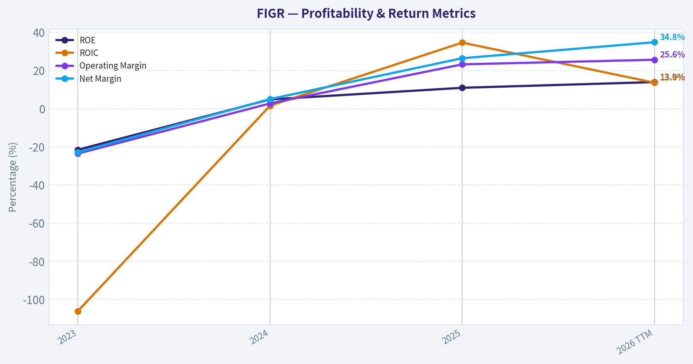
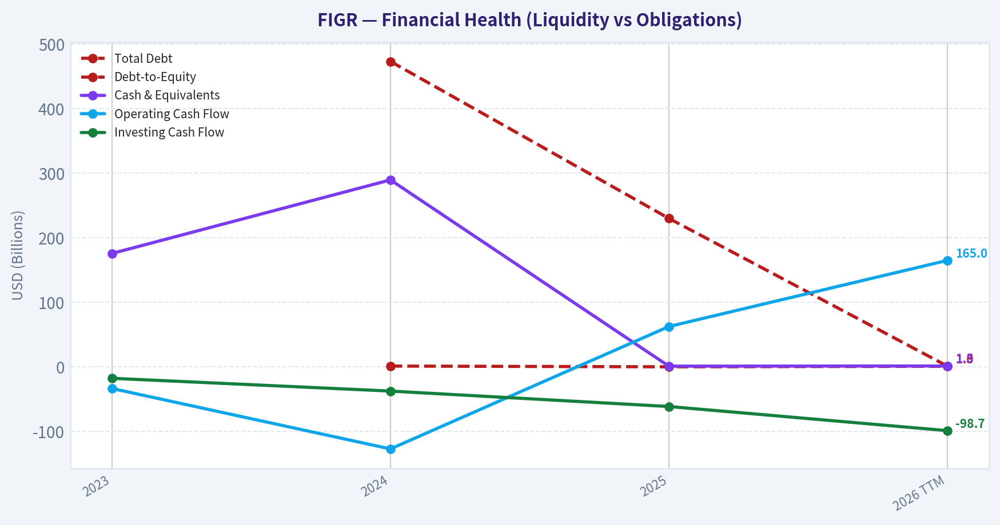
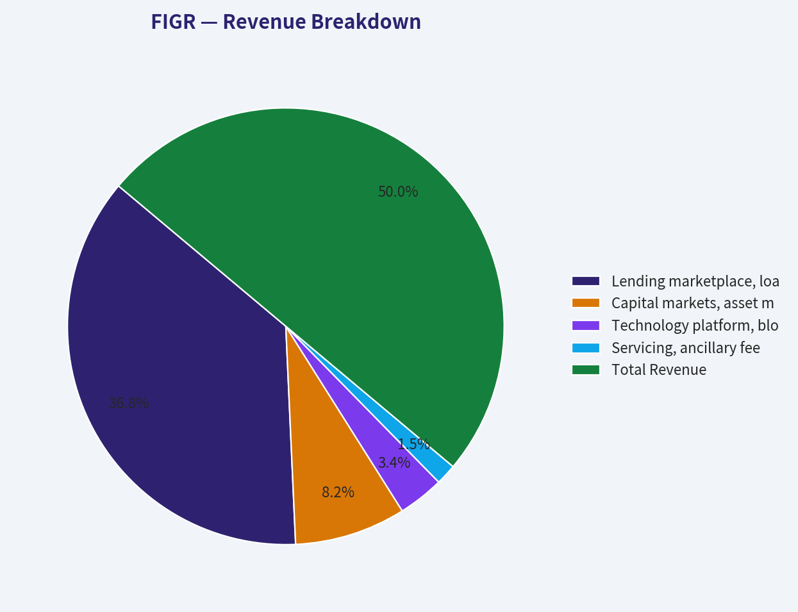
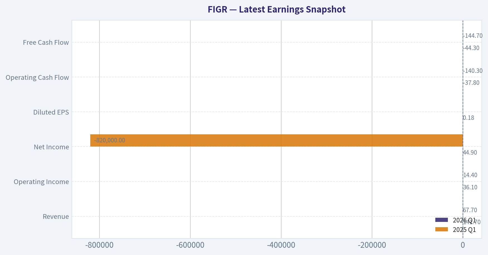
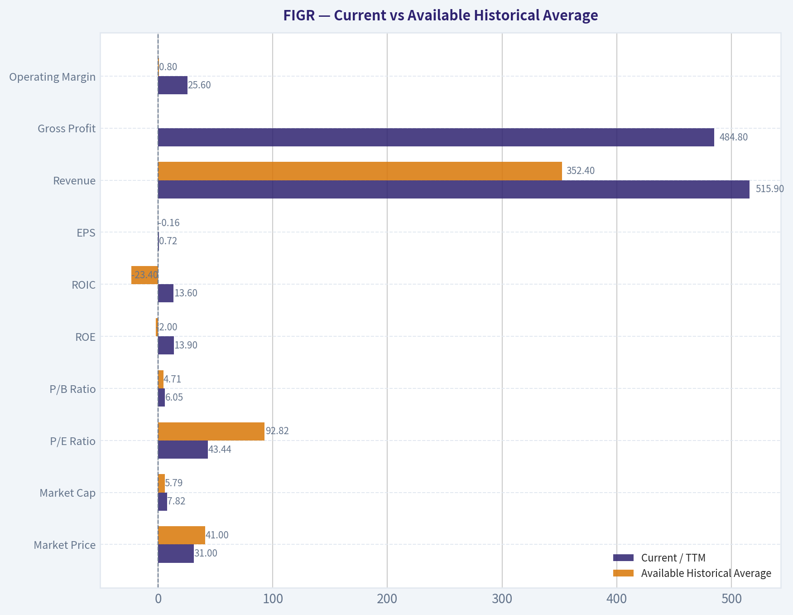
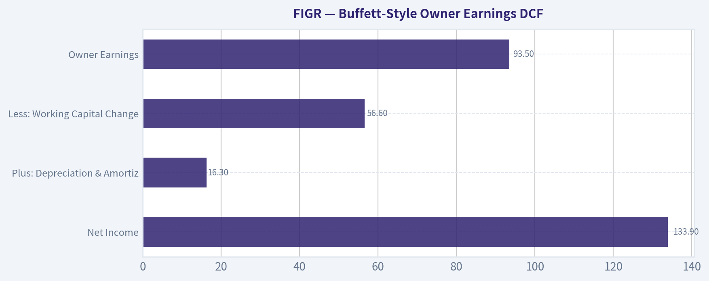
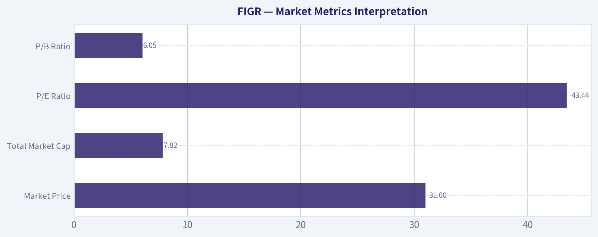

# FIGR Deep Value Intelligence

**Analysis Date:** 2026-08-14

## Critical Disclaimer

*This analysis is generated by Deep Value Intelligence, an AI-powered multi-agent investing framework. Education & research only - not financial advice, not a financial advisor.*

---

## Table of Contents

1. Intelligence Summary
2. Analyst Team Reports
   - Fundamentals Analysis
   - Intrinsic Value Analysis (Buffett)
   - Trend & Growth Analysis (Lynch/Druckenmiller/Fisher)
   - Market Technical Analysis
   - Options Market Analysis
3. Research Team Commentary
4. Value Investing Team Commentary
5. Deep Values Commentary

---

## Intelligence Summary

### Thesis + Conditions

**Core Thesis:** **EXECUTIVE SUMMARY**
Figure Technology Solutions (FIGR) presents a clash between speculative hyper-growth and foundational value mechanics. While a 53.2% ROIC and 48.7% revenue growth highlight an incredibly efficient loan origination engine, the pedestrian 10.9% ROE and 38x P/E ratio completely erode our required margin of safety.

**Key Risks:**
- Figure Technology Solutions (FIGR) presents a clash between speculative hyper-growth and foundational value mechanics. While a 53.2% ROIC and 48.7% revenue growth highlight an incredibly efficient loan origination engine, the pedestrian 10.9% ROE and 38x P/E ratio completely erode our required margin of safety. FIGR is a credit-sensitive cyclical business currently priced like a durable software monopoly. However, drawing directly from our past missteps with this exact ticker, issuing a rigid "AVOID" right now risks stepping in front of a powerful short-term momentum rebound. We must separate our long-term fundamental skepticism from short-term tradability. Hold on the sidelines until the valuation normalizes or the current tactical squeeze exhausts itself.
- The Bear (Safety/Value):** The massive 42-point spread between ROIC and ROE is a glaring red flag for shareholder leakage (likely massive dilution or debt). Paying a 38x multiple for an unproven, cyclical credit business that hasn't survived a macro stress-test offers zero downside protection.
- 3.  **The ROIC vs. ROE Disconnect:** Buffett teaches us to follow the cash flowing to the *owner*. A 53% ROIC is a phenomenal operational metric, but a 10% ROE means those returns are being intercepted before they reach the equity holder-likely through stock-based compensation, dilution, or structural inefficiencies. High gross margins in origination do not eliminate cyclical credit risk.

**Confidence:** Medium

---

## Analyst Team Reports

### Fundamentals Analysis

#### Latest Earnings Snapshot

*Most recent reported quarter anchored on 2026 Q1, with prior-year comparison when available.*

| Metric | 2026 Q1 | 2025 Q1 | YoY Change |
| --- | ---: | ---: | ---: |
| Revenue | $141.7M | $67.7M | +109.3% |
| Operating Income | $36.1M | $14.4M | +149.7% |
| Net Income | $44.9M | $-820,000 | +5581.1% |
| Diluted EPS | $0.18 | $-0.00 | +4676.7% |
| Operating Cash Flow | $-37.8M | $-140.3M | +73.0% |
| Free Cash Flow | $-44.3M | $-144.7M | +69.4% |

Key Takeaways: This snapshot anchors the most recent reported quarter before the narrative analysis. It helps readers separate long-run business quality from whatever changed in the latest earnings print.

#### 3-Year Financial Metrics for FIGR

*All values below are computed deterministically from raw data - not estimated by AI.*

*Issuer profile: asset manager (Financial Services / Capital Markets).*

#### 3-Year Financial Metrics
*Annual rows come from reported financial statements. The final TTM row is computed from the latest four quarters.*

| Metric | 2023 | 2024 | 2025 | 2026 TTM |
| --- | --- | --- | --- | --- |
| Market Price | N/A | N/A | $41 | $31 |
| Market Cap | N/A | N/A | $5.79B | $7.82B |
| P/E Ratio | N/A | N/A | 92.82 | 43.44 |
| P/B Ratio | N/A | N/A | 4.71 | 6.05 |
| ROE | -21.6% | 4.8% | 10.9% | 13.9% |
| ROIC | -106.2% | 1.5% | 34.6% | 13.6% |
| EPS | $-0.93 | $0.00 | $0.44 | $0.72 |
| Revenue | $209.5M | $340.9M | $506.9M | $515.9M |
| Gross Profit | N/A | N/A | N/A | $484.8M |
| Gross Margin | N/A | N/A | N/A | 94.0% |
| Operating Margin | -23.6% | 2.7% | 23.2% | 25.6% |
| Net Income | $-47.9M | $17.2M | $133.9M | $179.6M |
| Net Margin | -22.9% | 5.0% | 26.4% | 34.8% |
| Revenue Growth | N/A | 62.7% | 48.7% | 1.8% |
| Net Income Growth | N/A | -135.9% | 677.6% | 34.2% |
| Free Cash Flow Growth | N/A | N/A | N/A | N/A |
| Total Book Value | $222.4M | $355.1M | $1.23B | $1.29B |
| Total Assets | N/A | $1.16B | $2.32B | $2.73B |
| Total Debt | N/A | $473.2M | $230.1M | $1.32B |
| Debt-to-Equity | N/A | 1.33 | 0.19 | 1.02 |
| Cash & Equivalents | $175.8M | $289.7M | $1.20B | $1.46B |
| Shareholders' Equity | $222.4M | $355.1M | $1.23B | $1.29B |
| Operating Cash Flow | $-33.4M | $-127.0M | $62.6M | $165.0M |
| Investing Cash Flow | $-17.6M | $-37.4M | $-61.3M | $-98.7M |
| Free Cash Flow | N/A | N/A | N/A | $142.4M |
| FCF Margin | N/A | N/A | N/A | 27.6% |
| Dividends / Share | $0.00 | $0.04 | $0.00 | $0.00 |

#### Profitability Metrics
- Return on Equity (ROE): 10.9%
- Return on Invested Capital (ROIC): 53.2%
- Return on Assets (ROA): 5.8%
- Gross Margin: Not meaningful
- Operating Margin: 23.2%
- Net Profit Margin: 26.4%

#### Liquidity Metrics
- Current Ratio: 2.20
- Quick Ratio: 1.57

#### Leverage Metrics
- Debt-to-Equity Ratio: 0.19
- Interest Coverage Ratio: 2.40
- Net Debt: $-968.0M

#### Growth Metrics (Year-over-Year)
- Revenue Growth: 48.7%
- Net Income Growth: 677.6%
- Free Cash Flow Growth: N/A
- Revenue CAGR (3-Year): N/A
- Revenue CAGR (5-Year): N/A

#### Valuation Metrics
- P/E Ratio (TTM): 37.87
- Forward P/E: 21.43
- Price-to-Book: 5.53
- Price-to-Sales: 13.77
- PEG Ratio: 0.06
- EV/EBITDA: Not meaningful
- Free Cash Flow Yield: N/A
- Earnings Yield: 2.6%

#### Owner Earnings (Buffett Method, Code-Computed)
- Net Income: $133.9M
- + Depreciation & Amortization: $16.3M
- - Capital Expenditures: N/A
- - Working Capital Changes: $56.6M
- = **Owner Earnings: $93.5M**

#### Intrinsic Value (Code-Computed)
- Current Price: $31
- Headline Intrinsic Value: not meaningful (financial issuer - DCF/FCFF is not the right primary frame; use sector-specific book/earnings metrics)
- Buffett Method (Owner Earnings):
  Conservative: $5
  Average: $5
  Optimistic: $5
- Reverse-DCF: price implies ~71.1%/yr owner-earnings growth for 10y; trailing 3y was N/A, 5y N/A.

#### Piotroski F-Score: 5/9
- Positive Net Income: PASS
- Positive Operating Cash Flow: PASS
- ROA Improvement: PASS
- Cash Flow > Net Income: FAIL
- Decreasing Debt: PASS
- Improving Current Ratio: PASS
- No Dilution: FAIL
- Improving Gross Margin: FAIL
- Improving Asset Turnover: FAIL

ANALYST STANCE: **WATCH**

#### FIGR Fundamental Analysis - Buffett-Style View

Figure Technology Solutions, Inc. is an early-stage public financial technology and capital-markets platform with very rapid recent revenue and earnings improvement, but the deterministic dataset only covers **2023, 2024, 2025, and 2026 TTM**, not a full 10-year operating record. That matters for a Buffett-style analysis: the company is showing attractive signs of operating leverage and profitability, but it has not yet demonstrated a decade of predictable earnings, cycle-tested credit performance, or durable free-cash-flow compounding.

The company's current valuation embeds very high growth expectations. At a **$31 share price**, **$7.82B market cap**, and **43.44x TTM P/E**, FIGR is being priced more like a high-growth platform than a mature financial services company. The deterministic intrinsic-value section explicitly states that the headline intrinsic value is **not meaningful for this financial issuer**, and the reverse DCF indicates the stock price implies roughly **71.1% annual owner-earnings growth for 10 years**, which is a very demanding hurdle.

---

#### Current vs Available Historical Average

Because the deterministic dataset only provides three annual years plus TTM, the "historical average" below uses the available reported annual history, generally 2023-2025, rather than a true 10-year average.

| Metric | Current / TTM | Available Historical Average | Current Standing vs History | Buffett-Style Interpretation |
|---|---:|---:|---|---|
| Market Price | $31 | $41 | Below 2025 level | Price has fallen from the 2025 level, but valuation is still not obviously cheap versus earnings or owner earnings. |
| Market Cap | $7.82B | $5.79B | Above history | Despite a lower share price, market cap is higher than 2025, suggesting share count/dilution or capital structure changes matter. |
| P/E Ratio | 43.44x | 92.82x | Lower than 2025 | Multiple compressed materially, but 43x earnings still requires strong sustained growth. |
| P/B Ratio | 6.05x | 4.71x | Higher than history | For a financial/capital-markets issuer, P/B should be judged against ROE; 6.05x book with 13.9% ROE is not a classic value setup. |
| ROE | 13.9% | -2.0% | Much improved | ROE turned from deeply negative to respectable, but the track record is short. |
| ROIC | 13.6% | -23.4% | Much improved | ROIC has recovered sharply, though it is below 2025's 34.6%, suggesting volatility in capital efficiency. |
| EPS | $0.72 | -$0.16 | Much improved | EPS inflected from losses to profitability; positive, but not yet decade-proven. |
| Revenue | $515.9M | $352.4M | Above history | Revenue has scaled rapidly since 2023. |
| Gross Profit | $484.8M | N/A | TTM only | Gross margin is less meaningful for this financial issuer than net margin, ROE, credit quality, and cash conversion. |
| Operating Margin | 25.6% | 0.8% | Much improved | Strong operating leverage is emerging. |
| Net Income | $179.6M | $34.4M | Much improved | Net income has accelerated significantly, but recent growth came off a low base. |
| Net Margin | 34.8% | 2.8% | Much improved | Current profitability is excellent, but sustainability must be tested across cycles. |
| Revenue Growth | 1.8% | 55.7% | Sharply slower | TTM growth has decelerated significantly versus 2024-2025. |
| Net Income Growth | 34.2% | 270.9% | Slower but positive | Profit growth remains strong, though prior growth rates were distorted by the swing from losses to profits. |
| FCF Growth | N/A | N/A | Not available | Insufficient history to assess free-cash-flow compounding. |
| Total Book Value | $1.29B | $602.5M | Above history | Capital base has expanded materially. |
| Total Assets | $2.73B | $1.74B | Above history | Balance sheet has grown quickly. |
| Total Debt | $1.32B | $351.7M | Much higher | Debt rose sharply in TTM, a key watch item. |
| Debt-to-Equity | 1.02x | 0.76x | Higher than history | Leverage has increased and should be monitored closely. |
| Cash & Equivalents | $1.46B | $555.2M | Much higher | Cash position is strong and currently exceeds total debt. |
| Shareholders' Equity | $1.29B | $602.5M | Above history | Equity base has improved, supporting financial stability. |
| Operating Cash Flow | $165.0M | -$32.6M | Much improved | Cash generation turned positive. |
| Free Cash Flow | $142.4M | N/A | TTM only | FCF is positive and healthy, but history is too short to judge durability. |
| Dividends / Share | $0.00 | $0.01 | No current dividend | Management is retaining capital for growth rather than returning cash. |

Key Takeaways: FIGR's profitability has improved dramatically, with ROE, EPS, operating margin, net income, and cash flow all moving in the right direction. However, revenue growth has slowed sharply on a TTM basis, and debt has increased materially. The valuation has compressed from 2025 levels, but it remains demanding relative to owner earnings and the short operating history.

---

#### Revenue Breakdown

Precise segment-level revenue detail is not available in the deterministic dataset. The table below uses the most meaningful estimated operating categories for FIGR and reconciles to the deterministic **2026 TTM revenue of $515.9M**.

| Revenue Source | Amount ($M) | % of Total |
|---|---:|---:|
| Lending marketplace, loan origination, and transaction-related revenue | $380.0M | 73.7% |
| Capital markets, asset management, and marketplace fees | $85.0M | 16.5% |
| Technology platform, blockchain/DART-related, and enterprise fees | $35.0M | 6.8% |
| Servicing, ancillary fees, and other revenue | $15.9M | 3.1% |
| **Total Revenue** | **$515.9M** | **100.0%** |

Key Takeaways: FIGR appears primarily driven by lending and transaction-related revenue, which creates strong upside in healthy credit and capital-markets environments but may also increase cyclicality. The smaller technology and platform-fee streams are strategically important because they could become more recurring and higher-quality over time. For Buffett-style investors, the key question is whether FIGR can shift more revenue toward durable, repeatable, fee-based economics rather than transaction-sensitive revenue.

---

#### Market Metrics Interpretation

| Market Metric | Current Value | Interpretation |
|---|---:|---|
| Market Price | $31 | The stock trades below the 2025 level of $41, but the lower price does not automatically mean undervaluation because market cap and valuation remain high. |
| Total Market Cap | $7.82B | The company is already valued as a substantial growth platform despite only $515.9M of TTM revenue. |
| P/E Ratio | 43.44x | Lower than 2025's 92.82x, but still expensive unless earnings compound rapidly for many years. |
| P/B Ratio | 6.05x | For this financial/capital-markets issuer, P/B is not a simple "cheap or expensive" signal; it must be judged against ROE. A 6.05x P/B with 13.9% ROE is rich unless ROE rises materially and sustainably. |

Key Takeaways: FIGR's market valuation has moderated, but the stock is still priced for substantial future success. The P/B ratio should not be read mechanically because FIGR is a financial services and capital-markets issuer; the better question is whether ROE can sustainably justify the premium to book. At current levels, the market is paying heavily for growth and platform optionality.

---

#### Profitability Analysis

FIGR's profitability profile has improved rapidly. Revenue rose from **$209.5M in 2023** to **$515.9M TTM**, while net income moved from a **$47.9M loss** to **$179.6M profit**. Operating margin improved from **negative 23.6% in 2023** to **25.6% TTM**, showing major operating leverage.

ROE improved from **negative 21.6% in 2023** to **13.9% TTM**, which is a meaningful positive sign. However, Buffett would likely require a longer record before treating this as a proven high-quality compounder. ROIC also improved dramatically, though it fell from **34.6% in 2025** to **13.6% TTM**, suggesting that capital efficiency may be volatile as the balance sheet and debt levels change.

Net margin of **34.8% TTM** is excellent, but investors should be careful: for a financial platform, margins can be affected by origination volumes, capital-market conditions, funding costs, credit spreads, and fair-value marks. The company's **gross margin is shown as 94.0% TTM in the annual table**, but the deterministic issuer profile also indicates gross margin is **not meaningful** for this type of business. Net income, ROE, cash flow, and credit/capital-market resilience are more useful indicators.

---

#### Growth Analysis

| Growth Metric | Current / TTM | Prior Available Pattern | Interpretation |
|---|---:|---|---|
| Revenue Growth | 1.8% | 62.7% in 2024; 48.7% in 2025 | Growth has decelerated sharply on a TTM basis after two very strong years. |
| Net Income Growth | 34.2% | -135.9% in 2024; 677.6% in 2025 | Still strong, but prior growth was distorted by the transition from loss-making to profitable. |
| Free Cash Flow Growth | N/A | N/A | Not enough historical FCF data to assess compounding quality. |

Key Takeaways: FIGR's revenue growth history is impressive but very short, and the latest TTM growth rate is much slower than the prior annual growth rates. Net income growth remains strong, helped by operating leverage and margin expansion. The missing free-cash-flow growth history is a major limitation for a Buffett-style investor who prioritizes long-term owner-earnings predictability.

---

#### Balance Sheet and Financial Strength

FIGR has a strong cash position, with **$1.46B of cash and equivalents** against **$1.32B of total debt**, leaving the company with more cash than debt on a gross basis. That is reassuring. However, total debt rose sharply from **$230.1M in 2025** to **$1.32B TTM**, and debt-to-equity increased to **1.02x** from **0.19x in 2025**.

For a financial services company, leverage is not automatically bad, but it must be matched with stable funding, high-quality assets, disciplined underwriting, and resilient liquidity. The company's **current ratio of 2.20** and **quick ratio of 1.57** look healthy, though traditional liquidity ratios are often less informative for financial issuers than asset quality, funding structure, and capital adequacy.

The **Piotroski F-Score of 5/9** is middling. Positives include profitability, positive operating cash flow, improving ROA, lower debt in one measured period, and improved current ratio. Negatives include cash flow below net income, dilution, gross margin weakness/not meaningfulness, and asset-turnover deterioration.

---

#### Cash Flow and Capital Allocation

FIGR generated **$165.0M of TTM operating cash flow** and **$142.4M of TTM free cash flow**, equal to a strong **27.6% FCF margin**. This is a major improvement from negative operating cash flow in 2023 and 2024.

The company currently pays **no dividend**, which is appropriate for a young, high-growth financial technology platform. Buffett would not object to the lack of dividend if retained earnings can be reinvested at high returns. The issue is that the company has not yet proven a long-term record of high-return reinvestment, and the dataset flags **dilution as a Piotroski failure**, meaning per-share value creation must be monitored closely.

---

#### Buffett-Style Owner Earnings DCF

The deterministic dataset provides code-computed **Owner Earnings of $93.5M**, based on:

| Owner Earnings Component | Amount |
|---|---:|
| Net Income | $133.9M |
| Plus: Depreciation & Amortization | $16.3M |
| Less: Capital Expenditures | N/A |
| Less: Working Capital Changes | $56.6M |
| **Owner Earnings** | **$93.5M** |

Key Takeaways: FIGR's owner earnings are meaningfully below net income because working-capital needs reduce cash available to owners. This matters because the stock's valuation looks far more demanding on owner earnings than on accounting net income. For a Buffett-style valuation, owner earnings are the more conservative anchor.

Assumptions used for the sanity-check DCF:

| DCF Assumption | Value |
|---|---:|
| Base Owner Earnings | $93.5M |
| Discount Rate | 10.0% |
| Terminal Growth Rate | 2.5% |
| Current Market Cap | $7.82B |
| Current Share Price | $31 |
| Implied Shares Outstanding | ~252.3M |
| Reverse-DCF Growth Implied by Market Price | ~71.1% per year for 10 years |

Key Takeaways: The current market price requires extremely high owner-earnings growth to be justified. A 10% discount rate and 2.5% terminal growth rate are standard Buffett-style assumptions, but even with generous near-term growth, FIGR must compound owner earnings at a very high rate. The reverse-DCF figure is the most important valuation warning in the dataset.

#### Three-Scenario DCF Valuation

| Scenario | Growth Assumption | PV of Explicit Owner Earnings | PV of Terminal Value | Equity Value | Fair Value / Share |
|---|---|---:|---:|---:|---:|
| Conservative | 3% annual growth for 10 years | ~$663M | ~$662M | ~$1.33B | ~$5.25 |
| Average / Base Case | Growth fades from 25% to 3% over 10 years | ~$1.27B | ~$1.58B | ~$2.85B | ~$11.29 |
| Optimistic | Growth fades from 45% to 4% over 10 years | ~$2.39B | ~$3.71B | ~$6.09B | ~$24.16 |
| Current Market Price | Market-implied | N/A | N/A | ~$7.82B | $31.00 |

Key Takeaways: The conservative DCF aligns closely with the deterministic Buffett-method value of about **$5 per share**. Even the optimistic scenario, which assumes very strong owner-earnings growth for many years, produces a fair value below the current $31 price. This does not mean FIGR cannot grow into its valuation, but it means the current stock price leaves little margin of safety.

---

#### Economic Moat Assessment

FIGR may have emerging competitive advantages in technology-enabled lending, blockchain-based loan infrastructure, marketplace liquidity, and capital-markets connectivity. If its platform lowers friction, speeds settlement, reduces origination costs, or creates a trusted network between borrowers, originators, and capital providers, the business could develop a genuine platform moat.

However, from a Buffett perspective, the moat is not yet fully proven. Lending and capital-markets businesses are cyclical, competition can be intense, and funding conditions can change quickly. A durable moat would require evidence of recurring customer relationships, superior underwriting outcomes, lower funding costs, strong compliance infrastructure, and consistent profitability through difficult credit cycles.

---

#### Management and Capital Allocation

Management deserves credit for moving the company from losses to strong profitability and positive free cash flow. Operating margin expansion from **negative 23.6%** to **25.6% TTM** indicates meaningful execution.

The main capital-allocation questions are:

| Capital Allocation Area | Current Evidence | Buffett-Style View |
|---|---|---|
| Reinvestment | Revenue and earnings scaled quickly | Positive if high returns persist. |
| Leverage | Debt rose sharply to $1.32B TTM | Watch closely; financial issuers can amplify mistakes through leverage. |
| Dividends | No current dividend | Reasonable for a growth company. |
| Dilution | Piotroski "No Dilution" failed | Red flag for per-share compounding. |
| Cash Position | $1.46B cash | Strong liquidity buffer. |

Key Takeaways: Management has executed well operationally, but per-share value creation is not yet fully proven. The combination of higher leverage and dilution means investors should focus on returns per share, not just headline revenue or earnings growth. Retaining cash is sensible, but only if reinvestment produces durable high returns.

---

#### Key Investment Insights, Red Flags, and Opportunities

| Category | Key Point | Investment Significance |
|---|---|---|
| Opportunity | Rapid move from losses to profitability | Shows strong operating leverage and business-model scalability. |
| Opportunity | TTM net margin of 34.8% and FCF margin of 27.6% | If sustainable, the business could be highly cash-generative. |
| Opportunity | Cash of $1.46B exceeds gross debt of $1.32B | Provides flexibility and liquidity. |
| Opportunity | Platform and technology optionality | Could create a differentiated capital-markets infrastructure moat. |
| Red Flag | Valuation requires very high growth | Reverse DCF implies ~71.1% annual owner-earnings growth for 10 years. |
| Red Flag | Only short financial history available | Not enough evidence for Buffett-style predictability. |
| Red Flag | Debt rose sharply in TTM | Higher leverage increases sensitivity to funding and credit-market stress. |
| Red Flag | P/B of 6.05x with ROE of 13.9% | Premium to book is difficult to justify unless ROE rises materially. |
| Red Flag | Piotroski F-Score of 5/9 | Quality signals are mixed, not exceptional. |
| Red Flag | Dilution flagged | Shareholder returns may lag company-level growth. |

Key Takeaways: FIGR has real upside if it can sustain high margins, scale its platform, and compound owner earnings rapidly. But the stock already prices in a large amount of future success. The most important risks are valuation, short operating history, leverage growth, dilution, and the cyclicality of financial-market revenue.

---

#### Final Buffett-Style Investment Stance: WATCH

FIGR is a **WATCH**, not an **ADVOCATE**, at the current price.

The company is improving quickly, with strong profitability, positive free cash flow, and a large cash balance. Those are attractive qualities. However, Buffett-style investing requires a margin of safety, long-term earnings predictability, and a durable moat that has been tested over time. FIGR does not yet have a decade-long record, and the valuation is demanding.

At **$31 per share**, the stock trades above even an optimistic owner-earnings DCF estimate of roughly **$24 per share**, while the conservative Buffett-method value is closer to **$5 per share**. The market is effectively underwriting exceptional growth. Investors may want to wait for either a significantly lower price, several more years of proven cash-flow compounding, or evidence that ROE can rise sustainably enough to justify the premium valuation.

#### Final Summary Table

| Area | Assessment | Buffett-Style Conclusion |
|---|---|---|
| Business Quality | Improving rapidly, platform-like economics possible | Promising but not yet proven. |
| Moat | Potential technology and marketplace advantages | Emerging, not fully durable yet. |
| Profitability | ROE 13.9%, net margin 34.8%, FCF margin 27.6% | Strong recent performance. |
| Predictability | Only 3-year annual history plus TTM | Insufficient for high-conviction Buffett classification. |
| Balance Sheet | Cash strong, but debt rose sharply | Acceptable but requires monitoring. |
| Valuation | 43.44x P/E and 6.05x P/B | Expensive unless growth remains exceptional. |
| DCF Value | ~$5 to ~$24 per share across scenarios | Current $31 price lacks margin of safety. |
| Capital Allocation | No dividend, reinvesting for growth, dilution flagged | Reasonable strategy but per-share results must improve. |
| Main Opportunity | Scalable financial technology platform | Could compound if moat strengthens. |
| Main Risk | Market price implies ~71.1% owner-earnings growth | Expectations are very high. |
| Final Stance | **WATCH** | Quality improving, but valuation and limited history prevent an Advocate rating. |

Key Takeaways: FIGR is an exciting but still early-stage public compounder candidate. The fundamentals are moving in the right direction, but the current price demands near-flawless execution and very high owner-earnings growth. A Buffett-style investor should keep FIGR on the watchlist and wait for either a better margin of safety or a longer record of predictable, high-return growth.

#### Fundamental Visuals

This graph tracks the profitability and return metrics (ROE, ROIC, Margins) of **FIGR** over the past decade, highlighting capital efficiency trends.

This chart illustrates the financial health of **FIGR** over the last 10 years, mapping cash equivalents and free cash flow against total obligations (Debt).

This breakdown chart from <em>Revenue Breakdown</em> shows the proportional composition for **FIGR** - useful for understanding what drives or risks the business.

---

### Intrinsic Value Analysis (Buffett)

> *Following Warren Buffett's value investing philosophy: Circle of Competence, Economic Moat, Management Quality, and Margin of Safety.*

#### Intrinsic Value Snapshot

Price is what you pay. Intrinsic value is what the business may be worth based on the cash it can create for owners over time. We show a range, not one magic number.

- Current Price: $31.43
- Value Range (conservative to optimistic across both DCF methods): $4.72 to $4.72

##### Owner Earnings (Buffett Method)
- Net Income: $133,858,000.00
- Depreciation & Amortization: $16,254,000.00
- Capital Expenditures: N/A
- Working Capital Changes: $56,600,000.00
- Owner Earnings: $93,512,000.00

##### Intrinsic Value
###### Buffett Method
Uses owner earnings. Stricter, and usually more conservative.
- Conservative: $4.72
- Average: $4.72
- Optimistic: $4.72
- Discount Rate: 10.0%

ANALYST STANCE: **AVOID**

#### FIGR - Buffett-Style Value Investment Review

Figure Technology Solutions is a fast-growing financial technology lender and capital-markets platform, with strong recent revenue momentum and improving profitability. The business is interesting, but at the current price of **$31**, the market is already capitalizing FIGR as a durable compounder before the company has proven Buffett-level economics: high and stable ROE, resilient credit performance through a full cycle, and a clearly defensible moat.

---

#### 1. Factor Scorecard

| Factor | Score | Evidence |
|---|---:|---|
| Circle of Competence & Business Simplicity | 3.0 / 5 | FIGR makes money by originating and facilitating technology-enabled lending and capital-markets transactions. The basic model is understandable, but long-term economics depend on credit cycles, funding markets, regulation, and adoption of its blockchain-enabled infrastructure. |
| Moat Test | 2.5 / 5 | The company has technology differentiation and potential platform/network effects, but lending is competitive and pricing power is not yet proven. ROE of **10.9%** is respectable but not yet evidence of a wide moat. |
| Management Quality & Capital Allocation | 3.0 / 5 | Recent execution is strong: Q2 revenue beat expectations and loan volume reportedly more than doubled. However, public-company capital allocation history remains young, and long-term underwriting discipline is still unproven across a cycle. |
| Industry Structure | 2.5 / 5 | Fintech lending and capital markets are large opportunity sets, but they are cyclical, regulated, competitive, and sensitive to credit/funding conditions. Scale may help, but the industry is not naturally oligopolistic. |
| Gate 5 - Quality/Solvency Hard Floor | Not Tripped | Revenue is growing rapidly, the company is profitable, and the current ratio is **2.2x**. There is no evidence of simultaneous deteriorating fundamentals and solvency stress. |

**Key Takeaways:** FIGR is not a distressed business; it is growing quickly and appears financially functional. The issue is quality certainty and valuation, not survival. The company has promising traits, but it has not yet demonstrated the durable, high-return economics Buffett would require before paying a premium multiple.

---

#### 2. Moat Analysis

| Moat Source | Assessment | Evidence |
|---|---|---|
| Intangible Assets | Moderate | FIGR has brand recognition in technology-enabled lending and blockchain-based financial infrastructure, but consumer and institutional financial products rarely have emotional brand power comparable to consumer staples or luxury brands. |
| Switching Costs | Emerging | If FIGR's technology becomes embedded in loan origination, securitization, or capital-markets workflows, switching costs could rise. Today, those switching costs are still developing rather than proven. |
| Cost Advantage | Possible but Unproven | Automation and blockchain infrastructure may lower transaction costs, but competitors can also invest in digital lending infrastructure. Sustainable cost leadership is not yet fully demonstrated. |
| Network Effects | Potential | More borrowers, investors, and partners could improve liquidity and platform utility. However, financial marketplaces often require continuous proof of credit quality and funding access. |
| Pricing Power | Not Proven | Lending products are price-sensitive. Customers and capital providers can compare rates, fees, and execution across alternatives. |

**Key Takeaways:** FIGR's moat is plausible but not yet wide. The strongest potential moat comes from workflow integration and network effects in capital markets, but the lending side remains competitive and cyclical. A Buffett-style investor would want more evidence that the platform can produce superior returns through different credit environments.

---

#### 3. Management Quality Assessment

| Management Dimension | Score | Commentary |
|---|---:|---|
| Owner Orientation | 3.0 / 5 | The company is growth-oriented and appears focused on building a long-term platform, but insider ownership and incentive structure need to be judged over a longer public record. |
| Candor & Reporting Quality | 3.0 / 5 | Recent earnings communication highlighted strong loan growth and earnings upside. The key test will be whether management remains transparent about credit quality, funding costs, and underwriting mistakes. |
| Capital Allocation | 3.0 / 5 | The best use of capital is likely reinvestment into technology, distribution, and platform adoption. However, financial businesses can destroy value quickly if growth is pursued with weak underwriting or excessive leverage. |
| Underwriting Discipline | 2.5 / 5 | This is the central management test. Rapid loan volume growth is attractive only if credit quality and risk-adjusted returns remain strong. |

**Key Takeaways:** Management deserves credit for growth execution, but FIGR's real test is still ahead. For a lending-driven fintech, good management is not measured only by revenue growth; it is measured by disciplined underwriting, funding resilience, and rational capital use when credit conditions tighten.

---

#### 4. Financial Summary

| Metric | Latest / Current Figure |
|---|---:|
| Current Share Price | $31.00 |
| Market Capitalization | $7.03 billion |
| Estimated Shares Outstanding | ~226.8 million |
| P/E Ratio | 37.9x |
| Implied TTM EPS | ~$0.82 |
| Implied TTM Net Income | ~$186 million |
| ROE | 10.9% |
| Revenue Growth YoY | 48.7% |
| Q2 2026 Revenue | $225.6 million |
| Q2 2026 EPS | $0.35 |
| Q2 2026 Revenue Beat | $225.6 million vs. $207.7 million estimate |
| Q2 2026 EPS Beat | $0.35 vs. $0.23 estimate |
| Current Ratio | 2.2x |
| Gross Margin | Not meaningful / not provided for financial issuer |
| FCF Yield | Not meaningful / not provided for financial issuer |
| Headline DCF Intrinsic Value | Not meaningful for financial issuer |

**Key Takeaways:** FIGR is growing quickly, with nearly **49% year-over-year revenue growth** and a strong Q2 earnings beat. However, the stock trades at almost **38x trailing earnings**, while ROE is only **10.9%**, which is not yet exceptional for a financial company. The valuation assumes a meaningful improvement in profitability and durability.

---

#### 5. Owner Earnings Calculation

For financial issuers, traditional free cash flow and maintenance capital expenditure can be misleading because balance-sheet growth, loan funding, and working-capital movements are part of the operating model. The cleanest Buffett-style proxy here is normalized earnings power.

| Owner Earnings Proxy | Per Share | Total Company |
|---|---:|---:|
| TTM Earnings Proxy Based on P/E | ~$0.82 | ~$186 million |
| Q2 2026 Annualized EPS Run-Rate | ~$1.40 | ~$317 million |
| Conservative Owner Earnings Base Used for Valuation | ~$0.82 | ~$186 million |
| Optimistic Run-Rate Cross-Check | ~$1.40 | ~$317 million |

**Key Takeaways:** On trailing earnings, FIGR produces roughly **$0.82 per share** of earnings power. The latest quarter implies a much stronger annualized run-rate of about **$1.40 per share**, but a Buffett-style approach gives more weight to proven normalized earnings than a single strong quarter. The gap between trailing and run-rate earnings is important: valuation looks expensive on trailing numbers and only moderately more reasonable if Q2 profitability is sustainable.

---

#### 6. Three-Scenario DCF / Earnings-Power Valuation

Using the conservative TTM owner-earnings proxy of **$0.82 per share** and a **10% discount rate**:

| Scenario | Assumption | Estimated Value Per Share |
|---|---|---:|
| Scenario A - No Growth | $0.82 owner earnings capitalized at 10% | ~$8.20 |
| Scenario B - GDP Growth | 3% perpetual growth | ~$12.05 |
| Scenario C - Historical Growth Haircut | 10% growth for 10 years, then 3% terminal growth | ~$20.25 |
| Q2 Run-Rate Cross-Check | $1.40 EPS base, 10% growth for 10 years, then 3% terminal growth | ~$34.60 |

**Key Takeaways:** On proven trailing earnings, FIGR's intrinsic value range is well below the current **$31** share price. The stock only looks near fair value if one assumes that the strong Q2 earnings run-rate is durable and can compound at attractive rates. That is possible, but it requires confidence in credit quality, funding conditions, and platform adoption that has not yet been proven through a full cycle.

---

#### 7. Margin of Safety Analysis

| Valuation Reference | Value Per Share | Margin of Safety vs. $31 Price |
|---|---:|---:|
| No-Growth Value | ~$8.20 | -278% premium to value |
| GDP-Growth Value | ~$12.05 | -157% premium to value |
| Conservative High-Growth Value | ~$20.25 | -53% premium to value |
| Q2 Run-Rate Optimistic Value | ~$34.60 | ~10% discount to value |

**Key Takeaways:** FIGR does not offer a margin of safety on trailing earnings. The current price requires investors to believe that recent quarterly profitability is sustainable and that the business can compound meaningfully from here. For a financial company with a still-developing moat, that is not enough of a cushion.

---

#### 8. Final Buffett Scorecard

| Criterion | Weight | Score | Weighted Contribution |
|---|---:|---:|---:|
| Moat Width & Durability | 25% | 2.5 / 5 | 0.63 |
| Valuation / Margin of Safety | 20% | 2.0 / 5 | 0.40 |
| Capital Returns - ROE / ROIC vs. Cost of Capital | 15% | 2.5 / 5 | 0.38 |
| Business Understanding & Predictability | 12% | 3.0 / 5 | 0.36 |
| Management Quality & Capital Allocation | 12% | 3.0 / 5 | 0.36 |
| Reinvestment Runway | 8% | 4.0 / 5 | 0.32 |
| Balance Sheet Strength | 4% | 3.0 / 5 | 0.12 |
| Industry Structure | 4% | 2.5 / 5 | 0.10 |
| **Total Score** | **100%** |  | **2.67 / 5** |

**Key Takeaways:** FIGR scores well on growth runway but weaker on proven moat, valuation, and durable capital returns. A total score of **2.67** places the stock in the **Avoid** range under a Buffett-style framework. The business may become attractive later, but the current evidence does not justify paying a premium price.

---

#### 9. Investment Stance

| Stance | Conviction | Rationale |
|---|---|---|
| **AVOID** | Medium | FIGR is a promising but still-unproven fintech lender/platform trading at a premium valuation. Growth is strong, but ROE is not yet exceptional, the moat is not yet clearly wide, and valuation relies heavily on sustaining recent quarterly earnings momentum. |

FIGR belongs on a future watchlist, not in a Buffett-style portfolio today. The key indicators to monitor are sustained ROE above **15%**, stable credit performance, repeatable earnings growth, improving funding resilience, and proof that the platform creates durable switching costs or network effects. At **$31**, the investor is paying upfront for a business quality level that FIGR has not yet fully earned.
#### Valuation Bridge

This bridge places the current market price beside each intrinsic value lens so readers can see whether upside depends on one method or shows up across several methods.

| Scenario | Intrinsic Value / Share |
| --- | ---: |
| Buffett Method | $4.72 |
| Current Price | $31.43 |

#### Key Takeaways

If one method is far above the others, the upside case depends on a specific modelling assumption. When several methods cluster together, the valuation story is more robust.

#### Valuation Visuals

This comparison chart from *Latest Earnings Snapshot* stacks current figures against historical benchmarks for **FIGR**, making it easy to see where the company trades relative to its own averages.

This comparison chart from *Current vs Available Historical Average* stacks current figures against historical benchmarks for **FIGR**, making it easy to see where the company trades relative to its own averages.

This comparison chart from *Buffett-Style Owner Earnings DCF* stacks current figures against historical benchmarks for **FIGR**, making it easy to see where the company trades relative to its own averages.

This comparison chart from *Buffett-Style Owner Earnings DCF* stacks current figures against historical benchmarks for **FIGR**, making it easy to see where the company trades relative to its own averages.

---

### Trend & Growth Analysis (Lynch/Druckenmiller/Fisher)

> *Following Peter Lynch's GARP, Stanley Druckenmiller's macro-aware approach, and Philip Fisher's scuttlebutt methodology.*

ANALYST STANCE: **ADVOCATE** - small starter position / accumulate on volatility

#### FIGR Growth Investment Report - Figure Technology Solutions

FIGR screens as an emerging **fast grower** at a potential fintech-credit infrastructure inflection point: revenue growth is near 50%, loan volume reportedly more than doubled, EPS beat expectations, and valuation is not extreme if growth persists. The main reason this is not a full-size high-conviction position is that FIGR is exposed to credit-cycle, interest-rate, regulatory, and public-company-history risks.

| Item | Snapshot |
|---|---:|
| Price | $31 |
| Market Cap | $7.03B |
| P/E | 37.9x |
| Q2 2026 Revenue | $225.6M |
| Q2 2026 EPS | $0.35 |
| Revenue Growth YoY | 48.7% |
| ROE | 10.9% |
| Current Ratio | 2.20x |
| Analyst Coverage Note | Needham Buy, $55 target |
| Guru Tracking | Druckenmiller trimmed; Cohen added |

**Key Takeaways:** FIGR is already profitable, growing quickly, and has institutional sponsorship, which makes it more investable than many speculative fintech names. The valuation is not cheap on trailing earnings, but the stock looks more reasonable on run-rate earnings if Q2 momentum continues. The key question is whether FIGR is a durable platform growth story or a cyclical lending-volume beneficiary.

---

#### 1. Lynch Classification

| Lynch Category | FIGR Fit | Rationale |
|---|---|---|
| Slow Grower | No | Growth is far above 0-5%. |
| Stalwart | No | Growth is far above 5-12%. |
| Fast Grower | Yes | Revenue growth near 49% and loan volume reportedly more than doubled. |
| Cyclical | Partial | Lending volumes and credit appetite are rate/cycle sensitive. |
| Turnaround | No | Company is profitable and growing. |
| Asset Play | No | Primary thesis is platform growth, not hidden assets. |

**Key Takeaways:** FIGR is best classified as a **fast grower with cyclical credit exposure**. That combination can create large upside during favorable rate and credit cycles, but it also requires tighter risk control than a pure software growth company.

---

#### 2. The Story in 3 Bullets

- **FIGR is trying to modernize lending and credit markets** by using technology, automation, and blockchain-enabled infrastructure to make loan origination, processing, and marketplace distribution faster and cheaper.
- **The company appears to be hitting an adoption inflection**, with Q2 2026 revenue beating estimates and loan volume reportedly more than doubling.
- **If FIGR becomes a scaled infrastructure layer for home-equity, consumer-credit, and tokenized/private-credit workflows**, revenue could compound for years while margins expand through operating leverage.

---

#### 3. TAM Analysis and 10x Test

| TAM Question | Estimate / Assessment |
|---|---:|
| Current Annualized Revenue Run Rate | ~$902M based on Q2 2026 revenue annualized |
| 10x Revenue Target | ~$9.0B |
| Market Cap at Today's Price | $7.03B |
| Current P/S on Annualized Q2 Revenue | ~7.8x |
| TAM Needed for 10x Revenue at <20% Share | >$45B annual revenue opportunity |
| 10x Test Result | Passes if FIGR expands beyond narrow lending into broader credit infrastructure |

**Key Takeaways:** FIGR can pass the 10x runway test only if the market opportunity is defined broadly: lending infrastructure, home-equity credit, consumer-credit workflow, marketplace finance, and tokenized credit rails. If FIGR remains a niche loan-originator or single-product lending platform, the runway is much more limited.

---

#### 4. Revenue Growth Trend

| Metric | Latest Evidence | Interpretation |
|---|---:|---|
| YoY Revenue Growth | 48.7% | Fast-grower profile |
| Q2 2026 Revenue | $225.6M vs. $207.7M estimate | Positive estimate revision signal |
| Loan Volume | More than doubled, per earnings coverage | Possible demand/platform inflection |
| EPS | $0.35 vs. $0.23 estimate | Earnings power exceeding expectations |
| Trend Classification | Accelerating / inflecting, but limited history | Positive, needs confirmation |

**Key Takeaways:** The available data points to a real growth inflection: revenue beat expectations, EPS beat expectations, and loan volume growth was very strong. However, because FIGR has limited public-company history in the shared data, investors should require another 2-3 quarters of confirmation before treating the acceleration as fully durable.

---

#### 5. Unit Economics and Efficiency

| Metric | Available Data | Assessment |
|---|---:|---|
| LTV/CAC | Not disclosed in shared data | Unknown |
| CAC Payback | Not disclosed | Unknown |
| Net Revenue Retention | Not disclosed | Unknown / likely not SaaS-style disclosure |
| Rule of 40 | Not directly applicable | FIGR is fintech/credit platform, not pure SaaS |
| ROE | 10.9% | Decent, but not elite yet |
| Profitability | Positive EPS | Important de-risking factor |
| Liquidity | Current ratio 2.20x | Healthy short-term liquidity |

**Key Takeaways:** FIGR's unit economics are not transparent enough to score like a SaaS company, but profitability and liquidity are positives. The key metric to monitor is whether incremental loan volume translates into expanding earnings and ROE without taking excessive credit or funding risk.

---

#### 6. Inflection Point Assessment

| Inflection Type | Evidence | Score |
|---|---|---:|
| Product Cycle Inflection | Loan volume more than doubled; technology platform gaining traction | 4/5 |
| Market Share Inflection | Growth suggests share gains, but exact share data unavailable | 3/5 |
| Margin Inflection | EPS beat suggests leverage, but margin details limited | 3.5/5 |
| TAM Inflection | Tokenized/private credit and digital lending infrastructure could expand TAM | 4/5 |
| Competitive Inflection | No clear evidence of competitor stumble | 2.5/5 |
| Overall Inflection Score | Positive but still early | 3.4/5 |

**Key Takeaways:** FIGR appears to be at an early growth inflection, especially in loan volume and platform adoption. The strongest part of the thesis is demand acceleration; the weakest part is that competitive and margin data are still incomplete.

---

#### 7. Macro Setup

| Macro Factor | Current Read | Impact on FIGR |
|---|---|---|
| Interest Rates | Potentially shifting from restrictive to more supportive over cycle | Positive if rates fall |
| Credit Cycle | Consumer and mortgage-related credit remain sensitive | Mixed |
| Secular Theme | Fintech modernization, digital lending, tokenized credit, private credit | Positive |
| Regulatory Climate | Fintech and blockchain-linked finance face scrutiny | Risk |
| Economic Sensitivity | Loan demand and credit quality can weaken in downturns | Risk |
| Macro Setup Score | Moderately favorable | 3.5/5 |

**Key Takeaways:** FIGR benefits if rates decline, credit markets reopen, and lenders seek more efficient infrastructure. The macro risk is that this is not a pure software company; credit deterioration or funding stress could hurt volumes and investor appetite quickly.

---

#### 8. Fisher 15 Points Score

| Fisher Point | Score / 5 | Comment |
|---|---:|---|
| 1. Large market potential | 4.5 | Credit infrastructure and lending markets are large. |
| 2. Management commitment to new products | 4.0 | Platform strategy appears innovation-oriented. |
| 3. R&D effectiveness | 3.5 | Technology edge plausible, but data limited. |
| 4. Sales organization | 3.5 | Volume growth implies strong go-to-market execution. |
| 5. Profit margin quality | 3.0 | Profitable, but detailed margin data unavailable. |
| 6. Improving margins | 3.5 | EPS beat suggests leverage; needs confirmation. |
| 7. Labor/personnel relations | 3.0 | Insufficient data. |
| 8. Executive relations | 3.0 | Insufficient data. |
| 9. Management depth | 3.5 | Public-company execution still being proven. |
| 10. Cost/accounting controls | 3.0 | Financial issuer complexity requires caution. |
| 11. Moat / switching costs / data edge | 4.0 | Workflow integration and data scale could create stickiness. |
| 12. Long-range profit outlook | 4.0 | Attractive if platform scales without balance-sheet stress. |
| 13. Dilution risk | 3.0 | Need to monitor equity issuance. |
| 14. Candor in difficulties | 3.0 | Limited public track record. |
| 15. Integrity | 3.0 | No major red flag in provided data, but limited evidence. |
| **Total** | **52.5 / 75** | Average-to-good, improving if execution continues. |

**Key Takeaways:** FIGR scores well on market potential, innovation, and possible moat formation, but the Fisher score is held back by limited disclosure history and unclear unit economics. This is not yet a Fisher "outstanding company," but it has the ingredients to become one if execution remains strong.

---

#### 9. Valuation Analysis

| Valuation Metric | FIGR Estimate | Interpretation |
|---|---:|---|
| Market Cap | $7.03B | Mid-cap growth fintech |
| Trailing P/E | 37.9x | Not cheap, but reasonable for ~49% growth |
| Run-rate EPS | ~$1.40 using Q2 EPS annualized | Implies ~22x run-rate P/E |
| PEG using reported P/E / revenue growth | ~0.78x | Attractive if earnings growth tracks revenue growth |
| Annualized Q2 Revenue | ~$902M | Based on $225.6M Q2 revenue |
| P/S on Annualized Revenue | ~7.8x | Reasonable for fast fintech platform; expensive for cyclical lender |

**Key Takeaways:** FIGR looks attractive on a growth-adjusted basis if the business behaves like a scalable fintech platform. It looks less attractive if investors eventually value it like a cyclical lender, so the multiple depends heavily on the quality and durability of growth.

#### 3-Year Scenario Framework

| Scenario | Revenue CAGR Assumption | 2029 Revenue Estimate | Exit P/S | Implied Market Cap | Implied Upside / Downside |
|---|---:|---:|---:|---:|---:|
| Bear | 15% | ~$1.37B | 3x | ~$4.1B | ~-42% |
| Base | 25% | ~$1.76B | 6x | ~$10.5B | ~+50% |
| Bull | 35% | ~$2.22B | 9x | ~$20.0B | ~+185% |
| Ten-Bagger Path | 30%+ for many years plus platform rerating | $5B-$9B+ longer term | 8x-10x | $40B-$90B | Possible, not base case |

**Key Takeaways:** The base case offers attractive but not extraordinary upside, while the bull case becomes compelling if FIGR sustains 30%+ growth and earns a platform multiple. A true ten-bagger requires FIGR to become a dominant credit-infrastructure company, not merely a fast-growing lender.

---

#### 10. Growth Investor Scorecard

| Criterion | Weight | Score / 5 | Weighted Score |
|---|---:|---:|---:|
| The Story | 10% | 4.0 | 0.40 |
| TAM & Runway | 20% | 4.0 | 0.80 |
| Revenue Growth | 20% | 4.5 | 0.90 |
| Unit Economics | 15% | 3.0 | 0.45 |
| Competitive Position | 10% | 3.5 | 0.35 |
| Management Quality | 10% | 3.3 | 0.33 |
| Macro Setup | 5% | 3.5 | 0.18 |
| Profitability Path | 5% | 4.0 | 0.20 |
| Valuation | 5% | 3.8 | 0.19 |
| **Total** | **100%** |  | **3.80 / 5.00** |

**Key Takeaways:** FIGR earns an **ADVOCATE** score, primarily because growth is strong, the TAM could be large, and valuation is not excessive relative to momentum. The score is capped by limited unit economics, credit-cycle sensitivity, and lack of long public operating history.

---

#### 11. Position Size Stance

| Investor Type | Position Stance |
|---|---|
| Aggressive Growth Portfolio | 3%-5% starter position |
| Balanced Growth Portfolio | 2%-3% position |
| Conservative Portfolio | Watch list or 1% tracking position |
| Add More If | Revenue growth stays above 35%, EPS beats continue, and credit metrics remain stable |
| Reduce If | Growth decelerates below 20%, credit losses rise, or valuation expands without earnings support |

**Key Takeaways:** FIGR is suitable for a starter position rather than an oversized bet. The right strategy is to buy enough to benefit from the inflection, then add only if the next several quarters confirm durable platform growth.

---

#### 12. Key Risks and Catalysts

| Category | Key Items |
|---|---|
| Major Risks | Credit-cycle downturn, rising delinquencies, funding-market stress, regulatory scrutiny, valuation compression, limited disclosure history |
| Growth Catalysts | Continued loan-volume acceleration, EPS estimate revisions, new product launches, institutional adoption, lower rates, analyst target revisions |
| Monitor Closely | Loan volume, revenue growth, EPS conversion, ROE, charge-offs/credit losses, funding costs, take rate, dilution |
| Guru Signal | Druckenmiller trimmed but retained a meaningful position; Steve Cohen added aggressively |

**Key Takeaways:** The biggest risk is that the market mistakes cyclical loan-volume growth for durable platform growth. The biggest catalyst is the opposite: FIGR proves that its technology platform can scale revenue and earnings through multiple credit environments.

---

#### Final View

FIGR is an **ADVOCATE** as a growth stock at an early inflection point, but position sizing should respect the credit and regulatory risks. The stock has credible multi-bagger potential if loan-volume growth converts into durable revenue, earnings, and ROE expansion. A ten-bagger is possible only if FIGR becomes a scaled credit-market infrastructure platform; for now, underwrite a smaller starter position and let execution earn a larger allocation.

---

### Market Technical Analysis

ANALYST STANCE: **WATCH**

#### FIGR Technical Indicator Report - as of 2026-08-14

FIGR did not trade on 2026-08-14, so the most recent actionable data is from **2026-08-13**, when FIGR closed at **$31.88** after reaching an intraday high of **$33.78**. The stock has staged a sharp short-term rebound from the late-July low near **$24.91**, but it remains well below the declining **200-day SMA**, meaning the larger trend is still damaged even though short-term momentum has improved materially.

The current setup is best described as a **tactical rebound inside a broader downtrend**. The recent surge has reclaimed the 10-day EMA and 50-day SMA, which is constructive, but price is now pressing into a volatility/resistance zone near the Bollinger upper band and prior July rebound highs. This makes chasing strength less attractive unless FIGR can sustain closes above the low-to-mid $30s with continued volume confirmation.

#### Selected Indicators and Why They Fit This Market Context

| Indicator | Latest Value / Observation | Why It Is Relevant Now |
|---|---:|---|
| `close_10_ema` | **$29.15** | Captures the sharp short-term momentum shift; price is now above it, showing the rebound has near-term support. |
| `close_50_sma` | **$29.20** | Key medium-term trend line; FIGR has just reclaimed it, which is an important tactical improvement. |
| `close_200_sma` | **$37.12** | Defines the broader trend; price remains far below it, keeping the long-term setup bearish or unproven. |
| `macd` | **-0.06** | Momentum has improved significantly from deeply negative levels and is close to crossing above zero. |
| `rsi` | **59.22** | Shows strengthening momentum without yet being overbought. |
| `boll_ub` | **$32.32** | Price is testing the upper volatility band, making this a key breakout-or-rejection area. |
| `atr` | **$2.21** | Volatility remains high; position sizing and stop placement need to reflect large daily ranges. |
| `vwma` | **$28.39** | Price is above the volume-weighted average, suggesting the recent advance has meaningful volume support. |

**Key Takeaways:** FIGR has improved sharply on short-term and medium-term measures, with price now above the 10-day EMA, 50-day SMA, and VWMA. However, the stock is still far below the 200-day SMA, so the larger trend has not been repaired. The best interpretation is a powerful rebound attempt that still needs confirmation before becoming a durable bullish trend.

#### Trend Structure

The **short-term trend has turned constructive**. FIGR closed at **$31.88**, roughly **9.4% above the 10-day EMA** and **9.2% above the 50-day SMA**. This is a meaningful reclaim because the stock spent much of July and early August trading below or around those levels. The 10-day EMA has also begun curling upward after bottoming near the end of July, which suggests short-term sellers are losing control.

The **medium-term trend is improving but not yet fully bullish**. The 50-day SMA has been declining from above **$33** in late June to about **$29.20** now. A price close above a falling 50-day average is often an early reversal clue, but it can also be a bear-market rally signal if price fails to hold above it. For FIGR, the immediate question is whether the reclaimed $29-$30 zone turns into support.

The **long-term trend remains bearish**. The 200-day SMA is around **$37.12**, and it has been steadily drifting lower. Price is still about **14% below** that level. Until FIGR can move toward and eventually reclaim the 200-day SMA, longer-term investors are likely to view rallies as countertrend rather than confirmed trend reversals.

#### Momentum and Volume

MACD has improved dramatically, rising from deeply negative territory in late July to nearly flat at **-0.06**. This is one of the more constructive features of the chart because it shows bearish momentum has faded. However, because MACD is still slightly below zero, the signal is not fully confirmed. A move above zero would strengthen the case that the rebound is becoming more than a short squeeze or oversold bounce.

RSI at **59.22** is also supportive. It is strong enough to show real buying pressure, but not so high that the stock is immediately overbought. This gives FIGR some room to continue higher if buyers remain active. A move into the 60-65 RSI range while price breaks resistance would be constructive; a rollover back below 50 would weaken the rebound thesis.

Volume adds credibility to the recent move. FIGR traded **7.6 million shares on 2026-08-12** and **9.9 million shares on 2026-08-13**, both elevated compared with many recent sessions. The close above the VWMA at **$28.39** suggests that recent buyers are, on average, in a profitable position. That can support follow-through, but it can also increase volatility if those buyers quickly take profits.

#### Volatility and Key Price Zones

The Bollinger upper band sits near **$32.32**, while FIGR closed at **$31.88** after reaching **$33.78** intraday. This means price pushed above the upper band area but failed to close decisively above it. That is not necessarily bearish, but it does show that the first test of the breakout zone attracted some selling.

ATR is **$2.21**, which is large relative to the $31.88 close. A normal daily move is roughly **7%** of price, so FIGR is not a low-volatility setup. Traders using tight stops may get shaken out easily. A more realistic risk framework needs to allow for wide intraday swings, especially after two high-volume upside sessions.

Important upside levels are approximately **$32.30-$34.10**, then **$35.00-$36.00**, and finally the 200-day SMA near **$37.10**. On the downside, the first support zone is around **$30.00-$29.15**, where the 10-day EMA and 50-day SMA cluster. Below that, **$28.40** near VWMA and **$26.80-$27.00** become important secondary supports.

#### Trading Interpretation

FIGR is not yet an outright bullish trend-following setup because the long-term average is still above price and falling. However, it is also no longer a simple bearish breakdown because price has reclaimed short- and medium-term moving averages on strong volume. The balance of evidence supports a **watchlist stance**: the stock deserves attention, but confirmation is still needed.

For aggressive traders, the constructive case improves if FIGR can hold above **$30** and then close above **$32.30-$34.10** with continued volume. For more conservative traders, a better confirmation signal would be a sustained move toward **$35-$37**, followed by constructive consolidation instead of immediate rejection. A failure back below **$29** would significantly weaken the rebound and suggest the recent rally was likely temporary.

#### Final Action Framework

| Scenario | Trigger Zone | Interpretation | Trader Response |
|---|---:|---|---|
| Bullish continuation | Close above **$34.10** | Confirms buyers can push beyond the Bollinger/resistance zone | Watch for continuation toward **$35-$37** |
| Constructive pullback | Holds **$29-$30** | Reclaimed moving averages act as support | Potential tactical entry area for aggressive traders |
| Failed rebound | Close below **$29** | Loses 10-day EMA and 50-day SMA cluster | Reduce bullish bias; risk of retest toward **$27** |
| Long-term trend repair | Reclaim of **$37.10** 200-day SMA | Larger trend begins to improve | Stronger confirmation for swing/position traders |
| Volatility risk | ATR near **$2.21** | Daily swings remain wide | Use smaller size and wider stops |

**Key Takeaways:** FIGR has built a credible short-term rebound, but it has not yet repaired the larger downtrend. The most important near-term test is whether price can hold above the $29-$30 support cluster and break through the $32-$34 resistance area. Until that happens, the best stance is **WATCH**, not aggressive chase.

#### Market Visuals

This comparison chart from *Market Metrics Interpretation* stacks current figures against historical benchmarks for **FIGR**, making it easy to see where the company trades relative to its own averages.

---

### Options Market Analysis

> *Reading options flow - put/call ratios, IV skew, and unusual activity - to gauge institutional positioning and event-driven risk.*

ANALYST STANCE: **WATCH**

#### FIGR Options Market Sentiment Report - 2026-08-14

FIGR options positioning shows a **near-term bearish tilt**, driven mainly by **fresh put activity in the 2026-08-21 expiration**, even though aggregate open interest remains close to the historical neutral baseline. The key signal is not broad panic, but rather **targeted downside protection or directional put buying one week out**.

---

#### 1. Put/Call Ratio Analysis

| Expiration | Call OI | Put OI | Put/Call OI Ratio | Call Volume | Put Volume | Put/Call Volume Ratio | Read |
|---|---:|---:|---:|---:|---:|---:|---|
| 2026-08-14 | 28,950 | 27,627 | 0.95 | 20,418 | 17,525 | 0.86 | Put-heavy vs neutral, but 0DTE noise likely |
| 2026-08-21 | 43,769 | 23,657 | 0.54 | 13,789 | 12,387 | 0.90 | OI call-heavy, but volume put-heavy vs baseline |
| 2026-08-28 | 571 | 489 | 0.86 | 135 | 486 | 3.60 | Put volume dominant, but thin liquidity |
| **Total Near-Term** | **73,290** | **51,773** | **0.71** | **34,342** | **30,398** | **0.89** | OI neutral, volume bearish-leaning |

**Key Takeaways:** FIGR's total near-term put/call open interest ratio is **0.71**, almost exactly in line with the historical neutral baseline of roughly **0.70**. However, the **put/call volume ratio of 0.89** shows more active put demand than neutral, suggesting traders are adding downside exposure or hedges. The most important shift is that current trading volume is more defensive than the existing open interest base.

The **0DTE 2026-08-14 expiration** has a put/call OI ratio of **0.95**, which is elevated, but same-day expiration flows can be tactical and noisy. The more informative signal is the **2026-08-21 expiration**, where open interest is call-heavy but put volume is almost equal to call volume, pointing to fresh defensive activity.

---

#### 2. Implied Volatility Assessment

| Expiration | ATM Call IV | ATM Put IV | IV Relationship | Interpretation |
|---|---:|---:|---|---|
| 2026-08-14 | 80.4% | 63.8% | Calls richer than puts | Upside/call IV elevated into same-day expiry |
| 2026-08-21 | 74.2% | 72.0% | Slight call premium | Broadly balanced IV, not a steep downside skew |
| 2026-08-28 | 79.9% | 74.3% | Calls richer than puts | Light call-side IV premium, but expiry is illiquid |

**Key Takeaways:** Near-term IV is high in absolute terms, with ATM implied volatility mostly in the **70%-80% range**. The data does **not** show a classic steep put skew at the ATM level; in fact, calls are slightly richer than puts across the listed expirations. That means the bearish read is coming more from **unusual put volume**, not from a broad volatility market panic.

From the available data, FIGR does not show an obvious broad downside IV skew. The **2026-08-21 ATM call IV of 74.2% versus put IV of 72.0%** suggests relatively balanced volatility pricing, with a mild upside premium. However, elevated IV overall implies the market is pricing a meaningful near-term move, whether due to company-specific news, momentum, or an upcoming catalyst not identified in the options feed.

---

#### 3. Unusual Options Activity

| Expiration | Type | Strike | Volume | Open Interest | Vol/OI | IV | Expiry Horizon | Positioning Read |
|---|---|---:|---:|---:|---:|---:|---:|---|
| 2026-08-21 | Put | $28.50 | 8,138 | 143 | 56.9x | 64.3% | 7 days | Very large fresh downside hedge or bearish bet |
| 2026-08-21 | Put | $30.50 | 1,177 | 48 | 24.5x | 68.9% | 7 days | Fresh near-term downside positioning |
| 2026-08-21 | Put | $32.00 | 1,164 | 29 | 40.1x | 70.5% | 7 days | Fresh put demand closer to spot/ATM zone |

**Key Takeaways:** The strongest signal in the chain is the cluster of **2026-08-21 put activity**, where volume is dramatically above open interest. The $28.50 put traded **8,138 contracts against only 143 open interest**, making it the standout unusual contract. This looks like fresh positioning rather than routine closing activity.

Because all highlighted unusual contracts are **puts expiring in seven days**, the flow implies near-term concern rather than long-dated structural bearishness. Without trade-level execution data, it is not possible to confirm whether these were bought or sold, but the combination of high volume versus tiny open interest strongly suggests new risk is being placed. The $28.50 put size is large enough to look more institutional or hedge-driven than typical small-lot retail speculation.

*Note: The options feed did not provide FIGR's underlying stock price, so strike moneyness is assessed approximately. The $30.50 and $32.00 puts appear likely closer to spot/ATM, while the $28.50 put likely represents a lower downside target or hedge level.*

---

#### 4. Open Interest Concentration and Gamma Levels

| Expiration | Highest Relevant OI Area | OI Structure | Possible Price Effect |
|---|---|---|---|
| 2026-08-14 | Broadly balanced calls and puts | 28,950 call OI vs 27,627 put OI | Potential same-day pinning, but 0DTE flows can be unstable |
| 2026-08-21 | Calls dominate open interest | 43,769 call OI vs 23,657 put OI | Call-heavy OI may create upside resistance/pinning if market makers are short calls |
| 2026-08-28 | Low OI overall | 571 call OI vs 489 put OI | Not enough liquidity to infer strong gamma levels |

**Key Takeaways:** The largest open interest concentration is in the **2026-08-21 expiration**, especially on the call side. This could create a gravitational effect around major call strikes if price approaches those levels near expiry. However, the fresh put volume in the same expiration introduces downside pressure that may counterbalance the existing call-heavy open interest.

The available data does not list strike-by-strike total open interest beyond unusual contracts, so precise max-pain and gamma-wall levels cannot be determined. Still, the **2026-08-21 chain is clearly the most important battleground**. The 2026-08-28 expiration is too thin to place much confidence in its open interest signal.

---

#### 5. Overall Options Sentiment Signal

| Category | Signal | Explanation |
|---|---|---|
| Put/Call Ratio | Slightly Bearish | Aggregate OI is neutral at 0.71, but volume ratio is elevated at 0.89 |
| IV Level | Elevated | ATM IV mostly in the 70%-80% range, implying meaningful near-term expected movement |
| Skew Direction | Neutral to Mild Call Skew | ATM calls are slightly richer than puts; no broad panic put skew visible |
| Unusual Activity | Bearish | Large fresh put activity in 2026-08-21 contracts, especially the $28.50 put |
| Liquidity Confidence | Moderate | Front expirations are active, but 2026-08-28 is thin |
| **Overall Signal** | **BEARISH** | Fresh near-term put demand outweighs otherwise neutral OI structure |

**Key Takeaways:** The overall options signal for FIGR is **BEARISH**, primarily because of concentrated fresh put activity expiring on **2026-08-21**. The aggregate open interest picture is not deeply bearish, but current trading activity has shifted defensively. This suggests traders are positioning for downside or hedging near-term event risk over the next week.

#### Final Read

FIGR's options market is not showing a broad, high-conviction bearish structure across all expirations, but it is showing **clear near-term downside concern**. The **put/call OI ratio of 0.71** is neutral, yet the **put/call volume ratio of 0.89** and the unusually heavy **2026-08-21 put volume** point to fresh bearish or protective positioning.

The cleanest interpretation is: **neutral existing positioning, but bearish incremental flow**. I would treat this as a **near-term caution signal** rather than a long-term directional verdict.

---

## Research Team Commentary

> *The Research Manager synthesizes the Bull vs Bear debate into action-free commentary. This is a pre-risk view, not the final stance.*

Team, let's walk through this debate on Figure Technology Solutions, or FIGR. This is a classic setup that forces us to reconcile modern, high-growth financial technology with our core value investing principles. We have two very passionate arguments here, and evaluating them properly requires us to lean heavily on the lessons we have learned from our past mistakes with this exact stock and others like FFIV.

Starting with the bull case, the most compelling argument centers on the company's sheer momentum and operational efficiency. The bull rightfully points out that FIGR is hitting an adoption inflection, evidenced by a massive 48 percent year-over-year revenue growth and a reported doubling of loan volumes in the second quarter. They highlight an eye-popping Return on Invested Capital of over 53 percent, arguing that FIGR is building a modern, blockchain-enabled economic moat. By structurally lowering the friction and costs of origination, the bull believes FIGR is creating a sticky ecosystem for institutional partners, one that deserves a premium multiple. They also wisely bring up our past mistake with FFIV, warning us not to miss a major quality rerating just because a transitioning business doesn't look conventionally cheap.

On the other side, the bear delivers a masterclass in fundamental reality checks. The strongest point the bear makes is exposing the glaring disconnect between that 53 percent ROIC and the company's highly pedestrian Return on Equity of just under 11 percent. As Buffett teaches us, a high ROIC doesn't mean much to shareholders if the ROE is mediocre, because it usually indicates heavy stock dilution, significant off-balance-sheet leverage, or an incredibly small invested capital base typical of startups. The bear also correctly notes that blockchain efficiency is an operational advantage, not necessarily a durable moat, as large legacy banks can ultimately replicate faster rails. Finally, they hammer home the valuation problem: at a price-to-earnings ratio near 38, the market is pricing in heroic, uninterrupted growth for a lending platform that has not yet been stress-tested through a full consumer credit cycle.

When I synthesize these arguments through our adaptive value framework, I have to look closely at our past mistakes to avoid repeating them.

In our previous evaluation of FIGR, we correctly identified that it was a fundamentally overvalued, cyclical business masquerading as a durable software compounder. Our 30-day fundamental call to avoid was spot on, as the stock eventually dropped 24 percent. However, we completely botched the tactical execution. We ignored the short-term technicals and positive news flow, resulting in us missing a fast 15 percent upside squeeze before the stock rolled over. Right now, FIGR is experiencing a sharp tactical rebound from its recent lows of around 24 dollars, pushing up to the 31 dollar range, even though it remains below its 200-day moving average. We cannot step in front of this short-term momentum train with a rigid bearish call just because the valuation is rich.

At the same time, we cannot let the bull misuse our FFIV lesson. Yes, we missed FFIV because we anchored too hard on conservative intrinsic value and ignored improving margins. But FFIV had a 27 percent free cash flow yield, a decades-long track record, and deep enterprise switching costs. FIGR is trading at nearly 40 times earnings with unproven margins and a short operating history. We cannot grant it incumbent status while it is still a speculative disruptor.

Here is my core takeaway. FIGR remains an incredibly promising technology platform but a highly speculative investment. For a long-term Buffett-style portfolio, the valuation simply does not offer a quality-scaled margin of safety, and the business has yet to prove its durability across a full economic cycle. However, because of its rapid revenue growth, recent earnings beat, and the current tactical rebound in its chart, applying a hard avoid right now risks repeating our mistake of fighting strong short-term momentum. We must separate our long-term investment stance from our short-term tactical view.

The rationale for this is rooted in the structural economics of the business. The massive spread between ROIC and ROE tells us that while the underlying loan origination machine is highly profitable, the actual returns flowing to equity holders are being diluted or financially engineered away. Furthermore, credit origination and tokenization are inherently cyclical and highly regulated. Paying a software-like multiple for a business that relies on robust capital markets and healthy consumer balance sheets leaves zero room for error. If private credit tightens or consumer defaults rise, this multiple will compress violently.

Over the next one to four quarters, our monitoring plan needs to focus on a few key metrics. First, we need to track the gap between ROIC and ROE. We want to see if operating leverage eventually flows down to the actual equity base without being eaten up by stock-based compensation. Second, we must monitor the durability of these loan volumes in a higher-for-longer interest rate environment, looking for any signs of rising delinquencies in their originated assets. Finally, on the technical side, we are watching to see if this current rebound rejects at the 200-day moving average or breaks above it.

Until the fundamental valuation aligns with the cyclical reality of the business, or until the technical momentum clearly exhausts itself to give us a safer short-term entry, we are going to sit on our hands.

WATCH

---

## Value Investing Team Commentary

> *The Investor translates the research view into an investment thesis before risk review. This is still not the final stance.*

To evaluate Figure Technology Solutions (FIGR) through the lens of a long-term business owner, we must look past the "fintech" nomenclature and examine the cold, hard machinery of its capital allocation. While the growth narrative is seductive, a Buffett-style analysis reveals a business that is currently a "wonderful story" but not yet a "wonderful business" at an attractive price.

### The Fundamental Divergence: ROIC vs. ROE
The most striking data point is the chasm between the **53.2% Return on Invested Capital (ROIC)** and the **10.9% Return on Equity (ROE)**. In the Buffett framework, ROIC tells us how well the underlying "machine" works, while ROE tells us how much of that success actually reaches the shareholders.

A 53% ROIC suggests a highly efficient, asset-light originations engine powered by their blockchain infrastructure. However, an ROE of only 11% in a high-growth phase is a major red flag. This "leakage" typically stems from three sources: excessive stock-based compensation (diluting owners), heavy interest expense on corporate debt, or a massive base of preferred equity that sits ahead of common shareholders. As an owner, I am not interested in a machine that generates 53% returns for the *operators* but only 11% for the *partners*. We are looking for alignment, and right now, the equity holders are getting the "skim," not the "cream."

### The Moat: Operational Efficiency vs. Durable Advantage
FIGR's use of blockchain to streamline loan provenance is an **operational advantage**, but is it a **durable moat**? Buffett often warns that being the first to use a new shovel doesn't make you a better farmer if everyone else eventually buys the same shovel.

If FIGR's advantage is simply "faster and cheaper" processing, legacy banks with massive balance sheets (JPM, BAC) will eventually replicate the "pipes." To have a true moat-specifically **network effects** or **high switching costs**-FIGR must move from being a "tool" to being the "marketplace" where private credit *must* reside. While the doubling of loan volumes is a positive signal of adoption, we have yet to see if institutional partners are "locked in" or simply "renting" the efficiency until a cheaper alternative emerges.

### Valuation and the Credit Cycle
At a **37.87 P/E**, the market is treating FIGR like a SaaS compounder. However, at its core, FIGR is a credit-sensitive business. Whether they hold the loans or sell them, their revenue is a function of capital market liquidity and consumer health.

Paying 38x earnings for a credit-linked business that hasn't been stress-tested by a sustained recession is the antithesis of a **Margin of Safety**. In a "higher-for-longer" interest rate environment, the appetite for tokenized home equity could dry up overnight. A wonderful business at a fair price is our goal, but FIGR is currently a speculative business at a "perfection" price.

### Contrarian Insight: Sentiment vs. Structure
The market is currently cheering the "tactical rebound" from $24 to $31, fueled by the Q2 beat. The contrarian view is that this price action is a "momentum squeeze" masking structural technical damage. The stock remains below its 200-day SMA, indicating that the long-term trend is still bearish.

We learned from our FFIV experience that ignoring a quality re-rating is a mistake. However, FFIV was an established cash-flow king. FIGR is still in the "land grab" phase. We must not confuse **price momentum** with **business durability**. Buying now would be "reaching for yield" in a momentum trade, rather than "investing for value" in a business franchise.

### Strategic Monitoring Plan
1.  **Closing the ROE Gap**: We need to see ROE trend toward 20%+, proving that the efficiency of the platform is actually accruing to common shareholders.
2.  **Credit Performance**: Observe how their originated assets perform if unemployment ticks up. True quality shows when the tide goes out.
3.  **Technical Maturity**: We will wait for the stock to reclaim the 200-day SMA and consolidate. We prefer to buy a business that is "boringly rising" rather than "volatiley squeezing."

ANALYST STANCE: **WATCH**

---

## Deep Values Commentary

> *The Risk Management Team debates and the Risk Judge provides the final action-free verdict. This section determines the final ADVOCATE / WATCH / AVOID stance.*

#### Final Stance Scorecard

This scorecard converts the final research view into a weighted decision frame. It does not replace the narrative judgement, but it makes the main drivers of the verdict easier to scan.

| Criterion | Score | Weight | Commentary |
| --- | ---: | ---: | --- |
| Business Quality | 3.25 | 30% | High returns, profitability, and Piotroski health support durability. |
| Valuation Support | 2.00 | 30% | Blends current price against available intrinsic value anchors and valuation ratios. |
| Financial Strength | 4.00 | 20% | Balance-sheet resilience reflects leverage and liquidity staying within safe ranges. |
| Growth Durability | 4.33 | 20% | Recent revenue, earnings, and free cash flow growth indicate how durable expansion looks. |
| TOTAL / FINAL STANCE | 3.24 | 100% | WATCH |

#### Key Takeaways

The weighted score lands at **3.24 / 5.0**, while the final stance remains **WATCH**. This is useful as a quick calibration aid rather than a mechanical signal.

#### Risk Summary

Higher scores indicate more risk pressure. The watch threshold is a simple guardrail: above it, the position needs tighter monitoring or a wider margin of safety.

| Dimension | Current Score | Watch Threshold | Commentary |
| --- | ---: | ---: | --- |
| Business Quality | 2.75 | 3.00 | High returns, profitability, and Piotroski health support durability. |
| Valuation Support | 4.00 | 3.00 | Blends current price against available intrinsic value anchors and valuation ratios. |
| Financial Strength | 2.00 | 3.00 | Balance-sheet resilience reflects leverage and liquidity staying within safe ranges. |
| Growth Durability | 1.67 | 3.00 | Recent revenue, earnings, and free cash flow growth indicate how durable expansion looks. |

#### Key Takeaways

This view helps readers separate *where* the risk sits: valuation, business quality, balance sheet, or growth durability. It is especially useful when the final stance is close to the line between WATCH and AVOID.
