# FITB Deep Value Intelligence

**Analysis Date:** 2026-10-18

## Critical Disclaimer

*This analysis is generated by Deep Value Intelligence, an AI-powered multi-agent investing framework. Education & research only - not financial advice, not a financial advisor.*

---

## Table of Contents

1. Intelligence Summary
2. Analyst Team Reports
   - Fundamentals Analysis
   - Intrinsic Value Analysis (Buffett)
   - Trend & Growth Analysis (Lynch/Druckenmiller/Fisher)
   - Market Technical Analysis
   - Options Market Analysis
3. Research Team Commentary
4. Value Investing Team Commentary
5. Deep Values Commentary

---

## Intelligence Summary

### Thesis + Conditions

**Core Thesis:** ## Executive Briefing

**Key Risks:**
- Bullish options activity creates near-term upside risk, so selling or shorting solely on valuation is unwarranted. However, absent CET1, tangible-book, deposit, NIM, and credit data, a full new position would mean paying before the normalization thesis is verified.
- ### Risky analyst: strongest points
- The risky analyst correctly argues that current profitability does not need to become exceptional for earnings to improve:

**Confidence:** Low

---

## Analyst Team Reports

### Fundamentals Analysis

#### Latest Earnings Snapshot

*Most recent reported quarter anchored on 2026 Q2, with prior-year comparison when available.*

| Metric | 2026 Q2 | 2025 Q2 | YoY Change |
| --- | ---: | ---: | ---: |
| Revenue | $3.21B | $2.22B | +44.4% |
| Operating Income | N/A | N/A | N/A |
| Net Income | N/A | $628.0M | N/A |
| Diluted EPS | $0.83 | $0.88 | -5.7% |
| Operating Cash Flow | $-1.11B | $1.23B | -189.7% |
| Free Cash Flow | $-1.25B | $1.12B | -212.2% |

Key Takeaways: This snapshot anchors the most recent reported quarter before the narrative analysis. It helps readers separate long-run business quality from whatever changed in the latest earnings print.

#### 17-Year Financial Metrics for FITB

*All values below are computed deterministically from raw data - not estimated by AI.*

*Issuer profile: bank (Financial Services / Banks - Regional).*

#### 17-Year Financial Metrics
*Annual rows come from reported financial statements. The final TTM row is computed from the latest four quarters.*

| Metric | 2009 | 2010 | 2011 | 2012 | 2013 | 2014 | 2015 | 2016 | 2017 | 2018 | 2019 | 2020 | 2021 | 2022 | 2023 | 2024 | 2025 | 2026 TTM |
| --- | --- | --- | --- | --- | --- | --- | --- | --- | --- | --- | --- | --- | --- | --- | --- | --- | --- | --- |
| Market Price | $6 | $9 | $8 | $10 | $14 | $14 | $14 | $19 | $22 | $17 | $24 | $22 | $36 | $28 | $31 | $40 | $46 | $50 |
| Market Cap | $7.08B | $11.73B | $12.08B | $14.37B | $18.82B | $17.18B | $16.23B | $20.62B | $22.47B | $16.13B | $22.13B | $19.84B | $30.97B | $22.80B | $23.72B | $29.06B | $31.48B | $46.14B |
| P/E Ratio | 14.55 | 23.30 | 10.78 | 9.16 | 10.41 | 12.28 | 10.00 | 14.12 | 10.80 | 7.69 | 9.23 | 15.07 | 11.68 | 9.79 | 10.71 | 13.46 | 13.26 | 17.19 |
| P/B Ratio | 0.52 | 0.84 | 0.91 | 1.05 | 1.29 | 1.10 | 1.02 | 1.27 | 1.39 | 0.99 | 1.04 | 0.86 | 1.39 | 1.32 | 1.24 | 1.48 | 1.45 | 1.35 |
| ROE | 5.5% | 5.4% | 9.8% | 11.5% | 12.6% | 9.5% | 10.8% | 9.5% | 13.5% | 13.5% | 11.8% | 6.2% | 12.5% | 14.1% | 12.3% | 11.8% | 11.6% | N/A |
| ROIC | 2.8% | 3.5% | 6.2% | 8.2% | 9.3% | 6.1% | 6.0% | 5.4% | 7.7% | 7.7% | 8.2% | 4.2% | 8.4% | 8.3% | 7.8% | 6.8% | 7.4% | N/A |
| EPS | $0.41 | $0.38 | $0.73 | $1.06 | $1.32 | $1.11 | $1.38 | $1.35 | $2.03 | $2.27 | $2.56 | $1.48 | $3.11 | $2.89 | $2.92 | $2.96 | $3.45 | $2.93 |
| Revenue | $8.14B | $6.33B | $6.01B | $6.59B | $6.79B | $6.05B | $6.54B | $6.31B | $7.02B | $6.93B | $8.33B | $7.61B | $7.89B | $8.38B | $8.71B | $8.48B | $9.02B | $10.49B |
| Gross Profit | N/A | N/A | N/A | N/A | N/A | N/A | N/A | N/A | N/A | N/A | N/A | N/A | N/A | N/A | N/A | N/A | N/A | N/A |
| Gross Margin | N/A | N/A | N/A | N/A | N/A | N/A | N/A | N/A | N/A | N/A | N/A | N/A | N/A | N/A | N/A | N/A | N/A | N/A |
| Operating Margin | 9.4% | 14.8% | 30.5% | 33.5% | 38.3% | 33.5% | 36.2% | 35.0% | 42.4% | 39.9% | 38.4% | 23.6% | 44.6% | 36.9% | 34.3% | 34.4% | 35.6% | N/A |
| Net Income | $737.0M | $753.0M | $1.30B | $1.58B | $1.84B | $1.48B | $1.71B | $1.55B | $2.18B | $2.19B | $2.51B | $1.43B | $2.77B | $2.45B | $2.35B | $2.31B | $2.52B | N/A |
| Net Margin | 9.1% | 11.9% | 21.6% | 23.9% | 27.0% | 24.5% | 26.2% | 24.5% | 31.0% | 31.6% | 30.1% | 18.7% | 35.1% | 29.2% | 27.0% | 27.3% | 28.0% | N/A |
| Revenue Growth | N/A | -22.2% | -5.1% | 9.7% | 2.9% | -10.8% | 8.0% | -3.4% | 11.3% | -1.3% | 20.2% | -8.7% | 3.6% | 6.2% | 4.0% | -2.6% | 6.3% | 16.4% |
| Net Income Growth | N/A | 2.2% | 72.2% | 21.5% | 16.5% | -19.3% | 15.6% | -9.6% | 40.9% | 0.6% | 14.5% | -43.2% | 94.1% | -11.7% | -4.0% | -1.5% | 9.0% | N/A |
| Free Cash Flow Growth | N/A | -14.9% | -33.6% | 7.2% | 96.9% | -57.0% | 21.2% | -15.5% | -32.8% | 108.1% | -40.7% | -95.8% | 3528.8% | 153.9% | -33.9% | -40.0% | 63.1% | -63.4% |
| Total Book Value | $13.50B | $14.05B | $13.20B | $13.72B | $14.59B | $15.63B | $15.84B | $16.20B | $16.20B | $16.25B | $21.20B | $23.11B | $22.21B | $17.33B | $19.17B | $19.64B | $21.72B | $34.11B |
| Total Assets | $113.38B | $111.01B | $116.97B | $121.89B | $130.44B | $138.67B | $141.05B | $142.08B | $142.08B | $146.07B | $169.37B | $204.68B | $211.12B | $207.45B | $214.57B | $212.93B | $214.38B | $297.04B |
| Total Debt | $10.51B | $9.56B | $9.68B | $7.08B | $9.63B | $14.97B | $15.81B | $14.39B | $14.90B | $14.43B | $14.97B | $14.97B | $11.82B | $13.71B | $16.38B | $18.99B | $14.52B | $19.55B |
| Debt-to-Equity | 0.78 | 0.68 | 0.73 | 0.52 | 0.66 | 0.96 | 1.00 | 0.89 | 0.92 | 0.89 | 0.71 | 0.65 | 0.53 | 0.79 | 0.85 | 0.97 | 0.67 | 0.57 |
| Cash & Equivalents | $2.32B | $2.16B | $2.66B | $2.44B | $3.18B | $3.09B | $2.54B | $2.39B | $2.51B | $2.68B | $3.28B | $3.15B | $2.99B | $3.47B | $3.14B | $3.01B | $3.50B | $4.08B |
| Shareholders' Equity | $13.50B | $14.05B | $13.20B | $13.72B | $14.59B | $15.63B | $15.84B | $16.20B | $16.20B | $16.25B | $21.20B | $23.11B | $22.21B | $17.33B | $19.17B | $19.64B | $21.72B | $34.11B |
| Operating Cash Flow | $3.79B | $3.31B | $2.37B | $2.56B | $4.59B | $2.08B | $2.42B | $2.09B | $1.48B | $2.86B | $1.82B | $371.0M | $2.70B | $6.43B | $4.51B | $2.82B | $4.51B | $2.17B |
| Investing Cash Flow | $1.08B | $1.71B | $-5.29B | $-6.53B | $-10.18B | $-8.94B | $-3.93B | $-2.86B | $428.0M | $-4.14B | $-797.0M | $-31.90B | $-7.97B | $-4.87B | $-9.49B | $1.04B | $-1.85B | $3.63B |
| Free Cash Flow | $3.62B | $3.08B | $2.05B | $2.19B | $4.32B | $1.86B | $2.25B | $1.91B | $1.28B | $2.66B | $1.58B | $66.0M | $2.40B | $6.08B | $4.02B | $2.41B | $3.93B | $1.44B |
| FCF Margin | 44.5% | 48.6% | 34.0% | 33.3% | 63.7% | 30.7% | 34.5% | 30.2% | 18.2% | 38.4% | 19.0% | 0.9% | 30.4% | 72.6% | 46.1% | 28.4% | 43.6% | 13.7% |
| Dividends / Share | $0.00 | $0.00 | $0.00 | $0.00 | $0.00 | $0.00 | $0.00 | $0.00 | $0.00 | $0.00 | $0.00 | $0.00 | $0.00 | $0.00 | $0.00 | $0.00 | $0.00 | $0.00 |

#### Profitability Metrics
- Return on Equity (ROE): 11.6%
- Return on Invested Capital (ROIC): 7.7%
- Return on Assets (ROA): 1.2%
- Gross Margin: Not meaningful
- Operating Margin: 35.6%
- Net Profit Margin: 28.0%

#### Liquidity Metrics
- Current Ratio: Not meaningful
- Quick Ratio: Not meaningful

#### Leverage Metrics
- Debt-to-Equity Ratio: 0.67
- Interest Coverage Ratio: Not meaningful
- Net Debt: $11.02B

#### Growth Metrics (Year-over-Year)
- Revenue Growth: 6.3%
- Net Income Growth: 9.0%
- Free Cash Flow Growth: 63.1%
- Revenue CAGR (3-Year): 2.5%
- Revenue CAGR (5-Year): 3.4%

#### Valuation Metrics
- P/E Ratio (TTM): 16.96
- Forward P/E: 10.18
- Price-to-Book: 1.41
- Price-to-Sales: 4.52
- PEG Ratio: 1.60
- EV/EBITDA: Not meaningful
- Free Cash Flow Yield: 8.6%
- Earnings Yield: 5.9%

#### Owner Earnings (Buffett Method, Code-Computed)
- Net Income: $2.52B
- + Depreciation & Amortization: $554.0M
- - Capital Expenditures: $-584.0M
- - Working Capital Changes: $393.0M
- = **Owner Earnings: $2.13B**

#### Intrinsic Value (Code-Computed)
- Current Price: $50
- Headline Intrinsic Value: not meaningful (financial issuer - DCF/FCFF is not the right primary frame; use sector-specific book/earnings metrics)
- Buffett Method (Owner Earnings):
  Conservative: $1
  Average: $23
  Optimistic: $57
- Cash Flow Method (FCF):
  Conservative: $-12
  Average: $3
  Optimistic: $67
- Reverse-DCF: price implies ~23.6%/yr owner-earnings growth for 10y; trailing 3y was -2.9%, 5y 13.7%.

#### Piotroski F-Score: 7/9
- Positive Net Income: PASS
- Positive Operating Cash Flow: PASS
- ROA Improvement: PASS
- Cash Flow > Net Income: PASS
- Decreasing Debt: PASS
- Improving Current Ratio: FAIL
- No Dilution: PASS
- Improving Gross Margin: FAIL
- Improving Asset Turnover: PASS

ANALYST STANCE: **WATCH**

#### Executive Summary

Fifth Third Bancorp, or FITB, is a reasonably profitable regional bank with improving recent revenue, solid capital resources, and a historically credible earnings record. However, the current market price of **$50** discounts a strong recovery and appears expensive relative to FITB's normal earnings and book-value economics.

The deterministic dataset reports a current **P/E ratio of 17.19**, versus a 2016-2025 average of approximately **11.58**. Current price-to-book is **1.35**, above the decade average of approximately **1.24**, but this should not be interpreted mechanically: for a bank, price-to-book is meaningful only in relation to sustainable ROE, asset quality, capital adequacy, and growth. FITB's current valuation is difficult to justify unless investors expect materially higher future returns than its historical approximately 12% ROE.

The company's owner-earnings model produces scenario values of **$1 conservative, $23 average, and $57 optimistic** per share. A hand-built owner-earnings DCF produces a more favorable range of approximately **$32, $46, and $61**, but bank cash flow is inherently difficult to interpret through a conventional industrial-company DCF. At $50, FITB is near the optimistic end of the valuation range. The appropriate stance is therefore **WATCH**, not an outright sell, because the bank is financially sound and operationally credible, but the margin of safety is limited.

#### Current Metrics Versus Ten-Year Averages

The comparison below uses the ten completed annual periods from 2016 through 2025. The current value is the 2026 TTM figure where available.

| Metric | Current / 2026 TTM | 2016-2025 Average | Current Versus Average | Interpretation |
|---|---:|---:|---:|---|
| Market Price | $50.00 | $28.50 | 75% higher | Major market rerating |
| Market Cap | $46.14B | $23.92B | 93% higher | Valuation and scale both increased |
| P/E Ratio | 17.19 | 11.58 | 48% higher | Expensive relative to normal earnings |
| P/B Ratio | 1.35 | 1.24 | 9% higher | Premium is modest, but requires sustained ROE |
| ROE | N/A TTM; 11.6% latest annual | 12.08% | Near historical level | No evidence of a major profitability breakthrough |
| ROIC | N/A TTM; 7.7% latest annual | 7.19% | Slightly higher | Stable, but not exceptional for a premium valuation |
| EPS | $2.93 TTM | $2.50 | 17% higher | Earnings power improved, but price rose faster |
| Revenue | $10.49B | $7.87B | 33% higher | Strong absolute expansion |
| Operating Margin | N/A TTM; 35.6% latest annual | 36.51% | Slightly below average | Broadly stable operating efficiency |
| Net Income | N/A TTM; $2.52B latest annual | $2.23B | 13% higher | Earnings recovered from weaker years |
| Net Margin | N/A TTM; 28.0% latest annual | 28.25% | Essentially average | No major margin expansion |
| Revenue Growth | 16.4% TTM | 3.56% | Substantially higher | Strong recent acceleration |
| Net Income Growth | N/A TTM; 9.0% latest annual | 8.91% | Approximately average | Earnings growth is healthy but not extraordinary |
| Free Cash Flow | $1.44B | $2.63B | 45% lower | Cash flow is unusually weak in the TTM period |
| Total Book Value | $34.11B | $19.80B | 72% higher | Capital base expanded materially |
| Total Debt | $19.55B | $14.41B | 36% higher | Debt increased in absolute terms |
| Debt-to-Equity | 0.57 | 0.79 | 28% lower | Leverage is currently better than normal |
| Cash & Equivalents | $4.08B | $3.01B | 36% higher | Improved liquidity resources |
| Shareholders' Equity | $34.11B | $19.80B | 72% higher | Stronger reported capital base |
| Owner Earnings | $2.13B | Not available historically | - | Current owner earnings support roughly $2.31 per share |

**Key Takeaways:** FITB's revenue, book value, cash balance, and earnings are materially above their decade averages, while leverage is below average. Nevertheless, the stock's market price and P/E have risen much faster than ROE, margins, or normalized earnings power. The major valuation issue is not business deterioration; it is whether a stable regional bank deserves a substantially higher multiple than it historically received.

#### Market Metrics and Valuation

- **Market price:** $50, compared with a 2016-2025 average annual price of $28.50. The stock has appreciated substantially, particularly as investors have rewarded improved earnings expectations and banking-sector normalization.
- **Market capitalization:** $46.14 billion, almost twice the ten-year average of $23.92 billion. This reflects both share-price appreciation and the larger balance sheet.
- **P/E ratio:** 17.19 versus a ten-year average of approximately 11.58. This is the clearest valuation warning. The market is assigning FITB a premium multiple despite ROE remaining close to its historical average.
- **P/B ratio:** 1.35 versus a decade average of 1.24. For a bank, this is not automatically excessive. A bank can justify a premium to book when it earns a sustainably high ROE, grows book value, maintains strong credit quality, and has a low cost of capital. FITB's approximately 11.6% latest annual ROE is respectable, but not obviously high enough to support a large premium.
- **Earnings yield:** Approximately 5.9%, which is not compelling against a 10% required return unless earnings grow meaningfully.
- **Free-cash-flow yield:** Approximately 8.6%, but bank FCF is less reliable than industrial-company FCF because loan originations, deposits, securities portfolios, and regulatory capital flows distort conventional cash-flow measures.

The reverse-DCF estimate is particularly demanding: the current price reportedly implies approximately **23.6% annual owner-earnings growth for ten years**, compared with a trailing three-year owner-earnings growth rate of **negative 2.9%** and a five-year rate of **13.7%**. That gap indicates that the current price requires a much stronger outcome than FITB has delivered consistently.

#### Profitability and Earnings Quality

FITB's profitability is solid but cyclical:

- **ROE:** Latest annual ROE is 11.6%, compared with a ten-year average of approximately 12.1%. The company is therefore not currently demonstrating a major improvement in shareholder returns.
- **ROIC:** Latest annual ROIC is 7.7%, above the ten-year average of approximately 7.2%. This supports the view that capital is being used reasonably well, although banks are more naturally assessed through ROE, net interest economics, credit losses, and capital ratios.
- **EPS:** Current TTM EPS is $2.93, versus a decade average of approximately $2.50. EPS has risen meaningfully since the weak 2020 period, although the $3.45 figure in 2025 was higher than the TTM result.
- **Revenue:** TTM revenue of $10.49 billion is the highest figure in the dataset and 16.4% above the prior year. This is a strong positive.
- **Operating margin:** The latest annual figure is 35.6%, close to the ten-year average of 36.5%. Margin stability is more important than the apparent TTM revenue acceleration.
- **Net income:** Latest annual net income was $2.52 billion, above the ten-year average of $2.23 billion. However, it remains below the $2.77 billion peak reached in 2021.
- **Net margin:** 28.0%, almost identical to the ten-year average of 28.25%. FITB has not achieved substantial structural margin expansion.

The earnings record is reasonably predictable over a full cycle but not exceptionally smooth. Net income fell sharply in 2020, rebounded in 2021, declined in 2022-2024, and recovered in 2025. That pattern is consistent with a cyclical bank exposed to interest rates, credit costs, deposit pricing, loan demand, and economic conditions.

#### Growth Analysis

Revenue growth is the strongest current operating signal. TTM revenue growth of **16.4%** is substantially above the decade average of approximately **3.6%**, and revenue reached a record $10.49 billion. However, the long-term pattern includes several contraction years, including 2010, 2011, 2014, 2016, 2018, 2020, and 2024.

Latest annual net income growth of **9.0%** is almost exactly in line with the ten-year average of approximately **8.9%**. This suggests that recent earnings growth is healthy but not yet extraordinary.

Free-cash-flow growth is highly volatile. The latest annual increase of 63.1% followed a weak base, while the TTM figure declined 63.4% to $1.44 billion. The historical arithmetic average is distorted by a 3,528.8% increase in 2021 following unusually depressed 2020 cash flow. It would be inappropriate to use that average as a sustainable growth assumption.

#### Balance Sheet and Financial Strength

FITB's balance sheet shows several strengths:

- **Total assets:** $297.04 billion, sharply above the 2025 level of $214.38 billion and well above the 2016-2025 average of approximately $190 billion. The step-up may reflect balance-sheet expansion, acquisitions, or reporting changes and merits close review.
- **Shareholders' equity and total book value:** Both are $34.11 billion, materially above the ten-year average of $19.80 billion.
- **Debt:** $19.55 billion, above the ten-year average of $14.41 billion in absolute terms.
- **Debt-to-equity:** 0.57, below the ten-year average of 0.79. This is a favorable capital-structure trend.
- **Cash and equivalents:** $4.08 billion, above the ten-year average of $3.01 billion.
- **Net debt:** Approximately $11.02 billion according to the research pack.

For a bank, debt is not comparable to ordinary corporate debt because deposits and funding liabilities are integral to the operating model. Therefore, debt-to-equity alone cannot establish safety. Investors should additionally examine tangible common equity, common-equity Tier 1 capital, unrealized securities losses, deposit stability, commercial real-estate exposure, net charge-offs, and provision coverage. Those metrics are not supplied in the deterministic dataset and should be treated as diligence requirements rather than assumed strengths.

#### Cash Flow and Dividends

Reported free cash flow is $1.44 billion TTM, down sharply from $3.93 billion in 2025 and below the ten-year average of approximately $2.63 billion. The dataset's owner-earnings calculation is more useful for valuation:

| Owner-Earnings Calculation | Amount |
|---|---:|
| Net income | $2.52B |
| Add: depreciation and amortization | $0.554B |
| Less: capital expenditures | $(0.584)B |
| Less: working-capital changes | $(0.393)B |
| Estimated owner earnings | $2.13B |
| Estimated owner earnings per share | Approximately $2.31 |

**Key Takeaways:** Current owner earnings are positive and substantial, but the cash-flow series is unusually volatile for a bank. The $2.13 billion owner-earnings estimate is more useful than raw FCF, although it still should not be treated as equivalent to an industrial company's distributable free cash flow. The deterministic dataset reports dividends per share of $0.00 in every period, so no dividend contribution is assumed in this analysis.

#### Revenue Breakdown

The deterministic dataset reports total revenue but does not provide FITB's precise segment or income-source allocation. Because FITB is a bank, "revenue" generally consists of net interest income plus noninterest income rather than product sales. The table therefore reports the verified total and identifies the component split as unavailable rather than inventing unsupported amounts.

| Revenue Source | Amount ($B) | % of Total |
|---|---:|---:|
| Total reported revenue | $10.49B | 100.0% |
| Net interest income | Not separately provided | Not available |
| Commercial banking income | Not separately provided | Not available |
| Consumer banking income | Not separately provided | Not available |
| Wealth and asset-management income | Not separately provided | Not available |
| Other noninterest income | Not separately provided | Not available |

**Key Takeaways:** FITB generated $10.49 billion of TTM revenue, the highest amount in the deterministic dataset. The available data cannot reliably allocate that total among net interest income, commercial banking, consumer banking, and wealth-management activities, so segment percentages should be obtained from the company's latest regulatory or investor filings before making a detailed business-mix judgment.

#### Buffett-Style Qualitative Assessment

**Economic moat:** FITB's moat is moderate rather than exceptional. Its advantages likely include deposit relationships, local and regional commercial-banking networks, switching costs for business customers, branch infrastructure, underwriting experience, and customer trust. These advantages can support durable returns, but regional banking remains competitive and vulnerable to deposit migration, fintech competition, and larger national banks.

**Financial strength:** The current debt-to-equity ratio of 0.57 is favorable relative to the decade average, while cash and equity are above historical norms. However, banking strength depends more on asset quality, liquidity, capital ratios, and deposit composition than on conventional corporate debt metrics. The large increase in reported assets and equity deserves reconciliation.

**Predictable earnings:** Earnings are profitable across most years but cyclical. Net income fell 43.2% in 2020, recovered 94.1% in 2021, and then declined in each of 2022, 2023, and 2024 before recovering in 2025. This is adequate predictability for a mature bank, but not the exceptionally stable record Buffett typically prefers for a premium valuation.

**Management performance:** Management appears to have preserved reasonable profitability and reduced leverage relative to the ten-year average. ROE, however, is approximately average rather than structurally improving. Capital allocation cannot be fully evaluated because the canonical dataset reports zero dividends per share throughout the entire period, which may reflect data limitations or a reporting convention rather than actual shareholder distributions.

**Quality of business:** FITB has a durable franchise and substantial scale, but the economic moat is narrower than that of a dominant national bank or a highly differentiated financial platform. Revenue and book value growth are positive, but margins and ROE have not expanded sufficiently to clearly validate the current premium valuation.

#### Owner-Earnings DCF

Because FITB is a bank, the DCF should be treated as a sanity check rather than the primary valuation framework. Conventional enterprise-value DCF methods are problematic because debt, deposits, securities, and working-capital movements are part of the financial operating model. The sector-specific anchors are sustainable ROE, price-to-book, earnings power, capital requirements, and credit quality.

The deterministic owner-earnings base is:

- Current owner earnings: **$2.13 billion**
- Estimated shares outstanding: approximately **922.8 million**, based on $46.14 billion market capitalization divided by $50 per share
- Current owner earnings per share: approximately **$2.31**
- Discount rate: **10%**
- Terminal growth rate: **2.5%**
- Forecast horizon: **10 years**

For a transparent sanity-check calculation, the simplified valuation formula is:

\[
PV = \sum_{t=1}^{10}\frac{OE_0(1+g)^t}{(1.10)^t}
+
\frac{OE_{10}(1.025)}{(0.10-0.025)(1.10)^{10}}
\]

The simplified cases below use defensible long-term average growth assumptions. In practice, near-term growth should fade toward the 2.5% terminal rate rather than continue indefinitely.

| Scenario | Owner-Earnings Growth Assumption | PV of Forecast Owner Earnings | PV of Terminal Value | Estimated Equity Value | Implied Value per Share |
|---|---:|---:|---:|---:|---:|
| Conservative | 3% | $14.6B | $15.1B | $29.7B | $32 |
| Average | 8% | $17.8B | $24.2B | $42.0B | $46 |
| Optimistic | 12% | $21.0B | $34.9B | $55.8B | $61 |

**Key Takeaways:** The hand DCF produces a broad range of approximately $32 to $61 per share, with a central estimate near $46. The current $50 price is above the simplified average case and requires a strong growth outcome. The optimistic case is close to the market price, meaning investors are paying today for much of the favorable scenario rather than receiving a large margin of safety.

The code-computed Buffett owner-earnings model is more conservative:

| Valuation Framework | Conservative | Average | Optimistic | Assessment at $50 |
|---|---:|---:|---:|---|
| Deterministic Buffett owner-earnings model | $1 | $23 | $57 | Near optimistic case |
| Deterministic FCF model | $(12) | $3 | $67 | Highly unreliable for this bank |
| Hand owner-earnings DCF | $32 | $46 | $61 | Price is above average case |
| Reverse DCF | - | - | 23.6% implied 10-year growth | Very demanding |

**Key Takeaways:** The deterministic model's average owner-earnings value of $23 is well below the current market price, while its optimistic value of $57 is only modestly above it. Across the different approaches, the common conclusion is that FITB is not obviously undervalued at $50; the stock requires strong execution, durable growth, or a sustained valuation premium.

#### Key Investment Insights, Risks, and Opportunities

| Category | Assessment |
|---|---|
| Major opportunity | TTM revenue growth of 16.4% and record revenue of $10.49B indicate strong current operating momentum |
| Major opportunity | Book value, equity, and cash are substantially above decade averages |
| Major opportunity | Debt-to-equity of 0.57 is better than the ten-year average |
| Major opportunity | A successful cycle of loan growth, lower credit costs, and stable deposit funding could support the optimistic valuation |
| Primary concern | P/E of 17.19 is approximately 48% above the ten-year average |
| Primary concern | ROE is approximately average, not clearly high enough to justify a large premium to book |
| Primary concern | TTM FCF is down to $1.44B, 45% below the decade average |
| Primary concern | Earnings have shown meaningful cyclical volatility |
| Primary concern | Reverse DCF requires approximately 23.6% annual owner-earnings growth for ten years |
| Data risk | Segment revenue, asset quality, capital ratios, and dividend information are not available in the deterministic dataset |
| Bank-specific risk | Deposit repricing, credit losses, commercial real estate, securities losses, and regulatory capital requirements could reduce normalized earnings |
| Valuation risk | A reversion toward the historical P/E range could produce material downside even if earnings remain stable |

**Key Takeaways:** FITB offers a credible banking franchise with improving scale and balance-sheet resources, but the stock price leaves little room for operational disappointment. The most important risk is valuation compression rather than immediate financial distress. The best opportunity would arise from either a meaningful price pullback or evidence that sustainable ROE is moving decisively above its historical range.

#### Final Investment Stance

**WATCH**

FITB is not an obvious avoid: profitability is positive, revenue momentum is strong, book value has expanded, cash is higher, and leverage is below its historical average. The company appears financially viable and operationally credible.

However, Buffett-style investing requires both business quality and a margin of safety. At $50, FITB trades at a P/E of 17.19, materially above its ten-year average, while ROE and net margins remain close to historical norms. The current price is near the optimistic hand-DCF value and near the optimistic deterministic owner-earnings value. The reverse-DCF requirement of 23.6% annual owner-earnings growth is especially demanding.

A more attractive entry point would likely require either:

1. A lower share price closer to the low-to-mid $40s or below,
2. Evidence of sustainably higher ROE,
3. Continued revenue growth without deterioration in credit quality, or
4. Clear confirmation that the expanded asset and equity base is producing superior earnings power.

| Final Decision Point | Conclusion |
|---|---|
| Business quality | Solid regional-bank franchise, but moat is moderate |
| Financial strength | Generally sound on the supplied data; bank-specific capital and credit checks remain necessary |
| Earnings predictability | Profitable over the cycle but materially cyclical |
| Current valuation | Above historical P/E norms and near optimistic DCF outcomes |
| Margin of safety | Limited at $50 |
| Best action | Watch and demand a lower entry price or stronger ROE evidence |
| Final stance | **WATCH** |

**Key Takeaways:** FITB is a reasonable business at a demanding price rather than a clearly mispriced bargain. The stock becomes more compelling if earnings growth proves durable and ROE rises, or if the market provides a lower entry point. Until then, maintaining a watch position is more consistent with Buffett-style discipline than initiating an aggressive purchase.

#### Fundamental Visuals

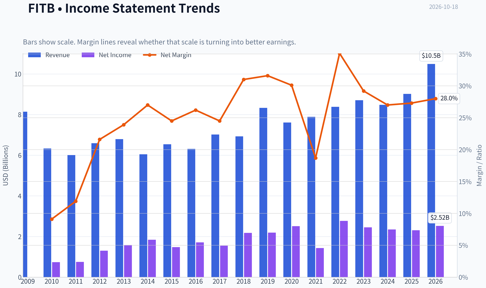

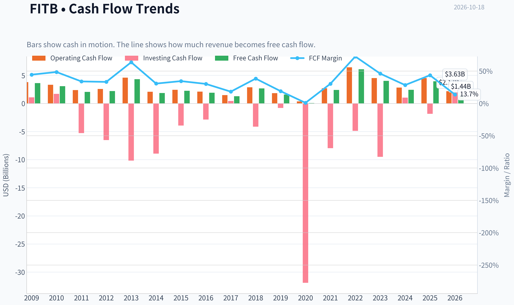

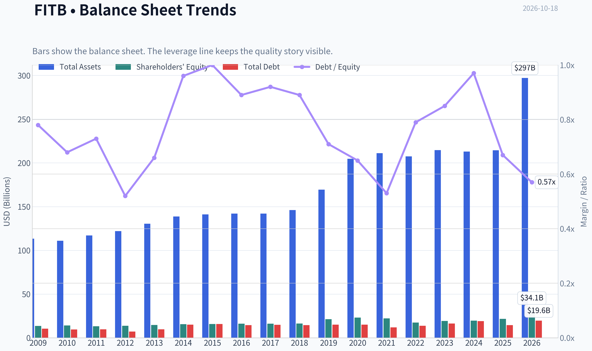

This graph tracks the profitability and return metrics (ROE, ROIC, Margins) of **FITB** over the past decade, highlighting capital efficiency trends.

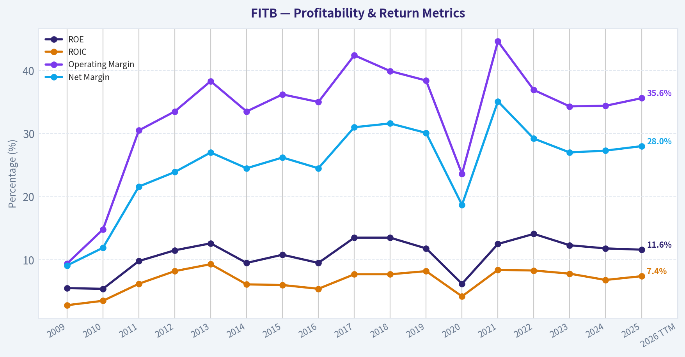

This chart illustrates the financial health of **FITB** over the last 10 years, mapping cash equivalents and free cash flow against total obligations (Debt).

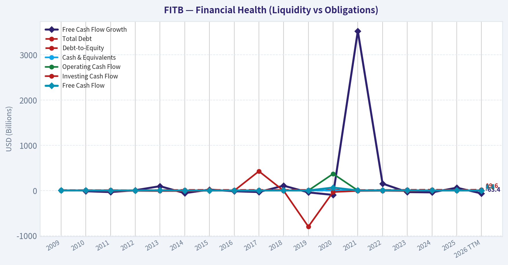

---

### Intrinsic Value Analysis (Buffett)

> *Following Warren Buffett's value investing philosophy: Circle of Competence, Economic Moat, Management Quality, and Margin of Safety.*

#### Intrinsic Value Snapshot

Price is what you pay. Intrinsic value is what the business may be worth based on the cash it can create for owners over time. We show a range, not one magic number.

- Current Price: $50.37
- Value Range (conservative to optimistic across both DCF methods): $-12.25 to $67.22

##### Owner Earnings (Buffett Method)
- Net Income: $2,522,000,000.00
- Depreciation & Amortization: $554,000,000.00
- Capital Expenditures: $-584,000,000.00
- Working Capital Changes: $393,000,000.00
- Owner Earnings: $2,129,000,000.00

##### Intrinsic Value
###### Buffett Method
Uses owner earnings. Stricter, and usually more conservative.
- Conservative: $0.77
- Average: $22.88
- Optimistic: $57.15
- Discount Rate: 10.0%

###### Cash Flow Method
Uses free cash flow. Better for companies spending heavily today to grow tomorrow.
- Conservative: $-12.25
- Average: $3.04
- Optimistic: $67.22
- Discount Rate: 10.0%

ANALYST STANCE: **WATCH**

#### Executive Summary

Fifth Third Bancorp is a recognizable, established regional bank trading at approximately 17 times earnings with an 8.6% free-cash-flow yield and 11.6% ROE. Its franchise benefits from deposits, banking relationships, regulatory licenses, and regional scale, but its returns are not currently strong enough to qualify as a high-quality compounder.

At $50 per share, the valuation appears full relative to a conservative earnings-based valuation. The stock could be attractive closer to the low-$40s, assuming stable credit quality and no deterioration in bank profitability.

#### Factor Scorecard

| Factor | Score | Assessment |
|---|---:|---|
| Circle of competence and simplicity | 4/5 | The model is understandable: gather deposits, make loans, invest liquidity, and earn a spread plus fee income. Forecasting remains exposed to credit losses, interest rates, regulation, and deposit competition. |
| Durable competitive advantage | 3/5 | Deposits, customer relationships, branch infrastructure, and regulatory scale provide a moderate moat. The moat is stable but not obviously widening. |
| Management and capital allocation | 3/5 | Fifth Third is an established public bank with conventional capital allocation. The available evidence does not establish exceptional owner orientation or unusually strong per-share value creation. |
| Industry structure | 3/5 | Banking has scale advantages and meaningful barriers to entry, but regional banks face intense competition, cyclical credit risk, and technology-driven pressure. |

**Key Takeaways:** FITB is a comprehensible, established business with a moderate-not exceptional-competitive position. Its main weaknesses are modest profitability and the inherent cyclicality of banking rather than obvious financial distress.

#### Gate 5: Quality and Solvency

The hard floor is **not tripped**. There is no evidence in the supplied data of simultaneous worsening earnings or cash flow and a solvency red line such as interest coverage below 1x or distress-zone financial condition. Bank-specific solvency should ultimately be judged through CET1 capital, liquidity, nonperforming loans, charge-offs, and reserve coverage rather than ordinary industrial debt ratios.

#### Moat Analysis

**Deposit franchise and switching costs:** Commercial and consumer banking relationships can be sticky because customers are reluctant to move direct deposits, payment activity, treasury services, and credit relationships. However, deposit pricing is competitive, and customers can move funds quickly when rates or confidence change.

**Regulatory barriers:** Banking charters, compliance infrastructure, risk systems, and capital requirements create meaningful barriers to entry. This supports incumbent scale but also limits flexibility and increases operating complexity.

**Scale and cost advantages:** Fifth Third's regional scale can spread technology, compliance, and branch costs across a large customer base. The evidence does not show a dominant cost advantage over the strongest national and regional competitors.

**Network effects:** Banking has limited traditional network effects. A larger customer base can improve data, cross-selling, and funding stability, but the product does not become dramatically more valuable simply because more customers use it.

**Moat rating: Wide and stable at best, more appropriately assessed as moderate or narrow-to-moderate.**

#### Management Quality Assessment

The available information supports a neutral assessment:

- The company operates a conventional banking model rather than a structurally novel or highly complex financial strategy.
- Capital allocation should be evaluated through long-term per-share book value, tangible book value, dividends, buybacks, and acquisition discipline.
- At an 11.6% ROE, the bank does not currently demonstrate the level of profitability associated with an outstanding compounder.
- For banks, retaining capital is valuable only when it can be reinvested at attractive incremental returns. A modest ROE reduces the case for aggressive balance-sheet expansion or acquisitions.
- No evidence supplied here indicates a major accounting concern or solvency event.

**Management score: 3/5.**

#### Financial Snapshot

| Metric | Latest available figure |
|---|---:|
| Share price | $50.00 |
| Market capitalization | $45.66 billion |
| P/E ratio | 16.96x |
| ROE | 11.6% |
| Revenue growth, year over year | 6.3% |
| FCF yield | 8.6% |
| Implied earnings per share | Approximately $2.95 |
| Gross margin | Not meaningful for a bank |
| Current ratio | Not meaningful for a bank |
| Conventional interest coverage | Not meaningful for a bank |

**Key Takeaways:** FITB is growing modestly, but its 11.6% ROE is ordinary rather than exceptional for a well-run financial institution. The roughly 17-times earnings multiple leaves limited room for credit deterioration, weaker net interest margins, or higher funding costs.

#### Owner Earnings Analysis

The standard industrial formula-net income plus depreciation, less maintenance capital expenditure and working-capital investment-is not directly reliable for a bank. Lending and securities investments are operating assets, while deposits and other funding are part of the operating model; "working capital" and maintenance capex do not capture the economics cleanly.

Using the supplied P/E ratio:

- Implied EPS: $50.00 ÷ 16.96 = approximately **$2.95**
- A reasonable banking proxy for owner earnings is normalized earnings available to common shareholders, adjusted for required capital retention and credit-cycle conditions.
- The reported 8.6% FCF yield should not be treated as equivalent to industrial free cash flow without reconciling regulatory capital requirements.

For valuation purposes, I use approximately **$2.95 per share of normalized earnings**, while recognizing that a bank's distributable earnings can differ materially from headline EPS.

#### Three-Scenario Valuation

| Scenario | Method | Estimated value per share |
|---|---|---:|
| A: No growth | $2.95 ÷ 10% | $29.50 |
| B: GDP-like growth | $2.95 x 1.03 ÷ (10% - 3%) | $43.40 |
| C: Historical-growth approach | Requires sustainable multi-year earnings growth and normalization for bank cycles | Approximately $40-$48 |
| Current market price | - | $50.00 |

**Key Takeaways:** The no-growth case produces a value near $30, while a 3% perpetual-growth case produces approximately $43. The valuation only approaches the current price if investors assume stronger growth, lower required returns, or unusually favorable credit and interest-rate conditions.

#### Margin of Safety Analysis

At $50, FITB trades:

- Approximately **69% above** the no-growth earnings value of $29.50.
- Approximately **15% above** the 3% growth value of $43.40.
- Near the upper end of the estimated $40-$48 normalized range.

Because FITB has moderate rather than wide-and-widening moat characteristics and ROE is below the level associated with exceptional compounders, a reasonable required margin of safety is approximately **25% to 35%**. That implies a preferred purchase range of roughly **$28 to $37**, with the upper end potentially acceptable only if credit quality, capital strength, and normalized ROE improve.

A less demanding fair-value range is approximately **$40 to $45**, but that would offer insufficient protection at the current price.

#### Final Buffett Scorecard

| Criterion | Weight | Score | Weighted contribution |
|---|---:|---:|---:|
| Moat width and durability | 25% | 3.0/5 | 0.75 |
| Valuation and margin of safety | 20% | 2.5/5 | 0.50 |
| Capital returns versus cost of capital | 15% | 3.0/5 | 0.45 |
| Business understanding and predictability | 12% | 3.5/5 | 0.42 |
| Management quality and capital allocation | 12% | 3.0/5 | 0.36 |
| Reinvestment runway | 8% | 3.0/5 | 0.24 |
| Balance-sheet strength | 4% | 3.0/5 | 0.12 |
| Industry structure | 4% | 3.0/5 | 0.12 |
| **Total** | **100%** | - | **2.96/5** |

**Key Takeaways:** FITB scores as a respectable but not outstanding bank. The principal constraint is valuation relative to profitability: an 11.6% ROE does not justify paying a premium multiple without stronger evidence of durable earnings growth or improving capital efficiency.

#### Investment Stance

**WATCH - medium conviction.**

Fifth Third is not an obvious avoid on business quality or solvency grounds. It has a comprehensible model, an established deposit franchise, and meaningful regulatory barriers. However, the current price does not provide an adequate margin of safety for a cyclical regional bank earning only 11.6% on equity.

A more compelling entry would likely require either:

1. A share price in the low-$40s or below,
2. Sustained ROE improvement toward the mid-teens, or
3. Clear evidence that credit quality, deposit costs, and net interest margins are improving together.

At $50, the disciplined Buffett-style decision is to wait.
#### Valuation Bridge

This bridge places the current market price beside each intrinsic value lens so readers can see whether upside depends on one method or shows up across several methods.

| Scenario | Intrinsic Value / Share |
| --- | ---: |
| Buffett Method | $22.88 |
| Cash Flow Method | $3.04 |
| Current Price | $50.37 |

#### Key Takeaways

If one method is far above the others, the upside case depends on a specific modelling assumption. When several methods cluster together, the valuation story is more robust.

#### Valuation Visuals

This comparison chart from *Latest Earnings Snapshot* stacks current figures against historical benchmarks for **FITB**, making it easy to see where the company trades relative to its own averages.

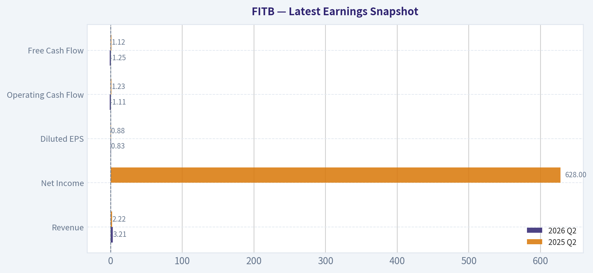

This comparison chart from *Current Metrics Versus Ten-Year Averages* stacks current figures against historical benchmarks for **FITB**, making it easy to see where the company trades relative to its own averages.

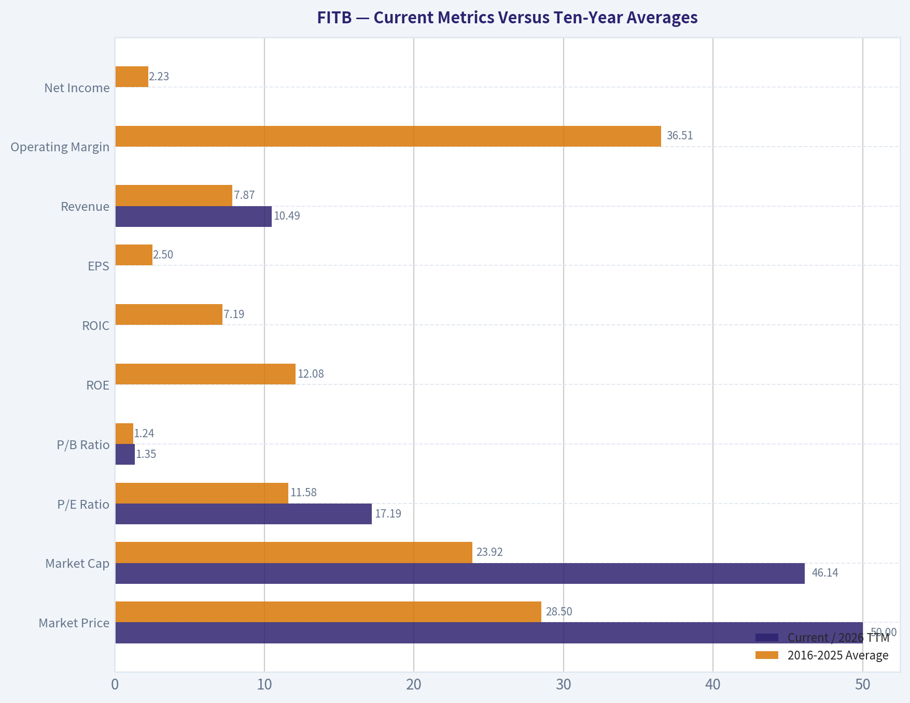

This comparison chart from *Cash Flow and Dividends* stacks current figures against historical benchmarks for **FITB**, making it easy to see where the company trades relative to its own averages.

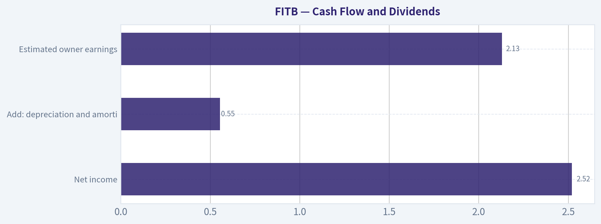

The following chart maps the **FITB** Owner Earnings DCF valuation scenarios (Conservative, Average, Optimistic) to visually represent the margin of safety based on intrinsic value calculations.

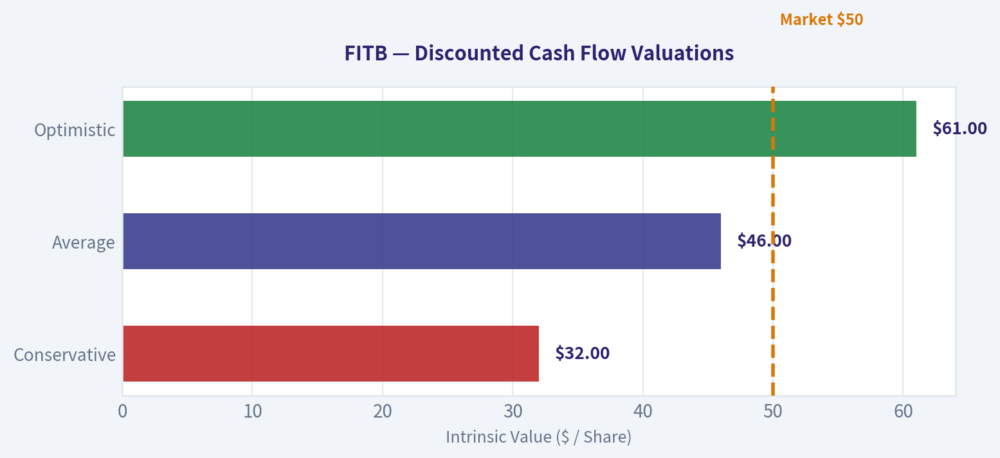

This comparison chart from *Owner-Earnings DCF* stacks current figures against historical benchmarks for **FITB**, making it easy to see where the company trades relative to its own averages.

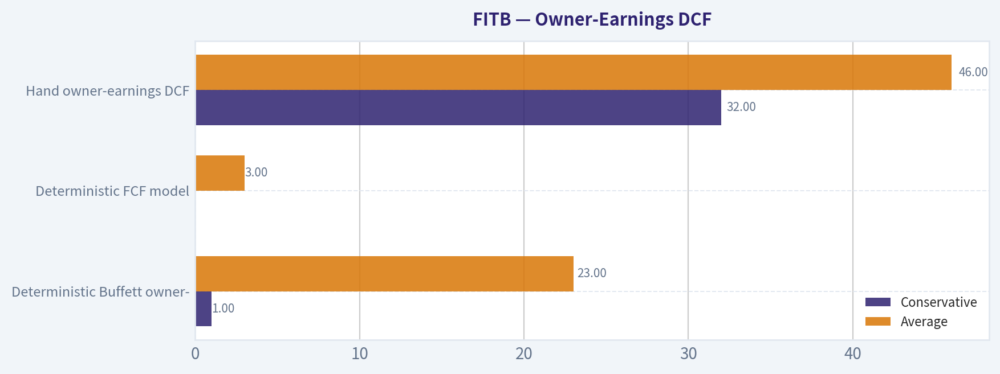

This comparison chart from *Financial Snapshot* stacks current figures against historical benchmarks for **FITB**, making it easy to see where the company trades relative to its own averages.

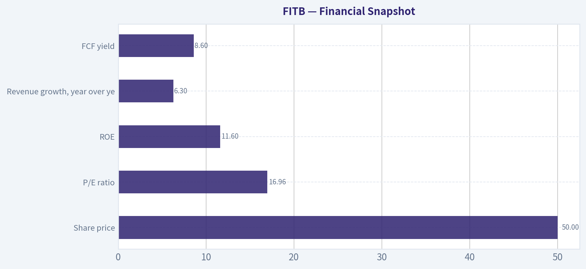

---

### Trend & Growth Analysis (Lynch/Druckenmiller/Fisher)

> *Following Peter Lynch's GARP, Stanley Druckenmiller's macro-aware approach, and Philip Fisher's scuttlebutt methodology.*

ANALYST STANCE: **WATCH**

#### Executive View

Fifth Third Bancorp, ticker FITB, is a profitable regional bank but does not currently meet the profile of a high-growth, ten-bagger candidate. Revenue growth is only 6.3%, ROE is 11.6%, and the stock trades near 17 times earnings. That combination suggests a reasonably valued financial stalwart, not an accelerating growth company.

The key near-term event is the October 19, 2026 earnings release. Consensus expects approximately $0.82 of quarterly EPS, down from $0.91 year over year, which does not signal an obvious earnings inflection.

#### 1. Lynch Classification

| Metric | FITB Assessment |
|---|---:|
| Classification | Stalwart / regional bank |
| Revenue growth | 6.3% year over year |
| P/E | 16.96 |
| ROE | 11.6% |
| FCF yield | 8.6% |
| Growth-investor fit | Limited |
| Ten-bagger potential | Low at current scale and growth rate |

**Key Takeaways:** FITB fits Lynch's "stalwart" category more than the "fast grower" category. Its valuation and cash generation are respectable, but the current growth rate is insufficient for a classic high-conviction growth thesis.

#### 2. The Story in Three Bullets

- Fifth Third is a diversified regional bank serving commercial, consumer, wealth-management, and institutional clients.
- The investment case depends on steady loan growth, net-interest-income recovery, credit discipline, expense control, and capital returns.
- A stronger thesis would require accelerating revenue, improving ROE, or a clear improvement in credit and net-interest-margin trends.

#### 3. TAM and 10x Test

The relevant market is U.S. regional banking, deposits, commercial lending, payments, and wealth management. This is a large market, but it is mature and highly competitive.

| TAM Test | Assessment |
|---|---|
| Current market capitalization | $45.66 billion |
| Hypothetical 10x equity value | Approximately $457 billion |
| Can FITB grow 10x while remaining below 20% of its market? | Technically yes, but unlikely through organic regional-bank growth alone |
| TAM growth profile | Mature; generally low-to-mid-single-digit |
| Main growth route | Market share gains, acquisitions, wealth management, payments, and operating leverage |

**Key Takeaways:** The absolute banking market is large enough to support growth, but the industry's mature economics make a 10x outcome difficult. FITB would likely need sustained share gains, successful acquisitions, or a material expansion in higher-growth fee businesses to become a ten-bagger.

#### 4. Revenue Growth Trend

| Indicator | Latest Reading | Interpretation |
|---|---:|---|
| Revenue growth | 6.3% year over year | Stalwart-level growth |
| Expected quarterly EPS | $0.82 | Near-term earnings pressure |
| Prior-year comparable EPS | $0.91 | Expected decline of roughly 10% |
| Growth pattern | No verified acceleration | No current inflection confirmed |

**Key Takeaways:** The available data show moderate revenue growth but weakening expected quarterly earnings. Until several quarters demonstrate accelerating revenue and earnings, the trend should be classified as stable-to-soft rather than inflecting upward.

#### 5. Unit Economics and Operating Quality

Traditional SaaS measures such as LTV/CAC, NRR, and Rule of 40 are not meaningful for a deposit-funded bank.

| Measure | FITB | Assessment |
|---|---:|---|
| LTV/CAC | Not applicable | Bank economics differ from subscription businesses |
| Net revenue retention | Not applicable | Use deposit retention and relationship growth instead |
| Rule of 40 | Not applicable | Not relevant to a bank |
| ROE | 11.6% | Solid, but not exceptional for a growth thesis |
| FCF yield | 8.6% | Supportive valuation and capital-return characteristic |
| Gross margin | Not applicable | Financial institutions do not use this metric conventionally |

**Key Takeaways:** FITB's useful operating measures are ROE, net interest margin, credit losses, efficiency ratio, deposit costs, and capital ratios-not SaaS metrics. The 11.6% ROE is healthy but does not indicate a dramatic profitability inflection.

#### 6. Inflection-Point Assessment

| Potential Inflection | Current Evidence | Status |
|---|---|---|
| Product cycle | No major new product disclosed in the research pack | Unconfirmed |
| Market-share gain | No quantified evidence provided | Unconfirmed |
| Margin inflection | No margin data available | Unconfirmed |
| TAM expansion | Banking market remains mature | Limited |
| Competitive inflection | No major competitor disruption identified | Unconfirmed |
| Earnings inflection | Consensus points to year-over-year EPS decline | Negative near term |

**Key Takeaways:** No clear Druckenmiller-style inflection point is currently visible. The upcoming earnings report could change the picture, particularly if FITB shows stronger loan growth, better deposit costs, improving net-interest income, and controlled credit provisions.

#### 7. Macro Setup

Regional banks are highly sensitive to interest rates, deposit competition, the yield curve, commercial real estate, and credit losses.

| Macro Factor | FITB Implication |
|---|---|
| Interest rates | Lower rates can reduce funding pressure but may compress asset yields |
| Yield curve | A healthier curve could support net-interest income |
| Credit cycle | Deteriorating commercial or consumer credit would be a major risk |
| Deposit competition | Higher funding costs pressure margins |
| Economic growth | Supports loan demand and credit quality |
| Current setup | Mixed; not clearly favorable without updated rate and credit data |

**Key Takeaways:** The macro backdrop is balanced rather than decisively supportive. FITB benefits from stable economic growth and improving funding conditions, but rate changes and credit deterioration can quickly offset those benefits.

#### 8. Fisher's 15-Point Assessment

| Fisher Criterion | Score / 5 | Comment |
|---|---:|---|
| Market potential | 3 | Large but mature banking market |
| New-product determination | 3 | No strong evidence of exceptional innovation |
| R&D effectiveness | 2 | Not a central differentiator for a bank |
| Sales organization | 3 | Established regional franchise |
| Profit margins | 3 | Banking profitability is adequate |
| Margin improvement | 2 | No confirmed improvement trend |
| Labor relations | 3 | Insufficient data |
| Executive relations | 3 | Insufficient data |
| Management depth | 3 | Established bank structure |
| Cost analysis | 3 | Likely institutionalized, but unverified |
| Outstanding moat | 3 | Deposits, relationships, and regional scale |
| Long-range profit outlook | 3 | Stable, not exceptional |
| Dilution risk | 3 | No major dilution issue identified |
| Management candor | 3 | Insufficient direct evidence |
| Management integrity | 3 | No specific adverse evidence in the supplied data |
| **Total** | **42 / 75** | **Below Fisher's "average" threshold** |

**Key Takeaways:** FITB receives a conservative Fisher score because the available information does not establish exceptional innovation, superior sales execution, or a powerful moat. The score is constrained by missing qualitative evidence rather than a specific allegation of poor management.

#### 9. Valuation Analysis

| Valuation Measure | Calculation / Reading | Interpretation |
|---|---:|---|
| P/E | 16.96x | Reasonable for a stable bank, not cheap for 6.3% growth |
| Revenue-growth proxy PEG | 16.96 / 6.3 = 2.69 | Expensive under Lynch's growth framework |
| FCF yield | 8.6% | Attractive capital-return support |
| Intrinsic value | Not meaningful from generic model | Banks require book value, tangible book, ROTCE, and credit analysis |
| Base valuation view | Fair to modestly attractive | Dependent on credit quality and earnings stability |

**Key Takeaways:** FITB is not attractively valued on a growth-adjusted basis: the revenue-growth proxy PEG is approximately 2.7. Its 8.6% FCF yield provides support, but bank valuation should be confirmed against tangible book value, ROTCE, capital ratios, and normalized earnings.

#### 10. Scenario Analysis

| Scenario | Assumption | Likely Outcome |
|---|---|---|
| Bear case | Revenue stagnates, EPS declines, credit costs rise | Multiple contracts and stock underperforms |
| Base case | Low-to-mid-single-digit growth, stable credit, normal capital returns | Moderate total return, mainly dividends and earnings growth |
| Bull case | Net-interest income accelerates, credit remains benign, wealth and fee businesses grow | Multiple expansion and better-than-expected earnings |
| Ten-bagger case | Requires sustained high-teens growth or major strategic transformation | Not supported by current evidence |

**Key Takeaways:** The base case is a steady regional-bank return profile rather than explosive compounding. The bull case depends on several favorable variables occurring simultaneously, while the ten-bagger case is not credible without a major growth or strategic inflection.

#### 11. Growth Investor Scorecard

| Criterion | Weight | Score / 5 | Weighted Contribution |
|---|---:|---:|---:|
| Lynch story | 10% | 2.5 | 0.25 |
| TAM and runway | 20% | 2.5 | 0.50 |
| Revenue growth | 20% | 2.5 | 0.50 |
| Unit economics | 15% | 3.0 | 0.45 |
| Competitive position | 10% | 3.0 | 0.30 |
| Management quality | 10% | 3.0 | 0.30 |
| Macro setup | 5% | 2.5 | 0.13 |
| Profitability path | 5% | 3.5 | 0.18 |
| Valuation | 5% | 3.0 | 0.15 |
| **Total** | **100%** | - | **2.76 / 5.00** |

**Key Takeaways:** FITB scores below the 3.0 threshold for a constructive growth-investor stance. Its profitability and valuation prevent an outright negative view, but insufficient growth, a mature TAM, and the lack of an identifiable inflection point keep it in the WATCH category.

#### 12. Position Size Stance

For a growth-focused portfolio, FITB merits **0% to 1%**, primarily as a value or income diversifier rather than a core growth holding. Existing holders may retain it if they want regional-bank exposure, but initiating a meaningful position should wait for evidence of accelerating earnings and improving return metrics.

#### 13. Key Catalysts and Risks

| Catalysts | Risks |
|---|---|
| Better-than-expected October 19 earnings | EPS declines and weaker guidance |
| Improving net-interest income | Deposit-cost pressure |
| Stable or improving credit quality | Commercial real-estate losses |
| Loan-growth acceleration | Recession-driven credit deterioration |
| Wealth-management and fee-income growth | Persistent low growth and multiple compression |
| Acquisitions that improve scale or profitability | Regulatory or integration risk |

**Key Takeaways:** The most important catalyst is a credible earnings reacceleration, not simply a quarterly beat. The largest risks are credit deterioration, funding-cost pressure, and the possibility that FITB remains a low-growth bank valued at a full multiple.

#### Bottom Line

FITB is a **WATCH**, not an advocate-quality growth investment. It is a reasonably profitable regional bank with a respectable FCF yield, but its 6.3% revenue growth, approximately 17x P/E, mature market, and expected near-term EPS decline do not support a high-conviction ten-bagger thesis. The thesis improves materially only if upcoming results show simultaneous acceleration in revenue, loan growth, net-interest income, and ROE.

---

### Market Technical Analysis

ANALYST STANCE: **WATCH**

#### FITB technical overview

The latest available FITB trading data is from October 16, 2026, because October 18 was a non-trading day. FITB closed at **$50.37**, down substantially from its 2026 high near **$58.88** reached in July. The stock remains in a medium-term corrective phase, although the long-term trend has not fully broken down.

The indicator set selected is:

- **50-day SMA** and **200-day SMA** for medium- and long-term trend structure.
- **10-day EMA** for short-term price direction.
- **MACD** for momentum and potential inflection points.
- **RSI** for momentum strength and oversold conditions.
- **Bollinger Upper and Lower Bands** for volatility-adjusted support and resistance.
- **ATR** for risk management and position sizing.

These indicators are complementary: trend, short-term direction, momentum, volatility, and trade-risk assessment are all represented without adding redundant oscillators.

#### Trend structure

FITB closed below its **50-day SMA of $53.19**, and that average has been declining steadily from approximately $55.61 on September 18. This indicates that the medium-term trend remains bearish. The stock is roughly **5.3% below** the 50-day average, so the $53.20 area is an important overhead resistance zone. A sustained close above that level would be an initial indication that the medium-term decline is stabilizing.

The longer-term picture is less negative. FITB remains slightly below its **200-day SMA of $51.06**, but the 200-day average itself is still rising gradually. This creates a transitional setup: the long-term trend has weakened, but it has not yet decisively turned bearish. The stock's location near the 200-day average makes the **$50.50-$51.10 region** especially important. Holding this zone could support a recovery attempt; repeated closes below it would increase the risk of a deeper trend deterioration.

The **10-day EMA is $50.48**, almost exactly aligned with the closing price. It has declined from approximately $53.37 in mid-September, but its fall has begun to flatten. This suggests that short-term selling pressure may be moderating, though there is not yet convincing evidence of a new uptrend. A close above roughly $50.50, followed by a move through $51.00-$51.10, would improve the short-term technical picture.

#### Momentum analysis

The MACD remains negative at approximately **-0.83**, confirming that bearish momentum is still present. However, MACD has improved from approximately **-1.11 on October 1** and **-1.03 on October 7**. This is an important nuance: momentum is still below its neutral baseline, but the rate of deterioration has slowed. If the MACD line crosses above its signal line and continues rising, that would offer an early recovery signal. Until then, the improvement should be treated as stabilization rather than a confirmed bullish reversal.

RSI was approximately **40.5** on October 16. This is weak and below the neutral 50 level, but it is not deeply oversold. RSI dipped near the low-30s several times during October, especially around October 1 and October 14, before recovering. That pattern indicates persistent selling pressure with intermittent relief rallies. Because RSI is not below 30 currently, the stock does not yet present a classic high-confidence oversold reversal setup.

The recent RSI improvement, combined with the less-negative MACD, does create a potential bullish divergence or early stabilization signal. However, confirmation still requires price to reclaim the 10-day EMA and then challenge the declining 50-day SMA.

#### Bollinger Band and volatility context

The latest Bollinger Upper Band was approximately **$52.36**, while the Lower Band was approximately **$49.38**. FITB closed near the lower half of this range, but not directly at the lower band. This means the stock is weak within its recent volatility envelope, yet it is not undergoing an extreme downside extension.

The lower band near $49.38 is the first meaningful short-term support reference. A decisive close beneath that level could expose the stock to a continuation toward the upper-$48 or mid-$47 area, particularly if accompanied by expanding volume and a worsening MACD. Conversely, a move above the Bollinger midpoint-approximately the low-$50s based on the band range-would indicate improving short-term breadth, but the declining 50-day SMA near $53.20 remains the more important resistance barrier.

The Bollinger range has narrowed considerably from September levels, when the bands were separated by more than $5. The latest spread is roughly $2.98. This contraction indicates that volatility has cooled from the earlier decline and may precede a larger directional move. A breakout above $52.36 or below $49.38 would therefore deserve more attention than ordinary day-to-day fluctuations.

ATR was approximately **$1.03**, equivalent to about **2.1% of the share price**. This is moderate volatility. For position management, a stop placed much tighter than roughly one ATR could be vulnerable to normal daily price movement. At the same time, the declining ATR from above $1.10 in late September suggests that the market is currently consolidating rather than experiencing uncontrolled volatility.

#### Key trading levels and scenarios

The immediate support zone is approximately **$49.35-$49.40**, corresponding to the lower Bollinger Band. The next support area is near **$48.50-$49.00**, based on recent price action. Failure below that zone would materially weaken the technical structure.

Initial resistance is near **$50.48**, the 10-day EMA, followed by the **$51.00-$51.10** region around the 200-day SMA. Stronger resistance is near **$52.35**, the upper Bollinger Band, and then around **$53.20**, the declining 50-day SMA.

A bullish scenario would require FITB to hold above the lower Bollinger Band, reclaim $50.50, and then close decisively above $51.10. A move through $52.35-$53.20, preferably with improving volume and a positive MACD crossover, would provide substantially stronger evidence of a trend reversal.

A bearish scenario would involve a close below $49.35, especially if RSI falls back toward 30 and MACD turns lower again. Such a move would suggest that the stock is not merely consolidating but is resuming its broader decline.

#### Overall assessment

FITB is showing **early signs of stabilization but not a confirmed reversal**. The long-term trend is only mildly compromised because the 200-day SMA remains relatively flat to rising, while the medium-term trend is clearly weaker because price is below a declining 50-day SMA. Momentum indicators are improving from depressed levels, but both MACD and RSI remain bearish enough to require confirmation.

The most prudent stance is to **watch rather than chase**. Aggressive traders could monitor the $49.35 support area for a defined-risk rebound, but a higher-quality long setup would require recovery above $51.10 and preferably the $53.20 50-day average. Until those levels are reclaimed, rallies may remain countertrend bounces within a broader correction.

#### Selected indicators and key observations

| Indicator | Latest reading | Interpretation | Important levels or signals |
|---|---:|---|---|
| 10-day EMA | $50.48 | Short-term trend is weak but beginning to flatten | Reclaiming $50.50 would improve near-term momentum |
| 50-day SMA | $53.19 | Declining medium-term trend; price remains well below it | Major resistance near $53.20 |
| 200-day SMA | $51.06 | Long-term trend is weakening but not decisively bearish | Holding above or reclaiming $51.10 would stabilize structure |
| MACD | -0.83 | Bearish momentum persists, but has improved from early October | Bullish crossover would support a recovery thesis |
| RSI | 40.5 | Weak momentum, but not currently oversold | A move above 50 would signal stronger momentum; below 30 would indicate oversold pressure |
| Bollinger Upper Band | $52.36 | Upper volatility resistance | Break above could signal a short-term upside expansion |
| Bollinger Lower Band | $49.38 | Immediate volatility-adjusted support | Breakdown could open a move toward the upper-$48 area |
| ATR | $1.03 | Moderate daily volatility and meaningful stop distance | Risk controls should account for roughly $1 of normal range |

**Key Takeaways:** FITB is below its declining 50-day average and near its 200-day average, so the stock remains technically vulnerable despite some momentum improvement. Support near $49.38 is critical, while $51.10 and $53.20 are the key recovery hurdles. The setup favors patience: a confirmed breakout above resistance would be more constructive than attempting to anticipate a bottom.

---

### Options Market Analysis

> *Reading options flow - put/call ratios, IV skew, and unusual activity - to gauge institutional positioning and event-driven risk.*

ANALYST STANCE: **ADVOCATE**

#### FITB Options Flow Report

**As of October 18, 2026.** The available data covers the November 20, December 18, 2026, and January 15, 2027 expirations. Current stock price, strike-level open interest, and detailed out-of-the-money skew data were not provided, limiting precision on gamma walls and strike-specific positioning.

#### 1. Put/Call Ratio Analysis

| Expiration | Call OI | Put OI | Put/Call OI Ratio | Call Volume | Put Volume | Put/Call Volume Ratio |
|---|---:|---:|---:|---:|---:|---:|
| Nov. 20, 2026 | 4,494 | 1,892 | 0.42 | 2,019 | 238 | 0.12 |
| Dec. 18, 2026 | 2,856 | 1,663 | 0.58 | 177 | 439 | 2.48 |
| Jan. 15, 2027 | 8,504 | 6,837 | 0.80 | 262 | 92 | 0.35 |
| **Total** | **15,854** | **10,392** | **0.66** | **2,458** | **769** | **0.31** |

The aggregate put/call open-interest ratio is **0.66**, modestly below the historical neutral level of approximately **0.70**. The aggregate volume ratio is much lower at **0.31**, driven primarily by heavy November call volume. This indicates a mild bullish bias, although the December put-volume spike shows some short-term hedging or bearish activity.

**Key Takeaways:** FITB's overall positioning is slightly more call-oriented than neutral. November shows the strongest bullish participation, while December's elevated put volume is a cautionary counter-signal. The aggregate data supports a bullish read, but not an aggressively bullish one.

#### 2. Implied Volatility Assessment

| Expiration | Call ATM IV | Put ATM IV | IV Difference | Interpretation |
|---|---:|---:|---:|---|
| Nov. 20, 2026 | 38.1% | 28.8% | Calls +9.3 points | Strong upside-demand or upside-event premium |
| Dec. 18, 2026 | 23.1% | 27.3% | Puts +4.2 points | Moderate downside protection premium |
| Jan. 15, 2027 | 32.3% | 26.5% | Calls +5.8 points | Call-side demand remains evident |

The data does not include dedicated OTM put and OTM call volatility, so a formal IV-skew calculation is unavailable. However, ATM comparisons show a **call-heavy volatility premium in November and January**, while December has a modest put premium.

No specific earnings, product, or macro catalyst was supplied. Therefore, it is not possible to determine whether the elevated November call IV reflects a known event or simply demand for upside exposure. November's 38.1% call IV is notably higher than December's 23.1%, suggesting concentrated near-term event or directional risk.

**Key Takeaways:** Volatility pricing is not uniformly defensive. The strongest signal is demand for November calls, while December puts retain a smaller downside premium. Without a confirmed catalyst calendar, the high November call IV should be treated as both bullish positioning and elevated event risk.

#### 3. Unusual Options Activity

| Finding | Result |
|---|---|
| Contracts with volume greater than five times open interest | None identified |
| Fresh directional contract activity | No statistically confirmed unusual contracts |
| Smart-money versus retail classification | Not possible from the supplied data |

No individual contract met the tool's unusual-activity threshold of volume greater than five times open interest. Accordingly, there is no verified fresh call sweep, put sweep, or clearly identifiable institutional directional bet.

The large November call volume is notable in aggregate, but without strike-level volume, open interest, trade direction, and execution details, it cannot be confidently classified as institutional buying. It could include opening call purchases, covered-call activity, spreads, or closing transactions.

**Key Takeaways:** There is no contract-level unusual activity strong enough to confirm a specific institutional trade. The bullish view comes from aggregate call dominance rather than a clearly traceable smart-money transaction. Confidence is therefore moderate rather than high.

#### 4. Open Interest Concentration and Gamma Levels

| Expiration | Highest Aggregate OI | Call OI | Put OI | Assessment |
|---|---:|---:|---:|---|
| Nov. 20, 2026 | 6,386 contracts | 4,494 | 1,892 | Largest near-term concentration |
| Dec. 18, 2026 | 4,519 contracts | 2,856 | 1,663 | Moderate concentration |
| Jan. 15, 2027 | 15,341 contracts | 8,504 | 6,837 | Largest overall concentration |

January 15, 2027 has the largest overall open interest, representing the primary medium-term positioning cluster. November has the largest near-term concentration and is heavily call-weighted.

Strike-level open interest was not provided, so specific gravitational strikes, maximum-pain levels, and gamma walls cannot be identified. The available data suggests that January may provide the strongest broad pinning influence, while November could experience more directional sensitivity because of its high call volume and call-weighted open interest.

**Key Takeaways:** January is the dominant open-interest expiration, but November is the more important near-term trading window. Exact gamma walls cannot be mapped without strike-level data. The call-heavy November structure could dampen or amplify moves depending on whether the calls are bought or written.

#### 5. Overall Options Sentiment

**Overall signal: BULLISH, with moderate confidence.**

The primary bullish drivers are:

- Aggregate put/call OI ratio of **0.66**, below the neutral 0.70 level.
- Aggregate put/call volume ratio of **0.31**, indicating substantially more call than put volume.
- Heavy November call volume, with 2,019 calls versus 238 puts.
- Call IV premiums in November and January, consistent with demand for upside exposure.

The main caveats are:

- December put volume is materially higher than call volume.
- No contract-level unusual activity confirms institutional call buying.
- Strike-level data is unavailable, preventing precise gamma and max-pain analysis.
- Elevated November call IV could reflect expensive event risk, not necessarily a favorable risk/reward setup.
- The data set does not establish whether calls were bought or sold.

This is a **moderately bullish options signal**, not a high-conviction breakout signal. The positioning favors upside exposure overall, but traders should watch whether FITB can sustain gains as November call activity and elevated call IV create a potentially volatile setup.

#### Summary

| Category | Assessment |
|---|---|
| Put/Call Ratio | Bullish-leaning: 0.66 OI ratio and 0.31 volume ratio |
| IV Level | Moderate to elevated in November, especially calls; lower in December |
| Skew Direction | Call-skewed in November and January; modest put skew in December |
| Unusual Activity | No contracts exceeded the 5-times-volume-to-OI threshold |
| Overall Signal | **BULLISH**, with moderate confidence |

**Key Takeaways:** FITB's options market leans bullish because calls dominate both aggregate open interest and near-term volume. November is the key expiration, with unusually strong call participation and elevated call IV. The absence of confirmed unusual contracts and the lack of strike-level data argue for a moderate-confidence bullish view rather than an aggressive one.

---

## Research Team Commentary

> *The Research Manager synthesizes the Bull vs Bear debate into action-free commentary. This is a pre-risk view, not the final stance.*

Core Takeaway: Fifth Third appears to be a sound regional bank, but at $50.37 the valuation already assumes a meaningful improvement from its current economics. An 11.6% ROE, 1.2% ROA, and 6.3% revenue growth describe an adequate-to-good franchise, not yet a superior compounder. The normalization thesis is plausible, but the prospective return is too dependent on ROE rising toward 13%-14% while credit, funding costs, and expenses all remain cooperative. I would not sell or short the stock solely on valuation, but I would wait for either stronger evidence or a better entry price.

The strongest bull argument is that Fifth Third has a real, if narrow, moat. Its regulated deposit franchise, commercial relationships, treasury-management integration, customer data, and compliance infrastructure create switching costs and barriers to entry. A 1.2% ROA suggests the underlying franchise is healthy, while 6.3% revenue growth gives management an opportunity to produce operating leverage. If deposit costs moderate, net interest income improves, credit remains controlled, and buybacks are sensible, ROE could move into the low-to-mid teens. Under that outcome, the bull's $53-$57 base valuation and $59-$64 stronger case are reasonable, with dividends adding to total return.

The strongest bear argument is price. The bull's base-case midpoint offers only about 9% appreciation, and that value already depends on profitability improving. For a cyclical and leveraged financial institution with only a narrow moat, that is not an adequate margin of safety. The cautious valuation of $39-$44 is more consistent with current profitability, and the inferred valuation near two times book looks demanding relative to an 11.6% ROE. The stock does not require business deterioration to disappoint; it may only require ROE to remain around 11%-12%.

The bear's residual-income calculation is directionally useful but should not be treated as exact. Inferring price-to-book by multiplying P/E by ROE can be distorted if the earnings and equity figures use different periods or definitions. We also lack the actual tangible-book multiple and several critical bank metrics. Nevertheless, the broader conclusion holds: at roughly 17 times current earnings, investors are not being paid much for uncertainty.

From a Buffett perspective, Fifth Third does not presently qualify as a wonderful business available at a fair price. It looks more like an average-to-good business that should require a larger discount-closer to 25% than 10%-unless management demonstrates consistently superior returns and risk control. The bull's 8%-8.5% cost-of-equity assumptions may also be generous for a regional bank exposed to deposit competition, regulation, and credit cycles. A modestly higher discount rate materially reduces estimated value.

The missing financial data are especially important. Before treating current earnings as durable, I would want to see CET1 capital, tangible book value per share, deposit composition and beta, uninsured deposits, loan-to-deposit ratio, net charge-offs, criticized loans, reserve coverage, commercial real-estate exposure, and accumulated other comprehensive income. The absence of these figures does not imply distress, but it prevents a high-conviction assessment of earnings quality and balance-sheet resilience.

Sentiment is tactically constructive. The 0.66 put/call open-interest ratio, 0.31 volume ratio, and heavy November call activity indicate a bullish positioning bias. That argues against using the valuation case as an immediate short thesis. It does not, however, establish intrinsic value, and concentrated call activity can reflect speculation or hedging. The handoff also does not provide actual moving-average or MACD readings, so there is insufficient evidence to call the technical trend bullish merely because those indicators were identified for review.

This is where the prior lessons matter. The FFIV mistake was allowing long-term valuation concerns to overwhelm improving economics and a confirmed bullish trend. Here, we do not have comparable evidence of elite returns, a major mix-shift rerating, or confirmed technical strength. The FIGR lesson was that weak value can coexist with a short-term rally. Accordingly, the right conclusion is to separate ownership from timing: FITB may continue rising with bullish sentiment, but that does not make the long-term expected return attractive at the current price.

My rationale is therefore balanced but cautious. Fifth Third is financially credible enough that a hard AVOID would overstate the case, especially because there is no evidence of solvency stress and profitability normalization is achievable. But ADVOCATE would require paying in advance for that normalization with little protection if it fails. At $50.37, the asymmetry is not favorable enough.

Over the next one to four quarters, I would monitor four areas closely. First, net interest margin, net interest income, deposit costs, noninterest-bearing deposit retention, and the loan-to-deposit ratio should show that funding pressure is stabilizing. Second, net charge-offs, nonperforming loans, provisions, criticized assets, and commercial real-estate exposures must remain controlled. Third, revenue should continue growing faster than expenses, producing genuine positive operating leverage rather than growth consumed by compensation, technology, or regulatory costs. Fourth, ROA, ROE, CET1 capital, and tangible book value per share plus dividends should demonstrate actual per-share compounding.

I would become more constructive if ROA remains around or above 1.2%, ROE moves above roughly 13.5% for more than one quarter, credit remains stable, and tangible book value per share grows without weakening capital. Alternatively, a decline toward approximately $39-$44, absent fundamental deterioration, would create a more credible margin of safety.

I would turn more negative if net interest margin continues falling, deposit costs remain elevated, provisions or charge-offs rise faster than expected, CET1 capital deteriorates, or management repurchases shares aggressively while the stock remains richly valued. Persistent ROE near 11%-12% would also confirm that the current valuation is capitalizing an improvement the franchise cannot deliver.

The business is sound, but the price currently asks investors to underwrite too much of the improvement before it is visible. Wait for proof or a wider discount.

WATCH

---

## Value Investing Team Commentary

> *The Investor translates the research view into an investment thesis before risk review. This is still not the final stance.*

### Fifth Third Bancorp: Sound Franchise, Insufficiently Discounted

Fifth Third appears to be a credible and conservatively understandable regional bank. Its deposit base, commercial relationships, treasury-management services, regulatory infrastructure, and customer switching costs provide a real-though not especially wide-economic moat. The central question is not whether FITB is a viable bank, but whether its current earnings power justifies paying $50.37.

### Business quality and earnings power

Current profitability is respectable rather than exceptional:

- **ROE:** 11.6%
- **ROA:** 1.2%
- **ROIC:** 7.7%
- **Revenue growth:** 6.3%
- **P/E:** 16.96

A 1.2% ROA indicates a healthy underlying franchise, while 6.3% revenue growth could produce operating leverage if expenses remain controlled. However, an 11.6% ROE does not establish Fifth Third as a superior bank compounder. Because banking is leveraged, cyclical, regulated, and sensitive to funding and credit conditions, investors should demand either stronger profitability or a more attractive purchase price.

The path to better economics is plausible. Falling deposit pressure, improved net interest income, controlled credit losses, and disciplined expenses could lift ROE toward 13%-14%. But that improvement is already an important part of the valuation thesis rather than free optionality.

### What the current price appears to imply

At approximately 17 times earnings, FITB has an earnings yield of only about **5.9%** before considering future growth and dividends. That is not automatically excessive, but it is demanding for a regional bank producing an 11.6% ROE.

The reverse-valuation problem is instructive. If the market eventually assigns FITB a more ordinary **13-times earnings multiple**, the stock would need substantial earnings growth merely to offset the multiple contraction. Over five years, moving from 17 times to 13 times creates an annualized valuation headwind of roughly 5%. Dividends would help, but current dividend information was not supplied. This means an attractive return likely requires sustained high-single-digit or low-double-digit earnings growth, not merely stable performance.

That is a meaningful expectation for a bank whose results remain exposed to:

- Deposit competition and deposit beta
- Net interest margin pressure
- Credit normalization
- Commercial real-estate exposure
- Regulatory and compliance expenses
- The timing and magnitude of interest-rate changes

A quality-scaled margin of safety supports caution. FITB presently looks like an average-to-good cyclical franchise, for which a **25% or greater discount** is more appropriate than the 10%-15% discount acceptable for an exceptional compounder. Applying that discipline to the analysts' $53-$57 normalized range points toward an attractive entry around **$40-$43**, broadly consistent with the proposed $39-$44 watch zone.

### Moat and management assessment

Fifth Third benefits from several durable advantages:

- A regulated and established deposit franchise
- Embedded commercial and treasury-management relationships
- Customer switching costs
- Scale in technology, compliance, and risk management
- Cross-selling opportunities across banking and wealth services

These advantages can support durable profitability, but they do not eliminate competition. Deposits can move when rate differences become meaningful, credit losses can overwhelm modest operating improvements, and regional banks generally possess less pricing power than truly dominant financial franchises.

Management quality also cannot be judged confidently from the supplied metrics alone. The relevant scorecard should be long-term growth in **tangible book value per share plus dividends**, adjusted for acquisitions and share issuance. Buybacks create value only when conducted below a conservative estimate of intrinsic value and without compromising capital resilience.

### Selective contrarian interpretation

The bullish options positioning is tactically constructive:

- Put/call open-interest ratio: **0.66**
- Put/call volume ratio: **0.31**
- Heavy November call activity

This indicates that traders are leaning toward upside, potentially in anticipation of favorable earnings, rates, or net-interest-income developments. It argues against treating FITB as an immediate short merely because valuation appears full.

The contrarian risk is that optimism may already be crowded. Heavy call buying does not prove that the business is becoming more valuable; it can reflect speculation, hedging, or short-term positioning. If investors broadly expect lower funding costs and improving profitability, merely adequate results may not be enough to drive further appreciation.

The more interesting contrarian opportunity would arise if shares declined toward $39-$44 because of broad regional-bank anxiety while FITB's deposits, capital, and credit quality remained sound. That would represent fear creating a discount in a viable franchise. Conversely, buying at $50.37 would be contrarian only if the market were materially underestimating the speed of operating leverage. The available evidence does not yet establish that.

Rate normalization is also not an uncomplicated catalyst. Lower rates could reduce deposit costs, but they can also pressure asset yields and occur alongside weakening economic activity. The net result depends on the timing of loan repricing, deposit beta, securities-book structure, and credit losses.

### Information needed before upgrading the thesis

The missing bank-specific metrics are significant. Before advocating ownership, I would want:

1. CET1 capital and management's target capital range
2. Tangible book value per share and price-to-tangible-book value
3. Tangible book value growth plus dividends over several years
4. Deposit mix, deposit beta, and noninterest-bearing deposit retention
5. Uninsured deposit concentration and liquidity coverage
6. Loan-to-deposit ratio
7. Net interest margin and net interest income trends
8. Net charge-offs, criticized loans, nonperforming assets, and reserve coverage
9. Commercial real-estate exposure by property type and geography
10. Accumulated other comprehensive income and securities duration
11. Expense growth and evidence of sustainable positive operating leverage

These are essential to distinguish durable earnings from temporarily favorable accounting profits.

### Decision framework

I would become more constructive if:

- ROE rises above approximately **13.5%** for multiple quarters
- ROA remains at or above roughly **1.2%**
- Deposit costs stabilize and net interest income improves
- Revenue consistently grows faster than expenses
- Credit losses and criticized assets remain controlled
- Tangible book value per share plus dividends compounds satisfactorily
- CET1 capital remains strong
- The price declines toward **$39-$44** without deterioration in these fundamentals

I would become more negative if:

- ROE remains around 11%-12% despite favorable normalization expectations
- Net interest margin continues to contract
- Deposit costs remain elevated or deposits weaken
- Charge-offs, provisions, or criticized loans accelerate
- Capital ratios deteriorate
- Management pursues expensive acquisitions or repurchases richly valued shares
- Commercial real-estate losses materially exceed reserves

The options market may support further short-term appreciation, but price momentum should not be confused with long-term value. Unlike the FFIV case, the evidence does not show elite returns, a transformative mix shift, or confirmed structural rerating. Unlike FIGR, however, FITB is profitable and financially credible enough that an outright bearish stance would be excessive.

**ANALYST STANCE: WATCH.** Fifth Third is a sound but not demonstrably exceptional regional-bank franchise. At $50.37 and roughly 17 times earnings, investors are paying in advance for ROE improvement, benign credit, and easing funding pressure. Existing shareholders can reasonably hold while monitoring capital, deposits, credit, and tangible book value, but new capital should wait for either sustained ROE above roughly 13.5% or a fundamentally intact decline toward approximately $39-$44.

---

## Deep Values Commentary

> *The Risk Management Team debates and the Risk Judge provides the final action-free verdict. This section determines the final ADVOCATE / WATCH / AVOID stance.*

#### Final Stance Scorecard

This scorecard converts the final research view into a weighted decision frame. It does not replace the narrative judgement, but it makes the main drivers of the verdict easier to scan.

| Criterion | Score | Weight | Commentary |
| --- | ---: | ---: | --- |
| Business Quality | 3.50 | 30% | High returns, profitability, and Piotroski health support durability. |
| Valuation Support | 3.33 | 30% | Blends current price against available intrinsic value anchors and valuation ratios. |
| Financial Strength | 4.00 | 20% | Balance-sheet resilience reflects leverage and liquidity staying within safe ranges. |
| Growth Durability | 3.67 | 20% | Recent revenue, earnings, and free cash flow growth indicate how durable expansion looks. |
| TOTAL / FINAL STANCE | 3.58 | 100% | AVOID |

#### Key Takeaways

The weighted score lands at **3.58 / 5.0**, while the final stance remains **AVOID**. This is useful as a quick calibration aid rather than a mechanical signal.

#### Risk Summary

Higher scores indicate more risk pressure. The watch threshold is a simple guardrail: above it, the position needs tighter monitoring or a wider margin of safety.

| Dimension | Current Score | Watch Threshold | Commentary |
| --- | ---: | ---: | --- |
| Business Quality | 2.50 | 3.00 | High returns, profitability, and Piotroski health support durability. |
| Valuation Support | 2.67 | 3.00 | Blends current price against available intrinsic value anchors and valuation ratios. |
| Financial Strength | 2.00 | 3.00 | Balance-sheet resilience reflects leverage and liquidity staying within safe ranges. |
| Growth Durability | 2.33 | 3.00 | Recent revenue, earnings, and free cash flow growth indicate how durable expansion looks. |

#### Key Takeaways

This view helps readers separate *where* the risk sits: valuation, business quality, balance sheet, or growth durability. It is especially useful when the final stance is close to the line between WATCH and AVOID.
