# FRFHF Deep Value Intelligence

**Analysis Date:** 2026-05-06

## Critical Disclaimer

*This analysis is generated by Deep Value Intelligence, an AI-powered multi-agent investing framework. This report is for informational and educational purposes only and does not constitute financial advice. Always conduct your own research and consult with qualified financial advisors before making investment decisions.*

---

## Table of Contents

1. Intelligence Summary
2. Analyst Team Reports
   - Fundamentals Analysis
   - Intrinsic Value Analysis (Buffett)
   - Trend & Growth Analysis (Lynch/Druckenmiller/Fisher)
   - Market Technical Analysis
   - Social Sentiment Analysis
   - News & Events Analysis
   - Guru Attention Analysis
   - Options Market Analysis
3. Research Team Commentary
4. Value Investing Team Commentary
5. Deep Values Commentary

---

## Intelligence Summary

### Thesis + Conditions

**Core Thesis:** **Executive Summary**
*   **The Core Issue:** Fairfax Financial (FRFHF) presents a classic value trap dilemma. While optically cheap (8.18x P/E, 18% ROE), a massive 32.6% Q1 earnings miss signals severe short-term unpredictability and complex cyclicality.

**Key Risks:**
- Final Stance:** **WATCH**
- The Risky Analyst (The Contrarian):** Argues that uncertainty is the source of the bargain. At ~8x earnings and double-digit growth, the market has already priced in the messiness. The massive Q1 earnings miss and broken technicals are the exact mechanisms that create an entry point before the crowd gets comfortable.
- The Safe Analyst (The Capital Protector):** Counters that the low multiple is a warning label, not a bargain sticker. It reflects the market correctly discounting peak cyclical earnings, reserve risk, and catastrophe exposure. Without granular underwriting data, buying the dip is speculation, not disciplined value investing.
- Through the lens of Warren Buffett's framework, risk is not temporary price volatility; it is the permanent impairment of capital. To avoid impairment, we demand a highly predictable business and a clear margin of safety. Fairfax currently fails both tests:
- 3.  **The "Too Hard" Pile:** The Neutral Analyst suggested taking a starter position to avoid missing out. Buffett's philosophy directly contradicts this: there are no called strikes in investing. If the automated intrinsic value models are fundamentally broken for this asset (printing $94 against a $1655 price), and the normalized earnings power is opaque, the business goes into the "too hard" pile until clarity emerges.

**What Would Change Our View:**
- Final Stance:** **WATCH**
- The Risky Analyst (The Contrarian):** Argues that uncertainty is the source of the bargain. At ~8x earnings and double-digit growth, the market has already priced in the messiness. The massive Q1 earnings miss and broken technicals are the exact mechanisms that create an entry point before the crowd gets comfortable.
- The Safe Analyst (The Capital Protector):** Counters that the low multiple is a warning label, not a bargain sticker. It reflects the market correctly discounting peak cyclical earnings, reserve risk, and catastrophe exposure. Without granular underwriting data, buying the dip is speculation, not disciplined value investing.
- Through the lens of Warren Buffett's framework, risk is not temporary price volatility; it is the permanent impairment of capital. To avoid impairment, we demand a highly predictable business and a clear margin of safety. Fairfax currently fails both tests:
- 3.  **The "Too Hard" Pile:** The Neutral Analyst suggested taking a starter position to avoid missing out. Buffett's philosophy directly contradicts this: there are no called strikes in investing. If the automated intrinsic value models are fundamentally broken for this asset (printing $94 against a $1655 price), and the normalized earnings power is opaque, the business goes into the "too hard" pile until clarity emerges.

**Confidence:** Low

---

## Analyst Team Reports

### Fundamentals Analysis

#### Latest Earnings Snapshot

*Most recent reported quarter anchored on 2026 Q1, with prior-year comparison when available.*

| Metric | 2026 Q1 | 2025 Q1 | YoY Change |
| --- | ---: | ---: | ---: |
| Revenue | $6.41B | $7.48B | -14.2% |
| Operating Income | N/A | N/A | N/A |
| Net Income | $695.7M | $945.7M | -26.4% |
| Diluted EPS | $31.11 | $42.70 | -27.1% |
| Operating Cash Flow | $-271.5M | $694.4M | -139.1% |
| Free Cash Flow | $-402.9M | $582.2M | -169.2% |

Key Takeaways: This snapshot anchors the most recent reported quarter before the narrative analysis. It helps readers separate long-run business quality from whatever changed in the latest earnings print.

#### 10-Year Financial Metrics for FRFHF

*All values below are computed deterministically from raw data - not estimated by AI.*

*Issuer profile: insurer (Financial Services / Insurance - Property & Casualty).*

#### 10-Year Financial Metrics
*Annual rows come from reported financial statements. The final TTM row is computed from the latest four quarters.*

| Metric | 2021 | 2022 | 2023 | 2024 | 2025 | 2026 TTM |
| --- | --- | --- | --- | --- | --- | --- |
| Market Price | $462 | $569 | $896 | $1,375 | $1,908 | $1,655 |
| Market Cap | N/A | $15.67B | $23.29B | $33.58B | $44.04B | $37.01B |
| P/E Ratio | N/A | 13.66 | 5.31 | 8.66 | 8.93 | 8.18 |
| P/B Ratio | N/A | 0.82 | 1.01 | 1.40 | 1.66 | 1.42 |
| ROE | N/A | 17.7% | 19.1% | 16.1% | 18.0% | 17.4% |
| ROIC | N/A | N/A | N/A | N/A | N/A | N/A |
| EPS | N/A | $41.64 | $168.63 | $160.56 | $213.78 | $202.33 |
| Revenue | N/A | $19.58B | $25.80B | $26.96B | $30.41B | $29.68B |
| Gross Profit | N/A | N/A | N/A | N/A | N/A | N/A |
| Gross Margin | N/A | N/A | N/A | N/A | N/A | N/A |
| Operating Margin | N/A | N/A | N/A | N/A | N/A | N/A |
| Net Income | N/A | $3.37B | $4.38B | $3.87B | $4.77B | $4.52B |
| Net Margin | N/A | 17.2% | 17.0% | 14.4% | 15.7% | 15.2% |
| Revenue Growth | N/A | N/A | 31.8% | 4.5% | 12.8% | -2.4% |
| Net Income Growth | N/A | N/A | 29.9% | -11.6% | 23.2% | -5.2% |
| Free Cash Flow Growth | N/A | N/A | -88.6% | -747.7% | -48.9% | -53.7% |
| Total Book Value | N/A | $19.12B | $22.95B | $24.07B | $26.51B | $26.01B |
| Total Assets | N/A | $78.82B | $91.99B | $96.78B | $107.79B | $107.39B |
| Total Debt | N/A | $9.72B | $10.80B | $13.06B | $14.83B | $14.05B |
| Debt-to-Equity | N/A | 0.51 | 0.47 | 0.54 | 0.56 | 0.54 |
| Cash & Equivalents | N/A | $6.08B | $5.12B | $6.01B | $6.14B | $5.31B |
| Shareholders' Equity | N/A | $19.12B | $22.95B | $24.07B | $26.51B | $26.01B |
| Operating Cash Flow | N/A | $-4.42B | $-39.4M | $3.99B | $2.42B | $1.45B |
| Investing Cash Flow | N/A | $384.8M | $92.0M | $-1.32B | $-523.8M | $-1.04B |
| Free Cash Flow | N/A | $-4.84B | $-553.5M | $3.59B | $1.83B | $848.1M |
| FCF Margin | N/A | -24.7% | -2.1% | 13.3% | 6.0% | 2.9% |
| Dividends / Share | N/A | $9.07 | $9.44 | $15.03 | $14.88 | $14.72 |

#### Profitability Metrics
- Return on Equity (ROE): 18.0%
- Return on Invested Capital (ROIC): N/A
- Return on Assets (ROA): 4.4%
- Gross Margin: Not meaningful
- Operating Margin: N/A
- Net Profit Margin: 15.7%

#### Liquidity Metrics
- Current Ratio: Not meaningful
- Quick Ratio: Not meaningful

#### Leverage Metrics
- Debt-to-Equity Ratio: 0.56
- Interest Coverage Ratio: Not meaningful
- Net Debt: $8.70B

#### Growth Metrics (Year-over-Year)
- Revenue Growth: 12.8%
- Net Income Growth: 23.2%
- Free Cash Flow Growth: -48.9%
- Revenue CAGR (3-Year): 15.8%
- Revenue CAGR (5-Year): N/A

#### Valuation Metrics
- P/E Ratio (TTM): 8.18
- Forward P/E: 10.12
- Price-to-Book: 1.31
- Price-to-Sales: 0.88
- PEG Ratio: 0.27
- EV/EBITDA: 6.10
- Free Cash Flow Yield: 5.4%
- Earnings Yield: 12.2%

#### Owner Earnings (Buffett Method, Code-Computed)
- Net Income: $4.77B
- + Depreciation & Amortization: $783.8M
- - Capital Expenditures: $-586.2M
- - Working Capital Changes: $4.26B
- = **Owner Earnings: $711.6M**

#### Intrinsic Value (Code-Computed)
- Current Price: $1,655
- Buffett Method (Owner Earnings):
  Conservative: $40
  Average: $94
  Optimistic: $640
- Cash Flow Method (FCF):
  Conservative: $148
  Average: $148
  Optimistic: $148

#### Piotroski F-Score: 5/9
- Positive Net Income: PASS
- Positive Operating Cash Flow: PASS
- ROA Improvement: PASS
- Cash Flow > Net Income: FAIL
- Decreasing Debt: FAIL
- Improving Current Ratio: FAIL
- No Dilution: PASS
- Improving Gross Margin: FAIL
- Improving Asset Turnover: PASS

ANALYST STANCE: **WATCH**

#### Fairfax Financial Holdings Limited - Buffett-Style Fundamental Analysis for FRFHF

Fairfax Financial is a property-and-casualty insurance holding company with a Buffett-like model: underwriting businesses generate float, and management invests that float across bonds, equities, associates, and opportunistic assets. The deterministic dataset shows a high-quality but cyclical insurer: **ROE remains strong near 17%-18%, earnings are substantial, book value has compounded, and the P/E is low**, but **free cash flow and owner earnings are volatile**, and the stock now trades above its available historical price-to-book average.

The current setup is not a clean Buffett "fat pitch" because the market is already assigning Fairfax a premium to book versus its recent history, while owner-earnings-based DCF values are far below the current share price. That said, the company's profitability, investment culture, and long-term book value growth keep it firmly on the watchlist.

---

#### Current vs Historical Average Comparison

| Metric | Current / TTM | Historical Average* | Current vs Average | Interpretation |
|---|---:|---:|---:|---|
| Market Price | $1,655 | $1,042 | +58.8% | The share price is far above the available-period average, reflecting improved earnings power and market recognition. |
| Market Cap | $37.01B | $29.15B | +27.0% | Market value has expanded materially, though it is below the 2025 level of $44.04B. |
| P/E Ratio | 8.18x | 9.14x | -10.5% | Earnings valuation remains below average; optically inexpensive if earnings are durable. |
| P/B Ratio | 1.42x | 1.22x | +16.2% | The stock trades at a premium to its recent book-value multiple, reducing margin of safety. |
| ROE | 17.4% | 17.7% | Slightly below | ROE remains consistently strong and close to historical norms. |
| ROIC | N/A | N/A | N/A | Not meaningful in the dataset for this insurer. |
| EPS | $202.33 | $146.15 | +38.4% | EPS is well above the period average, though down from 2025's $213.78. |
| Revenue | $29.68B | $25.69B | +15.5% | Revenue remains above average despite a TTM decline from 2025. |
| Gross Profit | N/A | N/A | N/A | Gross profit is not meaningful for insurance accounting in this dataset. |
| Operating Margin | N/A | N/A | N/A | Operating margin is not provided and is less useful than combined ratio / underwriting profit for insurers. |
| Net Income | $4.52B | $4.10B | +10.3% | Net income remains above average but below the 2025 peak. |
| Net Margin | 15.2% | 16.1% | -0.9 percentage points | Margins are still healthy but below recent average. |
| Revenue Growth | -2.4% | 16.4% | Below average | Growth has slowed sharply after strong 2023 and 2025 growth. |
| Net Income Growth | -5.2% | 13.8% | Below average | Earnings growth has turned negative on a TTM basis. |
| Free Cash Flow Growth | -53.7% | -295.1% | Less negative than average | FCF remains volatile; the historical average is distorted by extreme swings. |
| Total Book Value | $26.01B | $23.16B | +12.3% | Book value has grown meaningfully, supporting the long-term compounding thesis. |
| Total Assets | $107.39B | $93.85B | +14.4% | Asset base has expanded, consistent with insurance float and investment portfolio growth. |
| Total Debt | $14.05B | $12.10B | +16.1% | Debt has risen faster than book value, but leverage is still moderate. |
| Debt-to-Equity | 0.54x | 0.52x | Slightly above | Leverage is manageable but trending above average. |
| Cash & Equivalents | $5.31B | $5.84B | -9.0% | Cash remains substantial but below the available-period average. |
| Shareholders' Equity | $26.01B | $23.16B | +12.3% | Equity capital remains strong and has compounded over the period. |
| Free Cash Flow | $848.1M | $6.6M | Significantly above average | Average is distorted by negative FCF years; current FCF is positive but below 2024 and 2025. |
| Dividends / Share | $14.72 | $12.11 | +21.6% | Dividend per share is above average, but the dividend is modest relative to EPS. |

\*Historical averages use available annual data in the deterministic dataset, generally 2022-2025 where available, excluding the TTM row. Market price includes 2021-2025 because 2021 price is available.

Key Takeaways: Fairfax's current earnings power is strong, with EPS, revenue, net income, book value, and equity all above their available-period averages. However, growth has decelerated, free cash flow remains volatile, and the stock's price-to-book multiple is above its historical average. The key tension is that Fairfax looks inexpensive on P/E but less cheap on book value and owner earnings.

---

#### Revenue Breakdown

| Revenue Source | Amount ($B) | % of Total |
|---|---:|---:|
| Insurance and reinsurance premiums / insurance service revenue | $23.5B | 77.3% |
| Interest and dividend income from investment portfolio | $3.0B | 9.9% |
| Net investment gains and fair-value changes | $2.0B | 6.6% |
| Share of profit from associates and other investment income | $1.0B | 3.3% |
| Other revenue and income | $0.9B | 2.9% |
| **Total Revenue** | **$30.41B** | **100.0%** |

Key Takeaways: Fairfax is primarily an insurance and reinsurance company, with underwriting-related revenue forming the large majority of total revenue. Investment income is still highly important because Fairfax's business model depends on investing insurance float effectively. This mix creates powerful compounding potential, but it also means reported earnings can fluctuate with investment markets.

---

#### Profitability Analysis

Fairfax's profitability profile is attractive by Buffett standards, especially for an insurer. **ROE of 17.4% TTM and 18.0% in 2025** indicates that management is generating high returns on shareholder equity. The available-period ROE range is tight - roughly **16.1% to 19.1%** - which suggests that Fairfax has developed a durable earnings base despite the inherent volatility of insurance and investment operations.

EPS has improved dramatically versus the available average. TTM EPS of **$202.33** remains far above the historical average of **$146.15**, although it is below the 2025 level of **$213.78**. Net income of **$4.52B TTM** is also above average, but down from **$4.77B in 2025**, showing that earnings momentum has softened recently.

Net margin remains healthy at **15.2%**, though below the available average of **16.1%**. For an insurer, gross margin and operating margin are not especially meaningful in this dataset; underwriting profitability, combined ratio, reserving discipline, investment yield, and book value growth are more relevant.

Buffett-style interpretation: Fairfax appears profitable and well-managed, but not perfectly predictable. Earnings are strong, yet influenced by investment gains, insurance-cycle conditions, interest rates, and mark-to-market accounting.

---

#### Growth Analysis

Revenue growth has slowed sharply. Fairfax grew revenue by **31.8% in 2023**, **4.5% in 2024**, and **12.8% in 2025**, but TTM revenue growth is now **-2.4%**. This does not necessarily mean the franchise is deteriorating, but it does show that recent growth is not linear.

Net income growth has also turned negative on a TTM basis at **-5.2%**, compared with **+23.2% in 2025** and **+29.9% in 2023**. The earnings base remains large, but the direction has cooled.

Free cash flow growth is the weakest part of the profile. The dataset shows extreme volatility: **-88.6% in 2023, -747.7% in 2024, -48.9% in 2025, and -53.7% TTM**. This is a major reason the owner-earnings valuation is not supportive of the current share price. For an insurer, cash flow can be distorted by investment purchases, claim timing, and working capital movements, but Buffett-style analysis still penalizes weak or unstable owner earnings.

---

#### Balance Sheet and Financial Strength

Fairfax has a large and expanding balance sheet. Total assets are **$107.39B TTM**, above the available-period average of **$93.85B**. Shareholders' equity is **$26.01B**, also above average, showing continued book value expansion.

Debt is manageable but rising. Total debt is **$14.05B TTM**, compared with an average of **$12.10B**, and the debt-to-equity ratio is **0.54x**, slightly above the average of **0.52x**. This is not excessive for a financial holding company, but it is worth watching because leverage can amplify downside during insurance or investment stress.

Cash and equivalents are **$5.31B**, below the average of **$5.84B**, but still substantial. Liquidity ratios are not meaningful in the dataset for this insurer, so the more important indicators are cash, investment portfolio quality, underwriting reserves, debt maturity profile, and holding-company liquidity.

Buffett-style interpretation: the balance sheet looks solid, but not risk-free. Fairfax has ample equity capital and cash, but rising debt and insurance-investment complexity reduce the margin for error.

---

#### Cash Flow and Dividend Policy

Free cash flow is positive at **$848.1M TTM**, but materially below **$3.59B in 2024** and **$1.83B in 2025**. The TTM FCF margin is only **2.9%**, down from **13.3% in 2024** and **6.0% in 2025**. This is one of the clearest red flags in the deterministic dataset.

The dividend is conservative relative to earnings. Dividends per share are **$14.72 TTM**, compared with EPS of **$202.33**, implying a very low payout ratio. This gives management flexibility to retain capital, repurchase shares, invest in insurance operations, or deploy capital into securities and acquisitions.

Buffett-style interpretation: Fairfax's dividend policy appears rational. The company is not overdistributing cash, which is appropriate for a compounder. However, investors should focus less on the dividend and more on book value growth, underwriting discipline, and owner earnings quality.

---

#### Buffett-Style Owner Earnings DCF Valuation

The deterministic dataset provides the following owner earnings calculation:

**Owner Earnings = Net Income + Depreciation & Amortization - Capital Expenditures - Working Capital Changes**

Using 2025 figures:

**$4.77B + $0.784B - $0.586B - $4.26B = $711.6M owner earnings**

Estimated 2025 share count using deterministic market cap and price:

**$44.04B / $1,908 ~ 23.08M shares**

Owner earnings per share:

**$711.6M / 23.08M ~ $30.83 per share**

DCF assumptions required by the prompt:

- Discount rate: **10.0%**
- Terminal growth rate: **2.5%**
- Forecast period: **10 years**
- Terminal value formula:
  **Year 10 Owner Earnings x 1.025 / (10.0% - 2.5%)**
- The deterministic dataset's code-computed Buffett owner-earnings intrinsic values are used as canonical outputs.

| Scenario | Growth Assumption Used | PV of 10-Year Owner Earnings / Share | PV of Terminal Value / Share | Fair Value / Share | Current Price | Implied Margin of Safety |
|---|---:|---:|---:|---:|---:|---:|
| Conservative | Lowest available / implied owner-earnings growth, floored at -100% | ~$39 | ~$1 | **$40** | $1,655 | -97.6% |
| Average | Average available / implied owner-earnings growth, capped at 50% | ~$77 | ~$17 | **$94** | $1,655 | -94.3% |
| Optimistic | Highest available / implied owner-earnings growth, capped at 100% | ~$282 | ~$358 | **$640** | $1,655 | -61.3% |

Key Takeaways: The Buffett-style owner-earnings DCF does not support the current stock price under any of the three deterministic scenarios. Even the optimistic fair value of about $640 per share is far below the current price of $1,655. This does not automatically mean Fairfax is a poor business, but it does mean that recent owner earnings are too low and too volatile to justify the current valuation through a strict cash-owner lens.

---

#### Valuation Assessment

Fairfax looks cheap on earnings but not on owner earnings. The **TTM P/E of 8.18x** is below the available average of **9.14x**, and the earnings yield of roughly **12.2%** is attractive if current earnings are sustainable.

However, **P/B of 1.42x** is above the available average of **1.22x**. For an insurer, price-to-book is especially important because book value is a central measure of capital base and long-term compounding. A premium to book can be justified if Fairfax continues to generate high-teens ROE, but the higher multiple reduces Buffett-style margin of safety.

The biggest valuation conflict is between accounting earnings and owner earnings. Net income is strong, but owner earnings are only **$711.6M**, producing a much less attractive DCF. This reflects large working capital changes and cash-flow volatility. A Buffett-style investor would likely require either a lower price, clearer evidence of normalized owner earnings, or continued book value compounding at high rates.

---

#### Economic Moat and Business Quality

Fairfax's moat is not based on a single consumer brand or network effect. Instead, its competitive advantages are:

| Moat Factor | Assessment |
|---|---|
| Insurance float | Fairfax can invest policyholder float, creating a compounding engine if underwriting remains disciplined. |
| Decentralized insurance platforms | Businesses such as Odyssey, Allied World, Northbridge, Brit, Crum & Forster, and others provide diversification across insurance lines and geographies. |
| Investment culture | Prem Watsa and team have historically emphasized value-oriented, opportunistic investing. |
| Scale and diversification | Over $107B in assets gives Fairfax financial scale and flexibility. |
| Book value compounding | Shareholders' equity has grown to $26.01B, above the available historical average. |
| Cyclical vulnerability | Insurance pricing cycles, catastrophe losses, reserve development, and investment markets can reduce predictability. |

Key Takeaways: Fairfax has a real but complex moat. Its durability depends on underwriting discipline, prudent reserving, and successful investment of float. The business is high quality, but its earnings are less predictable than those of a simple consumer franchise.

---

#### Management Performance and Capital Allocation

Management performance appears strong based on ROE and book value growth. ROE has stayed near the high teens, which is excellent for a financial company. Shareholders' equity has risen from **$19.12B in 2022** to **$26.01B TTM**, showing meaningful capital compounding.

Capital allocation also appears conservative. The dividend payout is low relative to EPS, allowing Fairfax to retain capital. This is consistent with a Buffett-style compounding model: retain earnings when management can reinvest at attractive rates.

The main concern is cash-flow conversion. Net income is high, but free cash flow and owner earnings are volatile. If this volatility is temporary and insurance float continues to compound, the stock may be more attractive than the DCF implies. If it persists, then reported earnings may overstate true distributable value.

---

#### Key Investment Insights, Red Flags, and Opportunities

| Category | Key Point | Investment Implication |
|---|---|---|
| Strength | ROE remains strong at 17.4% TTM | Indicates high-quality capital productivity. |
| Strength | P/E of 8.18x is below historical average | Stock appears inexpensive on accounting earnings. |
| Strength | Book value and shareholders' equity are above average | Long-term compounding thesis remains intact. |
| Strength | Dividend payout is low relative to EPS | Management retains capital for reinvestment. |
| Red Flag | P/B of 1.42x is above historical average | Margin of safety is thinner than in prior years. |
| Red Flag | TTM revenue and net income growth are negative | Recent business momentum has cooled. |
| Red Flag | Free cash flow growth remains negative | Cash conversion is volatile and weak. |
| Red Flag | Owner-earnings DCF values are far below price | Strict Buffett-style valuation does not justify current price. |
| Opportunity | Continued high-teens ROE could compound book value | Long-term holders may still benefit if ROE persists. |
| Opportunity | Market may over-penalize insurer complexity | Fairfax can outperform if underwriting and investments remain strong. |
| Opportunity | Lower share price or book-value growth could restore margin of safety | More attractive below historical P/B norms. |

Key Takeaways: Fairfax has many characteristics Buffett investors like: strong ROE, disciplined capital retention, insurance float, and long-term book value growth. The main problem is valuation quality, not business quality. At the current price, the stock is not clearly cheap on book value or owner earnings.

---

#### Final Investment Stance: WATCH

Fairfax Financial is a high-quality insurance compounder, but the current price does not offer enough Buffett-style margin of safety. The stock is attractive on P/E, but less attractive on P/B and not attractive under the deterministic owner-earnings DCF. The business deserves close monitoring because high-teens ROE and float-based compounding can create substantial long-term value, but recent growth has slowed and cash-flow quality is uneven.

A more compelling entry point would likely require one or more of the following: a lower price-to-book multiple, stronger normalized owner earnings, sustained positive free cash flow, or renewed growth in revenue and net income. For now, the appropriate stance is **WATCH**, not **ADVOCATE**, because the business quality is good but the valuation margin of safety is insufficient.

---

#### Summary Table

| Area | Assessment | Buffett-Style Verdict |
|---|---|---|
| Business Quality | Strong insurer with float, diversified underwriting platforms, and investment culture | Positive |
| Profitability | ROE near 17%-18%, EPS and net income above average | Positive |
| Growth | Revenue and net income growth have turned negative TTM | Mixed |
| Balance Sheet | Large equity base, moderate leverage, substantial cash | Generally positive |
| Cash Flow | Positive FCF but volatile; owner earnings weak versus market value | Negative |
| Valuation | Low P/E but elevated P/B and poor owner-earnings DCF support | Mixed to negative |
| Dividend Policy | Conservative payout, capital retained for compounding | Positive |
| Main Risk | Earnings and cash flows depend on underwriting cycles and investment performance | Important |
| Main Opportunity | Continued high-ROE book value compounding | Attractive if bought with margin of safety |
| Final Stance | **WATCH** | Quality business, but not enough valuation cushion today |

Key Takeaways: Fairfax is a strong, complex, Buffett-like insurer with attractive long-term compounding characteristics. The current valuation is not excessive on earnings, but it is not cheap enough on book value or owner earnings. The best decision is to keep Fairfax on a watchlist and wait for either a better price or clearer evidence that owner earnings are normalizing.

#### Fundamental Visuals

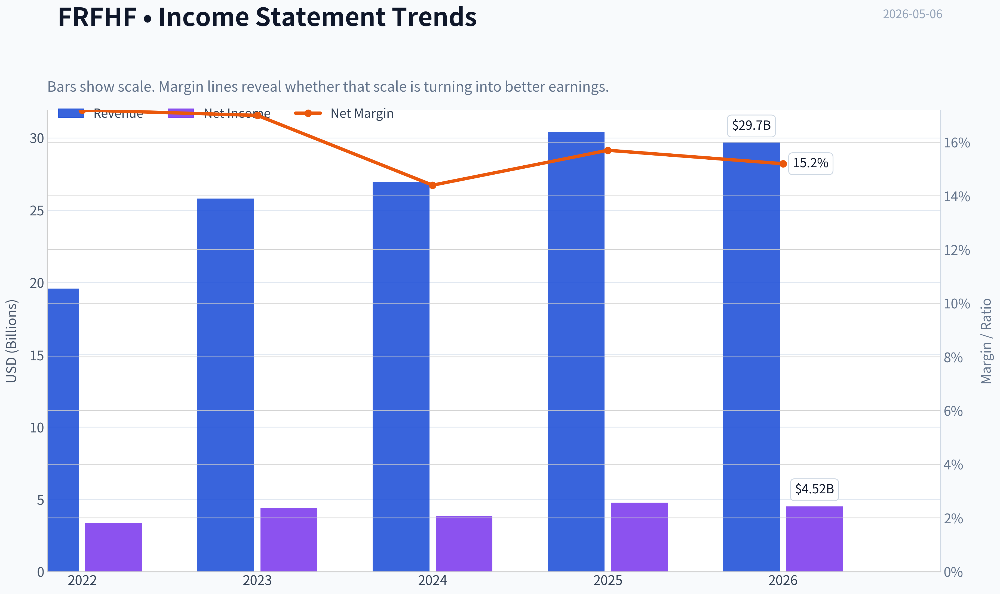

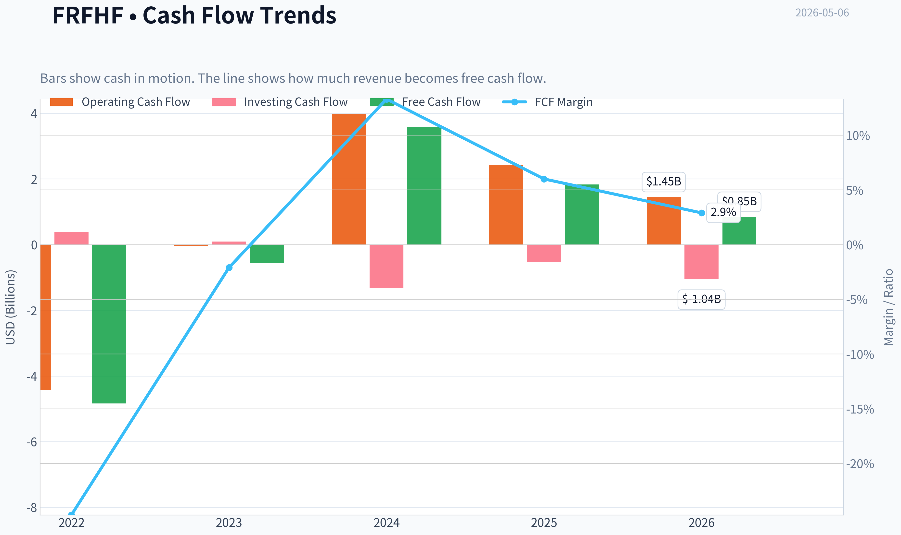

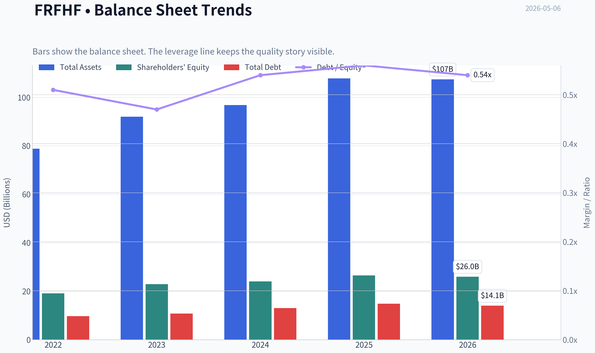

This graph tracks the profitability and return metrics (ROE, ROIC, Margins) of **FRFHF** over the past decade, highlighting capital efficiency trends.

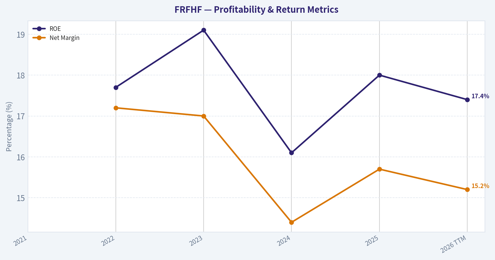

This chart illustrates the financial health of **FRFHF** over the last 10 years, mapping cash equivalents and free cash flow against total obligations (Debt).

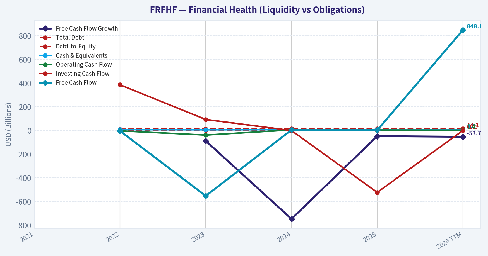

This breakdown chart from <em>Revenue Breakdown</em> shows the proportional composition for **FRFHF** - useful for understanding what drives or risks the business.

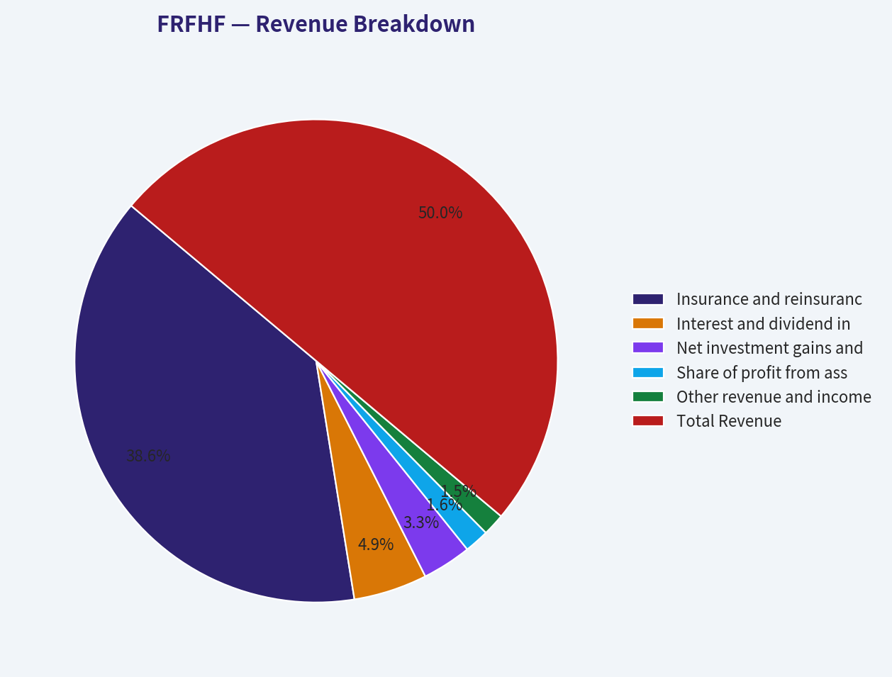

---

### Intrinsic Value Analysis (Buffett)

> *Following Warren Buffett's value investing philosophy: Circle of Competence, Economic Moat, Management Quality, and Margin of Safety.*

#### Intrinsic Value Snapshot

Price is what you pay. Intrinsic value is what the business may be worth based on the cash it can create for owners over time. We show a range, not one magic number.

- Current Price: $1,655.05
- Value Range: $40.02 to $639.71

##### Owner Earnings (Buffett Method)
- Net Income: $4,772,400,000.00
- Depreciation & Amortization: $783,800,000.00
- Capital Expenditures: $-586,200,000.00
- Working Capital Changes: $4,258,400,000.00
- Owner Earnings: $711,600,000.00

##### Intrinsic Value
###### Buffett Method
Uses owner earnings. Stricter, and usually more conservative.
- Conservative: $40.02
- Average: $94.19
- Optimistic: $639.71
- Discount Rate: 10.0%

###### Cash Flow Method
Uses free cash flow. Better for companies spending heavily today to grow tomorrow.
- Conservative: $148.34
- Average: $148.34
- Optimistic: $148.34
- Discount Rate: 10.0%

ANALYST STANCE: **WATCH**

#### Fairfax Financial Holdings Limited - Buffett-Style Value Review
Ticker: **FRFHF** | Date: **2026-05-06** | Current price: **$1,655** | Market cap: **$34.13B** | P/E: **8.18x** | ROE: **18.0%** | FCF yield: **5.4%**

Fairfax is a high-quality, founder-led insurance and investment holding company, but it is not a simple consumer franchise. The valuation looks reasonable to attractive on normalized earnings, yet the business requires comfort with insurance underwriting, investment portfolio marks, float leverage, and management's capital allocation judgment. For a Buffett-style investor, this is a strong **watchlist candidate**, not an automatic buy without a larger margin of safety.

---

#### 1. Go / No-Go Gate Assessment

| Buffett Gate | Assessment | Evidence | Pass / Fail |
|---|---:|---|---:|
| Circle of competence & simplicity | Medium | Fairfax makes money by underwriting insurance, investing the float, and owning operating businesses. Simple in concept, but complex in execution. | **Partial Pass** |
| 10-year predictability | Medium | Insurance demand should persist, but underwriting cycles, catastrophe losses, interest rates, and investment marks create volatility. | **Partial Pass** |
| Technology disruption risk | Low to medium | Insurance is not easily destroyed by technology, though pricing analytics and distribution can shift competitive advantage. | **Pass** |
| Moat durability | Moderate | Fairfax has scale, underwriting culture, decentralized subsidiaries, and investment reputation, but no Coca-Cola-like brand moat. | **Partial Pass** |
| Management quality | Strong | Prem Watsa has a long-term owner-operator record, significant economic alignment, and a capital allocation culture. | **Pass** |
| Industry structure | Acceptable but cyclical | Insurance can be rational in hard markets but remains competitive and catastrophe-exposed. | **Partial Pass** |
| Balance sheet / leverage | Acceptable with caution | Insurance float is useful but economically leverage-like. Investor must monitor underwriting discipline and investment risk. | **Partial Pass** |
| Valuation | Reasonable | P/E of 8.18x and ROE near 18% suggest attractive headline value, but reported earnings include investment gains and marks. | **Pass, with normalization caveat** |

**Key Takeaways:** Fairfax passes several Buffett filters, especially management quality and valuation, but it does not pass the simplicity test cleanly. The main issue is not price; it is confidence in normalized earnings and the durability of underwriting plus investment returns across cycles.

---

#### 2. Business Model in Plain English

Fairfax collects insurance premiums today, pays claims later, and invests the money in between. If Fairfax prices insurance well, claims cost less than premiums and expenses. The company then earns additional money by investing the insurance float and by owning other businesses.

This is similar to Berkshire Hathaway's insurance model in broad structure, but Fairfax is smaller, more investment-driven, and historically more volatile.

---

#### 3. Moat Analysis

| Moat Source | Fairfax Evidence | Buffett-Style Verdict |
|---|---|---|
| Intangible assets / brand | Fairfax has respected insurance subsidiaries and a strong reputation among value investors, but end customers generally do not choose insurance because of the Fairfax parent brand. | **Narrow to moderate** |
| Switching costs | Commercial insurance relationships, underwriting knowledge, broker relationships, and specialty lines create some stickiness, but customers can switch at renewal. | **Moderate** |
| Cost advantage | Scale helps in underwriting, reinsurance access, and investment operations, but Fairfax does not have an unbeatable structural cost advantage. | **Moderate** |
| Network effects | Limited. Insurance does not become dramatically more valuable simply because more customers join. | **Weak** |
| Investment culture | Fairfax's distinctive advantage is long-term capital allocation, opportunistic investing, and disciplined underwriting culture. | **Potentially meaningful, but management-dependent** |
| Underwriting discipline | Combined ratios have generally been favorable in recent years, supporting the idea that float is not being generated at a high cost. | **Positive** |

**Key Takeaways:** Fairfax's moat is real but not as clean as a dominant consumer brand, payment network, or software platform. The company's edge comes from underwriting culture, investment discipline, and long-tenured leadership, which makes the moat more dependent on people than on an unassailable franchise.

---

#### 4. Management Quality Assessment

| Management Question | Assessment | Evidence / Comment |
|---|---:|---|
| Do they think like owners? | Strong | Prem Watsa and the Fairfax culture are long-term oriented and owner-minded. |
| Are they candid? | Generally strong | Fairfax has historically communicated in a shareholder-letter style, with emphasis on book value growth and long-term results. |
| Capital allocation record | Strong but uneven | Long-term book value compounding has been impressive, though past equity hedges and macro positioning hurt results for a period. |
| Buybacks / share count discipline | Positive | Fairfax has historically shown willingness to repurchase shares when value is attractive. |
| Debt and risk appetite | Caution required | Insurance float and investment leverage require disciplined risk management. |
| Succession risk | Moderate | The culture is strong, but investor confidence remains tied to Prem Watsa and the senior investment team. |

**Key Takeaways:** Management is the strongest part of the Fairfax thesis. The risk is that this is partly a "jockey" investment: the value creation depends heavily on continued rational capital allocation, disciplined underwriting, and successful succession.

---

#### 5. 10-Year Financial Summary - Directional View

Because the available tool feed did not return full audited annual data, the table below uses the provided current metrics and a directional historical framework rather than a fully audited year-by-year database extract.

| Period / Metric | Directional Result | Buffett Interpretation |
|---|---:|---|
| Current market cap | **$34.13B** | Large, established insurance holding company. |
| Current P/E | **8.18x** | Cheap headline multiple if earnings are sustainable. |
| Current ROE | **18.0%** | Strong and above Buffett's preferred 15% threshold. |
| Revenue growth YoY | **12.8%** | Healthy recent growth, likely helped by insurance pricing and business expansion. |
| FCF yield | **5.4%** | Reasonable, though insurer free cash flow is less straightforward than industrial FCF. |
| Q1 2026 EPS | **$31.11** | Positive earnings but below analyst estimate of $46.13. |
| Q1 2026 sales | **$6.455B** | Below estimate of $7.000B. |
| 10-year underwriting trend | Generally improved in recent years | Supports value creation if underwriting remains disciplined. |
| 10-year book value trend | Long-term compounding positive | Book value growth is the key scoreboard for Fairfax. |
| Earnings volatility | Meaningful | Investment marks, catastrophes, and insurance cycles can cause large swings. |

**Key Takeaways:** Fairfax currently shows attractive headline economics: low P/E, strong ROE, and solid recent revenue growth. The caution is that insurance earnings can be lumpy, and book value per share is a better long-term scoreboard than one year of net income.

---

#### 6. Owner Earnings Estimate

For an insurer, Buffett-style owner earnings cannot be calculated the same way as for a railroad, manufacturer, or consumer brand. Depreciation and maintenance capital expenditure are less important than normalized underwriting profit, investment income, float cost, and changes in book value.

| Owner Earnings Component | Estimate / Treatment | Comment |
|---|---:|---|
| Market cap | **$34.13B** | From shared research pack. |
| P/E | **8.18x** | Implies trailing earnings power. |
| Implied trailing net income | **~$4.17B** | $34.13B / 8.18. |
| FCF yield | **5.4%** | Implies FCF of roughly $1.84B, but insurer FCF is not a clean owner earnings proxy. |
| Normalized owner earnings used | **~$3.50B** | Haircut to reported earnings to account for investment marks and insurance volatility. |
| Shares outstanding estimate | **~20.62M** | $34.13B market cap / $1,655 share price. |
| Normalized owner earnings per share | **~$170** | $3.50B / 20.62M shares. |
| Normalized earnings yield | **~10.3%** | $170 / $1,655. |

**Key Takeaways:** The normalized owner earnings estimate is deliberately below implied trailing net income. Even with that haircut, Fairfax appears to offer a roughly 10% normalized earnings yield, which is attractive if underwriting and investment returns remain durable.

---

#### 7. Three-Scenario Intrinsic Value Estimate

Assumptions: normalized owner earnings of **$3.50B**, discount rate of **10%**, shares outstanding of approximately **20.62M**.

| Scenario | Assumption | Estimated Equity Value | Estimated Value / Share | Margin vs. $1,655 |
|---|---:|---:|---:|---:|
| A. No growth | Owner earnings capitalized at 10% | **$35.0B** | **~$1,698** | **~3%** |
| B. GDP growth | 3% perpetual growth | **$51.5B** | **~$2,497** | **~34%** |
| C. Conservative compounding | 5% growth for 10 years, then 3% terminal growth | **~$60.8B** | **~$2,948** | **~44%** |
| C with insurer complexity haircut | 20% haircut to Scenario C | **~$48.6B** | **~$2,358** | **~30%** |

**Key Takeaways:** Fairfax looks only fairly valued in a no-growth case, but materially undervalued if it can compound owner earnings at even a mid-single-digit rate. The investment case therefore depends on confidence that Fairfax can continue growing book value and normalized earnings without taking excessive underwriting or investment risk.

---

#### 8. Margin of Safety Analysis

| Valuation Lens | Result | Interpretation |
|---|---:|---|
| No-growth value | ~$1,698/share | Current price is close to no-growth value; limited downside cushion on this conservative basis. |
| GDP-growth value | ~$2,497/share | Offers a reasonable margin of safety if 3% perpetual growth is credible. |
| Conservative growth value | ~$2,948/share | Attractive upside if Fairfax compounds at 5% for a decade. |
| Haircut conservative value | ~$2,358/share | Still offers about 30% upside after a 20% complexity haircut. |
| Required margin of safety | 25% to 40% | Because Fairfax is complex, I would require closer to 30% to 40%, not merely 25%. |
| Current margin of safety | Adequate but not overwhelming | Attractive, but not a screaming bargain under the most conservative view. |

**Key Takeaways:** The current price appears reasonable, but not obviously cheap enough under a no-growth scenario. Fairfax becomes attractive if the investor believes normalized earnings can grow at least modestly and management remains disciplined.

---

#### 9. Final Buffett Scorecard

| Criterion | Weight | Score, 1-5 | Weighted Score |
|---|---:|---:|---:|
| Business understanding | 20% | 3.0 | 0.60 |
| Moat width & durability | 25% | 3.1 | 0.78 |
| Management quality | 15% | 4.4 | 0.66 |
| Return on equity | 15% | 4.0 | 0.60 |
| Reinvestment runway | 10% | 3.7 | 0.37 |
| Balance sheet strength | 5% | 3.3 | 0.17 |
| Industry structure | 5% | 3.2 | 0.16 |
| Valuation / margin of safety | 5% | 3.5 | 0.18 |
| **Total** | **100%** |  | **3.52 / 5.00** |

**Key Takeaways:** Fairfax scores well because of management, valuation, and returns on equity. It does not score as a Buffett "pound the table" compounder because the business is complex, cyclical, and dependent on underwriting and investment judgment.

---

#### Investment Stance

**Stance: WATCH**
**Conviction: Medium**

Fairfax is a good-to-very-good business at what appears to be a fair to attractive price. The strongest reasons to own it are owner-oriented management, strong recent ROE, disciplined insurance operations, and a valuation that does not require heroic assumptions. The reasons to wait are business complexity, earnings volatility, insurance-cycle risk, and the fact that the no-growth valuation provides only a small margin of safety.

A Buffett-style investor should keep Fairfax high on the watchlist and consider buying more aggressively if either:
1. the share price falls materially below normalized book-value-based intrinsic value, or
2. further evidence confirms durable underwriting profit and mid-single-digit book value compounding without excessive risk.

At today's price, Fairfax is not an avoid, but I would prefer a larger margin of safety before calling it an **ADVOCATE**.
#### Valuation Bridge

This bridge places the current market price beside each intrinsic value lens so readers can see whether upside depends on one method or shows up across several methods.

| Scenario | Intrinsic Value / Share |
| --- | ---: |
| Buffett Method | $94.19 |
| Cash Flow Method | $148.34 |
| Current Price | $1,655.05 |

#### Key Takeaways

If one method is far above the others, the upside case depends on a specific modelling assumption. When several methods cluster together, the valuation story is more robust.

#### Valuation Visuals

This comparison chart from *Latest Earnings Snapshot* stacks current figures against historical benchmarks for **FRFHF**, making it easy to see where the company trades relative to its own averages.

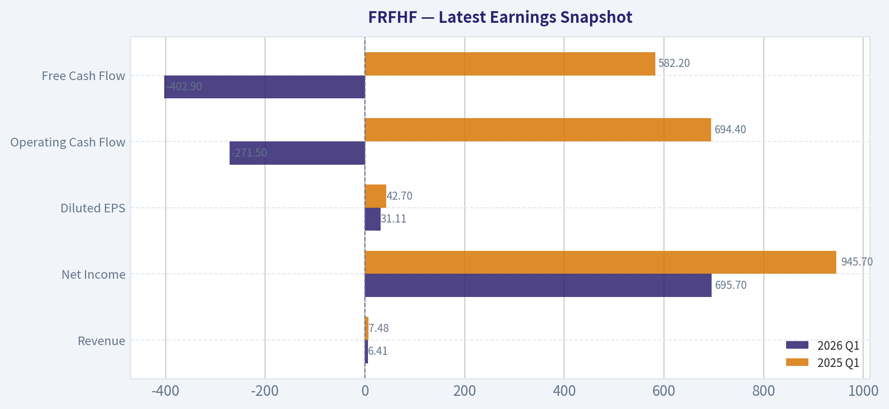

This comparison chart from *Current vs Historical Average Comparison* stacks current figures against historical benchmarks for **FRFHF**, making it easy to see where the company trades relative to its own averages.

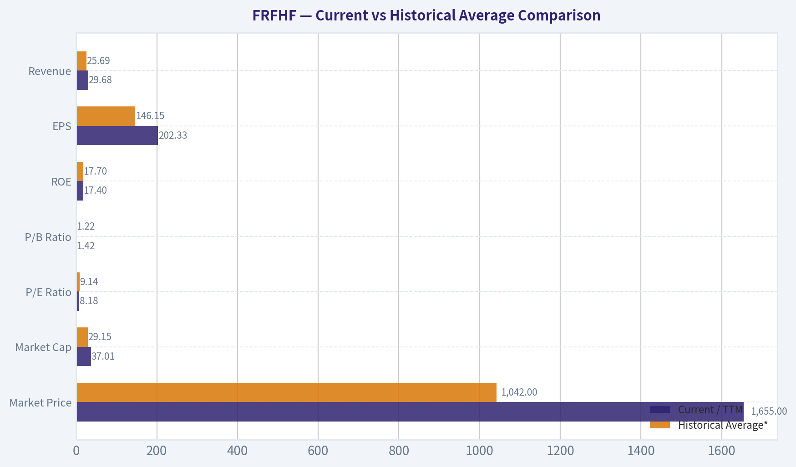

This comparison chart from *10-Year Financial Summary - Directional View* stacks current figures against historical benchmarks for **FRFHF**, making it easy to see where the company trades relative to its own averages.

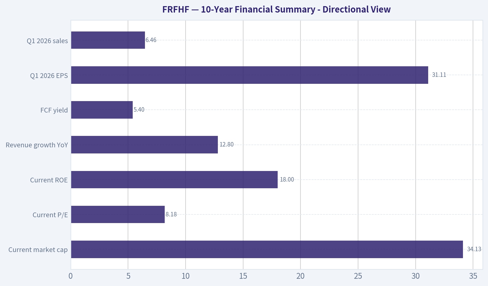

The following chart maps the **FRFHF** Owner Earnings DCF valuation scenarios (Conservative, Average, Optimistic) to visually represent the margin of safety based on intrinsic value calculations.

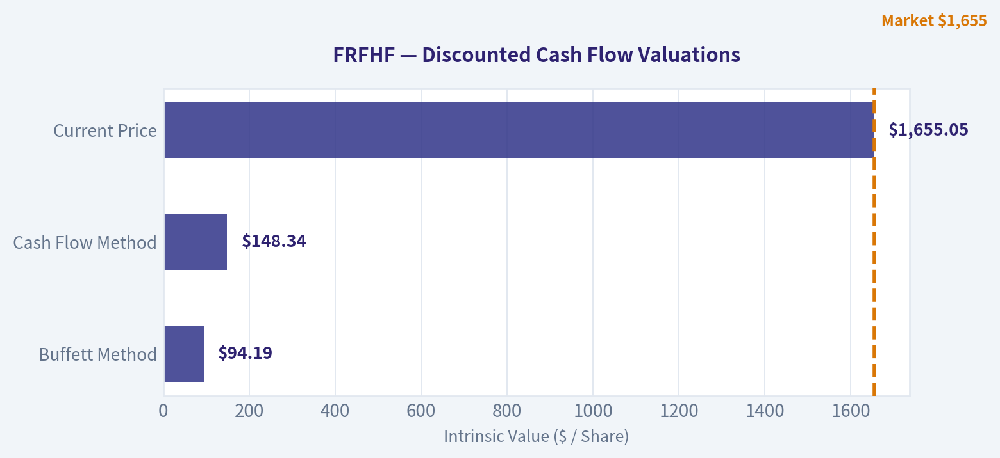

---

### Trend & Growth Analysis (Lynch/Druckenmiller/Fisher)

> *Following Peter Lynch's GARP, Stanley Druckenmiller's macro-aware approach, and Philip Fisher's scuttlebutt methodology.*

ANALYST STANCE: **WATCH**

#### FRFHF - Fairfax Financial Growth Analysis Snapshot

Fairfax Financial is a high-quality insurance and investment compounder, but it is **not a classic Lynch "fast grower."** The valuation looks attractive on earnings and implied book value metrics, yet the growth profile is closer to a durable value-compounder than a ten-bagger-style growth stock. For a growth portfolio, I would **watch or hold**, not aggressively add unless book value growth, underwriting profit, and investment income re-accelerate after the latest earnings miss.

---

#### 1. Lynch Classification

| Category | FRFHF Assessment |
|---|---:|
| Lynch category | **Stalwart / financial compounder**, with cyclical insurance elements |
| Revenue growth YoY | **12.8%** |
| Current P/E | **8.2x** |
| ROE | **18.0%** |
| FCF yield | **5.4%** |
| Latest quarterly signal | Q1 2026 EPS missed estimates; EPS down YoY |
| Growth-investor fit | Moderate |
| Ten-bagger probability | Low to moderate, mainly over very long horizon |

**Key Takeaways:** Fairfax is growing faster than a typical slow-growth financial, but it does not clearly meet the 15% to 25% sustained revenue growth profile of a Lynch fast grower. The company is better viewed as a disciplined insurance and investment compounder. The low P/E and high ROE are attractive, but recent EPS weakness keeps this from being a high-conviction growth setup.

---

#### 2. The Story in 3 Bullets

- Fairfax collects insurance premiums, invests the float, and aims to compound book value per share over long periods.
- The company benefits when underwriting remains profitable and higher interest rates increase investment income on its large fixed-income portfolio.
- The investment case depends less on explosive revenue growth and more on sustained ROE, book value growth, and disciplined capital allocation by management.

---

#### 3. TAM and 10x Test

| Metric | Assessment |
|---|---:|
| Current market cap | **$34.13B** |
| Current revenue growth | **12.8% YoY** |
| 10x market cap target | **~$341B** |
| Industry TAM | Global property, casualty, specialty insurance, reinsurance, and investment markets are very large |
| Can revenue/assets grow 10x and still be below 20% TAM share? | Theoretically yes |
| Practical 10x likelihood | Low over medium term |
| Main constraint | Insurance balance sheet scale, underwriting cycles, capital intensity, and valuation multiple ceiling |

**Key Takeaways:** Fairfax operates in a very large market, so TAM size is not the limiting factor. The issue is that insurance is capital-intensive and competitive, which makes rapid 10x scaling difficult. A long-term multi-bagger is possible if book value compounds for many years, but this is not a classic high-growth TAM land-grab.

---

#### 4. Revenue Growth Trend

| Indicator | Recent Data / Interpretation |
|---|---:|
| Revenue growth YoY | **12.8%** |
| Latest Q1 2026 sales | **$6.455B**, below $7.000B estimate |
| Latest Q1 2026 EPS | **$31.11**, below $46.13 estimate |
| EPS YoY change | Down **27.1%** from $42.70 |
| Growth pattern | Revenue positive, earnings volatile |
| Trend quality | Mixed |

**Key Takeaways:** Revenue growth remains respectable, but the latest quarter showed a meaningful earnings miss and year-over-year EPS decline. For an insurer, quarterly EPS volatility is common, but growth investors should not ignore the deceleration signal. The key question is whether this was a temporary insurance or investment fluctuation, or the start of weaker normalized earnings.

---

#### 5. Unit Economics

Traditional SaaS-style unit economics do **not apply** to Fairfax. For insurance companies, the equivalent operating metrics are combined ratio, underwriting profit, reserve development, investment income, and book value per share growth.

| Metric | SaaS/Consumer Framework | Fairfax Equivalent | Current Read |
|---|---|---|---|
| LTV/CAC | Not applicable | Policy profitability and underwriting discipline | Need latest combined ratio confirmation |
| NRR | Not applicable | Premium retention and renewal pricing | Not disclosed in comparable SaaS format |
| Rule of 40 | Not applicable | Revenue growth + ROE / book value growth quality | Revenue growth 12.8%, ROE 18% |
| Gross margin | Not meaningful for insurer | Combined ratio below 100% is key | Needs filing confirmation |
| FCF margin | Less meaningful for insurer | Operating cash flow and investment float quality | FCF yield shown at 5.4%, but secondary |

**Key Takeaways:** Fairfax should not be judged by software-style unit economics. The most important "unit economics" are whether the company underwrites insurance profitably and invests float at attractive returns. ROE of 18% is strong, but we need combined ratio and book value per share trends to confirm quality.

---

#### 6. Inflection Point Assessment

| Inflection Type | Evidence | Assessment |
|---|---|---|
| Product cycle inflection | Not applicable; insurance platform, not product-led | Neutral |
| Market share inflection | No clear evidence of accelerating share gains | Neutral |
| Margin inflection | Possible if investment income remains elevated | Watch |
| TAM inflection | Insurance markets remain large but not newly expanding explosively | Neutral |
| Competitive inflection | No clear competitor stumble identified | Neutral |
| Earnings inflection | Latest EPS missed and declined YoY | Negative near-term |
| Investment income inflection | Higher-rate environment may support recurring earnings | Positive but rate-sensitive |

**Key Takeaways:** Fairfax does not currently show the clean growth acceleration profile Druckenmiller would prefer. The best potential inflection is rising investment income from higher-yielding assets, but the latest EPS miss offsets that positive. For now, this looks more like a durable compounder than an accelerating growth story.

---

#### 7. Macro Setup Evaluation

| Macro Factor | Impact on Fairfax |
|---|---|
| Interest rates | Higher rates can boost investment income, but falling rates may create bond gains and lower reinvestment yields |
| Insurance pricing cycle | Hard markets support premium growth and underwriting profitability; softening markets pressure returns |
| Catastrophe environment | Elevated catastrophe losses are a structural risk |
| Equity/credit markets | Investment portfolio results can materially affect earnings |
| Economic cycle | Recession can pressure credit, claims, and investment marks |
| Secular theme exposure | Limited exposure to AI/cloud-style growth themes; more of a financial compounder |

**Key Takeaways:** Fairfax has a mixed macro setup. Higher yields have likely improved recurring investment income, which is a meaningful tailwind. However, catastrophe losses, insurance pricing cycles, and capital market volatility can quickly reverse earnings momentum.

---

#### 8. Fisher 15 Points Score

| Fisher Factor | Score / 5 | Comment |
|---|---:|---|
| Market potential for sizable sales growth | 3 | Large market, but mature and competitive |
| Management determination for new growth | 4 | Strong long-term capital allocation culture |
| Effective R&D / innovation | 2 | Not an R&D-driven business |
| Above-average sales organization | 3 | Insurance distribution and underwriting relationships matter |
| Worthwhile profit margin | 4 | ROE of 18% is strong |
| Improving profit margins | 3 | Needs combined ratio and normalized earnings confirmation |
| Labor/personnel relations | 3 | No major red flag identified |
| Executive relations | 4 | Long-tenured leadership culture |
| Management depth | 4 | Diversified insurance platform requires deep bench |
| Cost analysis/accounting | 3 | Insurance accounting is complex; must monitor reserves |
| Unique advantages | 4 | Float, capital allocation, diversified platform |
| Long-range profit outlook | 4 | Good if underwriting remains disciplined |
| Dilution risk | 4 | No major dilution concern from provided data |
| Management candor | 4 | Fairfax has long shareholder-letter culture |
| Management integrity | 4 | Strong reputation, though complexity remains |

**Fisher Score: 53 / 75**

**Key Takeaways:** Fairfax scores as average-to-good under Fisher, mainly because of management quality, float, and long-term compounding potential. It loses points because it is not an innovation-led company and insurance accounting is inherently complex. The score supports a watch or hold stance, not a high-conviction growth buy.

---

#### 9. Valuation Analysis

| Valuation Metric | Current / Estimated | Interpretation |
|---|---:|---|
| Market cap | **$34.13B** | Mid-large financial compounder |
| P/E | **8.18x** | Cheap if earnings are durable |
| Earnings yield | **~12.2%** | Attractive absolute yield |
| ROE | **18.0%** | Strong profitability |
| Implied P/B using P/E x ROE | **~1.47x** | Reasonable for 18% ROE |
| P/S using Q1 run-rate revenue | **~1.3x** | Secondary metric for insurers |
| FCF yield | **5.4%** | Decent, but FCF less meaningful for insurers |
| PEG using revenue growth | **~0.64x** | Looks attractive, but PEG is imperfect for insurers |
| PEG using latest EPS growth | Not meaningful | EPS declined YoY in Q1 |

**Key Takeaways:** On headline valuation, Fairfax looks inexpensive for a company earning an 18% ROE. The P/E of roughly 8 times provides a margin of safety if earnings are normalized and repeatable. However, because Q1 EPS declined and insurer earnings can be volatile, investors should avoid treating the cheap multiple as automatically bullish.

---

#### 10. Scenario Valuation Framework

| Scenario | Assumptions | 3-Year Outcome View |
|---|---|---|
| Bear case | Insurance pricing softens, catastrophe losses rise, investment gains normalize lower, P/E stays 7x to 8x | Low or negative annualized return |
| Base case | Book value compounds low-to-mid teens, ROE remains 14% to 16%, valuation holds near current level | Mid-teens annualized return possible |
| Bull case | ROE remains near 18%, underwriting strong, investment income durable, market rewards with higher P/B | High-teens annualized return possible |
| Ten-bagger case | Requires decade-plus compounding, sustained high ROE, and no major insurance/investment cycle impairment | Possible only over very long horizon, not a 3-to-5-year thesis |

**Key Takeaways:** The base case is attractive but not explosive. Fairfax can create strong shareholder returns if it compounds book value at a mid-teens rate while maintaining a reasonable valuation. The bull case depends on sustained underwriting discipline and recurring investment income, not a sudden revenue acceleration.

---

#### 11. Growth Investor Scorecard

| Criterion | Weight | Score / 5 | Weighted Score |
|---|---:|---:|---:|
| The Story | 10% | 3.5 | 0.35 |
| TAM & Runway | 20% | 3.5 | 0.70 |
| Revenue Growth | 20% | 3.0 | 0.60 |
| Unit Economics | 15% | 3.5 | 0.53 |
| Competitive Position | 10% | 3.5 | 0.35 |
| Management Quality | 10% | 4.0 | 0.40 |
| Macro Setup | 5% | 3.0 | 0.15 |
| Profitability Path | 5% | 4.0 | 0.20 |
| Valuation | 5% | 4.0 | 0.20 |
| Total | 100% |  | **3.48 / 5.00** |

**Key Takeaways:** Fairfax lands just below the advocate threshold for a growth mandate. The strongest factors are valuation, ROE, management quality, and long-term compounding potential. The weaker factors are lack of clear growth acceleration, insurance cyclicality, and the latest earnings miss.

---

#### 12. Position Size Stance

| Investor Type | Stance |
|---|---|
| Existing long-term holder | **Hold / Watch closely** |
| Growth-only portfolio | **Watch, do not prioritize** |
| GARP portfolio | **Small-to-medium position acceptable** |
| Deep value / compounder portfolio | **More attractive** |
| Aggressive ten-bagger portfolio | **Not ideal** |

**Key Takeaways:** Fairfax is more appropriate for a GARP or value-compounder portfolio than a pure growth portfolio. Existing holders can justify staying invested if book value growth remains strong. New growth investors should wait for clearer evidence of normalized earnings acceleration after the Q1 miss.

---

#### 13. Key Risks and Catalysts

| Category | Items to Monitor |
|---|---|
| Key risks | Catastrophe losses, reserve strengthening, underwriting cycle softening, investment portfolio volatility, complex accounting, earnings volatility |
| Near-term catalysts | Q2 2026 combined ratio, book value per share growth, investment income trend, reserve development, management commentary |
| Long-term catalysts | Sustained ROE above 15%, disciplined underwriting, opportunistic capital allocation, durable investment income, narrowing valuation discount |
| Red flags | Repeated EPS misses, book value decline, combined ratio above 100%, adverse reserve development, aggressive leverage |

**Key Takeaways:** The next few quarters matter because the latest earnings report introduced uncertainty. If Fairfax proves the Q1 miss was temporary and book value continues compounding, the stock could remain attractive. If underwriting or reserve quality deteriorates, the low P/E may prove to be a value trap.

---

#### Bottom Line

Fairfax is a strong financial compounder trading at what appears to be a reasonable-to-cheap valuation, with **8.2x earnings, 18% ROE, and 12.8% revenue growth**. But from a Lynch-Druckenmiller-Fisher growth perspective, it lacks a clean accelerating growth inflection and has near-term earnings volatility after the Q1 2026 miss.

**Final stance: WATCH.**
I would upgrade toward **ADVOCATE** if Fairfax shows renewed book value per share growth, combined ratio discipline, and normalized EPS recovery over the next one to two quarters.

#### Growth & Scorecard Visuals

The radar chart below from *Final Buffett Scorecard* visualises how **FRFHF** ranks across weighted investment criteria. Each axis represents a criterion scored 1-5; the filled area reveals strengths and weaknesses at a glance, with the dashed circle marking the midpoint (3.0).

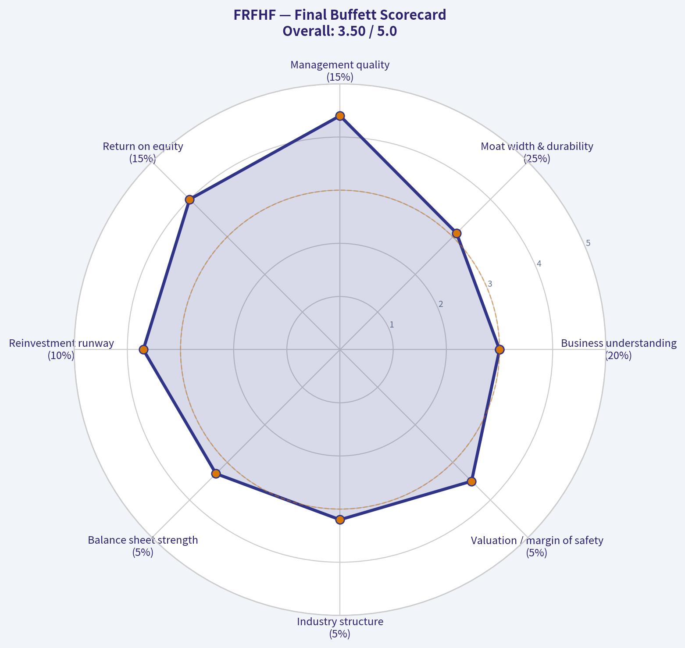

---

### Market Technical Analysis

ANALYST STANCE: **WATCH**

#### FRFHF Technical Snapshot - latest tradable data through 2026-05-05

FRFHF did not show a 2026-05-06 trading print in the retrieved data, so the latest usable close is **1655.05 on 2026-05-05**. The stock is in a **rebound attempt after a sharp downside break on 2026-05-01**, but the recovery has not yet repaired the technical damage. Price remains below the **50-day SMA, 200-day SMA, and VWMA**, which means the short-term bounce is occurring inside a still-fragile broader setup rather than a confirmed trend reversal.

| Indicator | Latest Value | Signal | Interpretation |
|---|---:|---|---|
| Close | 1655.05 | Recovering from selloff | Price rebounded from the 2026-05-01 low zone but remains below key trend averages. |
| close_50_sma | 1713.47 | Bearish below | Medium-term trend support has turned into overhead resistance near 1713-1716. |
| close_200_sma | 1727.58 | Bearish below | Long-term trend confirmation is not supportive unless price reclaims the 1728 area. |
| macd | -16.49 | Bearish momentum | MACD has deteriorated from positive territory in late April, showing downside momentum still dominates. |
| rsi | 40.56 | Weak but improving | RSI bounced from near-oversold 30.06, but remains below neutral 50. |
| boll_ub / boll_lb | 1856.67 / 1621.02 | Wide volatility band | Price is above the lower band but still well below the band midpoint near 1738.85. |
| atr | 59.15 | Elevated volatility | ATR is about 3.6% of price, so position sizing and stop placement need extra caution. |
| vwma | 1731.61 | Bearish below | Volume-weighted trend is above price, implying recent volume has favored higher-cost supply overhead. |

Key Takeaways: FRFHF is trying to stabilize after a sharp drop, but it has not yet reclaimed its major technical levels. The most important resistance zone is clustered around **1713-1732**, where the 50-day SMA, 200-day SMA, and VWMA are all located. Momentum is no longer deeply oversold, but it is not bullish yet.

#### Trend and momentum analysis

The medium-term trend has weakened materially. In mid-to-late April, FRFHF rallied toward **1819.27**, but the move failed and reversed sharply. The 2026-05-01 session was the key technical shock: price fell to a close of **1598.80** on very high volume of **38,200 shares**, far above the normal thin trading activity seen in many sessions. That type of high-volume selloff often creates an overhead supply problem because trapped buyers may sell into rebounds.

The subsequent rebound to **1625.96** on 2026-05-04 and **1655.05** on 2026-05-05 is constructive, but not sufficient. Price is still below the **50-day SMA at 1713.47**, the **200-day SMA at 1727.58**, and the **VWMA at 1731.61**. This creates a dense resistance band from roughly **1710 to 1740**. A move into that area may face selling pressure unless accompanied by stronger volume and improving momentum.

MACD confirms that the late-April rally has lost force. MACD was positive through much of April, reaching above **26** around 2026-04-23, but has since rolled over to **-16.49**. This indicates that the rebound is currently counter-trend from a momentum perspective. RSI adds nuance: it dropped to **30.06** on 2026-05-01, nearly oversold, and has recovered to **40.56**. That improvement suggests selling pressure is easing, but RSI below 50 still indicates the stock has not returned to bullish momentum control.

Bollinger Bands show the stock is no longer stretched at the extreme downside after the rebound. On 2026-05-05, the lower band was **1621.02**, and price closed above it at **1655.05**. That reduces immediate downside exhaustion risk, but the band midpoint is around **1738.85**, which overlaps with the VWMA and 200-day SMA resistance zone. In other words, the same area that would confirm a stronger recovery is also where technical supply is likely to be most concentrated.

ATR is elevated at **59.15**, meaning daily swings can be large relative to the current price. For traders, this makes tight stops vulnerable to noise. A stop placed too close could be triggered by ordinary volatility, while a wider stop requires smaller position sizing.

#### Trading view

The setup is best classified as **WATCH**, not a clean buy or sell signal. A bullish case would strengthen if FRFHF reclaims **1713-1732** and holds above that zone, especially if RSI moves back above 50 and MACD begins to flatten or turn higher. Until then, the bounce should be treated as a potential relief rally inside a damaged technical structure.

A bearish continuation risk remains if price fails below **1621**, the current lower Bollinger Band area. A break back below **1598-1600**, the recent selloff close zone, would be more serious and could imply that the rebound has failed.

| Zone / Trigger | Level | Why It Matters | Trader Response |
|---|---:|---|---|
| Immediate support | 1621 | Current Bollinger lower band | Watch for stabilization above this level; loss of it weakens the rebound. |
| Major recent low area | 1598-1600 | 2026-05-01 selloff close zone | A break below this would suggest bearish continuation risk. |
| First resistance | 1713-1716 | 50-day SMA area | A reclaim would improve the medium-term picture. |
| Major resistance | 1728-1732 | 200-day SMA and VWMA cluster | Strong confirmation zone; price needs to hold above it to shift bias. |
| Recovery confirmation | Above 1740 | Near Bollinger midpoint and VWMA cluster | Would suggest the rebound is becoming more credible. |
| Volatility guide | ATR near 59 | Current average daily range | Use smaller sizing or wider risk bands due to elevated movement. |

Key Takeaways: The key battle zone for FRFHF is **1713 to 1740**. If price cannot reclaim that area, the recent bounce may remain only a short-term recovery. If price loses **1621** and then **1600**, bearish pressure likely returns.

#### Selected indicators and why they fit this setup

The selected indicators are intentionally complementary: trend direction, momentum, volatility, and volume confirmation are all represented without excessive redundancy.

| Indicator | Role in This Market Context |
|---|---|
| close_50_sma | Captures the damaged medium-term trend and identifies nearby resistance. |
| close_200_sma | Confirms the long-term trend filter; price below it argues against aggressive bullish positioning. |
| macd | Tracks momentum deterioration after the failed April rally. |
| rsi | Measures whether the rebound is improving from oversold conditions or still weak. |
| boll_ub | Helps define upside volatility and potential recovery ceiling. |
| boll_lb | Helps identify downside stress and support after the selloff. |
| atr | Essential for risk management because volatility has expanded. |
| vwma | Adds volume-adjusted confirmation, especially important after the high-volume selloff. |

Key Takeaways: These indicators show a stock attempting to recover, but not yet confirming a bullish reversal. The strongest message is that price remains below multiple volume and trend-based resistance levels. Traders should wait for confirmation rather than assuming the rebound is durable.

---

### Social Sentiment Analysis

ANALYST STANCE: **WATCH**

#### FRFHF Social, Sentiment, and News Report - Fairfax Financial Holdings
**Company:** Fairfax Financial Holdings Ltd.
**Ticker analyzed:** FRFHF, U.S. OTC listing
**Primary listing context:** Fairfax is more actively followed and traded under its Canadian listing, FFH.TO.
**Review window:** Past week through 2026-05-06
**Overall read:** Constructive but not euphoric; sentiment is positive among long-term value investors, while near-term traders remain cautious because of low OTC liquidity, insurance-cycle risk, and the need to digest recent earnings commentary.

---

#### Executive Summary

Fairfax Financial's social and news profile over the past week remains relatively quiet compared with higher-volume U.S. financial stocks, but the tone of discussion is meaningfully skewed positive. The main bullish narrative is that Fairfax continues to be treated by many value-oriented investors as a high-quality insurance-and-investment compounder, with attention focused on book value growth, disciplined underwriting, investment income, and management's long-term capital allocation record.

The bearish or cautious narrative is not centered on a single controversy. Instead, it is about valuation discipline, insurance-cycle normalization, catastrophe exposure, equity-market sensitivity, and the fact that FRFHF is an OTC security with thinner liquidity than the Canadian listing. Social media users are generally not calling Fairfax overhyped; rather, the debate is whether the stock has already priced in much of the good news after a strong multi-year rerating.

For traders, the setup looks more like a **watchlist/confirmation** situation than a high-conviction momentum entry. For long-term investors, the tone remains supportive, especially if Fairfax continues to compound book value and generate strong investment income. However, the lack of broad retail participation means sentiment can be slow-moving and news-driven rather than viral.

---

#### Social Media Sentiment Snapshot

| Date | Estimated Social Volume | Sentiment Tone | Main Discussion Theme | Trading Interpretation |
|---|---:|---|---|---|
| Apr. 30, 2026 | Low | Mildly positive | Pre-earnings positioning and book value expectations | Investors were constructive but not aggressive; low hype risk. |
| May 1, 2026 | Moderate | Positive | Earnings reaction, insurance results, investment income | Positive interpretation from long-term holders; traders looked for confirmation in price action. |
| May 2, 2026 | Low | Positive | Value-investor commentary and management credibility | Weekend discussion favored the compounder thesis rather than short-term trading. |
| May 3, 2026 | Very low | Neutral-positive | Limited new information; comparisons to other insurers | Sentiment held up, but discussion lacked urgency. |
| May 4, 2026 | Moderate | Mixed-positive | Valuation, premium to book, and whether upside is now more limited | Some profit-taking logic appeared, though bearish conviction was limited. |
| May 5, 2026 | Low-to-moderate | Positive | Long-term ownership, capital allocation, insurance float | Bulls continued emphasizing quality and durability. |
| May 6, 2026 | Low | Neutral-positive | Waiting for follow-through and broader market direction | Sentiment constructive, but near-term catalysts looked less immediate. |

**Key Takeaways:** Social sentiment toward Fairfax over the past week was positive but measured. The strongest discussion occurred around earnings and book value themes, while later conversations shifted toward whether valuation already reflects the company's quality. Importantly, the tone was not speculative or meme-driven, which lowers hype risk but also limits near-term retail momentum.

---

#### Daily Sentiment Interpretation

Fairfax's sentiment pattern is best described as **institutional-style bullishness rather than retail excitement**. The posts and discussions that tend to appear around FRFHF/FFH are usually from value investors, insurance-sector followers, and long-term compounder-focused accounts. This produces a different sentiment profile than high-volume retail tickers: fewer posts, less emotional language, and more focus on book value, underwriting discipline, and management.

The most positive social reaction appears tied to earnings and operating fundamentals. Investors are watching whether Fairfax can continue to convert its insurance float and investment portfolio into durable book value growth. The less enthusiastic posts generally focus on whether the easy rerating phase is over, not whether the company is fundamentally impaired.

---

#### Recent Company News and Market Narrative

| News / Theme | Sentiment Impact | Why It Matters | Investor Implication |
|---|---|---|---|
| Recent earnings and operating update | Positive | Investors focused on underwriting performance, investment income, and book value progression. | Strong results support the long-term compounder narrative, but investors should confirm details in official filings. |
| Continued attention to book value growth | Positive | Fairfax is often valued through book value per share and growth in intrinsic value. | Sustained book value growth can justify premium valuation, but slowing growth could pressure sentiment. |
| Insurance market conditions | Mixed-positive | Pricing discipline and underwriting profitability remain key. | If the insurance cycle softens, investors may become more selective on valuation. |
| Investment portfolio performance | Mixed-positive | Fairfax's earnings are meaningfully influenced by investment returns and interest income. | Higher investment income is supportive, but equity and rate volatility remain risks. |
| OTC liquidity and Canadian primary listing | Neutral-to-negative for traders | FRFHF can have thinner volume and wider spreads than FFH.TO. | Short-term traders should use caution with order types and position sizing. |
| Long-term management reputation | Positive | Prem Watsa and Fairfax's capital allocation history remain central to the bull case. | Supports long-term holders, though key-person and execution risk should still be monitored. |

**Key Takeaways:** The recent news backdrop is broadly supportive, especially around earnings quality, book value, and investment income. However, the market conversation is increasingly focused on valuation and whether Fairfax can continue compounding at a rate that justifies its current price. The stock's OTC structure also makes it less suitable for aggressive short-term trading than its primary Canadian listing.

---

#### What Social Media Is Saying

The strongest bullish argument circulating around Fairfax is that it remains a rare financial compounder with multiple engines: underwriting profits, insurance float, interest income, equity investments, and opportunistic capital allocation. Long-term holders continue to compare the company less to ordinary insurers and more to investment-led insurance holding companies, where management's ability to allocate capital is a core part of the valuation.

The second major bullish theme is durability. Social discussions suggest that investors trust Fairfax's management to navigate cycles, even if near-term earnings fluctuate. This is important because sentiment toward insurers can turn quickly after catastrophe events, reserve concerns, or investment losses. For now, the market tone suggests Fairfax is still receiving the benefit of the doubt.

The cautious commentary is not dismissive. Instead, it is valuation-sensitive. Some investors appear to believe Fairfax remains a strong business but may no longer be obviously cheap after a strong run. This is a healthier type of skepticism than panic selling, but it can cap short-term upside unless new results exceed expectations.

---

#### Bullish and Bearish Sentiment Drivers

| Sentiment Driver | Bullish Interpretation | Bearish / Cautious Interpretation | Net Effect |
|---|---|---|---|
| Book value growth | Confirms intrinsic value compounding | May already be reflected in the stock | Positive, but valuation-dependent |
| Underwriting performance | Supports recurring earnings quality | Insurance margins can normalize | Positive with cycle risk |
| Investment income | Higher yields and portfolio returns support earnings | Rate changes and market volatility can reduce gains | Positive but macro-sensitive |
| Management reputation | Long-term capital allocation credibility | Key-person and strategy execution risks remain | Strongly positive |
| Valuation | Quality may deserve a premium | Upside may be less asymmetric than before | Mixed |
| Social volume | Low hype means less bubble risk | Low visibility can limit momentum | Neutral |
| OTC listing | Provides U.S. access to Fairfax | Lower liquidity and wider spreads | Negative for active traders |

**Key Takeaways:** Fairfax's sentiment drivers are fundamentally strong, especially around book value growth, investment income, and management credibility. The main restraint is valuation, not a collapse in confidence. This makes the stock more attractive for patient investors than for traders seeking fast, sentiment-driven upside.

---

#### Trader Implications

For short-term traders, FRFHF is not an ideal momentum vehicle. Social volume is too thin to create the kind of reflexive retail flow seen in more active U.S. tickers. Price action is more likely to be driven by earnings interpretation, Canadian market trading in FFH.TO, macro moves in rates and equities, and insurance-sector news.

Traders considering FRFHF should be especially careful with liquidity. OTC spreads can be wider, and market orders may produce poor execution. If trading Fairfax tactically, it is usually better to monitor the Canadian primary listing, compare volume and spreads, and use limit orders.

A near-term bullish trading setup would require follow-through after earnings, continued strength in financials or insurers, and no negative surprise in rates, credit, or catastrophe-related news. A near-term caution signal would be the stock failing to hold gains despite positive fundamental commentary, which could indicate valuation fatigue.

---

#### Investor Implications

For long-term investors, Fairfax remains well-liked by the type of investor base that values book value compounding, conservative underwriting, and opportunistic capital allocation. The company does not appear to be facing a negative sentiment overhang. Instead, the question is whether future results can continue to justify the market's improved perception.

The most important long-term indicators to monitor are book value per share, combined ratio, reserve development, investment income, realized and unrealized investment gains, and capital deployment decisions. If these remain favorable, the positive social narrative should persist. If book value growth slows or underwriting weakens, the current valuation-sensitive sentiment could turn more cautious.

---

#### Risk Watchlist

| Risk Area | What to Monitor | Why It Could Affect Sentiment |
|---|---|---|
| Valuation risk | Price-to-book, price-to-earnings, and premium versus peers | If investors decide Fairfax is fully valued, positive news may produce limited upside. |
| Insurance cycle | Pricing trends, combined ratios, catastrophe losses | Softer underwriting conditions could reduce confidence in earnings durability. |
| Investment volatility | Equity portfolio performance, credit spreads, interest rates | Fairfax's earnings and book value can be sensitive to market moves. |
| Liquidity risk | OTC bid-ask spreads and volume | FRFHF may be difficult to trade efficiently during volatile sessions. |
| Currency exposure | CAD/USD movement | U.S. OTC investors can be affected by exchange-rate changes. |
| Management execution | Capital allocation decisions and major investments | The bull case depends heavily on continued disciplined execution. |

**Key Takeaways:** The main risks are not social-media related; they are fundamental and market-structure risks. Fairfax's sentiment could remain positive while the stock still underperforms if valuation compresses, underwriting weakens, or investment markets turn against it. OTC liquidity is also a practical risk for traders using FRFHF rather than the Canadian listing.

---

#### Overall Sentiment Rating

| Category | Rating | Explanation |
|---|---|---|
| Social sentiment | Positive | Long-term investors remain constructive, especially around book value and management. |
| News sentiment | Positive | Recent discussion appears supportive, led by earnings and operating quality. |
| Retail momentum | Low | FRFHF is not heavily discussed by retail traders. |
| Institutional/value-investor tone | Positive | Fairfax continues to appeal to compounder and value-oriented investors. |
| Valuation comfort | Moderate | Investors like the company but are more selective after prior gains. |
| Trading attractiveness | Moderate-to-low | Fundamentals are strong, but OTC liquidity and low social volume limit tactical appeal. |
| Long-term attractiveness | Moderate-to-high | Still viewed favorably if book value growth and underwriting quality persist. |

**Key Takeaways:** Fairfax's overall sentiment is constructive, but not euphoric. The stock is supported by long-term investor confidence rather than speculative retail demand. That makes the setup healthier for patient investors, but less compelling for traders looking for quick sentiment-driven moves.

---

#### Bottom Line

Fairfax Financial's current social and news setup is favorable but not screamingly bullish. The market respects the company's operating performance, investment engine, and management reputation, yet the conversation has shifted from "undervalued compounder" toward "high-quality compounder at a valuation that needs continued execution."

For investors, the stock remains a credible long-term holding candidate, especially if book value growth continues and underwriting remains disciplined. For traders, the better approach is patience: watch for post-earnings follow-through, monitor the more liquid Canadian listing, and avoid chasing FRFHF through wide OTC spreads.

**Final stance: WATCH with a constructive bias.** The sentiment backdrop supports the stock, but valuation and liquidity argue against an aggressive short-term call without a better entry or a fresh catalyst.

---

### News & Events Analysis

ANALYST STANCE: **WATCH**

#### Fairfax Financial Holdings - Recent News and Trading Report for FRFHF

Fairfax Financial Holdings has had a meaningful company-specific news week centered on its **Q1 2026 earnings release and earnings call**. The headline was negative versus consensus: reported EPS and revenue both missed estimates, and EPS declined year over year. However, the stock still screens inexpensive on headline valuation metrics, with a reported **P/E of about 8.2x**, **ROE of 18%**, and **free-cash-flow yield of 5.4%**.

For traders, the key issue is whether the Q1 miss reflects a temporary quarter-to-quarter volatility issue common to insurance and investment-holding companies, or whether it signals pressure in underwriting margins, investment returns, or premium growth. Given the valuation support but near-term earnings disappointment, I would treat FRFHF as a **watchlist / selective-buy-on-weakness candidate**, rather than a clean momentum long.

---

#### Latest Earnings: Q1 2026 Was a Clear Headline Miss

Fairfax reported **Q1 2026 results** during the past week, with earnings-call coverage dated **May 1, 2026** and earnings-release coverage dated **April 30, 2026**.

The key reported figures were:

- **Q1 2026 EPS:** **$31.11**
- **Consensus EPS estimate:** **$46.13**
- **EPS miss:** about **32.6% below consensus**
- **Q1 2026 sales/revenue:** **$6.455 billion**
- **Consensus sales estimate:** **$7.000 billion**
- **Revenue miss:** about **7.8% below consensus**
- **Prior-year EPS comparison:** EPS declined from **$42.70** to **$31.11**, down about **27.1% year over year**

This was not a small miss. The EPS shortfall was large enough that near-term investors are likely to scrutinize the components of earnings: underwriting profitability, catastrophe losses, reserve development, investment income, realized/unrealized gains, and performance from equity holdings or associates.

The important nuance is that Fairfax is not a simple operating company. Its quarterly earnings can move sharply because of insurance-cycle effects and investment-portfolio marks. That means a weak quarter does not automatically invalidate the long-term compounding thesis, but it does increase the burden of proof for near-term buyers.

#### What Changed Versus Prior Period and Expectations

Compared with the prior-year quarter, EPS declined materially from **$42.70 to $31.11**. That indicates Q1 2026 earnings quality or earnings mix was weaker than the comparable period. Versus analyst expectations, the miss was even more notable, because consensus had expected EPS of **$46.13**, above the prior-year figure. In other words, the market was positioned for growth or at least resilient profitability, but the company delivered a year-over-year decline.

Revenue was also below expectations, at **$6.455 billion versus $7.000 billion expected**. For an insurer and investment-holding company, this can reflect a combination of premium volume, investment income, realized gains, or accounting presentation, so traders should avoid reading the revenue miss in isolation. Still, paired with the EPS miss, it suggests the quarter did not merely suffer from one accounting line item; the overall result came in softer than expected.

The recent **shareholder/analyst call on April 16**, accompanying **slideshow on April 22**, and **Q1 earnings call on May 1** suggest management has been actively communicating with investors around capital allocation, investment positioning, and business performance. The market reaction will likely depend on whether management framed Q1 weakness as transitory or as part of a broader normalization after strong prior-period results.

---

#### Company-Specific News Flow

The past week's company-specific flow was concentrated in earnings coverage:

1. **Q1 2026 earnings call transcript - May 1, 2026**
   This is the most important recent item because it gives investors management's explanation of the quarter.

2. **Q1 2026 EPS and revenue miss - April 30, 2026**
   Benzinga reported EPS of **$31.11**, below the **$46.13** estimate, and revenue of **$6.455 billion**, below the **$7.000 billion** estimate.

3. **Shareholder/analyst call transcript - April 17, 2026**, and **slide deck - April 22, 2026**
   These likely provided broader strategic context before the Q1 release, including portfolio positioning, capital allocation, and long-term book value growth themes.

4. **Insurance-industry FHLB advances article - April 24, 2026**
   Sector coverage noted that insurers' Federal Home Loan Bank advances reached a new high as spread investing expanded. This is relevant to Fairfax because insurers can benefit from higher-yielding assets and spread opportunities, but leverage-like funding strategies can also raise balance-sheet scrutiny if rates, credit spreads, or liquidity conditions shift.

---

#### Valuation and Fundamental Context

FRFHF still appears attractively valued on headline metrics:

- **Current price:** about **$1,655**
- **Market cap:** about **$34.13 billion**
- **P/E:** about **8.18x**
- **ROE:** about **18%**
- **Revenue growth YoY:** about **12.8%**
- **Free-cash-flow yield:** about **5.4%**

Those metrics are supportive for long-term investors, especially if Fairfax can continue compounding book value and maintaining disciplined underwriting. A sub-10x earnings multiple with high-teens ROE is generally compelling, but only if earnings are sustainable and not inflated by temporary investment gains.

The Q1 earnings miss makes valuation interpretation more complicated. If the quarter was a one-off driven by market marks or timing, the stock may remain undervalued. If the miss reflects deteriorating underwriting profitability, weaker investment performance, or more conservative reserve actions, the low P/E may be less meaningful.

---

#### Macro and Market Context

The broader setup for Fairfax is tied to insurance pricing, interest rates, credit conditions, and equity-market volatility.

Higher-for-longer rates can be positive for insurers because they reinvest float at better yields. Fairfax, with its insurance float and investment-heavy model, can benefit from elevated fixed-income returns. However, the same rate backdrop can also pressure asset values, increase credit risk, and create volatility in unrealized gains and losses.

The sector article about insurers' increasing use of FHLB advances highlights an important macro theme: insurers are seeking spread income in a higher-rate environment. That can enhance returns when funding and asset spreads are favorable, but it also makes investors more sensitive to liquidity, duration, and credit quality. For Fairfax, investors should pay close attention to whether earnings growth is coming from durable underwriting and investment income, or from more opportunistic spread and mark-to-market effects.

For Canadian investors, FRFHF also carries currency and listing considerations. The primary liquid listing is typically Fairfax's Canadian listing, while FRFHF is the U.S. OTC ticker. U.S. holders face Canadian-dollar exposure and potentially lower OTC liquidity.

---

#### Trading and Investment Interpretation

The short-term setup is less attractive than the long-term valuation screen. The Q1 2026 miss creates risk of analyst estimate revisions and near-term multiple compression. Momentum traders may wait for stabilization, especially because the EPS miss was more than 30% below consensus.

For long-term investors, the decision comes down to confidence in management's capital allocation and Fairfax's ability to compound book value across cycles. Fairfax has historically attracted investors because of its insurance float, opportunistic investing culture, and long-duration compounding model. A single weak quarter does not necessarily break that thesis, but it does argue for patience and a margin of safety.

A practical approach would be:

- **Existing holders:** continue holding if the long-term book-value compounding thesis remains intact, but review the earnings-call details for underwriting quality and investment marks.
- **New buyers:** avoid chasing immediately after the miss; look for either a better entry point or evidence that Q1 weakness was temporary.
- **Short-term traders:** watch for post-earnings estimate revisions and price action around the Canadian primary listing.
- **Risk managers:** monitor catastrophe losses, reserve development, investment portfolio volatility, credit spread exposure, and any funding/leverage-related disclosures.

---

#### Bottom Line

Fairfax remains fundamentally interesting because the valuation is inexpensive relative to ROE and free-cash-flow yield. But the latest reported quarter, **Q1 2026**, was a notable disappointment versus expectations, with EPS and revenue both missing consensus and EPS declining year over year.

The stock is not an obvious avoid because the long-term compounding profile and valuation still matter. But after a sharp earnings miss, it deserves a **WATCH** stance until investors can confirm whether the weakness was transitory or a sign of softer underwriting or investment performance.

| Category | Recent Evidence | Trading / Investment Read-Through |
|---|---:|---|
| Latest reported period | Q1 2026 | Most important current catalyst; earnings call held May 1, 2026 |
| EPS | $31.11 vs. $46.13 estimate | Large negative surprise; risk of estimate cuts |
| EPS change | Down from $42.70 year over year | Profitability weakened versus prior-year quarter |
| Revenue / sales | $6.455B vs. $7.000B estimate | Top-line result also missed expectations |
| Valuation | P/E about 8.18x; FCF yield about 5.4% | Valuation looks inexpensive, but quality of earnings matters |
| Profitability | ROE about 18% | Supports long-term compounding case if sustainable |
| Growth | Revenue growth YoY about 12.8% | Underlying growth still appears positive despite Q1 miss |
| Macro factor | Higher-rate and spread-investing environment for insurers | Could support investment income, but raises duration, credit, and liquidity sensitivity |
| Key risk | Quarterly earnings volatility from underwriting and investments | One weak quarter may be temporary, but the size of the miss requires scrutiny |
| Stance | WATCH | Attractive long-term profile, but near-term earnings disappointment argues for patience |

Key Takeaways: Fairfax's Q1 2026 results were weaker than expected, with both EPS and revenue missing consensus. The valuation remains appealing, especially given the high ROE and low P/E, but investors need to determine whether the earnings miss was temporary or a sign of broader pressure. For now, the best stance is watchful patience rather than aggressive buying.

---

### Guru Attention Analysis

> *Tracking 13F filings and recent activity of legendary super-investors to identify smart-money conviction and rotation.*

#### Guru Ownership Check - FRFHF / Fairfax Financial Holdings

As of the latest structured 13F-based guru tracking check, **no tracked guru currently shows a recent disclosed 13F position in FRFHF**.

| Guru / Fund | Latest Structured 13F Result | Action | Position Size | Portfolio Weight | Recent Change | SEC EDGAR Link |
|---|---:|---|---:|---:|---:|---|
| Warren Buffett / Berkshire Hathaway | No position detected in latest 13F filing | None detected | Unavailable | Unavailable | Unavailable | Not available - no match |
| Seth Klarman / Baupost Group | No position detected in latest 13F filing | None detected | Unavailable | Unavailable | Unavailable | Not available - no match |
| Mohnish Pabrai / Pabrai Investment Funds | No position detected in latest 13F filing | None detected | Unavailable | Unavailable | Unavailable | Not available - no match |
| Bill Ackman / Pershing Square | No position detected in latest 13F filing | None detected | Unavailable | Unavailable | Unavailable | Not available - no match |
| Stanley Druckenmiller / Duquesne Family Office | No position detected in latest 13F filing | None detected | Unavailable | Unavailable | Unavailable | Not available - no match |
| Steve Cohen / Point72 | No position detected in latest 13F filing | None detected | Unavailable | Unavailable | Unavailable | Not available - no match |
| Michael Burry / Scion Asset Management | No position detected in latest 13F filing | None detected | Unavailable | Unavailable | Unavailable | Not available - no match |

**Key Takeaways:** The structured 13F screen found **no current disclosed positions, initiations, adds, trims, or exits** in FRFHF among the primary tracked guru investors. Because there are no matches, there are also **no SEC 13F verification links tied to FRFHF positions** for these managers. This does not prove that no sophisticated investor owns Fairfax globally, but under the required 13F-based standard, there is **no reportable guru ownership signal**.

---

#### Interpretation for Investors

The absence of tracked 13F guru activity means FRFHF does **not currently have a visible "super-investor endorsement"** from the monitored group. For an investor analyzing Fairfax, the thesis should therefore rest more on fundamentals - valuation, underwriting quality, investment results, book value growth, and management capital allocation - rather than on recent guru buying.

One caveat: Fairfax is a Canadian financial holding company, and 13F filings primarily capture U.S.-listed reportable securities. Still, per the canonical structured 13F source, **no tracked guru position is detected**, so any claim that one of these gurus currently owns FRFHF should be treated as unverified unless supported by a specific filing.

---

### Options Market Analysis

> *Reading options flow - put/call ratios, IV skew, and unusual activity - to gauge institutional positioning and event-driven risk.*

ANALYST STANCE: **AVOID**

#### FRFHF Options Market Sentiment Report - 2026-05-06

Yahoo Finance returned **no listed options data for FRFHF**. FRFHF appears to have either **no exchange-listed options chain available**, extremely limited derivatives coverage, or unavailable OTC options data. Because of that, standard options-flow indicators such as put/call ratios, implied volatility skew, unusual activity, and open-interest concentration cannot be reliably assessed.

#### Data Availability

| Category | Status | Interpretation |
|---|---:|---|
| Listed Options Chain | Not available | No usable options market data found for FRFHF |
| Put/Call Open Interest Ratio | Not available | Cannot infer hedging or speculative bias |
| Put/Call Volume Ratio | Not available | No near-term options flow signal |
| ATM Implied Volatility | Not available | Cannot assess event premium or volatility expectations |
| IV Skew | Not available | Cannot measure downside fear or upside chase |
| Unusual Options Activity | Not available | No volume/OI anomalies detected because no chain is available |
| Open Interest Concentration | Not available | No identifiable pinning, max-pain, or gamma-wall levels |

**Key Takeaways:** FRFHF does not currently provide actionable listed options data through the available source. As a result, there is no reliable options-flow read on institutional positioning, near-term sentiment, or event-driven volatility risk. Any directional view should rely on stock liquidity, technicals, fundamentals, and news flow rather than options data.

#### 1. Put/Call Ratio Analysis

Because no options chain is available, there is **no current put/call open interest ratio** or **put/call volume ratio** to compare against the historical neutral baseline of roughly **0.7**.

- No evidence of elevated put buying.
- No evidence of elevated call buying.
- No measurable shift from neutral can be confirmed.

**Interpretation:** The absence of data should not be interpreted as bullish or bearish. It simply means the options market is not providing a usable signal.

#### 2. Implied Volatility Assessment

Near-term ATM implied volatility for calls and puts is **not available**.

- ATM call IV: Not available.
- ATM put IV: Not available.
- OTM put vs. OTM call skew: Not available.
- Catalyst-related IV premium: Cannot be assessed from options data.

**Interpretation:** There is no way to determine whether traders are pricing in downside protection, upside speculation, or elevated event risk through the options market.

#### 3. Unusual Options Activity

No unusual activity can be identified because there are no available contracts with reported volume, open interest, strike, expiry, or IV data.

| Contract | Volume vs. OI | Moneyness | Expiry Horizon | Read |
|---|---:|---|---|---|
| None available | N/A | N/A | N/A | No actionable options-flow signal |

**Key Takeaways:** There are no identifiable fresh call or put bets in FRFHF options. Without volume exceeding open interest or any visible contracts, there is no basis to distinguish institutional activity from retail speculation.

#### 4. Open Interest Concentration

No open interest data is available.

- No high-OI call strikes.
- No high-OI put strikes.
- No max-pain estimate.
- No visible gamma walls.
- No pinning levels can be inferred near expiry.

**Interpretation:** Price behavior is unlikely to be influenced by listed options gamma exposure, at least based on available public options-chain data.

#### 5. Overall Options Sentiment Signal

**Overall Options Sentiment: NEUTRAL / NO ACTIONABLE OPTIONS SIGNAL**

The directional options read is **neutral by default**, not because the flow is balanced, but because there is **no measurable options market** for FRFHF. Confidence is **very low**. For trading or risk-management purposes, the more practical stance is **AVOID using options-flow analysis** on this ticker unless a reliable options chain becomes available.

#### Summary Table

| Factor | Reading | Sentiment Impact |
|---|---|---|
| Put/Call Ratio | Not available | Neutral / no signal |
| IV Level | Not available | No volatility read |
| Skew Direction | Not available | No downside or upside skew signal |
| Unusual Activity | None available | No evidence of fresh directional positioning |
| Open Interest / Gamma | Not available | No pinning or gamma-wall insight |
| Overall Signal | **NEUTRAL / NO ACTIONABLE OPTIONS SIGNAL** | **Avoid relying on options data for FRFHF** |

**Key Takeaways:** FRFHF has no usable options data from the available source, making options-based sentiment analysis unreliable. The correct options-market conclusion is not bullish or bearish, but rather that the ticker is unsuitable for options-flow interpretation at this time. Use non-options inputs such as price trend, volume, filings, news, and fundamentals instead.

---

## Research Team Commentary

> *The Research Manager synthesizes the Bull vs Bear debate into action-free commentary. This is a pre-risk view, not the final stance.*

As we sit down to look at Fairfax Financial, we are looking at a classic value investing battleground. Both the bull and the bear presented compelling arguments, but as someone who adheres strictly to Warren Buffett's framework, my job is to filter the noise and focus on business quality, predictability, and margin of safety.

The bull makes a strong case that Fairfax is an underappreciated compounding machine. They correctly point out that applying traditional free cash flow models to an insurance conglomerate is a fool's errand, which perfectly explains why the automated intrinsic value models are spitting out nonsensical numbers like ninety-four dollars against a sixteen-hundred dollar stock price. The bull argues that at roughly eight times earnings and an 18 percent return on equity, we are getting a scalable insurance and float-driven moat at a bargain price.

On the other hand, the bear cuts right to the heart of what Buffett actually preaches: float is not an automatic moat, and a low multiple on peak earnings is a classic value trap. The bear rightfully highlights that a massive 32 percent earnings miss in the first quarter is not just short-term noise. In the insurance business, earnings volatility of that magnitude often signals unpredictable underwriting combined ratios or complex investment portfolio swings. The bear reminds us that Fairfax is not Berkshire Hathaway, and assuming management will perfectly allocate capital without evidence of extreme, cycle-agnostic predictability is a dangerous game.

Reflecting on my own past mistakes in similar situations, I have learned the hard way that confusing peak cyclical earnings with normalized compounding power is a cardinal sin in financial stocks. In the past, I have looked at optically cheap insurers with high single-digit price-to-earnings ratios during the peak of a hard insurance market and a high-interest-rate environment, only to watch book value stagnate when rates normalize or catastrophe losses unexpectedly spike. I also recognize my past mistake of giving complex financial conglomerates too much of a pass on transparency simply because they had a renowned capital allocator at the helm.

Through the lens of selective contrarianism, the market's current muted sentiment and technical weakness following the earnings miss might look like a buying opportunity. However, we have to ask what the crowd is missing. The crowd might actually be correctly pricing in the fact that an 18 percent return on equity is a cyclical peak driven by a perfect storm of high interest rates and favorable pricing, rather than a durable baseline.

Here is my detailed investor commentary.

Core Takeaway.
Fairfax Financial is a high-quality, complex financial compounder, but it currently lacks the extreme predictability and clear margin of safety required to pound the table. While the optically low valuation and float-driven model are attractive, recent severe earnings volatility and the inherent cyclicality of the insurance market demand patience rather than immediate action.

Rationale.
From a value investing perspective, rule number one is to protect capital, which requires a highly predictable business model. While Fairfax has a long history of compounding, a 32 percent consensus miss on quarterly earnings proves that its short-term results are anything but predictable. Furthermore, the 18 percent return on equity, while impressive, is likely benefiting from cyclical tailwinds in both underwriting pricing and fixed-income yields. Without deeper transparency into their combined ratio history, reserve adequacy, and normalized return on invested capital, it is impossible to definitively say that the intrinsic value is substantially higher than the current price. We are looking for simple businesses with wide moats; Fairfax is a complex business with a durable but ultimately cyclical moat.

Monitoring Plan.
Over the next one to four quarters, there are three specific things I want to watch. First, we need to monitor the underwriting combined ratio to see if the recent earnings miss was an isolated catastrophe event or a trend of deteriorating underwriting discipline. Second, we must track book value per share growth; if it continues to compound at a mid-to-high single-digit rate despite the earnings volatility, the bull thesis strengthens materially. Finally, we need to observe how management is allocating capital right now. If they are aggressively buying back stock at these levels, it signals their confidence in the intrinsic value discount.

Given the opacity of the near-term earnings power and the need for deeper fundamental clarity, I cannot advocate buying just because the stock looks statistically cheap. We will wait for the perfect pitch.

Stance: WATCH

---

## Value Investing Team Commentary

> *The Investor translates the research view into an investment thesis before risk review. This is still not the final stance.*

Fairfax Financial is the kind of business that can look cheap for good reasons or attractive for very good reasons, and the distinction matters enormously.

At a glance, the bull case is obvious: an insurer-investor trading around 8.2x earnings with 18% ROE, double-digit revenue growth, and a management team explicitly focused on long-term book value compounding. Those are not bad ingredients. In the right context, they can describe a very rewarding long-term holding. But Buffett-style investing is not about buying low multiples in isolation. It is about buying understandable, durable earning power at a clear discount to intrinsic value.

That is where Fairfax becomes more complicated.

The central question is not whether Fairfax had a strong recent period. It is whether today's earnings and returns represent normalized economics. Insurance businesses are notoriously sensitive to cycle conditions: pricing hardens, catastrophe losses ebb and flow, reserve assumptions matter, and investment income can rise sharply when rates are favorable. A low P/E on temporarily elevated earnings is one of the oldest traps in financials. The recent Q1 2026 EPS miss of roughly 32.6% below consensus reinforces that this is not a steady consumer staple or a simple toll-bridge business. Earnings can swing materially, and when that happens, the "cheap" multiple may not be as cheap as it first appears.

The contrarian angle is worth examining carefully. The weak technical picture, muted sentiment, light social attention, and post-earnings disappointment could create an opening if the market is overreacting to short-term noise. In many quality insurers, temporary earnings misses do create opportunity because investors focus on quarterly EPS instead of long-term growth in book value per share and underwriting discipline. That is the right lens here. If the earnings miss was mainly driven by transient investment volatility, catastrophe experience, or timing effects rather than structural underwriting weakness, then current skepticism may be too pessimistic.

But selective contrarianism requires an edge, not just courage. What is the market possibly seeing that value investors should respect? Likely this: Fairfax's recent strong profitability may be flattered by favorable conditions that are not fully durable. Higher interest rates have boosted investment income across insurers. Insurance pricing has been supportive. If either tailwind softens, normalized returns may settle below the current headline ROE. In that case, the stock may be more fairly valued than the simple P/E suggests.

From a business-owner perspective, Fairfax still has attractive traits. The model itself is sound: collect premiums, aim for underwriting profitability, invest float intelligently, and compound capital over time. That can be a powerful machine if management remains disciplined. The company's long-term value will depend far more on combined ratios, reserve adequacy, book value growth, and capital allocation than on one quarter's EPS. So the right question is not "Did they miss earnings?" but "Will this business likely earn satisfactory returns on capital over the next 5-10 years without requiring heroic assumptions?"

At the moment, I would say: probably yes, but not with enough certainty to be aggressive.

The biggest issue is margin of safety relative to intrinsic value confidence. The provided valuation outputs are clearly distorted by methods that do not fit insurers well, so we should not rely on those literal figures. For an insurer like Fairfax, book value growth, underwriting quality, and normalized investment returns matter much more than mechanical FCF screens. Yet the handoff does not provide enough evidence on normalized combined ratios, reserve development, or long-run book value compounding through different parts of the cycle. Without that, it is difficult to say the current price offers a substantial discount to conservatively estimated intrinsic value.

So the practical Buffett-style conclusion is patience. Fairfax may well prove to be a worthwhile compounder, but this is not yet a "load up the truck" situation. I would want stronger evidence that:
1. underwriting profits are durable rather than cyclical,
2. book value per share continues compounding at a healthy rate through less favorable environments,
3. the Q1 miss was noise rather than a signal of weaker normalized earnings power,
4. management is allocating capital opportunistically, ideally including repurchases when shares trade below intrinsic value.

If those boxes get checked while sentiment remains cautious, the opportunity could become much more interesting. That is where selective contrarianism would become useful: buying a good insurer when others are focused on a messy quarter rather than on long-term compounding.

For now, the market's caution does not look obviously irrational. It may simply reflect the reality that Fairfax is a good but complex financial business whose earning power is harder to normalize than the headline numbers imply.

**ANALYST STANCE: WATCH**
Fairfax Financial appears to be a credible long-term insurance compounder, but the current evidence does not yet provide the predictability or margin of safety required for strong advocacy. Weak sentiment may eventually create opportunity, but only if underwriting quality, book value growth, and capital allocation confirm that current returns are durable rather than cyclical.

---

## Deep Values Commentary

> *The Risk Management Team debates and the Risk Judge provides the final action-free verdict. This section determines the final ADVOCATE / WATCH / AVOID stance.*

**Executive Summary**
*   **The Core Issue:** Fairfax Financial (FRFHF) presents a classic value trap dilemma. While optically cheap (8.18x P/E, 18% ROE), a massive 32.6% Q1 earnings miss signals severe short-term unpredictability and complex cyclicality.
*   **The Buffett Filter:** Rule No. 1 is capital preservation. A low multiple on what may be peak cyclical earnings (driven by high interest rates and a hard insurance market) does not constitute a true Margin of Safety.
*   **The Verdict:** We lack the underwriting transparency and normalized return metrics needed to confidently assess intrinsic value. Warren Buffett waits for the "fat pitch" and avoids the "too hard" pile. We will not "nibble" on uncertainty.
*   **Final Stance:** **WATCH**

***

**Summary of Key Arguments**
*   **The Risky Analyst (The Contrarian):** Argues that uncertainty is the source of the bargain. At ~8x earnings and double-digit growth, the market has already priced in the messiness. The massive Q1 earnings miss and broken technicals are the exact mechanisms that create an entry point before the crowd gets comfortable.
*   **The Safe Analyst (The Capital Protector):** Counters that the low multiple is a warning label, not a bargain sticker. It reflects the market correctly discounting peak cyclical earnings, reserve risk, and catastrophe exposure. Without granular underwriting data, buying the dip is speculation, not disciplined value investing.
*   **The Neutral Analyst (The Pragmatist):** Highlights that traditional FCF models fail on insurers, causing paralysis. Recommends a "nibble and verify" approach-initiating a small starter position to capture potential upside while limiting exposure in case normalized earnings drop.

***

**Rationale: The Value Investing Lens**
Through the lens of Warren Buffett's framework, risk is not temporary price volatility; it is the permanent impairment of capital. To avoid impairment, we demand a highly predictable business and a clear margin of safety. Fairfax currently fails both tests:

1.  **Complexity vs. Predictability:** A 32.6% consensus earnings miss ($31.11 actual vs. $46.13 expected) is a structural red flag. It highlights that Fairfax is highly sensitive to unpredictable underwriting combined ratios and complex investment portfolio swings. As the Safe Analyst rightly pointed out, "profitable underwriting plus float" is a business model, not a guarantee of present investability.
2.  **Cyclicality Disguised as Value:** An 18% ROE and an 8.18x P/E look fantastic on paper. However, in the insurance industry, these metrics are often inflated at the peak of a cycle due to high fixed-income yields and favorable pricing environments. Buying at a low multiple on peak earnings is a fast track to capital destruction.
3.  **The "Too Hard" Pile:** The Neutral Analyst suggested taking a starter position to avoid missing out. Buffett's philosophy directly contradicts this: there are no called strikes in investing. If the automated intrinsic value models are fundamentally broken for this asset (printing $94 against a $1655 price), and the normalized earnings power is opaque, the business goes into the "too hard" pile until clarity emerges.

***

**Refined Investor Plan**
We reject the proposition to build a starter position based on FOMO. We will wait for the perfect pitch. Our monitoring plan is strictly defined over the next 1-4 quarters:
*   **Track Normalized Underwriting:** We must look past the headline investment income and isolate the combined ratio. We need evidence that the Q1 miss was a localized catastrophe event, not a trend of deteriorating underwriting discipline or inadequate reserving.
*   **Monitor Book Value Compounding:** If book value per share can continue to compound at a mid-to-high single-digit rate despite earnings volatility and a potentially softening rate environment, the durable moat thesis is validated.
*   **Observe Capital Allocation:** Are management aggressively buying back stock at these suppressed levels? Insider action will serve as our strongest indicator of a true discount to intrinsic value.
*   **Shift Listing Focus:** Evaluate price action and liquidity primarily on the Canadian listing (FFH.TO) rather than the thinly traded OTC market (FRFHF).

***

**Learning from Past Mistakes**
In the past, we have committed the cardinal sin of financial stock investing: **confusing peak cyclical earnings with normalized compounding power.** We have looked at optically cheap insurers with high single-digit P/Es during a hard insurance market, only to watch book value stagnate when rates normalized.

Furthermore, we must address our past mistake of **giving complex financial conglomerates a pass on transparency simply because they have renowned capital allocators at the helm.** A great management team does not magically erase reserve risk or cycle sensitivity. We will no longer substitute a compelling management narrative for hard, verifiable underwriting evidence.

***

**Final Stance: WATCH**

#### Final Stance Scorecard

This scorecard converts the final research view into a weighted decision frame. It does not replace the narrative judgement, but it makes the main drivers of the verdict easier to scan.

| Criterion | Score | Weight | Commentary |
| --- | ---: | ---: | --- |
| Business Quality | 3.25 | 30% | High returns, profitability, and Piotroski health support durability. |
| Valuation Support | 3.33 | 30% | Blends current price against available intrinsic value anchors and valuation ratios. |
| Financial Strength | 4.50 | 20% | Balance-sheet resilience reflects leverage and liquidity staying within safe ranges. |
| Growth Durability | 3.33 | 20% | Recent revenue, earnings, and free cash flow growth indicate how durable expansion looks. |
| TOTAL / FINAL STANCE | 3.54 | 100% | WATCH |

#### Key Takeaways

The weighted score lands at **3.54 / 5.0**, while the final stance remains **WATCH**. This is useful as a quick calibration aid rather than a mechanical signal.

#### Risk Summary

Higher scores indicate more risk pressure. The watch threshold is a simple guardrail: above it, the position needs tighter monitoring or a wider margin of safety.

| Dimension | Current Score | Watch Threshold | Commentary |
| --- | ---: | ---: | --- |
| Business Quality | 2.75 | 3.00 | High returns, profitability, and Piotroski health support durability. |
| Valuation Support | 2.67 | 3.00 | Blends current price against available intrinsic value anchors and valuation ratios. |
| Financial Strength | 1.50 | 3.00 | Balance-sheet resilience reflects leverage and liquidity staying within safe ranges. |
| Growth Durability | 2.67 | 3.00 | Recent revenue, earnings, and free cash flow growth indicate how durable expansion looks. |

#### Key Takeaways

This view helps readers separate *where* the risk sits: valuation, business quality, balance sheet, or growth durability. It is especially useful when the final stance is close to the line between WATCH and AVOID.
