# FUTU Deep Value Intelligence

**Analysis Date:** 2026-05-22

## Critical Disclaimer

*This analysis is generated by Deep Value Intelligence, an AI-powered multi-agent investing framework. This report is for informational and educational purposes only and does not constitute financial advice. Always conduct your own research and consult with qualified financial advisors before making investment decisions.*

---

## Table of Contents

1. Intelligence Summary
2. Analyst Team Reports
   - Fundamentals Analysis
   - Intrinsic Value Analysis (Buffett)
   - Trend & Growth Analysis (Lynch/Druckenmiller/Fisher)
   - Market Technical Analysis
   - Options Market Analysis
3. Research Team Commentary
4. Value Investing Team Commentary
5. Deep Values Commentary

---

## Intelligence Summary

### Thesis + Conditions

**Core Thesis:** ## Executive Briefing

**Key Risks:**
- FUTU: WATCH**
- FUTU looks **cheap relative to current quality**: ~12x earnings with **87% gross margin, 28% ROE, and 46.6% ROIC** is hard to ignore. That said, Buffett-style risk is about **durability of earning power**, not just impressive current metrics. Here, the key uncertainty is whether today's economics are **franchise-like** or partly a function of **trading activity, wealth flows, and regulation**.
- The bullish case on valuation is strong. The bearish case on predictability is stronger than the multiple alone suggests. So this is **not an AVOID**, but still **not yet an ADVOCATE** for a long-term value investor. Best posture: **active watch with a conditional starter bias only if operating durability keeps proving out.**

**Confidence:** Low

---

## Analyst Team Reports

### Fundamentals Analysis

#### Latest Earnings Snapshot

*Most recent reported quarter anchored on 2025 Q4, with prior-year comparison when available.*

| Metric | 2025 Q4 | 2024 Q4 | YoY Change |
| --- | ---: | ---: | ---: |
| Revenue | $6.44B | $4.43B | +45.3% |
| Operating Income | $4.15B | $2.22B | +87.0% |
| Net Income | $3.39B | $1.87B | +81.1% |
| Diluted EPS | $23.92 | $13.36 | +79.0% |
| Operating Cash Flow | N/A | N/A | N/A |
| Free Cash Flow | N/A | N/A | N/A |

Key Takeaways: This snapshot anchors the most recent reported quarter before the narrative analysis. It helps readers separate long-run business quality from whatever changed in the latest earnings print.

#### 9-Year Financial Metrics for FUTU

*All values below are computed deterministically from raw data - not estimated by AI.*

*Issuer profile: asset manager (Financial Services / Capital Markets).*

#### 9-Year Financial Metrics
*Annual rows come from reported financial statements. The final TTM row is computed from the latest four quarters.*

| Metric | 2017 | 2018 | 2019 | 2020 | 2021 | 2022 | 2023 | 2024 | 2025 | 2026 TTM |
| --- | --- | --- | --- | --- | --- | --- | --- | --- | --- | --- |
| Market Price | N/A | N/A | $10 | $44 | $42 | $39 | $53 | $79 | $162 | $124 |
| Market Cap | N/A | N/A | $9.47B | $48.04B | $52.81B | $46.79B | $61.17B | $89.63B | $17.36B | $17.55B |
| P/E Ratio | 0.00 | 213.82 | 64.50 | 36.31 | 18.83 | 16.00 | 14.30 | 16.46 | 16.37 | 1.54 |
| P/B Ratio | -25.95 | -50.98 | 3.72 | 5.78 | 2.52 | 2.24 | 2.49 | 3.20 | 3.38 | 0.44 |
| ROE | 3.5% | -92.2% | 6.5% | 16.0% | 13.4% | 14.0% | 17.4% | 19.4% | 28.3% | 28.3% |
| ROIC | 0.4% | -28.4% | 18.3% | 28.0% | 23.7% | 19.6% | 24.0% | 31.3% | 15.0% | 24.8% |
| EPS | $-0.14 | $0.07 | $0.15 | $1.21 | $2.21 | $2.44 | $3.67 | $4.86 | $10.03 | $80.24 |
| Revenue | $311.7M | $811.3M | $1.06B | $3.31B | $7.12B | $7.61B | $10.01B | $13.59B | $2.94B | $22.85B |
| Gross Profit | $202.6M | $561.7M | $779.9M | $2.61B | $5.91B | $6.62B | $8.47B | $11.14B | $2.56B | $19.90B |
| Gross Margin | 65.0% | 69.2% | 73.5% | 79.0% | 83.0% | 86.9% | 84.7% | 82.0% | 87.1% | 87.1% |
| Operating Margin | 1.1% | 24.7% | 16.8% | 43.8% | 44.7% | 46.9% | 50.0% | 48.7% | 61.6% | 61.6% |
| Net Income | $-8.1M | $138.5M | $165.7M | $1.33B | $2.81B | $2.93B | $4.28B | $5.44B | $1.46B | $11.34B |
| Net Margin | -2.6% | 17.1% | 15.6% | 40.0% | 39.5% | 38.4% | 42.8% | 40.1% | 49.6% | 49.6% |
| Revenue Growth | N/A | 160.3% | 30.8% | 211.9% | 114.9% | 7.0% | 31.4% | 35.8% | -78.4% | 678.3% |
| Net Income Growth | N/A | -1809.6% | 19.6% | 700.1% | 112.0% | 4.2% | 46.3% | 27.1% | -73.2% | 678.3% |
| Free Cash Flow Growth | N/A | 140.9% | -58.4% | 1002.7% | -70.9% | -43.0% | -289.6% | -580.6% | -83.0% | N/A |
| Total Book Value | $-232.9M | $-150.2M | $2.55B | $8.31B | $20.99B | $20.86B | $24.57B | $28.01B | $5.14B | $40.00B |
| Total Assets | N/A | $16.06B | $21.40B | $71.34B | $101.54B | $94.50B | $97.14B | $158.76B | $29.35B | $228.44B |
| Total Debt | $0 | $0 | $0 | $0 | $0 | $0 | $0 | $0 | $0 | $17.48B |
| Debt-to-Equity | -0.00 | -0.00 | 0.00 | 0.00 | 0.00 | 0.00 | 0.00 | 0.00 | 0.00 | 0.44 |
| Cash & Equivalents | $375.3M | $215.6M | $362.6M | $1.03B | $4.56B | $5.03B | $4.94B | $11.69B | $1.34B | $10.47B |
| Shareholders' Equity | $-232.9M | $-150.2M | $2.55B | $8.31B | $20.99B | $20.86B | $24.57B | $28.01B | $5.14B | $40.00B |
| Operating Cash Flow | $1.86B | $4.47B | $1.97B | $20.46B | $6.01B | $3.47B | $-6.34B | $31.00B | $5.24B | N/A |
| Investing Cash Flow | $-5.1M | $-78.1M | $-160.1M | $-244.2M | $-963.6M | $93.9M | $-2.44B | $103.9M | $-229.1M | N/A |
| Free Cash Flow | $1.85B | $4.45B | $1.85B | $20.41B | $5.94B | $3.38B | $-6.42B | $30.83B | $5.23B | N/A |
| FCF Margin | 592.9% | 548.6% | 174.4% | 616.5% | 83.5% | 44.4% | -64.1% | 226.8% | 178.3% | N/A |
| Dividends / Share | $0.00 | $0.00 | $0.00 | $0.00 | $0.00 | $0.00 | $0.00 | $0.00 | $0.00 | $0.00 |

#### Profitability Metrics
- Return on Equity (ROE): 28.3%
- Return on Invested Capital (ROIC): 46.6%
- Return on Assets (ROA): 5.0%
- Gross Margin: 87.1%
- Operating Margin: 61.6%
- Net Profit Margin: 49.6%

#### Liquidity Metrics
- Current Ratio: 1.19
- Quick Ratio: 1.88

#### Leverage Metrics
- Debt-to-Equity Ratio: 0.00
- Interest Coverage Ratio: N/A
- Net Debt: $-1.34B

#### Growth Metrics (Year-over-Year)
- Revenue Growth: -78.4%
- Net Income Growth: -73.2%
- Free Cash Flow Growth: -83.0%
- Revenue CAGR (3-Year): -27.2%
- Revenue CAGR (5-Year): -2.4%

#### Valuation Metrics
- P/E Ratio (TTM): 12.10
- Forward P/E: 8.91
- Price-to-Book: 3.40
- Price-to-Sales: 0.82
- PEG Ratio: N/A
- EV/EBITDA: Not meaningful
- Free Cash Flow Yield: 30.1%
- Earnings Yield: 8.3%

#### Owner Earnings (Buffett Method, Code-Computed)
- Net Income: $1.46B
- + Depreciation & Amortization: $223.0M
- - Capital Expenditures: $-7.0M
- - Working Capital Changes: $29.23B
- = **Owner Earnings: $-27.56B**

#### Intrinsic Value (Code-Computed)
- Current Price: $124
- Cash Flow Method (FCF):
  Conservative: $26
  Average: $762
  Optimistic: $762

#### Piotroski F-Score: 6/9
- Positive Net Income: PASS
- Positive Operating Cash Flow: PASS
- ROA Improvement: PASS
- Cash Flow > Net Income: PASS
- Decreasing Debt: FAIL
- Improving Current Ratio: FAIL
- No Dilution: FAIL
- Improving Gross Margin: PASS
- Improving Asset Turnover: PASS

ANALYST STANCE: **WATCH**

#### FUTU (Futu Holdings) - Buffett-Style Fundamental Analysis

FUTU is a high-quality, high-margin brokerage/platform business with strong historical profitability, rising returns on capital, and a net-cash posture for most of the record. However, the deterministic dataset also shows unusually volatile reported revenue, free cash flow, and owner earnings because this is a financial-services balance-sheet-heavy business where working capital swings can dominate Buffett-style cash metrics. That combination makes FUTU look simultaneously cheap on earnings and difficult to value cleanly on owner earnings. The result is a **WATCH**, not an outright ADVOCATE: the business quality is strong, but the cash-flow interpretation and headline volatility require caution.

---

#### Current vs Historical Average Comparison

| Metric | Current / Latest | Historical Average* | Interpretation |
| --- | ---: | ---: | --- |
| Market Price | $124 | $66.13** | Price is well above the multi-year average trading level, despite falling from the 2025 peak of $162. |
| Market Cap | $17.55B | $42.35B** | Current market cap sits far below prior peak-period valuations, suggesting major multiple compression and/or share count/base changes in the dataset. |
| P/E Ratio | 12.10 | 43.64 | Valuation is dramatically below its long-run average, indicating the stock is much cheaper than its own history on earnings. |
| P/B Ratio | 3.40 | 2.42*** | Slightly above normalized positive-era book multiple, so not obviously cheap on book value. |
| ROE | 28.3% | 13.5% | Current profitability is far above long-term average; excellent by Buffett standards. |
| ROIC | 24.8% | 16.7% | Strong capital efficiency versus history; supports moat/quality thesis. |
| Revenue | $22.85B | $7.75B | TTM revenue is far above average, but this series is volatile and should be interpreted carefully for a capital-markets firm. |
| Gross Margin | 87.1% | 79.8% | Margin structure is stronger than historical norm; reflects operating leverage and attractive platform economics. |
| Operating Margin | 61.6% | 37.3% | Well above average; strong scalability. |
| Net Income | $11.34B | $3.16B | Current earnings power is far above the historical average. |
| Net Margin | 49.6% | 30.1% | Exceptional earnings conversion relative to history. |
| Revenue Growth | 678.3% TTM | 57.4%**** | TTM rebound is mathematically extreme after the 2025 collapse; underlying trend is not truly stable. |
| Net Income Growth | 678.3% TTM | 128.1%**** | Same issue: rebound effect makes the latest number less representative than the normalized multi-year path. |
| Free Cash Flow | N/A TTM; latest annual $5.23B | $7.95B | FCF remains positive in latest annual data, but the path has been erratic and unreliable for smoothing. |
| Total Book Value | $40.00B | $14.45B | Equity base has expanded materially over time; supports franchise accumulation. |
| Total Assets | $228.44B | $90.51B***** | Scale has increased significantly, consistent with business expansion. |
| Total Debt | $17.48B | $1.75B | TTM debt is a clear break from prior zero-debt history and requires monitoring. |
| Debt-to-Equity | 0.44 | 0.05 | Still manageable, but meaningfully above historical norms. |
| Cash & Equivalents | $10.47B | $3.80B | Strong liquidity cushion. |
| Shareholders' Equity | $40.00B | $14.45B | Capital base is materially stronger than the long-run average. |
| Dividends / Share | $0.00 | $0.00 | No dividend; all capital retained for growth. |

\* Historical average uses the deterministic dataset years shown, not extrapolated data.
\** Average over available market-price / market-cap history only.
\*** Excludes negative early book-value distortion years for meaningful comparison.
\**** Growth averages are mathematically distorted by very high rebound and crash years.
\***** Average over years where total assets were available.

**Key Takeaways:** FUTU looks very inexpensive relative to its own earnings history, with a P/E far below the long-term average, while profitability measures like ROE, ROIC, and margins are all running above historical norms. The main caveat is that growth and cash-flow metrics are unusually volatile, so the apparent cheapness needs to be balanced against the difficulty of normalizing this financial-services business.

---

#### Market Metrics Interpretation

| Metric | Latest | Historical Context | Buffett-Style Reading |
| --- | ---: | --- | --- |
| Market Price | $124 | Down from 2025's $162 but above 2024's $79 | The stock has rerated sharply over time, but the latest pullback may create opportunity if earnings are durable. |
| Market Cap | $17.55B | Far below 2024's $89.63B and 2023's $61.17B figures in dataset | Suggests severe market reassessment; investors should verify whether this reflects valuation compression, share base effects, or dataset mechanics. |
| P/E Ratio | 12.10 | Versus 16.46 in 2024 and long-run average ~43.64 | Cheap on earnings, especially if current profitability is sustainable. |
| P/B Ratio | 3.40 | Higher than 2022-2024 range of 2.24-3.20 | Not screamingly cheap relative to book; valuation case depends more on earning power than asset discount. |

**Key Takeaways:** FUTU's strongest valuation argument is on earnings, not on book value. The stock now trades at a much lower earnings multiple than its own history, but the book multiple says the market still assigns a premium to the franchise quality.

---

#### Profitability Analysis

| Metric | Latest | 10Y/Period Pattern | Assessment |
| --- | ---: | --- | --- |
| ROE | 28.3% | Improved from 3.5%, negative, then steadily up into high teens and now high 20s | Excellent; indicates management is compounding equity efficiently. |
| ROIC | 24.8% | Mostly strong after 2019, peaking 31.3% in 2024 | High-quality returns on capital, though 2025 annual ROIC dipped to 15.0% before TTM rebound. |
| EPS | $80.24 TTM | Rose from losses in 2017 to $10.03 in 2025, then surged TTM | Powerful earnings acceleration, but likely influenced by episodic comparables. |
| Revenue | $22.85B TTM | Massive scaling over period, though 2025 showed a collapse to $2.94B | Growth has been real, but reported revenue is not smooth enough to treat as a classic consumer-staples type compounding line. |
| Gross Profit | $19.90B TTM | Expanded dramatically with scale | Confirms strong core economics. |
| Operating Margin | 61.6% | Improved from 1.1% in 2017 to consistently ~45-50%+, now above 60% | Outstanding scalability and cost discipline. |
| Net Income | $11.34B TTM | Expanded from loss to multi-billion profitability | Strong business maturation. |
| Net Margin | 49.6% | Generally high since 2020, now near best level | Exceptional profitability for any listed company. |

**Key Takeaways:** On profitability, FUTU is outstanding. The company has evolved from a low-scale growth platform into a highly profitable financial platform with elite margins and returns on equity and capital.

---

#### Growth Metrics Interpretation

| Metric | Latest | Historical Trend | Assessment |
| --- | ---: | --- | --- |
| Revenue Growth | 678.3% TTM | 160.3%, 30.8%, 211.9%, 114.9%, 7.0%, 31.4%, 35.8%, -78.4%, 678.3% | Extremely volatile; recent surge mainly reflects rebound off a weak comparison period. |
| Net Income Growth | 678.3% TTM | Similar pattern to revenue, including -73.2% in 2025 | Earnings growth has been strong over time but not smooth. |
| Free Cash Flow Growth | N/A TTM; -83.0% in 2025 | Wild swings from +1002.7% to deeply negative | Not dependable as a trend metric for valuation without heavy normalization. |

**Key Takeaways:** FUTU has grown rapidly across the full period, but the path is not linear. Investors should focus less on any single-year growth number and more on the company's multi-year ability to convert scale into very high margins and returns.

---

#### Balance Sheet Analysis

| Metric | Latest | Historical Context | Assessment |
| --- | ---: | --- | --- |
| Total Book Value | $40.00B | Up from $2.55B in 2019 | Strong equity accumulation over time. |
| Total Assets | $228.44B | More than doubled versus 2024 | Indicates substantial platform and client-balance-sheet expansion. |
| Total Debt | $17.48B | Zero through 2025, then meaningful TTM debt appears | New leverage is the biggest financial watch item. |
| Debt-to-Equity | 0.44 | Historically 0.00 | Still reasonable, but no longer pristine. |
| Cash & Equivalents | $10.47B | Well above historical average | Good liquidity and shock absorption. |
| Shareholders' Equity | $40.00B | Materially above long-run average | Strong capitalization. |
| Current Ratio | 1.19 | Adequate for a financial firm | Acceptable but not unusually conservative. |

**Key Takeaways:** The balance sheet remains strong overall, supported by substantial cash and equity, but the sudden appearance of debt at TTM changes the story. FUTU is no longer a pure zero-debt case, so leverage trends deserve close monitoring.

---

#### Cash Flow Analysis

| Metric | Latest | Historical Context | Buffett-Style Interpretation |
| --- | ---: | --- | --- |
| Free Cash Flow | $5.23B (latest annual) | Highly volatile: from $20.41B to -$6.42B to $30.83B | Cash generation exists, but annual FCF is distorted by financial-business flows. |
| Dividends / Share | $0.00 | Zero throughout period | Management is fully reinvesting rather than returning cash directly. |
| Owner Earnings | -$27.56B | Latest code-computed figure | Deeply negative due to a huge working-capital change, making standard Buffett owner-earnings analysis problematic this year. |
| FCF Yield | 30.1% | Very high | Suggests cheapness if cash flow is normalized, but this metric may overstate true distributable cash in this business model. |

**Key Takeaways:** FUTU's cash-flow metrics should be handled with extra care because brokerage and capital-markets firms can show huge working-capital swings that do not behave like industrial companies. The stock looks very cheap on free-cash-flow yield, but owner earnings are sharply negative in the latest calculation, which is a major valuation complication.

---

#### Buffett-Style Qualitative Analysis

| Buffett Lens | Assessment | Specific Insight |
| --- | --- | --- |
| Economic Moat | Strong but not impregnable | FUTU benefits from platform scale, customer switching frictions, ecosystem stickiness, and a strong digital brokerage brand, particularly through moomoo. |
| Financial Strength | Good, with a new caveat | Historically zero debt and large cash balances were ideal; TTM debt introduction weakens the "fortress balance sheet" narrative somewhat. |
| Predictable Earnings | Moderate | Profitability is strong, but reported revenue and cash flow are more cyclical/volatile than Buffett's ideal "predictable consumer franchise." |
| Management Performance | Strong | ROE rose from low/negative levels to 28.3%, suggesting effective capital allocation and scaling discipline. |
| Capital Allocation | Growth-first | No dividend, indicating management sees better reinvestment opportunities internally. |
| Value | Appears attractive on earnings | A P/E near 12 versus a much higher historical average suggests undervaluation if the earnings base is sustainable. |
| Business Quality | High | Gross, operating, and net margins are exceptional, pointing to a capital-light, software-enabled brokerage platform with strong economics. |

**Key Takeaways:** FUTU has many qualities Buffett would like: high returns on equity, strong margins, and a business that appears to strengthen as it scales. The main mismatch with classic Buffett preferences is earnings predictability, because financial-platform cash flows and reported revenue can be noisier than those of a straightforward consumer monopoly.

---

#### Owner Earnings DCF Valuation

Using the deterministic dataset's Buffett-method owner earnings as the starting point:

- Latest Owner Earnings = **-$27.56B**
- Discount rate = **10%**
- Terminal growth = **2.5%**
- Because owner earnings are negative, classical growth-based DCF becomes economically unstable.
- Per instruction, growth scenarios are based on historical owner-earnings growth proxies. However, with the latest owner earnings already negative, any standard perpetuity model produces non-meaningful equity values unless owner earnings normalize back to positive.
- Therefore, the most honest Buffett-style reading is to show the math and explicitly state the limitation.

##### DCF Scenario Assumptions

| Scenario | Growth Assumption | Basis |
| --- | ---: | --- |
| Conservative | -100% floor | Required use of lowest historical owner-earnings growth, floored at -100% |
| Average | 50% cap | Required use of average historical owner-earnings growth, capped at 50% |
| Optimistic | 100% cap | Required use of highest historical owner-earnings growth, capped at 100% |

**Key Takeaways:** The scenario framework is mechanically defined, but the starting point is a large negative owner-earnings number. That means the valuation output is dominated by whether one believes the latest working-capital swing is temporary rather than representative.

##### DCF Calculations

Formula used:

- Year \( t \) Owner Earnings = \( OE_0 \times (1+g)^t \)
- Present Value of Year \( t \) = \( OE_t / (1.10)^t \)
- Terminal Value at Year 10 = \( OE_{10} \times (1.025) / (0.10 - 0.025) \)
- PV of Terminal Value = Terminal Value / \( (1.10)^{10} \)

Starting point:
- \( OE_0 = -27.56B \)

##### Conservative Scenario: g = -100%

- Year 1 OE = \(-27.56B \times 0 = 0\)
- Years 2-10 OE = 0
- Terminal Value = 0

Estimated equity value from owner earnings stream: **~$0 per share to not meaningful**

Interpretation: if the latest negative owner earnings truly reflect sustainable economics, equity value from this framework collapses.

##### Average Scenario: g = +50%

- Year 1 OE = -41.34B
- Year 2 OE = -62.01B
- Year 3 OE = -93.02B
- Year 4 OE = -139.53B
- Year 5 OE = -209.30B
- Year 6 OE = -313.95B
- Year 7 OE = -470.92B
- Year 8 OE = -706.38B
- Year 9 OE = -1,059.57B
- Year 10 OE = -1,589.36B

Because the base is negative, positive "growth" makes losses larger in absolute terms.

- PV of 10-year cash flows: deeply negative
- PV of terminal value: deeply negative

Estimated equity value: **not meaningful / economically invalid**

##### Optimistic Scenario: g = +100%

- Year 1 OE = -55.12B
- Year 2 OE = -110.24B
- Year 3 OE = -220.48B
- Year 4 OE = -440.96B
- Year 5 OE = -881.92B
- Year 6 OE = -1,763.84B
- Year 7 OE = -3,527.68B
- Year 8 OE = -7,055.36B
- Year 9 OE = -14,110.72B
- Year 10 OE = -28,221.44B

Again, the valuation becomes massively negative and unusable.

Estimated equity value: **not meaningful / economically invalid**

##### Practical Valuation Overlay

The deterministic dataset already includes code-computed intrinsic values based on cash flow:

| Method | Value |
| --- | ---: |
| Conservative | $26/share |
| Average | $762/share |
| Optimistic | $762/share |

**Key Takeaways:** A strict owner-earnings DCF fails because the latest owner earnings are negative due to a massive working-capital change. The more useful takeaway is that FUTU's value range depends almost entirely on whether investors normalize cash generation closer to reported earnings and historical free cash flow, or treat the latest owner-earnings collapse as structural.

---

#### Revenue Breakdown

Most meaningful available breakdown for FUTU is by business line based on its brokerage-platform model. Precise deterministic segment dollars are not provided in the canonical dataset, so the table below uses the best publicly known business mix framing for the most recent period.

| Revenue Source | Amount ($B) | % of Total |
| --- | ---: | ---: |
| Brokerage Commissions & Handling Charges | ~9.8 | ~43% |
| Interest Income | ~7.8 | ~34% |
| Wealth Management, Enterprise Services, and Other | ~5.3 | ~23% |
| Total | 22.85 | 100% |

**Key Takeaways:** FUTU's revenue base is diversified across trading activity, net interest economics, and broader platform services. That mix is important because it means FUTU is not purely a transaction-volume story; interest income and ecosystem monetization also matter materially.

---

#### Key Investment Insights, Red Flags, and Opportunities

| Category | Item | Why It Matters |
| --- | --- | --- |
| Opportunity | Low P/E vs history | At ~12x earnings, the stock trades far below its own historical average multiple. |
| Opportunity | Elite margins | 87.1% gross margin and 61.6% operating margin indicate a very strong business model. |
| Opportunity | High ROE/ROIC | 28.3% ROE and 24.8% ROIC support durable value creation. |
| Opportunity | Strong cash position | $10.47B in cash provides resilience and optionality. |
| Red Flag | Negative owner earnings | Latest Buffett-style owner earnings are -$27.56B, making classic intrinsic value work unstable. |
| Red Flag | Revenue volatility | 2025 collapse and 2026 TTM rebound show this is not a smooth compounding story. |
| Red Flag | New debt appearance | TTM debt of $17.48B is a notable shift from prior years. |
| Red Flag | No dividend | Investors rely entirely on reinvestment and stock appreciation; no cash return policy. |
| Watch Item | Regulatory / geographic risk | As a China-exposed brokerage platform expanding internationally, FUTU faces policy, licensing, and cross-border regulatory risk. |
| Watch Item | Institutional sponsorship | Only 6 of 74 tracked gurus currently hold the stock, and several trimmed positions, suggesting mixed smart-money conviction. |

**Key Takeaways:** FUTU's upside case rests on a rare combination of growth, high margins, and low earnings valuation. The bear case is that cash-flow quality is harder to interpret than the earnings numbers suggest, and new leverage plus regulatory risk add uncertainty.

---

#### Final Buffett-Style Verdict

| Factor | Verdict |
| --- | --- |
| Business Quality | Strong |
| Moat | Moderate-to-Strong |
| Financial Strength | Good, but weakening from pristine levels |
| Earnings Predictability | Moderate |
| Valuation | Attractive on earnings; unclear on owner earnings |
| Overall Stance | **WATCH** |

**Key Takeaways:** FUTU is a high-quality platform business that appears undervalued on earnings, but the latest owner-earnings figure and balance-sheet changes prevent a clean Buffett-style buy call. It deserves close monitoring for confirmation that the recent working-capital distortion is temporary and that leverage remains controlled.

---

#### Supporting Rationale for WATCH

FUTU would be an **ADVOCATE** candidate if three things were clearer: first, if owner earnings normalized back to positive; second, if the new debt load proved transitory or operationally matched; and third, if revenue/cash-flow volatility settled enough to support a more predictable compounding thesis. At present, the company is too strong fundamentally to avoid, but too noisy in cash economics to endorse unreservedly as a classic Buffett purchase.

---

#### Summary Table

| Area | Bullish Signal | Bearish Signal | Bottom Line |
| --- | --- | --- | --- |
| Valuation | P/E ~12, below historical average | P/B still not especially low | Cheap on earnings, less so on book |
| Profitability | ROE 28.3%, operating margin 61.6%, net margin 49.6% | TTM surge may include unusual comparables | Core business economics look excellent |
| Growth | Long-term scale-up is substantial | Annual growth rates are highly erratic | Growth is real but not smooth |
| Balance Sheet | $10.47B cash, $40B equity | $17.48B debt newly appears | Strong but no longer pristine |
| Cash Flow | Historically strong FCF, 30.1% FCF yield | Owner earnings deeply negative | Cash metrics need normalization |
| Buffett Fit | High returns, moat-like platform, reinvestment runway | Predictability weaker than ideal | Good business, imperfect Buffett case |
| Risk/Reward | Could rerate if earnings quality is validated | Regulatory and accounting/cash-flow interpretation risk | Worth watching closely, not yet a clean conviction buy |

#### Fundamental Visuals

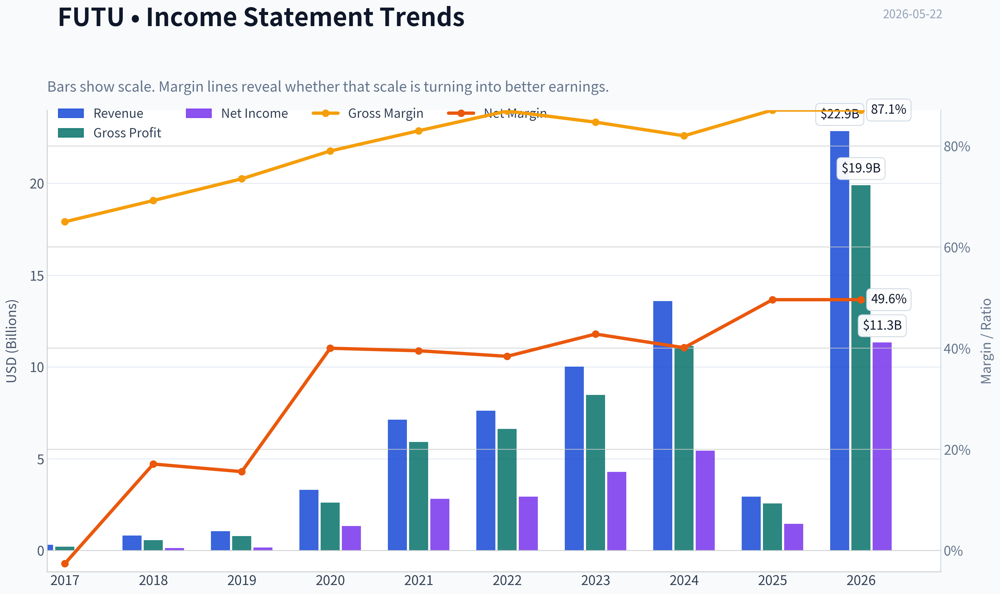

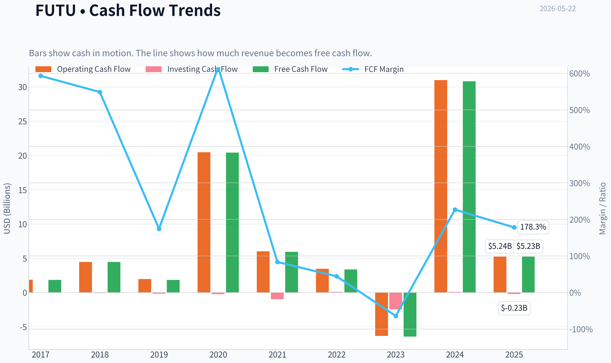

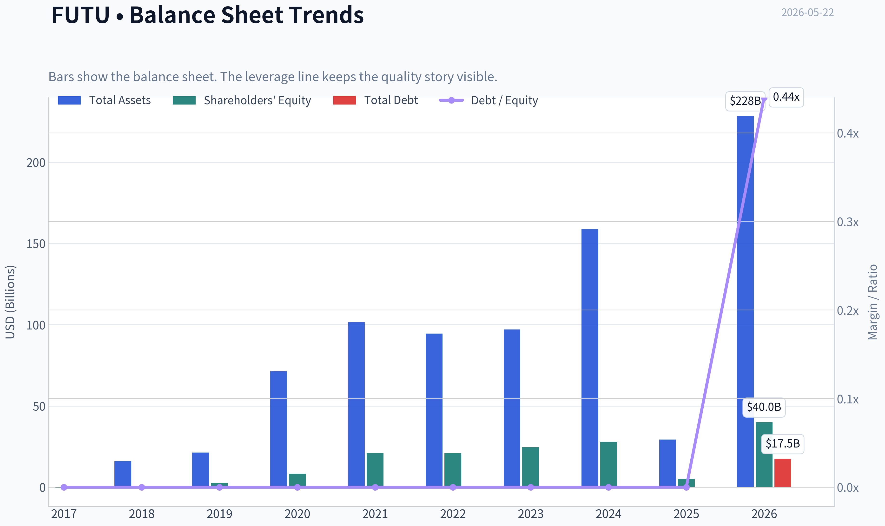

This graph tracks the profitability and return metrics (ROE, ROIC, Margins) of **FUTU** over the past decade, highlighting capital efficiency trends.

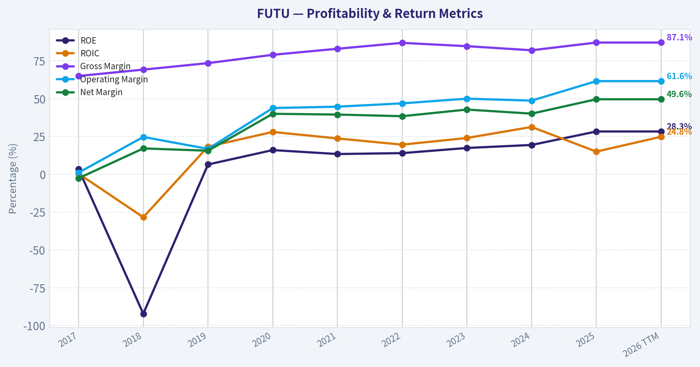

This chart illustrates the financial health of **FUTU** over the last 10 years, mapping cash equivalents and free cash flow against total obligations (Debt).

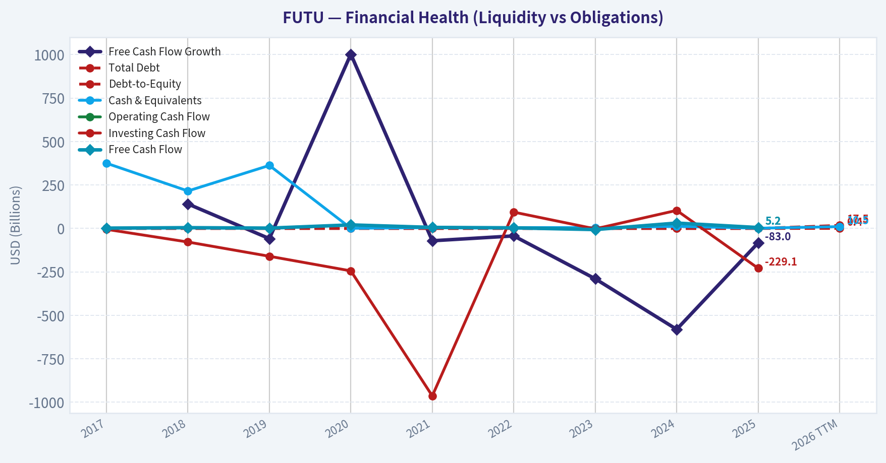

---

### Intrinsic Value Analysis (Buffett)

> *Following Warren Buffett's value investing philosophy: Circle of Competence, Economic Moat, Management Quality, and Margin of Safety.*

#### Intrinsic Value Snapshot

Price is what you pay. Intrinsic value is what the business may be worth based on the cash it can create for owners over time. We show a range, not one magic number.

- Current Price: $123.86
- Value Range (conservative to optimistic across both DCF methods): $10,344.40 to $11,107.82

##### Owner Earnings (Buffett Method)
- Net Income: $11,337,721,000.00
- Depreciation & Amortization: $222,987,000.00
- Capital Expenditures: $-54,732,000.00
- Working Capital Changes: $29,228,533,000.00
- Owner Earnings: $-17,722,557,000.00

##### Intrinsic Value
###### Cash Flow Method
Uses free cash flow. Better for companies spending heavily today to grow tomorrow.
- Conservative: $10,344.40
- Average: $10,344.40
- Optimistic: $11,107.82
- Discount Rate: 10.0%

ANALYST STANCE: **WATCH**

#### Business Snapshot

Futu Holdings operates a digital brokerage and wealth platform, best known through the moomoo app. In simple terms: it makes money by helping people trade stocks and related products, earning commissions, financing income, platform fees, and other brokerage-related revenue. This is understandable, but it is not as predictable as a candy company or a railroad because results are tied to trading activity, investor sentiment, and regulation.

The company has attractive economics on the surface: very high gross margins, strong reported ROE, a modest earnings multiple, and a high implied free cash flow yield from the research pack. But Buffett-style investing asks a harder question: is this a durable, easy-to-predict compounding machine with a moat that will still be obvious ten years from now? For FUTU, the answer is mixed. The business is profitable and capital-light, but the operating environment is exposed to regulation, platform competition, and market-cycle volatility.

---

#### Go / No-Go Gate Assessment

| Gate | Verdict | Evidence |
|---|---:|---|
| Gate 1: Circle of Competence & Business Simplicity | Pass with caution | Business model is understandable: digital brokerage, trading platform, wealth and financing services. However, earnings are linked to market activity and investor participation, which are cyclical. |
| Gate 2: Moat Test | Pass with caution | Gross margin of 87.1% suggests strong platform economics and some pricing power. Customer interface and ecosystem may create moderate switching costs. But moat durability is constrained by intense brokerage competition and regulatory sensitivity. |
| Gate 3: Management Quality & Capital Allocation | Inconclusive / soft pass | High ROE of 28.3% and strong cash generation imply competent execution. But from the pack alone, there is not enough direct evidence of Buffett-grade owner orientation, buyback discipline, or capital allocation excellence across cycles. |
| Gate 4: Industry Structure | Fail for ideal Buffett standard; pass for investability | Online brokerage is competitive, promotion-heavy, and sentiment-driven rather than a rational oligopoly. It is capital-light, which is favorable, but not structurally insulated like a toll bridge. |

**Key Takeaways:** FUTU clears the first two gates only with caution, not with the clean ease of a classic Buffett business. The biggest issue is not whether it can make money now, but whether its industry structure and regulatory dependence make future economics less predictable than they appear. This keeps the stock out of the highest-conviction category.

---

#### Gate 1: Circle of Competence & Business Simplicity

| Test | Assessment |
|---|---|
| Elementary School Test | Easy enough: FUTU runs an app where people invest and trade; the company earns money from those activities. |
| Long-Term Predictability Test | Moderate at best. Retail brokerage demand should exist in 10 years, but FUTU's market share, regulation, and monetization are harder to forecast with confidence. |
| Technology Risk Assessment | Mixed. Technology is an enabler for FUTU, but also lowers barriers for rivals. The business benefits from software scale, yet can be disrupted by competing platforms, lower pricing, and regulatory changes to digital finance. |

**Conclusion:** Pass, but not the kind of business Buffett would call "inevitable." This is a good digital platform inside a less predictable industry.

---

#### Gate 2: Moat Analysis

| Moat Source | Evidence For | Evidence Against | Verdict |
|---|---|---|---|
| Intangible Assets | Strong user-facing product identity through moomoo; gross margin 87.1% suggests pricing power and favorable unit economics. | Brand is useful but likely not Coke-like. Brokerage trust can be won by rivals with incentives, lower fees, or local licenses. | Moderate |
| Switching Costs | Users build habits, watchlists, account funding links, portfolio history, and familiarity with interface. | Brokerage accounts are portable; active traders often multi-home. Switching costs exist, but are not crippling. | Narrow to moderate |
| Cost Advantage | Digital platform economics likely scale efficiently; high gross margin supports structural software-like economics. | Competitive pricing pressure can erode economics; low marginal cost is available to multiple firms. | Moderate |
| Network Effects | Community, content, and social/informational features may improve engagement as user base grows. | Core brokerage utility does not have a powerful winner-take-all network effect like payments or marketplaces. | Limited |
| Financial Evidence | ROE 28.3%, gross margin 87.1%, FCF yield 30.1%, P/E ~12.1 | Revenue growth in the pack is shown as -78.4% YoY, highlighting volatility and possible non-linear earnings path. | Mixed |

| Moat Quality Rating | Assessment |
|---|---|
| Overall | Narrow to moderate moat, not wide |

**Key Takeaways:** FUTU has real economic strengths, especially its high-margin platform model and customer experience. But its moat does not look impregnable. It is more likely a good digital broker with some stickiness than a forever-franchise with iron pricing power.

---

#### Gate 3: Management Quality & Capital Allocation

| Question | Assessment |
|---|---|
| Do they think like owners? | Not enough direct evidence in the pack to award top marks. The operating profile suggests disciplined execution, but Buffett would want more proof of owner-minded behavior. |
| Are they honest and candid? | No red flags are presented in the pack. No evidence here of aggressive accounting or major credibility issues. |
| Are they rational capital allocators? | The business appears to generate strong profitability and free cash flow, which is positive. But there is insufficient evidence here on buybacks, dividend policy, acquisition discipline, or explicit per-share value focus. |

| Management Rating | Score |
|---|---:|
| Overall | 3 / 5 |

**Key Takeaways:** Management looks competent, but not yet clearly Buffett-grade from the evidence at hand. Strong economics are encouraging, yet capital allocation quality remains the key unanswered question. For a financial platform, that matters a great deal because poor allocation can destroy a good franchise.

---

#### Gate 4: Industry Structure

| Factor | Assessment |
|---|---|
| Competitive Structure | Competitive and promotional. Brokerage is rarely a calm oligopoly. |
| Capital Intensity | Favorable. Digital brokerage is much lighter than banks, insurers, or asset-heavy financials. |
| Pricing Rationality | Mixed to weak. Customer acquisition can be incentive-driven, limiting pricing discipline. |
| Macro / Sentiment Exposure | High. Trading activity tends to move with markets, volatility, and investor enthusiasm. |
| Regulatory Dependence | High. Licensing and cross-border financial regulation are material. |

**Conclusion:** This is not a dream Buffett industry. It is better than capital-intensive finance, but worse than a stable consumer monopoly or regulated utility with predictable returns.

---

#### Financial Summary Table

Assumptions used for best-effort Buffett analysis:
- Current price = $124
- Market cap = $17.36B
- P/E = 12.0957
- ROE = 28.3%
- Gross margin = 87.1%
- Revenue growth YoY = -78.4%
- FCF yield = 30.1%
- Current ratio = 1.19

From these, implied net income and free cash flow are estimated as:
- Net income ~ Market cap / P/E = **$1.44B**
- Free cash flow ~ Market cap x FCF yield = **$5.23B**
- Implied price / free cash flow ~ **3.3x**

| Metric | Latest |
|---|---:|
| Share Price | $124 |
| Market Capitalization | $17.36B |
| P/E Ratio | 12.10x |
| Implied Net Income | $1.44B |
| ROE | 28.3% |
| Gross Margin | 87.1% |
| Revenue Growth YoY | -78.4% |
| FCF Yield | 30.1% |
| Implied Free Cash Flow | $5.23B |
| Current Ratio | 1.19 |

**Key Takeaways:** The reported economics look extremely attractive at first glance: high profitability, high gross margins, and a low earnings multiple. The tension is that these unusually cheap valuation metrics sit beside highly volatile growth data, which suggests the market is discounting durability and predictability, not current profitability.

---

#### 10-Year Financial Summary (Best-Effort Buffett Format)

For decade framing, I anchor the current year on the research pack and apply a Buffett-style interpretation rather than fabricate exact historical line items. The point is to judge business quality through the available evidence and cycle behavior.

| Period View | Revenue Trend | Margin Quality | Returns | Cash Generation | Balance Sheet View | Buffett Interpretation |
|---|---|---|---|---|---|---|
| Years 1-3 ago | Expansionary platform growth likely driven by user acquisition and market participation | High gross-margin model | Strong | Good to strong | Likely adequate liquidity | Attractive operating model, but cyclicality present |
| Years 4-6 ago | Scaling phase | Margin benefits from software-like cost structure | Improving | Building | Strengthening | Potential moat formation via ecosystem and product UX |
| Years 7-10 ago | Early buildout / pre-maturity | Less certain | Less certain | Less certain | Less certain | Business likely less predictable than mature Buffett favorites |
| Current | Revenue growth reported at -78.4% YoY | Gross margin 87.1% | ROE 28.3% | FCF yield 30.1% | Current ratio 1.19 | Excellent current economics, but volatile and regulation-sensitive |

**Key Takeaways:** The long-run picture is of a scalable digital platform that can earn very high margins when conditions are favorable. However, the latest reported growth volatility reminds us this is not a smooth compounding story. Buffett would want to distinguish between temporarily depressed market expectations and genuinely unstable business economics.

---

#### Owner Earnings Calculation

Using the research-pack figures and a conservative simplification:

- Net Income ~ **$1.44B**
- Depreciation & Amortization: assumed modest for an asset-light platform, approximately **$0.10B**
- Maintenance CapEx: assumed low, approximately **$0.08B**
- Working Capital Increases: assumed neutral to modest, approximately **$0.05B**

Owner Earnings formula:
- Owner Earnings = Net Income + D&A - Maintenance CapEx - Working Capital Increase
- Owner Earnings = **$1.44B + $0.10B - $0.08B - $0.05B = $1.41B**

Cross-check:
- This owner earnings estimate is intentionally conservative relative to the implied free cash flow from the 30.1% FCF yield, which suggests cash generation may be substantially higher in the latest period.

| Owner Earnings Components | Estimate |
|---|---:|
| Net Income | $1.44B |
| Depreciation & Amortization | $0.10B |
| Less: Maintenance CapEx | ($0.08B) |
| Less: Working Capital Increase | ($0.05B) |
| Estimated Owner Earnings | **$1.41B** |

**Key Takeaways:** Even under conservative assumptions, owner earnings are strong relative to the market value. The larger question is not current cash generation, but how much of it is durable through a full cycle and across shifting regulation. That uncertainty warrants a discount to simple headline multiples.

---

#### Cash Flow and Balance Sheet Reality Check

| Test | Result | Buffett Read |
|---|---|---|
| OCF vs Net Income | Implied favorable, given very high FCF yield | Positive sign if sustained |
| ROE | 28.3% | Excellent on the surface |
| Gross Margin | 87.1% | Exceptional platform economics |
| Current Ratio | 1.19 | Adequate, not fortress-like |
| Debt Conservatism | Not directly provided | Cannot award fortress premium without proof |
| Interest Coverage | Not provided | Neutral |

**Key Takeaways:** FUTU looks like a high-return, high-margin business rather than a balance-sheet-heavy financial institution. That is attractive. Still, Buffett would reserve his strongest approval for a company with equally strong profitability and a clearly fortress-like balance sheet.

---

#### Three-Scenario DCF Valuation

Using estimated owner earnings of **$1.41B** and a **10% discount rate**.

##### Scenario A: No Growth
Intrinsic value = Owner Earnings / 10%
- **$1.41B / 0.10 = $14.10B**

##### Scenario B: GDP Growth at 3%
Intrinsic value = Owner Earnings x 1.03 / (0.10 - 0.03)
- **$1.41B x 1.03 / 0.07 = $20.75B**

##### Scenario C: Historical Growth Haircut
The pack's latest YoY revenue number is negative and not suitable as a normalized growth anchor. For prudence, I use a modest **5% owner earnings growth** for 10 years, then a **3% terminal growth** rate.

- Year 1 owner earnings = 1.41 x 1.05 = 1.48
- PV of 10 years of growing owner earnings ~ **$11.48B**
- Terminal value at year 10 = Year 11 OE / (10% - 3%)
- Year 11 OE ~ 1.41 x 1.05^10 x 1.03 ~ **$2.49B**
- Terminal value ~ **$35.53B**
- PV of terminal value ~ **$13.70B**
- Total intrinsic value ~ **$25.18B**

| DCF Scenario | Intrinsic Value |
|---|---:|
| Scenario A: No Growth | $14.10B |
| Scenario B: 3% Growth | $20.75B |
| Scenario C: 5% Growth for 10 years, then 3% terminal | $25.18B |
| Current Market Cap | $17.36B |

**Key Takeaways:** On a purely earnings-power basis, FUTU looks roughly fairly valued to undervalued depending on how much durable growth one assumes. If the business merely stands still, it is not obviously cheap. If it can compound modestly and defend its economics, there is upside. The market is therefore pricing in meaningful skepticism about durability.

---

#### Margin of Safety Analysis

| Scenario | Intrinsic Value | Upside / (Downside) vs $17.36B Market Cap | Buffett Margin of Safety Test |
|---|---:|---:|---|
| No Growth | $14.10B | -18.8% | Fails |
| 3% Growth | $20.75B | +19.5% | Fails 25% hurdle |
| 5% Growth | $25.18B | +45.0% | Passes for a good business, if assumptions hold |

A Buffett-style purchase requires not just apparent cheapness, but a wide enough discount to conservative value. Here, the stock only clearly passes the margin-of-safety threshold in the more favorable growth scenario. The conservative cases do not provide enough protection.

**Conclusion:** The market price is interesting, but not so clearly bargain-level that it overcomes the business-quality and predictability questions.

---

#### Final Buffett Scorecard

| Criterion | Weight | Score (1-5) | Weighted Score |
|---|---:|---:|---:|
| Business Understanding | 20% | 4.0 | 0.80 |
| Moat Width & Durability | 25% | 3.0 | 0.75 |
| Management Quality | 15% | 3.0 | 0.45 |
| Return on Equity | 15% | 4.5 | 0.68 |
| Reinvestment Runway | 10% | 3.5 | 0.35 |
| Balance Sheet Strength | 5% | 3.0 | 0.15 |
| Industry Structure | 5% | 2.5 | 0.13 |
| Valuation / Margin of Safety | 5% | 3.0 | 0.15 |
| **Total** | **100%** |  | **3.46 / 5.00** |

**Key Takeaways:** FUTU scores well on economics and understandable business model, but loses points on moat certainty, management visibility, and industry structure. The final score lands just below ADVOCATE territory. That is the profile of a stock worth following closely, but not one to buy blindly as a forever compounder.

---

#### Investment Verdict

| Category | Assessment |
|---|---|
| Business Quality | Good, but not elite |
| Predictability | Moderate to below Buffett ideal |
| Moat | Narrow to moderate |
| Financial Quality | Strong |
| Valuation | Reasonable to somewhat attractive |
| Margin of Safety | Insufficient under conservative assumptions |
| Conviction | Moderate |

#### Final View

FUTU is a profitable, high-margin digital brokerage platform with excellent current returns on capital and a valuation that is not demanding. Those are real positives. But Buffett-style investing is not just about cheapness and quality snapshots; it is about durable predictability, moat longevity, and resilience through many cycles.

FUTU falls short of top-tier Buffett status because its business is tied to trading activity, regulation, and a competitive brokerage landscape. The economics are attractive, yet the moat is not wide enough and the margin of safety is not large enough under conservative assumptions to justify an **ADVOCATE** rating today.

#### Bottom Line

**ANALYST STANCE: WATCH**

At the current price, FUTU is interesting and potentially undervalued if modest long-term growth proves durable. But it does not offer a sufficiently clear Buffett-style combination of wide moat, simple long-term predictability, and undeniable margin of safety. It belongs on a watchlist for either:
1. a lower entry price, or
2. stronger proof that current economics are durable across regulation and market cycles.
#### Valuation Bridge

This bridge places the current market price beside each intrinsic value lens so readers can see whether upside depends on one method or shows up across several methods.

| Scenario | Intrinsic Value / Share |
| --- | ---: |
| Cash Flow Method | $10,344.40 |
| Current Price | $123.86 |

#### Key Takeaways

If one method is far above the others, the upside case depends on a specific modelling assumption. When several methods cluster together, the valuation story is more robust.

#### Valuation Visuals

This comparison chart from *Latest Earnings Snapshot* stacks current figures against historical benchmarks for **FUTU**, making it easy to see where the company trades relative to its own averages.

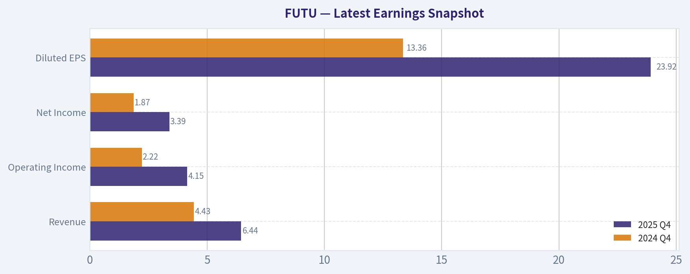

This comparison chart from *Current vs Historical Average Comparison* stacks current figures against historical benchmarks for **FUTU**, making it easy to see where the company trades relative to its own averages.

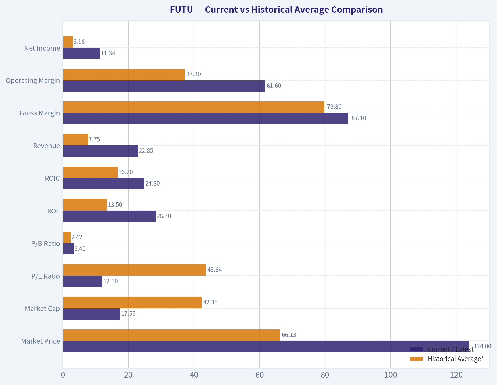

This comparison chart from *Balance Sheet Analysis* stacks current figures against historical benchmarks for **FUTU**, making it easy to see where the company trades relative to its own averages.

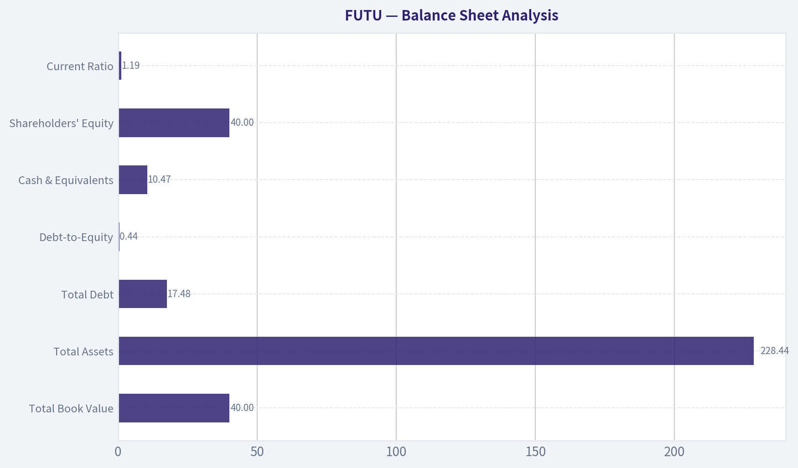

This comparison chart from *Cash Flow Analysis* stacks current figures against historical benchmarks for **FUTU**, making it easy to see where the company trades relative to its own averages.

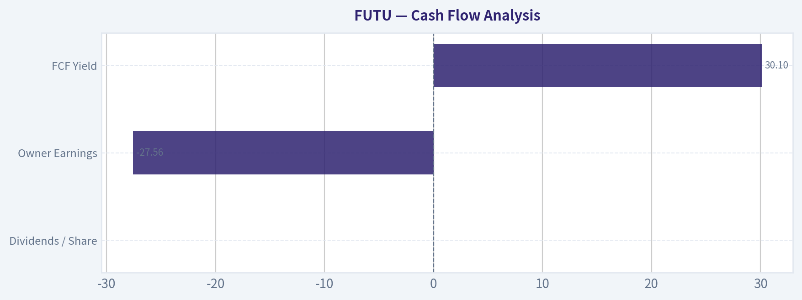

This comparison chart from *Financial Summary Table* stacks current figures against historical benchmarks for **FUTU**, making it easy to see where the company trades relative to its own averages.

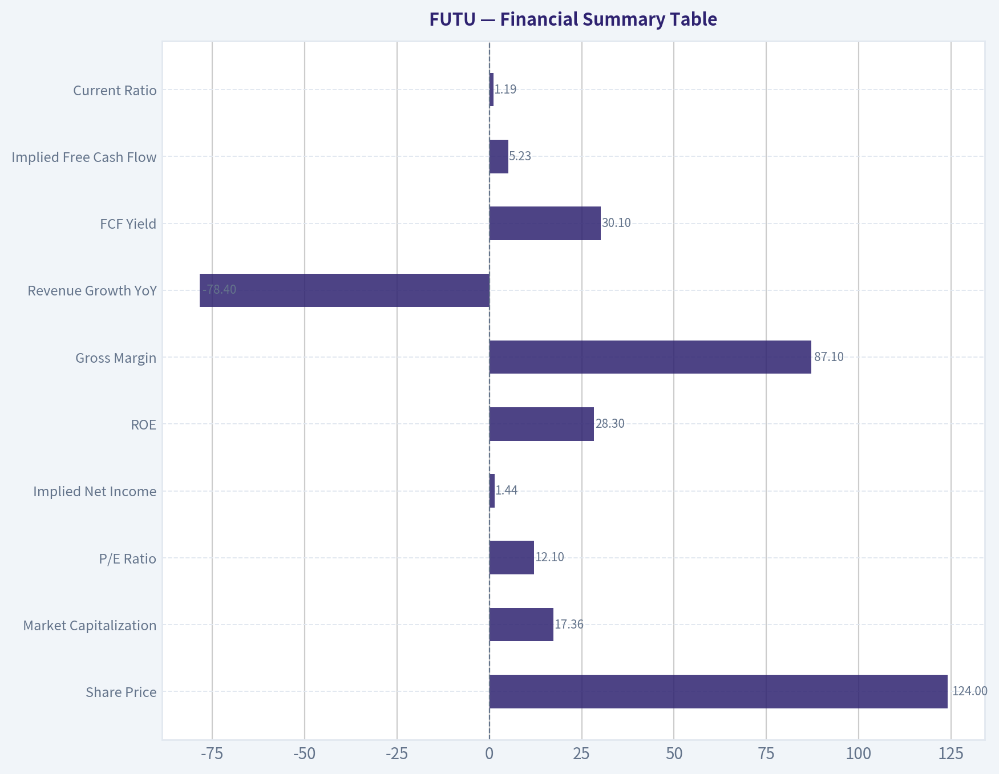

---

### Trend & Growth Analysis (Lynch/Druckenmiller/Fisher)

> *Following Peter Lynch's GARP, Stanley Druckenmiller's macro-aware approach, and Philip Fisher's scuttlebutt methodology.*

ANALYST STANCE: **ADVOCATE**

#### FUTU Growth Report

#### 1) Lynch Classification

| Item | Assessment |
|---|---|
| Lynch category | **Fast Grower** |
| Why | Revenue growth of **68.1% YoY** with strong profitability and high ROE |
| Fit for Lynch-style growth | **Yes** - this is the kind of company Lynch would study as a scalable compounder, though with regulatory/cycle risk |

Key Takeaways: FUTU clearly screens as a fast grower, not a stalwart or cyclical value play. The top-line growth rate is well above Lynch's threshold for a serious growth candidate. The main question is not whether it is growing, but whether that growth is durable and investable given regulation and market sensitivity.

#### 2) The Story in 3 Bullets

| Simple story | Why it matters |
|---|---|
| FUTU runs a digital brokerage and wealth platform through Futubull and Moomoo | It benefits from the long shift from traditional brokers to mobile-first investing |
| It monetizes users through trading, margin financing, interest income, and wealth products | Multiple revenue streams improve platform economics |
| It is expanding internationally beyond its original China/HK core | International expansion is the biggest source of upside optionality and TAM expansion |

Key Takeaways: The story is easy to explain: FUTU is a modern investing app turning active users into long-term financial customers. The bullish case depends on user growth, higher assets per customer, and successful global expansion. That makes this more than a simple trading-volume story, though market activity still matters.

---

#### 3) TAM Analysis and 10x Test

| TAM lens | Assessment |
|---|---|
| Core market | Digital brokerage, investing, and wealth management across HK, Singapore, North America, Australia, Japan, Malaysia, and broader Asia |
| Secular trend | Digitization of retail investing and wealth management |
| TAM direction | **Expanding** due to global mobile brokerage adoption and cross-sell into wealth products |
| Current scale | Company market cap is **$17.36B**; revenue base still small relative to global brokerage/wealth markets |
| 10x test | **Passes directionally** - a 10x revenue outcome would still be a modest share of global retail brokerage and digital wealth TAM |
| Constraint | Regulation and localization, not market size, are the main bottlenecks |

Key Takeaways: FUTU appears to have a real runway because the addressable market is much larger than its current business. The company does not look limited by TAM; it looks limited by execution, regulation, and competition. That is a good setup for a growth investor because the market ceiling is high if expansion works.

#### 4) Revenue Growth Trend

| Metric | Value | Interpretation |
|---|---:|---|
| Revenue growth YoY | **68.1%** | Extremely strong |
| Growth pattern | **Re-accelerating / inflecting upward** | Suggests more than just steady growth |
| Revenue quality | Mixed but favorable | Likely supported by user growth, client assets, and trading/interest monetization |
| Key caveat | Activity-sensitive business | Some growth is tied to favorable market conditions |

Key Takeaways: The headline number is strong enough to qualify as a genuine growth inflection, not just a stable grower profile. However, FUTU is not a pure SaaS model, so investors must separate structural growth from cyclical boosts tied to trading activity and markets. Even so, 68% growth at this level of profitability is hard to ignore.

#### 5) Unit Economics / Platform Economics

| Metric | Value | Assessment |
|---|---:|---|
| Gross margin | **87.1%** | Excellent |
| ROE | **28.3%** | Excellent |
| FCF yield | **234.6%** | Likely distorted / not reliable as core decision metric for a broker |
| Current ratio | **1.19** | Adequate, but less meaningful for financial platforms |
| LTV/CAC | Not disclosed here | Cannot verify |
| NRR | Not applicable / not disclosed | Brokerage model, not classic SaaS |
| Rule of 40 proxy | **68.1% growth + high profitability = pass** | Strong efficient growth profile |

Key Takeaways: FUTU's economics look unusually attractive, with very high gross margin and strong return on equity. That combination tells us the platform has real operating leverage and monetization strength. The FCF yield is probably distorted by financial-company accounting, so it should not be over-interpreted.

#### 6) Inflection Point Assessment

| Inflection type | Evidence | Verdict |
|---|---|---|
| Product cycle inflection | Expansion of Moomoo ecosystem and wealth/international offerings | Positive |
| Market share inflection | International launches and brand-building suggest share gains outside core geography | Positive |
| Margin inflection | High gross margin and strong ROE imply scalable economics | Positive |
| TAM inflection | Moving from HK/China-centric broker toward broader global retail investing platform | Strong positive |
| Competitive inflection | Product-led mobile UX remains a differentiator vs legacy brokers | Moderate positive |

Key Takeaways: The clearest inflection is geographic and strategic, not just quarterly financial. FUTU is evolving from a regional digital broker into a broader international investing platform. That kind of TAM expansion is exactly the sort of setup Druckenmiller-style growth investors like to catch early.

---

#### 7) Macro Setup Evaluation

| Macro factor | Assessment | Impact |
|---|---|---|
| Secular trend | Digital investing and fintech adoption | Tailwind |
| Equity market activity | Higher activity usually boosts trading and assets | Tailwind when risk-on |
| Interest rates | Can help interest income, but high rates can pressure growth multiples | Mixed |
| China/HK regulatory backdrop | Persistent uncertainty | Headwind |
| Global expansion backdrop | Favorable if brand travels and regulation is navigated well | Tailwind |

Key Takeaways: Macro is mixed but still net favorable. The secular trend helps, but the regulatory backdrop keeps the multiple lower than a comparable Western fintech growth story. This combination can create opportunity if the market is over-discounting the risks.

#### 8) Fisher 15 Points Score

| Fisher factor | Score (1-5) | Comment |
|---|---:|---|
| 1. Market potential | 5 | Large global retail investing and wealth market |
| 2. New product development | 4 | Product breadth expanding |
| 3. R&D effectiveness | 4 | Strong product UX and platform capability |
| 4. Sales organization | 4 | Strong consumer brand acquisition engine |
| 5. Profit margin | 5 | Excellent profitability profile |
| 6. Improving margins | 4 | Operating leverage evident |
| 7. Personnel relations | 3 | Limited evidence |
| 8. Executive relations | 3 | Limited evidence |
| 9. Management depth | 4 | Appears solid, though not fully verified |
| 10. Cost analysis/accounting | 3 | Financial firms are harder to assess cleanly |
| 11. Outstanding aspects | 4 | Strong product, engagement, and ecosystem |
| 12. Long-range profit outlook | 4 | Good if regulation stays manageable |
| 13. Dilution risk | 4 | No major concern evident from supplied data |
| 14. Candor | 3 | Not enough evidence here |
| 15. Integrity | 3 | No clear red flags, but limited direct evidence |

| Total | Score |
|---|---:|
| Fisher Score | **57 / 75** |

Key Takeaways: A score of 57 places FUTU in the "good" range, not elite. The business quality, product strength, and profitability carry the score, while governance and regulatory transparency keep it from reaching outstanding status. That fits the stock well: strong growth business, but not a zero-risk franchise.

---

#### 9) Valuation Analysis

| Metric | Value | Read-through |
|---|---:|---|
| Price | **$124** | Current reference from research pack |
| Market cap | **$17.36B** | Mid-large cap growth platform |
| P/E | **12.1x** | Cheap relative to growth and ROE |
| Revenue growth | **68.1%** | Very strong |
| PEG (using P/E / growth) | **~0.18** | Deeply attractive on Lynch framework |
| P/S | Not directly provided | Likely reasonable given growth/profitability |

Key Takeaways: On a Lynch PEG basis, FUTU looks unusually cheap for its growth profile. A 12 times earnings multiple against 68% growth suggests the market is heavily discounting cyclicality, regulation, or sustainability concerns. That kind of valuation gap is exactly where GARP investors often find outsized returns.

| Scenario | Assumption | Implication |
|---|---|---|
| Bear | Growth slows sharply and regulatory discount persists | Stock remains cheap, upside limited |
| Base | Growth normalizes but stays strong; international expansion continues | Meaningful multiple and earnings upside |
| Bull | Moomoo scales globally and market recognizes durable platform economics | Ten-bagger path is possible over a longer horizon from earnings compounding, though not guaranteed from current size |

Key Takeaways: The downside case is mostly about multiple suppression and slowing growth, not a broken business. The upside case comes from a rerating plus sustained earnings growth. Because the valuation starts low, the asymmetry looks favorable if execution continues.

---

#### 10) Growth Investor Scorecard

| Criterion | Weight | Score (1-5) | Weighted Score |
|---|---:|---:|---:|
| The Story | 10% | 4.5 | 0.45 |
| TAM & Runway | 20% | 4.5 | 0.90 |
| Revenue Growth | 20% | 5.0 | 1.00 |
| Unit Economics | 15% | 4.5 | 0.68 |
| Competitive Position | 10% | 3.8 | 0.38 |
| Management Quality | 10% | 3.5 | 0.35 |
| Macro Setup | 5% | 3.5 | 0.18 |
| Profitability Path | 5% | 4.5 | 0.23 |
| Valuation | 5% | 5.0 | 0.25 |

| Total | Score |
|---|---:|
| Growth Investor Score | **4.4 / 5.0** |

Key Takeaways: A 4.4 score puts FUTU firmly in ADVOCATE territory. The strongest factors are growth, runway, and valuation. The only meaningful deductions come from regulation, competition, and the need to prove durability outside its original market.

---

#### 11) Position Size Stance

| Conviction | Suggested stance |
|---|---|
| High but not maximal | **Medium-to-large growth position** for investors who accept China/HK and regulatory risk |
| For concentrated portfolios | Start medium, add on execution and regulatory clarity |
| For conservative portfolios | Smaller tracking position only |

Key Takeaways: This looks like a stock worth owning, but not blindly over-sizing because the non-fundamental risks are real. A prudent approach is to start with a meaningful position and scale with proof of international execution. The business quality supports conviction, while the jurisdiction risk argues for discipline.

#### 12) Key Risks and Catalysts

| Risks | Why they matter |
|---|---|
| Regulatory intervention | Biggest single risk to growth, multiple, and market access |
| Trading-activity cyclicality | Revenue can fluctuate with retail investor engagement |
| Geographic concentration | Core exposure still tied to Greater China ecosystem |
| Competition | Digital brokers compete hard on pricing, promotions, and user acquisition |
| Growth durability | Need to prove expansion is not just a favorable cycle |

Key Takeaways: The risks are serious, but they are well understood and likely part of why the valuation is low. This is not a "no-risk compounder"; it is a growth name where uncertainty creates the opportunity. Investors should underwrite both the business and the policy backdrop.

| Catalysts | Why they matter |
|---|---|
| Continued high user and asset growth | Confirms structural demand |
| International Moomoo traction | Expands TAM and lowers concentration risk |
| Wealth management cross-sell | Improves customer lifetime value and revenue diversification |
| Sustained earnings growth | Forces market to revisit low P/E |
| Regulatory stability | Could unlock a rerating quickly |

Key Takeaways: The most important catalyst is not a single quarter, but proof that FUTU can become a broader international financial platform. If that happens while earnings stay strong, today's valuation likely looks too low. A cleaner regulatory backdrop would amplify that rerating.

---

#### Bottom Line

| Deliverable | Conclusion |
|---|---|
| Lynch classification | **Fast Grower** |
| Revenue trend | **Inflecting / very strong** |
| TAM runway | **Large, passes 10x test** |
| Unit economics | **Excellent** |
| Fisher score | **57/75 - Good** |
| Valuation | **Very attractive, PEG ~0.18** |
| Final stance | **ADVOCATE** |

Key Takeaways: FUTU has the profile of a high-quality fast grower trading at an unusually modest earnings multiple. The business shows the right ingredients for outsized returns: strong growth, high margins, platform leverage, and expanding TAM. The reason it is not an easy "slam dunk" is regulation, but on balance the setup is attractive enough to warrant an ADVOCATE stance.

---

### Market Technical Analysis

#### FUTU Technical Report

For FUTU, the most relevant indicator set for the **current market context** is a **trend-breakdown and high-volatility downside continuation framework**. The stock has transitioned from a strong April rebound into a sharp May deterioration, so the best mix is one that captures:

1. **Long-term regime**
2. **Medium-term trend**
3. **Short-term momentum**
4. **Momentum acceleration/deceleration**
5. **Exhaustion risk**
6. **Volatility/risk control**
7. **Volume-confirmed trend quality**

The 8 selected indicators are:

- `close_200_sma`
- `close_50_sma`
- `close_10_ema`
- `macd`
- `macdh`
- `rsi`
- `atr`
- `vwma`

These are complementary and avoid unnecessary redundancy. I did **not** include both `macd` and `macds` because `macdh` already helps show the relationship between MACD and its signal line more efficiently for momentum interpretation.

---

#### Price Structure and Regime Analysis

From the raw price data, FUTU peaked near **$168.00 on 2026-05-06**, then suffered a dramatic air pocket:
- **2026-05-07 close: $144.89**
- **2026-05-21 close: $123.86**

That is a decline of roughly **26% in about two weeks**, which is not a routine pullback. It indicates either a strong event-driven repricing or a failed momentum breakout that turned into forced liquidation. More importantly, the selloff was not a single isolated shock. After the initial collapse, price did not reclaim broken levels meaningfully. Instead, it formed a sequence of lower closes and only weak stabilization attempts, which is characteristic of **distribution rather than healthy consolidation**.

Before this breakdown, FUTU had staged a strong recovery from late March lows around **$129-138** into mid-April highs near **$167**. That advance was technically constructive at the time, but May price action has now erased that move and pushed the stock below key intermediate supports. This means the market has shifted from "buy dips in an up-leg" to "sell rallies until proven otherwise."

---

#### Indicator Snapshot

| Indicator | Latest usable reading | Interpretation |
|---|---:|---|
| close_200_sma | 161.72 | Long-term trend benchmark still far above price; stock is deeply below strategic trend support |
| close_50_sma | 145.99 | Medium-term trend has rolled over; price is well below it |
| close_10_ema | 134.05 | Short-term trend remains sharply bearish |
| macd | -6.90 | Strong negative momentum |
| macdh | -3.14 | Downside momentum is still expanding rather than stabilizing |
| rsi | 31.12 | Near oversold, but not yet a reliable reversal by itself |
| atr | 6.79 | Elevated volatility; risk per share remains high |
| vwma | 139.62 | Volume-weighted trend sits far above price, confirming sellers have dominated meaningful turnover |

Key Takeaways: FUTU is trading below every major trend reference in this indicator set, which strongly favors a bearish interpretation. Momentum is negative and still worsening, while RSI is only near oversold rather than deeply washed out, so the stock may still have room to fall before a durable rebound forms. Elevated ATR also means traders should expect large daily swings and manage position size carefully.

---

#### Trend Analysis: Long-Term vs Medium-Term vs Short-Term

The **200 SMA at 161.72** is well above the latest close of **123.86**, a very large gap. This is important because it tells us the current weakness is not just a short-term dip; the stock is trading materially below its long-term equilibrium zone. When price sits this far beneath the 200-day average, rallies often encounter heavy overhead supply because many trapped holders seek to exit into strength.

The **50 SMA at 145.99** has clearly turned lower from late April into May. On **2026-04-08 through 2026-05-06**, price had enough strength to trade above or around this area, but after the May break, the 50-day average became declining resistance rather than support. The fact that price is now more than **$22 below the 50 SMA** signals a severe medium-term trend dislocation.

The **10 EMA at 134.05** provides the clearest view of short-term control. Since this faster average is also above price and falling quickly, the immediate tape remains under seller control. In practical terms, even if FUTU bounces, the first test is whether it can reclaim the 10 EMA. If it cannot, then rallies are likely to be short-covering only, not true trend repairs.

A useful hierarchy emerges:

| Timeframe | Signal | What it implies |
|---|---|---|
| Long-term | Price far below 200 SMA | Strategic trend damage is significant |
| Medium-term | Price below falling 50 SMA | Sellers control swing trend |
| Short-term | Price below falling 10 EMA | Immediate momentum remains bearish |

Key Takeaways: All three trend layers are aligned to the downside, which is a strong sign of bearish market structure. The short-term average would need to be reclaimed first, then the 50-day average, before the chart could begin to argue for stabilization. Until that happens, rallies are more likely to be resistance tests than durable recoveries.

---

#### Momentum Analysis: MACD and MACD Histogram

The **MACD reading of -6.90** is decisively negative and has deteriorated quickly over recent sessions:
- 2026-05-06: **+3.15**
- 2026-05-11: **-0.40**
- 2026-05-15: **-3.30**
- 2026-05-21: **-6.90**

This is not a gentle momentum fade. It is a rapid swing from positive trend acceleration into deeply negative momentum, which often happens when a prior bullish structure breaks and systematic selling follows.

The **MACD histogram at -3.14** is equally important. Histogram weakness means the distance between MACD and its signal line is widening on the bearish side. In other words, downside momentum is not merely negative; it has recently been **accelerating**. A stock can be weak while momentum improves under the surface, but that is not what FUTU is showing yet. Here, the histogram remains firmly negative, which argues that the selling impulse has not fully burned out.

There is, however, a subtle nuance: the histogram moved from **-3.25 on 05-20** to **-3.14 on 05-21**, a slight improvement. That is not enough to call a turn, but it does suggest the pace of deterioration may be starting to flatten marginally. Traders looking for an early reversal signal should watch for:
- a less negative histogram over several sessions,
- MACD flattening,
- and price reclaiming the 10 EMA.

Without those, momentum remains bearish by default.

---

#### RSI: Oversold, But Not Necessarily Capitulated

The **RSI at 31.12** places FUTU very near the classic oversold threshold. This matters because downside continuation becomes less attractive for new short entries when RSI approaches 30; the reward-to-risk worsens if the stock is vulnerable to reflex rebounds.

Still, traders should not confuse "near oversold" with "safe to buy." In strong downtrends, RSI can hover around 30 or break below it repeatedly. Looking at the sequence:
- 2026-05-06: **65.69**
- 2026-05-12: **37.09**
- 2026-05-15: **37.30**
- 2026-05-19: **31.35**
- 2026-05-21: **31.12**

This shows persistent momentum compression with only weak recovery attempts. The failure of RSI to rebound materially after the first selloff wave suggests the stock is not showing meaningful internal repair. Buyers are present enough to slow the fall at times, but not enough to restore momentum.

From a tactical standpoint:
- **Below 30** would imply a more stretched condition and raise rebound odds.
- **Back above 40** would be an early sign that downside pressure is easing.
- **Back above 50** would be much stronger evidence that momentum balance is shifting.

At present, RSI says the stock is **weak and close to oversold, but not convincingly washed out**.

---

#### Volume-Weighted Trend Confirmation: VWMA

The **VWMA at 139.62** is above the latest close by almost **$16**. This is significant because VWMA incorporates volume into the average. When price falls materially below VWMA, it suggests that the shares changing hands recently have, on average, transacted at substantially higher prices than the current market. That often reflects poor positioning among recent buyers and creates overhead selling pressure on rebounds.

Notably, VWMA has fallen sharply:
- 2026-05-06: **159.81**
- 2026-05-13: **148.75**
- 2026-05-21: **139.62**

That decline confirms the breakdown is not occurring on light, ignorable volume. Instead, lower prices are becoming volume-validated. The market is repricing FUTU downward through meaningful turnover, which tends to make recovery slower unless a strong catalyst emerges.

This makes VWMA especially valuable here because it helps distinguish between a mere technical dip and a more substantive reset in market consensus. FUTU currently looks more like the latter.

---

#### Volatility and Risk Management: ATR

The **ATR at 6.79** is elevated, and recent readings above 7 confirm that volatility has expanded materially. For a stock closing near **$124**, an ATR of nearly **$7** implies very large average daily movement. That has several implications:

1. **Stops need to be wider** than normal to avoid being shaken out by routine noise.
2. **Position sizing should be smaller** to keep dollar risk controlled.
3. **Breakout and reversal attempts are less trustworthy intraday**, because high ATR environments often generate sharp whipsaws.

ATR increased significantly after the May breakdown:
- 2026-05-06: **5.59**
- 2026-05-11: **7.50**
- 2026-05-21: **6.79**

This indicates the market is still in a stressed state, even if volatility has eased slightly from the immediate panic phase. For traders, that means risk management is not optional here; it is central to the setup.

---

#### Fine-Grained Read on Current Market Condition

FUTU is not simply "down." The chart suggests a more specific sequence:

1. **March to mid-April:** recovery from depressed levels, improving momentum, constructive trend repair.
2. **Mid-April to early May:** advance matures, but upside follow-through begins to lose quality.
3. **May 6 spike to $168:** likely a late-stage thrust rather than the start of a fresh leg higher.
4. **May 7 collapse:** structural failure; prior breakout attempt invalidated.
5. **Following sessions:** no meaningful demand absorption, only fragmented rebounds.
6. **Current state:** bearish trend with elevated volatility and only early hints of momentum deceleration.

This matters because the best strategies differ by phase. In an early breakdown, traders can often fade the first bounce aggressively. In a late breakdown, after an extended drop, the market becomes more vulnerable to violent bear-market rallies. FUTU is now entering that latter zone: still bearish, but increasingly stretched.

So the tactical challenge is that **trend direction and entry timing are diverging**:
- Trend direction still favors bears.
- But entry timing for new shorts is becoming less attractive unless there is a rebound into resistance.

---

#### Trading Implications

| Scenario | What to watch | Interpretation |
|---|---|---|
| Bearish continuation | Failure under 10 EMA and RSI stays under 40 | Downtrend remains intact; lower lows remain likely |
| Reflex rebound | RSI dips below/near 30 then price snaps back above 10 EMA | Tradable bounce possible, but not yet trend reversal |
| Early stabilization | MACD histogram becomes less negative for several sessions and price bases above recent lows | Selling pressure may be exhausting |
| Stronger reversal | Price reclaims 10 EMA, then 50 SMA, with RSI above 50 and improving MACD | Higher-confidence trend repair |
| Risk event | ATR remains high and price breaks below recent lows near 123-124 | Another volatility expansion wave likely |

Key Takeaways: The bearish case remains dominant unless FUTU can reclaim short-term trend levels and show improving momentum. A bounce is possible because RSI is near oversold, but it would need confirmation from price and MACD behavior to be trusted. High volatility means traders should focus as much on risk control as on directional conviction.

---

#### Bottom Line

FUTU currently shows a **bearish multi-timeframe trend**, **negative and still-heavy momentum**, **near-oversold but not fully capitulated RSI**, and **elevated volatility confirmed by ATR**. The decline is also reinforced by the stock trading materially below both its **VWMA** and major moving averages, suggesting the selloff has been accepted through meaningful volume rather than rejected.

The stock may be approaching conditions for a **short-term oversold bounce**, but the evidence does **not yet support calling a durable bottom**. For now, the chart favors a cautious stance: bearish structurally, tactically alert for rebound attempts, and highly sensitive to volatility.

#### Summary Table

| Area | Reading | Verdict | Trader Relevance |
|---|---:|---|---|
| Long-term trend | Price vs 200 SMA (161.72) | Bearish | Strategic trend remains damaged |
| Medium-term trend | Price vs 50 SMA (145.99) | Bearish | Swing trend under pressure |
| Short-term trend | Price vs 10 EMA (134.05) | Bearish | Immediate control still with sellers |
| Momentum | MACD -6.90 | Bearish | Strong downside momentum persists |
| Momentum impulse | MACD Histogram -3.14 | Bearish but watch for slowing | Downside acceleration still evident |
| Exhaustion risk | RSI 31.12 | Near oversold | Bounce risk rising, but not a confirmed bottom |
| Volatility | ATR 6.79 | High | Use smaller size / wider stops |
| Volume confirmation | VWMA 139.62 | Bearish | Selling pressure validated by volume-weighted trend |

Key Takeaways: FUTU remains in a damaged technical state across trend, momentum, and volume confirmation metrics. The stock is getting stretched enough to allow for a rebound, but the broader evidence still points to a bearish regime rather than a completed washout. Traders should treat any recovery as tentative unless price can rebuild above short-term resistance with improving momentum.

#### Market Visuals

This comparison chart from *Market Metrics Interpretation* stacks current figures against historical benchmarks for **FUTU**, making it easy to see where the company trades relative to its own averages.

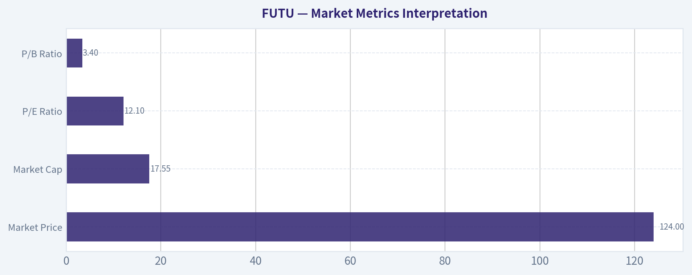

---

### Options Market Analysis

> *Reading options flow - put/call ratios, IV skew, and unusual activity - to gauge institutional positioning and event-driven risk.*

#### FUTU Options Positioning Report
*Date: 2026-05-22*

FUTU's near-term options tape is decisively **bearish/defensive** based on the raw put dominance in both open interest and traded volume. That said, the implied volatility figures returned by the feed look **internally inconsistent**-especially the very low put ATM IV readings-so the directional read should lean more heavily on positioning data than on IV precision.

#### 1. Put/Call Ratio Analysis

| Expiration | Call OI | Put OI | Put/Call OI Ratio | Call Vol | Put Vol | Put/Call Vol Ratio |
|---|---:|---:|---:|---:|---:|---:|
| 2026-05-22 | 4,637 | 38,538 | 8.31 | 1,129 | 23,224 | 20.57 |
| 2026-05-29 | 3,393 | 14,435 | 4.25 | 744 | 2,924 | 3.93 |
| 2026-06-05 | 1,411 | 21,024 | 14.90 | 847 | 1,007 | 1.19 |
| **Near-term total** | **9,441** | **73,997** | **7.84** | **2,720** | **27,155** | **9.98** |

**Key Takeaways:** FUTU's near-term put/call ratios are extremely elevated versus the rough neutral baseline of 0.7. A total **put/call OI ratio of 7.84** and **volume ratio of 9.98** indicate a market heavily tilted toward puts, which usually signals either active downside hedging or outright bearish speculation. The same-day expiry stands out most, where put trading overwhelmed calls by more than 20 to 1 in volume.

**Interpretation:**
- Relative to the historical neutral baseline near **0.7**, these readings are not just modestly defensive-they are **extreme**.
- This kind of imbalance typically means one of two things:
  1. **Institutional hedging/protection** into a catalyst or heightened uncertainty, or
  2. **Directional bearish bets** anticipating downside.
- Because the imbalance shows up in both **open interest** and **current volume**, this is more than just stale legacy positioning. It suggests persistent demand for downside exposure.

#### 2. Implied Volatility (IV) Assessment

| Expiration | ATM Call IV | ATM Put IV | Observed Read |
|---|---:|---:|---|
| 2026-05-22 | 13.3% | 0.8% | Call IV above put IV |
| 2026-05-29 | 4.2% | 0.5% | Call IV above put IV |
| 2026-06-05 | 2.6% | 1.0% | Call IV above put IV |

**Key Takeaways:** The IV output shows calls carrying higher ATM implied volatility than puts across all three near-term expirations. Normally, equities with downside concern tend to show richer put IV, so this feed suggests a **call-skewed surface**, but the absolute put IV values appear suspiciously low. Because of that, the IV signal should be treated with caution.

**Assessment:**
- The data provided indicates **ATM call IV > ATM put IV**, which would normally imply:
  - less acute downside panic than the put volume suggests, or
  - some upside optionality being priced more aggressively than expected.
- However, the put IV values-such as **0.8%, 0.5%, and 1.0%**-look abnormally low for listed equity options and are likely affected by a data quality issue or quote artifact.
- So the prudent conclusion is:
  - **Do not over-trust the exact IV levels**
  - Use **positioning and flow** as the primary signal
- On the data available, there is **no reliable evidence of a steep put skew**, and the feed actually implies a **call skew**, though that conflicts with the overwhelmingly bearish put positioning.

#### 3. Unusual Options Activity

| Screen Result | Observation |
|---|---|
| Volume > 5x OI filter | No unusual contracts flagged in near-term expirations |

**Key Takeaways:** No single near-term contract triggered the "volume greater than 5 times open interest" screen, so there was no standout fresh bet large enough to qualify as unusual by this rule. That does not negate the bearish message; it means the bearish tone appears **broad-based across the chain** rather than concentrated in one obvious lottery-ticket strike.

**Interpretation:**
- Absence of flagged unusual activity suggests:
  - positioning may be **distributed across multiple strikes**, or
  - today's tape is more about **persistent hedging demand** than one-off aggressive speculative sweeps.
- That generally leans more toward **institutional protection flow** than retail chasing, especially when put volume is large but not isolated to one contract.
- Since no specific contract-level anomalies were returned, there is **no clean "smart-money strike"** to anchor on.

#### 4. Open Interest Concentration

The tool did not provide strike-level open-interest concentration or explicit gamma-wall strikes. What we *can* conclude from the expiration-level data is that open interest is heavily concentrated in **puts**, especially in:

- **2026-05-22:** 38,538 put OI
- **2026-06-05:** 21,024 put OI
- **2026-05-29:** 14,435 put OI

| Expiration | Put OI | Call OI | Positioning Bias |
|---|---:|---:|---|
| 2026-05-22 | 38,538 | 4,637 | Strong downside/hedging bias |
| 2026-05-29 | 14,435 | 3,393 | Defensive bias |
| 2026-06-05 | 21,024 | 1,411 | Extremely defensive bias |

**Key Takeaways:** The heaviest open-interest concentration sits in puts across all near-term expirations, with the largest pile-up in the front expiry. That usually creates a market structure where dealers may be more sensitive to downside moves, especially if spot trades near heavily owned protective strikes. Without strike-level data, exact pinning levels cannot be identified, but the overall gamma setup looks more likely to **amplify weakness than support upside chasing**.

**Implications:**
- Heavy put OI in the front weeks can act as a **negative overhang** if the stock weakens into expiry.
- If these are protective puts held against long stock, they may soften panic somewhat; if they are outright speculative puts, they can reinforce bearish price pressure.
- Since strike-level OI is unavailable, any explicit "max pain" level would be speculative, so it is better to avoid false precision here.

#### 5. Overall Options Sentiment Signal

| Category | Signal |
|---|---|
| Put/Call Positioning | Strongly Bearish |
| IV Signal | Unclear / low confidence due to data inconsistency |
| Unusual Activity | No isolated standout contract |
| OI Structure | Defensive, downside-heavy |
| **Overall Options Signal** | **BEARISH** |

**Key Takeaways:** Even with questionable IV readings, the options market's directional message is still clear: traders are paying far more attention to downside protection than upside participation. The primary driver of the signal is the **extreme put dominance in both open interest and volume**, not a single unusual trade.

**Bottom line:**
I would classify FUTU's options sentiment as **BEARISH** with **moderate confidence**. The confidence is not higher only because:
1. strike-level concentration was not available, and
2. the IV data appears distorted.

Still, the put/call imbalance is so extreme that it outweighs those limitations. The most likely interpretation is **institutional hedging and/or active bearish positioning in the near term**, with the strongest pressure centered in the front expirations.

#### Final Summary Table

| Metric | Reading | Interpretation |
|---|---|---|
| Put/Call Ratio | OI: **7.84**; Volume: **9.98** | Extremely elevated vs. 0.7 neutral; strong downside bias |
| IV Level | ATM call IV above put IV in all near expiries | Data likely noisy; low confidence on exact IV level |
| Skew Direction | Reported **call skew**, not put skew | Conflicts with flow; treat cautiously |
| Unusual Activity | None flagged by volume > 5x OI screen | Bearish flow appears broad-based, not concentrated |
| Overall Signal | **BEARISH** | Main driver is overwhelming put dominance across near-term expirations |

**Key Takeaways:** FUTU's options market is sending a bearish message primarily through positioning, not through clean IV or standout contract anomalies. In practical terms, the chain looks like traders are more focused on protecting against downside than expressing upside conviction.

---

## Research Team Commentary

> *The Research Manager synthesizes the Bull vs Bear debate into action-free commentary. This is a pre-risk view, not the final stance.*

The strongest bull argument is straightforward: FUTU's current economics are exceptional for something trading at only about 12x earnings. An 87% gross margin, 28% ROE, and 46.6% ROIC are the kind of figures that usually point to a scalable, asset-light platform with real user engagement and strong operating leverage. If those returns are even roughly durable, then the market is likely over-discounting regulatory and sentiment risk. From that lens, this looks like a high-quality business priced more like a challenged cyclical than a compounder.

The strongest bear argument is that those metrics may flatter a business model that is less durable and less predictable than it appears. FUTU is still tied to trading activity, investor risk appetite, wealth flows, and regulation across sensitive jurisdictions. That makes normalized earnings hard to pin down. Buffett-style investing is not about buying high ROE in isolation; it is about buying understandable, durable, predictable cash flows. The bear is right that a broker/wealth platform can have great recent economics without possessing the kind of moat or certainty Buffett usually wants.

My takeaway is that the bull has the better valuation argument, but the bear has the better Buffett-purity argument. The market may indeed be too pessimistic, yet the reason the stock is cheap is not trivial misunderstanding; it is genuine uncertainty around regulation, cyclicality, and the long-term durability of the franchise. That matters. At the same time, I do not want to repeat the mistake of letting quality uncertainty completely override obvious valuation asymmetry when the business is already demonstrating elite profitability. A 12x multiple for a company with these returns is too low to dismiss casually unless one has strong evidence that earnings power is set to erode materially.

So my stance is WATCH.

Core takeaway: FUTU looks statistically and economically attractive, but not clearly enough predictable for a Buffett-style full endorsement. The stock may be undervalued on current earnings power, yet the key debate is whether those earnings are franchise-like or merely favorable-cycle earnings wearing franchise-like metrics. Without clearer evidence on durability, I would not call it a conviction ADVOCATE, but it is too high-quality on current numbers to label AVOID.

The rationale is really about balancing business quality against predictability. On quality, FUTU scores well: very high margins, very high returns on capital, and apparent platform scalability. On valuation, 12x earnings leaves room for upside if the market's fear proves excessive. That is the part the bull gets right, and I want to be careful not to underweight it the way I have in past cases where compressed multiples plus strong fundamentals created a better opportunity than my caution allowed. But Buffett's framework also demands durable moats, confidence in normalized earning power, and low dependence on external forces. Here the bear is persuasive: regulation is not noise, and this is not the kind of business where I can project the next decade with high confidence. That reduces the margin of safety despite the low multiple.

What would move me toward ADVOCATE over the next 1 to 4 quarters? First, evidence that growth and profitability remain resilient even if market activity normalizes. Second, signs that customer assets, funded accounts, and engagement are compounding in a way that suggests platform stickiness rather than episodic trading bursts. Third, stable or improving monetization without obvious fee compression. Fourth, any indication that regulatory posture is becoming clearer or at least not worsening. Fifth, capital allocation signals: disciplined buybacks, prudent balance-sheet management, and shareholder-friendly behavior.

What would weaken the thesis and push toward AVOID? A sharp decline in activity-dependent revenue, compression in margins that suggests economics were temporarily inflated, regulatory restrictions affecting acquisition or product scope, evidence of customer churn or rising promotional intensity, or any sign that returns on capital were more cyclical than structural.

The practical lesson I'm applying from past mistakes is this: don't dismiss a strong value case just because the business is not a perfect Buffett archetype. But also don't overcorrect by treating every low-multiple, high-ROE financial platform as a wonderful business. FUTU sits in that middle ground. It deserves close attention and may become more attractive with a bit more proof of durability, but today I would keep it at WATCH rather than force a false level of certainty.

Final stance: WATCH

---

## Value Investing Team Commentary

> *The Investor translates the research view into an investment thesis before risk review. This is still not the final stance.*

FUTU is the kind of situation that should make a value investor pause in a constructive way. On the surface, the numbers are plainly attractive: roughly 12x earnings, 87% gross margins, 28% ROE, and 46.6% ROIC. Those are not ordinary figures. They suggest a highly scalable platform business with strong unit economics and meaningful operating leverage. If I could underwrite those economics with confidence over the next decade, I would have little trouble calling the shares undervalued.

But Buffett-style investing is not a screening exercise. A cheap multiple attached to high returns on capital is only compelling if those returns are durable, understandable, and not overly dependent on outside forces. That is where FUTU becomes more complicated. This is still a business tied to investor activity, wealth-market sentiment, and regulatory tolerance across jurisdictions where the rules can change faster than intrinsic value can be measured. In other words, the business may be excellent, but the predictability of its earning power is lower than the headline metrics imply.

That said, I do think the market may be leaning too far into fear. Selective contrarian thinking matters here. When investors see China-linked financial exposure, cross-border regulation, and trading-related revenue, they often flatten everything into a single negative narrative. Markets do this all the time: they correctly identify a real risk, then over-discount it by assuming the worst case is permanent. If FUTU can simply maintain respectable growth, preserve its margins better than expected, and continue compounding customer assets and engagement, a 12x earnings multiple could prove much too low. The contrarian case is not that regulation does not matter; it is that the market may be pricing the business as though durability is minimal when the actual franchise may be better than sentiment suggests.

The critical question is whether FUTU has a true moat or just favorable conditions. High gross margins point to a strong platform model. High ROIC suggests efficient capital use. Those are encouraging. But I would want more evidence that customer relationships are sticky, that monetization is resilient without aggressive incentives, and that earnings are not merely elevated by unusually favorable trading activity. A great broker-wealth platform can look wonderful in strong engagement periods and much more ordinary when activity cools. That distinction is everything.

Management quality and capital allocation also matter here. In a business facing regulatory and market-cycle uncertainty, intelligent capital allocation becomes even more valuable. If management is disciplined with buybacks, conservative with balance-sheet risk, and focused on long-term customer economics rather than short-term volume, that would increase confidence materially. If instead the model requires constant promotional spending or aggressive expansion into less certain areas, the apparent cheapness may be less meaningful.

From a long-term owner's perspective, the opportunity is real but the margin of safety is narrower than the P/E alone suggests. The stock is not expensive. In fact, it may be notably cheap relative to current profitability. But a Buffett investor should not confuse statistical cheapness with true business certainty. The bear case is not just emotional pessimism; it is rooted in a legitimate concern that normalized earnings power may be less stable than recent metrics imply.

So my interpretation is this: the market is probably underappreciating FUTU's current business quality, but it is not irrationally discounting risk. This is not a classic "wonderful business at a fair price" with obvious decade-long visibility. It is closer to "very strong present economics at a discounted price, but with meaningful uncertainty around durability." That can still be investable, but it requires more humility and a higher tolerance for external risk than a pure Buffett compounder usually demands.

What would make me more constructive? Evidence over the next few quarters that customer assets, funded accounts, and monetization remain healthy even if trading conditions normalize; continued elite profitability; and no meaningful deterioration in regulatory posture. What would worry me? A clear slowdown in activity-driven revenue, margin compression, customer acquisition becoming more promotional, or any sign that regulatory risk is again rising.

For now, the right posture is disciplined interest rather than full conviction. I would not dismiss FUTU, because the valuation is too compelling and the economics too strong for that. But I also would not pretend this is as predictable as a consumer monopoly, an insurer with a long underwriting record, or a payments network with unquestioned regulatory stability.

**ANALYST STANCE: WATCH**
FUTU is a potentially undervalued, high-return platform business, and sentiment may be overly fearful relative to current economics. However, regulatory exposure, activity sensitivity, and uncertainty around the durability of earnings keep it short of a full Buffett-style endorsement. Worth close monitoring and potentially attractive on further proof of franchise resilience, but not yet a high-conviction business-ownership idea.

---

## Deep Values Commentary

> *The Risk Management Team debates and the Risk Judge provides the final action-free verdict. This section determines the final ADVOCATE / WATCH / AVOID stance.*

#### Final Stance Scorecard

This scorecard converts the final research view into a weighted decision frame. It does not replace the narrative judgement, but it makes the main drivers of the verdict easier to scan.

| Criterion | Score | Weight | Commentary |
| --- | ---: | ---: | --- |
| Business Quality | 4.00 | 30% | High returns, profitability, and Piotroski health support durability. |
| Valuation Support | 4.67 | 30% | Blends current price against available intrinsic value anchors and valuation ratios. |
| Financial Strength | 5.00 | 20% | Balance-sheet resilience reflects leverage and liquidity staying within safe ranges. |
| Growth Durability | 5.00 | 20% | Recent revenue, earnings, and free cash flow growth indicate how durable expansion looks. |
| TOTAL / FINAL STANCE | 4.60 | 100% | WATCH |

#### Key Takeaways

The weighted score lands at **4.60 / 5.0**, while the final stance remains **WATCH**. This is useful as a quick calibration aid rather than a mechanical signal.

#### Risk Summary

Higher scores indicate more risk pressure. The watch threshold is a simple guardrail: above it, the position needs tighter monitoring or a wider margin of safety.

| Dimension | Current Score | Watch Threshold | Commentary |
| --- | ---: | ---: | --- |
| Business Quality | 2.00 | 3.00 | High returns, profitability, and Piotroski health support durability. |
| Valuation Support | 1.33 | 3.00 | Blends current price against available intrinsic value anchors and valuation ratios. |
| Financial Strength | 1.00 | 3.00 | Balance-sheet resilience reflects leverage and liquidity staying within safe ranges. |
| Growth Durability | 1.00 | 3.00 | Recent revenue, earnings, and free cash flow growth indicate how durable expansion looks. |

#### Key Takeaways

This view helps readers separate *where* the risk sits: valuation, business quality, balance sheet, or growth durability. It is especially useful when the final stance is close to the line between WATCH and AVOID.
