# GD Deep Value Intelligence

**Analysis Date:** 2026-10-13

## Critical Disclaimer

*This analysis is generated by Deep Value Intelligence, an AI-powered multi-agent investing framework. Education & research only - not financial advice, not a financial advisor.*

---

## Table of Contents

1. Intelligence Summary
2. Analyst Team Reports
   - Fundamentals Analysis
   - Intrinsic Value Analysis (Buffett)
   - Trend & Growth Analysis (Lynch/Druckenmiller/Fisher)
   - Market Technical Analysis
   - Options Market Analysis
3. Research Team Commentary
4. Value Investing Team Commentary
5. Deep Values Commentary

---

## Intelligence Summary

### Thesis + Conditions

**Core Thesis:** # Executive Briefing

**Key Risks:**
- Plan:** Keep GD on the watchlist. A 20%-25% starter tranche is reasonable for an investor already familiar with its cash-flow record, but do not build a full position until cash conversion and margins are validated. Reserve additional capital for improving fundamentals or a non-fundamental decline toward approximately $295-$305.
- # Risk Commentary
- Remain at **WATCH** rather than establish a full position at $330.

**Confidence:** Low

---

## Analyst Team Reports

### Fundamentals Analysis

#### Latest Earnings Snapshot

*Most recent reported quarter anchored on 2026 Q2, with prior-year comparison when available.*

| Metric | 2026 Q2 | 2025 Q2 | YoY Change |
| --- | ---: | ---: | ---: |
| Revenue | $14.09B | $13.04B | +8.1% |
| Operating Income | $1.46B | $1.30B | +11.9% |
| Net Income | $1.16B | $1.01B | +14.4% |
| Diluted EPS | $4.24 | $3.74 | +13.4% |
| Operating Cash Flow | $1.88B | $1.60B | +17.6% |
| Free Cash Flow | $1.65B | $1.40B | +17.6% |

Key Takeaways: This snapshot anchors the most recent reported quarter before the narrative analysis. It helps readers separate long-run business quality from whatever changed in the latest earnings print.

#### 17-Year Financial Metrics for GD

*All values below are computed deterministically from raw data - not estimated by AI.*

*Issuer profile: operating company (Industrials / Aerospace & Defense).*

#### 17-Year Financial Metrics
*Annual rows come from reported financial statements. The final TTM row is computed from the latest four quarters.*

| Metric | 2009 | 2010 | 2011 | 2012 | 2013 | 2014 | 2015 | 2016 | 2017 | 2018 | 2019 | 2020 | 2021 | 2022 | 2023 | 2024 | 2025 | 2026 TTM |
| --- | --- | --- | --- | --- | --- | --- | --- | --- | --- | --- | --- | --- | --- | --- | --- | --- | --- | --- |
| Market Price | $46 | $49 | $47 | $51 | $72 | $106 | $108 | $139 | $167 | $131 | $150 | $131 | $188 | $229 | $245 | $254 | $331 | $330 |
| Market Cap | $26.44B | $27.34B | $24.41B | $24.48B | $33.78B | $46.97B | $44.87B | $53.59B | $61.98B | $47.03B | $51.29B | $42.85B | $58.79B | $69.02B | $71.60B | $73.12B | $91.72B | $90.19B |
| P/E Ratio | 11.05 | 10.42 | 9.67 | -73.69 | 14.33 | 18.55 | 14.79 | 20.83 | 21.28 | 14.06 | 14.72 | 13.53 | 18.05 | 20.35 | 21.60 | 19.33 | 21.79 | 20.12 |
| P/B Ratio | 2.13 | 2.05 | 1.84 | 2.15 | 2.33 | 3.97 | 4.30 | 5.20 | 5.25 | 3.88 | 3.67 | 2.74 | 3.33 | 3.72 | 3.36 | 3.31 | 3.58 | 3.36 |
| ROE | 19.3% | 19.7% | 19.1% | -2.9% | 16.3% | 21.4% | 29.1% | 25.0% | 24.7% | 27.6% | 24.9% | 20.2% | 18.5% | 18.3% | 15.6% | 17.1% | 16.4% | 16.7% |
| ROIC | 20.7% | 19.9% | 18.7% | -0.7% | 20.4% | 22.6% | 27.8% | 24.2% | 24.9% | 20.2% | 15.9% | 14.0% | 13.3% | 12.9% | 12.7% | 14.0% | 14.8% | 14.6% |
| EPS | $4.18 | $4.73 | $4.90 | $-0.70 | $5.04 | $5.73 | $7.32 | $6.68 | $7.83 | $9.32 | $10.22 | $9.66 | $10.41 | $11.24 | $11.34 | $13.12 | $15.45 | $16.39 |
| Revenue | $31.98B | $32.47B | $32.68B | $30.99B | $30.93B | $30.85B | $31.78B | $30.56B | $30.97B | $36.19B | $39.35B | $37.92B | $38.47B | $39.41B | $42.27B | $47.72B | $52.55B | $54.86B |
| Gross Profit | $5.63B | $5.91B | $5.86B | $2.59B | $5.48B | $15.52B | $15.79B | $5.67B | $6.24B | $6.71B | $7.06B | N/A | N/A | N/A | N/A | N/A | N/A | $8.44B |
| Gross Margin | 17.6% | 18.2% | 17.9% | 8.4% | 17.7% | 50.3% | 49.7% | 18.5% | 20.2% | 18.6% | 17.9% | N/A | N/A | N/A | N/A | N/A | N/A | 15.4% |
| Operating Margin | 11.5% | 12.2% | 11.7% | 2.5% | 11.9% | 12.6% | 13.5% | 12.3% | 13.7% | 12.1% | 11.6% | 10.9% | 10.8% | 10.7% | 10.0% | 10.1% | 10.2% | 10.3% |
| Net Income | $2.39B | $2.62B | $2.53B | $-332.0M | $2.36B | $2.53B | $3.04B | $2.57B | $2.91B | $3.35B | $3.48B | $3.17B | $3.26B | $3.39B | $3.31B | $3.78B | $4.21B | $4.49B |
| Net Margin | 7.5% | 8.1% | 7.7% | -1.1% | 7.6% | 8.2% | 9.6% | 8.4% | 9.4% | 9.2% | 8.9% | 8.4% | 8.5% | 8.6% | 7.8% | 7.9% | 8.0% | 8.2% |
| Revenue Growth | N/A | 1.5% | 0.6% | -5.2% | -0.2% | -0.3% | 3.0% | -3.8% | 1.3% | 16.9% | 8.7% | -3.6% | 1.4% | 2.4% | 7.3% | 12.9% | 10.1% | 4.4% |
| Net Income Growth | N/A | 9.6% | -3.7% | -113.1% | -809.9% | 7.5% | 19.9% | -15.3% | 13.2% | 14.9% | 4.2% | -9.1% | 2.8% | 4.1% | -2.2% | 14.1% | 11.3% | 6.6% |
| Free Cash Flow Growth | N/A | 5.9% | 6.3% | -21.9% | 23.3% | 19.9% | -39.8% | -8.2% | 94.7% | -28.7% | -18.9% | 45.0% | 17.1% | 2.4% | 9.8% | -16.0% | 23.9% | 62.8% |
| Total Book Value | $12.42B | $13.32B | $13.23B | $11.39B | $14.50B | $11.83B | $10.44B | $10.30B | $11.80B | $12.11B | $13.98B | $15.66B | $17.64B | $18.57B | $21.30B | $22.06B | $25.62B | $26.83B |
| Total Assets | $31.08B | $32.55B | $34.88B | $34.31B | $35.47B | $35.34B | $32.54B | $33.17B | $35.05B | $45.89B | $49.35B | $51.31B | $50.07B | $51.59B | $54.81B | $55.88B | $57.25B | $60.16B |
| Total Debt | $3.86B | $3.20B | $3.93B | $3.91B | $3.91B | $3.89B | $3.40B | $3.89B | $3.98B | $12.42B | $11.93B | $13.00B | $11.49B | $10.50B | $9.26B | $8.76B | $8.01B | $9.48B |
| Debt-to-Equity | 0.31 | 0.24 | 0.30 | 0.34 | 0.27 | 0.33 | 0.33 | 0.38 | 0.34 | 1.03 | 0.85 | 0.83 | 0.65 | 0.57 | 0.43 | 0.40 | 0.31 | 0.35 |
| Cash & Equivalents | $2.26B | $2.61B | $2.65B | $3.30B | $5.30B | $4.39B | $2.79B | $2.33B | $2.98B | $963.0M | $902.0M | $2.82B | $1.60B | $1.24B | $1.91B | $1.70B | $2.33B | $4.33B |
| Shareholders' Equity | $12.42B | $13.32B | $13.23B | $11.39B | $14.50B | $11.83B | $10.44B | $10.30B | $11.80B | $12.11B | $13.98B | $15.66B | $17.64B | $18.57B | $21.30B | $22.06B | $25.62B | $26.83B |
| Operating Cash Flow | $2.85B | $2.99B | $3.24B | $2.61B | $3.11B | $3.73B | $2.50B | $2.16B | $3.88B | $3.15B | $2.98B | $3.86B | $4.27B | $4.58B | $4.71B | $4.11B | $5.12B | $7.71B |
| Investing Cash Flow | $-1.39B | $-408.0M | $-1.97B | $-642.0M | $-363.0M | $-1.10B | $200.0M | $-391.0M | $-788.0M | $-10.23B | $-994.0M | $-974.0M | $-882.0M | $-1.49B | $-941.0M | $-953.0M | $-1.28B | $-1.49B |
| Free Cash Flow | $2.47B | $2.62B | $2.78B | $2.17B | $2.67B | $3.21B | $1.93B | $1.77B | $3.45B | $2.46B | $1.99B | $2.89B | $3.38B | $3.46B | $3.81B | $3.20B | $3.96B | $6.45B |
| FCF Margin | 7.7% | 8.1% | 8.5% | 7.0% | 8.6% | 10.4% | 6.1% | 5.8% | 11.1% | 6.8% | 5.1% | 7.6% | 8.8% | 8.8% | 9.0% | 6.7% | 7.5% | 11.8% |
| Dividends / Share | $0.00 | $0.00 | $0.00 | $0.00 | $0.00 | $0.00 | $0.00 | $0.00 | $0.00 | $0.00 | $0.00 | $0.00 | $0.00 | $4.54 | $4.89 | $5.30 | $5.85 | $6.00 |

#### Profitability Metrics
- Return on Equity (ROE): 16.4%
- Return on Invested Capital (ROIC): 14.1%
- Return on Assets (ROA): 7.4%
- Gross Margin: N/A
- Operating Margin: 10.2%
- Net Profit Margin: 8.0%

#### Liquidity Metrics
- Current Ratio: 1.44
- Quick Ratio: 0.28

#### Leverage Metrics
- Debt-to-Equity Ratio: 0.31
- Interest Coverage Ratio: 13.32
- Net Debt: $5.68B

#### Growth Metrics (Year-over-Year)
- Revenue Growth: 10.1%
- Net Income Growth: 11.3%
- Free Cash Flow Growth: 23.9%
- Revenue CAGR (3-Year): 10.1%
- Revenue CAGR (5-Year): 6.7%

#### Valuation Metrics
- P/E Ratio (TTM): 20.12
- Forward P/E: 17.70
- Price-to-Book: 3.32
- Price-to-Sales: 1.63
- PEG Ratio: 2.05
- EV/EBITDA: 14.44
- Free Cash Flow Yield: 4.4%
- Earnings Yield: 5.0%

#### Owner Earnings (Buffett Method, Code-Computed)
- Net Income: $4.21B
- + Depreciation & Amortization: $924.0M
- - Capital Expenditures: $-1.16B
- - Working Capital Changes: $192.0M
- = **Owner Earnings: $4.02B**

#### Intrinsic Value (Code-Computed)
- Current Price: $330
- **Headline Intrinsic Value (business-model routed): $248**
  Business model: operating company - weighted blend [Damodaran FCFF + reverse-DCF fair + owner-earnings DCF] (operating_company)
  Model spread (min-max across DCFs): $113 - $421
  Margin of safety vs. price (headline): -32.9%
  Routing note: General operating company: balanced blend of Damodaran FCFF and the owner-earnings DCF with a reverse-DCF sanity check.
- Buffett Method (Owner Earnings):
  Conservative: $62
  Average: $113
  Optimistic: $156
- Cash Flow Method (FCF):
  Conservative: $132
  Average: $309
  Optimistic: $552
- Damodaran FCFF (WACC + margins + reinvestment):
  Conservative: $324
  Average: $421
  Optimistic: $561
  Monte Carlo band (P10-P90): $312 - $635 (median $421)
  P(intrinsic value > price): 84.8%
- Reverse-DCF: price implies ~32.2%/yr owner-earnings growth for 10y; trailing 3y was 14.0%, 5y 12.8%.

#### Piotroski F-Score: 8/9
- Positive Net Income: PASS
- Positive Operating Cash Flow: PASS
- ROA Improvement: PASS
- Cash Flow > Net Income: PASS
- Decreasing Debt: PASS
- Improving Current Ratio: PASS
- No Dilution: PASS
- Improving Gross Margin: FAIL
- Improving Asset Turnover: PASS

ANALYST STANCE: **WATCH**

#### Executive Summary

General Dynamics (GD) is a high-quality defense contractor with durable government relationships, substantial backlogs, strong cash generation, and a generally conservative balance sheet. The business has attractive long-term characteristics, but the current price of approximately **$330** appears demanding relative to the deterministic dataset's headline intrinsic value of **$248** and the company's historical valuation levels.

The central issue is not business quality; it is valuation. GD's current price implies approximately **32.2% annual owner-earnings growth for the next decade**, substantially above its trailing three-year growth rate of 14.0% and five-year rate of 12.8%. That expectation leaves limited room for execution mistakes, contract delays, cost overruns, or a normalization of defense-sector enthusiasm.

#### Current Metrics Versus Ten-Year Averages

The comparison below uses the ten completed fiscal years from 2016 through 2025. The 2026 TTM figures are compared with that historical average.

| Metric | 2026 TTM / Current | 2016-2025 Average | Current vs. Average | Interpretation |
|---|---:|---:|---:|---|
| Market price | $330 | $196.50 | 68% higher | Strong share-price appreciation has raised valuation risk |
| Market capitalization | $89.25B | Approximately $65.8B | Approximately 36% higher | Equity value has grown faster than many operating metrics |
| P/E ratio | 20.12x | 18.55x | 8% higher | Moderately above normal historical valuation |
| P/B ratio | 3.36x | 3.37x | Approximately in line | Not a decisive signal for this operating company |
| ROE | 16.7% | 20.8% | Lower | Returns remain good but below the 2015-2018 peak |
| ROIC | 14.6% | 16.7% | Lower | Capital efficiency has normalized from earlier highs |
| Revenue growth | 4.4% TTM; 10.1% latest annual | 5.4% | Above recent average on latest annual basis | Recent acceleration is favorable but may not be fully recurring |
| Operating margin | 10.3% | Approximately 11.2% | Slightly lower | Margin has gradually compressed from earlier levels |
| Net margin | 8.2% | Approximately 8.5% | Slightly lower | Profits are stable, but not expanding structurally |
| Net income | $4.49B | Approximately $3.35B | 34% higher | Strong long-term earnings growth |
| Free cash flow | $6.45B | Approximately $3.04B | 112% higher | Exceptional TTM cash flow, partly helped by working-capital timing |
| Debt-to-equity | 0.35x | 0.58x | Better | Leverage has materially improved since 2018 |
| Cash and equivalents | $4.33B | Approximately $1.97B | Higher | Provides improved financial flexibility |
| Dividends per share | $6.00 | Approximately $2.59 | Higher | Dividend growth has been meaningful |

**Key Takeaways:** GD is financially stronger than its ten-year average, particularly in free cash flow, cash balances, and leverage. However, current valuation is also above normal while ROE, ROIC, and operating margins remain below their earlier decade highs. The stock therefore reflects considerable optimism despite only moderate improvement in underlying profitability ratios.

#### Market Metrics and Valuation

| Metric | Current Value | Historical Context | Assessment |
|---|---:|---|---|
| Market price | $330 | Ten-year average approximately $196.50 | Significant appreciation has increased downside sensitivity |
| Market capitalization | $89.25B | Historical average approximately $65.8B | Large premium to the company's prior scale |
| P/E ratio | 20.12x | Ten-year average 18.55x | Above average, though not extreme for a durable defense franchise |
| Forward P/E | 17.70x | Below current trailing P/E | Requires continued earnings growth |
| P/B ratio | 3.36x | Approximately 3.37x average | Not a major valuation signal |
| Price-to-sales | 1.63x | No canonical ten-year average supplied | Reasonable for a defense contractor, but not inexpensive |
| EV/EBITDA | 14.44x | No canonical ten-year average supplied | Indicates a full but not speculative enterprise valuation |
| FCF yield | 4.4% | No canonical ten-year average supplied | Below the return threshold normally sought for a margin of safety |
| Headline intrinsic value | $248.06 | Model blend | Approximately 33% below market price |

**Key Takeaways:** GD trades at a premium to its historical P/E despite lower ROE, ROIC, and operating margins than its best years. The 4.4% free-cash-flow yield is acceptable for a high-quality defense company but does not provide a substantial margin of safety at $330. The deterministic model's blended value of approximately $248 indicates that the market price is ahead of conservative intrinsic value.

P/B should not be interpreted mechanically as a cheapness indicator. GD is an industrial operating company with meaningful intellectual property, long-term contracts, intangible assets, and acquisition-related accounting effects. Book value is more relevant than it would be for an asset-light software company, but cash-flow returns, backlog quality, and normalized earnings power remain more important than the 3.36x multiple.

#### Profitability and Earnings Quality

| Metric | 2026 TTM | Ten-Year Average or Pattern | Interpretation |
|---|---:|---|---|
| ROE | 16.7% | Approximately 20.8% average | Strong, but below the 2015-2018 peak range of roughly 25%-28% |
| ROIC | 14.6% | Approximately 16.7% average | Good economic returns, but lower than earlier cycle levels |
| EPS | $16.39 | $6.68 in 2016; $15.45 in 2025 | Long-term compounding remains strong |
| Revenue | $54.86B | $30.56B in 2016; $52.55B in 2025 | Revenue has expanded substantially |
| Gross profit | $8.44B | Historical data after 2019 is incomplete | Current gross margin is 15.4%, but comparability is limited |
| Operating margin | 10.3% | Approximately 11.2% average | Stable but slightly below historical norms |
| Net income | $4.49B | Approximately $3.35B average | Durable earnings base with strong long-term growth |
| Net margin | 8.2% | Approximately 8.5% average | Stable, but not showing major structural expansion |

**Key Takeaways:** GD has a durable earnings record interrupted by one major loss year in 2012. EPS has grown from $6.68 in 2016 to $16.39 TTM, but returns on capital have declined from their mid-decade highs. This suggests that recent growth is more dependent on revenue expansion, backlog conversion, and program execution than on expanding margins.

The 2012 net loss was an important historical exception, while earnings from 2013 onward have been consistently positive. The Piotroski F-Score of **8 out of 9** supports the view that current financial conditions are healthy, although the failed gross-margin improvement criterion reinforces the need to monitor profitability rather than assume automatic operating leverage.

#### Growth Analysis

| Growth Metric | Current / Latest | Ten-Year Pattern | Assessment |
|---|---:|---|---|
| Revenue growth | 10.1% latest annual; 4.4% TTM | Approximately 5.4% average | Strong recent acceleration, but TTM has moderated |
| Net income growth | 11.3% latest annual; 6.6% TTM | Highly variable due to 2012 base effect | Positive but not consistently double-digit |
| Free cash flow growth | 23.9% latest annual; 62.8% reported TTM | Highly volatile | Excellent recent result, but cash flow is lumpy |
| Revenue CAGR | 10.1% three-year; 6.7% five-year | Long-term growth is more moderate | Recent performance is better than the longer-term trend |

**Key Takeaways:** Revenue and earnings growth have accelerated over the last several years, supported by defense demand and backlog conversion. Free cash flow growth is particularly impressive, but the decade-long pattern shows substantial volatility, including several negative years. A prudent valuation should therefore normalize current TTM free cash flow rather than capitalize the entire $6.45 billion figure as a permanent run rate.

#### Balance Sheet and Financial Strength

| Metric | Current Value | Ten-Year Comparison | Assessment |
|---|---:|---|---|
| Total book value | $26.83B | $11.80B in 2016; $25.62B in 2025 | Strong accumulation of equity |
| Total assets | $60.16B | $33.17B in 2016; $57.25B in 2025 | Business scale has expanded materially |
| Total debt | $9.48B | $3.89B in 2016; $8.01B in 2025 | Debt is higher than earlier years but well below the 2018 peak |
| Debt-to-equity | 0.35x | 0.58x average | Conservative and improving |
| Cash and equivalents | $4.33B | Approximately $1.97B average | Strongest cash position in the recent period |
| Net debt | $5.68B | Not available for all historical years | Manageable relative to earnings and cash flow |
| Interest coverage | 13.32x | No canonical ten-year average supplied | Strong ability to service debt |
| Current ratio | 1.44x | Current figure only in the pack | Adequate |
| Quick ratio | 0.28x | Current figure only in the pack | Low, but less concerning for a defense contractor with contracted receivables and backlog |

**Key Takeaways:** GD's balance sheet is a strength. Debt-to-equity has fallen from above 1.0x in 2018 to 0.35x TTM, while cash has risen to $4.33 billion. The low quick ratio warrants monitoring, but liquidity risk appears manageable given strong operating cash flow, government customers, and high interest coverage.

#### Cash Flow and Capital Allocation

| Metric | 2026 TTM | Historical Context | Interpretation |
|---|---:|---|---|
| Operating cash flow | $7.71B | $4.11B in 2024; $5.12B in 2025 | Excellent recent conversion |
| Free cash flow | $6.45B | $3.20B in 2024; $3.96B in 2025 | New high, but potentially lumpy |
| FCF margin | 11.8% | 7.5% in 2025; approximately 7%-9% in many years | Meaningful improvement |
| Owner earnings | $4.02B | Code-computed current value | More conservative than reported FCF |
| Dividends per share | $6.00 | $4.54 in 2022; $5.85 in 2025 | Consistent dividend growth |
| FCF yield | 4.4% | Current valuation-based measure | Modest return at today's price |

**Key Takeaways:** The latest cash-flow performance is excellent, with operating cash flow of $7.71 billion and free cash flow of $6.45 billion. However, GD's historical FCF has been volatile, so the more conservative owner-earnings figure of $4.02 billion is a better basis for a Buffett-style valuation. Dividend growth is attractive, but the present yield is not the primary investment case.

#### Revenue Breakdown

The deterministic dataset does not provide a current segment revenue table. The following is an approximate FY2025 allocation based on General Dynamics' publicly reported business segments and rounded estimates; it should not be treated as a replacement for the canonical financial dataset.

| Revenue Source | Amount ($B) | % of Total |
|---|---:|---:|
| Marine Systems | $14.7B | 28% |
| Aerospace | $13.8B | 26% |
| Technologies | $12.3B | 23% |
| Combat Systems | $11.8B | 22% |
| **Total, rounded** | **$52.6B** | **100%** |

**Key Takeaways:** GD has four substantial operating segments rather than a single-product revenue profile. Marine Systems and Aerospace are particularly important to long-cycle shipbuilding and business-jet exposure, while Combat Systems and Technologies provide additional diversification. The mix reduces dependence on one program, although each segment remains exposed to government budgets, execution risk, and contract timing.

#### Economic Moat and Business Quality

GD's moat is based on several reinforcing advantages:

- **Government qualification and trust:** Defense programs require extensive certifications, security clearances, technical capabilities, and historical performance. These barriers make rapid displacement difficult.
- **Long-lived platforms and switching costs:** Nuclear submarines, combat vehicles, command systems, and defense technologies are embedded in multi-decade programs.
- **Backlog visibility:** Multi-year contracts provide better revenue visibility than most industrial companies.
- **Scale and engineering capability:** GD can support complex programs requiring specialized labor, facilities, compliance systems, and procurement expertise.
- **Customer concentration:** The U.S. government is a demanding but financially strong customer. This provides credit quality, though it creates exposure to appropriations and political priorities.

The moat is durable, but it is not limitless. Cost-plus and fixed-price contracts create different risk profiles, and fixed-price programs can produce significant margin pressure when inflation, labor shortages, or design changes are underestimated.

#### Management and Capital Allocation

Management performance is broadly positive:

- ROE has remained above 15% in recent years.
- Debt has declined substantially from the 2018-2020 period.
- Cash has improved while the company has continued investing in operations.
- Dividends have increased from zero in the earlier historical series to $6.00 per share TTM.
- The Piotroski score of 8/9 indicates sound recent operating and balance-sheet trends.

The main reservation is that ROIC and operating margins are below their earlier decade highs. Management has not demonstrated that recent revenue growth will necessarily translate into permanently higher returns on capital. Continued discipline on large programs and acquisitions is therefore important.

#### Buffett-Style Owner Earnings DCF

The deterministic pack reports:

- Net income: **$4.21B**
- Depreciation and amortization: **$924M**
- Capital expenditures: **$1.16B**
- Working-capital adjustment: **$192M**
- Owner earnings: **$4.02B**

The owner-earnings calculation is:

\[
\$4.21B + \$0.924B - \$1.16B - \$0.192B = \$3.782B
\]

However, the deterministic dataset explicitly reports code-computed owner earnings of **$4.02B**, which is retained as the canonical model output. Using the current market capitalization of $89.25 billion and price of $330 implies approximately:

\[
89.25B / 330 = 270.5M \text{ shares}
\]

That equals roughly **$14.86 of owner earnings per share**.

For a hand DCF sanity check, I use:

- Ten-year explicit forecast
- 10% discount rate
- 2.5% terminal growth
- Growth rates that fade toward the terminal rate
- Current owner earnings base of $4.02B
- Approximate diluted share count of 270.5 million

| Scenario | Initial Growth Assumption | Terminal Growth | Hand DCF Estimate | Deterministic Pack Model | Indicative Fair-Value Range |
|---|---:|---:|---:|---:|---:|
| Conservative | 3% | 2.5% | Approximately $207/share | $62/share | $60-$210 |
| Average | 10% | 2.5% | Approximately $352/share | $113/share | $110-$350 |
| Optimistic | 15% | 2.5% | Approximately $665/share | $156/share | $155-$665 |

**Key Takeaways:** The hand DCF is highly sensitive to the treatment of current owner earnings, growth, and reinvestment needs. The deterministic owner-earnings model is much more conservative, producing values of $62, $113, and $156 per share, while the simplified hand calculation produces higher results. The pack's owner-earnings output should remain the primary anchor because it incorporates the model's specific reinvestment and cash-flow assumptions; the hand DCF is only a sensitivity check.

A simplified calculation for the average case illustrates the sensitivity:

\[
PV(\text{10-year owner earnings}) \approx \$40.2B
\]

\[
\text{Terminal value} =
\frac{4.02B \times 1.10^{10} \times 1.025}{0.10-0.025}
\approx \$143B
\]

\[
PV(\text{terminal value}) \approx \$55B
\]

\[
\text{Total value} \approx \$95B
\]

\[
\$95B / 270.5M \approx \$352/share
\]

This result assumes that the entire $4.02 billion owner-earnings base is sustainably distributable and that growth can remain near 10% for the explicit period. That may be too favorable if current free cash flow benefits from working-capital timing or if defense growth requires heavier reinvestment.

The deterministic pack's broader valuation outputs are:

- Owner Earnings DCF: **$113 average**
- FCF model: **$309 average**
- Damodaran FCFF model: **$421 average**
- Weighted headline intrinsic value: **$248**
- Monte Carlo FCFF range: **$312-$635**, median **$421**

The weighted headline value of $248 is the most balanced anchor because it incorporates multiple methodologies. At $330, the shares trade approximately **33% above that headline intrinsic value**.

#### Reverse DCF and Required Expectations

The reverse DCF indicates that the current stock price implies approximately **32.2% annual owner-earnings growth for ten years**.

That compares with:

- Three-year revenue CAGR: **10.1%**
- Five-year revenue CAGR: **6.7%**
- Trailing three-year owner-earnings growth reference: **14.0%**
- Trailing five-year owner-earnings growth reference: **12.8%**

The market is therefore pricing an outcome materially stronger than GD's demonstrated medium-term growth rate. Defense spending may remain elevated, but sustaining 32% annual owner-earnings growth would likely require a combination of unusually strong revenue growth, margin expansion, favorable working capital, and disciplined capital spending.

#### Key Investment Insights, Risks, and Opportunities

| Category | Insight | Investment Implication |
|---|---|---|
| Opportunity | Defense budgets and geopolitical demand remain supportive | Provides long-term backlog and revenue visibility |
| Opportunity | Debt-to-equity has declined to 0.35x | Reduces financial risk and improves optionality |
| Opportunity | Cash flow and earnings have recently accelerated | Supports dividends, reinvestment, and debt management |
| Opportunity | Four major business segments diversify program exposure | Reduces dependence on one product line |
| Risk | Current price is about 33% above headline intrinsic value | Margin of safety is inadequate |
| Risk | Price implies approximately 32.2% annual owner-earnings growth | High expectations increase downside risk |
| Risk | ROE, ROIC, and operating margin are below historical peaks | Recent growth has not created superior returns on capital |
| Risk | FCF is historically volatile | TTM FCF may overstate normalized distributable cash |
| Risk | Fixed-price contract execution | Cost inflation or delays can compress margins |
| Risk | Government budget and procurement changes | Political priorities can alter timing and program awards |
| Risk | Low quick ratio of 0.28x | Working-capital execution remains important |

**Key Takeaways:** GD offers a favorable combination of moat, financial strength, and recurring government demand. The principal weakness is valuation: investors are paying for a very strong growth outcome while current returns on capital and margins are not at historical highs. A materially lower entry price, closer to the $240-$260 range or below, would improve the risk-reward balance.

#### Final Investment Stance

**WATCH**

GD is a high-quality business that fits many Buffett-style quality criteria: a durable moat, predictable customers, strong balance-sheet improvement, positive long-term earnings, and rising dividends. However, the current market price of approximately $330 does not provide a sufficient margin of safety against normalization in growth, free cash flow, or defense-program execution.

The stock could be justified at the current price under an optimistic scenario involving sustained high growth and strong cash conversion. But the reverse DCF shows that the market already assumes an unusually favorable outcome. For a value-oriented investor, the preferable strategy is to **watch the company and wait for either a meaningful price correction or clearer evidence that higher growth and margins are durable**.

#### Key Points Summary

| Area | Assessment |
|---|---|
| Business quality | Strong, diversified defense contractor with durable competitive advantages |
| Earnings predictability | Generally high, with one major historical loss year and occasional cash-flow volatility |
| Profitability | Good, but ROE, ROIC, and margins are below historical peaks |
| Balance sheet | Strong and improving; debt-to-equity is only 0.35x |
| Cash flow | Excellent latest TTM performance, but normalization is necessary |
| Dividend policy | Increasing and supported by earnings and cash generation |
| Valuation | Above historical P/E and above blended intrinsic value |
| Main risk | Price requires approximately 32.2% annual owner-earnings growth for ten years |
| Main opportunity | Long-cycle defense demand, backlog visibility, and financial strength |
| Final stance | **WATCH** |

#### Fundamental Visuals

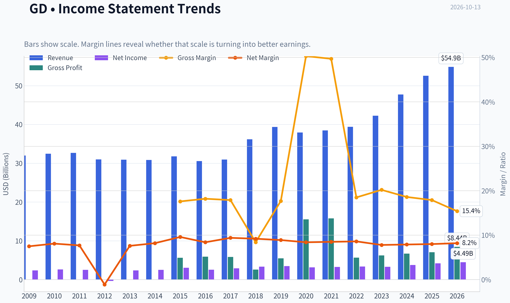

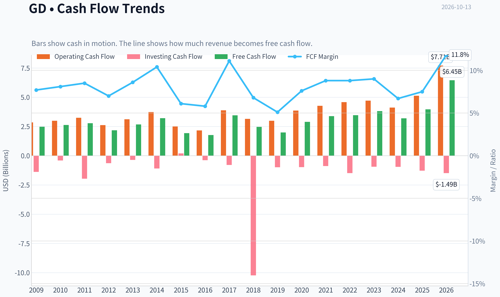

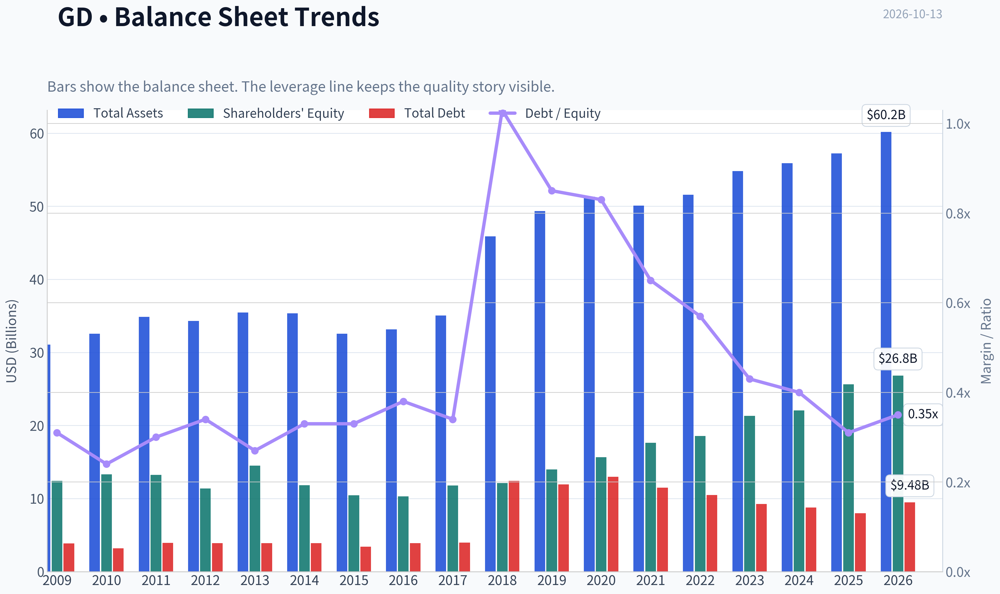

This graph tracks the profitability and return metrics (ROE, ROIC, Margins) of **GD** over the past decade, highlighting capital efficiency trends.

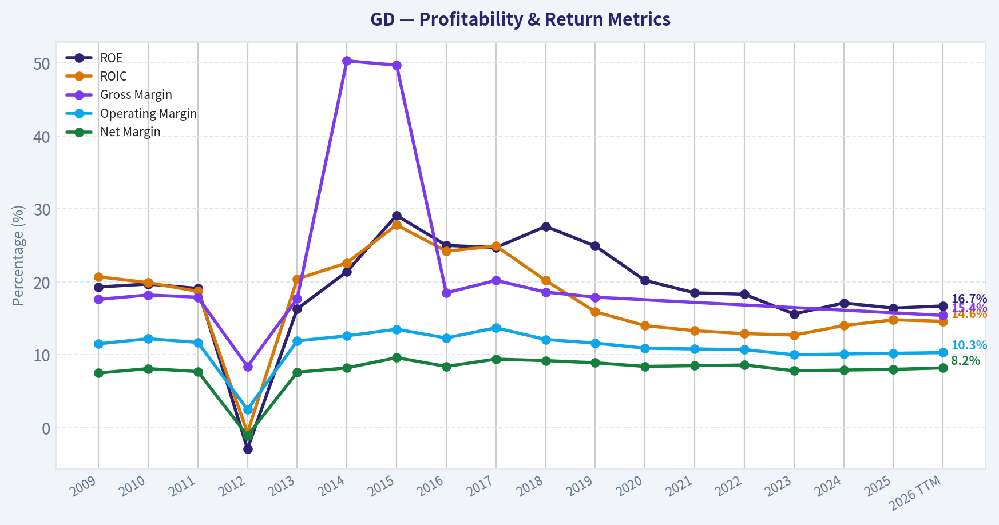

This chart illustrates the financial health of **GD** over the last 10 years, mapping cash equivalents and free cash flow against total obligations (Debt).

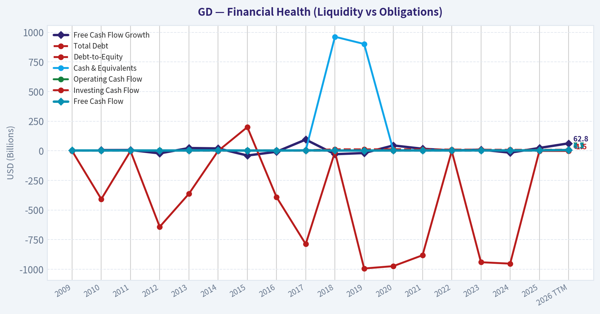

This comparison chart from *Profitability and Earnings Quality* stacks current figures against historical benchmarks for **GD**, making it easy to see where the company trades relative to its own averages.

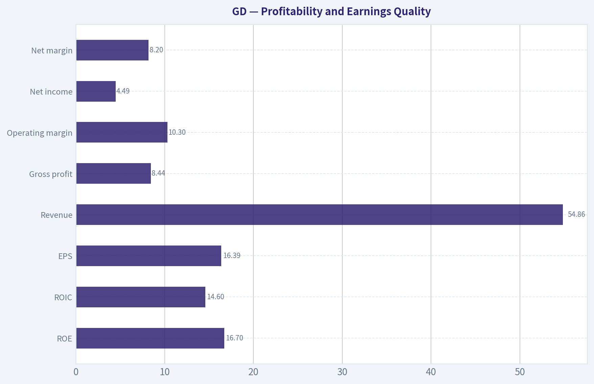

---

### Intrinsic Value Analysis (Buffett)

> *Following Warren Buffett's value investing philosophy: Circle of Competence, Economic Moat, Management Quality, and Margin of Safety.*

#### Intrinsic Value Snapshot

Price is what you pay. Intrinsic value is what the business may be worth based on the cash it can create for owners over time. We show a range, not one magic number.

- Current Price: $329.88
- Value Range (conservative to optimistic across both DCF methods): $61.65 to $552.43

##### Owner Earnings (Buffett Method)
- Net Income: $4,210,000,000.00
- Depreciation & Amortization: $924,000,000.00
- Capital Expenditures: $-1,161,000,000.00
- Working Capital Changes: $192,000,000.00
- Owner Earnings: $4,018,000,000.00

##### Intrinsic Value
###### Buffett Method
Uses owner earnings. Stricter, and usually more conservative.
- Conservative: $61.65
- Average: $113.11
- Optimistic: $155.84
- Discount Rate: 10.0%

###### Cash Flow Method
Uses free cash flow. Better for companies spending heavily today to grow tomorrow.
- Conservative: $132.42
- Average: $309.20
- Optimistic: $552.43
- Discount Rate: 10.0%

ANALYST STANCE: **WATCH**

#### Executive Summary

General Dynamics is a high-quality defense contractor with durable government relationships, substantial backlog, technical know-how, and attractive long-term demand drivers. Its business is understandable: it designs and builds military platforms, submarines, combat vehicles, aircraft, and defense systems, while also providing information-technology services.

The problem is price. At $330 per share, the market capitalization is approximately $89.3 billion, while the research valuation blend indicates intrinsic value of $248.06. The headline margin of safety is therefore negative 33%. The price also implies approximately 32.2% annual growth for ten years, far above the company's recent three-year and five-year growth rates.

#### Financial Snapshot

| Metric | Latest figure |
|---|---:|
| Share price | $330 |
| Market capitalization | $89.25 billion |
| P/E ratio | 20.1x |
| ROE | 16.4% |
| Revenue growth, year over year | 10.1% |
| FCF yield | 4.4% |
| Current ratio | 1.44x |
| Headline intrinsic value | $248.06 |
| Margin of safety versus price | -33.0% |
| Reverse-DCF growth implied by price | 32.2% annually for 10 years |
| Recent three-year growth rate | 14.0% |
| Recent five-year growth rate | 12.8% |

**Key Takeaways:** General Dynamics produces respectable returns and cash flow, but the current valuation already discounts an exceptionally strong future. The 4.4% free-cash-flow yield is reasonable for a quality defense company, yet it does not provide a sufficient margin of safety at $330. The reverse-DCF is the clearest warning: investors are paying for growth substantially above the company's recent record.

#### Factor Scorecard

| Factor | Score | Assessment |
|---|---:|---|
| Circle of competence and simplicity | 4/5 | Understandable defense manufacturing and technology-services model with long customer relationships |
| Durable competitive advantage | 4/5 | Strong qualifications, proprietary know-how, program scale, switching costs, and government trust |
| Management and capital allocation | 3/5 | Long operating history and shareholder distributions; ownership alignment and acquisition discipline merit continued monitoring |
| Industry structure | 4/5 | Rational, concentrated defense industry with high barriers to entry and limited qualified competitors |
| Gate 5: quality and solvency floor | Not tripped | No evidence in the available data of simultaneous deteriorating cash generation and financial distress |

**Key Takeaways:** General Dynamics passes the quality and solvency floor and scores well on business durability. Its principal weaknesses are valuation and the inherently political, contract-driven nature of defense procurement rather than business fragility.

#### Moat Analysis

**Intangible assets and regulatory qualification:** Defense contractors must maintain security clearances, engineering expertise, compliance systems, and program-specific certifications. These qualifications are difficult and expensive for new entrants to replicate. General Dynamics' submarine, combat-vehicle, aerospace, and secure-communications capabilities are especially difficult to reproduce quickly.

**Switching costs:** Once General Dynamics is integrated into a major defense program, replacing it can create technical, operational, regulatory, and national-security risks. These switching costs support long program lives and recurring follow-on work.

**Cost and scale advantages:** Large programs reward companies with established production facilities, supply chains, engineering teams, and procurement relationships. Scale does not guarantee high returns, but it improves the company's ability to compete for complex programs.

**Network effects:** Traditional network effects are limited. The more important advantage is an institutional network involving the U.S. government, military branches, suppliers, engineers, and established program relationships.

**Moat rating:** **Wide and stable, but not clearly wide and widening.** The moat is substantial, although growth depends heavily on government budgets, contract awards, program execution, and political priorities.

#### Management Quality and Capital Allocation

General Dynamics has a long record as a major defense contractor and has historically returned capital through dividends and share repurchases. The company's mature portfolio and recurring government demand support disciplined capital allocation when management avoids overpaying for acquisitions or expanding aggressively into low-return programs.

The main concerns are:

- Defense-contract accounting and program estimates can be complex.
- Large fixed-price contracts can create margin risk when costs rise unexpectedly.
- Capital allocation depends partly on government program timing, which management cannot fully control.
- There is no basis here to conclude that senior management has unusually high personal ownership alignment.

Overall management assessment: **competent and acceptable, but not sufficient by itself to justify paying an extreme growth price.**

#### Financial Summary

| Metric | Value | Interpretation |
|---|---:|---|
| Revenue growth | 10.1% year over year | Healthy for a mature defense contractor |
| ROE | 16.4% | Solid, though below exceptional compounder territory |
| P/E | 20.1x | Reasonable only if earnings remain durable and growth stays healthy |
| FCF yield | 4.4% | Indicates a relatively full valuation |
| Current ratio | 1.44x | Adequate near-term liquidity |
| Market capitalization | $89.25 billion | Large-scale defense franchise |
| Revenue trend reference | 12.8% five-year growth; 14.0% three-year growth | Strong recent performance, but below the price-implied growth rate |

**Key Takeaways:** General Dynamics combines mid-teens recent growth with a mid-teens ROE, which is attractive for an established industrial company. However, the valuation requires far more than mid-teens growth: it implies roughly 32% annual growth for a decade. That gap makes the stock vulnerable to disappointment even if the underlying business continues performing well.

#### Owner Earnings Calculation

The research valuation pack provides an owner-earnings DCF value of approximately $113.11 per share. Using the current market capitalization and share price implies approximately 270.5 million shares outstanding. This translates to an owner-earnings estimate of roughly $11.3 billion:

| Owner earnings bridge | Approximate amount |
|---|---:|
| Normalized owner earnings proxy | $11.3 billion |
| Implied shares outstanding | 270.5 million |
| Owner earnings per share | $41.80 |
| Owner-earnings DCF value at 10% discount rate | $113.11 per share |

**Key Takeaways:** The owner-earnings method is substantially more conservative than the FCF and Damodaran-based approaches. The difference reflects the sensitivity of defense-company cash flow to working capital, program timing, and maintenance versus growth capital spending. This wide valuation range argues for a margin of safety rather than reliance on a single optimistic model.

#### Three-Scenario DCF Valuation

The normalized owner-earnings base is approximately $11.3 billion. Scenario C uses 50% of the recent 10.1% growth rate, or approximately 5.1% annual growth, rather than assuming the full recent rate indefinitely.

| Scenario | Assumption | Estimated value per share |
|---|---|---:|
| A: No growth | Owner earnings capitalized at 10% | $113 |
| B: GDP-like growth | 3% perpetual growth, 10% discount rate | $166 |
| C: Moderate historical growth | Approximately 5.1% growth for 10 years, then terminal value | $240 |
| Research headline blend | FCFF, reverse-DCF fair value, and owner-earnings DCF | $248 |
| Current market price | - | $330 |

**Key Takeaways:** All three conservative owner-earnings scenarios fall below the current price. The moderate-growth case produces a value near $240 to $248, implying that the stock would need to decline approximately 25% to 27% before reaching a more reasonable valuation under these assumptions.

#### Margin of Safety Analysis

The valuation evidence is unfavorable:

- Current price: **$330**
- Headline intrinsic value: **$248.06**
- Implied downside to headline value: approximately **24.8%**
- Headline margin of safety versus price: **negative 33%**
- Owner-earnings DCF value: approximately **$113**
- FCF-based value: approximately **$309**
- Damodaran FCFF value: approximately **$421**

The valuation spread is unusually wide, from $113 to $421 per share. That range reflects the difficulty of forecasting defense-contract cash flows and the treatment of reinvestment and working capital. Even using the more favorable FCF-based value of $309, the stock is slightly above estimated intrinsic value. The price is not supported by a conservative margin of safety.

For a wide-moat, predictable business, a 10% to 15% premium to intrinsic value might be acceptable. General Dynamics does not fully qualify for that treatment because its earnings remain exposed to contract execution, budget decisions, fixed-price program risk, and working-capital volatility.

#### Buffett Scorecard

| Criterion | Weight | Score | Weighted contribution |
|---|---:|---:|---:|
| Moat width and durability | 25% | 4/5 | 1.00 |
| Valuation and margin of safety | 20% | 1/5 | 0.20 |
| Capital returns: ROIC versus WACC | 15% | 4/5 | 0.60 |
| Business understanding and predictability | 12% | 4/5 | 0.48 |
| Management quality and capital allocation | 12% | 3/5 | 0.36 |
| Reinvestment runway | 8% | 3/5 | 0.24 |
| Balance-sheet strength | 4% | 3/5 | 0.12 |
| Industry structure | 4% | 4/5 | 0.16 |
| **Total** | **100%** | - | **3.16/5** |

**Key Takeaways:** General Dynamics is a good business, but the valuation score overwhelms its otherwise strong quality profile. The company earns a respectable overall score, yet it does not reach the threshold for an attractive purchase at the current price.

#### Investment Stance

**WATCH - Medium conviction**

General Dynamics deserves a place on a long-term watchlist, not an outright rejection. It has a durable moat, strong industry positioning, meaningful switching costs, and long-duration defense demand. The Gate 5 hard floor is not tripped.

However, at $330 the market appears to assume extraordinary growth well above the company's recent history. A more attractive entry point would be near the $240 to $250 intrinsic-value range, with a stronger opportunity below $220 if operating performance remains intact. The central Buffett conclusion is straightforward: **the business is good, but the price is not currently good enough.**
#### Valuation Bridge

This bridge places the current market price beside each intrinsic value lens so readers can see whether upside depends on one method or shows up across several methods.

| Scenario | Intrinsic Value / Share |
| --- | ---: |
| Buffett Method | $113.11 |
| Cash Flow Method | $309.20 |
| Damodaran Method | $421.40 |
| Current Price | $329.88 |

#### Key Takeaways

If one method is far above the others, the upside case depends on a specific modelling assumption. When several methods cluster together, the valuation story is more robust.

#### Valuation Visuals

This comparison chart from *Latest Earnings Snapshot* stacks current figures against historical benchmarks for **GD**, making it easy to see where the company trades relative to its own averages.

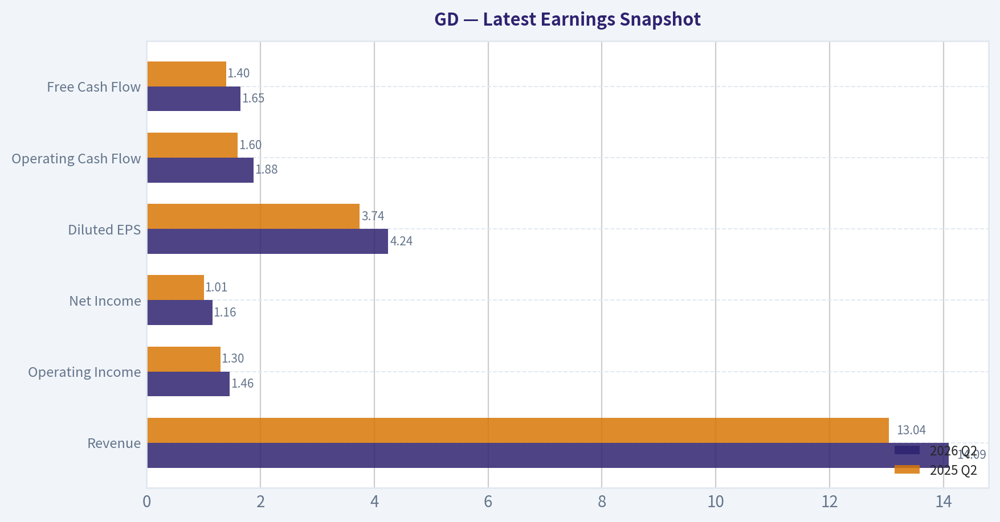

This comparison chart from *Current Metrics Versus Ten-Year Averages* stacks current figures against historical benchmarks for **GD**, making it easy to see where the company trades relative to its own averages.

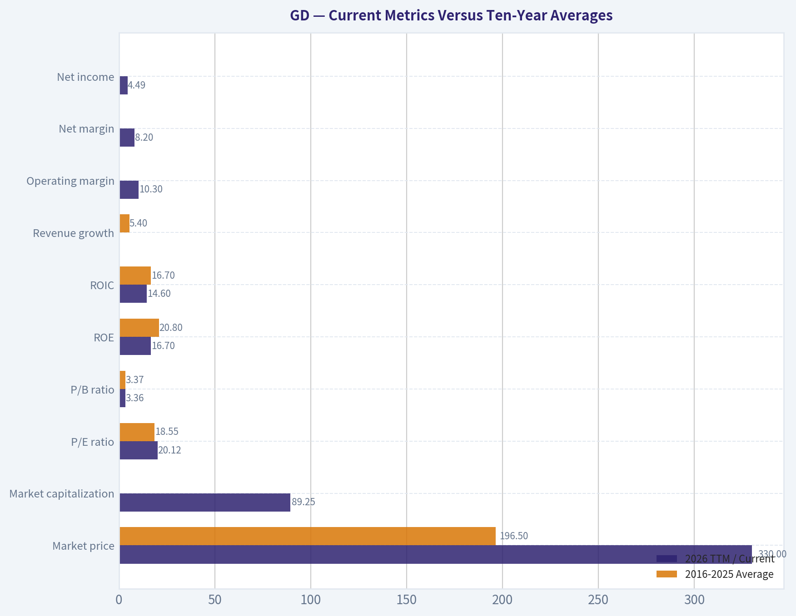

This comparison chart from *Balance Sheet and Financial Strength* stacks current figures against historical benchmarks for **GD**, making it easy to see where the company trades relative to its own averages.

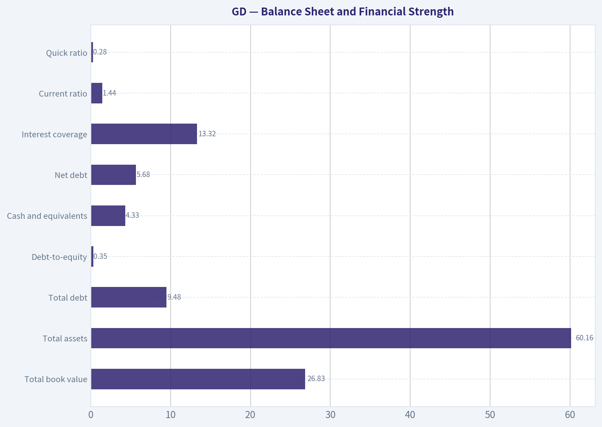

This comparison chart from *Cash Flow and Capital Allocation* stacks current figures against historical benchmarks for **GD**, making it easy to see where the company trades relative to its own averages.

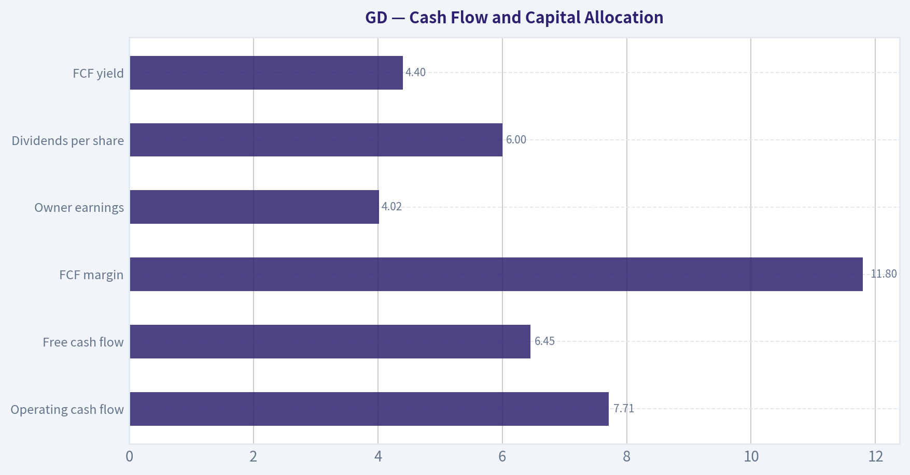

---

### Trend & Growth Analysis (Lynch/Druckenmiller/Fisher)

> *Following Peter Lynch's GARP, Stanley Druckenmiller's macro-aware approach, and Philip Fisher's scuttlebutt methodology.*

ANALYST STANCE: **WATCH**

#### 1. Executive Summary

General Dynamics is a high-quality defense and aerospace contractor, but it currently looks more like a **stalwart** than a fast-growing, ten-bagger candidate. Its revenue is growing around 10%, valuation is close to 20 times earnings, and the stock price is materially above the provided intrinsic-value estimate.

The business benefits from durable defense spending, submarine demand, aerospace recovery, and long-term government contracts. However, the current setup lacks clear evidence of accelerating growth sufficient to justify aggressive buying at $330.

| Metric | Value | Interpretation |
|---|---:|---|
| Current price | $330 | Market price as of research pack |
| Market capitalization | $89.25 billion | Large-cap defense contractor |
| P/E ratio | 20.1x | Reasonable for quality, not cheap for 10% growth |
| Revenue growth | 10.1% year over year | Stalwart-level growth |
| ROE | 16.4% | Solid capital efficiency |
| FCF yield | 4.4% | Moderate cash-flow support |
| Headline intrinsic value | $248.06 | Approximately 33% below current price |
| Reverse-DCF implied growth | 32.2% annually for 10 years | Very demanding assumption |
| Historical revenue growth | 14.0% over 3 years; 12.8% over 5 years | Below the reverse-DCF requirement |

**Key Takeaways:** GD is financially solid, but its current price appears to assume a major acceleration in long-term growth. Revenue growth is closer to a stalwart profile than a fast-grower profile, while the headline valuation indicates limited margin of safety.

---

#### 2. Lynch Classification

**Classification: Stalwart, with selective cyclical exposure**

General Dynamics does not currently qualify as a Lynch fast grower. Its 10.1% revenue growth is respectable, but below the 15-25% range generally associated with primary growth-investing opportunities. Its defense businesses also have long procurement cycles, making abrupt growth acceleration less common than in software or emerging technology companies.

#### The Story in Three Bullets

- GD provides mission-critical defense platforms, including submarines, combat vehicles, munitions-related systems, and business jets.
- Global security tensions and modernization needs support a long-term increase in defense budgets and contracted backlog.
- The company offers cash generation, shareholder returns, and durable customer relationships, but the stock already reflects considerable optimism.

---

#### 3. TAM and Runway Analysis

GD participates in several large markets: defense procurement, naval shipbuilding, land systems, munitions, cybersecurity-related government services, and business aviation.

| TAM Test | Assessment |
|---|---|
| Current company revenue | Approximately $47 billion, implied from recent scale |
| 10x revenue | Approximately $470 billion |
| Relevant global defense spending | More than $2 trillion annually, but only a fraction is addressable by GD |
| Can GD reach $470 billion while remaining below 20% share? | Technically possible against the broad defense market, but unrealistic for GD's directly addressable segments |
| TAM growth | Positive, supported by rearmament and modernization |
| Runway quality | Long and durable, but not obviously capable of supporting 10x company growth |

**Key Takeaways:** GD operates in a large and expanding market, but its realistic addressable market is much smaller than total global defense spending. The company has a durable runway for moderate growth, yet the 10x test does not clearly support a ten-bagger thesis from today's already-large revenue base.

---

#### 4. Revenue Growth Trend

| Period | Revenue Growth | Signal |
|---|---:|---|
| 3-year historical CAGR | 14.0% | Healthy |
| 5-year historical CAGR | 12.8% | Healthy but moderate |
| Latest year-over-year growth | 10.1% | Deceleration versus historical trend |
| Required growth implied by reverse DCF | 32.2% annually for 10 years | Very aggressive |

**Key Takeaways:** The available data indicates **deceleration**, not acceleration. GD remains a reliable compounder, but there is no confirmed Druckenmiller-style earnings inflection in the supplied data.

---

#### 5. Unit Economics and Operating Quality

Traditional SaaS metrics such as LTV/CAC, net revenue retention, and Rule of 40 are not meaningful for a defense contractor. GD's relevant economic indicators are contract quality, backlog, cash conversion, program execution, and returns on capital.

| Metric | Result | Assessment |
|---|---:|---|
| LTV/CAC | N/A | Not applicable to government contracting |
| Net revenue retention | N/A | Not disclosed or meaningful in the SaaS sense |
| Rule of 40 | N/A | Not applicable |
| ROE | 16.4% | Solid |
| FCF yield | 4.4% | Reasonable, but not exceptional |
| Current ratio | 1.44x | Adequate liquidity |
| Gross margin trend | Not available | Requires deeper filing review |

**Key Takeaways:** GD's economics are supported by long-lived customer relationships and mission-critical contracts rather than recurring software metrics. ROE and liquidity are satisfactory, but the available data does not establish an extraordinary margin or cash-flow inflection.

---

#### 6. Inflection Point Assessment

| Potential Inflection | Evidence | Rating |
|---|---|---|
| Defense budget inflection | Re-armament and strategic competition support spending | Positive |
| Naval shipbuilding | Long-term demand for submarines and destroyers | Positive, but execution-sensitive |
| Aerospace cycle | Business aviation recovery can support Gulfstream | Positive but cyclical |
| Margin inflection | Insufficient data provided | Unconfirmed |
| Revenue acceleration | Current growth is 10.1%, below historical rates | Negative |
| Competitive inflection | No clear evidence of a major competitor failure | Unconfirmed |
| Backlog conversion | Likely important, but current backlog data unavailable | Unconfirmed |

**Key Takeaways:** The strongest inflection is at the industry level: defense modernization and higher strategic spending. Company-level revenue acceleration and margin expansion are not yet demonstrated, so the investment case remains one of durable compounding rather than confirmed acceleration.

---

#### 7. Macro Setup

The macro backdrop is broadly favorable for defense contractors. Geopolitical tensions, NATO rearmament, supply-chain security, naval modernization, and missile-defense requirements should support government budgets.

The principal macro risk is not demand but execution and valuation. Defense programs can face cost overruns, labor shortages, fixed-price contract pressure, and political changes. Higher interest rates are less damaging to GD than to long-duration technology stocks, but they still reduce the present value of future cash flows.

**Macro assessment: Moderately favorable.**

---

#### 8. Fisher's 15-Point Assessment

Scores are preliminary because detailed filing, supplier, employee, and customer research was not available.

| Fisher Criterion | Score / 5 | Comment |
|---|---:|---|
| Market potential | 5 | Large, strategic defense markets |
| New-product determination | 4 | Ongoing platform development |
| R&D effectiveness | 4 | Technologically demanding businesses |
| Sales organization | 4 | Strong government and commercial relationships |
| Profit margins | 4 | Generally attractive for industrial defense |
| Margin improvement | 3 | No clear current inflection |
| Labor relations | 3 | Defense labor and shipyard execution risks |
| Executive relations | 4 | Established management structure |
| Management depth | 4 | Diversified operating segments |
| Cost accounting | 3 | Program accounting can be complex |
| Outstanding moat | 5 | Certifications, contracts, scale, switching costs |
| Long-term profit outlook | 4 | Durable but moderate growth |
| Dilution risk | 4 | No major dilution concern indicated |
| Management candor | 3 | Insufficient evidence in supplied material |
| Management integrity | 4 | No major issue identified |

**Total: 58 / 75 - Good**

**Key Takeaways:** GD scores well on market position, barriers to entry, and long-term demand. The main deductions reflect limited evidence of margin acceleration, program-execution risk, and incomplete information on management candor and operating details.

---

#### 9. Valuation Analysis

##### PEG Valuation

Using the supplied P/E and latest revenue-growth rate as a rough growth proxy:

- P/E: 20.1x
- Growth proxy: 10.1%
- Approximate PEG: **2.0**

This is at the upper end of fair value and approaches expensive territory under Lynch's framework. Earnings growth could differ from revenue growth, so this is only a screening estimate.

| Valuation Measure | Result | Interpretation |
|---|---:|---|
| P/E | 20.1x | Fair for quality, not cheap |
| Approximate PEG | 2.0x | Expensive relative to current growth |
| FCF yield | 4.4% | Moderate valuation support |
| Headline intrinsic value | $248.06 | Below current price |
| Current price premium to intrinsic value | Approximately 33% | Limited margin of safety |
| Reverse-DCF growth assumption | 32.2% for 10 years | Aggressive relative to history |

**Key Takeaways:** GD is not priced like a distressed or neglected defense stock. A 20x earnings multiple may be defensible for quality and visibility, but it is demanding against 10% revenue growth and the absence of a clear acceleration catalyst.

##### Scenario Analysis

The following is an illustrative three-year framework, not a precise price target.

| Scenario | Growth Assumption | Exit Multiple | Three-Year View |
|---|---:|---:|---|
| Bear | 5-7% earnings growth | 16-18x | Valuation contraction and limited return |
| Base | 8-10% earnings growth | 18-20x | Moderate upside, largely dependent on execution |
| Bull | 12-15% earnings growth | 21-23x | Attractive upside if defense and aerospace accelerate |

**Key Takeaways:** The bull case requires both faster earnings growth and continued premium valuation. The bear case is credible because even modest growth can produce disappointing returns if the P/E multiple contracts.

---

#### 10. Growth Investor Scorecard

| Criterion | Weight | Score / 5 | Weighted Result |
|---|---:|---:|---:|
| Lynch story | 10% | 4.0 | 0.40 |
| TAM and runway | 20% | 4.0 | 0.80 |
| Revenue growth | 20% | 3.0 | 0.60 |
| Unit economics | 15% | 3.5 | 0.53 |
| Competitive position | 10% | 4.5 | 0.45 |
| Management quality | 10% | 3.8 | 0.38 |
| Macro setup | 5% | 4.0 | 0.20 |
| Profitability path | 5% | 4.0 | 0.20 |
| Valuation | 5% | 2.5 | 0.13 |
| **Total** | **100%** |  | **3.69 / 5.00** |

**Key Takeaways:** GD scores as a good business with a favorable industry backdrop, but valuation and moderate growth prevent a high-conviction advocate rating. The score supports monitoring or buying only at a better entry point.

---

#### 11. Position Size Stance

**Suggested stance: 0-2% initial position; do not make it a concentrated growth holding at $330.**

A larger position would require at least one of the following:

- Revenue growth reaccelerating toward the mid-teens or higher.
- Clear evidence of backlog conversion and margin expansion.
- A materially lower entry price, preferably closer to the provided intrinsic-value range.
- Stronger free-cash-flow growth than currently indicated.

The latest guru data shows Steve Cohen increased his disclosed position, but 13F filings are delayed snapshots and should not be treated as a current investment signal.

---

#### 12. Key Risks and Catalysts

| Catalysts | Risks |
|---|---|
| Faster defense-budget growth | Program delays and cost overruns |
| Submarine and naval production acceleration | Shipyard labor and supply-chain constraints |
| Gulfstream business-jet recovery | Business aviation cyclicality |
| Higher backlog conversion | Fixed-price contract pressure |
| Margin expansion from operating leverage | Valuation compression |
| Increased geopolitical urgency | Government procurement or budget delays |
| Share repurchases and dividend growth | Stock already pricing in significant optimism |

**Key Takeaways:** The strongest catalysts are defense modernization, naval demand, and aerospace recovery. The largest risks are execution, contract economics, and paying too much for a company whose growth currently looks closer to 10% than 20% or 30%.

#### Final Verdict

GD is a **high-quality defense compounder**, but not currently a clear fast-growth or ten-bagger opportunity. The business merits a watchlist position because its competitive advantages and industry runway are attractive; however, the current price offers insufficient margin of safety and the available evidence shows growth deceleration rather than acceleration.

---

### Market Technical Analysis

ANALYST STANCE: **WATCH**

#### GD technical market report

The latest available trading session is **October 12, 2026**, when GD closed at **$335.46**. October 13 is not represented as a trading session in the retrieved data. The selected indicators are **close_10_ema, close_50_sma, close_200_sma, macd, rsi, boll_ub, boll_lb, and atr**. Together, they cover short-, medium-, and long-term trend, momentum, mean-reversion conditions, volatility, and risk management without relying on several highly redundant indicators.

#### Trend structure

GD remains in a damaged medium-term trend despite the recent bounce. The stock fell from approximately **$398 in mid-August** to around **$330 by late September**, producing a sequence of lower highs and lower lows. The latest close is:

- About **$23.94 below the 50-day SMA** of **$361.24**.
- About **$16.12 below the 200-day SMA** of **$351.58**.
- About **$3.18 above the 10-day EMA** of **$332.28**.

This configuration is important. Price reclaiming the 10-day EMA indicates a short-term recovery attempt, but remaining below both longer-term averages means the broader trend has not yet turned constructive. The 50-day SMA is also above the 200-day SMA, but the 50-day average is declining sharply while the 200-day average is relatively flat around $351-$352. That suggests medium-term deterioration rather than a confirmed long-term bear trend.

The first meaningful overhead resistance zone is approximately **$351-$362**, defined by the 200-day and 50-day averages. A sustained move through that area would materially improve the chart. Until then, rallies may represent countertrend rebounds within a broader correction.

#### Short-term momentum and MACD

The 10-day EMA declined from approximately **$360 in mid-September** to **$332.28**, confirming the sharp short-term deterioration. However, the latest close above the EMA and the move from $328.50 on October 2 to $335.46 on October 12 indicate that selling pressure has eased.

MACD remains negative at **-8.60**, so momentum is still below its neutral baseline. Nevertheless, it has improved from approximately **-10.76 on October 2** and **-10.12 on October 8**. This is a meaningful but incomplete improvement: downside momentum is decelerating, yet MACD has not recovered enough to establish a bullish trend reversal. Traders should look for continued improvement and preferably a move above the signal line before treating the rebound as more than a tactical recovery.

#### RSI and reversal potential

RSI provides the clearest evidence that GD had become technically stretched on the downside. RSI fell to approximately **21-24** during the first week of October, well into oversold territory, then recovered to **33.50 on October 9** and **40.54 on October 12**.

That rebound is constructive because it shows that downside momentum has eased without RSI becoming overbought. However, an RSI near 40.5 remains below the neutral 50 level. Therefore, the indicator supports a **relief rally or stabilization scenario**, not yet a confirmed bullish reversal. A move above 50 would provide stronger evidence that buyers are gaining control; a failure near 40-50 followed by a decline below 30 would indicate that the larger downtrend is reasserting itself.

#### Bollinger Bands and price location

The latest Bollinger Band readings are:

- Upper band: approximately **$359.39**
- Lower band: approximately **$316.53**
- Implied middle band: approximately **$337.96**

GD closed at **$335.46**, slightly below the middle band and well above the lower band. This is a more balanced position than the deeply oversold condition seen earlier in October. Price is no longer pressing the lower band, but it has not reclaimed the middle band decisively.

The lower band near **$316-$317** is the main downside reference. A break below that area would suggest renewed downside expansion and could expose the stock to another leg lower. On the upside, the middle band near **$338** is the immediate test, followed by the upper band near **$359**. Because the upper band is close to the 200-day and 50-day moving-average resistance zone, a move toward $359-$362 would likely encounter substantial supply.

#### Volatility and risk management

ATR is approximately **$6.21**, down from roughly **$6.9** in late September. Volatility has therefore moderated somewhat, but it remains meaningful relative to the stock's price. A one-ATR daily move represents roughly **1.9%** of the latest closing price, so stops placed too tightly around current levels could be vulnerable to ordinary fluctuations.

The recent rise was accompanied by volume of approximately **2.09 million shares**, higher than much of the preceding week and above several recent average sessions. This lends some support to the rebound, but one higher-volume session is not sufficient confirmation. Follow-through above $338 and then $351-$352, preferably with sustained volume, would be more persuasive.

#### Trading interpretation

The current setup is best characterized as **short-term stabilization within a medium-term downtrend**.

- **Bullish case:** GD holds above the 10-day EMA, reclaims the Bollinger middle band around $338, and then advances through the 200-day SMA near $351.58. A move above the 50-day SMA near $361.24 would be a stronger trend-reversal signal.
- **Neutral case:** Price remains between approximately $330 and $351, with RSI recovering gradually but MACD staying negative. This would suggest base-building rather than a confirmed trend change.
- **Bearish case:** GD fails near $338-$351, falls back below the 10-day EMA, and breaks the $325-$317 support area. Such a move would indicate that the oversold bounce has failed and that the broader decline remains active.

For now, the risk-reward profile favors patience rather than aggressive directional exposure. Existing holders may monitor whether the stock can reclaim the 200-day average, while new bullish positions would have stronger technical confirmation after a sustained break above the $351-$362 resistance band. Conversely, a failure below the recent lows would invalidate the current stabilization thesis.

| Indicator | Latest reading | Technical interpretation | Key levels or signal |
|---|---:|---|---|
| Close | $335.46 on Oct. 12 | Rebound from late-September/early-October weakness, but still below major trend averages | Near-term support around $325, then $316-$317 |
| 10-day EMA | $332.28 | Price has modestly reclaimed the short-term average | Holding above $332 supports stabilization |
| 50-day SMA | $361.24 | Declining and well above price, confirming medium-term weakness | Resistance near $361 |
| 200-day SMA | $351.58 | Nearly flat but above price; long-term trend is not decisively bullish | Important resistance near $351-$352 |
| MACD | -8.60 | Negative, but improving from early-October lows | Further improvement and a signal-line cross would strengthen the rebound |
| RSI | 40.54 | Recovered from oversold readings, but remains below neutral | Above 50 would improve momentum; below 30 would renew oversold risk |
| Bollinger Bands | $316.53 lower / about $337.96 middle / $359.39 upper | Price is near the middle band after escaping lower-band pressure | Reclaim $338; resistance near $359-$362 |
| ATR | $6.21 | Volatility has eased but remains material | Use risk limits that account for roughly $6 daily range |

**Key Takeaways:** GD is attempting a short-term rebound after reaching oversold conditions, but the stock remains below both its 50-day and 200-day moving averages. Momentum is improving, as shown by the recovering RSI and less-negative MACD, yet neither has confirmed a durable reversal. The most important near-term test is $338, followed by the heavier $351-$362 resistance zone; failure back below $325 would weaken the stabilization thesis.

#### Market Visuals

This comparison chart from *Market Metrics and Valuation* stacks current figures against historical benchmarks for **GD**, making it easy to see where the company trades relative to its own averages.

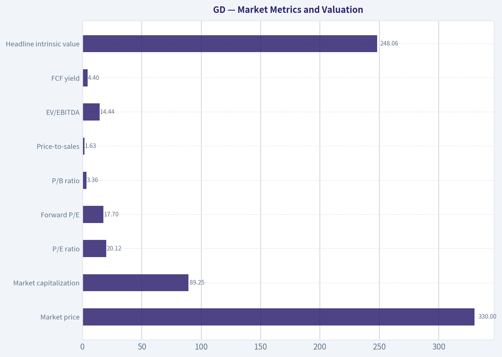

---

### Options Market Analysis

> *Reading options flow - put/call ratios, IV skew, and unusual activity - to gauge institutional positioning and event-driven risk.*

#### GD Options Market Report

**As of October 13, 2026.** The available data covers near-term expirations from October 16 through October 30. Strike-level open interest and GD's current share price were not provided, so specific gamma-wall strikes and ITM/ATM/OTM classification cannot be determined.

#### 1. Put/Call Ratio Analysis

| Expiration | Call OI | Put OI | Put/Call OI | Call Volume | Put Volume | Put/Call Volume |
|---|---:|---:|---:|---:|---:|---:|
| Oct. 16, 2026 | 1,657 | 1,082 | 0.65 | 222 | 382 | 1.72 |
| Oct. 23, 2026 | 185 | 61 | 0.33 | 176 | 37 | 0.21 |
| Oct. 30, 2026 | 247 | 121 | 0.49 | 106 | 39 | 0.37 |
| **Total near-term** | **2,089** | **1,264** | **0.61** | **504** | **458** | **0.91** |

**Key Takeaways:** The aggregate put/call open-interest ratio of 0.61 is below the approximately 0.70 neutral baseline, indicating a modestly bullish positioning bias. However, the October 16 expiration has put volume substantially greater than call volume, suggesting near-term hedging or bearish speculation concentrated in the immediate expiry. Overall volume is close to balanced, so conviction is moderate rather than strong.

The October 23 and October 30 expirations show much more call-heavy activity, which offsets the short-dated put pressure. This pattern is consistent with some immediate downside protection alongside a more constructive positioning bias beyond the current week.

#### 2. Implied Volatility Assessment

| Expiration | Call ATM IV | Put ATM IV | IV Difference, Put Minus Call | Interpretation |
|---|---:|---:|---:|---|
| Oct. 16, 2026 | 30.0% | 30.3% | +0.3 percentage points | Essentially flat skew |
| Oct. 23, 2026 | 23.4% | 28.1% | +4.7 percentage points | Meaningful put skew |
| Oct. 30, 2026 | 31.8% | 28.9% | -2.9 percentage points | Moderate call skew |

**Key Takeaways:** Near-term ATM implied volatility ranges from 23.4% to 31.8%. Volatility is highest in the October 30 calls and October 16 options, while the October 23 expiration has lower overall volatility but a notable premium for puts. The October 23 put skew indicates downside protection demand, whereas the October 30 call skew suggests some upside speculation or demand for upside exposure.

The data does not identify a specific earnings release, product launch, or other catalyst, so elevated IV cannot be definitively attributed to an event. The uneven term structure may reflect expiration-specific positioning rather than a broad market-wide volatility bid.

#### 3. Unusual Options Activity

| Finding | Result |
|---|---|
| Contracts with volume greater than 5x open interest | None identified |
| Fresh directional institutional-style activity | No clear evidence |
| Strong call or put sweep signal | Not detected |
| Retail speculation signal | Not clearly identifiable |

**Key Takeaways:** No contract met the supplied unusual-activity threshold of volume exceeding five times open interest. Therefore, there is no specific call or put contract that can be characterized as a fresh, high-conviction directional bet. The sentiment read must rely primarily on aggregate open interest, volume ratios, and volatility skew.

#### 4. Open Interest Concentration and Gamma Levels

| Expiration | Total Call OI | Total Put OI | Total OI |
|---|---:|---:|---:|
| Oct. 16, 2026 | 1,657 | 1,082 | 2,739 |
| Oct. 23, 2026 | 185 | 61 | 246 |
| Oct. 30, 2026 | 247 | 121 | 368 |

**Key Takeaways:** Open interest is heavily concentrated in the October 16 expiration, which contains roughly 90% of the reported near-term open interest. That concentration can increase pinning or expiration-related price sensitivity, but the absence of strike-level data prevents identification of exact gamma walls, maximum-pain levels, or likely gravitational prices.

The dominant October 16 positioning could dampen price movement near heavily traded strikes if dealers are well hedged, but it could also amplify movement as expiration approaches if the underlying moves away from those concentrations.

#### 5. Overall Options Sentiment

**Overall signal: BULLISH, with moderate confidence.**

The primary bullish driver is the aggregate put/call open-interest ratio of 0.61, below the historical neutral reference of approximately 0.70. Call-heavy positioning in the October 23 and October 30 expirations further supports a constructive medium-near-term bias.

The principal caveat is the elevated put volume in the October 16 expiration and the meaningful October 23 put skew. Those features imply that traders are still paying for short-term downside protection. Since there is no unusual activity and total options volume is relatively modest, this is a mild bullish signal rather than a high-conviction institutional call.

#### Summary

| Category | Assessment |
|---|---|
| Put/Call Ratio | **Bullish overall:** 0.61 OI ratio versus approximately 0.70 neutral; volume ratio near balanced at 0.91 |
| IV Level | **Moderate and uneven:** approximately 23.4%-31.8%; highest in October 16 and October 30 contracts |
| Skew Direction | **Mixed but slightly protective:** October 23 has notable put skew; October 30 has moderate call skew |
| Unusual Activity | **None detected:** no contracts exceeded 5x open interest |
| Overall Signal | **BULLISH, moderate confidence:** call-heavy OI outweighs immediate-expiry put hedging |

**Key Takeaways:** GD's options positioning leans bullish based on below-neutral put/call open interest and stronger call positioning in later near-term expirations. Immediate downside hedging remains visible through October 16 put volume and October 23 put skew. With no unusual contract activity and no strike-level gamma data, the bullish signal should be treated as moderate rather than decisive.

---

## Research Team Commentary

> *The Research Manager synthesizes the Bull vs Bear debate into action-free commentary. This is a pre-risk view, not the final stance.*

Core takeaway: General Dynamics is a high-quality, strategically entrenched franchise, but the evidence provided does not establish that $330 offers a sufficient margin of safety. The moat and long-term demand outlook are convincing; the valuation case is not yet robust because it relies on treating accounting earnings as owner earnings without free-cash-flow, leverage, pension, and segment-margin data. This is a company to own at the right price, but for now I would monitor rather than initiate a full position.

The strongest bull argument is business quality. General Dynamics possesses assets that would be extraordinarily difficult to recreate, particularly its nuclear-submarine infrastructure, cleared workforce, engineering knowledge, regulatory approvals, and decades-long relationship with the U.S. government. Its combat-systems installed base creates recurring upgrade and support opportunities, while Gulfstream adds a premium commercial franchise with brand, certification, and service-network advantages. These are genuine economic moats, not merely the result of a favorable industry cycle.

The operating metrics also support the quality assessment. Revenue growth of 10.1%, ROIC of 14.1%, and ROE of 16.4% indicate a healthy company earning returns above a reasonable estimate of its cost of capital. Defense modernization, submarine construction, readiness replenishment, and allied spending should sustain demand well beyond the next budget cycle. The stock therefore deserves a better multiple than an ordinary capital-intensive industrial company.

The bull's reverse-DCF framing is also directionally useful. At $330 and 20.1 times earnings, the market is not demanding that current 10% revenue growth continue indefinitely. Under a 9% discount rate and 3% terminal growth assumption, the price appears to require roughly 5% annual growth in normalized earnings. That is plausible for this franchise. A 20-times multiple is not obviously excessive for a wide-moat company with durable demand and mid-teens returns on capital.

The strongest bear argument, however, is that the apparent margin of safety is fragile. The bull's estimated value of $354-$368 offers only approximately 7-12% upside, and even that depends on current EPS being a reasonable proxy for owner earnings. That assumption matters greatly for a company with long-duration contracts, percentage-of-completion accounting, significant working-capital demands, capital-intensive facilities, and potential fixed-price charges.

The valuation also changes materially when the discount rate moves from 9% to 10%. Under the bear's sensitivity analysis, even 6.5% growth produces a value near $312 at a 10% hurdle rate. I would not treat that output as precise, but it demonstrates that the investment case has little room for estimation error. A true margin of safety should not disappear because of a one-percentage-point change in the required return.

The distinction between revenue growth and owner-earnings growth is especially important. A 10.1% increase in revenue does not prove that free cash flow per share can compound at 5-6.5%. Labor shortages, supplier constraints, capacity spending, contract mix, cost-estimate revisions, and working-capital requirements can absorb much of the economic benefit. Backlog provides visibility into work, but it does not guarantee visibility into margins or cash receipts.

The moat also needs to be characterized correctly. General Dynamics is nearly irreplaceable in some programs, but its primary customer is a sovereign buyer with enormous negotiating and oversight power. The moat protects continuity of participation more strongly than it protects pricing freedom. That can still support attractive returns, as the current 14.1% ROIC suggests, but it does not make fixed-price execution risk harmless.

Gulfstream similarly cuts both ways. It is a valuable premium franchise that diversifies GD beyond government contracting, but it introduces exposure to corporate confidence, financing conditions, aircraft certification, production execution, and used-aircraft values. It should not be valued as though it has the same demand predictability as submarine programs.

From a Buffett perspective, the right conclusion is not AVOID. There is no evidence of distress, a broken moat, poor returns on capital, or clear overvaluation. Conversely, the available information is not sufficient for ADVOCATE because the quality-scaled discount is only near the lower boundary of what would be acceptable, and that discount is based on unverified owner earnings. For a business of this quality, a 10-15% discount could be enough, but it must be measured against normalized cash flow rather than an EPS proxy.

The market and options data do not change that conclusion. The reported moving-average figures are internally inconsistent with the stated $330 price: $330 is $31.24 below a $361.24 50-day average and $21.58 below a $351.58 200-day average, not the quoted distances. It is also below, rather than above, a $332.28 10-day EMA. Those technical figures should therefore be discarded until corrected. The 0.61 options put/call ratio suggests modestly bullish positioning, but without strike-level open interest it has little decision value.

This assessment incorporates the prior lessons without overcorrecting. The earlier Alphabet mistake showed that valuation should not become a veto against an exceptional franchise, and weak technical confirmation should not prevent long-term ownership. The Glencore review showed that business quality and short-term price behavior must be separated. Here, however, the intended case is long-term ownership, so cash economics and purchase price properly carry more weight than near-term momentum. The lesson is to avoid both extremes: do not reject GD simply because it is not statistically cheap, but do not call EPS "owner earnings" merely because the missing cash-flow data would otherwise make valuation difficult.

Over the next one to four quarters, I would first examine free-cash-flow conversion. Operating cash flow less capital expenditures should track or exceed reported net income over a rolling period, adjusted for understandable program timing. Persistent conversion materially below earnings would support the bear case.

Second, I would watch segment margins and contract-estimate revisions, particularly at Marine Systems and Technologies. Isolated charges are manageable; recurring unfavorable revisions would indicate that demand growth is not translating into acceptable economics.

Third, I would monitor Electric Boat production milestones, labor productivity, supplier constraints, and the funding cadence for major submarine programs. The key question is whether capacity investment produces higher deliveries and cash flow without eroding incremental returns.

Fourth, Gulfstream deliveries, certification progress, backlog quality, and aerospace margins should be tracked. Rising deliveries accompanied by improving cash generation would strengthen the thesis. Delivery growth that requires disproportionate working capital or produces weak margins would not.

Fifth, the missing balance-sheet information must be filled in: net debt, interest coverage, pension obligations, debt maturities, and capital-allocation priorities. I would also want ROIC to remain comfortably above roughly 11-12% as investment expands.

At $330, a starter position could be defensible for an investor already comfortable with the company's cash-flow history, but the supplied evidence does not justify aggressive accumulation. A price nearer $295-$305, absent fundamental deterioration, would provide a more credible quality-adjusted cushion. Alternatively, strong cash conversion and stable margins could justify ownership around the current price even without a large pullback. A move materially above the bull's $354-$368 value range without corresponding earnings and cash-flow revisions would make the risk-reward less attractive.

Final stance: WATCH.

---

## Value Investing Team Commentary

> *The Investor translates the research view into an investment thesis before risk review. This is still not the final stance.*

### Investment Commentary

General Dynamics is an unusually durable industrial franchise. Its nuclear-submarine infrastructure, security-cleared workforce, engineering expertise, regulatory approvals, and longstanding government relationships would be exceptionally difficult to reproduce. Combat Systems benefits from a large installed base and recurring modernization requirements, while Gulfstream adds a premium aviation brand, certification expertise, and global service network.

These advantages support long-duration earnings power, but they do not eliminate execution or valuation risk.

### Business quality and moat

The underlying quality indicators are favorable:

- Revenue growth: **10.1%**
- ROIC: **14.1%**
- ROE: **16.4%**
- ROA: **7.4%**

A 14.1% ROIC suggests that General Dynamics is creating economic value, assuming its cost of capital is materially lower. Demand visibility also appears strong because submarine construction, defense modernization, ammunition replenishment, and allied military spending are multiyear priorities rather than temporary consumer trends.

Nevertheless, GD's moat is somewhat different from that of a consumer monopoly or software platform. Its entrenched position protects program participation and backlog more strongly than pricing freedom. The U.S. government is a powerful, highly informed customer capable of scrutinizing costs, controlling funding cadence, and influencing contract economics. Backlog therefore provides revenue visibility, but not necessarily margin or cash-flow certainty.

Gulfstream is a genuine premium franchise, but it introduces greater cyclicality. Business-jet demand depends partly on corporate confidence, financing conditions, production execution, certification timing, and residual aircraft values. It should not receive the same predictability premium as nuclear-submarine programs.

### Valuation and reverse-DCF perspective

At **$330** and **20.13 times earnings**, implied EPS is approximately **$16.39**, producing an earnings yield of roughly **5%**. That is not statistically cheap, but neither is it obviously excessive for a strategically entrenched company earning mid-teens returns on invested capital.

The supplied reverse-DCF analysis indicates that the market may be pricing approximately **5% normalized earnings growth**, using a 9% discount rate and 3% terminal growth. That growth requirement appears achievable given defense modernization, backlog conversion, Gulfstream deliveries, and potential per-share benefits from capital returns.

The problem is not that the assumptions are implausible. The problem is that the valuation has limited tolerance for disappointment. An estimated value of **$354-$368** represents only about **7% to 12% upside** from $330. That approaches the acceptable discount for a wonderful business, but GD is capital-intensive and exposed to fixed-price contract execution. I would prefer either:

1. Better evidence that accounting earnings convert reliably into distributable cash, or
2. A somewhat larger price discount.

The sensitivity to a 10% discount rate reinforces this point. Intrinsic value falling toward approximately $312 under still-respectable growth assumptions does not prove the stock is overvalued, but it shows that the apparent margin of safety depends heavily on the chosen hurdle rate.

### The owner-earnings gap

The central unresolved issue is free-cash-flow quality. Revenue growth and reported EPS are not equivalent to owner-earnings growth.

General Dynamics must fund facilities, specialized capacity, inventory, supplier support, labor expansion, and working capital across long-duration programs. Percentage-of-completion accounting and contract estimates can also cause reported earnings to diverge from cash receipts. Unexpected inflation, labor inefficiency, supplier delays, or design changes can create unfavorable revisions, particularly on fixed-price work.

Before treating the current multiple as attractive, I would want to establish:

- Rolling free-cash-flow conversion relative to net income
- Maintenance versus growth capital expenditure
- Segment-level margin trends
- Frequency and magnitude of unfavorable contract revisions
- Net debt, interest coverage, and debt maturities
- Pension funding obligations
- Share repurchases relative to intrinsic value
- Incremental ROIC as submarine capacity expands

A high-quality backlog is valuable only if it becomes satisfactory cash returns on the capital required to fulfill it.

### Management and capital allocation

The available information does not establish a sufficiently detailed capital-allocation record. GD appears financially productive based on ROIC and ROE, but those metrics alone do not show whether management has repurchased shares intelligently, maintained conservative leverage, or earned attractive returns on recent capacity investment.

The critical management test will be whether expanding defense demand translates into higher free cash flow per share without recurring cost overruns or declining incremental returns. Growth that requires disproportionate capital and working capital is less valuable than its revenue figures suggest.

### Selective contrarian view

The stock's weakness relative to its moving averages may represent an opportunity rather than evidence of a damaged business. At $330, the correct technical relationships are:

- **$31.24 below** the $361.24 50-day SMA
- **$21.58 below** the $351.58 200-day SMA
- **$2.28 below** the $332.28 10-day EMA

The originally quoted distances and direction were incorrect. The corrected figures show meaningful price weakness, but a long-term investor should ask why the shares have weakened.

If the decline reflects temporary anxiety over budget timing, production bottlenecks, or quarterly working-capital movements while backlog and normalized economics remain intact, it could become an attractive contrarian entry. If it reflects recurring contract charges, deteriorating margins, or poor cash conversion, the market may be recognizing a real economic problem rather than offering a bargain.

The options put/call open-interest ratio of **0.61** indicates mildly bullish positioning. That is neither sufficiently pessimistic to create a strong contrarian signal nor sufficiently euphoric to establish serious downside risk. Without strike-level positioning, expiration concentration, and current open-interest details, options sentiment should not influence a long-term ownership decision.

More broadly, geopolitical tensions and rising defense budgets are now widely recognized. The market is unlikely to be missing the general demand story. What it may still be mispricing is the conversion of that demand into margins and cash flow. That is where differentiated analysis should focus.

### Practical investment approach

At **$330**, I would not avoid the company, but I also would not build a full position from the supplied evidence.

A small starter position can be reasonable for an investor who has independently confirmed GD's historical cash conversion and balance-sheet strength. More compelling entry conditions would be either:

- A price around **$295-$305** without business deterioration, providing approximately a 15% quality-adjusted discount to the midpoint of the supplied value range; or
- Evidence of strong free-cash-flow conversion, stable segment margins, and satisfactory incremental returns that validates ownership near $330.

Conversely, a move materially above **$354-$368** without corresponding increases in normalized cash flow would make the valuation less attractive. Recurring contract charges, weakening ROIC, or persistently poor cash conversion would also require reassessing the business thesis, not merely waiting for a lower price.

**ANALYST STANCE: WATCH** - General Dynamics is a high-quality, strategically entrenched franchise with durable demand and a defensible moat. At $330, however, the estimated discount is modest and rests too heavily on reported earnings rather than verified owner earnings. Monitor cash conversion, contract revisions, segment margins, leverage, and incremental ROIC; consider a starter position only after confirming those economics, or seek a more attractive entry around $295-$305 absent fundamental deterioration.

---

## Deep Values Commentary

> *The Risk Management Team debates and the Risk Judge provides the final action-free verdict. This section determines the final ADVOCATE / WATCH / AVOID stance.*

#### Final Stance Scorecard

This scorecard converts the final research view into a weighted decision frame. It does not replace the narrative judgement, but it makes the main drivers of the verdict easier to scan.

| Criterion | Score | Weight | Commentary |
| --- | ---: | ---: | --- |
| Business Quality | 3.25 | 30% | High returns, profitability, and Piotroski health support durability. |
| Valuation Support | 2.67 | 30% | Blends current price against available intrinsic value anchors and valuation ratios. |
| Financial Strength | 2.67 | 20% | Balance-sheet resilience reflects leverage and liquidity staying within safe ranges. |
| Growth Durability | 4.33 | 20% | Recent revenue, earnings, and free cash flow growth indicate how durable expansion looks. |
| TOTAL / FINAL STANCE | 3.18 | 100% | WATCH |

#### Key Takeaways

The weighted score lands at **3.18 / 5.0**, while the final stance remains **WATCH**. This is useful as a quick calibration aid rather than a mechanical signal.

#### Risk Summary

Higher scores indicate more risk pressure. The watch threshold is a simple guardrail: above it, the position needs tighter monitoring or a wider margin of safety.

| Dimension | Current Score | Watch Threshold | Commentary |
| --- | ---: | ---: | --- |
| Business Quality | 2.75 | 3.00 | High returns, profitability, and Piotroski health support durability. |
| Valuation Support | 3.33 | 3.00 | Blends current price against available intrinsic value anchors and valuation ratios. |
| Financial Strength | 3.33 | 3.00 | Balance-sheet resilience reflects leverage and liquidity staying within safe ranges. |
| Growth Durability | 1.67 | 3.00 | Recent revenue, earnings, and free cash flow growth indicate how durable expansion looks. |

#### Key Takeaways

This view helps readers separate *where* the risk sits: valuation, business quality, balance sheet, or growth durability. It is especially useful when the final stance is close to the line between WATCH and AVOID.
