# GE Deep Value Intelligence

**Analysis Date:** 2026-10-16

## Critical Disclaimer

*This analysis is generated by Deep Value Intelligence, an AI-powered multi-agent investing framework. Education & research only - not financial advice, not a financial advisor.*

---

## Table of Contents

1. Intelligence Summary
2. Analyst Team Reports
   - Fundamentals Analysis
   - Intrinsic Value Analysis (Buffett)
   - Trend & Growth Analysis (Lynch/Druckenmiller/Fisher)
   - Market Technical Analysis
   - Options Market Analysis
3. Research Team Commentary
4. Value Investing Team Commentary
5. Deep Values Commentary

---

## Intelligence Summary

### Thesis + Conditions

**Core Thesis:** ## Executive Briefing

**Key Risks:**
- The principal risk is **overpayment, not financial distress or temporary volatility**. At **36.8x earnings**, the stock offers only a **2.7% earnings yield** and appears to require roughly **12% annual earnings growth for a decade**. Current 18.5% revenue growth is encouraging, but it reflects an aviation recovery and cannot safely be extrapolated into long-duration owner-earnings growth.
- With estimated value near **$274 at 10% growth** and only about **$320 at 12%**, $312 provides little protection against ordinary execution, cash-conversion, or multiple risk. Improving short-term momentum does not repair that valuation.
- # Risk Judgment

**Confidence:** Low

---

## Analyst Team Reports

### Fundamentals Analysis

#### Latest Earnings Snapshot

*Most recent reported quarter anchored on 2026 Q2, with prior-year comparison when available.*

| Metric | 2026 Q2 | 2025 Q2 | YoY Change |
| --- | ---: | ---: | ---: |
| Revenue | $13.35B | $11.02B | +21.1% |
| Operating Income | $2.56B | $2.10B | +22.0% |
| Net Income | $2.37B | $2.03B | +16.9% |
| Diluted EPS | $2.26 | $1.89 | +19.6% |
| Operating Cash Flow | $3.19B | $2.25B | +42.3% |
| Free Cash Flow | $2.86B | $1.92B | +49.0% |

Key Takeaways: This snapshot anchors the most recent reported quarter before the narrative analysis. It helps readers separate long-run business quality from whatever changed in the latest earnings print.

#### 17-Year Financial Metrics for GE

*All values below are computed deterministically from raw data - not estimated by AI.*

*Issuer profile: operating company (Industrials / Aerospace & Defense).*

#### 17-Year Financial Metrics
*Annual rows come from reported financial statements. The final TTM row is computed from the latest four quarters.*

| Metric | 2009 | 2010 | 2011 | 2012 | 2013 | 2014 | 2015 | 2016 | 2017 | 2018 | 2019 | 2020 | 2021 | 2022 | 2023 | 2024 | 2025 | 2026 TTM |
| --- | --- | --- | --- | --- | --- | --- | --- | --- | --- | --- | --- | --- | --- | --- | --- | --- | --- | --- |
| Market Price | $52 | $65 | $66 | $80 | $110 | $103 | $131 | $137 | $78 | $35 | $54 | $52 | $57 | $51 | $100 | $165 | $307 | $312 |
| Market Cap | $773.66B | $930.48B | $907.51B | $1.06T | $1.38T | $1.23T | $1.50T | $1.38T | $726.48B | $315.30B | $60.68B | $58.89B | $64.62B | $57.48B | $111.94B | $182.47B | $328.98B | $326.66B |
| P/E Ratio | 71.79 | 82.69 | 69.78 | 77.98 | 105.77 | 80.74 | -244.73 | 201.92 | -81.19 | -13.85 | -11.15 | 11.60 | -9.81 | 1044.05 | 12.18 | 27.84 | 37.84 | 36.75 |
| P/B Ratio | 6.60 | 7.82 | 7.79 | 8.64 | 10.59 | 9.57 | 15.21 | 19.71 | 12.97 | 10.18 | 2.14 | 1.66 | 2.02 | 1.71 | 4.09 | 9.43 | 17.61 | 18.52 |
| ROE | 9.4% | 9.8% | 12.2% | 11.1% | 10.0% | 11.9% | -6.2% | 10.7% | -15.1% | -72.2% | -17.6% | 16.0% | -19.8% | 1.0% | 34.6% | 33.9% | 46.6% | 50.9% |
| ROIC | 2.4% | 3.3% | 3.2% | 3.9% | 1.7% | 2.5% | 2.9% | 4.3% | -5.6% | -17.1% | -0.7% | -8.0% | -7.8% | 2.9% | 24.8% | 21.8% | 31.0% | 29.8% |
| EPS | $0.73 | $0.79 | $0.94 | $1.03 | $1.04 | $1.28 | $-0.54 | $0.68 | $-0.97 | $-2.53 | $-4.83 | $4.52 | $-5.86 | $0.05 | $8.36 | $5.99 | $8.14 | $8.49 |
| Revenue | $154.40B | $128.56B | $110.06B | $112.59B | $113.25B | $117.18B | $117.39B | $119.47B | $99.28B | $97.01B | $90.22B | $75.83B | $56.47B | $29.14B | $35.35B | $38.70B | $45.85B | $50.64B |
| Gross Profit | $103.82B | $82.56B | $58.61B | $55.80B | $55.38B | $55.93B | $57.48B | $57.03B | $34.95B | $24.19B | $23.31B | $15.41B | N/A | N/A | N/A | N/A | N/A | $15.72B |
| Gross Margin | 67.2% | 64.2% | 53.2% | 49.6% | 48.9% | 47.7% | 49.0% | 47.7% | 35.2% | 24.9% | 25.8% | 20.3% | N/A | N/A | N/A | N/A | N/A | 31.0% |
| Operating Margin | 10.1% | 13.4% | 18.8% | 20.3% | 8.0% | 8.8% | 7.0% | 5.9% | -11.4% | -21.6% | -0.1% | -11.2% | -10.1% | 5.2% | 29.5% | 19.7% | 21.8% | 18.7% |
| Net Income | $11.03B | $11.64B | $14.15B | $13.64B | $13.06B | $15.23B | $-6.13B | $7.50B | $-8.48B | $-22.36B | $-4.98B | $5.70B | $-6.34B | $336.0M | $9.48B | $6.56B | $8.70B | $8.97B |
| Net Margin | 7.1% | 9.1% | 12.9% | 12.1% | 11.5% | 13.0% | -5.2% | 6.3% | -8.5% | -23.0% | -5.5% | 7.5% | -11.2% | 1.2% | 26.8% | 16.9% | 19.0% | 17.7% |
| Revenue Growth | N/A | -16.7% | -14.4% | 2.3% | 0.6% | 3.5% | 0.2% | 1.8% | -16.9% | -2.3% | -7.0% | -15.9% | -25.5% | -48.4% | 21.3% | 9.5% | 18.5% | 10.4% |
| Net Income Growth | N/A | 5.6% | 21.5% | -3.6% | -4.3% | 16.7% | -140.2% | -222.4% | -213.1% | 163.5% | -77.7% | -214.6% | -211.1% | -105.3% | 2722.0% | -30.9% | 32.8% | 3.1% |
| Free Cash Flow Growth | N/A | 66.8% | -21.3% | 10.7% | -5.2% | -5.4% | -38.8% | -148.0% | -98.5% | 1773.9% | -495.3% | -68.0% | 18.5% | 96.3% | -10.9% | -15.0% | 97.5% | 15.6% |
| Total Book Value | $117.29B | $118.94B | $116.44B | $123.03B | $130.57B | $128.16B | $98.27B | $70.16B | $56.03B | $30.98B | $28.32B | $35.55B | $32.04B | $33.70B | $27.40B | $19.34B | $18.68B | $17.64B |
| Total Assets | $781.95B | $748.49B | $718.00B | $685.00B | $663.25B | $653.93B | $493.07B | $359.12B | $369.25B | $311.07B | $265.18B | $256.21B | $205.38B | $188.85B | $173.30B | $123.14B | $130.17B | $127.67B |
| Total Debt | $471.88B | $429.74B | $416.11B | $337.48B | $295.80B | $198.65B | $194.52B | $135.79B | $132.61B | $101.72B | $90.88B | $74.90B | $35.11B | $24.06B | $21.97B | $21.31B | $22.16B | $19.16B |
| Debt-to-Equity | 4.02 | 3.61 | 3.57 | 2.74 | 2.27 | 1.55 | 1.98 | 1.94 | 2.37 | 3.28 | 3.21 | 2.11 | 1.10 | 0.71 | 0.80 | 1.10 | 1.19 | 1.09 |
| Cash & Equivalents | $70.48B | $78.94B | $84.50B | N/A | N/A | N/A | $70.48B | $48.13B | $43.30B | $31.12B | $35.81B | $36.53B | $15.17B | $15.81B | $15.20B | $13.62B | $12.39B | $9.35B |
| Shareholders' Equity | $117.29B | $118.94B | $116.44B | $123.03B | $130.57B | $128.16B | $98.27B | $70.16B | $56.03B | $30.98B | $28.32B | $35.55B | $32.04B | $33.70B | $27.40B | $19.34B | $18.68B | $17.64B |
| Operating Cash Flow | $24.42B | $36.12B | $33.36B | $31.27B | $28.51B | $27.71B | $19.89B | $1.16B | $6.55B | $4.98B | $8.73B | $3.41B | $3.48B | $5.92B | $5.19B | $4.71B | $8.54B | $9.80B |
| Investing Cash Flow | $42.38B | $32.44B | $19.88B | $11.30B | $29.12B | $-5.03B | $59.49B | $49.13B | $5.38B | $18.28B | $8.98B | $17.06B | $21.38B | $2.27B | $3.97B | $-1.67B | $-1.15B | $-2.27B |
| Free Cash Flow | $15.78B | $26.32B | $20.72B | $22.95B | $21.76B | $20.57B | $12.58B | $-6.04B | $-88.0M | $-1.65B | $6.52B | $2.09B | $2.47B | $4.86B | $4.33B | $3.68B | $7.26B | $8.40B |
| FCF Margin | 10.2% | 20.5% | 18.8% | 20.4% | 19.2% | 17.6% | 10.7% | -5.1% | -0.1% | -1.7% | 7.2% | 2.8% | 4.4% | 16.7% | 12.2% | 9.5% | 15.8% | 16.6% |
| Dividends / Share | $0.00 | $0.00 | $0.00 | $0.00 | $0.00 | $0.00 | $0.00 | $0.00 | $0.00 | $0.00 | $0.00 | $0.00 | $0.00 | $0.00 | $0.00 | $0.00 | $0.00 | $0.00 |

#### Profitability Metrics
- Return on Equity (ROE): 46.6%
- Return on Invested Capital (ROIC): 30.2%
- Return on Assets (ROA): 6.7%
- Gross Margin: N/A
- Operating Margin: 21.8%
- Net Profit Margin: 19.0%

#### Liquidity Metrics
- Current Ratio: 1.04
- Quick Ratio: 0.56

#### Leverage Metrics
- Debt-to-Equity Ratio: 1.19
- Interest Coverage Ratio: 11.86
- Net Debt: $9.76B

#### Growth Metrics (Year-over-Year)
- Revenue Growth: 18.5%
- Net Income Growth: 32.8%
- Free Cash Flow Growth: 97.5%
- Revenue CAGR (3-Year): 16.3%
- Revenue CAGR (5-Year): -9.6%

#### Valuation Metrics
- P/E Ratio (TTM): 36.79
- Forward P/E: 34.24
- Price-to-Book: 18.35
- Price-to-Sales: 6.39
- PEG Ratio: 3.90
- EV/EBITDA: 29.11
- Free Cash Flow Yield: 2.2%
- Earnings Yield: 2.7%

#### Owner Earnings (Buffett Method, Code-Computed)
- Net Income: $8.70B
- + Depreciation & Amortization: $1.22B
- - Capital Expenditures: $-1.27B
- - Working Capital Changes: $-470.0M
- = **Owner Earnings: $9.17B**

#### Intrinsic Value (Code-Computed)
- Current Price: $312
- **Headline Intrinsic Value (business-model routed): $100**
  Business model: cyclical - weighted blend [Damodaran FCFF + reverse-DCF fair + owner-earnings DCF] (cyclical)
  Model spread (min-max across DCFs): $18 - $134
  Margin of safety vs. price (headline): -210.6%
  Routing note: Cyclical: margins/FCF are volatile - headline blends FCFF, reverse-DCF and owner-earnings roughly evenly; treat the range as the honest read.
- Buffett Method (Owner Earnings):
  Conservative: $39
  Average: $134
  Optimistic: $225
- Cash Flow Method (FCF):
  Conservative: $44
  Average: $74
  Optimistic: $285
- Damodaran FCFF (WACC + margins + reinvestment):
  Conservative: $-4
  Average: $18
  Optimistic: $77
  Monte Carlo band (P10-P90): $6 - $44 (median $23)
  P(intrinsic value > price): 0.0%
- Reverse-DCF: price implies ~31.9%/yr owner-earnings growth for 10y; trailing 3y was N/A, 5y 15.9%.

#### Piotroski F-Score: 5/9
- Positive Net Income: PASS
- Positive Operating Cash Flow: PASS
- ROA Improvement: PASS
- Cash Flow > Net Income: FAIL
- Decreasing Debt: FAIL
- Improving Current Ratio: FAIL
- No Dilution: PASS
- Improving Gross Margin: FAIL
- Improving Asset Turnover: PASS

ANALYST STANCE: **AVOID**

#### Executive Summary

GE Aerospace is now a much higher-quality operating business than the legacy GE conglomerate reflected in much of its historical record. Revenue, margins, ROE, ROIC, earnings, and free cash flow have recovered sharply since the 2017-2022 restructuring period.

However, the current price of approximately **$312 per share** discounts an exceptionally strong future. The deterministic dataset indicates a price-to-earnings ratio near **36.8**, an earnings yield of only **2.7%**, and a free-cash-flow yield of approximately **2.2%**. The reverse DCF implies roughly **31.9% annual owner-earnings growth for ten years**, which is a very demanding assumption for a cyclical aerospace manufacturer.

The business quality is attractive, but the valuation provides little margin of safety. Buffett-style intrinsic-value models in the research pack range from **$18 to $134 per share**, with a headline blended value of approximately **$100**. Even the optimistic owner-earnings case of **$225** is below the current market price.

#### Current Metrics Versus Ten-Year Averages

The comparison below uses the ten available periods from 2017 through 2026 TTM. Averages for P/E and growth rates should be interpreted cautiously because losses and turnaround years create distorted percentages.

| Metric | Current / 2026 TTM | 2017-2026 Average | Interpretation |
|---|---:|---:|---|
| Market Price | $312 | $121 | 158% above average; reflects major rerating |
| Market Capitalization | $326.66B | $223.35B | 46% above average |
| P/E Ratio | 36.75 | Distorted by loss years | High relative to current earnings power |
| P/B Ratio | 18.52 | 8.03 | Extremely elevated, but not a useful primary metric for this operating business |
| ROE | 50.9% | 5.8% | Dramatically above average, helped by low equity base |
| ROIC | 29.8% | 7.1% | Major improvement in capital efficiency |
| EPS | $8.49 | $2.14 | Current earnings far above the decade average |
| Revenue | $50.64B | $61.85B | Still below the pre-breakup historical scale |
| Operating Margin | 18.7% | 4.1% | Strong recovery and normalization |
| Net Margin | 17.7% | 4.2% | Far above the restructuring-era average |
| Revenue Growth | 10.4% | -5.6% | Current growth is strong versus a shrinking historical base |
| Free Cash Flow | $8.40B | $3.79B | More than double the decade average |
| Total Debt | $19.16B | $54.39B | Significant deleveraging |
| Cash and Equivalents | $9.35B | $22.83B | Below average because GE is much smaller after separations |
| Debt-to-Equity | 1.09 | 1.70 | Improved, but still meaningful leverage |
| Shareholders' Equity | $17.64B | $29.97B | Low equity base magnifies ROE |
| FCF Margin | 16.6% | Approximately 8.1% | Strong current cash conversion |

**Key Takeaways:** GE's current profitability and capital efficiency are substantially better than its ten-year averages, while debt is much lower. The important qualification is that current ROE is partly magnified by a very small equity base, and current valuation has risen much faster than the underlying long-term revenue base.

#### Market Metrics and Valuation

| Market Metric | Current Value | Assessment |
|---|---:|---|
| Market Price | $312 | Near the upper end of the historical range |
| Total Market Capitalization | $326.66B | Very large valuation relative to approximately $50.64B of TTM revenue |
| P/E Ratio | 36.75-36.79 | Expensive for a cyclical industrial company |
| Forward P/E | 34.24 | Only modestly lower than trailing P/E |
| P/B Ratio | 18.35-18.52 | Extremely high, but not a reliable valuation anchor here |
| Price-to-Sales | 6.39 | Rich for an industrial manufacturer |
| EV/EBITDA | 29.11 | Indicates substantial expectations for sustained earnings power |
| FCF Yield | 2.2% | Low cash return at the current price |
| Earnings Yield | 2.7% | Low starting yield for a cyclical business |

P/B deserves special treatment. GE is classified as an operating industrial and aerospace company, not a bank or insurer, and its book value has been reduced by restructuring, separations, buybacks, and legacy balance-sheet actions. Therefore, the **18.5 price-to-book ratio should not be interpreted mechanically**, but it nevertheless confirms that the market value is far above accounting capital.

The valuation should be anchored primarily to normalized free cash flow and owner earnings. On that basis, GE is priced for excellent execution, strong aircraft-cycle conditions, continuing aftermarket growth, and high long-term margins.

#### Profitability

| Profitability Metric | Current | Historical Context |
|---|---:|---|
| ROE | 50.9% | Far above the 2017-2026 average of approximately 5.8% |
| ROIC | 29.8% | Far above the decade average of approximately 7.1% |
| EPS | $8.49 | Near the highest level in the dataset |
| Revenue | $50.64B | Up 10.4% year over year, but below legacy GE scale |
| Gross Profit | $15.72B | Current gross margin is approximately 31.0% |
| Operating Margin | 18.7% | Well above the decade average of approximately 4.1% |
| Net Income | $8.97B | Strong and relatively stable versus 2024-2025 |
| Net Margin | 17.7% | Much higher than the decade average of approximately 4.2% |

GE's profitability improvement is genuine. Operating margin recovered from negative levels in 2017-2021 to 18.7% currently, while ROIC rose from deeply negative levels to approximately 30%. This supports the argument that the post-breakup GE Aerospace business has materially better economics than legacy GE.

Nevertheless, the historical record is not that of a consistently predictable compounder. It includes substantial losses, margin collapses, asset sales, and restructuring. The current margin profile should be viewed as a high-quality cyclical peak or mature-cycle normalization until demonstrated across a longer period.

The current ROE of 50.9% is impressive but must be adjusted for the unusually low $17.64 billion equity base. ROIC is more informative and remains excellent at 29.8%.

#### Growth and Earnings Quality

| Growth Metric | Current | Historical Observation |
|---|---:|---|
| Revenue Growth | 10.4% TTM; latest YoY data also reported at 18.5% | Strong recovery from years of contraction |
| Net Income Growth | 3.1% TTM; latest YoY data reported at 32.8% | Positive, but highly affected by comparison periods |
| Free Cash Flow Growth | 15.6% TTM; latest YoY data reported at 97.5% | Strong recovery, but prior-year base was depressed |
| Three-Year Revenue CAGR | 16.3% | Strong post-restructuring recovery |
| Five-Year Revenue CAGR | -9.6% | Still reflects GE's shrinkage and business separations |

The headline growth rates are favorable, but several are distorted by unusually weak prior periods. Net income growth percentages in particular are not economically meaningful when the comparison year contains losses or near-zero earnings. Free cash flow growth is also inflated by the recovery from very low cash generation.

The strongest evidence of improvement is not the percentage growth rate itself, but the simultaneous recovery in **operating margin, ROIC, EPS, and free cash flow**. That combination suggests a real improvement in business quality and mix.

The weakness is predictability. GE's historical earnings series contains repeated negative years, and its free cash flow has also been volatile. Buffett generally prefers businesses whose earnings are predictable without requiring a favorable industrial cycle.

#### Balance Sheet and Financial Strength

| Balance-Sheet Metric | Current | Assessment |
|---|---:|---|
| Total Assets | $127.67B | Much smaller than legacy GE after major separations |
| Total Debt | $19.16B | Substantially reduced from $471.88B in 2009 |
| Debt-to-Equity | 1.09 | Improved versus the decade average of 1.70, but not conservative |
| Cash and Equivalents | $9.35B | Provides liquidity, though below historical average |
| Shareholders' Equity | $17.64B | Low relative to market capitalization |
| Net Debt | $9.76B | Manageable relative to current operating cash flow |
| Interest Coverage | 11.86 times | Comfortable |
| Current Ratio | 1.04 | Adequate but not strong |
| Quick Ratio | 0.56 | Indicates dependence on inventory and operating cash flow |

The balance sheet is far healthier than it was during legacy GE's financial-services era. Debt has fallen from hundreds of billions of dollars to approximately $19 billion, and interest coverage is comfortable.

Liquidity is less impressive. The current ratio is only about 1.04 and the quick ratio is approximately 0.56. These measures are not the primary valuation drivers for an aerospace manufacturer, but they indicate that GE does not possess an exceptionally large liquidity cushion relative to current obligations.

The reduction in equity means that leverage ratios and ROE require careful interpretation. GE has reduced debt, but it has also become a much smaller company with a lower capital base.

#### Cash Flow and Capital Allocation

| Cash-Flow Metric | Current | Historical Context |
|---|---:|---|
| Operating Cash Flow | $9.80B | Strongest level in the recent period |
| Free Cash Flow | $8.40B | Near the highest level in the dataset |
| FCF Margin | 16.6% | Strong versus the approximately 8.1% decade average |
| Owner Earnings | $9.17B | Net income plus D&A less capital expenditures and working capital investment |
| Dividends per Share | $0.00 | No current dividend in the deterministic dataset |
| Cash Flow Conversion | FCF below owner earnings | Reasonable, but not perfect |

The owner-earnings calculation is:

| Owner-Earnings Component | Amount |
|---|---:|
| Net Income | $8.70B |
| Depreciation and Amortization | +$1.22B |
| Capital Expenditures | -$1.27B |
| Working Capital Changes | -$0.47B |
| Owner Earnings | **$9.17B** |

**Key Takeaways:** GE currently produces approximately $8.4 billion of free cash flow and $9.17 billion of calculated owner earnings. The absence of a dividend means shareholders depend almost entirely on reinvestment, buybacks, or future capital appreciation. At a $326.66 billion market capitalization, current owner earnings represent only about a 2.8% yield before considering cyclicality.

#### Revenue Breakdown

The deterministic dataset does not provide a current segment-level revenue table. The following is a best-available approximation based on GE Aerospace's latest publicly reported business mix, using the current revenue base as the reference.

| Revenue Source | Amount ($B, approximate) | % of Total |
|---|---:|---:|
| Commercial Engines and Services | $35.9B | 70.9% |
| Defense and Propulsion Technologies | $14.7B | 29.1% |
| Total GE Aerospace Revenue | **$50.6B** | **100.0%** |

**Key Takeaways:** GE is primarily exposed to commercial aerospace engines and aftermarket services, which are generally more attractive than one-time equipment sales because installed engines can generate recurring maintenance revenue for decades. Defense and propulsion provide diversification, but commercial aviation remains the dominant economic driver.

The commercial engine and services franchise is GE's central moat. Once an engine is installed on an aircraft, switching suppliers is difficult and expensive, while maintenance, repair, and overhaul activity can produce long-lived recurring revenue. Risks include airline financial stress, aircraft delivery delays, supply-chain constraints, engine reliability issues, and the cyclicality of air travel.

#### Buffett-Style Economic Moat

GE's moat is narrower than that of a consumer-staples or software business, but it is meaningful in aerospace:

- **Installed-base advantage:** Engines create long-duration aftermarket service opportunities.
- **Certification and switching costs:** Aircraft manufacturers and airlines face significant technical, regulatory, and operational barriers to changing engine platforms.
- **Engineering expertise:** Aerospace propulsion requires specialized know-how, intellectual property, certification history, and deep supplier relationships.
- **Scale:** GE can spread research, certification, manufacturing, and support costs over a large installed base.
- **Customer integration:** Long-term relationships with airframers and airlines make the franchise difficult to displace quickly.

The moat is strongest in commercial engine services. It is less absolute in original equipment manufacturing, where large contracts can involve significant pricing pressure and substantial upfront investment.

#### Predictability of Earnings

Predictability has improved, but the ten-year record is not Buffett-quality consistency. GE reported negative net income in multiple years, negative operating margins from 2017 through 2021, and negative or very weak free cash flow during portions of the restructuring.

The post-breakup GE Aerospace business is more predictable than legacy GE because it is simpler and has a large service component. However, the observed record includes only a limited period under the current structure. A prudent investor should require several more years of stable through-cycle earnings before assigning a premium multiple comparable to a highly predictable compounder.

#### Management and Capital Allocation

Management deserves credit for:

- Separating GE's businesses into more focused companies.
- Reducing legacy financial leverage.
- Improving operating margins and capital efficiency.
- Concentrating the company around aerospace, where GE has a durable competitive position.
- Restoring free cash flow after a prolonged restructuring period.

The capital allocation record is more complicated. The company has no dividend in the deterministic dataset, so investors receive no immediate cash yield. The low equity base and historical restructuring actions also make accounting returns look better than the economic returns generated over the full decade.

The Piotroski F-score is **5 out of 9**, which is neutral rather than exceptionally strong. GE passes tests for positive net income, positive operating cash flow, improving ROA, no dilution, and improving asset turnover, but fails on cash flow exceeding net income, decreasing debt, improving current ratio, and improving gross margin.

#### Three-Scenario Buffett-Style Owner-Earnings DCF

The current owner-earnings baseline is approximately **$9.17 billion**, or roughly **$8.84 per share** using an estimated 1.04 billion shares outstanding. A standard DCF framework is:

\[
\text{Fair Value} =
PV(\text{Owner Earnings over 10 years})
+
PV(\text{Terminal Value})
\]

The terminal value uses:

\[
\text{Terminal Value} =
\frac{\text{Year 10 Owner Earnings} \times (1+2.5\%)}
{10\%-2.5\%}
\]

The simple hand DCF is sanity-checked against the research pack's cyclical-business models. Because GE's historical cash flows are highly volatile, the pack's model normalizes owner earnings rather than blindly capitalizing the latest peak cash flow.

| Scenario | Normalized Owner Earnings Used | Growth Assumption | Discount Rate | Terminal Growth | Model-Based Fair Value |
|---|---:|---:|---:|---:|---:|
| Conservative | Approximately $3.0B | 3% near term, fading to 2.5% | 10% | 2.5% | **$39/share** |
| Average | Approximately $6.2B | 10% near term, fading to 2.5% | 10% | 2.5% | **$134/share** |
| Optimistic | Approximately $7.1B | 15% near term, fading to 2.5% | 10% | 2.5% | **$225/share** |

For illustration, the conservative case uses approximately $3.0 billion of normalized owner earnings rather than capitalizing the latest $9.17 billion directly:

\[
PV(\text{explicit period}) + PV(\text{terminal value})
\approx \$40.5\text{ billion}
\]

Dividing by approximately 1.04 billion shares produces a value near **$39 per share**.

The average case assumes that GE can retain a substantial portion of current profitability and compound owner earnings at roughly 10% during the explicit forecast period:

\[
PV(\text{explicit period}) + PV(\text{terminal value})
\approx \$139\text{ billion}
\]

This produces a value near **$134 per share** after share-count adjustment.

The optimistic case assumes a durable commercial aerospace cycle, strong aftermarket economics, and sustained high returns on capital:

\[
PV(\text{explicit period}) + PV(\text{terminal value})
\approx \$234\text{ billion}
\]

This produces a value near **$225 per share**.

| Valuation Method | Conservative | Average | Optimistic |
|---|---:|---:|---:|
| Owner-Earnings DCF | $39 | $134 | $225 |
| FCF Method | $44 | $74 | $285 |
| Damodaran FCFF | -$4 | $18 | $77 |
| Headline Blended Intrinsic Value | - | **$100** | - |
| Current Price | $312 | $312 | $312 |
| Margin of Safety | -87.5% | -57.1% | -27.9% |

**Key Takeaways:** Even the optimistic owner-earnings estimate of $225 is below the current $312 share price. The broader model spread of $18 to $134 reflects the difficulty of valuing a cyclical company at a potentially favorable point in its earnings cycle. The headline intrinsic value of approximately $100 implies that the market price has a substantial negative margin of safety.

The reverse DCF is particularly concerning. At $312, the market price implies approximately **31.9% annual owner-earnings growth for ten years**. That is materially above the company's demonstrated long-term revenue growth and requires exceptional execution, sustained margins, and favorable aerospace conditions.

#### Key Investment Insights, Risks, and Opportunities

| Category | Assessment |
|---|---|
| Primary opportunity | Commercial aerospace growth and a large installed-engine aftermarket base |
| Margin opportunity | Further service mix improvement could support high operating margins |
| Strategic benefit | GE is now simpler and more focused after major separations |
| Financial opportunity | Debt is far lower than during the legacy GE period |
| Main valuation risk | Current price assumes unusually high long-term growth |
| Cyclicality risk | Airline demand, aircraft production, and defense budgets can fluctuate |
| Execution risk | Supply-chain constraints and engine delivery issues could delay cash flow |
| Balance-sheet risk | Quick ratio of 0.56 and debt-to-equity near 1.09 are not exceptionally conservative |
| Earnings-quality risk | Historical earnings and FCF were highly volatile |
| Capital-allocation risk | No dividend and limited current shareholder yield |
| Accounting risk | Very high ROE is magnified by a low equity base |
| Sentiment risk | The stock may be priced for continued positive aerospace news and guidance increases |

The principal opportunity is that GE Aerospace may be structurally better than the historical dataset suggests. Its installed base, service revenue, engineering capabilities, and market position could support decades of attractive returns on capital.

The principal risk is paying for that improvement too early and too expensively. A high-quality business can still be a poor investment when purchased at a price that assumes near-perfect execution.

#### Final Investment Stance

**AVOID at approximately $312 per share.**

This is not a judgment that GE Aerospace is a poor business. On the contrary, the current company has:

- A credible aerospace moat.
- Strong current ROIC.
- Improved operating margins.
- Lower debt than legacy GE.
- Significant aftermarket revenue potential.
- Positive and growing free cash flow.

The problem is valuation and margin of safety. At the current price:

- P/E is approximately 36.8.
- FCF yield is approximately 2.2%.
- Earnings yield is approximately 2.7%.
- Reverse DCF requires approximately 31.9% annual owner-earnings growth for ten years.
- Headline intrinsic value is approximately $100.
- Average owner-earnings value is approximately $134.
- Even the optimistic owner-earnings value is approximately $225.

A Buffett-style investor should place GE on a watchlist rather than chase the current price. A materially lower entry price, stronger evidence of through-cycle earnings stability, or a meaningful increase in owner earnings could improve the risk-reward profile.

| Key Point | Conclusion |
|---|---|
| Business quality | Improved substantially; credible aerospace moat |
| Current profitability | Excellent, with ROIC near 30% and operating margin near 19% |
| Financial strength | Much better than legacy GE, but liquidity and leverage are not pristine |
| Earnings predictability | Improving, but not yet proven across a full cycle |
| Capital allocation | Restructuring was effective; current dividend yield is zero |
| Valuation | Expensive on earnings, sales, cash flow, and intrinsic-value models |
| Margin of safety | Negative at the current market price |
| Best catalyst | Sustained aftermarket growth and continued margin expansion |
| Biggest risk | Aerospace-cycle normalization or valuation compression |
| Final stance | **AVOID at current price; monitor for a substantially better entry point** |

**Key Takeaways:** GE Aerospace appears to be a better business than legacy GE, but the stock price already reflects much of the expected transformation. The combination of high valuation, cyclical earnings, limited dividend support, and a negative modeled margin of safety makes waiting the more disciplined investment decision.

#### Fundamental Visuals

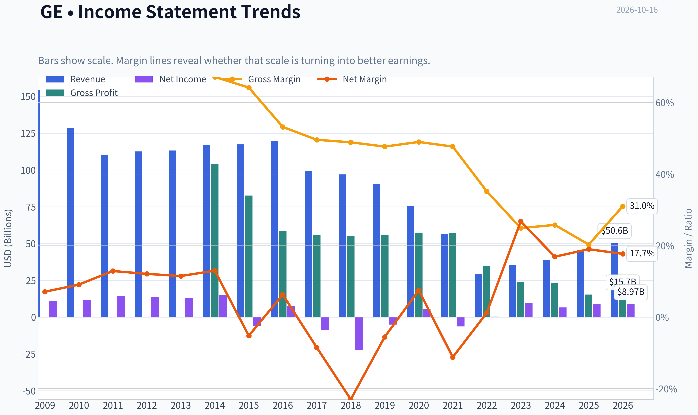

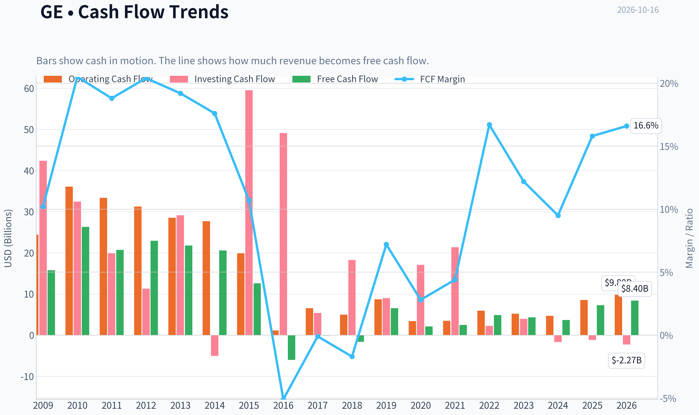

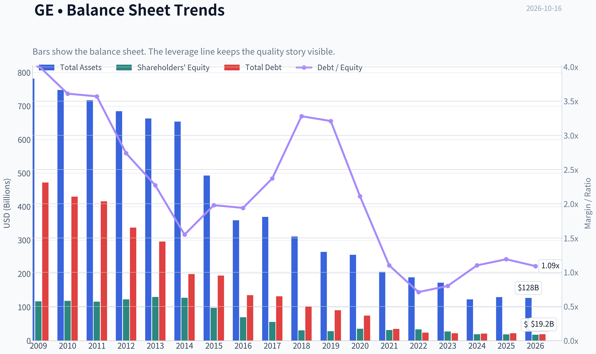

This graph tracks the profitability and return metrics (ROE, ROIC, Margins) of **GE** over the past decade, highlighting capital efficiency trends.

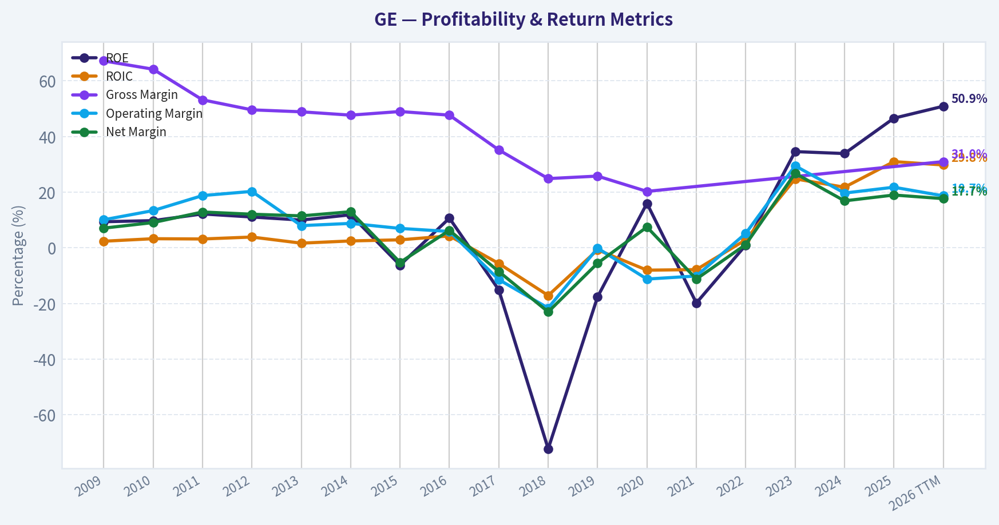

This chart illustrates the financial health of **GE** over the last 10 years, mapping cash equivalents and free cash flow against total obligations (Debt).

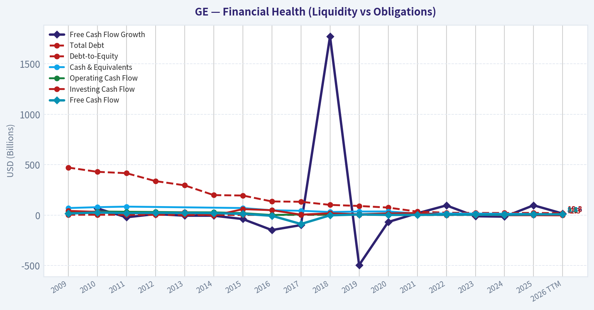

This comparison chart from *Profitability* stacks current figures against historical benchmarks for **GE**, making it easy to see where the company trades relative to its own averages.

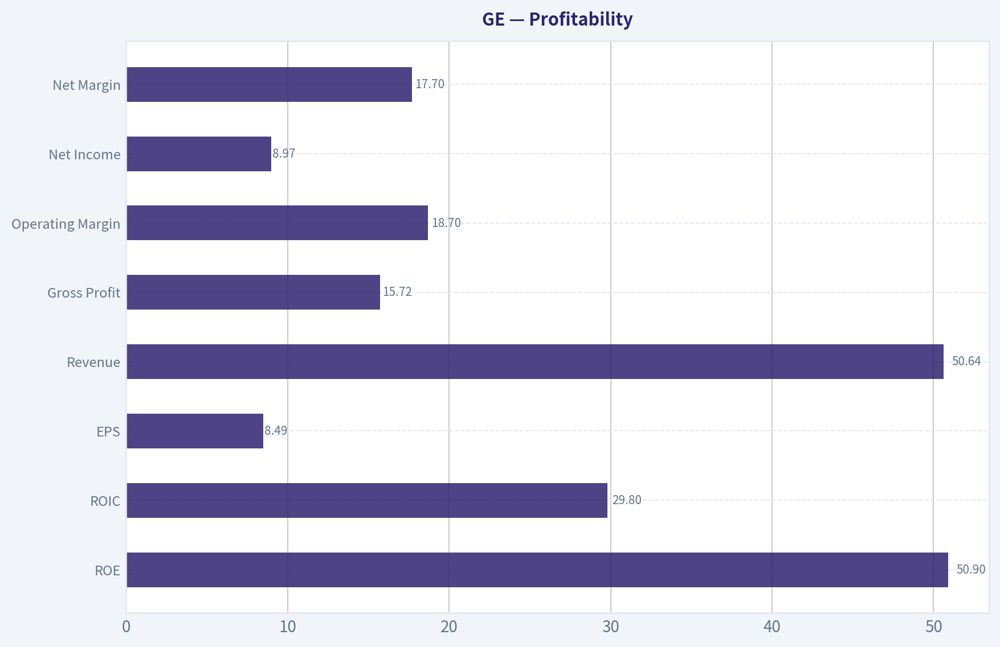

---

### Intrinsic Value Analysis (Buffett)

> *Following Warren Buffett's value investing philosophy: Circle of Competence, Economic Moat, Management Quality, and Margin of Safety.*

#### Intrinsic Value Snapshot

Price is what you pay. Intrinsic value is what the business may be worth based on the cash it can create for owners over time. We show a range, not one magic number.

- Current Price: $312.00
- Value Range (conservative to optimistic across both DCF methods): $38.78 to $284.66

##### Owner Earnings (Buffett Method)
- Net Income: $8,704,000,000.00
- Depreciation & Amortization: $1,220,000,000.00
- Capital Expenditures: $-1,273,000,000.00
- Working Capital Changes: $-470,000,000.00
- Owner Earnings: $9,174,000,000.00

##### Intrinsic Value
###### Buffett Method
Uses owner earnings. Stricter, and usually more conservative.
- Conservative: $38.78
- Average: $134.47
- Optimistic: $224.56
- Discount Rate: 10.0%

###### Cash Flow Method
Uses free cash flow. Better for companies spending heavily today to grow tomorrow.
- Conservative: $43.88
- Average: $74.36
- Optimistic: $284.66
- Discount Rate: 10.0%

ANALYST STANCE: **WATCH**

#### Executive Summary

GE Aerospace is a high-quality aviation franchise with substantial switching costs, a large installed engine base, regulatory barriers, and attractive aftermarket economics. The post-spin structure is simpler and more focused than legacy General Electric.

However, at approximately **$312 per share**, the valuation is demanding. The stock trades at roughly **36.8 times earnings** and offers only a **2.2% free-cash-flow yield**. The research valuation models produce a headline intrinsic value of approximately **$100 per share**, with a wide range of outcomes from **$18 to $134**. The price also implies approximately **31.9% annual growth for ten years**, which appears heroic even for a strong aerospace compounder.

This is a wonderful business at an evidently unwonderful price. The appropriate action is to watch rather than chase.

#### Factor Scorecard

| Factor | Score | Assessment |
|---|---:|---|
| Circle of Competence and Simplicity | 3.5/5 | GE Aerospace designs, manufactures, and services aircraft engines. The model is understandable, though engine economics, certification, program accounting, and airline cycles add complexity. |
| Durable Competitive Advantage | 4/5 | Large installed base, certification barriers, aftermarket service relationships, proprietary technology, and customer switching costs create a wide but cyclical moat. |
| Management and Capital Allocation | 4/5 | Larry Culp's restructuring and portfolio simplification have been strategically strong. The post-spin company has clearer accountability and a more focused capital-allocation framework. |
| Industry Structure | 4/5 | Commercial aircraft engines are effectively an oligopoly, with GE Aerospace and Safran dominant in narrow-body engines and GE competing with Rolls-Royce and Pratt & Whitney in other categories. High barriers are offset by long development cycles and program risk. |

**Key Takeaways:** GE Aerospace scores well on business quality, moat, management, and industry structure. Its main weakness is not the franchise but the price paid for it and the cyclicality inherent in aerospace demand and engine programs.

#### Moat Analysis

| Moat Source | Evidence | Strength |
|---|---|---|
| Intangible assets | Engineering expertise, intellectual property, safety certifications, and decades of operating history | Strong |
| Switching costs | Airlines and aircraft manufacturers face enormous operational, regulatory, training, and maintenance costs when changing engine platforms | Strong |
| Cost advantages | Scale in engineering, manufacturing, global maintenance, and parts distribution | Moderate to strong |
| Network effects | A larger installed base supports better maintenance infrastructure, data, parts availability, and customer familiarity | Moderate |
| Aftermarket economics | Engines generate long-duration parts, repairs, maintenance, and service revenue after the initial sale | Strong |
| Competitive durability | New entrants face billions of dollars of development costs and lengthy certification timelines | Strong |

GE's moat is strongest in the **installed base and aftermarket ecosystem**. Airlines may negotiate aggressively on new-engine pricing, but once an engine platform is embedded in an aircraft fleet, the long-term maintenance relationship is difficult to displace.

The principal risks are technology shifts, manufacturing defects, delays in new engine programs, airline bankruptcies, defense-budget changes, and concentration among large aircraft manufacturers and airline customers.

#### Management Quality Assessment

Larry Culp's record at GE has several Buffett-compatible attributes:

- Simplified the conglomerate and separated businesses into more focused companies.
- Reduced strategic complexity and improved operational accountability.
- Emphasized free cash flow, execution, and balance-sheet repair.
- Created a clearer link between operating performance and shareholder value.

The key question is whether management can convert GE Aerospace's strong competitive position into sustained **per-share free-cash-flow growth** without overpaying for acquisitions or pursuing uneconomic expansion. The company's post-spin history is shorter than the legacy GE record, so capital-allocation judgment should continue to be monitored.

Overall management assessment: **above average, but not yet deserving of an unquestioned top score based solely on the post-spin record.**

#### Financial Summary

| Metric | Latest Value |
|---|---:|
| Share price | $312 |
| Market capitalization | $323.72 billion |
| Price-to-earnings ratio | 36.8x |
| Return on equity | 46.6% |
| Revenue growth, year over year | 18.5% |
| Free-cash-flow yield | 2.2% |
| Implied annual free cash flow | Approximately $7.1 billion |
| Current ratio | 1.04x |
| Five-year revenue-growth reference | 15.9% annualized |
| Price-implied ten-year growth | Approximately 31.9% annually |

**Key Takeaways:** GE is growing rapidly, with 18.5% year-over-year revenue growth and a very high reported ROE. But the 2.2% free-cash-flow yield shows that the market is already capitalizing a large amount of future success. The current ratio near 1.0 is not automatically alarming for an industrial company with strong customer relationships, but it leaves less balance-sheet cushion than a net-cash business.

ROE deserves careful interpretation. A 46.6% ROE is excellent on its face, but post-spin capital structures and relatively low equity bases can magnify the figure. The quality of GE's returns should therefore be judged primarily through operating cash flow, free cash flow, and returns on invested capital rather than ROE alone.

#### Owner Earnings Calculation

A precise maintenance-capital-expenditure figure is not separately available in the supplied valuation data. Using free cash flow as a practical owner-earnings proxy:

| Owner-Earnings Component | Estimate |
|---|---:|
| Net income and non-cash charges, less working-capital effects | Reflected in operating cash flow |
| Less maintenance capital expenditures | Reflected in free cash flow |
| Estimated owner earnings | Approximately $7.1 billion |
| Estimated owner earnings per share | Approximately $6.85-$6.90 |
| Owner earnings yield at $312 | Approximately 2.2% |

**Key Takeaways:** GE's owner earnings are estimated at roughly $7.1 billion, or about $6.90 per share. That produces an owner-earnings yield near 2.2%, meaning investors are paying a very high price for each dollar of current cash-generation capacity.

#### Three-Scenario DCF Valuation

The valuation is highly sensitive to cyclicality, maintenance investment, program timing, and the long-term aftermarket growth rate.

| Scenario | Key Assumption | Estimated Value per Share |
|---|---|---:|
| A. No growth | Owner earnings capitalized at 10% | Approximately $69 |
| B. GDP growth | 3% perpetual growth and 10% discount rate | Approximately $101 |
| C. Historical-growth case | Approximately 7.95% growth, based on using 50% of the 15.9% five-year reference rate | Highly sensitive; approximately $360 under a long-duration DCF |
| Research-pack blended value | Damodaran FCFF, reverse DCF, and owner-earnings methods | $100.46 |
| Three-model range | Owner earnings / FCF / Damodaran FCFF | $134.47 / $74.36 / $18.10 |

**Key Takeaways:** The conservative no-growth and GDP-growth cases produce values well below the current price. The high-growth DCF can justify a much higher value, but only by assuming unusually strong growth for a long period and applying a terminal value that dominates the calculation. The blended research value of approximately $100 is therefore more useful than the optimistic high-growth result.

#### Margin of Safety Analysis

| Measure | Result |
|---|---:|
| Current price | $312 |
| Headline intrinsic value | $100.46 |
| Premium to headline intrinsic value | Approximately 211% |
| Margin of safety versus price | Approximately negative 210.6% |
| FCF-based valuation | $74.36 |
| Owner-earnings valuation | $134.47 |
| Reverse-DCF implied growth | Approximately 31.9% annually for ten years |

**Key Takeaways:** GE does not currently offer a conventional margin of safety. The price requires growth materially above the company's five-year reference growth rate and far above a normal GDP-like scenario. Even allowing for GE's wide moat and high quality, the valuation appears to discount an exceptionally favorable decade.

#### Balance Sheet and Solvency

The Gate 5 hard floor is **not tripped**. There is no evidence in the supplied data of both deteriorating earnings and a solvency red line such as interest coverage below 1.0 times or distress-level financial weakness.

| Balance-Sheet Criterion | Assessment | Score |
|---|---|---:|
| Current ratio | Approximately 1.04x; adequate but not fortress-like | 3/5 |
| Debt and solvency | No supplied evidence of distress-level leverage | 3/5 |
| Cash-flow support | Positive and growing free-cash-flow profile | 4/5 |
| Overall balance-sheet strength | Sound enough to support the business, but not an obvious net-cash fortress | 3/5 |

**Key Takeaways:** GE appears financially viable and the hard solvency floor is not breached. Nevertheless, the balance sheet does not provide the same downside protection as a net-cash compounder, so valuation discipline remains important.

#### Final Buffett Scorecard

| Criterion | Weight | Score | Weighted Contribution |
|---|---:|---:|---:|
| Moat width and durability | 25% | 4.0 | 1.00 |
| Valuation and margin of safety | 20% | 1.0 | 0.20 |
| Capital returns versus WACC | 15% | 4.0 | 0.60 |
| Business understanding and predictability | 12% | 3.5 | 0.42 |
| Management quality and capital allocation | 12% | 4.0 | 0.48 |
| Reinvestment runway | 8% | 4.0 | 0.32 |
| Balance-sheet strength | 4% | 3.0 | 0.12 |
| Industry structure | 4% | 4.0 | 0.16 |
| **Total** | **100%** |  | **3.30/5** |

**Key Takeaways:** GE's operating business scores strongly, particularly on moat, reinvestment runway, management, and industry structure. The valuation score sharply reduces the total because the current stock price assumes extraordinary long-term growth. The resulting score of 3.30 falls in the WATCH range.

#### Investment Stance

**WATCH - Medium conviction**

GE Aerospace is a high-quality, understandable industrial franchise with a durable aftermarket moat and attractive long-term reinvestment opportunities. It merits a place on a watchlist and could become compelling during an aerospace downturn, execution setback, market correction, or period of temporarily depressed free cash flow.

At approximately $312, however, the stock appears priced for near-perfect execution and roughly 32% annual growth for a decade. A more attractive entry point would require either substantially lower shares prices or a significant upward revision in sustainable owner earnings. The business is worthy of ownership; the current price is not sufficiently attractive.
#### Valuation Bridge

This bridge places the current market price beside each intrinsic value lens so readers can see whether upside depends on one method or shows up across several methods.

| Scenario | Intrinsic Value / Share |
| --- | ---: |
| Buffett Method | $134.47 |
| Cash Flow Method | $74.36 |
| Damodaran Method | $18.10 |
| Current Price | $312.00 |

#### Key Takeaways

If one method is far above the others, the upside case depends on a specific modelling assumption. When several methods cluster together, the valuation story is more robust.

#### Valuation Visuals

This comparison chart from *Latest Earnings Snapshot* stacks current figures against historical benchmarks for **GE**, making it easy to see where the company trades relative to its own averages.

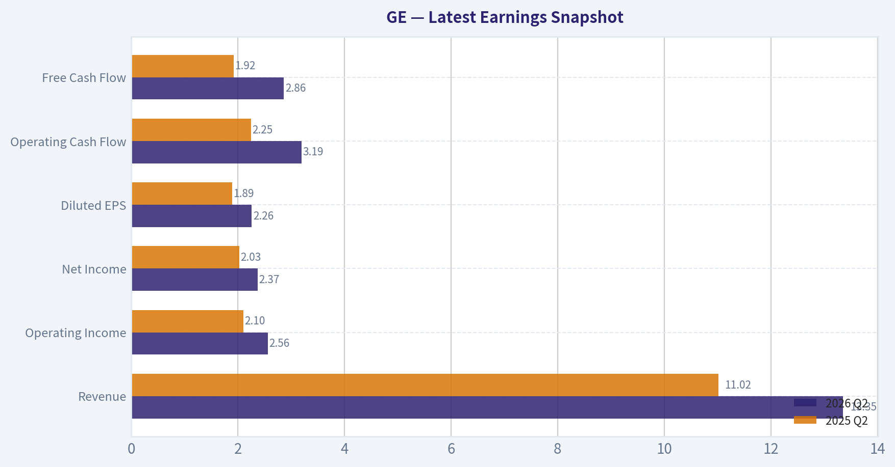

This comparison chart from *Current Metrics Versus Ten-Year Averages* stacks current figures against historical benchmarks for **GE**, making it easy to see where the company trades relative to its own averages.

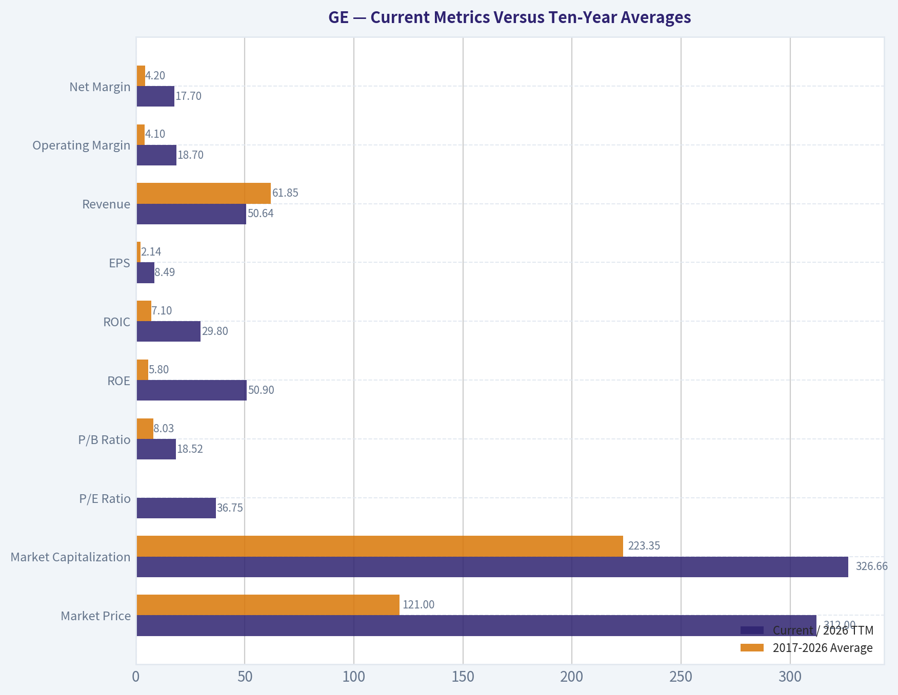

This comparison chart from *Balance Sheet and Financial Strength* stacks current figures against historical benchmarks for **GE**, making it easy to see where the company trades relative to its own averages.

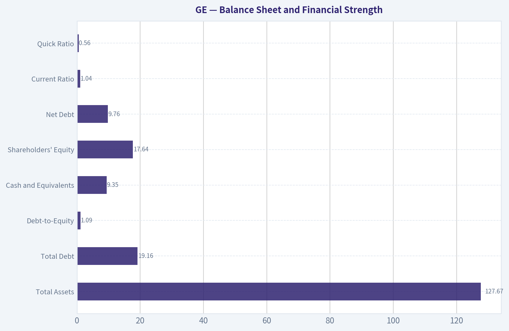

This comparison chart from *Cash Flow and Capital Allocation* stacks current figures against historical benchmarks for **GE**, making it easy to see where the company trades relative to its own averages.

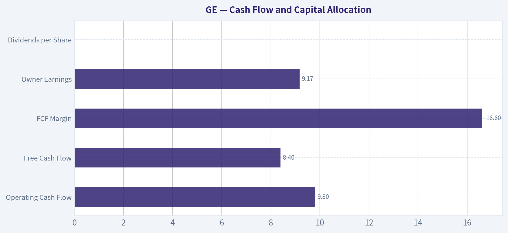

---

### Trend & Growth Analysis (Lynch/Druckenmiller/Fisher)

> *Following Peter Lynch's GARP, Stanley Druckenmiller's macro-aware approach, and Philip Fisher's scuttlebutt methodology.*

ANALYST STANCE: **AVOID**

#### 1. Lynch Classification

**Fast grower transitioning toward a cyclical stalwart.** GE Aerospace is growing faster than a traditional industrial company, but recent growth is decelerating and the valuation already assumes exceptional execution. It is not a classic GARP opportunity at approximately 37 times earnings and a PEG ratio near 3.9.

#### 2. The Story

- GE Aerospace benefits from a multiyear recovery in commercial aviation, including aircraft production, engine sales, spare parts, and aftermarket services.
- Its installed engine base creates recurring, high-margin maintenance revenue and meaningful switching costs.
- The market is pricing in sustained earnings growth far above the company's recent revenue trend, leaving limited room for disappointment.

#### 3. Financial Snapshot

| Metric | Latest figure |
|---|---:|
| Share price | $312 |
| Market capitalization | $323.7B |
| Revenue growth, latest YoY | 18.5% |
| Revenue growth, latest TTM | 10.4% |
| Three-year revenue CAGR | 16.3% |
| Five-year revenue CAGR | -9.6% |
| Operating margin | 18.7%-21.8% |
| Net margin | 17.7%-19.0% |
| Free-cash-flow margin | 16.6% |
| ROIC | 29.8%-30.2% |
| Debt-to-equity | 1.09-1.19 |
| Current ratio | 1.04 |

**Key Takeaways:** GE has materially improved profitability and capital returns after years of restructuring. However, the five-year revenue CAGR remains negative because of portfolio divestitures and the former conglomerate structure. The latest TTM revenue growth of roughly 10% is respectable, but not strong enough by itself to justify the current valuation.

#### 4. The 10x TAM Test

GE Aerospace generated approximately $50.6 billion of TTM revenue. A tenfold increase would imply more than $500 billion of annual revenue.

| TAM consideration | Assessment |
|---|---|
| Core market | Commercial aircraft engines, aftermarket services, defense propulsion, and related aerospace systems |
| Industry growth | Likely mid-single-digit to low-double-digit over a full cycle |
| GE's competitive position | Extremely strong in commercial aircraft engines and installed-base services |
| 10x revenue feasibility | No, not within the current core market |
| Long runway | Yes, but more likely through share gains, service intensity, pricing, and adjacent products than a literal 10x scale-up |
| TAM quality | Durable, strategically important, and supported by global air-traffic growth |

**Key Takeaways:** GE has a durable and attractive aerospace market, but it does not pass the strict tenfold test at today's scale. The opportunity is a high-quality compounding industrial franchise rather than an obvious ten-bagger from current market capitalization. Its strongest advantage is the installed engine base and long-duration aftermarket economics.

#### 5. Revenue Growth Trend

| Period | Revenue growth |
|---|---:|
| 2023 | 21.3% |
| 2024 | 9.5% |
| 2025 | 18.5% |
| Latest TTM | 10.4% |
| Three-year CAGR | 16.3% |
| Five-year CAGR | -9.6% |

**Key Takeaways:** The overall trend is **erratic and recently decelerating**, rather than accelerating. The 2025 rebound was strong, but the latest TTM rate has fallen toward 10%. This reflects both difficult comparisons and the post-spin restructuring, but it does not currently meet the preferred 20%+ accelerating-growth pattern.

#### 6. Unit Economics and Operating Leverage

GE is not a subscription software company, so SaaS metrics such as NRR and LTV/CAC are not applicable.

| Metric | Result | Interpretation |
|---|---:|---|
| NRR | N/A | Not applicable to aerospace manufacturing |
| LTV/CAC | N/A | Not a consumer or subscription model |
| Rule of 40 | N/A | Not an appropriate industrial-company metric |
| FCF margin | 16.6% | Strong |
| Operating margin | Approximately 19%-22% | Strong and improving |
| Interest coverage | 11.9x | Healthy |
| FCF growth, latest YoY | 97.5% | Strong rebound, partly normalization-driven |

**Key Takeaways:** GE's economic engine is aftermarket service revenue, pricing power, and operating leverage rather than recurring software subscriptions. Cash generation and margins have improved substantially. The major limitation is that recent cash-flow growth benefited from a low comparison base and should not be extrapolated at nearly 100% annually.

#### 7. Inflection Point Assessment

| Potential inflection | Evidence | Assessment |
|---|---|---|
| Product cycle | Commercial aviation recovery and new-engine programs | Positive |
| Market share | Strong position in commercial aircraft engines | Positive, but mature |
| Margin | Operating margin near 20% and ROIC near 30% | Positive |
| TAM | Air travel and aftermarket demand expanding | Positive, moderate |
| Competitive conditions | High barriers to entry and limited engine suppliers | Positive |
| Earnings expectations | Price implies approximately 31.9% annual owner-earnings growth for 10 years | Negative valuation signal |

**Key Takeaways:** The business has undergone a genuine quality and margin inflection after the conglomerate breakup. However, the stock's valuation implies a much more dramatic earnings inflection than the revenue data currently supports. The operating business may be improving while the security itself is no longer at an attractive entry point.

#### 8. Macro Setup

- **Positive:** Commercial aviation demand, aircraft utilization, defense spending, and fleet aging support aerospace aftermarket activity.
- **Positive:** Aerospace supply-chain normalization could allow GE to convert demand into higher deliveries and service revenue.
- **Neutral:** GE is less exposed to broad consumer cyclicality than many industrial companies because maintenance revenue is tied to a large installed base.
- **Negative:** High interest rates and elevated industrial-equity multiples pressure long-duration valuations.
- **Negative:** Airline financial health, aircraft delivery delays, engine-development costs, and defense-budget changes remain meaningful risks.

Macro conditions are **constructive for the business but not sufficient to overcome valuation risk**.

#### 9. Fisher's 15-Point Score

| Fisher criterion | Score / 5 |
|---|---:|
| Market potential | 4 |
| New-product determination | 4 |
| R&D effectiveness | 4 |
| Sales organization | 4 |
| Profit margins | 4 |
| Margin trend | 4 |
| Labor relations | 3 |
| Executive relations | 4 |
| Management depth | 4 |
| Cost analysis and accounting | 3 |
| Outstanding competitive features | 5 |
| Long-range profit outlook | 4 |
| Dilution risk | 4 |
| Management candor | 3 |
| Management integrity | 4 |
| **Total** | **56 / 75** |

**Key Takeaways:** GE scores in the **GOOD** range under Fisher's framework. Its strongest attributes are market position, installed-base advantages, technical expertise, and long-term industry relevance. The score is held back by cyclical exposure, accounting complexity from the historical conglomerate structure, and limited visibility into long-term execution.

#### 10. Valuation Analysis

| Valuation measure | Result | Interpretation |
|---|---:|---|
| P/E | 36.8x | Expensive |
| Forward P/E | 34.2x | Expensive |
| PEG | 3.9 | Very expensive |
| Price-to-sales | 6.4x | High for an industrial company |
| EV/EBITDA | 29.1x | High |
| FCF yield | 2.2% | Low |
| Headline intrinsic value | $100 | Well below market price |
| Owner-earnings valuation range | $39-$225 | Wide and below current price in most cases |
| FCF valuation range | $44-$285 | Current price exceeds average case |
| Reverse DCF implied growth | 31.9% annually for 10 years | Highly demanding |

**Key Takeaways:** Valuation is the central problem. The PEG ratio is far above Lynch's preferred range, while the 2.2% FCF yield offers little margin of safety. Even the optimistic modeled values generally do not support a $312 purchase price unless GE sustains unusually strong earnings growth for many years.

#### 11. Growth Investor Scorecard

| Criterion | Weight | Score / 5 | Weighted contribution |
|---|---:|---:|---:|
| The Story | 10% | 4.0 | 0.40 |
| TAM and runway | 20% | 3.2 | 0.64 |
| Revenue growth | 20% | 2.8 | 0.56 |
| Unit economics | 15% | 4.0 | 0.60 |
| Competitive position | 10% | 4.5 | 0.45 |
| Management quality | 10% | 3.8 | 0.38 |
| Macro setup | 5% | 3.8 | 0.19 |
| Profitability path | 5% | 4.2 | 0.21 |
| Valuation | 5% | 1.2 | 0.06 |
| **Total** | **100%** |  | **3.49 / 5.00** |

**Key Takeaways:** GE is a high-quality operating business but a weak new-money growth investment at the current price. The score falls just below the 3.5 threshold because revenue growth is not accelerating enough and valuation is exceptionally demanding. A materially lower entry price or a clear upward revision to long-term earnings estimates would improve the setup.

#### 12. Position Size Stance

- **New position:** No position recommended at current prices.
- **Existing position:** Hold only if the investor has a favorable cost basis and accepts aerospace-cycle risk; avoid aggressively adding.
- **Speculative sizing:** At most a watch-list position until valuation improves or earnings estimates rise substantially.
- **Preferred trigger:** A major valuation reset, or several quarters showing accelerating revenue, expanding margins, and upward guidance revisions.

#### 13. Catalysts and Risks

| Catalysts | Risks |
|---|---|
| Commercial aircraft production accelerates | Aircraft delivery delays and supply-chain constraints |
| Higher engine utilization drives aftermarket revenue | Airline or global travel slowdown |
| Margin expansion exceeds expectations | Engine-development costs or execution problems |
| Defense spending remains strong | Valuation compression from higher rates |
| Guidance and long-term targets are raised | Customer concentration and program dependence |
| Buybacks or capital returns increase | Earnings normalization after a strong recovery |

**Key Takeaways:** The most important upside catalyst is sustained earnings acceleration from commercial aerospace aftermarket growth and operating leverage. The most important downside risk is multiple compression: even strong execution may not produce attractive returns if the stock is already discounting many years of exceptional growth.

#### Bottom Line

GE Aerospace is a substantially better business than legacy General Electric, with strong competitive advantages, attractive margins, and a durable aerospace runway. Nevertheless, at approximately **37 times earnings**, a **3.9 PEG ratio**, and a **2.2% FCF yield**, the stock appears to discount an aggressive long-term outcome. The appropriate stance is **AVOID for new purchases; WATCH for a better entry point or evidence of renewed growth acceleration**.

---

### Market Technical Analysis

ANALYST STANCE: **WATCH**

#### GE technical market report

**Data basis:** The latest available trading session is October 15, 2026, because October 16 is not listed as a trading day in the retrieved data. GE closed at **$312.00**, up from $307.02 the prior session.

The selected indicators are **close_50_sma, close_200_sma, close_10_ema, macd, rsi, boll_ub, boll_lb, and atr**. Together they cover long-, medium-, and short-term trend, momentum, mean-reversion zones, and volatility without adding excessive redundancy.

#### Trend structure

GE remains in a **longer-term uptrend that has weakened into a medium-term correction**. The closing price of $312.00 is still below the **200-day SMA at $322.99**, which is now the most important overhead trend reference. However, the 200-day average itself is gradually rising, from approximately $321.30 in mid-September to nearly $323.00 now. This indicates that the longer-term trend has not decisively rolled over, even though price has fallen below it.

The medium-term picture is more negative. The **50-day SMA is $331.23** and has declined steadily from approximately $349.31 on September 16. GE is therefore trading about **5.8% below the 50-day average**, showing that the recent weakness is not merely a one- or two-day pullback. The declining 50-day average also creates a substantial resistance zone between roughly $323 and $331.

The **10-day EMA is $309.47**, and the close has moved back above it. This is a modest short-term improvement, particularly after the stock traded near $303.62 on October 7. However, the EMA itself has fallen sharply from $322.78 in mid-September, so the recent move above it is better interpreted as an initial stabilization signal rather than confirmation of a sustained new uptrend.

#### Momentum and reversal evidence

The MACD remains negative at **-5.88**, confirming that medium-term momentum is still bearish. There is, however, evidence of improvement: MACD has risen from approximately **-11.13 on September 17** to -5.88 currently. This represents a meaningful reduction in downside momentum. A further bullish development would require the MACD to move above its signal line and eventually toward zero; the present reading alone does not establish that a durable reversal is underway.

RSI has also improved, rising from **32.9 on October 5** to **44.8 on October 15**. The earlier readings in the low 30s indicated stressed or near-oversold momentum, but the current RSI is neither oversold nor overbought. This suggests that the rebound has room to continue, but it also means the stock has not yet generated strong bullish momentum. For a more convincing trend reversal, RSI would ideally reclaim 50 and then hold above it during pullbacks.

#### Bollinger-band positioning

The current Bollinger range is approximately **$300.56 to $324.71**, with a middle-band estimate near **$312.64**. GE closed almost exactly at the middle band. This is an important equilibrium point: the stock has recovered from the lower portion of its recent range, but it has not yet demonstrated an upside breakout.

The lower band near $300.56 is a meaningful short-term support reference. A sustained close below that level would suggest that the recent stabilization has failed and would expose the stock to renewed downside volatility. On the upside, the upper band near $324.71 aligns closely with the 200-day SMA at $322.99, making the **$323-$325 area a particularly important resistance cluster**.

A decisive close above that zone, preferably accompanied by stronger volume and improving MACD, would materially improve the technical outlook. Failure near that area would keep the prevailing corrective structure intact.

#### Volatility and risk management

ATR has declined from approximately **9.28 in mid-September to 7.39 currently**. This indicates that daily price ranges have contracted as the stock stabilized. The decline in ATR is constructive from a risk-control perspective, but it can also precede a larger directional move after a period of consolidation.

At the current price, an ATR-based risk framework implies that a typical daily move is roughly **$7.40**, or about 2.4% of the share price. Stops placed too close to the entry price could therefore be vulnerable to normal fluctuations. A risk-managed approach would use the $300-$301 support region as a structural reference rather than relying solely on a narrow percentage stop.

#### Trading interpretation

The evidence is best characterized as **early stabilization within a still-bearish medium-term structure**:

- **Positive:** Price has reclaimed the 10-day EMA, RSI has recovered from near-oversold territory, MACD is becoming less negative, and ATR is declining.
- **Negative:** Price remains below both the 50-day and 200-day SMAs, both of which represent overhead resistance; the 50-day SMA is declining; MACD remains below zero.
- **Key confirmation level:** A sustained move above approximately **$323-$325** would be the first meaningful bullish confirmation.
- **Key support:** The **$300-$301** region, represented by the lower Bollinger Band, is the principal near-term downside level.
- **Intermediate support:** The recent trading area around **$303-$309** may provide shorter-term support, but a break below $300 would weaken the recovery case substantially.

For bullish traders, the preferable signal would be a close above $325 followed by successful support on a retest. For defensive or short-biased traders, rejection in the $323-$331 resistance region or a breakdown below $300 would provide stronger evidence that the medium-term decline is resuming. Until one of those conditions occurs, GE is better treated as a watch-list setup than a high-conviction directional trade.

| Indicator | Latest reading | Technical implication | Important levels or trigger |
|---|---:|---|---|
| Closing price | $312.00 | Rebound from recent weakness; slightly above short-term EMA | Must hold above roughly $309-$310 |
| 10-day EMA | $309.47 | Short-term momentum has improved, but the EMA is still declining | Loss of EMA would weaken stabilization |
| 50-day SMA | $331.23 | Medium-term trend remains bearish and creates overhead resistance | Resistance near $331 |
| 200-day SMA | $322.99 | Long-term trend is weakened but not decisively broken | Major resistance near $323 |
| MACD | -5.88 | Bearish momentum persists, although downside pressure is easing | Bullish confirmation requires further improvement and a signal crossover |
| RSI | 44.78 | Recovered from near-oversold levels; still below neutral bullish territory | Sustained move above 50 would strengthen the reversal case |
| Bollinger Bands | Lower $300.56; upper $324.71 | Price is near the middle band, indicating consolidation rather than breakout | $300-$301 support; $323-$325 resistance |
| ATR | 7.39 | Volatility has contracted from September highs | Use wider, volatility-aware stops; watch for expansion |

**Key Takeaways:** GE is stabilizing, but the broader technical structure remains cautious because price is below both the 50-day and 200-day moving averages. Improving MACD, RSI, and short-term EMA positioning suggest that selling pressure is easing, while the $323-$325 resistance zone will determine whether this becomes a genuine recovery. A break below $300 would invalidate much of the stabilization thesis, whereas a sustained move above $325 would shift the outlook more constructively.

#### Market Visuals

This comparison chart from *Market Metrics and Valuation* stacks current figures against historical benchmarks for **GE**, making it easy to see where the company trades relative to its own averages.

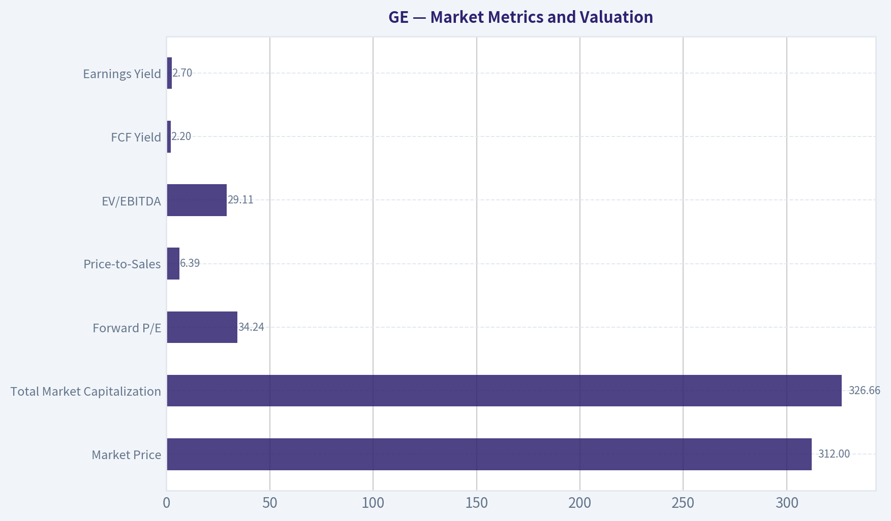

---

### Options Market Analysis

> *Reading options flow - put/call ratios, IV skew, and unusual activity - to gauge institutional positioning and event-driven risk.*

#### GE Options Market Report

**As of October 16, 2026.** The available near-term options data is extremely thin, with only three contracts of call open interest and three contracts of put open interest across the reported expirations. This makes the ratios and inferred sentiment low-confidence.

#### Put/Call Ratio Analysis

| Expiration | Call OI | Put OI | Put/Call OI Ratio | Call Volume | Put Volume | Put/Call Volume Ratio |
|---|---:|---:|---:|---:|---:|---:|
| Oct. 16, 2026 | 3 | 3 | 1.00 | 1,065 | 1,545 | 1.45 |
| Oct. 23, 2026 | 0 | 0 | N/A | 645 | 426 | 0.66 |
| Oct. 30, 2026 | 0 | 0 | N/A | 183 | 238 | 1.30 |
| **Total** | **3** | **3** | **1.00** | **1,893** | **2,209** | **1.17** |

**Key Takeaways:** The aggregate put/call volume ratio is 1.17, modestly above the historical neutral reference of approximately 0.7 and therefore slightly defensive. However, the open-interest ratio is exactly 1.00, not strongly bearish. Because almost all reported open interest is only three contracts on each side, the volume ratio likely reflects short-term trading or hedging rather than established institutional positioning.

#### Implied Volatility Assessment

| Expiration | Call ATM IV | Put ATM IV | IV Difference | Assessment |
|---|---:|---:|---:|---|
| Oct. 16, 2026 | 5.8% | 5.5% | Calls +0.3 pts | Very low IV; essentially balanced |
| Oct. 23, 2026 | 2.2% | 2.2% | Neutral | Extremely low and balanced |
| Oct. 30, 2026 | 2.0% | 1.8% | Calls +0.2 pts | Extremely low; no put premium |

The supplied data does not include separate out-of-the-money put and call IV values, so a formal OTM skew calculation is unavailable. ATM pricing shows no meaningful downside volatility premium: puts are slightly cheaper than calls in the reported expirations.

**Key Takeaways:** Near-term implied volatility is exceptionally low, with ATM readings ranging from 2.0% to 5.8%. There is no evidence of a steep put skew or significant event-risk premium in this dataset. A catalyst such as earnings cannot be confirmed from the options data alone, but the pricing does not indicate that traders are aggressively bidding up near-term protection.

#### Unusual Options Activity

| Finding | Result |
|---|---|
| Contracts with volume greater than 5x open interest | None identified |
| Fresh directional institutional bets | No confirmed examples |
| Largest reported activity | Same-day expiration: 1,065 calls and 1,545 puts |
| Directional interpretation | Slightly put-heavy, but not verifiable as opening trades |

No individual strikes were supplied for the reported activity, so contracts cannot be classified as ITM, ATM, or OTM. Likewise, days-to-expiration are limited to the expiration dates: same-day expiry on October 16, seven days for October 23, and fourteen days for October 30.

**Key Takeaways:** There are no contracts meeting the tool's unusual-activity threshold. The same-day expiration has the most volume, but the lack of volume-to-open-interest anomalies means there is no clear evidence of fresh smart-money positioning. The modest put-volume excess is better interpreted as cautious short-term hedging than as a strong bearish bet.

#### Open Interest Concentration and Gamma Levels

| Expiration | Total Call OI | Total Put OI | Strike Concentration | Gamma-Wall Assessment |
|---|---:|---:|---|---|
| Oct. 16, 2026 | 3 | 3 | Strike-level data unavailable | Cannot identify |
| Oct. 23, 2026 | 0 | 0 | None reported | None apparent |
| Oct. 30, 2026 | 0 | 0 | None reported | None apparent |

There is no meaningful open-interest concentration in the reported chain. Since strike-level open interest was not provided and total OI is nearly nonexistent, max-pain, pinning, and gamma-wall analysis cannot be performed reliably.

**Key Takeaways:** GE has no identifiable near-term gravitational strike based on the available data. With virtually no open interest outside the same-day expiration, options-related price pinning or gamma amplification should be minimal. This also reinforces that the chain is too illiquid for high-confidence positioning analysis.

#### Overall Options Sentiment

**Signal: NEUTRAL, with a slight bearish/defensive bias.**

The modestly elevated put/call volume ratio of 1.17 is the primary bearish factor, suggesting somewhat greater demand for puts than calls in the near term. That signal is offset by a balanced 1.00 open-interest ratio, very low and nearly symmetric implied volatility, no unusual-volume contracts, and the absence of meaningful open-interest concentration.

Confidence is **low** because the chain is exceptionally thin: only three call contracts and three put contracts of total open interest are reported across the near-term expirations. The options market currently indicates caution rather than a strong directional conviction.

#### Summary

| Category | Assessment |
|---|---|
| Put/Call Ratio | OI ratio 1.00; volume ratio 1.17, modestly defensive versus the ~0.7 neutral reference |
| IV Level | Very low; 2.0%-5.8% ATM IV across near-term expirations |
| Skew Direction | Essentially neutral; no meaningful put premium and no formal OTM skew data |
| Unusual Activity | None; no contract exceeded 5x open interest |
| Overall Signal | **NEUTRAL**, with a slight bearish/defensive bias and low confidence |

**Key Takeaways:** GE's options market does not show a strong bullish or bearish institutional signal. Put volume is somewhat heavier than call volume, but the extremely small open-interest base and lack of unusual activity make that tilt unreliable. The best overall read is neutral with mild defensive pressure, not an outright bearish setup.

---

## Research Team Commentary

> *The Research Manager synthesizes the Bull vs Bear debate into action-free commentary. This is a pre-risk view, not the final stance.*

Core Takeaway: GE Aerospace is an excellent business, but at $312 it is not an attractive value investment. Its installed engine base, certification barriers, aftermarket revenue, and 30.2% reported ROIC support a wide-moat assessment. The problem is that the approximately 36.8x earnings multiple already capitalizes much of that quality. The reverse DCF requires roughly 12% annual earnings growth for a decade merely to justify the price, while a still-strong 10% growth outcome indicates value closer to $274. That is insufficient margin of safety for a cyclical, capital-intensive company whose growth requires meaningful reinvestment. My stance is AVOID at the current price, while keeping the business on a high-quality watchlist.

The strongest bull argument is the durability of GE's aviation ecosystem. Commercial aircraft engines are extraordinarily difficult to design, certify, manufacture, and support. Once an engine enters service, switching is generally impractical, and GE can earn recurring revenue from spare parts, maintenance, upgrades, and long-term service agreements over decades. The installed base creates both customer lock-in and valuable operating data. Continued air-traffic growth, fleet renewal, higher aircraft utilization, and supply constraints that keep older aircraft flying all support aftermarket demand.

Management quality has also improved significantly. Larry Culp's simplification of the old conglomerate, balance-sheet repair, focus on cash generation, and stronger operational accountability deserve substantial credit. The reported 18.5% revenue growth and 30.2% ROIC indicate that this is not merely a turnaround narrative; the focused aerospace franchise currently has excellent economics. Unlike an acquisition-dependent roll-up with deteriorating returns, GE has an identifiable organic engine in its installed base and service activity.

The bull is also correct that a high P/E does not automatically mean overvaluation. A wide-moat company with recurring revenue, high returns on capital, and a long reinvestment runway deserves a premium. If GE can compound earnings at 13-14% for a decade while maintaining strong cash conversion, the illustrative value of approximately $345-$373 would make today's price reasonable.

The bear case is nevertheless more compelling at the present quotation. The bull's own valuation work shows how little room there is for error. At 12% ten-year earnings growth, estimated value is about $320-only slightly above the market price. At 10%, which would still be a very good long-term result, estimated value falls to approximately $274. The attractive outcomes depend on raising the growth assumption to 13-14%, with small assumption changes having large valuation consequences.

That is not a quality-scaled margin of safety. For a predictable, wide-moat compounder, I would accept roughly a 10-15% discount to a conservatively derived intrinsic value. GE offers that discount only against an optimistic 13% growth case, not against a conservative base case. A margin of safety should survive modest disappointment; it should not disappear when earnings growth declines from 13% to 10%.

There is also a weakness in using accounting earnings as a close substitute for owner earnings. GE cannot simultaneously distribute essentially all earnings and compound rapidly without reinvestment. Sustaining growth may require substantial spending on research, future engine programs, tooling, capacity, inventory, supplier support, and service infrastructure. The relevant question is not just current ROIC, but the incremental return on the capital required to support the next decade of growth.

The 30.2% ROIC is impressive, but it should not be extrapolated mechanically. Recent separations, asset sales, historical write-downs, and changes in the invested-capital denominator may make the current figure unusually favorable. The evidence provided does not establish that GE can reinvest large amounts at 30% returns through a complete aviation cycle.

The aftermarket moat also carries obligations. Long-term service agreements depend on assumptions about engine durability, shop-visit timing, inflation, parts costs, and utilization. Unexpected reliability or maintenance issues can convert anticipated service profits into charges. GE also remains dependent on Boeing, Airbus, airlines, specialized suppliers, regulators, and future platform decisions. These risks do not undermine the moat, but they make a near-37x multiple less forgiving.

The chart reinforces caution without determining intrinsic value. The stock has reclaimed its 10-day average and momentum is becoming less negative, but it remains below declining intermediate- and long-term moving averages. A sustained move above approximately $323-$325 would provide initial technical confirmation, but it would not solve the valuation problem. The options data are too thin to be useful; the slightly defensive put/call ratio should receive negligible weight.

The important lesson from prior mistakes is to separate business quality, valuation, and time horizon. Roper showed that admiring a quality franchise can lead to an overly neutral stance when valuation, capital efficiency, and trend are unfavorable. Glencore showed that weak long-term business quality should not dominate a short-term call when the commodity cycle and price trend are strong. In GE's case, the conclusion is not based on technical weakness alone and is not a prediction of an imminent collapse. It is a long-term expected-return judgment: the business is excellent, but the price demands an unusually smooth decade.

Rationale: At $312, an investor receives an earnings yield of only about 2.7% and must rely heavily on sustained low-to-mid-teens growth. GE may achieve that, but Buffett-style investing does not require paying in advance for nearly all plausible success. The expected return looks ordinary if earnings grow around 10-12% and the terminal multiple eventually normalizes. The upside becomes compelling only in the more optimistic scenarios, while supply-chain problems, weaker cash conversion, service-contract charges, an aviation slowdown, or multiple compression could produce meaningful downside.

Monitoring Plan: Over the next one to four quarters, I would focus on five areas. First, compare organic revenue and operating-profit growth with the current 18.5% revenue pace; persistent low-double-digit growth would support the embedded expectations, while normalization toward mid-single digits would weaken them. Second, track free cash flow and conversion of net income into cash, including working capital, inventories, supplier support, and capital expenditures. Strong earnings without corresponding cash generation would validate the bear case.

Third, monitor aftermarket revenue, shop visits, pricing, and service margins. The thesis needs aftermarket growth to remain durable without material contract or reliability charges. Fourth, examine incremental ROIC rather than relying on the current snapshot. Returns should remain comfortably above the cost of capital as GE invests in capacity and future platforms. Fifth, watch capital allocation: expensive repurchases, rising leverage, or large development commitments with uncertain returns would be negative, while disciplined reinvestment and conservative balance-sheet management would be positive.

A sustained move above $323-$325 would improve the technical picture, but an upgrade to ADVOCATE would require more than a breakout. I would want either stronger evidence that normalized owner earnings can compound above 12% with excellent cash conversion, or a materially lower price. Assuming no major change in earnings power, the upper $260s to mid-$270s would be more interesting, while a price in the mid-$200s would begin to offer a more defensible margin of safety.

Final stance: AVOID.

---

## Value Investing Team Commentary

> *The Investor translates the research view into an investment thesis before risk review. This is still not the final stance.*

### GE Aerospace: An Exceptional Franchise With Little Valuation Slack

GE Aerospace is no longer the sprawling, opaque conglomerate that historically deserved a complexity discount. Following the separations and balance-sheet repair, investors now own a much more focused aviation franchise with understandable economics: sell engines into a large installed base and monetize that base through decades of parts, maintenance, and service activity.

That transformation materially improves the investment case. It does not, however, make price irrelevant.

### Business quality and moat

GE Aerospace appears to be a wonderful business by most relevant measures:

- Aircraft engines require extraordinary engineering expertise, regulatory certification, manufacturing scale, and global support infrastructure.
- Once an engine platform enters service, switching is generally impractical.
- The installed base generates recurring aftermarket demand through spare parts, shop visits, upgrades, and long-term service agreements.
- GE benefits from valuable operating data and decades-long relationships with aircraft manufacturers and airlines.
- Reported revenue growth of 18.5% and ROIC of 30.2% indicate powerful current economics.

The aftermarket franchise is especially important. Engine deliveries can be cyclical and initially less attractive economically, while the subsequent service stream can persist for decades. Supply constraints that keep older aircraft flying may also support shop visits and parts demand even when new-aircraft production is disrupted.

Management deserves considerable credit. Larry Culp's simplification of GE, emphasis on operational execution, and focus on cash flow have reduced many of the structural problems that once made the company difficult to analyze. This is not merely a financial-engineering turnaround; the remaining aerospace business has genuine organic advantages.

### Do not take the headline returns at face value

The 46.6% ROE and 30.2% ROIC are impressive, but neither should be extrapolated mechanically.

GE's restructuring, asset sales, historical losses and write-downs, and changing invested-capital base can make denominator-based returns unusually favorable. ROA of 6.7% provides a useful counterpoint: this remains a capital-intensive industrial franchise, not a nearly capital-free software platform.

The more important question is the return GE can earn on the *next* dollar invested. Sustaining low-to-mid-teens growth may require substantial spending on:

- Research and engine development
- Tooling and production capacity
- Inventories and supplier support
- Maintenance infrastructure
- Reliability improvements
- Future engine platforms

Current ROIC demonstrates franchise strength, but it does not yet prove that GE can deploy large amounts of incremental capital at comparable returns throughout a full aviation cycle.

### Valuation carries the real risk

At $312 and approximately 36.8 times earnings, GE has an earnings yield of roughly 2.7%. That is not automatically excessive for a superior compounder, but it places most of the prospective return on future growth and continued premium valuation.

The scenario analysis illustrates the narrow valuation cushion:

| Ten-year growth assumption | Illustrative intrinsic value | Discount/(premium) at $312 |
|---|---:|---:|
| 10% | $274 | (14%) premium |
| 12% | $320 | 3% discount |
| 13% | $345 | 10% discount |
| 14% | $373 | 16% discount |

These estimates suggest that the market is effectively requiring something near 12% annual growth for a decade merely to support the quotation. A 10% result would still represent excellent business performance, yet could produce disappointing investment returns if the valuation multiple normalizes.

For a business of GE's quality, a 10-15% margin of safety is reasonable rather than demanding a deep-value discount. Applying that standard to the $320 base-case value produces an attractive entry range of roughly $272-$288. The current price offers the desired margin of safety only against the more optimistic 13-14% growth scenarios.

That does not make GE outrageously overvalued. It makes the stock highly dependent on execution.

### What the market may be getting right

A contrarian investor should not assume that optimism is irrational merely because the P/E is high. The market may correctly recognize that:

- The simplified GE deserves a higher multiple than the old conglomerate.
- Commercial aviation has a long growth runway.
- The installed engine base provides unusually visible aftermarket demand.
- Certification barriers and switching costs make competitive disruption difficult.
- Management quality and operational accountability have improved materially.

The 36.8-times multiple may therefore reflect a genuine improvement in business quality rather than mere speculative enthusiasm. Using the old GE's historical multiple or a generic industrial valuation would understate the value of the focused aftermarket franchise.

### What optimistic sentiment may be overlooking

The more useful contrarian observation is that investors may be treating aftermarket earnings as smoother and less capital-dependent than they really are.

Long-term service agreements contain obligations as well as recurring revenue. Their profitability depends on engine durability, utilization, shop-visit timing, labor and parts inflation, and maintenance assumptions. Reliability problems or cost overruns can turn expected future service profits into present charges.

GE also remains exposed to factors outside its direct control:

- Boeing and Airbus production schedules
- Airline financial health and aircraft utilization
- Specialized supplier capacity
- Regulatory decisions
- Engine reliability and warranty expenses
- Future aircraft-platform selections
- The broader commercial aviation cycle

At a modest valuation, these would be ordinary operating risks. At nearly 37 times earnings, they become valuation risks because even temporary disappointment could produce substantial multiple compression.

### Technical and sentiment evidence

The chart is improving tactically but remains unconfirmed:

- Reclaiming the 10-day EMA and recovering RSI suggest that selling pressure has eased.
- A less-negative MACD and declining ATR indicate stabilization.
- However, price remains below the 50-day and 200-day averages.
- The declining 50-day average and sub-zero MACD indicate that the intermediate trend has not repaired itself.
- A sustained move through approximately $323-$325 would be the first meaningful bullish confirmation.

These signals should not drive a ten-year ownership decision, but they reinforce the absence of urgency. A breakout could improve sentiment and momentum, yet would make the valuation still less attractive unless accompanied by higher estimates of normalized owner earnings.

The options evidence deserves almost no weight. With only a few contracts of reported open interest, the 1.17 put/call ratio is not a reliable indication of informed bearish positioning.

### Appropriate stance and upgrade conditions

I would not describe GE as an outright long-term avoidance candidate. The company lacks financial distress, the competitive advantages are substantial, and the valuation is demanding rather than obviously absurd. Under a quality-scaled framework, that distinction matters.

The appropriate action is to keep GE on a high-quality watchlist and wait for one of two developments:

1. **Better evidence of intrinsic value:** Owner earnings, free-cash-flow conversion, and incremental ROIC demonstrate that sustainable growth above 12% is achievable without disproportionate reinvestment or risk.

2. **A better price:** Assuming unchanged earnings power, approximately $270-$285 would begin to offer a reasonable quality-adjusted margin of safety. The mid-$200s would provide a more compelling opportunity, particularly if reached because of temporary sentiment or execution concerns rather than permanent moat deterioration.

Investors should monitor organic growth, aftermarket pricing and shop visits, service margins, cash conversion, working capital, supplier support, incremental returns on capital, and capital allocation. Expensive repurchases near the present multiple would be less attractive than disciplined reinvestment or balance-sheet conservatism.

**ANALYST STANCE: WATCH** - GE Aerospace is a wide-moat, well-managed franchise with attractive long-term aviation and aftermarket economics, but $312 already discounts roughly 12% annual growth for a decade and leaves little room for normal industrial setbacks. The valuation is not extreme enough to justify AVOID for such a strong business, but it also lacks the 10-15% margin of safety needed to ADVOCATE ownership today.

---

## Deep Values Commentary

> *The Risk Management Team debates and the Risk Judge provides the final action-free verdict. This section determines the final ADVOCATE / WATCH / AVOID stance.*

#### Final Stance Scorecard

This scorecard converts the final research view into a weighted decision frame. It does not replace the narrative judgement, but it makes the main drivers of the verdict easier to scan.

| Criterion | Score | Weight | Commentary |
| --- | ---: | ---: | --- |
| Business Quality | 3.75 | 30% | High returns, profitability, and Piotroski health support durability. |
| Valuation Support | 1.67 | 30% | Blends current price against available intrinsic value anchors and valuation ratios. |
| Financial Strength | 2.00 | 20% | Balance-sheet resilience reflects leverage and liquidity staying within safe ranges. |
| Growth Durability | 4.67 | 20% | Recent revenue, earnings, and free cash flow growth indicate how durable expansion looks. |
| TOTAL / FINAL STANCE | 2.96 | 100% | AVOID |

#### Key Takeaways

The weighted score lands at **2.96 / 5.0**, while the final stance remains **AVOID**. This is useful as a quick calibration aid rather than a mechanical signal.

#### Risk Summary

Higher scores indicate more risk pressure. The watch threshold is a simple guardrail: above it, the position needs tighter monitoring or a wider margin of safety.

| Dimension | Current Score | Watch Threshold | Commentary |
| --- | ---: | ---: | --- |
| Business Quality | 2.25 | 3.00 | High returns, profitability, and Piotroski health support durability. |
| Valuation Support | 4.33 | 3.00 | Blends current price against available intrinsic value anchors and valuation ratios. |
| Financial Strength | 4.00 | 3.00 | Balance-sheet resilience reflects leverage and liquidity staying within safe ranges. |
| Growth Durability | 1.33 | 3.00 | Recent revenue, earnings, and free cash flow growth indicate how durable expansion looks. |

#### Key Takeaways

This view helps readers separate *where* the risk sits: valuation, business quality, balance sheet, or growth durability. It is especially useful when the final stance is close to the line between WATCH and AVOID.
