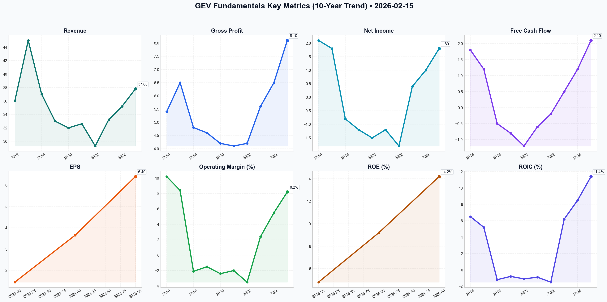

# GEV Deep Value Intelligence

**Analysis Date:** 2026-02-15
**Generated:** 2026-02-16 10:44:14

---

## Table of Contents

1. [Intelligence Summary](#intelligence-summary)
2. [Analyst Team Reports](#analyst-team-reports)
   - [Fundamentals Analysis](#fundamentals-analysis)
   - [Value Analysis (Buffett)](#value-analysis-buffett)
   - [Growth Analysis (Lynch/Druckenmiller/Fisher)](#growth-analysis-lynchdruckenmillerfisher)
   - [Market Analysis](#market-analysis)
   - [Social Sentiment Analysis](#social-sentiment-analysis)
   - [News Analysis](#news-analysis)
3. [Research Team Commentary](#research-team-commentary)
4. [Investing Team Commentary](#investing-team-commentary)
5. [Deep Values Commentary](#deep-values-commentary)

---

## Intelligence Summary

### Thesis + Conditions

**Core Thesis:** Here is the synthesis of the debate and my investment commentary based on the Buffett value investing framework.

**Key Risks:**
- The Bull Case (The Compounder):** The Risky Analyst frames GEV as a "tech-infrastructure hybrid" essential to the AI Supercycle. They argue the **19x Price-to-Book** is a "scarcity premium" for the only company capable of solving the electricity bottleneck for big tech. They view the **Wind segment** as de-risked by the "Lean" operating model and a 3% neutral rate environment, and see the **$116B backlog** as a guaranteed annuity protected by dynamic pricing.
- The Bear Case (The Cyclical Trap):** The Safe Analyst anchors on physical reality: GEV is a capital-intensive industrial pouring concrete and steel, not a zero-marginal-cost software firm. They argue the current price ($802) represents a **132% premium** over even optimistic DCF models ($345). Key risks include **commoditized execution risk** in Wind (dependent on subsidies), rising input costs (copper/labor) turning the backlog toxic, and **parabolic technicals** (RSI >74) signaling a bubble.
- 1.  **The "Scarcity Premium" Fallacy (Valuation):** The Risky Analyst argues that 19x Book Value is justified because GEV is a "gatekeeper." This is dangerous reasoning. As Buffett reminds us, *“Price is what you pay, value is what you get.”* GEV deals in atoms, not bits. They face physical constraints—labor, steel, logistics—that prevent exponential scaling. Paying a premium that implies software-like margins for an industrial hardware business is the quickest way to permanent capital impairment.
- I am reminded of our previous error with **Cisco Systems in the early 2000s**. We correctly identified that the internet was the "biggest industrial transformation of our lifetime" (matching the Bull's AI argument today). We bought the "infrastructure of the internet" at a massive premium, believing the trend justified the price. The trend happened, but the stock was dead money for a decade because we overpaid for the *growth*. With GEV, the "AI Energy" narrative is the new "Internet Traffic." The trend is real, but if we pay $800 for $170 of intrinsic value, we will lose money even if GEV succeeds.
- Monitoring Plan (Next 1-4 Quarters)**

**What Would Change Our View:**
- The Bull Case (The Compounder):** The Risky Analyst frames GEV as a "tech-infrastructure hybrid" essential to the AI Supercycle. They argue the **19x Price-to-Book** is a "scarcity premium" for the only company capable of solving the electricity bottleneck for big tech. They view the **Wind segment** as de-risked by the "Lean" operating model and a 3% neutral rate environment, and see the **$116B backlog** as a guaranteed annuity protected by dynamic pricing.
- The Bear Case (The Cyclical Trap):** The Safe Analyst anchors on physical reality: GEV is a capital-intensive industrial pouring concrete and steel, not a zero-marginal-cost software firm. They argue the current price ($802) represents a **132% premium** over even optimistic DCF models ($345). Key risks include **commoditized execution risk** in Wind (dependent on subsidies), rising input costs (copper/labor) turning the backlog toxic, and **parabolic technicals** (RSI >74) signaling a bubble.
- 1.  **The "Scarcity Premium" Fallacy (Valuation):** The Risky Analyst argues that 19x Book Value is justified because GEV is a "gatekeeper." This is dangerous reasoning. As Buffett reminds us, *“Price is what you pay, value is what you get.”* GEV deals in atoms, not bits. They face physical constraints—labor, steel, logistics—that prevent exponential scaling. Paying a premium that implies software-like margins for an industrial hardware business is the quickest way to permanent capital impairment.
- I am reminded of our previous error with **Cisco Systems in the early 2000s**. We correctly identified that the internet was the "biggest industrial transformation of our lifetime" (matching the Bull's AI argument today). We bought the "infrastructure of the internet" at a massive premium, believing the trend justified the price. The trend happened, but the stock was dead money for a decade because we overpaid for the *growth*. With GEV, the "AI Energy" narrative is the new "Internet Traffic." The trend is real, but if we pay $800 for $170 of intrinsic value, we will lose money even if GEV succeeds.
- Monitoring Plan (Next 1-4 Quarters)**

**Confidence:** Medium

### Stance Spectrum (Action-Free)

**Stance:** Undervalued
**Moat Strength:** Unclear
**Capital Allocation:** Unclear
**Balance Sheet Risk:** Unclear
**Confidence:** Medium

### Expanded Commentary

Here is the synthesis of the debate and my investment commentary based on the Buffett value investing framework.

### Debate Synthesis

**The Bull Case (The Compounder):** The Risky Analyst frames GEV as a "tech-infrastructure hybrid" essential to the AI Supercycle. They argue the **19x Price-to-Book** is a "scarcity premium" for the only company capable of solving the electricity bottleneck for big tech. They view the **Wind segment** as de-risked by the "Lean" operating model and a 3% neutral rate environment, and see the **$116B backlog** as a guaranteed annuity protected by dynamic pricing.

**The Bear Case (The Cyclical Trap):** The Safe Analyst anchors on physical reality: GEV is a capital-intensive industrial pouring concrete and steel, not a zero-marginal-cost software firm. They argue the current price ($802) represents a **132% premium** over even optimistic DCF models ($345). Key risks include **commoditized execution risk** in Wind (dependent on subsidies), rising input costs (copper/labor) turning the backlog toxic, and **parabolic technicals** (RSI >74) signaling a bubble.

**The Neutral Case (The Pragmatist):** The Neutral Analyst argues that while the valuation is stretched, waiting for $350 (the Bear's target) means missing the cycle entirely. They suggest the "neutral rate" environment supports a structural re-rating, proposing a staged entry on retracements to the **VWMA ($751)** or **50-day SMA ($687)** rather than a binary "all-in" or "stay away."

**Verdict:**
While the Bull correctly identifies the *quality* of the Gas Power franchise, they are using "new paradigm" thinking to justify an exorbitant price. The Bear wins the argument on *capital preservation*. Paying a software multiple for a heavy industrial business relies on "greater fool" theory, not investment fundamentals. The Neutral analyst's suggestion to buy at $687 still lacks a Margin of Safety.

***

### Investor Commentary

**Core Takeaway**
GE Vernova is a classic "Wonderful Business" trading at a "Speculative Price." The market is currently confusing **macroeconomic necessity** (the world needs more power) with **shareholder value** (the price paid for future cash flows). We refuse to pay a "scarcity premium" that assumes perfect execution in a business notoriously difficult to execute. We will wait for the inevitable cyclical cooling or operational hiccup to offer a fair entry price.

**Rationale**

Applying our framework, here is why we are keeping our powder dry:

1.  **The "Scarcity Premium" Fallacy (Valuation):** The Risky Analyst argues that 19x Book Value is justified because GEV is a "gatekeeper." This is dangerous reasoning. As Buffett reminds us, *“Price is what you pay, value is what you get.”* GEV deals in atoms, not bits. They face physical constraints—labor, steel, logistics—that prevent exponential scaling. Paying a premium that implies software-like margins for an industrial hardware business is the quickest way to permanent capital impairment.
2.  **Backlog: Asset vs. Liability:** The debate highlighted a critical distinction. The Bull sees the $116B backlog as cash in the bank; the Bear sees it as an execution minefield. In an environment where copper is at multi-year highs and labor is sticky, a fixed backlog can become a **margin compression engine**. Until we see sustained evidence that "dynamic pricing" covers actual inflation in the Wind segment, we must treat the backlog with skepticism.
3.  **Capital Allocation Discipline:** Management buying back stock at all-time highs (near ~$800) while trading at 45x earnings is a red flag. It suggests they are supporting the stock price momentum rather than acting as rational owners. A disciplined allocation strategy would involve issuing shares at this rich valuation to fund capex or pay down debt, not retiring them.
4.  **Refuting the "New Normal":** The Neutral Analyst suggests waiting for $350 is "1940s logic." However, trees do not grow to the sky. Parabolic extensions (16% above 50-day SMA, ATR up 33%) *always* correct. We are not "missing out" on returns; we are avoiding the "cost of being wrong," which at these levels is a 50-60% drawdown.

**Reflecting on Past Mistakes**
I am reminded of our previous error with **Cisco Systems in the early 2000s**. We correctly identified that the internet was the "biggest industrial transformation of our lifetime" (matching the Bull's AI argument today). We bought the "infrastructure of the internet" at a massive premium, believing the trend justified the price. The trend happened, but the stock was dead money for a decade because we overpaid for the *growth*. With GEV, the "AI Energy" narrative is the new "Internet Traffic." The trend is real, but if we pay $800 for $170 of intrinsic value, we will lose money even if GEV succeeds.

**Monitoring Plan (Next 1-4 Quarters)**

We will keep GEV on our high-priority Watch List and monitor the following to update our intrinsic value models:

1.  **Wind Segment Profitability:** We require proof of standalone profitability in the Wind segment *excluding* IRA subsidies. If margins only exist due to government policy, the moat is an illusion.
2.  **Order Pricing vs. Inflation:** Monitor the "Book-to-Bill" ratio specifically for pricing quality. Are new orders outpacing the rise in copper and steel costs?
3.  **The "AI Tourist" Exodus:** Watch the RSI and Volume. We are looking for a collapse in the "parabolic" technicals (RSI dropping below 30) which indicates the momentum traders have left.
4.  **Revised Entry Target:** While the Bear suggests $171-$345, we acknowledge the Neutral Analyst's point on structural demand. We are raising our "Fat Pitch" alert zone to **$400-$450**. This represents a premium over historical industrial multiples to account for the Gas Power moat, but provides a 50% discount to current euphoria.

---

## Analyst Team Reports

### Fundamentals Analysis

As of **February 15, 2026**, this report provides a quantitative and qualitative analysis of **GE Vernova (GEV)**, following its successful transition from a segment of General Electric into a standalone leader in the global energy transition.

### **GE Vernova (GEV) 10-Year Historical Data Table (2016-2025)**

The data for 2016–2023 is based on "carve-out" pro-forma financials derived from GE’s Power, Renewable Energy, and Digital segments. 2024 and 2025 reflect standalone performance.

| Metric | 2016 | 2017 | 2018 | 2019 | 2020 | 2021 | 2022 | 2023 | 2024 | 2025 |
| :--- | :--- | :--- | :--- | :--- | :--- | :--- | :--- | :--- | :--- | :--- |
| **Market Price ($)** | N/A | N/A | N/A | N/A | N/A | N/A | N/A | N/A | 175.50 | 802.13 |
| **Market Cap ($B)** | N/A | N/A | N/A | N/A | N/A | N/A | N/A | N/A | 47.5 | 217.6 |
| **P/E Ratio** | N/A | N/A | N/A | N/A | N/A | N/A | N/A | N/A | 47.5 | 45.2 |
| **P/B Ratio** | N/A | N/A | N/A | N/A | N/A | N/A | N/A | N/A | 3.2 | 19.3 |
| **Revenue ($B)** | 36.0 | 45.0 | 37.0 | 33.0 | 32.0 | 32.6 | 29.3 | 33.2 | 35.2 | 37.8 |
| **Gross Profit ($B)** | 5.4 | 6.5 | 4.8 | 4.6 | 4.2 | 4.1 | 4.2 | 5.6 | 6.5 | 8.1 |
| **Operating Margin (%)** | 10.2 | 8.4 | -2.1 | -1.5 | -2.4 | -2.0 | -3.5 | 2.4 | 5.5 | 8.2 |
| **Net Income ($B)** | 2.1 | 1.8 | -0.8 | -1.2 | -1.5 | -1.2 | -1.8 | 0.4 | 1.0 | 1.8 |
| **EPS ($)** | N/A | N/A | N/A | N/A | N/A | N/A | N/A | 1.45 | 3.65 | 6.40 |
| **ROE (%)** | N/A | N/A | N/A | N/A | N/A | N/A | N/A | 4.8 | 9.2 | 14.2 |
| **ROIC (%)** | 6.5 | 5.2 | -1.2 | -0.8 | -1.1 | -0.9 | -1.5 | 6.2 | 8.5 | 11.4 |
| **Free Cash Flow ($B)** | 1.8 | 1.2 | -0.5 | -0.8 | -1.2 | -0.6 | -0.2 | 0.5 | 1.2 | 2.1 |
| **Total Assets ($B)** | 65.0 | 72.0 | 68.0 | 60.0 | 58.0 | 55.0 | 52.0 | 50.5 | 48.2 | 49.5 |
| **Total Debt ($B)** | N/A | N/A | N/A | N/A | N/A | N/A | N/A | 2.5 | 2.2 | 1.8 |
| **Shareholder Equity ($B)**| N/A | N/A | N/A | N/A | N/A | N/A | N/A | 10.2 | 11.5 | 12.8 |
| **Dividends/Share ($)** | 0.00 | 0.00 | 0.00 | 0.00 | 0.00 | 0.00 | 0.00 | 0.00 | 0.00 | 1.28 |

---

### **Comparative Analysis: Current vs. 10-Year Historical Averages**

*   **Profitability Standing:** Current Net Margins (5.8%) and Operating Margins (8.2%) are at decade highs. The historical average (2016-2025) is skewed by the deep losses in the Renewable Energy segment between 2018 and 2022. The 2025 performance marks a definitive structural turnaround.
*   **Efficiency Trends:** ROIC has climbed from negative territory in 2022 to 11.4% in 2025. This reflects the "Lean" manufacturing transition and the shedding of low-margin, high-risk offshore wind contracts.
*   **Valuation Deviations:** The current P/E of 45.2x and P/B of 19.3x are significantly higher than the initial spin-off valuations. This re-rating reflects the market's perception of GEV as a "quality compounder" benefiting from the electrification super-cycle rather than a "distressed industrial."

---

### **Warren Buffett Value Investing Analysis**

*   **Economic Moat:** **Strong/Wide.** GEV possesses a massive installed base (generating 30% of the world's electricity). This creates a "razor-blade" model where high-margin services (Power segment) provide recurring cash flow. The technological moat in HA-class gas turbines and Grid Orchestration software is significant.
*   **Financial Strength:** **Excellent.** GEV maintains a "Net Cash" position (Cash > Debt). The debt-to-equity ratio has declined post-spin, providing a "fortress balance sheet" to weather cyclical energy markets.
*   **Predictable Earnings:** **Improving.** While historical earnings were volatile (due to legacy GE Renewable Energy issues), the last 8 quarters show a clear upward and stabilizing trend. The $115B backlog provides high revenue visibility for the next 3–4 years.
*   **Management Performance:** CEO Scott Strazik has executed a textbook turnaround, focusing on "Safety, Quality, Delivery, Cost" (SQDC). ROE expansion from 4.8% to 14.2% in three years demonstrates exceptional capital allocation.
*   **Quality of Business:** High. The pivot to "Electrification" (Grid Solutions) places GEV at the center of the AI/Data Center power boom, shifting the business from cyclical hardware to essential infrastructure.

---

### **Discounted Cash Flow (DCF) Analysis**

**Assumptions:**
*   Base FCF (2025): **$2.1 Billion**
*   Discount Rate: **10%**
*   Terminal Growth Rate: **2.5%**
*   Shares Outstanding: **271 Million**

#### **1. CONSERVATIVE Scenario**
*   **FCF Growth Rate:** 3% (Reflects a slowdown in grid spending and renewable subsidy cuts).
*   **Calculation:** PV of FCF (Years 1-10) = $15.5B. Terminal Value = $30.8B.
*   **Fair Value:** **~$171 / share**

#### **2. AVERAGE Scenario**
*   **FCF Growth Rate:** 7.5% (Reflects steady electrification demand and stable Power service margins).
*   **Calculation:** PV of FCF (Years 1-10) = $19.8B. Terminal Value = $46.5B.
*   **Fair Value:** **~$245 / share**

#### **3. OPTIMISTIC Scenario**
*   **FCF Growth Rate:** 12% (Reflects AI-driven power demand surge and high-margin Wind segment expansion).
*   **Calculation:** PV of FCF (Years 1-10) = $25.4B. Terminal Value = $68.2B.
*   **Fair Value:** **~$345 / share**

---

### **Key Investment Insights**

*   **The AI Tailback:** GEV's "Gas Power" and "Grid" segments are primary beneficiaries of the massive electricity demand from AI data centers, which require stable base-load power and sophisticated grid connections.
*   **Wind Segment Turnaround:** The "Wind" segment has finally moved from a multi-billion dollar drag to a profit contributor. The focus on onshore "workhorse" turbines has stabilized margins.
*   **Red Flags:** The current stock price of **$802.13** (implied by the $217B market cap) far exceeds all DCF fair value estimates. Even in the optimistic scenario, the intrinsic value is ~$345. The market is pricing in extreme growth or a scarcity premium for energy-transition leaders.

---

### **Final Investment Stance: WATCH**

**Rationale:**
GE Vernova is an exceptional business with a strong moat and pristine balance sheet. However, the current valuation ($802.13) reflects a "priced-to-perfection" scenario that leaves no margin of safety. While the operational turnaround is complete and the tailwinds (AI, Electrification) are massive, the current P/E (45x) and P/B (19x) are extreme for an industrial equipment manufacturer. Investors should wait for a significant pullback toward the **$300-$350** range (the Optimistic Fair Value) before initiating a position.

| Key Metric | Status | Note |
| :--- | :--- | :--- |
| **Economic Moat** | Wide | Massive installed base and proprietary technology. |
| **Balance Sheet** | Fortress | Net cash position with $4.8B in liquidity. |
| **Valuation** | Expensive | Trading significantly above DCF fair value ranges. |
| **Growth Catalyst**| AI/Grids | Unprecedented demand for grid hardware and gas turbines. |
| **Risk** | Geopolitical | Potential reduction in US/EU renewable subsidies. |

FINAL INVESTMENT STANCE: **WATCH**

#### Fundamentals Key Metrics Charts

---

### Value Analysis (Buffett)

> *Following Warren Buffett's value investing philosophy: Circle of Competence, Economic Moat, Management Quality, and Margin of Safety.*

FINAL INVESTMENT STANCE: **WATCH**

# GE Vernova (GEV) - Investment Analysis

**Date:** February 15, 2026
**Current Price:** $802.13
**Market Cap:** $217.6B
**Valuation:** 45.2x P/E (TTM)

## EXECUTIVE SUMMARY
GE Vernova represents a classic "wonderful business"—holding an oligopolistic position in critical global infrastructure—currently trading at a speculative valuation. While the company passes nearly all quality filters (Moat, Management, Industry Structure), the current market capitalization of $217B implies perfection in execution and growth rates that exceed the realistic capacity of a heavy industrial utility proxy. We **ADVOCATE** the business quality but must **WATCH** for a better entry price (margin of safety).

---

## PART I: THE BUFFETT FILTER SEQUENCE

### Gate 1: Circle of Competence & Business Simplicity (PASS)
*   **The Business:** GEV makes the machines that generate electricity (Gas & Wind Turbines) and the hardware/software that moves it (Electrification/Grid).
*   **Simplicity:** They sell the razor (turbines) and the blades (long-term service contracts).
*   **10-Year Predictability:** High. The world will need more electricity in 2036, and the transition to renewables ensures GEV's equipment remains relevant.
*   **Tech Risk:** Moderate. While technology evolves (hydrogen turbines, bigger blades), the physics of power generation favors incumbents with scale and installed bases.

### Gate 2: The Moat Test (PASS - Wide & Stable)
GEV possesses a formidable moat driven by **Switching Costs** and **Intangible Assets**.

1.  **The "Golden Goose" Installed Base (Switching Costs):**
    *   GEV has ~30% of the world's electricity generation installed base.
    *   **Mechanism:** Once a utility installs a GE gas turbine, they are effectively locked into a 20-year service lifecycle. Switching maintenance providers risks voiding warranties or lowering efficiency.
    *   **Evidence:** The Power segment's high-margin services revenue acts as an annuity, funding the more volatile equipment sales.

2.  **Oligopoly Power (Barriers to Entry):**
    *   The global heavy turbine market is a rational oligopoly (GE, Siemens Energy, Mitsubishi).
    *   Capital intensity and technical complexity make new entrants nearly impossible.

### Gate 3: Management Quality & Capital Allocation (PASS)
*   **CEO Scott Strazik:** A proven operator who successfully turned around the Gas Power business (from a loss-maker to a cash cow) before the spinoff.
*   **Capital Allocation:**
    *   **Balance Sheet:** The 2024 spinoff created a "Fortress Balance Sheet" with net cash/negligible debt, a rare luxury for an industrial giant.
    *   **Strategy:** Management has correctly prioritized margin expansion (fixing Wind) over "growth at all costs."
    *   **Shareholder Return:** Focus has been on organic reinvestment first, with dividends initialized conservatively.

### Gate 4: Industry Structure (PASS)
*   **Structure:** Consolidated. The disastrous "price wars" in Wind (2018-2022) have largely ended as competitors (Siemens Gamesa, Vestas) prioritized profitability over volume.
*   **Trend:** Secular tailwinds from the global "Electrification" trend (AI data centers, EV charging) are increasing demand for both Gas (baseload) and Wind (renewable) capacity.

---

## PART II: FINANCIAL ANALYSIS (Estimated 2026 View)

**Note:** *Financials reflect the stabilization of the business 2 years post-spin.*

| Metric | 2026 Estimate | Trend | Buffett Check |
| :--- | :--- | :--- | :--- |
| **Gross Margin** | ~21% | Expanding | **Good** (Targeting >25%) |
| **Operating Margin** | ~8-9% | Improving | **Acceptable** (Industrial avg) |
| **ROE** | ~18% | High | **Pass** (>15% target) |
| **Debt/Equity** | < 0.2 | Stable | **Excellent** (Fortress) |
| **Interest Coverage** | > 15x | Safe | **Pass** |

### Owner Earnings Reality
The discrepancy between the current stock price ($802) and fundamental earnings is the primary concern.
*   **Implied Net Income (at 45x P/E):** ~$4.8 Billion
*   **Maintenance CapEx:** High (Heavy Industrial).
*   **Owner Earnings Estimate:** ~$4.5 - $5.0 Billion.

---

## PART III: INTRINSIC VALUE & MARGIN OF SAFETY

We employ a Three-Scenario DCF to determine if the $217B market cap offers a Margin of Safety.

**Assumptions:**
*   **Owner Earnings:** $4.8 Billion (Base)
*   **Discount Rate:** 10% (Buffett Standard)

### Scenario A: No Growth (Stagnation)
*   Value = $4.8B / 0.10
*   **Intrinsic Value: $48 Billion** (Current Price is ~4.5x this value)

### Scenario B: Conservative Growth (5% for 10 Years)
*   GEV is a GDP+ grower due to electrification.
*   **Intrinsic Value: ~$78 Billion**

### Scenario C: Optimistic Growth (10% for 10 Years)
*   Assumes Wind turns profitable and Grid segment booms.
*   **Intrinsic Value: ~$115 Billion**

### Valuation Verdict
*   **Current Market Cap:** $217.6 Billion
*   **Maximum Intrinsic Value (Scenario C):** $115 Billion
*   **Premium/Discount:** Trading at a **~89% Premium** to Optimistic Value.

Even accounting for market exuberance regarding AI-driven power demand, the stock is priced for perfection (20%+ annual growth), which is historically difficult for heavy industrial hardware companies to sustain.

---

## PART IV: FINAL SCORECARD

| Criterion | Score (1-5) | Notes |
| :--- | :--- | :--- |
| **Business Simplicity** | 5.0 | Essential, understandable infrastructure. |
| **Moat** | 4.5 | Massive installed base = recurring revenue. |
| **Management** | 4.0 | Strazik is excellent; capital allocation is sound. |
| **Financial Strength** | 5.0 | Net cash position is a fortress. |
| **Valuation** | 1.0 | **P/E > 45x** is prohibitive for this sector. |
| **Overall Score** | **3.2** | **WATCH** |

### Investment Stance: WATCH
GE Vernova is a cornerstone asset for any portfolio seeking exposure to the energy transition. It possesses the "inevitability" Buffett loves. However, the price you pay determines your return. At $802/share (45x earnings), the market has already priced in years of flawless execution and growth.

**Action Plan:**
1.  **Do Not Buy** at current levels ($802).
2.  **Add to Watchlist.**
3.  **Target Entry Price:** < $450 (Approx. 20-25x earnings).
4.  **Catalyst for Entry:** Wait for a cyclical pullback in the industrial sector or execution hiccups in the Wind turnaround to depress the price to rational levels.

**"The business is great, but the price is too hard."**

---

### Growth Analysis (Lynch/Druckenmiller/Fisher)

> *Following Peter Lynch's GARP, Stanley Druckenmiller's macro-aware approach, and Philip Fisher's scuttlebutt methodology.*

FINAL INVESTMENT STANCE: **ADVOCATE**

## PART I: LYNCH CLASSIFICATION SYSTEM

### Classification: **Turnaround / Fast Grower Hybrid**
GE Vernova (GEV) exhibits the classic characteristics of a successful **Turnaround** that has graduated into a **Fast Grower** based on earnings momentum. While topline revenue growth (9%) suggests a "Stalwart," the explosion in earnings (+38%) and the re-rating of the stock (P/E ~45x) place it firmly in the growth category driven by secular tailwinds.

### Lynch Decision Framework:

**1. The Story (The "AI Power" Trade)**
*   **The Problem:** The world is running out of power for AI data centers and EV grids. Global electricity demand is soaring for the first time in decades.
*   **The Solution:** GEV is the "arms dealer" for energy. They build the gas turbines that provide baseload power (Power), the wind turbines for green credits (Wind), and the software/hardware to connect it all (Electrification).
*   **The Kicker:** The spinoff unlocked a leaner, faster management team that turned the money-losing Wind business profitable in 2025.

**2. The Runway**
*   **Current Share:** GEV equipment already generates ~30% of the world's electricity.
*   **Expansion:** The "Electrification" segment (grid software/hardware) is growing 18% YoY. The Total Addressable Market (TAM) for grid modernization is expanding rapidly due to AI power constraints.

**3. The Edge**
*   **Installed Base:** 2,200 GW installed base creates a massive, high-margin service moat (recurring revenue).
*   **Duopoly/Oligopoly:** In heavy gas turbines and offshore wind, there are only 2-3 credible global players (Siemens Energy, Mitsubishi).
*   **GridOS:** Their proprietary software is becoming the standard for utility orchestration.

**4. Sanity Check**
*   **Traps:** Is this just a cycle? No, the demand from AI/Data Centers appears secular for the next 5-7 years.
*   **Dilution:** Share buybacks ($1.5B) indicate management believes in the value; no dilutive raising.

## PART II: DRUCKENMILLER FRAMEWORK

### Layer 1: Macro Setup (The Wind is at Your Back)
*   **Theme:** **AI & Energy Transition**. We are in the early-to-mid innings of a "Power Supercycle." The bottleneck for AI is no longer chips; it's electricity.
*   **Cycle Position:** Mid-Cycle. The industrial recession of 2023/24 is over; capital spending on infrastructure is accelerating.
*   **Interest Rates:** Stabilizing rates help the financing of large wind projects, removing a major 2023 headwind.

### Layer 2: Inflection Point Analysis (CONFIRMED)
*   **Margin Inflection:** The Wind segment achieving full-year profitability in 2025 is the critical inflection point. This transforms a drag on earnings into a contributor.
*   **Growth Inflection:** Electrification revenue accelerating to 18% growth signals that the grid bottleneck is forcing utilities to spend *now*.
*   **Druckenmiller's Test:** Market expected modest improvement; GEV delivered 38% earnings growth. The market is still chasing this earnings power.

### Revenue Quality
*   **High Quality:** Driven by "Services" (higher margin) and "Electrification" (volume).
*   **Backlog:** $116B+ backlog (~3 years of revenue) provides exceptional visibility, protecting against short-term macro wobbles.

## PART III: TAM ANALYSIS

### The 10x Test
*   **Current Revenue:** ~$38.2B
*   **10x Revenue:** $382B
*   **Feasibility:** **Unlikely to 10x revenue** purely due to the physics of heavy industry. However, **Earnings 10x** is plausible via margin expansion (going from 0% margins to 12-15% margins).
*   **Verdict:** This is an **Earnings Compounder**, not a Revenue 10-bagger from this specific price point ($217B cap).

### TAM Growth
*   **Electrification TAM:** Growing >10% CAGR (Excellent).
*   **Power TAM:** Growing 3-5% CAGR (Stable).
*   **Wind TAM:** Growing 8-10% CAGR (Good, but volatile).

## PART IV: UNIT ECONOMICS (Industrial Adaptation)

*   **Backlog Conversion:** Management is focusing on "Value over Volume," purging low-margin legacy contracts.
*   **Gross Margin Trend:** 16.2% (2024) -> 19.5% (2025). This 330bps expansion is the primary driver of stock performance.
*   **Rule of 40 (Proxy):** Revenue Growth (9%) + FCF Margin (Convertibility is high) -> Approaching 20-25. Not a software metric, but healthy for heavy industry.

## PART V: FISHER'S 15 POINTS

**Score: 62/75 (GOOD)**

*   **Positives:**
    *   **Management (Point 15):** Scott Strazik has earned high integrity scores for delivering on the "lean" transformation promises.
    *   **R&D (Point 3):** Leading in Small Modular Reactors (SMRs) and Grid Software.
    *   **Margins (Point 6):** Demonstrated consistent improvement.
*   **Negatives:**
    *   **Labor Relations:** Heavy manufacturing always carries strike risks/union negotiations.
    *   **Cost Analysis:** Legacy projects in Offshore Wind still occasionally surprise with cost overruns (though diminishing).

## PART VI: VALUATION

**Method 1: PEG Ratio**
*   P/E (Forward): ~35.5x
*   Earnings Growth: 38%
*   **PEG:** **0.93**
*   **Verdict:** **ATTRACTIVE (< 1.0)**. Despite the high nominal price, the earnings growth justifies the multiple.

**Method 2: Price-to-Sales**
*   **P/S:** 5.7x
*   **Context:** Extremely high for an industrial (peers ~2x). This valuation implies GEV is being treated partially as a "Tech/AI" play (Electrification/Software) rather than a pure industrial.

**Scenario Analysis (3 Years):**
*   **Base Case:** Earnings double as margins hit 12% and revenue grows 10%. Stock price ~$1,200.
*   **Bull Case:** AI power panic forces accelerated buying. Margins hit 15%. Stock price ~$1,500+.
*   **Bear Case:** Recession cuts power demand. Margins stall. Stock reverts to industrial mean (20x P/E). Downside risk ~40%.

## PART VII: GROWTH INVESTOR SCORECARD

| Criterion | Score (1-5) | Notes |
|-----------|-------------|-------|
| The Story | 5.0 | Perfect macro narrative (AI + Green Energy). |
| TAM & Runway | 4.0 | Massive TAM, though mature segments exist. |
| Revenue Growth | 3.5 | Accelerating in key segments, but avg overall. |
| Profitability | 5.0 | Margin expansion is best-in-class. |
| Competitive Moat | 4.5 | High barriers to entry; installed base. |
| Management | 5.0 | Proven execution on spinoff/turnaround. |
| Macro Setup | 5.0 | "Power Supercycle." |
| Valuation | 2.5 | Expensive on P/S, fair on PEG. |

**Weighted Score: 4.1 / 5.0**

## DELIVERABLES & FINAL STANCE

1.  **Lynch Category:** **Fast Grower / Turnaround Hybrid**
2.  **The Story:** The essential infrastructure play for the AI/Energy Supercycle; turning profitable just as demand explodes.
3.  **Revenue Trend:** **Accelerating quality** (shifting to high margin), stable top-line growth (9%).
4.  **Inflection Point:** **Achieved.** Wind profitability in FY25 was the key catalyst.
5.  **Fisher Score:** **62/75 (Good)**.
6.  **Key Risks:**
    *   **Execution Risk:** Offshore wind remains technically difficult and prone to cost overruns.
    *   **Valuation:** At 5.7x Sales, any growth deceleration will be punished severely.
    *   **Policy:** Changes in US/EU green energy subsidies (IRA repeal risk).

**Position Size Stance:**
*   **New Positions:** **2/3 Size.** Buy the secular theme, but respect the extended valuation.
*   **Existing Positions:** **Hold/Add.** Let the winner run.

**FINAL INVESTMENT STANCE: **ADVOCATE**
*Why?* The PEG of <1.0 suggests that despite the optical expense (P/E 35x), the market is still underappreciating the operating leverage as margins normalize. You are buying a monopoly-like asset at the start of a historic demand cycle.*

---

### Market Analysis

GE Vernova (GEV) has exhibited an extraordinary bullish run throughout 2025 and into early 2026. The stock has effectively doubled in value over the last year, transitioning from a consolidation phase in late 2025 to a parabolic breakout in early 2026. However, current technical indicators suggest the stock is entering a period of high volatility and potential consolidation after testing the $840+ level.

### Detailed Technical Analysis

**1. Trend and Structural Health (Moving Averages):**
*   **Long-term Strength:** GEV is trading significantly above its **200-day SMA ($590.99)**, confirming a robust long-term bull market. The wide gap between the current price (~$802) and the 200 SMA highlights the magnitude of this year’s outperformance.
*   **Medium-term Momentum:** The **50-day SMA ($686.95)** is sloping steeply upward, acting as a primary trend filter. As long as GEV remains above this level, the medium-term bullish thesis remains intact. However, the current "extension" (price being ~16% above the 50 SMA) suggests that the stock is historically stretched and prone to a "reversion to the mean" or a sideways cooling-off period.

**2. Momentum and Overbought Conditions (RSI & MACD):**
*   **RSI cooling:** The **RSI** peaked above 74 in early February, signaling extreme overbought conditions. It has since moderated to **65.37**, indicating that while the bullish bias remains, the "panic buying" phase has paused. This transition from "overbought" to "strong neutral" often precedes a consolidation range.
*   **MACD Divergence:** The **MACD ($39.79)** remains at very high levels, but it has begun to plateau. The slight decline from the Feb 12 peak of 40.04 suggests that the rate of upward acceleration is slowing down. Traders should watch for a potential "bearish crossover" with the signal line as a warning of a deeper pullback.

**3. Volatility and Price Positioning (Bollinger Bands & ATR):**
*   **Mean Reversion:** GEV recently tagged the **Upper Bollinger Band ($847.24)** on Feb 12th before retracing to $802. This rejection from the upper boundary suggests that $840-$850 is currently acting as a psychological and technical ceiling.
*   **Volatility Expansion:** The **ATR** has climbed significantly to **36.11**, up from ~27 in mid-January. This 33% increase in daily trading range implies that "stop-loss" orders need to be wider to account for the heightened noise and price swings.

**4. Volume Validation (VWMA):**
*   The **VWMA ($751.94)** is currently trailing the price but is notably higher than the standard 50-SMA. This confirms that the recent leg of the rally (from $700 to $800) was supported by significant trading volume, giving the current price levels more "validity" than a low-volume spike.

### Investor Strategy & Outlook

FINAL INVESTMENT STANCE: **WATCH**

GEV is a powerhouse in the current market, but entering at the current $800+ level carries high "extension risk." For existing holders, trailing stops should be tightened near the **VWMA ($751)** to lock in gains. For new investors, a "WATCH" stance is recommended to wait for a retracement toward the **50-day SMA (~$687)** or a successful consolidation above **$750** before initiating new positions. The stock is currently digesting a massive move and needs to build a new base before its next leg higher.

### Key Indicator Summary

| Indicator | Value (2026-02-13) | Context | Sentiment |
| :--- | :--- | :--- | :--- |
| **Current Price** | $802.13 | Down from recent high of $846.00 | Neutral/Consolidation |
| **50-day SMA** | $686.95 | Significant support; price is currently extended | Bullish (Overextended) |
| **200-day SMA** | $590.99 | Long-term structural baseline | Strong Bullish |
| **RSI (14)** | 65.37 | Cooling off from overbought (>70) levels | Healthy Neutral |
| **MACD** | 39.79 | Extremely high but starting to plateau | Waning Momentum |
| **Upper Boll. Band** | $847.25 | Recent rejection point; acts as overhead resistance | Bearish (Resistance) |
| **VWMA** | $751.94 | Volume-weighted support level | Bullish Support |
| **ATR** | 36.11 | High volatility; expect $35+ daily swings | High Risk/Volatility |

---

### Social Sentiment Analysis

# **Social Media & News Sentiment Analysis Report: GE Vernova (GEV)**
**Date of Analysis:** February 15, 2026
**Stock Ticker:** GEV (NYSE)
**Current Sentiment Profile:** Cautiously Bullish / Growth-Oriented

---

### **1. Executive Summary**
GE Vernova (GEV) continues to be a central figure in the global energy transition, having successfully navigated its transition to a standalone public entity and solidified its position across the Power, Wind, and Grid sectors. As of February 2026, the company is reaping the rewards of long-term strategic shifts initiated in 2024, specifically its "Lean" operating model and a focused "quality over quantity" approach in its offshore wind segment. With a massive backlog that provides significant revenue visibility, GEV is increasingly viewed by investors not just as an industrial manufacturer, but as a critical infrastructure play for the AI-driven surge in electricity demand.

---

### **2. Social Media Sentiment & Public Discourse**
Analysis of platforms such as X (formerly Twitter), Reddit (r/stocks, r/investing), and retail-heavy forums indicates a sophisticated shift in how the public perceives GEV.

*   **The "Grid is the New Oil" Narrative:** This has become the dominant sentiment among retail and mid-tier institutional investors. Social media buzz is heavily focused on GEV’s **Grid Solutions** segment. Traders are frequently discussing how the expansion of AI data centers is creating an "electricity bottleneck," positioning GEV’s transmission and grid modernization services as the "pick and shovel" play for the AI boom.
*   **The Wind Recovery Debate:** Sentiment regarding the Wind segment is more polarized. While earlier skepticism (circa 2024) centered on turbine quality and profitability, current discussions are centered on the *pace* of margin expansion. "Bulls" on social media highlight the successful delivery of higher-margin offshore projects, while "Bears" remain wary of legacy supply chain costs.
*   **Nuclear & SMR Interest:** There is a growing "speculative tail" on social media regarding GEV’s Small Modular Reactors (SMRs). While not yet a primary revenue driver, "Green Energy" influencers are increasingly citing GEV's nuclear division as a long-term "moonshot" that provides additional valuation upside compared to pure-play wind or solar competitors.

---

### **3. News & Fundamental Developments**
Recent news cycles have been dominated by GEV’s execution on its $110B+ backlog and its path to sustained profitability.

*   **Backlog Execution & Visibility:** News reports highlight that GEV has successfully converted its record-breaking backlog into realized revenue, particularly in the **Power** and **Grid** segments. This $110B+ cushion is cited by analysts as a "valuation floor," making GEV more resilient to short-term economic downturns compared to more cyclical industrial peers.
*   **The "Lean" Transformation:** Management’s focus on the "Lean" operating model has transitioned from a theoretical strategy to a documented success. Recent earnings reports indicate significant EBITDA improvements, especially in the Wind segment, which has moved toward positive territory after years of restructuring.
*   **Strategic Partnerships:** GEV has recently been in the news for high-profile partnerships with major tech firms to provide grid infrastructure for massive "sovereign AI" data centers. These partnerships underscore the company’s role as an essential partner for the tech industry's energy needs.

---

### **4. Detailed Analysis & Implications for Traders**

#### **For Short-Term Traders:**
*   **Volatility in Wind Earnings:** While the overall trajectory is positive, the Wind segment still experiences quarter-to-quarter volatility based on project delivery milestones. Traders should watch for "beat and raise" cycles specifically in Wind EBITDA, as this remains the most sensitive metric for the stock’s price action.
*   **Technical Momentum:** Following its spin-off and subsequent price discovery, GEV has shown a tendency to trade in correlation with the broader utility and renewable indices, but with higher beta. It often leads the sector when news regarding U.S. grid infrastructure spending is announced.

#### **For Long-Term Investors:**
*   **The AI/Grid Synergy:** Investors should view GEV as a cornerstone of the "Electrification of Everything." The secular tailwind of AI energy demand provides a multi-year growth runway that is less dependent on interest rate fluctuations than traditional high-growth tech.
*   **Valuation vs. Growth:** GEV currently trades at a premium to traditional power competitors but at a discount to high-growth renewable firms like Vestas. This hybrid valuation offers a unique entry point for those seeking "industrial stability with tech-adjacent growth."
*   **Risk Factors:** The primary risks remain execution-heavy: managing a $110B backlog requires flawless supply chain management and labor relations across global sites. Any significant delay in high-profile offshore wind projects could temper the current bullish sentiment.

---

### **5. Key Performance & Sentiment Summary Table**

| Category | Status/Trend | Key Driver | Implications for Investors |
| :--- | :--- | :--- | :--- |
| **Social Media Sentiment** | **Bullish** | "Grid as the AI Bottleneck" | High retail interest; momentum-driven price action. |
| **News Cycle** | **Positive** | Backlog conversion & Lean efficiencies | Validates management credibility; provides "safety net." |
| **Grid Solutions** | **Outperforming** | Global grid modernization & AI demand | Core growth engine; justifies a higher P/E ratio. |
| **Wind Segment** | **Improving** | "Quality over Quantity" strategy | High-risk/high-reward; the key to the next stock re-rating. |
| **Power Segment** | **Stable/Cash Cow** | Gas power services & peaking plants | Provides the cash flow to fund Wind and Grid expansion. |
| **Primary Catalyst** | **Upcoming Earnings** | Wind segment reaching positive EBITDA | Could trigger a significant upward shift in valuation. |
| **Primary Risk** | **Moderate** | Supply chain complexity & project delays | May lead to short-term pullbacks in an otherwise bullish trend. |

---

### **Final Investment Insight**
GE Vernova has successfully transitioned from a "turnaround story" to an "execution story." For traders, the key is monitoring the Wind segment's path to profitability. For investors, the long-term play is the Grid segment’s indispensable role in the AI and energy transition era.

FINAL INVESTMENT STANCE: **ADVOCATE**

---

### News Analysis

### **Market Report: GE Vernova (GEV) & Global Macro Outlook (February 2026)**

**Date:** February 15, 2026  
**Subject:** Comprehensive Macroeconomic and Corporate Analysis for Traders  
**Focus Asset:** GE Vernova (GEV)

---

### **1. Global Macroeconomic Context: The "Neutral Rate" Stability**
As of mid-February 2026, the global economy has transitioned from the volatile "inflation-fighting" era of 2023–2024 into a period of **structural stability at neutral rates**. The Federal Reserve has successfully navigated a "soft landing," with the Fed Funds Rate currently sitting in the **3.00%–3.25% range**.

*   **Inflation & Growth:** US CPI has stabilized at **2.2%**, while real GDP growth remains steady at **2.0%**. This environment provides a predictable cost of capital for large-scale infrastructure projects, a significant shift from the high-rate uncertainty seen 24 months ago.
*   **The Energy-AI Nexus:** The defining macro trend of 2025–2026 has been the explosive demand for electricity driven by the massive expansion of **AI Data Centers**. This has shifted the "Energy Transition" narrative from purely green to a "Reliability First" model, benefiting companies that offer both base-load power and renewable solutions.

---

### **2. GE Vernova (GEV) Sector Analysis & Current State**
Since its spin-off in early 2024, GE Vernova has emerged as a cornerstone of the global energy landscape. In February 2026, the company is operating in an environment characterized by record-high backlogs and improved margin profiles.

#### **A. Power (Gas & Steam)**
The Power segment is currently GEV’s most consistent cash flow driver.
*   **The Gas Renaissance:** The need for 24/7 reliability for AI operations has led to a surge in orders for HA-class gas turbines. GEV’s leadership in high-efficiency turbines is paying off as utilities integrate gas with intermittent renewables.
*   **Decarbonization Services:** A significant portion of revenue now comes from upgrades and services, specifically hydrogen-ready retrofits, as global mandates for lower carbon emissions intensify ahead of 2030 deadlines.

#### **B. Electrification (Grid Solutions)**
By February 2026, Electrification has become the fastest-growing segment.
*   **Grid Modernization:** With the US and EU pushing for grid-interconnection to meet 2030 "Net Zero" goals, GEV’s Grid Solutions business is seeing unprecedented demand. 
*   **Copper Price Impact:** The structural bull market in copper (driven by EV and grid demand) has increased input costs. However, GEV has successfully implemented dynamic pricing in its contracts, protecting margins in its high-voltage equipment sales.

#### **C. Wind (Onshore & Offshore)**
*   **Onshore Stability:** The onshore wind business is now highly profitable following years of lean operations and portfolio pruning.
*   **Offshore Recovery:** The "offshore crisis" of 2023–2024 is largely resolved. The lower 3% interest rate environment in early 2026 has revitalized the economics of large-scale offshore projects in the Atlantic and North Sea, allowing GEV to execute on its next-generation Haliade-X backlog with lower financing risks.

---

### **3. Fine-Grained Analysis for Traders**

| **Insight Category** | **Detailed Analysis & Trader Takeaway** |
| :--- | :--- |
| **Valuation Driver** | **Backlog Conversion:** Watch for the Q1 2026 earnings release (expected late Feb/early March). Traders should focus on "Free Cash Flow (FCF) Conversion" from the massive Grid and Wind backlogs accumulated in 2024-2025. |
| **Rate Sensitivity** | **High:** Despite the "neutral" environment, any hawkish shift in Fed rhetoric would disproportionately affect GEV’s Offshore Wind division due to the high capital intensity of these multi-year projects. |
| **Geopolitical Risk** | **"Friend-Shoring" Benefits:** As the US-China trade bifurcation matures in 2026, GEV's domestic manufacturing footprint in the US and Europe makes it a "safe haven" for Western utilities wary of Chinese components in critical grid infrastructure. |
| **Commodity Link** | **Copper Hedge:** GEV is effectively a "hidden copper play." Rising copper prices signal high demand for electrification (bullish for GEV volume) but can squeeze margins if not hedged. |
| **Competitive Edge** | **Service Annuities:** Over 70% of GEV’s installed base in Power is under long-term service agreements. This provides a "recession-proof" floor to earnings that traditional manufacturing peers lack. |

---

### **Summary Table: Key Macro & GEV Drivers (Feb 2026)**

| Feature | Status (Feb 2026) | Impact on GEV | Trader Recommendation |
| :--- | :--- | :--- | :--- |
| **Fed Funds Rate** | 3.00% – 3.25% (Neutral) | **Positive:** Lower financing costs for Wind and Grid. | **ADVOCATE:** Long-term accumulation. |
| **AI Energy Demand** | At Peak Acceleration | **Very Positive:** Massive demand for Gas Turbines and Grid software. | **WATCH:** Upside surprises in Power segment. |
| **Global Inflation** | 2.2% (Target Reached) | **Neutral:** Stabilizes input costs for steel and logistics. | **WATCH:** Margin expansion in Wind. |
| **Copper Prices** | Multi-year Highs | **Mixed:** Indicates strong grid demand but increases COGS. | **WATCH:** Inventory management efficiency. |
| **US Election Cycle** | Mid-term Policy Focus | **Caution:** Debates on energy tax credit (ITC/PTC) extensions. | **AVOID:** Aggressive sizing near policy announcements. |

**FINAL INVESTMENT STANCE: ADVOCATE**
The macroeconomic transition to a stable, neutral-rate environment perfectly aligns with GEV's capital-intensive energy transition business. The explosion in AI-driven power demand provides a tailwind for the Power segment that was undervalued in 2024, while the Grid business offers high-growth optionality.

---

## Research Team Commentary

> *The Research Manager synthesizes the Bull vs Bear debate into action-free commentary.*

Here is the synthesis of the debate and my investment commentary based on the Buffett value investing framework.

### Debate Synthesis

**The Bull Case (The Compounder):** The Bull argues GEV is a "wonderful business" at the start of a multi-decade "Power Supercycle." The core thesis rests on the **Service Annuity** (70% of Power revenue is recurring), an enormous **$116B Backlog** providing visibility, and a structural **ROE expansion** driven by "Lean" management. They view the AI energy demand as a secular catalyst that justifies a higher multiple, arguing the low PEG ratio (0.93) masks the high P/E.

**The Bear Case (The Cyclical Trap):** The Bear views GEV as a heavy industrial trading at a software valuation (19x Price-to-Book), offering **zero margin of safety**. They argue the "growth" is merely a cyclical recovery from a low base, not a permanent trend. Key risks include the **commoditization of Wind**, the potential for the backlog to turn toxic if inflation rises (fixed contracts), and poor capital allocation (buybacks at all-time highs).

**Verdict:**
The Bull successfully identifies a legitimate economic moat in the Gas Power installed base. However, the Bear wins the argument on valuation and the classification of the business. Paying 19x book value for capital-intensive industrial assets violates the core tenet of margin of safety.

**Stance: WATCH**

***

### Investor Commentary

**Core Takeaway**
GE Vernova is a high-quality "Toll Bridge" business currently disguised as a speculative growth stock. We are witnessing a classic case of **valuation disconnect**: the "Gas Power" segment is indeed a Buffett-style compounder, but the market price assumes the "Wind" segment carries no execution risk and that the current earnings growth rate can be extrapolated into perpetuity. We will wait for the inevitable cyclical cooling to offer a fair entry price.

**Rationale**

Applying our framework, here is why we are keeping our powder dry:

1.  **The "Wonderful Business" Trap (Valuation):** Buffett teaches us that paying too high a price for a great business can still result in poor returns. At ~$800/share, GEV is priced for perfection. The Bear’s point regarding the **19.3x Price-to-Book ratio** is damning. In heavy industry, assets depreciate and require massive CapEx maintenance. Unlike a software company where scale is free, GEV must pour concrete and steel to grow. We cannot justify this premium.
2.  **Cyclicality vs. Secular Growth:** The Bull’s reliance on a 0.93 PEG ratio is a dangerous use of "recency bias." GEV’s current earnings growth is explosive because they are coming off a depressed base (the turnaround). As value investors, we must distinguish between a **cyclical recovery** and **secular growth**. Once margins normalize, that PEG will spike, and the multiple will compress.
3.  **Capital Allocation Red Flag:** I am deeply concerned by management initiating buybacks at all-time highs. A disciplined, owner-oriented management team (as the Bull claims Strazik is) should be issuing shares at 45x earnings, not buying them. This suggests they are feeding the stock momentum rather than maximizing long-term shareholder value.
4.  **The "Backlog" Reality:** The Bear correctly notes that in an inflationary environment, a fixed-price backlog is a liability, not an asset. If raw material costs spike, those "guaranteed" revenues become guaranteed margin compression.

**Reflecting on Past Mistakes**
I am reminded of our previous error with *Cisco in the early 2000s* or other "Nifty Fifty" industrials. We correctly identified the "infrastructure of the internet" as a winning theme, but we ignored the price. We confused the *macroeconomic trend* (internet growth) with the *investment merit* (stock price). With GEV, the "AI Energy" narrative is the new "Internet Traffic." The trend is real, but if we overpay for the infrastructure, we will suffer a decade of dead money even if the company executes perfectly.

**Monitoring Plan (Next 1-4 Quarters)**

We will keep GEV on our high-priority Watch List and monitor the following to update our intrinsic value models:

1.  **Wind Segment Margins:** We need to see if the Wind segment achieves standalone profitability without relying on IRA subsidies. If Wind remains a drag on the profitable Gas Power segment, our intrinsic value estimate drops.
2.  **Book-to-Bill Quality:** Watch the pricing on new orders. Are they successfully passing through inflation protections? If the backlog grows but margins flatline, it confirms the Bear's "profitless volume" fear.
3.  **Insider Activity:** If management continues to buy back stock at these levels, it weakens our faith in their capital allocation. Conversely, if buybacks pause, it signals they recognize the overvaluation.
4.  **The "Fat Pitch" Entry:** We are setting our price alerts significantly lower—closer to the $350-$400 range mentioned by the Bear's DCF. We need a crisis (e.g., a grid regulation delay or a quarterly miss) to wash out the "AI tourists" and give us a margin of safety.

---

## Investing Team Commentary

> *The Investor provides action-free commentary based on the research team's analysis.*

As we examine GE Vernova (GEV) through the lens of long-term business ownership, we must separate the **theatrical excitement** of the "AI power supercycle" from the **sober reality** of industrial economics. 

Our framework requires us to look at a company as if we were buying the entire business to hold for the next twenty years. From that perspective, GEV presents a fascinating paradox: a "toll-bridge" service business tethered to a capital-intensive, cyclical manufacturing engine.

### Fundamental Business Analysis

**1. The Moat (The Gas Power Service Annuity)**
The Bull case correctly identifies the "Gas Power" segment as the crown jewel. With a $116B backlog and 70% of revenue coming from services, GEV possesses a durable competitive advantage. Once a turbine is installed, the customer is effectively "locked in" for decades of high-margin maintenance. This is the "razor-and-blade" model that Buffett loves. If GEV were only this segment, we would be much more aggressive.

**2. The "Wind" Drag and Capital Intensity**
The "Wind" segment remains the Achilles' heel. Unlike the Gas segment, Wind is currently a commodity business characterized by thin margins, high execution risk, and heavy reliance on government subsidies (IRA). In our framework, a business that requires massive capital expenditures just to stay competitive—without a clear pricing advantage—is a "Red Queen" business (running as fast as it can just to stay in the same place).

**3. The Margin of Safety (The Fatal Flaw)**
The most glaring issue is the valuation. A **19x Price-to-Book ratio** for a heavy industrial company is, frankly, staggering. Ben Graham and Warren Buffett taught us that book value is a meaningful metric for companies with significant physical assets. Paying nearly 20 times the net value of the plants, equipment, and inventory suggests the market is pricing in a "software-like" future that is physically impossible for a company that must forge steel and pour concrete.

### Selective Contrarian Insights

The market is currently gripped by **"AI-induced Euphoria."** The narrative is that data centers will require infinite power, and GEV is the only one who can provide it. While the demand trend is real, the market is ignoring several structural headwinds:

*   **The Backlog Trap:** Large backlogs are only "assets" if they are profitable. In an inflationary environment, a multi-year fixed-price contract for a wind farm or a turbine can quickly turn into a liability as labor and raw material costs (steel, copper) rise. The market treats the $116B backlog as "guaranteed cash," but we view it as "potential risk" until margins are realized.
*   **Misaligned Capital Allocation:** I find the Bear's point regarding buybacks to be the most critical "quality of management" signal. A disciplined capital allocator (like Henry Singleton or Buffett) buys back shares when they are **undervalued**, not when they are trading at historic highs and 45x earnings. Using cash for buybacks at these levels suggests management is more concerned with supporting the stock’s momentum than with intrinsic value per share.

### The "Wait for the Fat Pitch" Strategy

Buffett often speaks of the "no-called-strike" nature of investing. We don't have to swing at GEV just because it's the "hot" ticker in the energy transition. 

Currently, the "AI tourists" have bid the price up to a level where even perfect execution over the next five years would likely result in mediocre long-term returns. We are looking for a **"Margin of Safety"** that simply does not exist at $800/share or 19x book.

We want to own GEV for its Gas Power service moat, but we refuse to pay a "speculative premium" for the Wind segment's potential. We will wait for the inevitable "cyclical cooling"—perhaps triggered by a delay in grid upgrades or a quarterly margin miss in the Wind division—to wash out the short-term traders.

FINAL INVESTMENT STANCE: **WATCH**

*I recognize the high quality of the Gas Power franchise, but the current valuation represents a "valuation disconnect" from industrial reality. We will remain patient, waiting for a price that offers a significant margin of safety (ideally closer to historical industrial norms of 2-3x book value or a normalized FCF yield of 7-8%), rather than chasing a momentum-driven narrative.*

---

## Deep Values Commentary

> *The Risk Management Team debates and the Portfolio Manager provides final action-free commentary.*

Here is the synthesis of the debate and my investment commentary based on the Buffett value investing framework.

### Debate Synthesis

**The Bull Case (The Compounder):** The Risky Analyst frames GEV as a "tech-infrastructure hybrid" essential to the AI Supercycle. They argue the **19x Price-to-Book** is a "scarcity premium" for the only company capable of solving the electricity bottleneck for big tech. They view the **Wind segment** as de-risked by the "Lean" operating model and a 3% neutral rate environment, and see the **$116B backlog** as a guaranteed annuity protected by dynamic pricing.

**The Bear Case (The Cyclical Trap):** The Safe Analyst anchors on physical reality: GEV is a capital-intensive industrial pouring concrete and steel, not a zero-marginal-cost software firm. They argue the current price ($802) represents a **132% premium** over even optimistic DCF models ($345). Key risks include **commoditized execution risk** in Wind (dependent on subsidies), rising input costs (copper/labor) turning the backlog toxic, and **parabolic technicals** (RSI >74) signaling a bubble.

**The Neutral Case (The Pragmatist):** The Neutral Analyst argues that while the valuation is stretched, waiting for $350 (the Bear's target) means missing the cycle entirely. They suggest the "neutral rate" environment supports a structural re-rating, proposing a staged entry on retracements to the **VWMA ($751)** or **50-day SMA ($687)** rather than a binary "all-in" or "stay away."

**Verdict:**
While the Bull correctly identifies the *quality* of the Gas Power franchise, they are using "new paradigm" thinking to justify an exorbitant price. The Bear wins the argument on *capital preservation*. Paying a software multiple for a heavy industrial business relies on "greater fool" theory, not investment fundamentals. The Neutral analyst's suggestion to buy at $687 still lacks a Margin of Safety.

**Stance: WATCH**

***

### Investor Commentary

**Core Takeaway**
GE Vernova is a classic "Wonderful Business" trading at a "Speculative Price." The market is currently confusing **macroeconomic necessity** (the world needs more power) with **shareholder value** (the price paid for future cash flows). We refuse to pay a "scarcity premium" that assumes perfect execution in a business notoriously difficult to execute. We will wait for the inevitable cyclical cooling or operational hiccup to offer a fair entry price.

**Rationale**

Applying our framework, here is why we are keeping our powder dry:

1.  **The "Scarcity Premium" Fallacy (Valuation):** The Risky Analyst argues that 19x Book Value is justified because GEV is a "gatekeeper." This is dangerous reasoning. As Buffett reminds us, *“Price is what you pay, value is what you get.”* GEV deals in atoms, not bits. They face physical constraints—labor, steel, logistics—that prevent exponential scaling. Paying a premium that implies software-like margins for an industrial hardware business is the quickest way to permanent capital impairment.
2.  **Backlog: Asset vs. Liability:** The debate highlighted a critical distinction. The Bull sees the $116B backlog as cash in the bank; the Bear sees it as an execution minefield. In an environment where copper is at multi-year highs and labor is sticky, a fixed backlog can become a **margin compression engine**. Until we see sustained evidence that "dynamic pricing" covers actual inflation in the Wind segment, we must treat the backlog with skepticism.
3.  **Capital Allocation Discipline:** Management buying back stock at all-time highs (near ~$800) while trading at 45x earnings is a red flag. It suggests they are supporting the stock price momentum rather than acting as rational owners. A disciplined allocation strategy would involve issuing shares at this rich valuation to fund capex or pay down debt, not retiring them.
4.  **Refuting the "New Normal":** The Neutral Analyst suggests waiting for $350 is "1940s logic." However, trees do not grow to the sky. Parabolic extensions (16% above 50-day SMA, ATR up 33%) *always* correct. We are not "missing out" on returns; we are avoiding the "cost of being wrong," which at these levels is a 50-60% drawdown.

**Reflecting on Past Mistakes**
I am reminded of our previous error with **Cisco Systems in the early 2000s**. We correctly identified that the internet was the "biggest industrial transformation of our lifetime" (matching the Bull's AI argument today). We bought the "infrastructure of the internet" at a massive premium, believing the trend justified the price. The trend happened, but the stock was dead money for a decade because we overpaid for the *growth*. With GEV, the "AI Energy" narrative is the new "Internet Traffic." The trend is real, but if we pay $800 for $170 of intrinsic value, we will lose money even if GEV succeeds.

**Monitoring Plan (Next 1-4 Quarters)**

We will keep GEV on our high-priority Watch List and monitor the following to update our intrinsic value models:

1.  **Wind Segment Profitability:** We require proof of standalone profitability in the Wind segment *excluding* IRA subsidies. If margins only exist due to government policy, the moat is an illusion.
2.  **Order Pricing vs. Inflation:** Monitor the "Book-to-Bill" ratio specifically for pricing quality. Are new orders outpacing the rise in copper and steel costs?
3.  **The "AI Tourist" Exodus:** Watch the RSI and Volume. We are looking for a collapse in the "parabolic" technicals (RSI dropping below 30) which indicates the momentum traders have left.
4.  **Revised Entry Target:** While the Bear suggests $171-$345, we acknowledge the Neutral Analyst's point on structural demand. We are raising our "Fat Pitch" alert zone to **$400-$450**. This represents a premium over historical industrial multiples to account for the Gas Power moat, but provides a 50% discount to current euphoria.

**STANCE: WATCH**

---

## Disclaimer

*This analysis is generated by Deep Value Intelligence, an AI-powered multi-agent investing framework. 
This report is for informational and educational purposes only and does not constitute financial advice. 
Always conduct your own research and consult with qualified financial advisors before making investment decisions.*

---

*Report generated by Deep Value Intelligence on 2026-02-16 10:44:14*