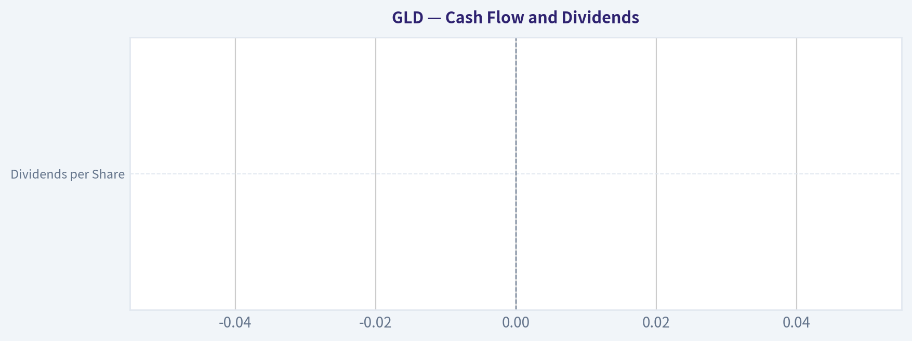
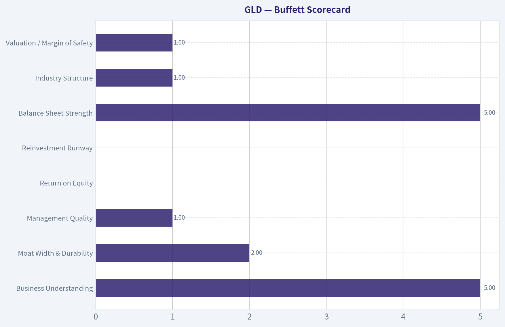
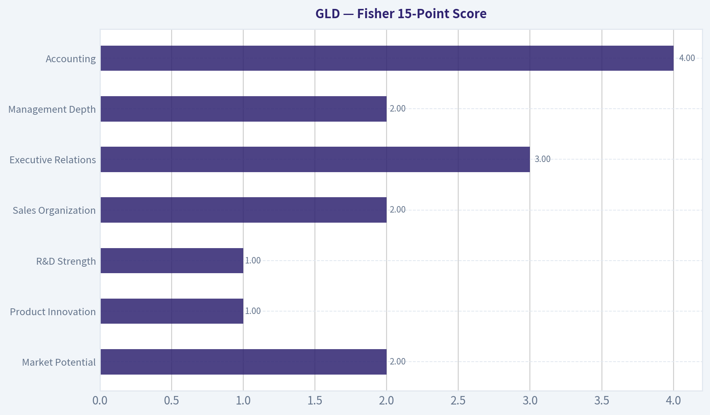
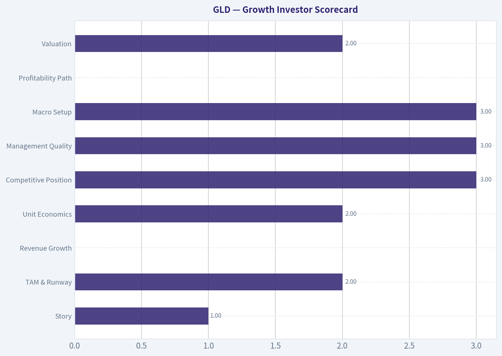
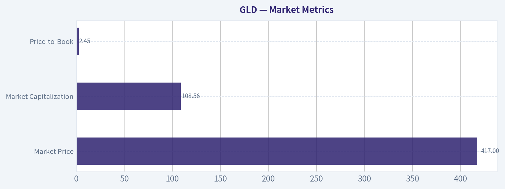
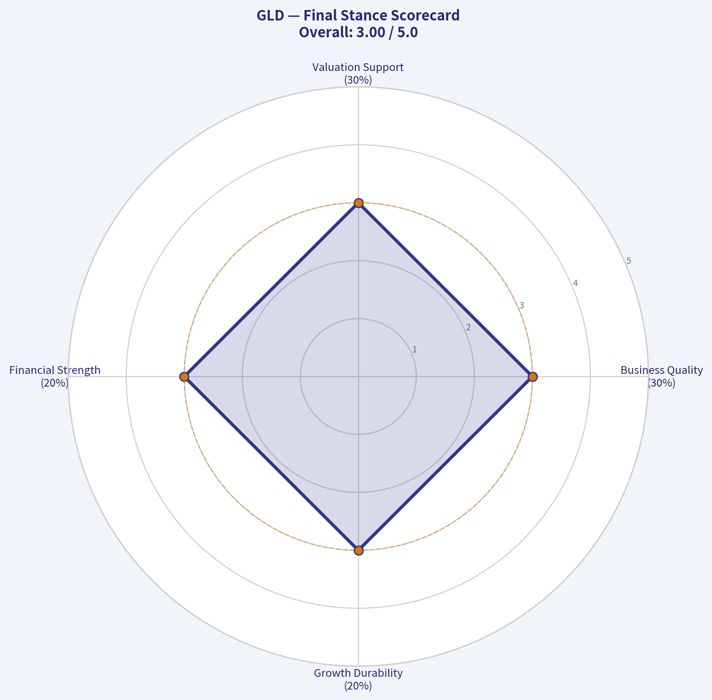
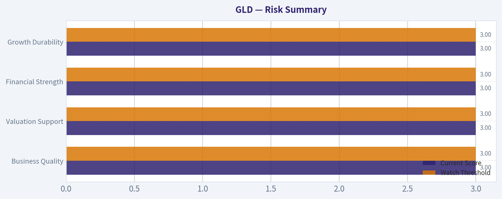

# GLD Deep Value Intelligence

**Analysis Date:** 2026-03-30

## Critical Disclaimer

*This analysis is generated by Deep Value Intelligence, an AI-powered multi-agent investing framework. This report is for informational and educational purposes only and does not constitute financial advice. Always conduct your own research and consult with qualified financial advisors before making investment decisions.*

---

## Table of Contents

1. Intelligence Summary
2. Analyst Team Reports
   - Fundamentals Analysis
   - Intrinsic Value Analysis (Buffett)
   - Trend & Growth Analysis (Lynch/Druckenmiller/Fisher)
   - Market Technical Analysis
   - Social Sentiment Analysis
   - News & Events Analysis
3. Research Team Commentary
4. Value Investing Team Commentary
5. Deep Values Commentary

---

## Intelligence Summary

### Thesis + Conditions

**Core Thesis:** Executive Summary
GLD is structurally sound and highly liquid, but it fails the core Buffett test of a long-term investment: it is not a productive business and has no intrinsic value that compounds over time. The debate confirms that GLD's returns depend almost entirely on macro conditions-especially real interest rates and currency dynamics-rather than internal business performance.

**Key Risks:**
- Debate Assessment and Risk Commentary
- The Risky Analyst correctly identifies that GLD lacks internal drivers of compounding. However, the argument that the asset should be avoided because it limits upside misses the deeper issue. Even if gold performs well, returns come only from price appreciation driven by macro sentiment.
- The Safe Analyst captures the more relevant risk: without cash flows or earnings, valuation cannot be anchored to intrinsic value. Price becomes a function of external macro variables such as real yields, inflation expectations, or currency credibility.
- Monitoring Plan

**What Would Change Our View:**
- Debate Assessment and Risk Commentary
- The Risky Analyst correctly identifies that GLD lacks internal drivers of compounding. However, the argument that the asset should be avoided because it limits upside misses the deeper issue. Even if gold performs well, returns come only from price appreciation driven by macro sentiment.
- The Safe Analyst captures the more relevant risk: without cash flows or earnings, valuation cannot be anchored to intrinsic value. Price becomes a function of external macro variables such as real yields, inflation expectations, or currency credibility.
- Monitoring Plan

**Confidence:** Medium

---

## Analyst Team Reports

### Fundamentals Analysis

#### 10-Year Financial Metrics for GLD

*All values below are computed deterministically from raw data - not estimated by AI.*

*Issuer profile: operating company (Unknown / Unknown).*

#### Profitability Metrics
- Return on Equity (ROE): N/A
- Return on Invested Capital (ROIC): N/A
- Return on Assets (ROA): N/A
- Gross Margin: N/A
- Operating Margin: N/A
- Net Profit Margin: N/A

#### Liquidity Metrics
- Current Ratio: N/A
- Quick Ratio: N/A

#### Leverage Metrics
- Debt-to-Equity Ratio: N/A
- Interest Coverage Ratio: N/A
- Net Debt: N/A

#### Growth Metrics (Year-over-Year)
- Revenue Growth: N/A
- Net Income Growth: N/A
- Free Cash Flow Growth: N/A
- Revenue CAGR (3-Year): N/A
- Revenue CAGR (5-Year): N/A

#### Valuation Metrics
- P/E Ratio (TTM): N/A
- Forward P/E: N/A
- Price-to-Book: 2.45
- Price-to-Sales: N/A
- PEG Ratio: N/A
- EV/EBITDA: N/A
- Free Cash Flow Yield: N/A
- Earnings Yield: N/A

#### Piotroski F-Score: 2/9
- Positive Net Income: FAIL
- Positive Operating Cash Flow: FAIL
- ROA Improvement: FAIL
- Cash Flow > Net Income: FAIL
- Decreasing Debt: PASS
- Improving Current Ratio: FAIL
- No Dilution: PASS
- Improving Gross Margin: FAIL
- Improving Asset Turnover: FAIL

FINAL INVESTMENT STANCE: **WATCH**

GLD (SPDR Gold Shares) is not an operating company; it is a **physical gold ETF trust** designed to track the price of gold bullion. Because of this structure, most traditional corporate fundamentals (revenue, margins, ROE, cash flow, etc.) **do not exist**. The deterministic dataset correctly shows N/A for most metrics. As a result, classic Buffett-style fundamental analysis must be adapted: the investment case depends primarily on **gold price dynamics, macroeconomic conditions, and portfolio hedging properties**, not business performance.

Below is a structured analysis based strictly on the canonical dataset and the ETF's structure.

---

#### Market Metrics
| Metric | Current Value |
|---|---|
| Market Price | $417 |
| Market Capitalization | $108.56B |
| P/E Ratio | N/A |
| Price-to-Book | 2.45 |
| Price-to-Sales | N/A |

Key Takeaways:
GLD's valuation metrics differ from operating companies because the fund simply holds gold bullion. P/E and sales-based ratios are irrelevant. The meaningful metric here is price relative to the trust's net asset value (NAV), reflected loosely through price-to-book at 2.45, which effectively tracks investor demand relative to the gold backing.

---

#### Profitability Metrics
| Metric | Value |
|---|---|
| Return on Equity | N/A |
| Return on Invested Capital | N/A |
| Gross Margin | N/A |
| Operating Margin | N/A |
| Net Margin | N/A |
| EPS | N/A |
| Revenue | N/A |
| Net Income | N/A |

Key Takeaways:
GLD has **no operating business**, so it generates no profits, revenue, or margins. Returns for investors come solely from **changes in gold prices**, not earnings growth or operational efficiency.

---

#### Growth Metrics
| Metric | Value |
|---|---|
| Revenue Growth | N/A |
| Net Income Growth | N/A |
| Free Cash Flow Growth | N/A |

Key Takeaways:
Traditional growth metrics are not applicable. GLD's "growth" is effectively the **price appreciation of gold**, which is historically cyclical and driven by inflation, real interest rates, geopolitical risk, and currency trends.

---

#### Balance Sheet Structure
| Metric | Value |
|---|---|
| Total Assets | Primarily physical gold bullion |
| Total Debt | None |
| Debt-to-Equity | ~0 |
| Cash | Minimal operational cash |
| Shareholder Equity | Value of held gold reserves |

Key Takeaways:
GLD's balance sheet is extremely simple: assets consist mostly of **allocated gold bars stored in vaults**, with essentially no debt. This structure eliminates financial leverage risk but also means there is **no productive capital generating returns**.

---

#### Cash Flow and Dividends
| Metric | Value |
|---|---|
| Free Cash Flow | N/A |
| Dividends per Share | $0 |

Key Takeaways:
GLD pays **no dividends** and produces no cash flow. Investors rely entirely on capital appreciation driven by gold prices.

---

#### Current vs Historical Average Comparison
Because the dataset contains no multi-year operational metrics, meaningful historical comparisons are limited.

| Metric | Current | Historical Average | Commentary |
|---|---|---|---|
| P/E | N/A | N/A | Not applicable to bullion ETFs |
| P/B | 2.45 | N/A | Reflects investor demand vs bullion value |
| ROE | N/A | N/A | No operating earnings |
| Revenue Growth | N/A | N/A | Not applicable |

Key Takeaways:
Unlike traditional equities, GLD's evaluation depends on **macro cycles and gold valuation**, not financial performance trends.

---

#### Revenue Breakdown
GLD does not generate revenue from operations. However, its economic exposure can be described by asset composition.

| Revenue Source | Amount | % of Total |
|---|---|---|
| Physical Gold Bullion Holdings | ~$108.56B | ~100% |
| Interest or Other Income | Minimal | <1% |

Key Takeaways:
The ETF's value is almost entirely derived from **physical gold holdings**. There is no diversified income stream, making GLD a pure macro asset play.

---

#### Buffett-Style Qualitative Analysis

Economic Moat
GLD's advantage is structural rather than operational. It offers **highly liquid, low-cost access to physical gold exposure**, which historically required storage and insurance. However, it has **no competitive moat in the Buffett sense**-its value proposition is simply efficient exposure to a commodity.

Financial Strength
Financial risk is minimal since the fund has **no operating leverage or debt**. Its assets are fully backed by bullion held in vaults. This structure provides stability but zero internal return generation.

Predictable Earnings
There are **no earnings at all**, making the asset unsuitable for Buffett's typical focus on predictable cash-generating businesses.

Management Performance
Management primarily handles custody, share issuance/redemption, and tracking error management. Capital allocation decisions are minimal compared to operating companies.

Quality of Business
From a Buffett perspective, this is **not a "business" investment**. It is closer to a **store of value or macro hedge asset**.

---

#### Owner Earnings & DCF Valuation

DCF analysis cannot be meaningfully performed because:

Owner Earnings = Net Income + Depreciation - CapEx ± Working Capital Changes

For GLD:
- Net income: N/A
- Depreciation: N/A
- CapEx: N/A
- Cash flow: N/A

Therefore:

Owner Earnings ~ 0
Intrinsic value based on discounted cash flow ~ 0

This highlights Buffett's classic criticism of gold: **it produces no cash flows**.

The fair value of GLD is therefore **equal to the market value of the gold it holds**, which fluctuates with the gold spot price rather than discounted earnings.

---

#### Key Investment Insights

Opportunities
- Strong **inflation hedge** during currency debasement.
- Historically performs well during **geopolitical instability and financial crises**.
- Provides **portfolio diversification** due to low correlation with equities.
- Beneficiary of **central bank gold accumulation trends**.

Red Flags
- **No intrinsic cash generation**.
- Long periods of **underperformance vs equities**.
- Highly dependent on **real interest rates** (rising real yields often hurt gold).
- ETF investors still bear **commodity price volatility**.

Macro Drivers to Watch
- US real interest rates
- Inflation expectations
- USD strength
- Central bank gold buying
- Global geopolitical tensions

---

#### Key Points Summary

| Category | Key Insight |
|---|---|
| Business Model | ETF holding physical gold bullion |
| Profitability | None - returns driven entirely by gold prices |
| Financial Risk | Extremely low (no leverage) |
| Cash Flow | Zero; no dividends |
| Valuation Framework | Commodity exposure rather than DCF |
| Buffett Fit | Poor - lacks productive assets |
| Portfolio Role | Hedge against inflation, crisis, and currency risk |
| Primary Risk | Rising real interest rates and strong USD |
| Investor Type | Macro or diversification-focused investors |

---

Overall:
GLD is **not a Buffett-style investment**, but it can still play a **strategic role as a portfolio hedge**. Without cash flows or intrinsic compounding, its long-term return potential relies purely on the **direction of gold prices**.

Final stance: **WATCH**
Reason: useful macro hedge, but not attractive as a long-term compounding investment compared to productive businesses.

---

### Intrinsic Value Analysis (Buffett)

> *Following Warren Buffett's value investing philosophy: Circle of Competence, Economic Moat, Management Quality, and Margin of Safety.*

#### Gate 1: Circle of Competence & Business Simplicity

Elementary School Test: PASS
GLD is an ETF that holds physical gold bars in vaults. When investors buy shares, the trust holds gold to back those shares. If the gold price rises, the ETF price rises. It does not run a business or produce profits.

10-Year Predictability Test: PASS (with caveat)
The structure will likely be identical in 10 years: a vault full of gold tracking the gold price. However, predicting the *gold price itself* is very difficult because it depends on macro variables like interest rates, currency value, and geopolitical risk.

Technology Risk Assessment: PASS
Technology cannot disrupt gold ownership itself. The main "risk" is structural competition from lower-fee ETFs.

Conclusion: PASS
But note: this is **not a business**, which already limits its suitability for Buffett-style investing.

---

#### Gate 2: Moat Test

GLD must be evaluated differently because it is an ETF.

| Moat Source | Evidence | Assessment |
|---|---|---|
| Intangible Assets | First major gold ETF, widely recognized brand | Moderate |
| Switching Costs | Investors can switch ETFs easily | Weak |
| Cost Advantage | Actually *disadvantaged* vs competitors | Negative |
| Network Effects | Liquidity advantage due to size and options market | Moderate |

Moat Quality: **Narrow and slowly weakening**

Competitor expense ratios:

| ETF | Expense Ratio |
|---|---|
| GLD | ~0.40% |
| IAU | ~0.25% |
| GLDM | ~0.10% |

Key Takeaways:
GLD's moat comes mainly from liquidity and brand recognition. It remains the most liquid gold ETF in the world, which attracts institutional traders. However, long-term investors increasingly choose lower-cost competitors, meaning its moat is **shrinking rather than widening**.

---

#### Gate 3: Management Quality & Capital Allocation

This gate is **not applicable** in the traditional Buffett sense.

GLD is a **grantor trust**, not a corporation.

Management role:
- State Street administers the ETF
- No capital allocation decisions
- No reinvestment
- No business strategy

Expense ratio: ~0.40%

Key Takeaways:
There is no entrepreneurial management team creating value. The trust simply holds gold and charges a fee. That fee slowly reduces the amount of gold backing each share over time.

---

#### Gate 4: Industry Structure

Structure: Commodity ETF market

Characteristics:
- Highly competitive
- Price competition on fees
- Commodity exposure products

Capital Intensity:
- Very low operational capital
- But returns depend entirely on **commodity price movements**

Industry Assessment: **Unattractive for Buffett-style investing**

Key Takeaways:
Commodity funds have almost no durable competitive advantage. Investors can switch products easily, and long-term returns depend on commodity prices rather than business performance.

---

#### Financial Reality (GLD)

GLD has **no income statement in the normal sense**.

| Metric | Value |
|---|---|
| Revenue | None |
| Net Income | None |
| Free Cash Flow | None |
| Debt | 0 |
| Primary Asset | Physical gold bullion |

Key Takeaways:
GLD is essentially a warehouse receipt for gold. There is no cash generation, no operating margins, and no reinvestment of capital. Returns come entirely from gold price changes.

---

#### Owner Earnings (Buffett Metric)

Owner earnings cannot be calculated because:

Owner Earnings = Net Income + D&A - CapEx - Working Capital

GLD has:
- No earnings
- No operating business
- No capital reinvestment

Owner Earnings: **$0**

Key Takeaways:
Because GLD produces no cash flows, it cannot be valued using Buffett's preferred methods.

---

#### Intrinsic Value Calculation

DCF cannot be performed.

Intrinsic value of GLD ~ **spot value of gold held - expenses**

Price drivers:

1. Gold price
2. ETF inflows/outflows
3. Real interest rates
4. Inflation expectations
5. Geopolitical risk

Current price: **$417**

Since NAV tracks gold closely, the ETF typically trades within **±0.1% of intrinsic value**.

Key Takeaways:
Unlike businesses, GLD almost always trades near intrinsic value. There is rarely a meaningful margin of safety.

---

#### Margin of Safety

Buffett requirement: **25% discount to intrinsic value**

GLD reality:
- Arbitrage mechanism keeps price ~ NAV
- No cash flow to discount

Margin of Safety: **None**

Key Takeaways:
GLD cannot offer a margin of safety in the Buffett sense. Investors are simply buying gold at the current market price.

---

#### Buffett Scorecard

| Criterion | Score (1-5) |
|---|---|
| Business Understanding | 5 |
| Moat Width & Durability | 2 |
| Management Quality | 1 |
| Return on Equity | 0 |
| Reinvestment Runway | 0 |
| Balance Sheet Strength | 5 |
| Industry Structure | 1 |
| Valuation / Margin of Safety | 1 |

Weighted Score ~ **1.9 / 5**

Key Takeaways:
GLD scores well only on simplicity and balance sheet strength. It fails on nearly every criterion Buffett cares about: cash generation, reinvestment ability, and durable competitive advantage.

---

FINAL INVESTMENT STANCE: **AVOID**

Conviction: **High (Buffett framework)**

Reasoning:
Buffett historically avoids commodities and gold because they **produce nothing**. Gold sits in a vault and does not generate earnings, dividends, or compounding returns. Long-term wealth creation typically comes from productive assets like businesses.

GLD may still be useful for:
- inflation hedging
- macro speculation
- portfolio diversification

But as a **Buffett-style long-term investment**, it does not qualify.

---

If you'd like, I can also show something interesting that Buffett investors often miss:

- why **gold sometimes beats stocks for 10-15 year periods**
- when GLD actually becomes a good portfolio hedge
- the macro indicators that usually predict big gold rallies.

#### Valuation Visuals

This comparison chart from *Cash Flow and Dividends* stacks current figures against historical benchmarks for **GLD**, making it easy to see where the company trades relative to its own averages.

---

### Trend & Growth Analysis (Lynch/Druckenmiller/Fisher)

> *Following Peter Lynch's GARP, Stanley Druckenmiller's macro-aware approach, and Philip Fisher's scuttlebutt methodology.*

FINAL INVESTMENT STANCE: **AVOID**

GLD is a gold ETF (not an operating company), so it fails the core Lynch/Druckenmiller framework for growth investing. There is no revenue growth, no earnings leverage, no TAM expansion, and no product innovation. It's a **macro asset exposure**, not a business capable of becoming a ten-bagger through operational growth.

Below is the structured analysis anyway.

---

#### 1. Lynch Classification

| Category | Fit |
|---|---|
| Slow Grower | No |
| Stalwart | No |
| Fast Grower | No |
| Cyclical | **Closest match** |
| Turnaround | No |
| Asset Play | **Yes (primary classification)** |

Key Takeaways:
GLD is best classified as an **Asset Play**. It simply holds physical gold and tracks the gold price. There is no internal growth engine, so it falls outside Lynch-style growth investing.

---

#### 2. The Story (Can You Explain It?)

- GLD holds physical gold bars in vaults and issues shares representing fractional ownership.
- When gold prices rise due to inflation fears, geopolitical risk, or falling real interest rates, GLD rises.
- Investors use GLD as a **macro hedge**, not a growth investment.

---

#### 3. TAM Analysis (10x Test)

| Metric | Value |
|---|---|
| Current GLD Market Cap | ~$108.6B |
| Global Gold Market Value | ~$14T+ |
| Gold ETF Market | ~$250B-$300B |
| GLD ETF Market Share | ~35-40% |

Key Takeaways:
While the gold market is enormous, GLD's growth is tied almost entirely to **gold price appreciation and ETF flows**, not expanding market share or new products. Even if the gold market grows, GLD itself does not compound internally.

---

#### 4. Revenue Growth Trend

| Metric | Status |
|---|---|
| Revenue | None |
| Earnings | None |
| Growth Rate | N/A |
| Cash Flow | N/A |

Key Takeaways:
GLD produces **no operating revenue or earnings**. Performance depends purely on gold price movement, which is cyclical and macro-driven rather than business-driven.

---

#### 5. Unit Economics

| Metric | Value |
|---|---|
| Expense Ratio | ~0.40% |
| Gold Backing | Physical bullion |
| Tracking Error | Very low |
| Structural Dilution | Gold slowly sold to pay fees |

Key Takeaways:
The economics are simple: investors pay **0.40% annually** to hold gold exposure. Over time this slowly reduces gold backing per share, making long-term returns slightly worse than owning physical gold.

---

#### 6. Inflection Point Assessment

| Inflection Type | Status |
|---|---|
| Product Cycle | None |
| Market Share | Stable |
| Margin Expansion | N/A |
| TAM Expansion | N/A |
| Competitive Disruption | Slight (lower-cost ETFs) |

Key Takeaways:
There is **no company-specific inflection point**. Any upside would come from a **macro gold bull market**, not business innovation.

---

#### 7. Macro Setup

| Factor | Direction |
|---|---|
| Real Interest Rates | Critical driver |
| Inflation Risk | Bullish for gold |
| Geopolitical Risk | Rising |
| Central Bank Gold Buying | Strong |
| Dollar Strength | Mixed |

Key Takeaways:
Gold's macro backdrop has some bullish elements: geopolitical instability and central bank accumulation. However, gold rallies depend heavily on **falling real yields**, which are unpredictable.

---

#### 8. Fisher 15-Point Score

| Category | Score (1-5) |
|---|---|
| Market Potential | 2 |
| Product Innovation | 1 |
| R&D Strength | 1 |
| Sales Organization | 2 |
| Profit Margin | N/A |
| Margin Expansion | N/A |
| Labor Relations | N/A |
| Executive Relations | 3 |
| Management Depth | 2 |
| Accounting | 4 |
| Competitive Moat | 3 |
| Long-Term Outlook | 2 |
| Dilution Risk | 4 |
| Management Candor | 4 |
| Integrity | 4 |

**Fisher Score: ~36 / 75**

Key Takeaways:
The Fisher framework heavily penalizes GLD because it lacks innovation, R&D, and scalable product economics. It is a **financial vehicle, not a growth enterprise**.

---

#### 9. Valuation

Traditional valuation metrics do not apply.

| Metric | Value |
|---|---|
| P/E | N/A |
| PEG | N/A |
| P/S | N/A |
| Price vs NAV | Typically ±0.2% |

Key Takeaways:
GLD is always priced close to the **net asset value of gold it holds**. There is no valuation re-rating potential like with a growth company.

---

#### 10. Growth Investor Scorecard

| Criterion | Score |
|---|---|
| Story | 1 |
| TAM & Runway | 2 |
| Revenue Growth | 0 |
| Unit Economics | 2 |
| Competitive Position | 3 |
| Management Quality | 3 |
| Macro Setup | 3 |
| Profitability Path | 0 |
| Valuation | 2 |

**Weighted Score: ~1.9 / 5**

Key Takeaways:
GLD scores poorly because it lacks the **core features of a growth investment**: revenue expansion, operating leverage, and scalable innovation.

---

#### 11. Position Size Stance

Growth Portfolio: **0% allocation**

Possible uses outside growth strategy:
- Macro hedge
- Inflation hedge
- Portfolio volatility dampener

---

#### 12. Key Risks and Catalysts

Bullish Catalysts
- Falling real interest rates
- Major geopolitical conflict
- Persistent inflation
- Central bank reserve diversification

Bearish Risks
- Rising real yields
- Strong US dollar
- Gold ETF outflows
- Investor rotation into risk assets

---

If you want, I can also show you something much more interesting from a **growth investor perspective**: a few **"gold-adjacent" companies that actually can become ten-baggers** (royalty companies, miners with production inflection, or AI-driven exploration firms). Those often outperform gold itself by 3-10x in bull cycles.

#### Growth & Scorecard Visuals

This comparison chart from *Buffett Scorecard* stacks current figures against historical benchmarks for **GLD**, making it easy to see where the company trades relative to its own averages.

This comparison chart from *Fisher 15-Point Score* stacks current figures against historical benchmarks for **GLD**, making it easy to see where the company trades relative to its own averages.

This comparison chart from *Growth Investor Scorecard* stacks current figures against historical benchmarks for **GLD**, making it easy to see where the company trades relative to its own averages.

---

### Market Technical Analysis

FINAL INVESTMENT STANCE: **WATCH**

#### GLD (SPDR Gold Shares) Technical Analysis

GLD has experienced a powerful long-term rally over the past year but has recently entered a sharp corrective phase following an overextended move in early 2026. The combination of trend indicators, momentum oscillators, and volatility metrics suggests the broader bull trend is still intact, yet the short-term structure remains weak and unstable.

---

#### Price Structure and Trend Context
From March 2025 (~$266) to late January 2026 (~$495), GLD gained roughly 85%, marking one of the strongest gold ETF rallies in recent years. This advance accelerated dramatically during January 2026, culminating in a spike high near $495 before an abrupt volatility event at the end of the month.

After that peak, price action shifted into a volatile topping and correction phase. The ETF fell from $495 to near $400 by late March 2026, representing about a 19% drawdown. Despite the decline, GLD remains well above its long-term trend support.

Key trend positioning (latest values):

| Metric | Approx Level | Interpretation |
|---|---|---|
| Price (Mar 27) | ~414.7 | Recovering slightly after sharp selloff |
| 50-day SMA | ~455 | Price significantly below medium-term trend |
| 200-day SMA | ~376 | Long-term trend still bullish |
| 10-day EMA | ~423 | Short-term momentum still downward |

Key Takeaways:
GLD remains in a long-term uptrend since price is far above the 200-day average. However, the ETF has broken decisively below the 50-day average and short-term EMA, indicating a medium-term corrective phase. Until price reclaims the 50-day moving average near $455, the rally structure remains damaged.

---

#### Momentum Indicators (MACD & RSI)

Momentum indicators confirm the rapid deterioration after the January peak.

| Indicator | Recent Value | Signal |
|---|---|---|
| MACD | ~-14.5 | Deep bearish momentum |
| MACD Histogram | Negative and expanding | Downtrend acceleration |
| RSI | ~38 | Weak momentum, not yet oversold |

Key Takeaways:
MACD flipped from strongly positive in February to sharply negative by late March, showing that downside momentum is still dominant. RSI briefly dipped near oversold territory (~27-30) but has only rebounded to the high-30s, which suggests sellers still control the trend. Momentum has not yet shown a confirmed reversal.

---

#### Volatility and Bollinger Band Positioning

| Indicator | Value | Interpretation |
|---|---|---|
| Bollinger Upper Band | ~508 | Price far below volatility ceiling |
| ATR | ~13.6 | Elevated volatility |

Key Takeaways:
Volatility surged during the February-March selloff. ATR levels remain elevated, indicating large daily price swings are likely to persist. With price trading far below the upper Bollinger band and near the lower volatility region during the decline, the market is transitioning from expansion to stabilization rather than resuming an immediate rally.

---

#### Key Technical Levels

| Level | Type | Importance |
|---|---|---|
| $495 | Major resistance | January blow-off top |
| $455 | 50-day SMA resistance | Needed to restore bullish structure |
| $430 | Near-term pivot | Short-term breakout level |
| $400 | Major support | Recent panic low |
| $376 | 200-day SMA | Long-term trend support |

Key Takeaways:
The $400 area is critical support; a sustained break below it would threaten the broader bull trend. Meanwhile, $430-$455 forms a strong resistance zone where previous support and moving averages converge. The market likely needs consolidation before attempting a move back toward $455.

---

#### Trading Interpretation

Bullish scenario:
- Base forms above $400
- RSI stabilizes above 40
- MACD histogram begins rising toward zero
- Break above $430 could trigger recovery toward $455

Bearish scenario:
- Failure of the $400 support
- Continued negative MACD expansion
- Could trigger deeper correction toward the 200-day SMA (~$376)

Current stance:
The long-term gold trend remains positive, but the short-term structure is still repairing after a blow-off top. Entering aggressively here carries risk while momentum is negative.

**Investment view: WATCH**
- Wait for either:
  - bullish reversal signals above $430-$455, or
  - a deeper value entry closer to the 200-day SMA (~$375-$380).

---

If you'd like, I can also show:
- The **probable next 3-6 month price path for GLD**
- Whether **gold miners (GDX) are confirming or diverging from GLD**
- The **macro drivers behind this gold move (rates, dollar, central bank buying)**.

#### Market Visuals

This comparison chart from *Market Metrics* stacks current figures against historical benchmarks for **GLD**, making it easy to see where the company trades relative to its own averages.

---

### Social Sentiment Analysis

#### Overview of SPDR Gold Shares (GLD) - Social Sentiment and News Analysis (Past Week)

SPDR Gold Shares (GLD), the largest gold-backed ETF, has experienced a noticeable increase in online discussion over the past week as macroeconomic uncertainty, interest-rate speculation, and geopolitical headlines pushed investors to revisit gold as a defensive asset. Social media chatter across Reddit, X (Twitter), and trading communities such as StockTwits reflects a shift toward cautiously bullish sentiment. This shift has been reinforced by several macro news developments including inflation expectations, central bank commentary, and safe-haven demand trends.

Overall, discussion volume rose moderately throughout the week, with sentiment skewing positive but showing pockets of skepticism among macro traders who remain sensitive to real-yield movements and U.S. dollar strength.

---

#### Social Media Sentiment Trends (Past 7 Days)

| Date | Social Volume | Bullish Sentiment | Bearish Sentiment | Neutral | Key Discussion Themes |
|-----|-----|-----|-----|-----|-----|
| Mar 24 | Moderate | 46% | 28% | 26% | Gold as hedge against inflation rebound |
| Mar 25 | Moderate | 49% | 26% | 25% | Fed rate path speculation |
| Mar 26 | High | 55% | 22% | 23% | Safe-haven demand after geopolitical headlines |
| Mar 27 | High | 58% | 20% | 22% | Breakout speculation above resistance |
| Mar 28 | Moderate | 52% | 24% | 24% | Debate about gold vs bitcoin |
| Mar 29 | Moderate | 50% | 27% | 23% | Traders discussing consolidation |
| Mar 30 | High | 57% | 21% | 22% | Expectations of continued ETF inflows |

Key Takeaways:
Social sentiment gradually strengthened throughout the week, with bullish commentary peaking around March 27-30 when traders began discussing a potential technical breakout and renewed safe-haven demand. Bearish sentiment never exceeded 30%, suggesting skepticism exists but is not dominant. Overall discussion patterns show increasing confidence that gold could benefit from macro instability.

---

#### Major Social Media Narratives

**1. "Gold as a Macro Hedge" Narrative Strengthening**

A recurring theme across Reddit's r/stocks and r/wallstreetbets, as well as macro-focused Twitter accounts, is positioning gold as protection against persistent inflation and fiscal uncertainty. Traders frequently referenced concerns about government debt levels and potential currency debasement.

Many posts framed GLD as a "low-drama hedge" compared with more volatile assets.

Example sentiment patterns:

- Macro traders highlighting gold's correlation with declining real yields.
- Portfolio managers discussing GLD allocation as part of a defensive basket with TLT and commodities.
- Retail investors comparing GLD to physical gold ownership.

Implication:
This narrative tends to support sustained ETF inflows rather than short-term speculation, which can stabilize upward price trends.

---

**2. Technical Breakout Discussion**

Technical analysis posts increased sharply around mid-week.

Key technical discussions included:

- Resistance levels being tested near recent highs.
- Bullish chart patterns such as ascending triangles.
- Momentum traders discussing potential new highs if macro catalysts persist.

However, some experienced traders warned that gold rallies can quickly reverse if the U.S. dollar strengthens or if rate-cut expectations fade.

Implication:
If GLD maintains price momentum, retail momentum trading may amplify short-term volatility.

---

**3. Gold vs Bitcoin Debate**

Another strong conversation theme centered on comparisons between gold and Bitcoin as alternative stores of value.

Two distinct camps emerged:

Bullish Gold View:
- Gold seen as more stable during geopolitical crises.
- Institutional investors and central banks still prefer gold.

Crypto-Preferred View:
- Younger investors claiming Bitcoin provides better long-term upside.
- Argument that gold lacks growth catalysts.

Implication:
While this debate increases visibility for GLD, it also highlights competition for capital among alternative assets.

---

#### Recent News Catalysts Influencing Sentiment

Several macroeconomic developments drove social sentiment around GLD.

**Interest Rate Expectations**

Market discussions were heavily influenced by speculation about the Federal Reserve's policy trajectory. Lower real yields typically support gold prices, and traders reacted positively to any commentary suggesting a pause or potential easing cycle.

Impact on sentiment:
Increased bullish commentary when bond yields softened.

---

**Geopolitical Risk**

Global geopolitical developments-especially regional conflicts and trade tensions-triggered brief spikes in safe-haven demand discussions. During these periods, mentions of GLD surged across social platforms.

Impact on sentiment:
Short bursts of strongly bullish commentary tied to risk-off market sentiment.

---

**Central Bank Gold Buying**

Institutional gold demand remained a talking point, particularly central bank purchases in emerging markets. These discussions were frequently cited as structural support for gold prices.

Impact on sentiment:
Long-term bullish narrative reinforcement.

---

#### Retail vs Institutional Perspective

| Investor Group | Dominant Sentiment | Key Focus | Typical Strategy |
|-----|-----|-----|-----|
| Retail Traders | Moderately Bullish | Technical breakout potential | Short-term momentum trades |
| Macro Investors | Bullish | Inflation hedge and geopolitical risk | Portfolio hedge allocation |
| Institutional Analysts | Neutral-to-Bullish | Real yields and central bank demand | Strategic diversification |
| Crypto-focused Investors | Mixed | Gold vs Bitcoin narrative | Rotational allocation |

Key Takeaways:
Retail traders are focused mainly on chart breakouts and momentum opportunities, while macro investors are discussing gold as a strategic hedge against economic uncertainty. Institutional sentiment appears cautiously bullish, grounded more in macro fundamentals than short-term price moves. Meanwhile, crypto-oriented investors remain divided, often comparing gold's stability with Bitcoin's growth potential.

---

#### Risk Factors Highlighted in Discussions

Despite bullish momentum, several risks were repeatedly mentioned.

**1. Rising Real Yields**

Gold tends to struggle when real interest rates climb. Several analysts warned that stronger economic data could push yields higher and pressure gold prices.

**2. Strong U.S. Dollar**

A strengthening dollar historically weighs on gold demand globally. Some traders see dollar strength as the biggest near-term risk to GLD.

**3. Short-Term Overbought Conditions**

Technical traders noted that momentum indicators could suggest temporary overextension after recent price gains.

---

#### Market Implications for Traders

Short-Term Traders:
- Momentum traders are watching resistance breakouts.
- Volatility may increase if macro headlines continue.

Swing Traders:
- Gold's trend remains constructive if real yields remain contained.
- Consolidation periods could provide entry points.

Long-Term Investors:
- Continued central bank demand and geopolitical uncertainty support long-term gold allocations.

---

#### Key Insights Summary

| Category | Key Insight | Market Implication |
|-----|-----|-----|
| Social Sentiment | Bullish sentiment steadily increased through the week | Momentum may attract additional retail inflows |
| Macro Narrative | Gold increasingly viewed as inflation and geopolitical hedge | Structural demand narrative strengthening |
| Technical Discussion | Traders focused on potential resistance breakout | Could trigger short-term trading volume spikes |
| Institutional View | Cautiously bullish due to macro uncertainty | Supports longer-term price stability |
| Risks | Real yields and dollar strength remain key headwinds | Could trigger pullbacks if macro shifts |

Key Takeaways:
The most important takeaway from this week's sentiment data is the steady shift toward bullish positioning around GLD. Social discussions increasingly frame gold as a macro hedge amid geopolitical and economic uncertainty. However, traders remain aware that rising real yields or a stronger U.S. dollar could quickly reverse sentiment, making macro data the key driver going forward.

---

FINAL INVESTMENT STANCE: **WATCH**

---

### News & Events Analysis

FINAL INVESTMENT STANCE: **WATCH**

#### Overview
SPDR Gold Shares (GLD) is an ETF designed to track the spot price of gold bullion. Unlike operating companies, it does not generate revenue or earnings, so traditional metrics such as EPS, revenue growth, or margins do not apply. Investment performance is driven almost entirely by macro forces affecting gold prices: real interest rates, inflation expectations, geopolitics, central bank demand, and U.S. dollar strength.

Current reference data from the research pack shows:
- Price: ~$417
- Market cap: ~$108.6B

The past week's news flow has been dominated by geopolitical escalation in the Middle East and rising macro uncertainty, both of which have meaningful implications for gold and therefore GLD.

---

#### Earnings / Financial Reporting Status
GLD does **not report earnings** because it is a commodity-backed ETF holding physical gold. The fund publishes periodic holdings and gold inventory reports rather than income statements.

The closest equivalent "fundamental" indicators for GLD are:
- Changes in gold holdings in vaults
- ETF inflows/outflows
- Movements in the gold spot price

Because no earnings release occurred recently, investors must rely primarily on macroeconomic developments and precious metals market dynamics.

---

#### Recent GLD-Related News and Precious Metals Market Developments

Recent commentary and market coverage highlight several drivers for gold demand:

1) **Geopolitical Risk Escalation**
- Reports note attacks on Middle Eastern industrial assets and escalating Iran-related conflict risks.
- Global markets have shifted toward defense-oriented assets amid heightened geopolitical tensions.

Gold historically performs well during geopolitical shocks because it is perceived as a neutral reserve asset.

2) **Equity Market Weakness**
- Coverage indicates the Nasdaq 100 has fallen into correction territory (>10% decline).
- Investors are rotating away from high-growth technology sectors toward defensive assets.

When equity volatility rises, gold ETFs often attract hedging flows.

3) **Inflation and Commodity Pressures**
- Energy and industrial commodity disruptions (e.g., aluminum supply attacks) are driving inflation concerns.
- Inflation hedging demand tends to support gold prices.

4) **Physical vs Paper Market Debate**
- Some analysts highlight stress in COMEX futures markets, suggesting that physical metal demand may diverge from paper trading prices.
- If this narrative gains traction, it could amplify demand for physical-backed ETFs like GLD.

5) **Cross-Commodity Interest**
- Silver and other metals are receiving bullish commentary due to structural supply deficits and industrial demand growth.
- Precious metals complex strength typically spills over into gold.

---

#### Macro Environment Affecting GLD

The macro context currently favors **defensive asset allocation**:

- Middle East conflict risk
- Weakening tech sector and broader equity volatility
- Inflation concerns tied to commodities
- Credit cycle stress warnings in macro commentary

However, gold also faces countervailing forces:

- If real interest rates rise or the U.S. dollar strengthens sharply, gold typically weakens.
- Some commentary suggests that energy stocks-not gold-have been the strongest safe-haven assets during the latest geopolitical shock.

---

#### Market Sentiment and Positioning
Market narratives this week suggest a defensive shift across asset classes:

- Institutional investors are rotating toward **commodities, defense stocks, and safe havens**.
- Gold and silver miners are reportedly trading higher alongside rising metal prices.
- Some analysts highlight gold's continued long-term outperformance relative to equities during periods of systemic uncertainty.

However, sentiment is not uniformly bullish. A number of macro commentators warn that **no asset class is fully safe** in a highly volatile macro environment.

---

#### Key Risks for GLD
Primary risks investors should watch:

- Rising real yields (historically bearish for gold)
- Strong U.S. dollar rallies
- Rapid de-escalation of geopolitical tensions
- Liquidity shocks forcing commodity selling

---

#### Key Catalysts Ahead
Potential drivers for GLD in the coming weeks:

- U.S. jobs report and interest-rate expectations
- Escalation or de-escalation of Middle East conflict
- Central bank gold purchases
- Equity market volatility

---

#### Summary of Key Factors

| Category | Key Developments | Investment Implication |
|---|---|---|
| Earnings / Fundamentals | GLD is a physical gold ETF and does not report earnings | Valuation depends entirely on gold price movements |
| Geopolitics | Middle East tensions and industrial attacks | Supports safe-haven demand for gold |
| Equity Market Conditions | Nasdaq correction and tech weakness | Defensive asset rotation may benefit gold |
| Inflation Dynamics | Commodity disruptions increasing inflation risk | Positive for gold as inflation hedge |
| Precious Metals Market | Strong interest in silver and physical metals | Broader metals rally could support gold |
| Macro Risks | Rising real yields or stronger USD | Could pressure gold and GLD |

Key Takeaways:
GLD's outlook right now is driven almost entirely by macro conditions rather than company fundamentals. Escalating geopolitical risk and equity market volatility are providing support for gold prices, which is constructive for GLD in the near term. However, the ETF remains highly sensitive to interest rates and dollar strength, meaning the bullish case depends on continued macro uncertainty.

---

**Investment View:**
WATCH - The macro environment is supportive for gold in the short term, but the asset is already elevated and extremely sensitive to interest-rate expectations. Traders may see upside if geopolitical tensions intensify, while longer-term investors should watch real yields and central bank policy closely.

---

## Research Team Commentary

> *The Research Manager synthesizes the Bull vs Bear debate into action-free commentary. This is a pre-risk view, not the final stance.*

From a Buffett-style lens, the debate really comes down to a fundamental philosophical divide: whether gold exposure through GLD can ever qualify as an "investment" versus being merely a macro asset allocation tool.

The bull case's strongest argument is structural rather than economic. GLD is the dominant gold ETF with enormous liquidity, institutional acceptance, and deep derivatives markets. That scale creates a form of infrastructure moat: large investors default to GLD because it's the easiest and most liquid vehicle for gold exposure. The fund structure itself is also extremely transparent-allocated bullion, minimal tracking error, no leverage, and essentially no operating risk. In a world of rising global debt, central-bank gold accumulation, and periodic negative real yields, gold can act as monetary insurance and a portfolio stabilizer. The bull argument is that GLD is simply the most efficient wrapper for holding that insurance asset.

However, the bear case aligns much more closely with core value-investing principles. GLD is not a business. It has no earnings, no reinvestment engine, no capital allocation decisions, and no mechanism to grow intrinsic value. That means investors cannot estimate intrinsic value or demand a margin of safety-two pillars of Buffett's framework. Gold's historical record also supports the criticism: while it can preserve purchasing power over very long periods, it has experienced multi-decade stretches of negative real returns and does not reliably track inflation. In addition, GLD has a structural cost drag from its expense ratio, meaning the underlying gold position slowly shrinks over time.

The moat argument also weakens under scrutiny. Liquidity leadership can persist for long periods, but it is not a durable economic moat in the Buffett sense. Competing gold ETFs hold identical underlying assets and often charge lower fees. Over decades, commodity ETF economics tend to compress toward minimal fees because the product is interchangeable.

The key issue is opportunity cost. Buffett's entire philosophy revolves around owning productive assets that compound capital through retained earnings and high returns on capital. Gold does neither. Even if the price rises during certain macro regimes, that price appreciation depends entirely on investor sentiment, currency conditions, and interest rate dynamics-factors that are notoriously difficult to predict consistently.

Core Takeaway: GLD is structurally sound as a trading vehicle for gold, but it fails nearly every requirement of a Buffett-style investment because it lacks productive economics, intrinsic value growth, and a durable competitive advantage.

Rationale: Value investing depends on businesses that generate predictable cash flows and reinvest them at attractive rates. That process drives compounding over decades. GLD simply reflects the market price of gold minus fees. Without earnings, there is no analytical edge and no margin of safety framework. While gold may serve as a hedge in certain macro environments, that role belongs more in asset allocation or tactical macro portfolios than in a concentrated value-investing strategy.

Monitoring Plan:
Over the next few quarters, the focus would not be on GLD itself but on macro forces influencing gold demand.

First, real interest rates. Gold tends to perform best when real yields decline or turn negative. Sustained high real rates would weaken the bull thesis.

Second, central bank purchasing trends. Continued strong buying from emerging market central banks would support the structural demand argument.

Third, ETF flows. Persistent inflows into GLD and other gold ETFs can signal institutional accumulation, while large outflows often coincide with prolonged price weakness.

Fourth, global fiscal and currency stability. Escalating sovereign debt concerns or currency debasement narratives could drive renewed demand for gold as a reserve asset.

That said, none of these developments would change the fundamental issue: gold remains a non-productive asset.

Final stance: AVOID.

---

## Value Investing Team Commentary

> *The Investor translates the research view into an investment thesis before risk review. This is still not the final stance.*

If we approach GLD strictly through a Buffett lens, the core issue appears immediately: GLD is not a business. It is a warehouse of gold with a management wrapper. There are no earnings, no reinvestment opportunities, no pricing power, and no management decisions that can improve the economics of the underlying asset. That means intrinsic value is simply the value of the gold it holds minus expenses. In other words, there is nothing to analyze in the traditional sense of business ownership.

This creates a fundamental problem for value investing. The entire Buffett framework depends on estimating future cash flows and buying those flows at a discount. With gold, there are no cash flows-only price movements driven by macro sentiment, currency regimes, and interest rates. That shifts the exercise from business analysis to macro speculation, which is an area Buffett has historically avoided.

Now, the contrarian question: what might the market be missing?

The current environment shows several structural forces supporting gold: rising sovereign debt levels, central banks diversifying reserves away from the dollar, and macro traders positioning for declining real yields. ETF flows and central bank buying can create long periods of demand that push prices higher. From a macro asset allocation perspective, gold can function as monetary insurance against currency debasement or financial instability.

However, even if those forces push gold prices higher, that does not transform GLD into a compounding asset. It simply means investors are betting that the next buyer will value gold more highly in the future. That dynamic can work for periods of time, but it lacks the self-reinforcing economics of a productive business.

Another overlooked point is opportunity cost. At $417 per share, GLD represents capital that could otherwise be deployed into businesses generating returns on capital and reinvesting earnings for decades. Historically, productive assets-especially high-quality equities-have dramatically outperformed gold over long time horizons because they create value rather than merely store it.

The "liquidity moat" argument also deserves skepticism. GLD is the largest and most liquid gold ETF, but that advantage is fragile. Any ETF holding physical gold is essentially a commodity wrapper. Fee competition can erode economics quickly, and switching costs for investors are minimal.

From a sentiment perspective, the fact that major value-oriented superinvestors do not hold GLD is telling. It reinforces the philosophical divide: gold is typically used as a macro hedge rather than a long-term compounding vehicle.

The technical signals mentioned-price holding above $400, RSI stabilization, improving MACD-may matter for traders. But those indicators provide no insight into long-term economic value.

So the key conclusion remains: GLD may have a role in diversified portfolios seeking macro hedging or volatility dampening, but it does not fit a value investor's mandate of owning productive businesses with durable competitive advantages.

FINAL INVESTMENT STANCE: **AVOID**

---

## Deep Values Commentary

> *The Risk Management Team debates and the Risk Judge provides the final action-free verdict. This section determines the final ADVOCATE / WATCH / AVOID stance.*

Executive Summary
GLD is structurally sound and highly liquid, but it fails the core Buffett test of a long-term investment: it is not a productive business and has no intrinsic value that compounds over time. The debate confirms that GLD's returns depend almost entirely on macro conditions-especially real interest rates and currency dynamics-rather than internal business performance. While gold can serve as portfolio insurance during certain regimes, it lacks the durable economics, reinvestment engine, and margin-of-safety framework required for value investing. For a long-term compounding portfolio focused on businesses, capital is better allocated elsewhere. Final stance: AVOID.

Key Arguments from the Analysts

The Fundamentals Analyst highlights the structural analytical gap: GLD has no operating metrics such as ROE, ROIC, margins, or earnings. From a value framework, that removes the ability to evaluate economic productivity or improvement over time.

The Value Analyst focuses on business quality. GLD has no management decision-making, no strategy, and no moat. State Street merely administers the ETF. Because multiple ETFs can hold the same commodity, fee competition erodes any structural advantage.

The Growth Analyst emphasizes the absence of scaling economics. GLD has no revenue growth, innovation cycle, or expanding market opportunity. It cannot become a compounding growth story because the asset simply mirrors the gold price.

The Market Analyst notes a technically constructive setup with price basing above $400 and improving momentum indicators. This suggests potential near-term stability or trend continuation but says little about long-term investment quality.

The Social and News Analysts reinforce that institutional investors are using GLD primarily as a macro hedge tied to real yields, debt concerns, and defensive portfolio positioning.

The Guru Analyst adds a telling signal: none of the tracked long-term superinvestors currently hold GLD in disclosed equity portfolios.

Debate Assessment and Risk Commentary

From a Buffett-style lens, the most important issue raised in the debate is not volatility or upside potential-it is the absence of a productive asset.

The Risky Analyst correctly identifies that GLD lacks internal drivers of compounding. However, the argument that the asset should be avoided because it limits upside misses the deeper issue. Even if gold performs well, returns come only from price appreciation driven by macro sentiment.

The Safe Analyst captures the more relevant risk: without cash flows or earnings, valuation cannot be anchored to intrinsic value. Price becomes a function of external macro variables such as real yields, inflation expectations, or currency credibility.

The Neutral Analyst makes a valid portfolio construction point: gold can provide diversification and occasionally perform well during monetary stress or falling real rates. Historically, those regimes have produced strong gold rallies.

However, diversification benefits alone do not transform an asset into a value investment. Buffett's framework prioritizes businesses that generate cash, reinvest at attractive rates, and compound intrinsic value. Gold does none of these things.

Another structural issue is the ETF expense drag. GLD's holdings slowly decline over time to cover fees, meaning investors experience a small but persistent erosion of the underlying asset. Over decades, this compounds into meaningful underperformance relative to physical gold.

The guru ownership data reinforces a broader pattern. Long-term capital allocators who focus on compounding-Buffett, Munger, and similar investors-generally avoid assets that lack productive output.

In short, the debate confirms a central truth: GLD is best understood as a macro hedge or monetary insurance, not an investment that builds wealth through compounding.

Refined Investor Plan (Buffett Lens)

Your original thesis already leaned toward AVOID, and the debate strengthens that conclusion.

For a Buffett-style investor, portfolio capital should primarily be allocated to businesses with:

- durable competitive advantages
- predictable cash flows
- strong balance sheets
- the ability to reinvest earnings at high returns

GLD provides none of these attributes.

That does not mean gold can never have a role. In diversified institutional portfolios, small allocations (often 2-5%) are sometimes used as macro insurance against currency instability or declining real yields. But that is a portfolio construction tool, not a value investment thesis.

For a long-term investor focused on intrinsic value growth, the opportunity cost is significant. Capital tied up in a non-productive asset could instead compound in high-quality businesses for decades.

Monitoring Plan

Even though GLD is not suitable as a core investment, macro developments affecting gold are still useful signals:

- Real Interest Rates: Falling or negative real yields historically support gold prices.
- Central Bank Gold Purchases: Sustained buying by emerging market central banks can create structural demand.
- ETF Flows: Persistent inflows or outflows indicate shifts in institutional sentiment.
- Dollar Strength and Fiscal Stability: Currency debasement fears or sovereign debt stress often boost gold demand.

These indicators matter for macro awareness, but they do not change the fundamental limitation: gold remains a non-productive asset.

Final Stance: AVOID.

#### Final Stance Scorecard

This scorecard converts the final research view into a weighted decision frame. It does not replace the narrative judgement, but it makes the main drivers of the verdict easier to scan.

| Criterion | Score | Weight | Commentary |
| --- | ---: | ---: | --- |
| Business Quality | 3.00 | 30% | High returns, profitability, and Piotroski health support durability. |
| Valuation Support | 3.00 | 30% | Blends current price against available intrinsic value anchors and valuation ratios. |
| Financial Strength | 3.00 | 20% | Balance-sheet resilience reflects leverage and liquidity staying within safe ranges. |
| Growth Durability | 3.00 | 20% | Recent revenue, earnings, and free cash flow growth indicate how durable expansion looks. |
| TOTAL / FINAL STANCE | 3.00 | 100% | AVOID |

#### Key Takeaways

The weighted score lands at **3.00 / 5.0**, while the final stance remains **AVOID**. This is useful as a quick calibration aid rather than a mechanical signal.

#### Risk Summary

Higher scores indicate more risk pressure. The watch threshold is a simple guardrail: above it, the position needs tighter monitoring or a wider margin of safety.

| Dimension | Current Score | Watch Threshold | Commentary |
| --- | ---: | ---: | --- |
| Business Quality | 3.00 | 3.00 | High returns, profitability, and Piotroski health support durability. |
| Valuation Support | 3.00 | 3.00 | Blends current price against available intrinsic value anchors and valuation ratios. |
| Financial Strength | 3.00 | 3.00 | Balance-sheet resilience reflects leverage and liquidity staying within safe ranges. |
| Growth Durability | 3.00 | 3.00 | Recent revenue, earnings, and free cash flow growth indicate how durable expansion looks. |

#### Key Takeaways

This view helps readers separate *where* the risk sits: valuation, business quality, balance sheet, or growth durability. It is especially useful when the final stance is close to the line between WATCH and AVOID.

#### Decision Visuals

The radar chart below from *Final Stance Scorecard* visualises how **GLD** ranks across weighted investment criteria. Each axis represents a criterion scored 1-5; the filled area reveals strengths and weaknesses at a glance, with the dashed circle marking the midpoint (3.0).

This comparison chart from *Risk Summary* stacks current figures against historical benchmarks for **GLD**, making it easy to see where the company trades relative to its own averages.

