# GLNG Deep Value Intelligence

**Analysis Date:** 2026-09-23

## Critical Disclaimer

*This analysis is generated by Deep Value Intelligence, an AI-powered multi-agent investing framework. Education & research only - not financial advice, not a financial advisor.*

---

## Table of Contents

1. Intelligence Summary
2. Analyst Team Reports
   - Fundamentals Analysis
   - Intrinsic Value Analysis (Buffett)
   - Trend & Growth Analysis (Lynch/Druckenmiller/Fisher)
   - Market Technical Analysis
   - Options Market Analysis
3. Research Team Commentary
4. Value Investing Team Commentary
5. Deep Values Commentary

---

## Intelligence Summary

### Thesis + Conditions

**Core Thesis:** # Executive Briefing

**Key Risks:**
- However, the shares trade at **34.2x trailing earnings**, while maintenance capital, parent-available cash flow, debt coverage, restricted cash, and project-level returns remain unverified. The modeled **$56-$57 base value offers only about 13% upside**, versus roughly **24% downside to $38**. That is insufficient for a concentrated, capital-intensive business that has not yet demonstrated high returns.
- ## Risky Analyst: Strongest bullish argument
- The risky analyst correctly challenges the use of backward-looking profitability as if it represented mature economics.

**Confidence:** Low

---

## Analyst Team Reports

### Fundamentals Analysis

#### Latest Earnings Snapshot

*Most recent reported quarter anchored on 2026 Q2, with prior-year comparison when available.*

| Metric | 2026 Q2 | 2025 Q2 | YoY Change |
| --- | ---: | ---: | ---: |
| Revenue | $130.5M | $137.6M | -5.1% |
| Operating Income | $65.2M | $69.3M | -5.9% |
| Net Income | $38.3M | $83.6M | -54.2% |
| Diluted EPS | $0.37 | $0.82 | -54.1% |
| Operating Cash Flow | $70.6M | $73.1M | -3.4% |
| Free Cash Flow | $-34.7M | $-59.9M | +42.1% |

Key Takeaways: This snapshot anchors the most recent reported quarter before the narrative analysis. It helps readers separate long-run business quality from whatever changed in the latest earnings print.

#### 17-Year Financial Metrics for GLNG

*All values below are computed deterministically from raw data - not estimated by AI.*

*Issuer profile: operating company (Energy / Oil & Gas Midstream).*

#### 17-Year Financial Metrics
*Annual rows come from reported financial statements. The final TTM row is computed from the latest four quarters.*

| Metric | 2009 | 2010 | 2011 | 2012 | 2013 | 2014 | 2015 | 2016 | 2017 | 2018 | 2019 | 2020 | 2021 | 2022 | 2023 | 2024 | 2025 |
| --- | --- | --- | --- | --- | --- | --- | --- | --- | --- | --- | --- | --- | --- | --- | --- | --- | --- |
| Market Price | $8 | $10 | $31 | $27 | $28 | $29 | $13 | $20 | $26 | $19 | $13 | $9 | $11 | $20 | $21 | $41 | $37 |
| Market Cap | $849.7M | $1.01B | $3.34B | $3.10B | $3.10B | $3.17B | $1.47B | $2.32B | $3.01B | $2.20B | $1.43B | $940.4M | $1.36B | $2.47B | $2.45B | $4.46B | $4.07B |
| P/E Ratio | 36.81 | 1501.00 | 71.69 | 3.15 | 28.35 | -66.31 | -8.63 | -11.53 | -16.77 | -9.52 | -6.75 | -3.44 | 3.28 | 3.14 | -52.38 | 87.63 | 62.03 |
| P/B Ratio | 1.29 | 2.46 | 4.92 | 1.76 | 1.72 | 1.42 | 0.78 | 1.24 | 1.76 | 1.26 | 0.96 | 0.73 | 0.78 | 0.99 | 1.19 | 2.21 | 2.21 |
| ROE | 3.5% | 0.1% | 6.9% | 55.1% | 6.1% | -2.1% | -9.0% | -10.0% | -10.5% | -13.3% | -14.1% | -21.2% | 23.9% | 31.5% | -2.3% | 2.5% | 3.6% |
| ROIC | 4.6% | 4.6% | 10.5% | 12.7% | 3.2% | -0.0% | -0.9% | -3.9% | -2.3% | 2.8% | 1.5% | 1.6% | 9.1% | 17.7% | 0.5% | 2.3% | 3.0% |
| EPS | $0.22 | $0.01 | $0.44 | $8.67 | $0.99 | $-0.44 | $-1.56 | $-1.71 | $-1.54 | $-2.01 | $-1.88 | $-2.51 | $3.38 | $6.49 | $-0.41 | $0.46 | $0.60 |
| Revenue | $216.5M | $244.0M | $299.8M | $410.3M | $99.8M | $106.2M | $102.7M | $80.3M | $143.5M | $430.6M | $448.8M | $261.4M | $260.3M | $267.7M | $298.4M | $260.4M | $393.5M |
| Gross Profit | N/A | N/A | N/A | N/A | N/A | N/A | N/A | N/A | N/A | N/A | N/A | N/A | N/A | N/A | N/A | N/A | N/A |
| Gross Margin | N/A | N/A | N/A | N/A | N/A | N/A | N/A | N/A | N/A | N/A | N/A | N/A | N/A | N/A | N/A | N/A | N/A |
| Operating Margin | 14.5% | 24.7% | 40.4% | 49.4% | 63.9% | -2.0% | -35.4% | -175.8% | -59.5% | 26.6% | 13.5% | 23.4% | 117.8% | 195.7% | 5.3% | 23.9% | 25.3% |
| Net Income | $23.1M | $384,000 | $46.6M | $971.3M | $109.6M | $-48.0M | $-171.1M | $-186.5M | $-179.7M | $-231.4M | $-212.0M | $-273.6M | $413.9M | $787.8M | $-46.8M | $50.8M | $65.7M |
| Net Margin | 10.7% | 0.2% | 15.6% | 236.7% | 109.7% | -45.2% | -166.7% | -232.4% | -125.2% | -53.7% | -47.2% | -104.7% | 159.0% | 294.2% | -15.7% | 19.5% | 16.7% |
| Revenue Growth | N/A | 12.7% | 22.9% | 36.9% | -75.7% | 6.3% | -3.3% | -21.8% | 78.8% | 200.0% | 4.2% | -41.8% | -0.4% | 2.9% | 11.5% | -12.8% | 51.1% |
| Net Income Growth | N/A | -98.3% | 12048.4% | 1982.1% | -88.7% | -143.8% | 256.4% | 9.0% | -3.7% | 28.8% | -8.4% | 29.1% | -251.3% | 90.4% | -105.9% | -208.6% | 29.2% |
| Free Cash Flow Growth | N/A | 18.2% | -242.1% | -418.1% | -71.0% | -136.9% | 1278.6% | -66.5% | -69.6% | -432.5% | N/A | N/A | N/A | N/A | N/A | N/A | N/A |
| Total Book Value | $658.2M | $410.6M | $677.8M | $1.76B | $1.80B | $2.24B | $1.90B | $1.86B | $1.72B | $1.75B | $1.50B | $1.29B | $1.73B | $2.50B | $2.07B | $2.01B | $1.84B |
| Total Assets | N/A | $2.08B | $2.23B | $2.41B | $2.59B | $3.90B | $4.27B | $4.26B | $4.76B | $4.81B | $4.63B | $4.31B | $4.95B | $4.28B | $4.08B | $4.37B | $5.33B |
| Total Debt | N/A | $787.2M | $691.5M | $504.9M | $667.0M | $1.35B | $1.84B | $1.98B | $2.41B | $2.57B | $2.54B | $2.35B | $1.62B | $1.19B | $1.22B | $1.45B | $2.76B |
| Debt-to-Equity | N/A | 1.92 | 1.02 | 0.29 | 0.37 | 0.61 | 0.97 | 1.06 | 1.41 | 1.47 | 1.69 | 1.82 | 0.94 | 0.48 | 0.59 | 0.72 | 1.50 |
| Cash & Equivalents | $122.2M | $164.7M | $66.9M | $424.7M | $125.3M | $191.4M | $105.2M | $224.2M | $214.9M | $217.8M | $179.7M | $86.0M | $231.8M | $878.8M | $679.2M | $566.4M | $1.15B |
| Shareholders' Equity | $658.2M | $410.6M | $677.8M | $1.76B | $1.80B | $2.24B | $1.90B | $1.86B | $1.72B | $1.75B | $1.50B | $1.29B | $1.73B | $2.50B | $2.07B | $2.01B | $1.84B |
| Operating Cash Flow | $43.8M | $51.7M | $116.6M | $233.8M | $67.7M | $24.9M | $-344.6M | $-115.4M | $-35.1M | $116.7M | $-38.2M | $-176.5M | $253.9M | $279.1M | $141.6M | $321.2M | $470.9M |
| Investing Cash Flow | $-56.5M | $364.7M | $-298.6M | $-290.7M | $-533.1M | $-1.43B | $-256.0M | $3.9M | $-419.9M | $-202.5M | $-1.3M | $-10.2M | N/A | $498.4M | $-131.7M | $-417.0M | $-813.2M |
| Free Cash Flow | $43.8M | $51.7M | $-73.5M | $233.8M | $67.7M | $-25.0M | $-344.6M | $-115.4M | $-35.1M | $116.7M | N/A | N/A | N/A | N/A | N/A | N/A | N/A |
| FCF Margin | 20.2% | 21.2% | -24.5% | 57.0% | 67.8% | -23.6% | -335.7% | -143.8% | -24.4% | 27.1% | N/A | N/A | N/A | N/A | N/A | N/A | N/A |
| Dividends / Share | $0.00 | $0.00 | $0.00 | $0.00 | $0.00 | $0.00 | $0.00 | $0.00 | $0.00 | $0.00 | $0.00 | $0.00 | $0.00 | $0.00 | $0.00 | $0.00 | $0.00 |

#### Profitability Metrics
- Return on Equity (ROE): 3.6%
- Return on Invested Capital (ROIC): 2.9%
- Return on Assets (ROA): 1.2%
- Gross Margin: N/A
- Operating Margin: 25.3%
- Net Profit Margin: 16.7%

#### Liquidity Metrics
- Current Ratio: 2.55
- Quick Ratio: 2.40

#### Leverage Metrics
- Debt-to-Equity Ratio: 1.50
- Interest Coverage Ratio: 3.03
- Net Debt: $1.46B

#### Growth Metrics (Year-over-Year)
- Revenue Growth: 51.1%
- Net Income Growth: 29.2%
- Free Cash Flow Growth: N/A
- Revenue CAGR (3-Year): 13.7%
- Revenue CAGR (5-Year): 8.5%

#### Valuation Metrics
- P/E Ratio (TTM): 34.21
- Forward P/E: 89.19
- Price-to-Book: 2.62
- Price-to-Sales: 9.74
- PEG Ratio: 7.69
- EV/EBITDA: 21.47
- Free Cash Flow Yield: N/A
- Earnings Yield: 2.9%

#### Owner Earnings (Buffett Method, Code-Computed)
- Net Income: $65.7M
- + Depreciation & Amortization: $49.3M
- - Capital Expenditures: N/A
- - Working Capital Changes: $197.3M
- = **Owner Earnings: $-82.4M**

#### Intrinsic Value (Code-Computed)
- Current Price: $50
- **Headline Intrinsic Value (business-model routed): $11**
  Business model: cyclical - Damodaran FCFF (cyclical)
  Model spread (min-max across DCFs): $6 - $11
  Margin of safety vs. price (headline): -362.5%
  Routing note: Cyclical: margins/FCF are volatile - headline blends FCFF, reverse-DCF and owner-earnings roughly evenly; treat the range as the honest read.
- Buffett Method (Owner Earnings):
  Conservative: $-15
  Average: $-7
  Optimistic: $-7
- Cash Flow Method (FCF):
  Conservative: $-13
  Average: $6
  Optimistic: $6
- Damodaran FCFF (WACC + margins + reinvestment):
  Conservative: $-12
  Average: $11
  Optimistic: $62
  Monte Carlo band (P10-P90): $-4 - $27 (median $10)
  P(intrinsic value > price): 0.4%

#### Piotroski F-Score: 5/9
- Positive Net Income: PASS
- Positive Operating Cash Flow: FAIL
- ROA Improvement: PASS
- Cash Flow > Net Income: FAIL
- Decreasing Debt: FAIL
- Improving Current Ratio: PASS
- No Dilution: PASS
- Improving Gross Margin: FAIL
- Improving Asset Turnover: PASS

ANALYST STANCE: **AVOID**

#### Executive Summary

Golar LNG Limited, ticker GLNG, is a cyclical LNG infrastructure and shipping company. The latest deterministic data show a sharp improvement in revenue, operating cash flow, operating margin, and net income compared with the weak 2015-2020 period. However, the improvement has not yet translated into durable owner earnings or attractive valuation.

At a current price of **$50**, GLNG trades well above the deterministic valuation range of approximately **$6-$11 per share**. The headline intrinsic value is **$10.80**, implying roughly **79% downside**. The central Buffett concern is not merely the headline P/E; it is the combination of cyclical earnings, high leverage, inconsistent historical profitability, negative computed owner earnings, and limited evidence that recent results represent a durable normalized level.

#### Current Metrics Versus the Recent Ten-Year Average

The table below compares the latest available current metrics with the arithmetic average of the 2016-2025 historical observations where such an average is meaningful. The current snapshot is generally based on the latest supplied data, while 2025 is the final annual row in the deterministic historical dataset.

| Metric | Current | 2016-2025 Average | Interpretation |
|---|---:|---:|---|
| Market price | $50.00 | $21.70 | 130% above average |
| Market capitalization | $5.10B | $2.48B | More than double the average |
| P/E ratio | 34.21 | Not reliable | Historical losses and extreme positive P/Es distort the average |
| Price-to-book | 2.62 | 1.33 | Elevated, but not a standalone value signal |
| ROE | 3.6% | -1.0% | Improved, but still weak for a value investment |
| ROIC | 2.9% | 3.2% | Approximately average and below a strong cost-of-capital return |
| Revenue | $393.5M | $284.5M | 38% above average |
| Operating margin | 25.3% | 19.6% | Above average, but historically volatile |
| Net income | $65.7M | $13.8M | Above average, helped by recovery from major losses |
| Net margin | 16.7% | -9.0% | Materially better than the decade average |
| Total debt | $2.76B | $2.01B | 37% above average |
| Debt-to-equity | 1.50 | 1.17 | More leveraged than average |
| Cash and equivalents | $1.15B | $442.9M | Stronger liquidity than average |
| Shareholders' equity | $1.84B | $1.83B | Approximately unchanged |
| Operating cash flow | $470.9M | $121.8M | Strong current improvement |
| Dividends per share | $0.00 | $0.00 | No dividend history in the dataset |

**Key Takeaways:** GLNG's current revenue, margins, operating cash flow, and cash balance are substantially better than their recent historical averages. Nevertheless, leverage and valuation are also materially higher, while ROE and ROIC remain modest. The business has improved operationally, but the stock price has risen faster than the evidence of durable shareholder returns.

#### Market Metrics and Valuation

- **Market price:** $50, compared with a 2016-2025 average of $21.70 and a 2025 year-end price of $37. The current price represents a major rerating.
- **Market capitalization:** $5.10 billion, versus a recent ten-year average of approximately $2.48 billion.
- **P/E ratio:** 34.21, equivalent to an earnings yield of only approximately **2.9%**. The forward P/E of **89.19** is especially unattractive and suggests that current earnings are not expected to scale proportionately with the stock price.
- **P/B ratio:** The current supplied valuation metric is 2.62, versus 2.21 in the 2025 historical row and approximately 1.33 for 2016-2025.

P/B is not sufficient by itself to value GLNG. This is an operating energy infrastructure business with substantial physical assets, so book value has more relevance than it would for an asset-light software or platform company. However, the ratio must still be interpreted alongside asset quality, contract duration, debt obligations, replacement cost, and returns on capital. With current ROE of only 3.6% and ROIC of approximately 2.9%, paying more than two times book value does not present a compelling Buffett-style bargain.

The supplied valuation models are substantially more cautious:

| Valuation Method | Conservative | Average | Optimistic | Comment |
|---|---:|---:|---:|---|
| Owner Earnings | -$15 | -$7 | -$7 | Negative owner earnings make the result highly unfavorable |
| FCF method | -$13 | $6 | $6 | Limited by incomplete recent FCF history |
| Damodaran FCFF | -$12 | $11 | $62 | Optimistic case requires a strong operating recovery |
| Headline intrinsic value | - | **$10.80** | - | Business-model-routed cyclical valuation |
| Current price | - | **$50.00** | - | Approximately 4.6 times headline value |

**Key Takeaways:** The market is pricing GLNG as though recent improvement will become durable and substantially larger. The deterministic valuation pack instead produces a central value near $11, with even the optimistic FCFF case requiring unusually favorable conditions. At $50, the margin of safety is negative rather than positive.

#### Profitability and Earnings Quality

GLNG's current profitability is better than its historical record but not yet Buffett-quality:

- **ROE:** 3.6%, versus a 2016-2025 average near negative 1.0%. The improvement is meaningful, but a 3.6% return on equity is weak relative to a 10% discount rate and does not justify a premium valuation.
- **ROIC:** 2.9%, approximately in line with the recent average of 3.2%. This suggests the company is not currently earning attractive returns on the capital committed to the business.
- **EPS:** $0.60 in 2025, versus substantial losses from 2014 through 2020. EPS remains far below the extraordinary $6.49 recorded in 2022, which appears to have been an unusually favorable year rather than a stable earnings base.
- **Revenue:** $393.5 million in 2025, up 51.1% year over year and above the recent average of $284.5 million.
- **Operating margin:** 25.3%, above the recent average of 19.6%. The trend is positive, but the decade includes extreme readings, including negative margins below -100% and unusually high margins above 100%, indicating considerable accounting and cyclical volatility.
- **Net income:** $65.7 million, up 29.2% year over year. This is better than the recent average of approximately $13.8 million, but the average is depressed by large losses.
- **Net margin:** 16.7%, substantially above the 2016-2025 average of approximately -9.0%.

Gross profit and gross margin are unavailable in the deterministic dataset. Accordingly, margin quality cannot be fully assessed through gross-margin trends.

The earnings record is not predictable. GLNG generated losses in most years from 2014 through 2020, followed by very strong profits in 2021-2022, a loss in 2023, and modest profits in 2024-2025. That pattern is more consistent with a cyclical or project-timing-sensitive company than with a steadily compounding enterprise.

#### Growth Analysis

- **Revenue growth:** 51.1% year over year, with three-year revenue CAGR of 13.7% and five-year CAGR of 8.5%.
- **Net income growth:** 29.2% year over year.
- **Free cash flow growth:** Not available for recent years in the deterministic dataset. The available 2010-2018 observations are highly erratic, including large negative growth rates and a one-year increase above 1,200%.

Recent revenue growth is strong, but it is partly a recovery comparison against a lower prior-year base. Revenue has not followed a smooth upward path: it reached $448.8 million in 2019, fell to approximately $260 million in 2020-2021, and then recovered. This limits the usefulness of applying a high historical growth rate to a long-term DCF.

Net income growth is even less dependable because the denominator often involved losses or very small profits. Buffett-style analysis should therefore emphasize normalized cash generation rather than reported percentage growth.

#### Balance Sheet and Financial Strength

GLNG has improved liquidity but increased leverage:

- **Total assets:** $5.33 billion.
- **Total debt:** $2.76 billion, the highest level in the supplied historical series and approximately 37% above the recent ten-year average.
- **Debt-to-equity:** 1.50, above the 2016-2025 average of approximately 1.17.
- **Cash and equivalents:** $1.15 billion, a strong increase from the recent average of approximately $443 million.
- **Net debt:** $1.46 billion.
- **Current ratio:** 2.55.
- **Quick ratio:** 2.40.
- **Interest coverage:** 3.03 times.
- **Shareholders' equity:** $1.84 billion, approximately unchanged from the recent average.

The cash position is a significant mitigating factor. However, cash does not eliminate refinancing, interest-rate, construction, counterparty, or project-completion risk. Interest coverage of approximately three times is adequate but not exceptionally strong for a capital-intensive cyclical business. The proposed potential issuance of $144A/Reg S senior unsecured notes is also a reminder that financing access and debt management remain central to the investment case.

The Piotroski F-Score of **5 out of 9** is neutral. Positive net income, improved ROA, current-ratio improvement, no dilution, and improved asset turnover are positives. Failure on cash flow exceeding net income and increasing debt are important negatives.

#### Cash Flow and Owner Earnings

The deterministic dataset shows:

- **Operating cash flow:** $470.9 million in 2025, substantially above the recent ten-year average of approximately $121.8 million.
- **Free cash flow:** $43.8 million in 2009, $51.7 million in 2010, and negative or volatile through 2018; recent annual FCF values are unavailable in the historical table.
- **Owner earnings:** **negative $82.4 million**, calculated as $65.7 million of net income, plus $49.3 million of depreciation and amortization, less $197.3 million of working-capital changes, with capital expenditures unavailable.

The negative owner-earnings result is not necessarily a permanent indication that GLNG destroys cash. Working capital and project investment can distort a single year, and missing capital-expenditure data limits precision. Nevertheless, it is a serious warning: reported earnings are not currently translating cleanly into distributable cash after reinvestment needs.

The absence of dividends throughout the dataset is consistent with a capital-intensive company prioritizing projects, liquidity, and debt management. It also means investors receive no cash yield while waiting for the business thesis to mature.

#### Buffett-Style Owner Earnings DCF

Because owner earnings are negative and recent FCF history is incomplete, the hand-built DCF should be treated as a sanity check rather than a replacement for the supplied model-based valuation.

The general Owner Earnings framework is:

\[
\text{Intrinsic Value} =
\sum_{t=1}^{5}\frac{OE_t}{(1+r)^t}
+
\frac{OE_5(1+g_T)}{(r-g_T)(1+r)^5}
\]

Assumptions:

- Starting owner earnings: **-$82.4 million**
- Discount rate: approximately **10%**
- Terminal growth rate: **2.5%**
- Five-year explicit forecast
- Growth rates fade toward the terminal rate
- Approximate diluted share count implied by the supplied market capitalization and $50 price: **102 million shares**

| Scenario | Initial Growth Assumption | Fade Pattern | DCF Interpretation | Approximate Per-Share Range |
|---|---:|---|---|---:|
| Conservative | 3% | Fades toward 2.5% | Negative owner earnings remain negative; no durable recovery assumed | Negative value; pack result -$15 |
| Average | 8% | Fades toward 2.5% | Moderate recovery, but insufficient to overcome current owner-earnings deficit | Negative value; pack result -$7 |
| Optimistic | 15% | Fades toward 2.5% | Strong FLNG utilization, stable contracts, improved cash conversion, and successful project economics | Still negative on the raw OE base; pack result -$7 |

For example, under the average case, first-year owner earnings would be approximately:

\[
-82.4 \times 1.08 = -89.0\text{ million}
\]

By year five, before fading effects, owner earnings would be approximately:

\[
-82.4 \times 1.08^5 \approx -120.9\text{ million}
\]

A terminal value applied to a negative owner-earnings base remains negative. This is why the raw hand DCF produces a poor result regardless of the growth scenario. The supplied pack's Owner Earnings outputs of **-$15, -$7, and -$7 per share** are therefore directionally consistent with the cash-conversion warning.

The more constructive Damodaran FCFF model produces **-$12, $11, and $62** per share for conservative, average, and optimistic cases, respectively. Its Monte Carlo range is **-$4 to $27**, with a median of approximately $10, and the estimated probability of intrinsic value exceeding the $50 market price is only **0.4%**.

**Key Takeaways:** The DCF does not support the current stock price. The optimistic $62 FCFF result is possible only under a highly favorable recovery and should not be treated as the base case. The strongest evidence points to a valuation near $10-$11, with significant downside risk if cash conversion or project economics disappoint.

#### Revenue Breakdown

The deterministic dataset provides total revenue but does not provide a current-year segment revenue table. Golar's economically meaningful reporting categories are generally associated with floating LNG infrastructure and related shipping or other activities. To avoid fabricating unsupported amounts, the table identifies the sources but marks precise allocation as unavailable.

| Revenue Source | Amount ($M or $B) | % of Total |
|---|---:|---:|
| Floating LNG infrastructure and liquefaction-related income | Not disclosed in deterministic pack | Not determinable |
| LNG shipping, vessel, and other related income | Not disclosed in deterministic pack | Not determinable |
| Total reported revenue, 2025 | $393.5M | 100% |

**Key Takeaways:** The business is economically concentrated in LNG infrastructure and shipping-related activities, but the supplied canonical dataset does not quantify each segment. This limits detailed assessment of recurring tolling revenue versus more volatile vessel, spot-market, or project-related income.

#### Economic Moat and Business Quality

GLNG may possess a moderate, specialized moat in certain parts of its business:

- Floating LNG projects require substantial technical expertise, construction capability, vessel conversion experience, and long-term customer relationships.
- Existing FLNG assets can benefit from high replacement costs and operational know-how.
- Long-term contracts, where present, can provide revenue visibility and reduce direct exposure to spot LNG prices.
- LNG infrastructure can benefit from global demand for flexible gas supply and energy-security diversification.

The moat is not equivalent to the moat of a consumer brand, dominant software platform, or regulated utility. It is project-specific and dependent on:

- Asset uptime and technical execution.
- Contract duration and counterparty credit quality.
- LNG prices and global shipping conditions.
- Financing costs and refinancing availability.
- Construction schedules and capital requirements.
- Political and geopolitical developments affecting LNG routes.

The decade-long earnings record shows that competitive positioning has not produced consistently high returns on capital. That weakens the case for assigning a premium multiple.

#### Management and Capital Allocation

Management's record is mixed:

- The company appears capable of producing substantial operating cash flow in favorable periods.
- Cash has increased significantly, providing strategic flexibility.
- The business has also accumulated substantial debt, with 2025 debt at the highest level in the historical dataset.
- No dividends have been paid in any reported year, so the shareholder return case depends entirely on capital appreciation.
- Negative owner earnings suggest that working-capital and reinvestment requirements remain significant.
- The historical swings in ROE, ROIC, operating margin, and net income make it difficult to conclude that capital has been allocated at consistently attractive returns.

A Buffett-style investor would want evidence that management can convert project-level earnings into recurring free cash flow while reducing leverage. That evidence is not yet established.

#### Key Investment Insights, Red Flags, and Opportunities

| Category | Assessment |
|---|---|
| Principal opportunity | LNG infrastructure demand, specialized FLNG assets, and potentially stronger utilization or contract economics |
| Recent positive | Revenue up 51.1%, operating cash flow of $470.9M, cash of $1.15B, and 25.3% operating margin |
| Valuation opportunity | None evident at $50; the opportunity would become more credible near or below conservative intrinsic-value estimates |
| Principal red flag | Price approximately 4.6 times the headline intrinsic value |
| Balance-sheet risk | $2.76B debt, 1.50 debt-to-equity, and only moderate interest coverage |
| Cash-flow risk | Owner earnings computed at negative $82.4M; recent FCF is unavailable |
| Earnings risk | Large historical losses and extreme volatility in margins and net income |
| Capital-allocation risk | No dividends and continued dependence on reinvestment and financing |
| Cyclical risk | LNG rates, energy prices, project timing, and geopolitical events can materially affect results |
| Data risk | Missing gross profit, gross margin, and recent FCF data reduce confidence in simple valuation multiples |

**Key Takeaways:** The opportunity is operational rather than valuation-based: GLNG could benefit from LNG demand and successful FLNG execution. The red flags are more important at the current price, especially leverage, negative owner earnings, and a long record of inconsistent returns. A lower entry price and several years of verified free-cash-flow conversion would materially improve the investment case.

#### Final Investment Stance

**AVOID**

GLNG has become financially healthier than it was during the 2015-2020 downturn, and the latest revenue, operating cash flow, margin, and liquidity data are encouraging. However, Buffett-style investing requires a durable economic moat, predictable owner earnings, strong returns on capital, conservative financing, and a meaningful margin of safety.

GLNG currently fails that combined test:

1. The business is cyclical and historically unpredictable.
2. ROE of 3.6% and ROIC of 2.9% are weak.
3. Debt is elevated at $2.76 billion, with debt-to-equity of 1.50.
4. Owner earnings are negative on the supplied calculation.
5. No dividend has been paid in the reported history.
6. The stock price of $50 is far above the approximately $10.80 headline intrinsic value.
7. The model estimates only a 0.4% probability that intrinsic value exceeds the current price.

The stock could continue rising if LNG markets, contract economics, or geopolitical developments remain favorable. That is a trading or cyclical-momentum argument, not a compelling long-term value-investing argument. A re-evaluation would be warranted if the price declined materially toward the model valuation range, owner earnings became consistently positive, debt declined, and ROIC demonstrated sustained improvement.

| Key Point | Conclusion |
|---|---|
| Business type | Cyclical LNG infrastructure and shipping |
| Current price | $50 |
| Headline intrinsic value | Approximately $10.80 |
| Current ROE / ROIC | 3.6% / 2.9% |
| Debt and leverage | $2.76B debt; 1.50 debt-to-equity |
| Cash position | $1.15B cash; $1.46B net debt |
| Owner earnings | Negative $82.4M |
| Earnings predictability | Weak and highly cyclical |
| Economic moat | Specialized but project-dependent |
| Main upside driver | Strong LNG demand and successful FLNG execution |
| Main downside driver | Valuation compression, leverage, and weak cash conversion |
| Buffett-style decision | **AVOID** |

**Key Takeaways:** GLNG is an improved operating business but an unattractive value investment at $50. The price assumes a durable and substantial recovery that is not supported by current returns on capital or owner earnings. The appropriate Buffett-style action is to avoid the shares until valuation and cash-flow evidence provide a genuine margin of safety.

#### Fundamental Visuals

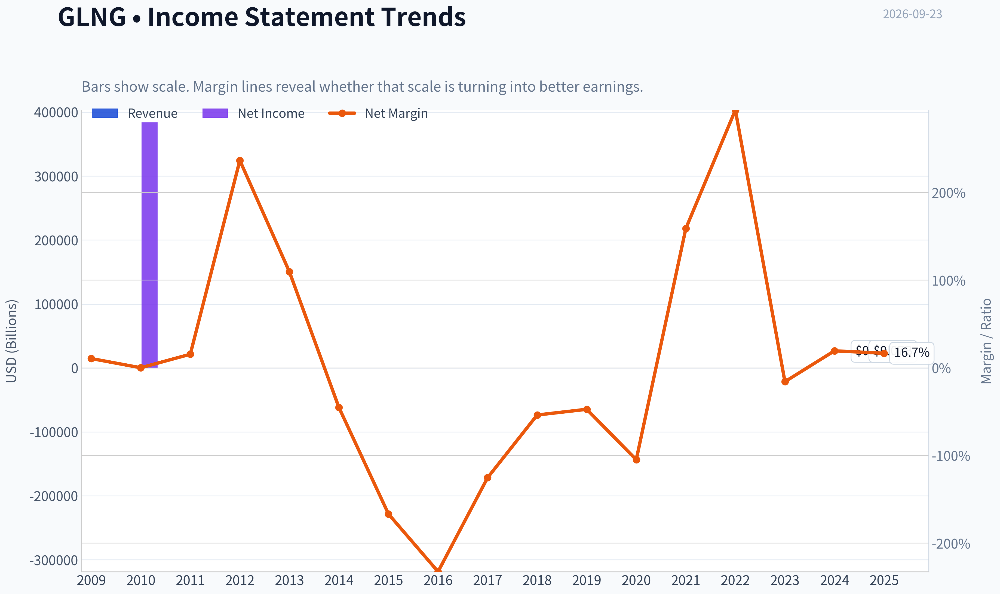

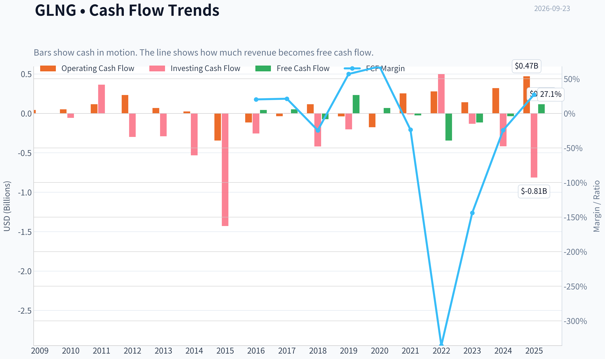

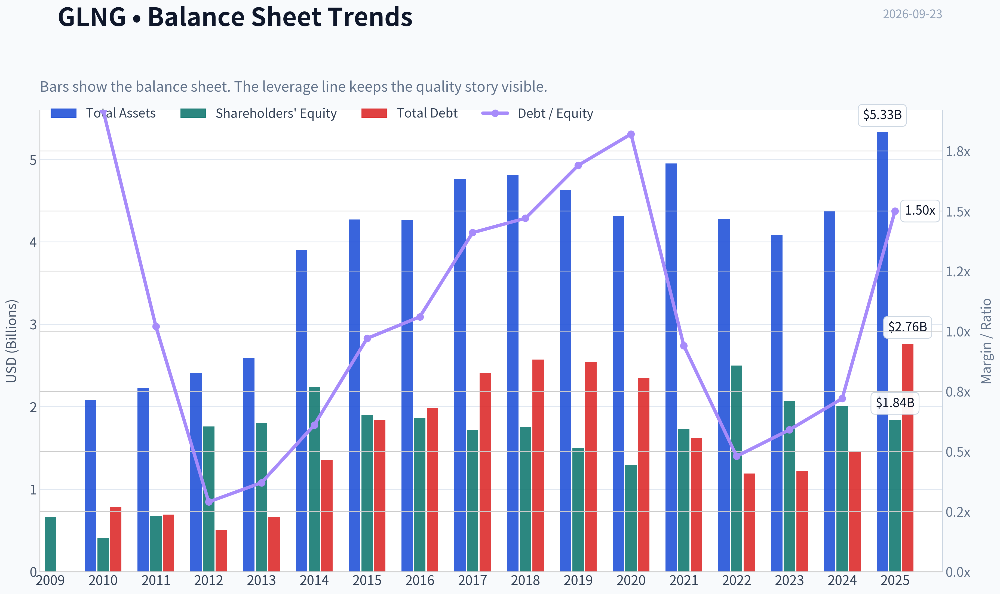

This graph tracks the profitability and return metrics (ROE, ROIC, Margins) of **GLNG** over the past decade, highlighting capital efficiency trends.

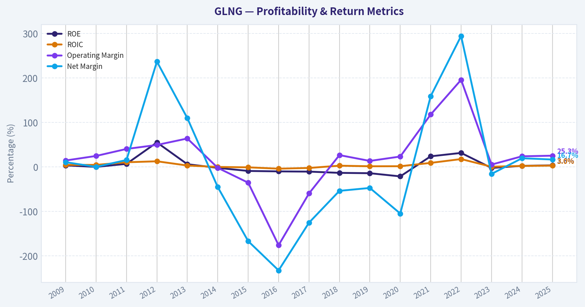

This chart illustrates the financial health of **GLNG** over the last 10 years, mapping cash equivalents and free cash flow against total obligations (Debt).

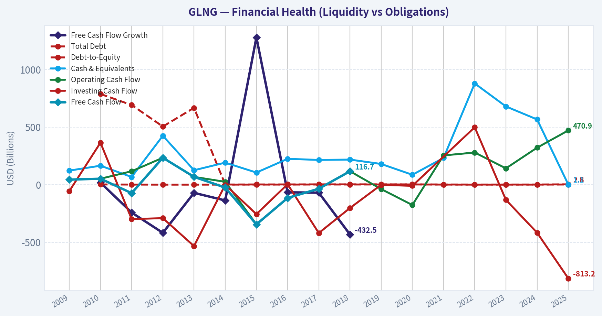

---

### Intrinsic Value Analysis (Buffett)

> *Following Warren Buffett's value investing philosophy: Circle of Competence, Economic Moat, Management Quality, and Margin of Safety.*

#### Intrinsic Value Snapshot

Price is what you pay. Intrinsic value is what the business may be worth based on the cash it can create for owners over time. We show a range, not one magic number.

- Current Price: $49.94
- Value Range (conservative to optimistic across both DCF methods): $-14.56 to $5.52

##### Owner Earnings (Buffett Method)
- Net Income: $65,676,000.00
- Depreciation & Amortization: $49,255,000.00
- Capital Expenditures: N/A
- Working Capital Changes: $197,290,000.00
- Owner Earnings: $-82,359,000.00

##### Intrinsic Value
###### Buffett Method
Uses owner earnings. Stricter, and usually more conservative.
- Conservative: $-14.56
- Average: $-7.12
- Optimistic: $-7.12
- Discount Rate: 10.0%

###### Cash Flow Method
Uses free cash flow. Better for companies spending heavily today to grow tomorrow.
- Conservative: $-12.74
- Average: $5.52
- Optimistic: $5.52
- Discount Rate: 10.0%

ANALYST STANCE: **AVOID**

#### Executive Conclusion

Golar LNG operates valuable floating LNG infrastructure, but GLNG is a highly cyclical, capital-intensive shipping and energy-infrastructure business. The stock price of **$50** implies a **34.2x P/E** despite only **3.6% ROE** and a research-pack intrinsic-value range of approximately **negative $7.12 to $10.80 per share**.

The business may benefit from LNG demand growth and constrained liquefaction infrastructure, but the current valuation appears to price in unusually favorable utilization, charter rates, project execution, and financing conditions. This is not a Buffett-style "wonderful business at a fair price" today.

#### Factor Scorecard

| Factor | Score | Assessment |
|---|---:|---|
| 1. Circle of competence and simplicity | 2.5/5 | The basic model-owning and leasing floating LNG vessels and infrastructure-is understandable, but earnings depend heavily on charter rates, project timing, energy markets, and financing. |
| 2. Durable competitive advantage | 2.5/5 | Specialized FLNG assets, engineering expertise, and long-term contracts provide a narrow moat, but the assets are expensive, project-specific, and exposed to commodity-cycle economics. |
| 3. Management and capital allocation | 2.5/5 | Specialized industry expertise is a positive. However, the capital intensity, financing needs, and proposed senior-note issuance require a high degree of trust in project execution and balance-sheet management. |
| 4. Industry structure | 2.5/5 | LNG infrastructure has attractive long-term demand characteristics, but shipping and energy infrastructure remain cyclical and capital intensive. |

**Gate 5-quality and solvency hard floor:** **Not tripped based on the available evidence.** The stock is not being hard-avoided because of demonstrated financial distress, an interest-coverage breach, or a confirmed Altman-Z distress condition. The avoidance decision is primarily driven by valuation, cyclicality, weak returns on equity, and uncertain owner earnings.

#### Moat Analysis

GLNG's strongest competitive advantages are specialized assets and operating expertise:

- Floating liquefaction vessels are difficult and costly to design, finance, construct, and operate.
- Long-term contracts can provide revenue visibility and partially insulate the company from spot LNG prices.
- Scarcity of suitable FLNG capacity may create bargaining power during periods of strong LNG demand.
- Existing relationships with energy producers and infrastructure partners can support future projects.

However, the moat is not comparable to a software platform, dominant consumer brand, or regulated utility. The company's assets require substantial capital, and returns depend on securing attractive contracts and maintaining high utilization. A 10% price increase cannot necessarily be passed through to customers in the same way that a branded consumer or software company can.

The moat is therefore best characterized as **narrow and asset-based**, rather than wide and self-reinforcing.

#### Management Quality and Capital Allocation

Management's industry specialization is valuable because FLNG projects involve technical, regulatory, construction, and commercial complexity. Long-term value creation will depend on:

1. Securing contracts before committing substantial capital.
2. Avoiding speculative vessel or project additions.
3. Maintaining conservative leverage through the LNG cycle.
4. Ensuring that new projects earn returns comfortably above the cost of capital.
5. Avoiding equity issuance or expensive debt when the stock or projects are overvalued.

The announcement of potential benchmark senior unsecured notes is not inherently negative, but it reinforces the need to monitor leverage, interest coverage, refinancing risk, and whether borrowed funds are being deployed into high-return projects. There is no clear evidence in the available information of unusually owner-oriented compensation, substantial insider ownership, or a long record of per-share value creation sufficient to award a high management score.

#### Financial Summary

| Metric | Latest value |
|---|---:|
| Share price | $50.00 |
| Market capitalization | $5.10 billion |
| P/E ratio | 34.2x |
| Implied net income | Approximately $149 million |
| Implied earnings per share | Approximately $1.46 |
| ROE | 3.6% |
| Revenue growth, year over year | 51.1% |
| Current ratio | 2.55x |
| Headline intrinsic value | $10.80 per share |
| Owner Earnings / FCF / FCFF model values | -$7.12 / $5.52 / $10.80 |

**Key Takeaways:** Revenue growth is strong, but the 51.1% increase is not enough to offset the company's low 3.6% ROE and high 34.2x earnings multiple. The valuation models produce values far below the current share price, with the owner-earnings model turning negative. The current ratio is healthy, but liquidity alone does not establish attractive long-term returns.

#### Owner Earnings Calculation

Buffett-style owner earnings are calculated as:

**Owner Earnings = Net income + depreciation and amortization - maintenance capital expenditure - working-capital increases**

Using the available market data:

- Implied net income: approximately **$149 million**
- Implied EPS: approximately **$1.46**
- Depreciation and amortization: not provided in the available figures
- Maintenance capital expenditure: not separately identified
- Working-capital investment: not separately identified

The available owner-earnings valuation result is **negative $7.12 per share**, indicating that after accounting for capital requirements and cash-flow adjustments, the business does not currently support a positive value under that model. This is a critical warning for a capital-intensive company: accounting earnings may materially overstate distributable owner cash flow.

#### Three-Scenario DCF Valuation

| Scenario | Method | Value per share |
|---|---|---:|
| A. No-growth / owner-earnings case | Owner-earnings model using a 10% discount rate | **-$7.12** |
| B. Conservative cash-flow case | FCF-based valuation with modest growth assumptions | **$5.52** |
| C. Cyclical normalized FCFF case | Damodaran cyclical FCFF methodology | **$10.80** |
| Current market price | Market quotation | **$50.00** |

**Key Takeaways:** Even the most favorable of the three available valuation outputs, $10.80, is only about one-fifth of the current share price. The spread between negative owner earnings and positive normalized FCFF shows how sensitive GLNG's value is to assumptions about maintenance capital expenditure, utilization, charter rates, and normalization of the LNG cycle.

A conventional GDP-growth perpetuity calculation is not reliable here because current accounting earnings are not a clean measure of sustainable owner earnings. Applying steady 3% growth to cyclical earnings would create a false appearance of precision. The more relevant conclusion is that the normalized cash-flow estimates remain dramatically below the market quotation.

#### Margin of Safety Analysis

| Measure | Result |
|---|---:|
| Price versus $10.80 intrinsic value | Approximately 363% above intrinsic value |
| Price versus $5.52 FCF value | Approximately 806% above intrinsic value |
| Price versus negative owner-earnings value | No meaningful positive margin of safety |
| Required margin of safety | At least 25%-35% for a cyclical, moderate-moat business |
| Actual margin of safety | **Strongly negative** |

**Key Takeaways:** GLNG does not merely lack a margin of safety; the price is several times higher than the available intrinsic-value estimates. For a cyclical, capital-intensive business with only a narrow moat, the required discount should be substantial rather than minimal. A durable LNG bull market could support higher earnings, but that would represent an optimistic scenario rather than a conservative underwriting case.

#### Buffett Scorecard

| Criterion | Weight | Score | Weighted contribution |
|---|---:|---:|---:|
| Moat width and durability | 25% | 2.5/5 | 0.63 |
| Valuation and margin of safety | 20% | 1.0/5 | 0.20 |
| Capital returns: ROIC versus WACC | 15% | 1.5/5 | 0.23 |
| Business understanding and predictability | 12% | 2.0/5 | 0.24 |
| Management quality and capital allocation | 12% | 2.5/5 | 0.30 |
| Reinvestment runway | 8% | 2.5/5 | 0.20 |
| Balance-sheet strength | 4% | 3.0/5 | 0.12 |
| Industry structure | 4% | 2.5/5 | 0.10 |
| **Total** | **100%** |  | **2.02/5** |

#### Principal Risks

| Risk | Why it matters |
|---|---|
| LNG and shipping cyclicality | Charter rates and asset values can fall sharply when vessel supply rises or LNG demand weakens. |
| Capital requirements | FLNG projects require large upfront investment and can suffer from construction delays or cost overruns. |
| Financing risk | New debt issuance increases fixed obligations and refinancing exposure. |
| Concentration risk | A small number of projects or counterparties may have an outsized effect on company results. |
| Contract and execution risk | Long-term contracts reduce volatility but do not eliminate construction, counterparty, or operational risk. |
| Valuation risk | The current price already assumes a powerful earnings environment and leaves little room for disappointment. |

#### Investment Stance

**AVOID - High conviction on valuation, moderate conviction on business quality.**

GLNG may own strategically valuable LNG infrastructure and could perform well during a favorable energy cycle. Nevertheless, Buffett-style underwriting requires purchasing future owner earnings at a sensible price. At **$50 per share**, the stock offers no demonstrated margin of safety, while the available valuation models point to values between **negative $7.12 and $10.80**.

A more attractive entry point would require either a substantially lower share price, clear evidence of sustainably higher owner earnings, or both.
#### Valuation Bridge

This bridge places the current market price beside each intrinsic value lens so readers can see whether upside depends on one method or shows up across several methods.

| Scenario | Intrinsic Value / Share |
| --- | ---: |
| Buffett Method | $-7.12 |
| Cash Flow Method | $5.52 |
| Damodaran Method | $10.80 |
| Current Price | $49.94 |

#### Key Takeaways

If one method is far above the others, the upside case depends on a specific modelling assumption. When several methods cluster together, the valuation story is more robust.

#### Valuation Visuals

This comparison chart from *Latest Earnings Snapshot* stacks current figures against historical benchmarks for **GLNG**, making it easy to see where the company trades relative to its own averages.

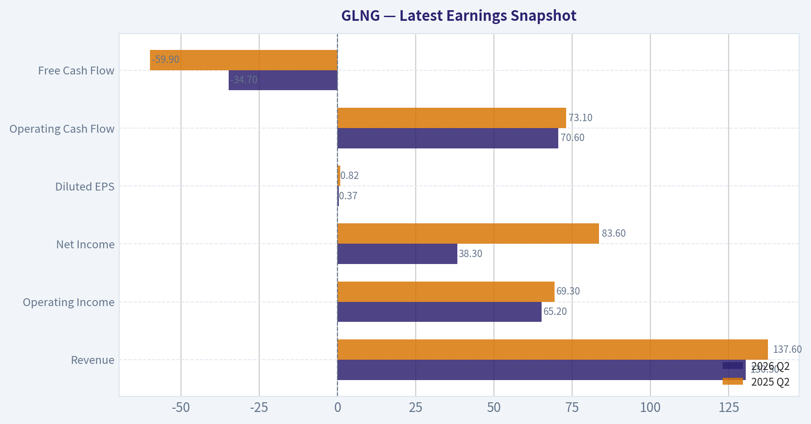

This comparison chart from *Current Metrics Versus the Recent Ten-Year Average* stacks current figures against historical benchmarks for **GLNG**, making it easy to see where the company trades relative to its own averages.

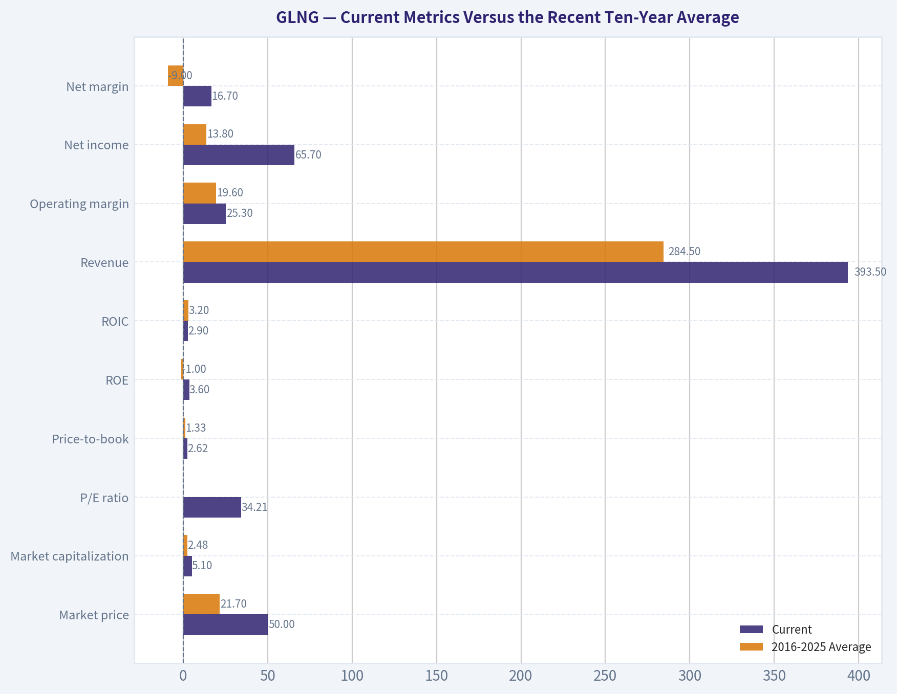

This comparison chart from *Buffett-Style Owner Earnings DCF* stacks current figures against historical benchmarks for **GLNG**, making it easy to see where the company trades relative to its own averages.

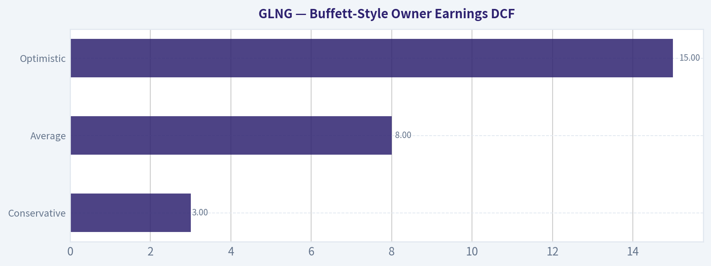

This comparison chart from *Financial Summary* stacks current figures against historical benchmarks for **GLNG**, making it easy to see where the company trades relative to its own averages.

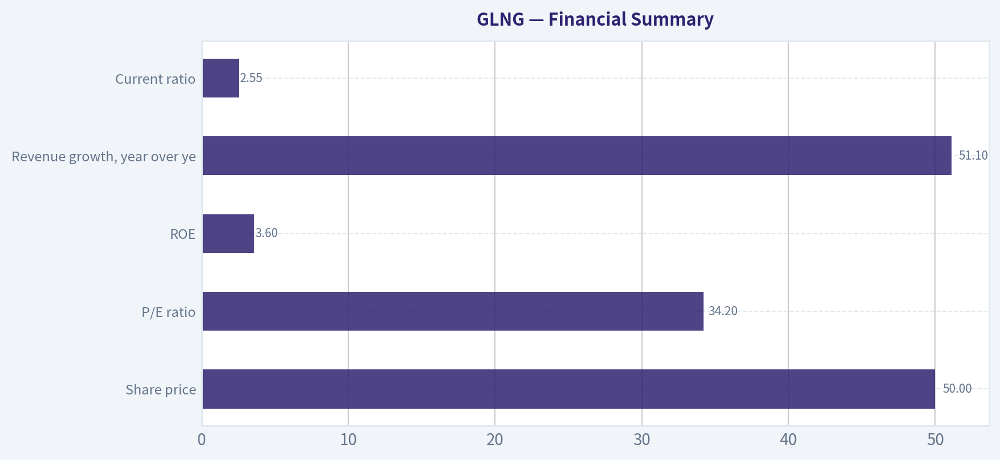

The following chart maps the **GLNG** Owner Earnings DCF valuation scenarios (Conservative, Average, Optimistic) to visually represent the margin of safety based on intrinsic value calculations.

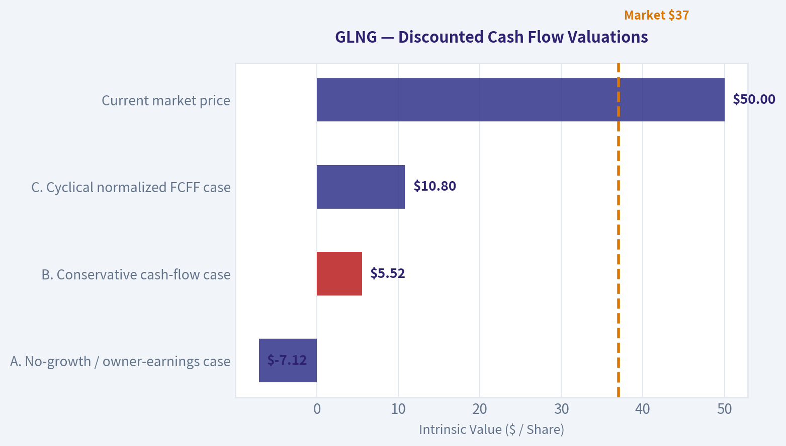

---

### Trend & Growth Analysis (Lynch/Druckenmiller/Fisher)

> *Following Peter Lynch's GARP, Stanley Druckenmiller's macro-aware approach, and Philip Fisher's scuttlebutt methodology.*

ANALYST STANCE: **AVOID**

#### 1. Lynch Classification

**GLNG is a cyclical, asset-intensive energy-shipping company-not a fast grower.** Its reported 51.1% year-over-year revenue growth is impressive, but likely reflects LNG shipping rates, asset utilization, contract timing, and geopolitical conditions rather than a durable 20%+ secular growth trajectory.

#### 2. The Story in Three Bullets

- Golar LNG operates floating LNG infrastructure and shipping assets that benefit from global LNG trade and regional gas-price dislocations.
- The company has exposure to long-term LNG demand growth, but earnings remain sensitive to charter rates, vessel utilization, financing costs, and geopolitical disruptions.
- The current setup appears event-driven: Hormuz disruptions and tanker shortages may support near-term rates, but the market price already discounts substantial earnings strength.

#### 3. Core Financial Snapshot

| Metric | GLNG |
|---|---:|
| Share price | $50 |
| Market capitalization | $5.10 billion |
| P/E ratio | 34.2x |
| Revenue growth, YoY | 51.1% |
| ROE | 3.6% |
| Current ratio | 2.55 |
| Gross margin | Not available |
| FCF yield | Not available |
| Headline intrinsic value | $10.80 |
| Owner earnings value | -$7.12 |
| FCF model value | $5.52 |

**Key Takeaways:** GLNG shows strong reported revenue growth, but its low 3.6% ROE and unavailable free-cash-flow yield make the quality of that growth difficult to validate. The three provided valuation methods produce values well below the current $50 price, indicating a substantial valuation cushion in reverse rather than a margin of safety.

#### 4. TAM Analysis and the 10x Test

GLNG participates in several overlapping markets:

- Global LNG transportation.
- Floating liquefaction and regasification infrastructure.
- Energy infrastructure supporting the transition from coal and oil toward natural gas.
- Short-term LNG shipping and charter markets.

The long-term LNG market has a credible secular-growth component, particularly from Asian demand, European energy-security needs, and new liquefaction capacity. However, GLNG's opportunity is constrained by its fleet, project pipeline, capital requirements, and the cyclical nature of shipping economics.

| 10x Test | Assessment |
|---|---|
| Current market capitalization | $5.10 billion |
| 10x equity value | Approximately $51 billion |
| Revenue needed for a 10x outcome | Not available from the supplied data |
| Can GLNG become 10x larger while retaining a small market share? | Unclear and unlikely without major fleet/project expansion |
| TAM quality | Large, but cyclical and capital intensive |

**Key Takeaways:** The underlying LNG market is large enough to support expansion, but a $51 billion equity value would require a radically larger asset base, much higher cash flows, or both. This is not a clean software-style TAM opportunity where revenue can scale rapidly with limited capital.

#### 5. Revenue Growth Trend

| Indicator | Interpretation |
|---|---|
| Latest YoY revenue growth | 51.1% |
| Multi-quarter growth series | Not available |
| Growth classification | Strong but unconfirmed |
| Likely drivers | Rates, utilization, contracts, and geopolitical conditions |
| Inflection confidence | Low to moderate |

**Key Takeaways:** The latest 51.1% growth rate is a positive signal, but one year-over-year figure cannot establish acceleration. Without a multi-quarter trend, it is impossible to distinguish durable operating momentum from a cyclical earnings peak or a favorable comparison period.

#### 6. Unit Economics and Profitability

| Metric | Assessment |
|---|---|
| LTV/CAC | Not applicable or unavailable |
| Net revenue retention | Not applicable |
| Rule of 40 | Not applicable |
| ROE | 3.6% |
| FCF yield | Not available |
| Balance-sheet liquidity | Current ratio of 2.55 |
| Business model | Capital intensive and asset based |

**Key Takeaways:** SaaS-style unit economics do not apply to GLNG. The current ratio indicates reasonable short-term liquidity, but the low ROE suggests that the asset base is not currently producing exceptional returns on equity. The key question is normalized free cash flow after maintenance capital expenditure and debt service, which is not demonstrated in the available data.

#### 7. Inflection-Point Assessment

| Potential inflection | Current assessment |
|---|---|
| Product or project ramp | Possible, but not verified |
| Market-share gains | Not demonstrated |
| Margin inflection | Not available |
| LNG TAM expansion | Positive secular backdrop |
| Competitive inflection | No clear evidence |
| Geopolitical/rate catalyst | Positive near term, inherently unstable |
| Financing catalyst or risk | Debt investor meetings announced; warrants scrutiny |

**Key Takeaways:** GLNG may be experiencing a favorable cyclical inflection from shipping shortages and geopolitical disruption. That is different from a durable company-specific inflection. The announced fixed-income investor meetings could support refinancing, but they also highlight the importance of leverage, interest expense, and capital-market access.

#### 8. Macro Setup

The macro picture is mixed:

- **Positive:** LNG demand, energy security, regional supply dislocations, and possible shipping-rate strength.
- **Negative:** Interest-rate sensitivity, debt financing, commodity cyclicality, geopolitical reversals, and new vessel or liquefaction capacity.
- **Druckenmiller assessment:** The near-term macro trade may be favorable, but the setup lacks the visibility and asymmetry usually required for a concentrated growth position.

GLNG is more suitable for a specialist commodity or infrastructure investor than for a long-duration growth investor.

#### 9. Fisher's 15-Point Assessment

Scores are preliminary because detailed management interviews, customer checks, and project-level disclosures were not available.

| Fisher criterion | Score / 5 |
|---|---:|
| Market potential | 4 |
| New-product and project development | 3 |
| R&D effectiveness | 2 |
| Sales organization | 3 |
| Profit margins | 2 |
| Margin improvement | 2 |
| Labor relations | 3 |
| Executive relations | 3 |
| Management depth | 3 |
| Cost analysis and accounting | 3 |
| Competitive advantages | 3 |
| Long-range profit outlook | 3 |
| Dilution risk | 3 |
| Management candor | 3 |
| Management integrity | 3 |
| **Total** | **43 / 75** |

**Key Takeaways:** GLNG benefits from a meaningful market opportunity and specialized infrastructure, but it scores weakly on margin quality, return on capital, and visible long-term compounding. The 43 out of 75 score falls below Fisher's "average" threshold for a high-quality growth investment.

#### 10. Valuation Analysis

**PEG:** Using the headline figures, PEG is approximately:

\[
34.2 \div 51.1 = 0.67
\]

That looks attractive by Lynch's framework. However, this is likely misleading because the denominator is a single-year growth rate for a cyclical business. PEG is most useful when earnings growth is durable and repeatable.

| Scenario | Assumed forward earnings framework | Illustrative P/E | Indicative value |
|---|---|---:|---:|
| Bear | Earnings normalize lower; cyclical conditions weaken | 15x | Approximately $16 |
| Base | Earnings stabilize and grow modestly | 20x | Approximately $34 |
| Bull | Strong LNG rates and project execution persist | 25x | Approximately $67 |

These scenarios use current implied earnings of approximately $1.46 per share from the $50 price divided by the 34.2x P/E. They are illustrative, not a substitute for normalized project-level cash-flow modeling.

**Key Takeaways:** GLNG's headline PEG appears inexpensive, but the calculation assumes that 51.1% growth is sustainable. The independent intrinsic-value estimates of negative $7.12, $5.52, and $10.80 are much lower than the market price, while the bull scenario requires sustained favorable LNG economics and strong execution.

#### 11. Growth Investor Scorecard

| Criterion | Weight | Score / 5 |
|---|---:|---:|
| Lynch story | 10% | 2.5 |
| TAM and runway | 20% | 2.8 |
| Revenue growth | 20% | 3.2 |
| Unit economics | 15% | 2.0 |
| Competitive position | 10% | 3.2 |
| Management quality | 10% | 3.0 |
| Macro setup | 5% | 3.2 |
| Profitability path | 5% | 2.5 |
| Valuation | 5% | 1.5 |
| **Weighted score** | **100%** | **2.7 / 5.0** |

**Key Takeaways:** GLNG receives credit for market opportunity, recent revenue growth, and specialized infrastructure. Those positives are outweighed by cyclical earnings risk, limited evidence of recurring growth, weak return on equity, and a valuation that appears demanding relative to intrinsic-value estimates.

#### 12. Position Size Stance

**New position: 0%.**

For an investor with specialized LNG-cycle expertise, GLNG could be considered a **small, speculative trading or cyclical position**, generally no more than **1%-2%** of a diversified portfolio. It does not qualify for a concentrated growth position or a ten-bagger-oriented core holding based on the available evidence.

#### 13. Key Catalysts and Risks

| Catalysts | Risks |
|---|---|
| Sustained LNG shipping-rate strength | Normalization of shipping rates |
| Hormuz disruption or prolonged regional supply dislocation | Geopolitical conditions rapidly improve |
| Successful project execution and utilization | Construction delays or cost overruns |
| Long-term LNG demand growth | Higher interest expense and refinancing risk |
| New contracts or improved charter coverage | Excess vessel supply |
| Stronger-than-expected free cash flow | Earnings prove to be at a cyclical peak |

**Key Takeaways:** The strongest catalysts are external-shipping shortages, geopolitical disruptions, and LNG-market tightness-rather than clearly demonstrated company-specific compounding advantages. The principal risk is that these temporary benefits fade while GLNG remains valued as though elevated earnings are durable.

#### Bottom Line

GLNG is a **cyclical LNG infrastructure and shipping opportunity with a favorable secular backdrop**, but not a sufficiently proven fast-growing compounder. The recent revenue surge deserves monitoring, particularly for evidence of multi-quarter acceleration, higher normalized free cash flow, and improving returns on capital. At approximately 34x earnings and $50 per share, the risk-reward does not currently justify initiating a growth-investor position.

---

### Market Technical Analysis

ANALYST STANCE: **WATCH**

#### GLNG technical analysis

GLNG's latest valid price appears to be **$51.36 on September 21, 2026**. The September 22 record contains volume but no open, high, low, or close data, while the indicator feed repeats September 21 values for September 23. Therefore, the analysis should be treated as current through the last reliable close rather than as a confirmed September 23 signal.

The larger trend remains constructive, but near-term momentum has weakened. GLNG is still trading well above its rising 200-day SMA, indicating that the long-term trend is bullish. However, price has recently pulled back from the $52.89 September 11 close and is fluctuating around the short-term averages, suggesting consolidation rather than a clean continuation signal.

#### Trend structure and moving averages

| Indicator | Latest reported value | Interpretation |
|---|---:|---|
| Price, latest valid close | $51.36 | Above the 10 EMA, 50 SMA, and 200 SMA |
| 10 EMA | $51.42 | Essentially neutral to slightly negative; price is just below it |
| 50 SMA | $50.72 | Rising and acting as an important medium-term support area |
| 200 SMA | $47.71 | Rising strongly; confirms a positive long-term trend |
| Price versus 200 SMA | Approximately 7.7% above | Long-term bullish structure remains intact |

The 200-day SMA has risen from approximately **$46.26 on August 24 to $47.71**, a meaningful upward slope. The 50-day SMA has also advanced from roughly **$50.09 to $50.72**, though its rate of increase has moderated. This combination indicates that the intermediate and long-term trend is still positive, but the stock is no longer accelerating upward at the same pace seen earlier in the year.

The 10-day EMA is approximately **$51.42**, almost exactly aligned with the latest valid close. This shows that short-term direction is unresolved. A sustained move above the 10 EMA, particularly above the recent $52.89-$53.24 area, would improve the short-term setup. Conversely, repeated closes below the 10 EMA would increase the probability of a test of the 50 SMA near $50.72.

**Key Takeaways:** GLNG remains in a bullish long-term trend because price is well above a rising 200-day SMA. The medium-term trend is also constructive, but the stock is currently consolidating around its 10-day EMA. The $50.70 area is the first important support zone, while sustained strength above approximately $53.25 would be needed to confirm renewed upside momentum.

#### Momentum: MACD and RSI

The MACD remains positive but has deteriorated considerably. It declined from approximately **0.51 on September 11 to 0.08 on September 21**, indicating that the earlier upside momentum has largely faded. A positive MACD value means the broader momentum structure has not yet turned decisively bearish, but the sharp contraction warns that buyers are no longer showing the same dominance.

The RSI has also cooled from **59.2 on September 11 to approximately 50.0**. This is close to the midpoint, meaning GLNG is neither overbought nor oversold. The RSI profile is consistent with a market in balance: the recent decline has relieved upside pressure, but it has not yet created a deeply oversold condition that would strongly favor a rebound.

For traders, the most useful confirmation would be a combination of RSI reclaiming the mid-50s and MACD turning upward. A move in RSI below the mid-40s, especially if accompanied by a negative MACD reading, would signal that the pullback is becoming more consequential rather than merely consolidative.

#### Volatility and trading conditions

ATR is approximately **$1.25**, down from roughly **$1.41-$1.43 in late August**. This represents a moderate decline in daily volatility. At the current price, the ATR is about **2.4% of the share price**, so a normal daily move can still be meaningful, but volatility is not presently expanding in a way that confirms a forceful breakout or breakdown.

The recent price action has produced several swings between roughly $50 and $53. A move of one ATR from the latest valid close would place approximate short-term reference levels near:

- Upside volatility reference: **$52.60**
- Downside volatility reference: **$50.11**

These are not fixed targets, but they help frame risk. Stops placed substantially tighter than one ATR may be vulnerable to normal GLNG fluctuations, particularly around LNG-sector news, commodity-price changes, or distribution-related trading.

#### Volume-weighted confirmation

The VWMA data requires caution. The latest reported VWMA of approximately **$48.92 on September 23** appears inconsistent with the surrounding values near **$51.7-$51.9** and is likely distorted by the missing September 22 price record. The last internally consistent VWMA reading was approximately **$51.71 on September 21**, slightly above the valid closing price of $51.36.

That relationship suggests that recent volume-weighted trading occurred at a somewhat higher level than the latest close. In practical terms, this creates a modest overhead supply signal: buyers who entered around the recent volume-weighted average may be more inclined to sell if price rebounds toward $51.70-$52.00. Because the data is affected by the missing-price record, the VWMA should be confirmed using a clean subsequent session before making a strong volume-based conclusion.

#### Bollinger-band positioning

The latest reported Bollinger upper band is approximately **$53.28**, compared with the last valid close of $51.36. Price is therefore about **$1.92 below the upper band**, or roughly 3.6% beneath it. GLNG is not currently pressing against an overbought upper-band condition.

The upper band has remained near $53.1-$53.3 through much of September, indicating that the recent trading range has not expanded materially. A close above $53.30 accompanied by stronger volume could represent a genuine range expansion. Failure near that level, followed by a move below the 50 SMA, would instead reinforce the interpretation of a broad consolidation range.

#### Trading scenarios

The primary scenario is **range-bound consolidation within a still-bullish longer-term trend**. In this scenario, GLNG holds the $50.70-$50.10 support region, stabilizes near the 10 EMA, and eventually attempts to retest $52.90-$53.30. The signal would become more attractive if RSI turns upward from around 50 and MACD begins to recover.

A bullish continuation scenario requires a decisive close above approximately **$53.25-$53.30**, preferably with volume above recent typical levels. Such a move would clear the recent high zone and the upper Bollinger band, signaling that the stock is leaving its recent range. Potentially higher levels would then need to be established from subsequent price action rather than assumed in advance.

The bearish risk scenario begins with a sustained close below the **50-day SMA near $50.72**, followed by a loss of the $50.10 area. That would weaken the medium-term structure and could expose the stock to a deeper retracement toward the high-$48s or the rising 200-day SMA near $47.71. A break below the 200-day SMA would be a much more serious deterioration, but current data does not support that conclusion.

#### Indicator selection

The selected indicators are designed to avoid excessive redundancy while covering trend, momentum, volatility, volume, and breakout context:

- **10 EMA:** Short-term direction and tactical entry timing.
- **50 SMA:** Medium-term trend and support.
- **200 SMA:** Long-term trend regime.
- **MACD:** Momentum direction and trend-change confirmation.
- **RSI:** Momentum balance and overbought or oversold context.
- **ATR:** Position sizing and stop-distance framework.
- **VWMA:** Volume-weighted support and supply assessment.
- **Bollinger Upper Band:** Breakout and exhaustion reference.

Overall, GLNG is best classified as **long-term bullish but short-term undecided**. The technical evidence favors patience rather than chasing price in the middle of the range. A bullish setup improves above $53.30; a risk-management warning develops below $50.70, and becomes substantially more negative below $50.10.

| Area | Current reading | Trading implication |
|---|---|---|
| Long-term trend | Price approximately 7.7% above rising 200 SMA at $47.71 | Bullish structural backdrop |
| Medium-term trend | Price above rising 50 SMA at $50.72 | Trend remains constructive |
| Short-term trend | Price near or slightly below 10 EMA at $51.42 | Momentum is currently unresolved |
| MACD | Positive but reduced to approximately 0.08 | Upside momentum has faded; watch for recovery or bearish crossover |
| RSI | Approximately 50.0 | Neutral momentum; neither overbought nor oversold |
| Volatility | ATR approximately $1.25 | Moderate daily risk; use volatility-aware stops |
| Volume-weighted price | Last consistent VWMA near $51.71 | Mild overhead supply around $51.70-$52.00 |
| Breakout reference | Upper Bollinger band near $53.28 | Close above $53.30 would strengthen bullish continuation case |
| First support | 50 SMA near $50.72 | Important medium-term trend support |
| Secondary support | Approximately $50.10, one ATR below latest close | Loss would make the pullback more concerning |
| Data quality | September 22 lacks OHLC data; latest indicator values may be duplicated or distorted | Confirm future signals using a complete trading session |

**Key Takeaways:** GLNG's long-term trend is bullish, but its short-term momentum has cooled to neutral as MACD and RSI have weakened. The key bullish trigger is a confirmed close above roughly $53.30, while $50.70 is the first important support and $50.10 is the more consequential downside level. Because the latest data contains a missing-price session, traders should wait for a clean follow-through session before treating any indicator crossover as fully reliable.

#### Market Visuals

This comparison chart from *Market Metrics and Valuation* stacks current figures against historical benchmarks for **GLNG**, making it easy to see where the company trades relative to its own averages.

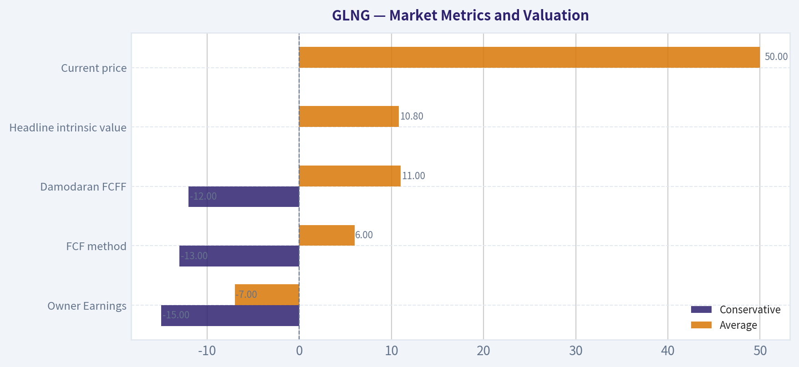

---

### Options Market Analysis

> *Reading options flow - put/call ratios, IV skew, and unusual activity - to gauge institutional positioning and event-driven risk.*

ANALYST STANCE: **ADVOCATE**

#### GLNG Options Flow Report

**As of September 23, 2026.** The available data covers the October 16, November 20, and December 18, 2026 expirations. Options positioning is moderately bullish overall, driven primarily by substantial December call activity and a very low aggregate put-to-call volume ratio. Confidence is moderate because no contract met the tool's unusual-activity threshold and strike-level open-interest data was not provided.

#### 1. Put/Call Ratio Analysis

| Expiration | Call OI | Put OI | Put/Call OI | Call Volume | Put Volume |
|---|---:|---:|---:|---:|---:|
| Oct. 16, 2026 | 1,359 | 4,549 | 3.35 | 447 | 333 |
| Nov. 20, 2026 | 2,647 | 3,341 | 1.26 | 30 | 145 |
| Dec. 18, 2026 | 9,331 | 3,598 | 0.39 | 5,053 | 238 |
| **Aggregate** | **13,337** | **11,488** | **0.86** | **5,530** | **716** |

**Key Takeaways:** Aggregate put/call open interest is 0.86, slightly above the historical neutral reference of approximately 0.70, indicating that existing protection remains meaningful. However, the 0.13 put/call volume ratio is strongly call-led, primarily because of heavy December call volume. The term structure is split: October and November carry more put protection, while December shows pronounced call positioning.

#### 2. Implied Volatility Assessment

| Expiration | Call ATM IV | Put ATM IV | Call-Put IV Differential | Assessment |
|---|---:|---:|---:|---|
| Oct. 16, 2026 | 34.6% | 31.4% | +3.2 points | Mild call premium |
| Nov. 20, 2026 | 38.2% | 31.7% | +6.5 points | Noticeable call skew |
| Dec. 18, 2026 | 37.5% | 34.9% | +2.6 points | Mild call premium |

The weighted near-term ATM IV is approximately **36% for calls** and **33% for puts**. The supplied data does not include dedicated out-of-the-money put and call IV, so a true OTM skew calculation is unavailable. ATM differentials nevertheless show call IV above put IV across all three expirations.

**Key Takeaways:** Implied volatility is moderate rather than obviously extreme, with the highest reported call IV in November and December. The consistent call-over-put IV differential suggests upside demand or upside-event speculation rather than a steep downside-protection skew. No known catalyst, such as earnings or a product event, was supplied, so elevated event-risk interpretation should be treated cautiously.

#### 3. Unusual Options Activity

| Finding | Result |
|---|---|
| Contracts with volume greater than 5x open interest | None |
| Confirmed fresh directional bets | None identified |
| Largest reported volume concentration | Dec. 18 calls, 5,053 contracts |
| Moneyness and strike assessment | Not available from supplied data |

The December call volume is substantial, but it is not classified as unusual under the stated filter because total call open interest is also large at 9,331 contracts. Therefore, the activity could represent a mixture of opening trades, existing-position adjustments, rolls, or closing transactions. Without strike-level volume, bid/ask execution, and current share price, it is not possible to distinguish institutional accumulation from retail speculation or to classify individual contracts as ITM, ATM, or OTM.

**Key Takeaways:** There is no formally confirmed unusual options activity. December calls are the dominant flow, but the data does not prove that these are fresh bullish positions. The bullish interpretation is therefore based on aggregate volume and IV patterns rather than a specific high-conviction sweep or block trade.

#### 4. Open Interest Concentration and Potential Gamma Levels

| Expiration | Largest OI Category | OI | Share of Aggregate OI |
|---|---|---:|---:|
| Oct. 16, 2026 | Puts | 4,549 | 30.9% |
| Nov. 20, 2026 | Puts | 3,341 | 22.8% |
| Dec. 18, 2026 | Calls | 9,331 | 63.1% |
| **All listed expirations** | **Calls plus puts** | **24,825** | **100%** |

December is the key open-interest concentration, with 9,331 calls versus 3,598 puts. October has the strongest put concentration, while November is more balanced but still put-heavy. Exact gravitational strikes, max-pain levels, and gamma walls cannot be identified because strike-by-strike open interest was not included.

**Key Takeaways:** December call open interest is the most important structural feature in the chain and could create upside price attraction or resistance near heavily populated strikes. October put positioning may provide downside hedging but could also pressure the stock if those puts are actively sold or hedges are adjusted. Exact pinning levels remain unavailable without strike-level data.

#### 5. Overall Options Sentiment

**Overall signal: BULLISH, with moderate confidence.**

The primary bullish drivers are:

- Aggregate put/call volume ratio of **0.13**, showing overwhelmingly call-dominated trading.
- December call volume of **5,053 contracts**, far exceeding December put volume of 238.
- December call open interest of **9,331**, substantially exceeding December put open interest of 3,598.
- Call ATM IV above put ATM IV across all listed expirations, indicating upside demand rather than pronounced downside fear.

The principal caveats are:

- Aggregate put/call OI of **0.86** remains above the approximately 0.70 neutral reference, so the existing chain still contains meaningful downside protection.
- No individual contract met the unusual-volume threshold, weakening the case for a clearly identifiable institutional bet.
- Strike-level data, execution direction, current share price, and OTM IV were not supplied, preventing precise gamma-wall and skew analysis.
- The chain is not extremely large, so the signal should not be treated as definitive.

#### Summary

| Factor | Assessment |
|---|---|
| Put/Call Ratio | OI ratio 0.86, mildly defensive versus the 0.70 neutral baseline; volume ratio 0.13, strongly call-led |
| IV Level | Moderate, approximately 36% call ATM IV and 33% put ATM IV across listed expirations |
| Skew Direction | Mild-to-moderate call skew based on ATM IV; true OTM skew unavailable |
| Unusual Activity | None formally identified; December calls dominate but do not exceed the 5x volume/OI threshold |
| Overall Signal | **BULLISH**, driven by December call positioning and highly call-heavy volume |

**Key Takeaways:** GLNG's options market leans bullish, chiefly because traders are concentrating activity and open interest in December calls. The signal is not a high-conviction institutional-flow call because no individual unusual contract was detected and existing put open interest remains substantial. The bullish read should be confirmed with price action and strike-level data before treating it as a strong directional trade.

---

## Research Team Commentary

> *The Research Manager synthesizes the Bull vs Bear debate into action-free commentary. This is a pre-risk view, not the final stance.*

Core Takeaway: Golar LNG may be developing a defensible floating-LNG infrastructure franchise, but at $49.94 investors are already paying for much of that transformation before it has appeared in free cash flow or returns on capital. The engineering barriers, scarce FLNG capacity, long-duration contracts, and 51.1% revenue growth make the opportunity credible. Nevertheless, a 34.2x trailing P/E, 2.9% ROIC, and incomplete information on owner earnings and debt coverage leave too little verified margin of safety. The appropriate stance is to monitor the transition rather than buy it today or assume the stock must fall.

The strongest bull argument is that trailing results substantially understate prospective economics. Golar has invested capital before receiving the full earnings contribution from its FLNG assets, so current ROIC may be temporarily depressed. Successfully operating these technically complex vessels can create a bankability advantage, while integration with host gas fields produces meaningful switching costs. Long-term contracts can also turn a historically cyclical business into a more predictable infrastructure platform. If normalized owner earnings reach roughly $2.25 per share and then grow around 8%, the bull's estimated value of $56-$57 is plausible.

The bull case is therefore more substantial than a temporary Hormuz or tanker-shortage trade. Golar could become a repeatable platform for monetizing stranded gas resources, and the 51.1% revenue increase provides at least some evidence that the transition is underway. The very bullish options positioning may support near-term momentum, although it says nothing about intrinsic value.

The strongest bear argument is that the valuation assumes the evidence investors are still waiting to see. The bull's $2.25 normalized owner-earnings starting point is approximately 54% above implied trailing EPS of $1.46. That uplift is then followed by another decade of 8% growth. Meanwhile, the supplied data do not establish free cash flow, maintenance capital requirements, net debt, restricted project cash, debt-service coverage, or vessel-level returns.

Using EPS as owner earnings is particularly fragile for a capital-intensive FLNG operator. Dry-docking, maintenance, conversion spending, project financing, and restricted subsidiary cash can cause distributable cash flow to differ materially from accounting earnings. A 9% discount rate may also be generous for concentrated assets exposed to commissioning, downtime, counterparty, jurisdictional, and refinancing risks.

The bull's own scenario range illustrates the problem. Its conservative value of approximately $38 represents around 24% downside, while its $56.50 base case provides only about 13% upside. A 12%-13% discount can be adequate for a proven, predictable, high-ROIC compounder. Golar, with 2.9% ROIC and substantial project concentration, has not yet earned that quality designation. Technical complexity creates barriers to entry, but a true moat must eventually appear as excess returns and durable free cash flow. Difficult assets can protect incumbents while still producing mediocre shareholder economics.

Rationale: This is not a clear AVOID because there is no demonstrated financial distress, structural demand collapse, or obviously impossible growth expectation. Approximately 12% annual growth from depressed trailing earnings could be achievable if major assets ramp successfully. Revenue growth is strong, FLNG capacity is genuinely scarce, and contracts could improve cash-flow predictability. Dismissing those factors solely because trailing ROIC is weak would repeat the mistake of treating transitional or cyclical accounting numbers as permanent economics.

Conversely, the prior mistakes also warn against letting strong momentum or a compelling secular narrative substitute for valuation discipline. The 0.13 put/call volume ratio and call-heavy December positioning suggest enthusiasm may be crowded. They may help the stock tactically, but they do not improve project returns. At the current price, there is insufficient evidence that Golar can beat the growth already embedded in its valuation.

This distinction matters: GLNG is not necessarily a poor near-term stock. Geopolitical disruption, LNG sentiment, commissioning milestones, and call-heavy positioning could carry it above the $52.60 volatility reference. But a favorable trading setup is different from a sufficiently discounted ten-year investment. The market reference of $50.11 is above the quoted share price and is not a meaningful downside support level, so it should not influence the value judgment.

Monitoring Plan: Over the next one to four quarters, the most important evidence will be the conversion of project activity into cash economics.

First, monitor commissioning, utilization, and vessel availability. High and stable availability without material delays or cost overruns would support the claim that current returns are temporarily depressed. Prolonged downtime, schedule slippage, or additional capital requirements would materially weaken the thesis.

Second, demand a clear reconciliation from reported earnings to operating cash flow and free cash flow. Maintenance capital expenditure, dry-docking costs, project-development spending, restricted cash, and cash available to the parent should be disclosed separately. The bull case becomes stronger if recurring owner earnings approach the proposed $2.25-per-share run rate without aggressive adjustments.

Third, watch whether ROIC rises as recently funded assets contribute. One quarter will not establish normalized economics, but ROIC should begin moving decisively out of the low single digits. If revenue continues growing while ROIC remains below roughly 5%, that would suggest expansion is consuming capital without creating adequate economic value.

Fourth, examine the balance sheet at both the project and parent levels. Key items include net debt, fixed versus floating rates, maturity schedules, covenant headroom, interest and debt-service coverage, recourse provisions, and liquidity under delayed-ramp scenarios. Debt reduction after commissioning would be encouraging; refinancing dependence, parent guarantees, or equity issuance to cover funding gaps would be negative.

Fifth, evaluate new contracts for quality rather than headline duration. Inflation protection, take-or-pay provisions, downtime treatment, termination rights, counterparty creditworthiness, and political jurisdiction matter more than contract length alone. New projects should be financed without excessive dilution and should offer returns clearly above the cost of capital.

Finally, watch valuation and expectations together. A lower price could create a margin of safety even before every operating question is resolved, while stronger verified cash flow could justify a higher intrinsic value. At approximately $49.94, however, the current combination of modest modeled upside and unverified project economics does not warrant advocacy.

The balanced conclusion is that Golar has a credible emerging franchise but not yet a demonstrated wonderful business. Existing shareholders can watch operating milestones rather than interpret this as a short-term sell signal. New long-term value investors should wait for either stronger proof of owner earnings and project returns or a materially more favorable price.

Final stance: WATCH.

---

## Value Investing Team Commentary

> *The Investor translates the research view into an investment thesis before risk review. This is still not the final stance.*

### Investment Commentary

Golar LNG presents a credible transformation story, but the evidence does not yet establish a high-quality compounding business. The company's floating LNG platform addresses a genuine commercial need: monetizing gas reserves that may be uneconomic or impractical to connect to conventional onshore liquefaction facilities. FLNG assets are technically difficult to develop, scarce, and potentially valuable under long-duration contracts. Those characteristics can create barriers to entry, customer switching costs, and substantial revenue visibility.

However, difficult-to-replicate assets do not automatically produce an economic moat. A moat must ultimately appear in durable free cash flow and returns meaningfully above the cost of capital. Golar's reported **2.9% ROIC, 3.6% ROE, and 1.2% ROA** do not yet demonstrate that outcome.

### What the market may be getting right

At **$49.94 and 34.2 times trailing earnings**, investors are not valuing Golar on its present profitability. They are anticipating a successful ramp in FLNG earnings, utilization, and cash distributions. That optimism is not irrational:

- Revenue increased **51.1% year over year**.
- Suitable floating-liquefaction capacity is scarce.
- Successful project execution can improve Golar's credibility with gas-resource owners and lenders.
- Long-term contracts could make future cash flows more predictable than those of a conventional LNG shipping company.
- Existing engineering and operating experience may provide a bankability advantage when competing for new projects.

The low reported ROIC may therefore be temporarily distorted by capital being invested before assets make their full earnings contribution. Treating the current return as permanent could cause investors to miss the emergence of a valuable infrastructure platform.

### What enthusiastic investors may be overlooking

The market is paying today for returns that remain largely prospective. Trailing EPS implied by the supplied valuation is approximately **$1.46**, while the bullish valuation begins with normalized owner earnings of about **$2.25 per share**-roughly 54% higher-and then assumes continued growth.

That may occur, but accounting EPS is an especially weak substitute for owner earnings in a capital-intensive FLNG business. The key unanswered items include:

- Maintenance and dry-docking expenditures
- Development and conversion spending
- Restricted cash within project subsidiaries
- Parent-level cash availability
- Project and parent-level net debt
- Fixed versus floating financing costs
- Debt-service and interest coverage
- Downtime and contractual performance deductions
- Future equity or funding requirements

A vessel can report accounting profits while generating limited cash distributable to shareholders. Conversely, project financing can make parent-level economics attractive even with substantial consolidated debt. The necessary disclosures must therefore be evaluated at both the vessel and parent levels.

Golar also has concentrated-asset risk. Technical failure, commissioning delays, geopolitical intervention, counterparty disputes, or prolonged downtime at one major asset can have an outsized effect. Long contracts improve visibility, but contract quality matters more than duration. Take-or-pay protections, inflation escalation, downtime allocation, termination rights, counterparty credit, and jurisdiction determine whether contracted revenue becomes dependable owner earnings.

### Valuation and margin of safety

The proposed base-case value of approximately **$56-$57** offers only about **13% upside** from $49.94. That discount could be sufficient for a proven, asset-light, high-ROIC compounder. It is not enough for a capital-intensive operator with low reported returns, concentrated projects, and incomplete debt and cash-flow information.

The conservative estimate near **$38** implies roughly **24% downside**. This unfavorable asymmetry is more important than the headline P/E alone. A quality-scaled margin of safety for an emerging, project-concentrated franchise should ordinarily be closer to **30%-40%**, unless operating evidence materially reduces uncertainty.

The valuation can become attractive in either of two ways:

1. **Price declines materially**, potentially toward the high-$30s or below, providing compensation for execution and financing risks; or
2. **Intrinsic value rises through evidence**, including owner earnings near the proposed $2.25-per-share run rate, improving ROIC, reliable availability, and visible parent-level cash generation.

At $49.94, investors are being asked to underwrite much of the successful transition before receiving adequate proof.

### Selective contrarian view on sentiment and news

The **0.13 put/call volume ratio** and heavy December call activity indicate highly bullish positioning. That can support near-term momentum, particularly around commissioning milestones or geopolitical headlines. It is not necessarily a bearish signal-strong stocks can remain crowded-but it increases vulnerability if project progress merely meets rather than exceeds expectations. Options activity can also reflect hedging or structured positions, so it should not be interpreted as a direct forecast of intrinsic value.

Investors should also be cautious about treating Hormuz disruption and tanker shortages as central to the long-term thesis. Golar should be valued primarily on contracted FLNG economics, asset availability, and repeatable project development-not on a temporary LNG-freight squeeze. Geopolitical tension can raise the strategic value of LNG infrastructure, but it can also increase operating, insurance, financing, and jurisdictional risks.

The selective contrarian opportunity is not to bet automatically against bullish sentiment. It is to recognize that the market may correctly anticipate stronger earnings while still underestimating how much of those earnings could be consumed by maintenance capital, debt service, restricted cash, and project risk.

### Evidence that would justify becoming constructive

The investment case would strengthen materially if Golar demonstrates:

- High and stable vessel availability without material cost overruns
- Recurring owner earnings approaching or exceeding $2.25 per share
- A transparent reconciliation from earnings to parent-available free cash flow
- ROIC progressing decisively above the low single digits and ultimately above the cost of capital
- Debt reduction and healthy coverage after project ramp-up
- New contracts with strong take-or-pay, inflation, and downtime protections
- New projects funded without excessive parent guarantees or shareholder dilution

A deterioration toward **AVOID** would require more serious evidence, such as repeated commissioning delays, major unplanned capital needs, weak debt-service coverage, dilutive financing, poor contract protection, or continued revenue growth without improving cash returns.

For existing shareholders, this is not necessarily a short-term sell signal. For new long-term investors, however, the current price offers too little compensation for the remaining uncertainty. Golar may become a defensible FLNG franchise, but investors should wait for either stronger proof or a materially better price.

**ANALYST STANCE: WATCH** - Golar LNG has credible scarcity value, technical barriers, and potentially attractive contracted growth, but its moat and owner-earnings power remain unproven. At $49.94, modest base-case upside does not provide an adequate quality-scaled margin of safety given low reported ROIC, asset concentration, and incomplete cash-flow and balance-sheet evidence.

---

## Deep Values Commentary

> *The Risk Management Team debates and the Risk Judge provides the final action-free verdict. This section determines the final ADVOCATE / WATCH / AVOID stance.*

#### Final Stance Scorecard

This scorecard converts the final research view into a weighted decision frame. It does not replace the narrative judgement, but it makes the main drivers of the verdict easier to scan.

| Criterion | Score | Weight | Commentary |
| --- | ---: | ---: | --- |
| Business Quality | 3.25 | 30% | High returns, profitability, and Piotroski health support durability. |
| Valuation Support | 2.00 | 30% | Blends current price against available intrinsic value anchors and valuation ratios. |
| Financial Strength | 4.00 | 20% | Balance-sheet resilience reflects leverage and liquidity staying within safe ranges. |
| Growth Durability | 4.33 | 20% | Recent revenue, earnings, and free cash flow growth indicate how durable expansion looks. |
| TOTAL / FINAL STANCE | 3.24 | 100% | WATCH |

#### Key Takeaways

The weighted score lands at **3.24 / 5.0**, while the final stance remains **WATCH**. This is useful as a quick calibration aid rather than a mechanical signal.

#### Risk Summary

Higher scores indicate more risk pressure. The watch threshold is a simple guardrail: above it, the position needs tighter monitoring or a wider margin of safety.

| Dimension | Current Score | Watch Threshold | Commentary |
| --- | ---: | ---: | --- |
| Business Quality | 2.75 | 3.00 | High returns, profitability, and Piotroski health support durability. |
| Valuation Support | 4.00 | 3.00 | Blends current price against available intrinsic value anchors and valuation ratios. |
| Financial Strength | 2.00 | 3.00 | Balance-sheet resilience reflects leverage and liquidity staying within safe ranges. |
| Growth Durability | 1.67 | 3.00 | Recent revenue, earnings, and free cash flow growth indicate how durable expansion looks. |

#### Key Takeaways

This view helps readers separate *where* the risk sits: valuation, business quality, balance sheet, or growth durability. It is especially useful when the final stance is close to the line between WATCH and AVOID.
