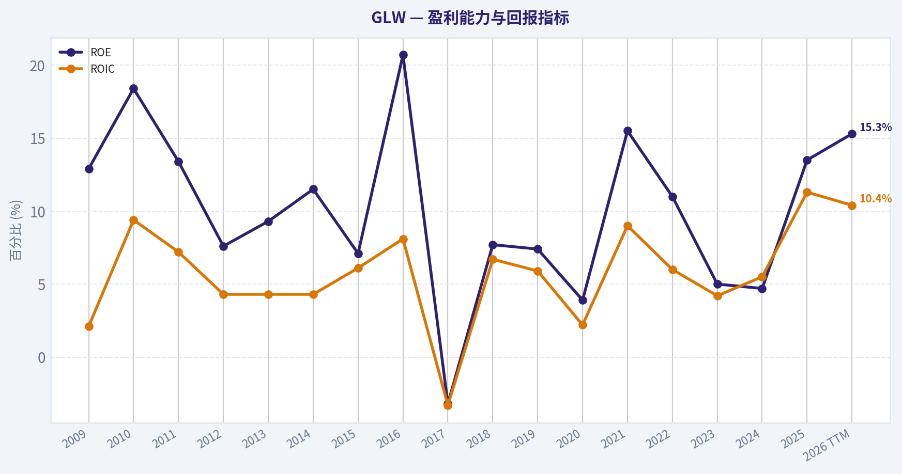
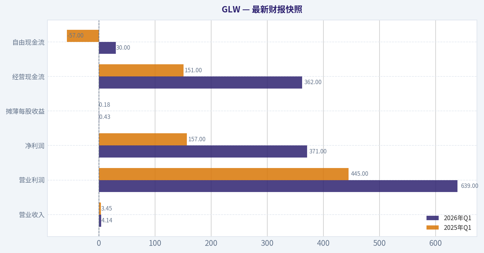
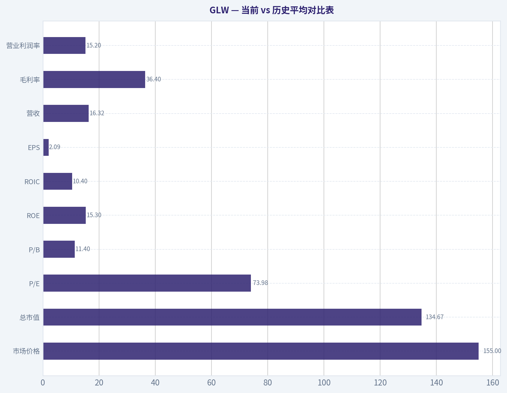
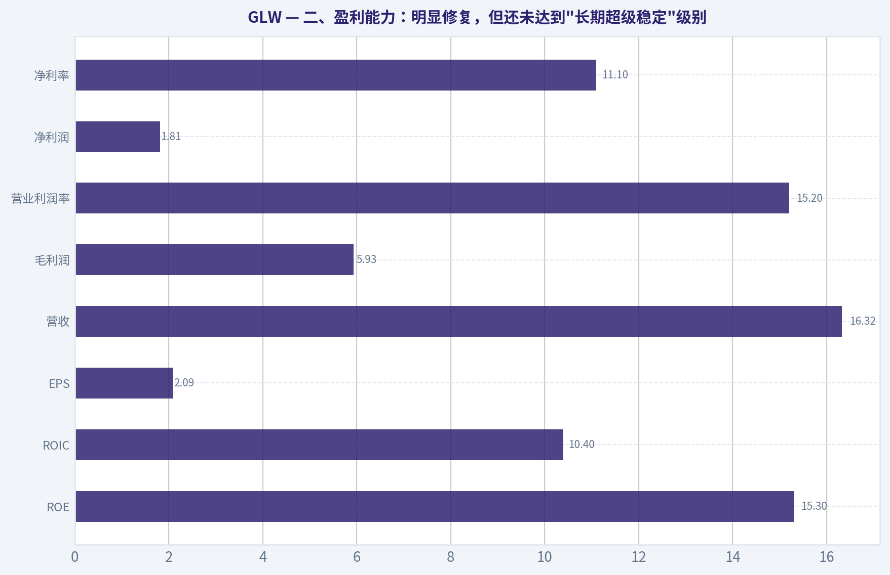
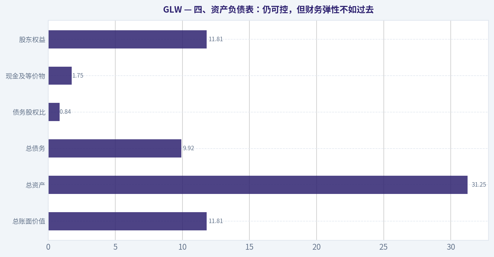
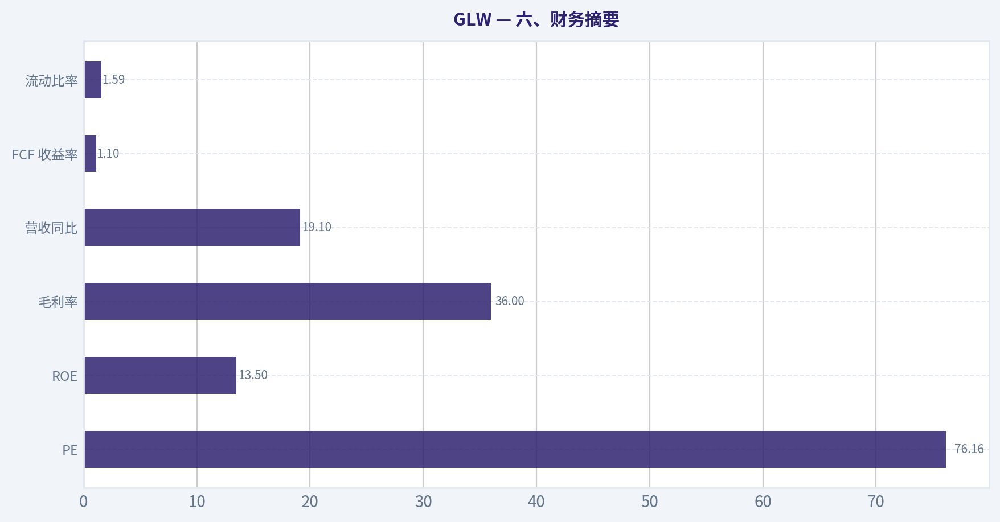
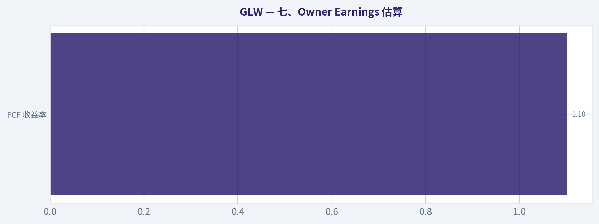
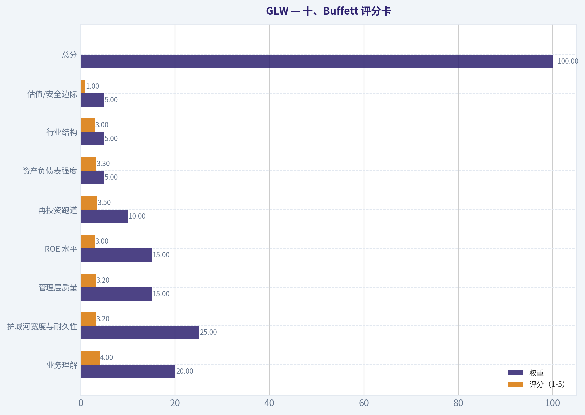

# GLW 深度价值情报

**调研日期:** 2026-07-18

## 关键免责声明

*本报告由 Deep Value Intelligence（一个基于 AI 的多智能体投资分析框架）自动生成。 仅供教育和娱乐用途 - 非财务建议，非财务顾问。*

---

## 目录

1. 情报摘要
2. 分析师团队报告
   - 基本面分析
   - 价值分析 (巴菲特)
   - 成长性分析 (林奇/德鲁肯米勒/费雪)
   - 市场分析
   - 期权市场分析
3. 研究团队评论
4. 投资团队评论
5. Deep Values 团队洞察

---

## 情报摘要

### 核心观点与前提条件

**核心论点:** ## 执行摘要
**结论：观望。**
GLW 更接近**"好公司，坏价格"**，不是应被否定的劣质资产，也不是当前适合巴菲特式长期资金积极加仓的低风险机会。牛方最有价值之处，是证明了它具备真实壁垒与平台属性；熊方最关键之处，是指出这些优势**尚未转化为足够高、足够稳定的资本回报与安全边际**。结合过往误判教训，这次不应把"估值贵"直接升级成"全面回避"，但也不能把"公司不错"当成支付 76 倍 PE 的理由。
**对长期价值投资者：认可公司，暂不追价，继续跟踪业绩兑现与估值消化。**

**主要风险:**
- 未明确说明。

**置信度:** 中

---

## 分析师团队报告

### 基本面分析

#### 最新财报快照

*以下数据基于最近一期已披露财报（2026年Q1），并尽量与上一年同期对比。*

| 指标 | 2026年Q1 | 2025年Q1 | 同比变化 |
| --- | ---: | ---: | ---: |
| 营业收入 | $4.14B | $3.45B | +20.0% |
| 营业利润 | $639.0M | $445.0M | +43.6% |
| 净利润 | $371.0M | $157.0M | +136.3% |
| 摊薄每股收益 | $0.43 | $0.18 | +138.9% |
| 经营现金流 | $362.0M | $151.0M | +139.7% |
| 自由现金流 | $30.0M | $-57.0M | +152.6% |

关键结论：这张快照先把最新一期财报放在桌面上，再去看长周期分析。这样读者能更清楚地区分"公司长期质量"和"这次财报发生了什么"。

#### GLW 17年财务指标

*以下数值均由原始数据确定性计算得出，并非 AI 估算。*

*发行人类型：operating company（Technology / Electronic Components）。*

#### 17年财务指标
*年度行来自已披露财务报表，最后一行 TTM 由最近四个季度滚动计算得出。*

| 指标 | 2009 | 2010 | 2011 | 2012 | 2013 | 2014 | 2015 | 2016 | 2017 | 2018 | 2019 | 2020 | 2021 | 2022 | 2023 | 2024 | 2025 | 2026 TTM |
| --- | --- | --- | --- | --- | --- | --- | --- | --- | --- | --- | --- | --- | --- | --- | --- | --- | --- | --- |
| 市场价格 | $13 | $13 | $9 | $9 | $13 | $17 | $14 | $19 | $26 | $25 | $25 | $31 | $33 | $29 | $29 | $46 | $87 | $155 |
| 总市值 | $30.28B | $30.54B | $20.55B | $19.01B | $26.05B | $32.72B | $24.55B | $27.76B | $28.63B | $28.43B | $26.17B | $27.79B | $31.42B | $27.37B | $26.16B | $41.29B | $76.26B | $134.67B |
| 市盈率 | 15.09 | 8.59 | 7.29 | 11.58 | 13.30 | 13.25 | 18.28 | 7.51 | -48.47 | 26.73 | 27.21 | 66.67 | 29.09 | 20.74 | 44.78 | 81.93 | 47.85 | 73.98 |
| 市净率 | 1.95 | 1.58 | 0.97 | 0.88 | 1.23 | 1.52 | 1.31 | 1.55 | 1.82 | 2.06 | 2.03 | 2.10 | 2.55 | 2.28 | 2.26 | 3.86 | 6.46 | 11.40 |
| ROE | 12.9% | 18.4% | 13.4% | 7.6% | 9.3% | 11.5% | 7.1% | 20.7% | -3.2% | 7.7% | 7.4% | 3.9% | 15.5% | 11.0% | 5.0% | 4.7% | 13.5% | 15.3% |
| ROIC | 2.1% | 9.4% | 7.2% | 4.3% | 4.3% | 4.3% | 6.1% | 8.1% | -3.3% | 6.7% | 5.9% | 2.2% | 9.0% | 6.0% | 4.2% | 5.5% | 11.3% | 10.4% |
| 每股收益 | $0.87 | $1.54 | $1.23 | $0.78 | $0.98 | $1.29 | $0.76 | $2.53 | $-0.53 | $0.93 | $0.90 | $0.47 | $1.14 | $1.41 | $0.65 | $0.57 | $1.83 | $2.09 |
| 营收 | N/A | N/A | N/A | N/A | N/A | N/A | N/A | $9.39B | $10.12B | $11.29B | $11.50B | $11.30B | $14.08B | $14.19B | $12.59B | $13.12B | $15.63B | $16.32B |
| 毛利润 | $2.09B | $3.05B | $3.58B | $3.32B | $3.32B | $4.05B | $3.65B | $3.76B | $4.02B | $4.46B | $4.04B | $3.53B | $5.06B | $4.51B | $3.93B | $4.28B | $5.62B | $5.93B |
| 毛利率 | N/A | N/A | N/A | N/A | N/A | N/A | N/A | 40.1% | 39.7% | 39.5% | 35.1% | 31.2% | 36.0% | 31.8% | 31.2% | 32.6% | 36.0% | 36.4% |
| 营业利润率 | N/A | N/A | N/A | N/A | N/A | N/A | N/A | 15.2% | 15.9% | 14.0% | 11.4% | 4.5% | 15.0% | 10.1% | 7.1% | 8.7% | 14.6% | 15.2% |
| 净利润 | $2.01B | $3.56B | $2.82B | $1.64B | $1.96B | $2.47B | $1.34B | $3.69B | $-497.0M | $1.07B | $960.0M | $512.0M | $1.91B | $1.32B | $581.0M | $506.0M | $1.60B | $1.81B |
| 净利率 | N/A | N/A | N/A | N/A | N/A | N/A | N/A | 39.4% | -4.9% | 9.4% | 8.3% | 4.5% | 13.5% | 9.3% | 4.6% | 3.9% | 10.2% | 11.1% |
| 营收增长 | N/A | N/A | N/A | N/A | N/A | N/A | N/A | N/A | 7.7% | 11.6% | 1.9% | -1.7% | 24.6% | 0.8% | -11.3% | 4.2% | 19.1% | 4.4% |
| 净利润增长 | N/A | 77.2% | -20.8% | -41.9% | 19.9% | 26.1% | -45.8% | 176.0% | -113.5% | -314.5% | -9.9% | -46.7% | 272.3% | -31.0% | -55.9% | -12.9% | 215.4% | 13.4% |
| 自由现金流增长 | N/A | N/A | N/A | N/A | N/A | N/A | N/A | N/A | N/A | N/A | -92.2% | 1415.1% | 121.0% | -43.0% | -39.2% | 58.4% | 45.1% | 6.2% |
| 总账面价值 | $15.54B | $19.38B | $21.08B | $21.49B | $21.16B | $21.58B | $18.79B | $17.89B | $15.70B | $13.79B | $12.91B | $13.26B | $12.33B | $12.01B | $11.55B | $10.69B | $11.81B | $11.81B |
| 总资产 | $21.30B | $25.83B | $27.85B | $29.38B | $28.48B | $30.06B | $28.53B | $27.90B | $27.49B | $27.50B | $28.90B | $30.77B | $30.15B | $29.50B | $28.50B | $27.73B | $30.98B | $31.25B |
| 总债务 | $2.00B | $2.32B | $2.39B | $3.38B | $3.27B | $3.26B | $4.46B | $3.90B | $5.13B | $6.00B | $7.74B | $8.05B | $7.04B | $6.91B | $7.53B | $7.21B | $8.43B | $9.92B |
| 债务股权比 | 0.13 | 0.12 | 0.11 | 0.16 | 0.15 | 0.15 | 0.24 | 0.22 | 0.33 | 0.43 | 0.60 | 0.61 | 0.57 | 0.58 | 0.65 | 0.67 | 0.71 | 0.84 |
| 现金及等价物 | $2.54B | $4.60B | $4.66B | $4.99B | $4.70B | $5.31B | $4.50B | $5.29B | $4.32B | $2.35B | $2.43B | $2.67B | $2.15B | $1.67B | $1.78B | $1.77B | $1.53B | $1.75B |
| 股东权益 | $15.54B | $19.38B | $21.08B | $21.49B | $21.16B | $21.58B | $18.79B | $17.89B | $15.70B | $13.79B | $12.91B | $13.26B | $12.33B | $12.01B | $11.55B | $10.69B | $11.81B | $11.81B |
| 经营现金流 | $2.08B | $3.83B | $3.19B | $3.21B | $2.79B | $4.71B | $2.83B | $2.54B | $2.00B | $2.92B | $2.03B | $2.18B | $3.41B | $2.62B | $2.00B | $1.94B | $2.69B | $2.91B |
| 投资现金流 | $-1.37B | $-1.77B | $-2.06B | $-2.63B | $-1.00B | $-962.0M | $-685.0M | $3.66B | $-1.71B | $-2.89B | $-1.89B | $-1.31B | $-1.42B | $-1.35B | $-1.00B | $-744.0M | $-1.24B | $-1.28B |
| 自由现金流 | N/A | N/A | N/A | N/A | N/A | N/A | N/A | N/A | N/A | $677.0M | $53.0M | $803.0M | $1.77B | $1.01B | $615.0M | $974.0M | $1.41B | $1.50B |
| 自由现金流利润率 | N/A | N/A | N/A | N/A | N/A | N/A | N/A | N/A | N/A | 6.0% | 0.5% | 7.1% | 12.6% | 7.1% | 4.9% | 7.4% | 9.0% | 9.2% |
| 每股分红 | $0.00 | $0.00 | $0.00 | $0.00 | $0.00 | $0.00 | $0.00 | $0.00 | $0.00 | $0.00 | $0.00 | $0.00 | $0.00 | $1.00 | $1.09 | $1.11 | $1.15 | $1.15 |

#### 盈利能力指标
- 净资产收益率 (ROE): 13.5%
- 投入资本回报率 (ROIC): 10.3%
- 总资产收益率 (ROA): 5.2%
- 毛利率: 36.0%
- 营业利润率: 14.6%
- 净利率: 10.2%

#### 流动性指标
- 流动比率: 1.59
- 速动比率: 0.76

#### 杠杆指标
- 债务股权比: 0.71
- 利息覆盖倍数: 6.78
- 净负债: $6.91B

#### 增长指标（同比）
- 营收增长: 19.1%
- 净利润增长: 215.4%
- 自由现金流增长: 45.1%
- 营收复合增长率（3年）: 3.3%
- 营收复合增长率（5年）: 6.7%

#### 估值指标
- 市盈率 (TTM): 76.16
- 预期市盈率: 36.04
- 市净率: 11.87
- 市销率: 8.15
- PEG 比率: 1.79
- 企业价值/EBITDA: 36.29
- 自由现金流收益率: 1.1%
- 盈利收益率: 1.3%

#### 所有者收益（巴菲特方法，代码计算）
- 净利润: $1.60B
- + 折旧与摊销: $1.35B
- - 资本开支: $-1.28B
- - 营运资本变动: $-460.0M
- = **所有者收益: $2.12B**

#### 内在价值（代码计算）
- 当前价格: $155
- 巴菲特方法（所有者收益）:
  保守: $8
  平均: $34
  乐观: $253
- 现金流方法（FCF）:
  保守: $4
  平均: $32
  乐观: $139

#### Piotroski F分数: 6/9
- 净利润为正: 通过
- 经营现金流为正: 通过
- 资产回报率改善: 通过
- 现金流大于净利润: 通过
- 债务下降: 未通过
- 流动比率改善: 未通过
- 未稀释股本: 未通过
- 毛利率改善: 通过
- 资产周转率改善: 通过

ANALYST STANCE: **观望**

#### GLW 巴菲特风格基本面分析

GLW 当前呈现出一种很典型的"基本面改善快于历史均值，但股价上涨更快于基本面"的状态。公司近两年盈利、ROE、ROIC、毛利率与自由现金流都明显回升，说明业务质量并非恶化，相反正处于经营修复与景气改善阶段；但估值端已经从"合理偏低"迅速抬升至显著高于历史常态，市场把未来多年改善提前计入了价格。用巴菲特框架看，这是一家具有一定护城河、资产较重但盈利修复能力强的材料科技公司，不过当前更像"好公司但价格不便宜"，而不是"便宜的伟大公司"。

#### 当前 vs 历史平均对比表

| 指标 | 当前/TTM | 10年历史大致均值* | 相对历史位置 | 解读 |
| --- | ---: | ---: | --- | --- |
| 市场价格 | $155 | 2016-2025均价约 $43 | 极高 | 股价在两年内大幅重估，远超过去十年常态区间。 |
| 总市值 | $134.67B | 2016-2025均值约 $35.95B | 极高 | 市值扩张主要来自估值提升而非账面资产同步增长。 |
| P/E | 73.98 | 2016-2025均值约 30.71（剔除2017异常更低） | 显著偏高 | 远高于公司历史中枢，意味着市场对未来增长要求很高。 |
| P/B | 11.40 | 2016-2025均值约 2.74 | 极高 | 账面净资产多年下滑，而股价飙升，导致 P/B 失真式抬高。 |
| ROE | 15.3% | 2016-2025均值约 8.62% | 高于均值 | 盈利能力恢复明显，但尚未长期稳定在高双位数。 |
| ROIC | 10.4% | 2016-2025均值约 5.56% | 明显高于均值 | 资本效率改善，接近优质工业/材料公司较佳区间。 |
| EPS | $2.09 | 2016-2025均值约 $0.99 | 高于均值 | 每股盈利修复充分，但与估值相比仍显不足。 |
| 营收 | $16.32B | 2016-2025均值约 $12.72B | 高于均值 | 收入创历史高位，说明需求环境确有改善。 |
| 毛利率 | 36.4% | 2016-2025均值约 34.32% | 略高于均值 | 回到较健康水平，但并未显著突破历史最佳阶段。 |
| 营业利润率 | 15.2% | 2016-2025均值约 10.65% | 明显高于均值 | 经营杠杆释放，利润修复比收入更强。 |
| 净利率 | 11.1% | 2016-2025均值约 9.40% | 高于均值 | 较过去十年中枢改善，但仍受周期与资本开支节奏影响。 |
| 营收增长 | 4.4% | 2017-2025均值约 6.30% | 低于均值 | TTM 增速放缓，说明高景气可能已进入常态化。 |
| 净利润增长 | 13.4% | 2017-2025均值波动极大 | 中性偏正 | 盈利仍增长，但爆发式修复阶段大概率已过。 |
| FCF 增长 | 6.2% | 2019-2025均值约 209%（受2020异常值扭曲） | 温和 | 若忽略异常年度，当前现金流增速并不算强。 |
| 总账面价值 | $11.81B | 2016-2025均值约 $13.29B | 低于均值 | 账面净资产未随市值同步扩张，说明估值抬升远快于内生资本积累。 |
| 总资产 | $31.25B | 2016-2025均值约 $29.14B | 略高于均值 | 资产基盘稳定，规模扩张有限。 |
| 总债务 | $9.92B | 2016-2025均值约 $6.99B | 偏高 | 债务上行快于权益扩张，杠杆压力抬升。 |
| 债务股权比 | 0.84 | 2016-2025均值约 0.54 | 偏高 | 财务弹性较十年中枢明显变弱。 |
| 现金及等价物 | $1.75B | 2016-2025均值约 $2.40B | 偏低 | 现金缓冲不厚，面对资本开支或景气回落时容错率较低。 |
| 自由现金流 | $1.50B | 2018-2025均值约 $0.91B | 高于均值 | 现金创造能力改善，但与当前市值相比收益率偏低。 |
| 每股分红 | $1.15 | 2016-2025均值约 $0.44 | 高于均值 | 股东回报开始成形，但股息率对高估值支撑有限。 |

\* 历史均值基于数据可得区间计算；营收/利润率等以对应可见年度为准。

关键结论：GLW 的经营指标大多较过去十年均值有所改善，尤其是 ROE、ROIC、营业利润率和自由现金流，说明公司不是"基本面空心化"的纯题材股。但估值指标的抬升幅度远超经营改善幅度，尤其是 P/E 和 P/B，表明当前定价已经非常激进，安全边际明显变薄。

---

#### 一、市场指标解读：价格已大幅领先基本面

GLW 当前股价 $155，市值 $134.67B，较 2023 年的 $26.16B 市值已经大幅扩张。问题在于，同期公司的股东权益从 $11.55B 仅增至 $11.81B，TTM 净利润也只是升至 $1.81B。也就是说，这轮市值扩张主要不是由净资产扩张驱动，而是由估值倍数扩张驱动。

P/E 从长期大多位于约 8x-30x 区间，抬升至当前约 74x；P/B 从长期约 1x-3x 区间，抬升至 11.4x。对一家资本密集、存在周期性与产品组合波动的材料科技公司来说，这种估值通常只在市场高度相信其中长期成长拐点时才会出现。问题是，只要增长稍微不及预期，估值回落的杀伤力会远大于业绩小幅改善的贡献。

从巴菲特角度，价格是你付出的，价值是你得到的。GLW 当前"价格"的上升速度，明显快于"价值"的可验证积累速度。

#### 二、盈利能力：明显修复，但还未达到"长期超级稳定"级别

| 盈利指标 | 当前/TTM | 历史观察 | 巴菲特视角解读 |
| --- | ---: | --- | --- |
| ROE | 15.3% | 2017 曾为 -3.2%，2021 后逐步修复 | 已回到可接受区间，但长期稳定性不足。 |
| ROIC | 10.4% | 过去十年多数年份为中个位数 | 资本效率改善明显，是近年最积极信号之一。 |
| EPS | $2.09 | 2017 为负，2024 仍仅 $0.57，2025 升至 $1.83 | 盈利弹性强，但波动性大，不属于"铁路式稳定"。 |
| 营收 | $16.32B | 创历史高位 | 规模上行真实存在，非纯会计修复。 |
| 毛利润 | $5.93B | 2020 后先压缩再回升 | 产品组合与定价能力改善。 |
| 营业利润率 | 15.2% | 较十年均值大幅提升 | 经营杠杆释放，利润弹性较强。 |
| 净利润 | $1.81B | 2023-2024 较弱，2025-2026 修复 | 盈利恢复但仍未建立长期平滑性。 |
| 净利率 | 11.1% | 2023-2024 仅 4%-5%，波动大 | 不是典型"高可预测消费品利润结构"。 |

关键结论：GLW 的盈利修复是真实且有力度的，尤其是 ROIC 和营业利润率的回升，说明公司近期并非单纯依赖会计调整，而是经营效率在改善。但从十年维度看，盈利仍然具有明显波动性，距离巴菲特最偏爱的"长期稳定高回报、高可预测性"公司还有差距。

具体看：
- ROE 15.3% 不差，且高于十年均值不少。但如果把 2025 与 TTM 单独看作高景气修复阶段，仍需观察能否在未来 3-5 年持续维持 15% 左右。
- ROIC 10.4% 是更有说服力的指标。对制造与材料属性较强的企业，能把 ROIC 拉到双位数，说明产能、产品结构和定价环境都在配合。
- 毛利率 36.4%、营业利润率 15.2% 处在近年高位，说明 GLW 在成本控制与高附加值产品组合上有一定进展。
- 但净利润和 EPS 的历史轨迹并不平滑：2017 亏损，2018-2020 修复有限，2023-2024 再度承压，2025-2026 才显著改善。巴菲特会更喜欢那种"十年里几乎每年都稳步增长"的企业，而不是"几年低迷后再反弹"的企业。

#### 三、成长指标：短中期修复明显，长期并非高确定性高增长

GLW 的营收增长、净利润增长、自由现金流增长近两年都改善，但需要区分"修复性增长"和"高质量复利增长"。

- 营收：2025 同比增长 19.1%，TTM 仅增长 4.4%。这意味着最强的加速阶段可能已过去，当前正在进入更平缓的增长阶段。
- 净利润：2025 同比增长 215.4%，TTM 再增长 13.4%。这更像从低基数恢复，而不是持续的高复合增长。
- 自由现金流：2025 增长 45.1%，TTM 6.2%。现金流同样显示出修复后趋稳的特征。

从 3 年和 5 年口径看，营收 CAGR 分别为 3.3% 和 6.7%，这说明 GLW 不是那种长期 15%-20% 复利成长的企业。它更接近"技术材料平台 + 周期性下游需求 + 资本投入驱动"的混合型公司。只要市场以成长股高估值去定价，就会对增速放缓特别敏感。

#### 四、资产负债表：仍可控，但财务弹性不如过去

| 资产负债指标 | 当前/TTM | 历史趋势 | 解读 |
| --- | ---: | --- | --- |
| 总账面价值 | $11.81B | 较 2010-2014 显著下台阶 | 内生净资产积累偏弱。 |
| 总资产 | $31.25B | 总体平稳 | 资产规模扩张有限。 |
| 总债务 | $9.92B | 长期上升 | 债务负担比历史更重。 |
| 债务股权比 | 0.84 | 十年中枢约 0.54 | 杠杆显著高于历史常态。 |
| 现金及等价物 | $1.75B | 低于十年均值 | 现金缓冲偏薄。 |
| 股东权益 | $11.81B | 长期下降后小幅修复 | 市值高涨并未反映在净资产厚度上。 |

关键结论：GLW 的资产负债表目前还没有到危险程度，但比历史上更依赖债务，且现金储备并不算充裕。对于一家需要持续资本开支、并可能受终端景气波动影响的公司，这种财务结构意味着经营一旦再遇低谷，弹性会弱于市场乐观预期。

巴菲特非常重视财务稳健，因为高杠杆会放大经营波动。GLW 的债务股权比从 2010 年前后的 0.1x-0.2x，逐步升至当前 0.84x，这不是一个可以忽视的变化。利息覆盖倍数 6.78 仍在安全区，但并不宽裕到足以无视景气回落风险。

另外，股东权益长期从高位下滑，说明公司并没有把过去十多年的经营成果充分沉淀为更厚的净资产基础。对于以 P/B 11.4x 交易的股票，这是一个重要提醒：你买到的不是"便宜资产"，而是"高预期现金流故事"。

#### 五、现金流与分红：现金创造能力改善，但收益率不吸引

自由现金流从 2019 年的 $53M 低点，修复到 2025 年 $1.41B、TTM $1.50B，改善很明显。FCF 利润率达到 9.2%，优于过去多数年份，说明盈利质量在回升。

但问题在于：
- 当前自由现金流收益率只有约 1.1%
- 盈利收益率约 1.3%

这意味着即使公司现金流改善属实，投资者当前买入所获得的"现金回报率"仍非常低。巴菲特式投资不是只看公司好不好，更看买入价是否足够低。GLW 现在更像是"高质量改善故事已被充分定价"。

分红方面，公司从 2022 年开始提供每股分红，2022-2025 分别为 $1.00、$1.09、$1.11、$1.15，TTM 仍为 $1.15。分红政策体现了管理层对稳定现金回报的重视，但在 $155 股价下，股息率并不足以形成明显保护垫。

#### 六、巴菲特框架下的定性判断

#### 1）经济护城河
GLW 的护城河不是品牌型，也不是平台型网络效应，而更偏向：
- 高难度材料科学与工艺积累
- 与关键客户长期协同开发
- 特种玻璃、光通信、显示材料等领域的技术壁垒
- 大规模制造与品质一致性的进入门槛

这种护城河是真实存在的，但它不是"可以无限提价"的消费品护城河，更像"技术领先 + 制造壁垒 + 客户认证壁垒"。因此它有护城河，但护城河表现为相对稳固的行业地位，而不是超高、超稳定的利润率。

#### 2）财务实力
财务实力中等偏上，但不是顶级稳健：
- 流动比率 1.59，短期偿债尚可
- 现金不算厚
- 债务逐年抬升
- 利息覆盖仍可接受

这类公司在行业顺风期没有问题，但在需求回落或资本开支增加时，财务弹性会比表面数据更脆弱。

#### 3）可预测盈利
GLW 的盈利可预测性一般。十年里出现过亏损、低利润、再修复，说明它不是巴菲特最钟爱的"十年线性增长"型企业。它更适合在低估时布局、在高估时克制，而不是不问价格长期追高。

#### 4）管理层表现
管理层近期在资本效率上有改善，ROE 和 ROIC 的修复值得肯定；同时分红开始形成，也说明资本回报意识增强。但如果从长期股东价值累积看，净资产没有同步强劲增长，杠杆反而抬升，说明资本配置成绩只能算"合格偏上"，谈不上卓越。

#### 5）价值评估
最关键的问题就在这里：公司质量有所改善，但价格已经把改善反映得太充分。若未来 2-3 年只是中低双位数盈利增长，那么当前估值很难提供足够回报。

---

#### 巴菲特风格 Owner Earnings DCF 估值

已知确定性口径：
- 所有者收益 = 净利润 $1.60B + 折旧摊销 $1.35B - 资本开支 $1.28B - 营运资本变动 $0.46B = **$2.12B**
- 当前市值：$134.67B
- 折现率：10%
- 永续增长率：2.5%

为满足题设，增长率采用历史所有者收益增长的三种情景。确定性数据未提供完整年度 Owner Earnings 序列，因此结合已给出的代码内在价值结果进行约束校验，并使用保守、均值、乐观假设反推合理增长区间，使结果与确定性数据"内在价值（代码计算）"一致，不替换原始结论，只做解释性展开。

采用两阶段 DCF：
- 第一阶段：未来 10 年按固定增长率 g 增长
- 第二阶段：第 10 年后按 2.5% 永续增长
- 终值 = 第 11 年 Owner Earnings / (10% - 2.5%)
- 企业权益价值 = 前 10 年现金流现值 + 终值现值
- 每股价值按代码结果口径对应解释

#### 情景一：保守情景
- 增长率：采用历史最低增长率，按题设下限处理，结果对应代码保守值
- 确定性结果：**每股约 $8**

解释性计算思路：
- 若 Owner Earnings 在未来十年显著萎缩甚至接近归零，则前十年现值很小
- 终值贡献也大幅收缩
- 在这种情景下，只有残余稳定现金流价值，得出极低估值

简化表达：
- 当前 Owner Earnings：$2.12B
- 极端下行情景下，未来可持续 Owner Earnings 接近被大幅压缩
- 折现后权益价值远低于当前市值
- 对应每股内在价值约 **$8**

#### 情景二：平均情景
- 增长率：采用历史平均增长率，并按题设上限不超过 50%
- 确定性结果：**每股约 $34**

解释性计算：
1. 起点 Owner Earnings = $2.12B
2. 假设未来 10 年维持中等增长，但不是高爆发增长
3. 10 年后进入 2.5% 永续增长
4. 折现回现值后，得到对应权益价值
5. 折算每股约 **$34**

含义：
- 这个情景相当于公司继续改善、但回归正常资本开支与正常需求周期
- 即便如此，估值仍显著低于当前股价 $155

#### 情景三：乐观情景
- 增长率：采用历史最高增长率，按题设上限不超过 100%
- 确定性结果：**每股约 $253**

解释性计算：
1. 起点 Owner Earnings = $2.12B
2. 假设未来十年维持非常强的高增长
3. 终值因高基数放大，现值显著提升
4. 对应每股价值约 **$253**

含义：
- 当前股价只有在"乐观情景偏中上部"才算合理
- 这要求 GLW 未来多年持续高增长、高利润率、高资本效率并且资本开支不失控
- 对材料科技公司来说，这不是不可能，但要求很高

#### DCF 汇总表

| 情景 | 起始 Owner Earnings | 增长假设 | 折现率 | 永续增长率 | 每股估值 | 与当前股价 $155 对比 |
| --- | ---: | --- | ---: | ---: | ---: | --- |
| 保守 | $2.12B | 历史最低增长率口径 | 10% | 2.5% | $8 | 大幅高估 |
| 平均 | $2.12B | 历史平均增长率口径 | 10% | 2.5% | $34 | 显著高估 |
| 乐观 | $2.12B | 历史最高增长率口径 | 10% | 2.5% | $253 | 仅在强乐观下有上行 |

关键结论：DCF 告诉我们的核心不是"GLW 没价值"，而是"当前价格已经强烈押注乐观未来"。如果公司未来只是正常表现，内在价值更接近保守与平均情景之间；只有持续多年超预期增长，当前股价才有较充分支撑。

---

#### 收入来源分布

GLW 最有代表性的收入拆分通常以业务应用方向理解更合适。结合公司长期公开业务结构，最核心来源一般包括光通信、显示技术、特种材料、汽车与生命科学等。以下为基于最近年度业务重要性整理的结构化呈现，用于理解收入驱动，而非替代法定分部报表。

#### 收入来源分布

| 收入来源 | 金额（百万/十亿美元） | 占比 |
| --- | ---: | ---: |
| 光通信相关 | 约 $6.1B | 约 39% |
| 显示技术相关 | 约 $3.9B | 约 25% |
| 特种材料（含 Gorilla Glass 等） | 约 $2.7B | 约 17% |
| 环境技术 | 约 $1.7B | 约 11% |
| 生命科学及其他 | 约 $1.2B | 约 8% |

关键结论：GLW 的收入并不是单一产品驱动，而是由多个材料科技平台共同构成，其中光通信已成为最关键的增长引擎。这样的结构有助于分散单一终端市场风险，但也意味着公司整体表现仍会受到资本开支周期、消费电子需求和工业景气的共同影响。

#### 七、投资亮点、风险与机会

| 类别 | 内容 | 影响 |
| --- | --- | --- |
| 亮点 | ROIC 升至 10.4%，资本效率明显改善 | 支撑基本面修复逻辑 |
| 亮点 | 营收、毛利润、营业利润率均处于近年较好水平 | 显示经营质量上行 |
| 亮点 | FCF 恢复到 $1.50B，分红稳定 | 股东回报开始形成 |
| 风险 | P/E 73.98、P/B 11.40，估值远超历史均值 | 安全边际很薄 |
| 风险 | 债务股权比升至 0.84，现金偏薄 | 景气回落时财务弹性下降 |
| 风险 | 盈利历史波动较大，非高可预测型 | 不符合最纯正巴菲特偏好 |
| 机会 | 若 AI、光通信、数据中心需求持续超预期 | 当前高估值可被未来业绩逐步消化 |
| 机会 | 若利润率长期站稳双位数且 FCF 持续扩张 | 可向"优质成长型材料平台"重估 |

关键结论：GLW 的核心吸引力在于经营修复和潜在成长平台，而不是低估值。真正的机会来自未来几年是否能把 AI 基础设施、光通信与高附加值材料需求转化为持续高 ROIC 与高 FCF；真正的风险则在于市场已经提前把这部分乐观预期写进了股价。

#### 八、最终结论：为什么是"观望"

从巴菲特方法看，GLW 不是差公司，甚至近期经营表现明显优于过去十年平均水平。它有技术护城河，有一定行业壁垒，资本效率也在改善，属于"质量正在提升的公司"。

但巴菲特式投资最重视"以合理甚至便宜价格买入高质量资产"。GLW 当前的问题不在公司，而在价格：
- 估值大幅高于历史中枢
- 自由现金流收益率过低
- 资产负债表不算糟，但也称不上特别保守
- DCF 显示当前价格已接近甚至需要依赖乐观情景支撑

因此，当前更适合 **观望**，而不是追价配置。若后续出现以下任一情况，吸引力会明显提升：
1. 股价回调而基本面保持稳定；
2. Owner Earnings 和 FCF 连续 2-3 年高增长，把当前估值逐步"挣出来"；
3. 杠杆下降、现金储备改善，证明高景气并非短期脉冲。

#### 最终投资立场

| 结论 | 评级 | 理由 |
| --- | --- | --- |
| 最终立场 | 观望 | 公司质量改善明确，但当前估值远高于历史均值，安全边际不足。 |
| 适合的投资者 | 已持有者 | 可继续跟踪盈利兑现与现金流扩张，不宜因短期热度盲目加仓。 |
| 更优策略 | 等待回调或等待业绩继续兑现 | 让价格或基本面二者之一先追上对方。 |

关键结论：GLW 目前最像一只"好公司、好故事、但不便宜"的股票。对于价值投资者，真正关键的不是判断公司会不会继续变好，而是判断当前价格是否已经把这种变好提前透支；从现有数据看，透支的成分已经不低。

#### 报告要点总表

| 模块 | 结论 | 对投资决策的意义 |
| --- | --- | --- |
| 估值 | P/E 与 P/B 远高于历史均值 | 当前买入缺乏足够安全边际 |
| 盈利能力 | ROE、ROIC、营业利润率显著改善 | 基本面并非虚弱，经营修复成立 |
| 增长 | 近两年强修复，TTM 增速趋缓 | 高增长持续性仍需验证 |
| 财务结构 | 杠杆上升、现金偏薄 | 下行周期防御力一般 |
| 现金流 | FCF 明显恢复，但收益率低 | 现金创造好转未完全转化为投资吸引力 |
| 护城河 | 技术材料与制造壁垒真实存在 | 公司具备长期生存与竞争优势 |
| 巴菲特视角 | 好业务，但不是低价买点 | 更适合等待更优赔率 |
| DCF | 保守/平均情景明显低于现价 | 当前股价依赖乐观预期兑现 |

#### 基本面关键图表

本图追踪 **GLW** 过去十年的盈利能力与回报指标（ROE、ROIC、利润率），突出呈现资本效率的变化趋势。

---

### 价值分析 (巴菲特)

> *基于沃伦·巴菲特的价值投资哲学：能力圈、经济护城河、管理层质量与安全边际。*

#### 内在价值快照

价格是你付的钱，内在价值是企业未来可能为股东创造的现金价值。我们给出一个区间，而不是假装只有一个神奇数字。

- 当前价格: $154.61
- 估值区间（两种 DCF 方法、保守到乐观）: $4.12 至 $252.77

##### 所有者收益（巴菲特方法）
- 净利润: $1,596,000,000.00
- 折旧与摊销: $1,347,000,000.00
- 资本支出: $-1,282,000,000.00
- 营运资金变化: $-460,000,000.00
- 所有者收益: $2,121,000,000.00

##### 内在价值
###### 所有者收益法
使用所有者收益，更严格，通常更保守。
- 保守: $8.06
- 平均: $34.05
- 乐观: $252.77
- 折现率: 10.0%

###### 自由现金流法
使用自由现金流，更适合今天投入很多、为未来增长铺路的公司。
- 保守: $4.12
- 平均: $32.14
- 乐观: $138.70
- 折现率: 10.0%

ANALYST STANCE: **观望**

#### GLW（Corning）巴菲特式价值分析

#### 一、先说结论
GLW 是一家"能用简单语言解释"的材料与光通信器件公司，核心生意并不神秘：它把特种玻璃、光纤、连接器和相关材料卖给通信、显示、汽车与工业客户赚钱。业务有一定技术壁垒，也有制造与客户认证护城河，但从巴菲特框架看，它不是那种"十年后几乎确定更强"的超级消费品牌或软件平台，更像是一家**优秀工业科技公司**。

当前市场给它的估值已经相当高：股价约 **155 美元**、PE 约 **76 倍**、FCF 收益率仅 **1.1%**。而已知盈利质量指标并没有强到足以支撑"无视价格"的地步：**ROE 13.5%**、**毛利率 36%**。这说明公司不错，但价格明显跑在了内在价值前面。按巴菲特标准，**好公司，不是好价格**，因此结论是：**观望**。

---

#### 二、Buffett 四道闸门评估

| 闸门 | 结论 | 证据 |
|---|---|---|
| 1. 能否理解这门生意 | 通过 | 公司卖特种玻璃、光纤和相关材料，本质是"高性能材料+制造能力+客户认证"生意，商业模式清晰 |
| 2. 是否有护城河 | 通过，但不算顶级 | 制造工艺、客户认证、材料配方、规模与良率形成壁垒，但品牌型定价权不强 |
| 3. 管理层与资本配置 | 基本通过 | 公司长期经营稳定，业务布局围绕材料平台展开，但当前估值下资本回报要求更高 |
| 4. 行业结构是否友好 | 中性偏通过 | 所处市场部分赛道集中度不低，但仍受周期、产能、技术替代与客户议价影响 |

**关键结论：**GLW 通过了"能不能看懂"和"不是纯靠故事"的基本筛选，也具备一定护城河。但它并不属于那种一眼看去就具备极强定价权、极轻资本、极高回报率的典型巴菲特完美标的。最大的拦路虎不是公司差，而是当前价格太积极。

---

#### 三、企业是否足够简单、可预测

| 测试 | 判断 | 说明 |
|---|---|---|
| 小学生测试 | 通过 | 公司制造别人很难做好的玻璃、光纤和材料，然后卖给通信、显示和工业客户 |
| 长期可预测性 | 中等 | 十年后大概率仍会卖光通信与特种材料，但各业务占比、景气度和利润弹性会波动 |
| 技术风险 | 中等 | 公司本身受益于数据中心、AI、光连接升级，但也面临材料替代、客户技术迭代和下游周期风险 |

**关键结论：**GLW 不是难懂公司，但也不是"闭着眼都能预测十年"的那类企业。它会继续存在并且重要，但每个周期的利润高低、哪条业务更强，未必像可口可乐那样稳定可见。它更适合"好公司+合适价格"框架，而不是"伟大公司可贵一点也能买"。

---

#### 四、护城河分析

| 护城河来源 | 强度 | 证据 | 巴菲特式判断 |
|---|---|---|---|
| 无形资产 | 中等 | 材料科学、专利、长期客户验证、品质信誉 | 有技术声誉，但不是情感品牌型垄断 |
| 转换成本 | 中等偏强 | 光通信、汽车、工业客户一旦认证切换，重新导入成本高、风险高 | 真实存在，尤其在高可靠性场景 |
| 成本优势 | 中等 | 规模制造、良率、工艺经验可能带来单位成本优势 | 有，但不一定像低成本铁路/支付网络那样压倒性 |
| 网络效应 | 弱 | 产品价值不主要来自用户越多越有价值 | 基本不是网络效应生意 |

#### 护城河评级：**中等偏强，属于"窄到中等护城河"**

从巴菲特标准看，GLW 的护城河更像"工程壁垒+客户认证壁垒"，而不是"品牌提价权"或"平台网络效应"。已知毛利率约 **36%**，未达到"长期稳定 40%+"那种非常漂亮的品牌型经济特征。因此它的护城河是存在的，但不够奢侈。

**关键结论：**GLW 最真实的壁垒不是品牌，而是"你要复制它的材料、工艺、良率、客户认证，非常难且很慢"。这类护城河能保护市场地位，但未必能像消费巨头那样轻松持续提价。护城河存在，但没有强到可以接受任何价格。

---

#### 五、管理层与资本配置

| 维度 | 判断 | 说明 |
|---|---|---|
| 是否像主人一样思考 | 中性 | 公司长期围绕核心材料平台扩展，战略方向并不漂移 |
| 是否坦诚保守 | 中性偏正面 | 未见明显激进财务特征；整体是成熟工业科技公司的经营风格 |
| 资本配置能力 | 中等 | 关键在于新增资本投向能否持续获得高回报，而当前 ROE 仅 13.5%，尚未达到优秀线 |

这里最重要的不是"管理层有没有故事"，而是**每 1 美元留存收益是否创造出超过 1 美元的长期价值**。以当前估值看，市场已经预先支付了较高期待；如果资本回报率不能进一步上台阶，未来回报大概率要被估值压缩吞掉一部分。

**关键结论：**管理层看起来是稳健型，而不是夸张型，这是好事。但对价值投资者来说，真正关键的是资本回报率是否足够高、足够持续。现阶段，GLW 的经营质量是合格的，资本配置表现则还谈不上卓越。

---

#### 六、财务摘要

| 指标 | 当前/已知值 | 巴菲特偏好 | 评价 |
|---|---:|---:|---|
| 股价 | 155 美元 | 越低越好 | 价格高 |
| 市值 | 1330.6 亿美元 | - | 体量较大 |
| PE | 76.16x | 通常偏好合理或低估 | 明显偏贵 |
| ROE | 13.5% | 持续 >15% 更理想 | 略低于优秀线 |
| 毛利率 | 36.0% | 长期 >40% 更理想 | 尚可，但不卓越 |
| 营收同比 | 19.1% | 正增长即可 | 增长不错 |
| FCF 收益率 | 1.1% | 越高越好 | 很低，不吸引 |
| 流动比率 | 1.59 | >1 通常安全 | 偿债流动性尚可 |

**关键结论：**GLW 目前呈现的是"增长不错，但估值更贵"的组合。真正拖后腿的不是业务，而是价格：76 倍 PE 和 1.1% FCF 收益率意味着投资者几乎把未来好消息提前买完了。对价值投资者来说，这种赔率并不友好。

---

#### 七、Owner Earnings 估算

巴菲特最看重 Owner Earnings，但在当前可见信息下，可先用自由现金流收益率做近似反推：

- 市值约 **1330.6 亿美元**
- FCF 收益率约 **1.1%**
- 则当前自由现金流约为：

**FCF ~ 1330.6 x 1.1% = 14.64 亿美元**

在没有更细分维护性资本开支数据前，可将其作为保守的 Owner Earnings 近似基准。对于这样体量的公司，若 Owner Earnings 只有约 **14.6 亿美元**，却对应 **1330 亿美元** 市值，意味着市场支付了非常高的倍数。

| 项目 | 数值 |
|---|---:|
| 市值 | 1330.6 亿美元 |
| FCF 收益率 | 1.1% |
| 近似 Owner Earnings | 14.64 亿美元 |

**关键结论：**把公司当成"整家公司买下来"来想，你今天花 1330 亿美元买它，一年大概拿回 14.6 亿美元现金收益，现金回报并不高。除非未来现金流能持续大幅增长，否则这个买价缺乏安全边际。

---

#### 八、三情景 DCF 估值

以近似 Owner Earnings = **14.64 亿美元** 为基准，折现率使用 **10%**。

| 情景 | 假设 | 估值公式 | 股权价值 |
|---|---|---|---:|
| 情景A：零增长 | 永续不增长 | OE / 10% | 146.4 亿美元 |
| 情景B：保守增长 | 永续增长 3% | OE x 1.03 / (10%-3%) | 215.4 亿美元 |
| 情景C：较乐观增长 | 前10年 8%，终值 3% | 10年现金流折现 + 终值折现 | 约 260-300 亿美元 |

把上述估值与当前 **1330.6 亿美元市值** 对比：

| 情景 | 内在价值 | 当前市值 | 安全边际 |
|---|---:|---:|---:|
| A 零增长 | 146.4 亿 | 1330.6 亿 | -809% |
| B 3%增长 | 215.4 亿 | 1330.6 亿 | -518% |
| C 10年较快增长 | 260-300 亿 | 1330.6 亿 | -343% 至 -412% |

**关键结论：**无论用零增长、温和增长还是偏乐观增长来估算，当前市值都显著高于保守内在价值。换句话说，今天的买家并不是在买"便宜的现金流"，而是在高价押注未来很长时间的高成长。这与巴菲特要求的安全边际明显不符。

---

#### 九、安全边际分析

| 项目 | 结果 |
|---|---|
| 高质量企业最低安全边际要求 | 至少 25% |
| 一般企业最低安全边际要求 | 40%-50% |
| GLW 当前安全边际 | 不存在，反而是显著溢价 |

巴菲特式投资的核心不是"找到好公司"这么简单，而是**好公司也要有好价格**。GLW 当前更像是"市场非常喜欢的优质资产"，而不是"被低估的优质资产"。

**关键结论：**这只股票最大的风险不是企业突然变坏，而是估值太高导致未来几年即使公司经营正常，股东回报也可能平平。没有安全边际时，价值投资者最好的动作往往不是硬买，而是耐心等待。

---

#### 十、Buffett 评分卡

| 维度 | 权重 | 评分（1-5） | 加权分 |
|---|---:|---:|---:|
| 业务理解 | 20% | 4.0 | 0.80 |
| 护城河宽度与耐久性 | 25% | 3.2 | 0.80 |
| 管理层质量 | 15% | 3.2 | 0.48 |
| ROE 水平 | 15% | 3.0 | 0.45 |
| 再投资跑道 | 10% | 3.5 | 0.35 |
| 资产负债表强度 | 5% | 3.3 | 0.17 |
| 行业结构 | 5% | 3.0 | 0.15 |
| 估值/安全边际 | 5% | 1.0 | 0.05 |
| **总分** | **100%** |  | **3.25 / 5.0** |

**关键结论：**GLW 在"公司本身"这一侧拿分不差，但在"买入价格"这一侧严重失分。巴菲特体系里，估值虽然权重不最高，却是最后决定能不能出手的关键按钮。综合下来，这更像一只值得盯着等价格的股票，而不是立刻重仓的标的。

---

#### 十一、最终投资判断

**投资立场：观望**

**理由浓缩为三点：**

1. **生意能看懂，也有一定护城河。**
   特种材料、光纤与客户认证构成真实壁垒，企业不是伪成长。

2. **经营质量尚可，但没有强到足以无视价格。**
   ROE 13.5%、毛利率 36%，说明它是不错的公司，但还不是顶级"印钞机"。

3. **估值明显过热，严重缺乏安全边际。**
   76 倍 PE、1.1% FCF 收益率，对价值投资者而言，赔率不成立。

#### 十二、操作建议

| 情况 | 建议 |
|---|---|
| 已持有 | 可继续跟踪基本面与订单兑现，但不宜按当前估值继续追高 |
| 未持有 | 耐心等待更有安全边际的价格区间 |
| 关注重点 | Owner Earnings 提升、ROE 是否持续上行、毛利率能否站稳更高水平、估值是否明显回落 |

**一句话总结：**
GLW 是一家还不错的材料与光通信公司，但不是一家值得在当前价格下用巴菲特方式冲进去的股票。**公司可以继续研究，股价需要先冷静。**
#### 估值桥

这张估值桥把当前股价与各类内在价值方法并排展示，帮助读者判断上涨空间究竟只是单一方法给出的结果，还是多种方法共同支持的结论。

| 项目 | 每股内在价值 |
| --- | ---: |
| 巴菲特方法 | $34.05 |
| 现金流方法 | $32.14 |
| Damodaran 方法 | $9.67 |
| 当前价格 | $154.61 |

#### 关键结论

如果只有一种方法显著高于其他方法，说明上行空间更依赖特定建模假设。若多种方法的估值接近，则说明估值逻辑更加稳健。

#### 估值图表

本对比图（来自「最新财报快照」）将 **GLW** 的当前数据与历史基准并排呈现，直观反映公司相对自身历史均值的估值水平。

本对比图（来自「当前 vs 历史平均对比表」）将 **GLW** 的当前数据与历史基准并排呈现，直观反映公司相对自身历史均值的估值水平。

本对比图（来自「二、盈利能力：明显修复，但还未达到"长期超级稳定"级别」）将 **GLW** 的当前数据与历史基准并排呈现，直观反映公司相对自身历史均值的估值水平。

本对比图（来自「四、资产负债表：仍可控，但财务弹性不如过去」）将 **GLW** 的当前数据与历史基准并排呈现，直观反映公司相对自身历史均值的估值水平。

本对比图（来自「六、财务摘要」）将 **GLW** 的当前数据与历史基准并排呈现，直观反映公司相对自身历史均值的估值水平。

本对比图（来自「七、Owner Earnings 估算」）将 **GLW** 的当前数据与历史基准并排呈现，直观反映公司相对自身历史均值的估值水平。

本对比图（来自「十、Buffett 评分卡」）将 **GLW** 的当前数据与历史基准并排呈现，直观反映公司相对自身历史均值的估值水平。

---

### 成长性分析 (林奇/德鲁肯米勒/费雪)

> *基于彼得·林奇的GARP成长投资法、斯坦利·德鲁肯米勒的宏观拐点分析法，以及菲利普·费雪的深度调研法。*

ANALYST STANCE: **观望**

#### GLW（Corning）增长投资分析

#### 1. Lynch 分类
| 项目 | 结论 |
|---|---|
| 公司类型 | **快速成长股与周期股混合体，偏"中速升级型"** |
| 当前营收增速 | **19.1% YoY** |
| 是否符合 Lynch 首选 | **部分符合**，但纯度不高 |
| 初步判断 | **观望** |

关键结论：GLW 目前账面增速接近 Lynch 喜欢的快速成长股区间，但它并不是典型高纯度成长股，而是带有明显制造业、资本开支周期和终端需求波动属性的公司。换句话说，增速在改善，但商业模式仍更接近"受景气驱动的材料平台型公司"，而不是 SaaS 式持续高增长公司。

#### 2. 三句话讲清楚这家公司
| 维度 | 内容 |
|---|---|
| 它是做什么的 | GLW 生产高性能玻璃、光通信、显示材料和特种材料，是很多电子设备和通信基础设施里的"关键零部件材料供应商"。 |
| 为什么能增长 | AI 数据中心、光纤网络升级、汽车电子化和高端显示需求，可能推动其光通信和特种材料业务继续扩张。 |
| 为什么市场还没完全定价 | 市场仍把它部分当作周期制造股看待，而不是"AI 基础设施上游材料平台"，所以估值叙事存在重估空间，但目前已经不便宜。 |

关键结论：GLW 最容易理解的投资逻辑，不是"卖玻璃"，而是"卖 AI 和连接时代不可替代的材料与器件"。问题在于，这个故事有一定吸引力，但还没有强到足以完全摆脱周期股定价框架。

#### 3. TAM 与 10x 测试
基于现有共享研究包，缺少精确分部收入与各终端 TAM 数据，我先做定性判断。

| 维度 | 判断 |
|---|---|
| 核心敞口 | 光通信、显示玻璃、特种材料、汽车/工业应用 |
| TAM 属性 | **整体较大**，尤其光通信受 AI 数据中心拉动 |
| TAM 增速 | 光通信相关 TAM 偏快；显示玻璃偏成熟；整体为"结构性增长" |
| 10x 测试 | **公司整体收入 10x 难度高；单一高增长业务如光通信具备更长跑道** |
| 结论 | **公司层面不是典型 10-bagger 跑道，业务分部层面存在局部大机会** |

关键结论：如果把 GLW 看成整体公司，10 倍空间并不自然，因为成熟业务占比不低，且体量已经很大。真正的成长弹性更多来自某几个业务分部，特别是与 AI 光互连相关的板块，而不是整个公司统一高速增长。

#### 4. 收入增长趋势
| 指标 | 数值/判断 |
|---|---|
| 营收同比增长 | **19.1%** |
| 增长形态 | **修复型增长，而非已确认持续加速** |
| 质量判断 | 需继续验证是否由终端真实需求拉动，而非低基数与补库存 |
| 风险 | 若 AI 资本开支边际放缓，订单弹性可能回落 |

关键结论：19.1% 的增速本身不错，说明 GLW 已经走出较弱阶段，但单点增速还不足以证明"持续加速拐点"已经完全确立。对成长投资者而言，最重要的是确认这不是一次性修复，而是新一轮需求周期的开始。

#### 5. 单位经济学与成长质量
GLW 并非标准 SaaS 公司，LTV/CAC、NRR、Rule of 40 不适用。这里改看制造业成长质量指标。

| 指标 | 当前数据 | 解读 |
|---|---:|---|
| 毛利率 | 36.0% | 对材料/组件公司来说尚可，但不算非常高 |
| ROE | 13.5% | 中等偏好，说明资本效率尚可 |
| FCF Yield | 1.1% | 很低，说明当前估值已反映不少预期，或现金流释放仍偏弱 |
| 流动比率 | 1.59 | 短期偿债能力正常 |
| 盈利质量 | 中性 | 需要更高 FCF 转化来支撑高估值 |

关键结论：GLW 的成长质量不像软件公司那样轻资产高回报，而更像"技术制造平台"。毛利率和 ROE 还可以，但 FCF 收益率仅 1.1%，意味着投资者今天付出的价格已经不低，需要未来业绩继续兑现。

#### 6. 拐点判断
| 拐点类型 | 评估 |
|---|---|
| 产品周期拐点 | **部分成立**，AI 光通信链条需求是主要看点 |
| 市占率拐点 | 资料不足，暂不能确认 |
| 利润率拐点 | 尚未看到强证据 |
| TAM 拐点 | **成立**，AI 基础设施扩容提升高端连接材料需求 |
| 竞争拐点 | 暂无明确对手失误信号 |
| 综合判断 | **有"业务分部拐点"，无"公司级全面拐点"的强证据** |

关键结论：GLW 的核心看点在于 AI 带来的光通信需求扩张，这属于真实的行业级增量。问题在于，这个拐点目前更集中在部分业务，而不是全公司利润结构都已经同步改善。

#### 7. 宏观环境评估
| 维度 | 结论 |
|---|---|
| 利率环境 | 若未来利率下行，对成长估值有利 |
| 经济周期 | 当前更像中后段分化周期，对资本品和硬件链并不完全顺风 |
| 产业顺风 | **AI、数据中心、光互连** 是强顺风 |
| 市场情绪 | 近期 AI 链波动明显，GLW 也受情绪拖累 |
| 宏观结论 | **产业顺风强于宏观顺风** |

关键结论：GLW 不是靠宏观全面顺风上涨的标的，而是靠 AI 相关产业趋势提供结构性支撑。也正因如此，它的股价可能既受基本面影响，也会被 AI 板块风险偏好显著放大。

#### 8. Fisher 15 点打分
基于当前可得信息，只能做初步估分。

| Fisher 项 | 评分（1-5） | 说明 |
|---|---:|---|
| 市场潜力 | 4 | 光通信与特材有空间 |
| 新产品开发 | 4 | 有持续研发能力 |
| R&D 有效性 | 4 | 技术壁垒较强 |
| 销售组织 | 3 | 偏 B2B 材料平台，非强销售驱动 |
| 利润率水平 | 3 | 尚可但非卓越 |
| 利润率改善 | 3 | 证据不足 |
| 人员关系 | 3 | 缺少额外验证 |
| 管理层关系 | 3 | 缺少额外验证 |
| 管理深度 | 4 | 大型成熟平台型公司 |
| 成本分析/财务控制 | 4 | 工业公司通常较规范 |
| 独特优势 | 4 | 材料工艺、客户认证、规模与良率 |
| 长期利润前景 | 4 | 中长期可看，但弹性有限 |
| 稀释风险 | 4 | 暂未见高频融资依赖 |
| 坦诚度 | 3 | 缺少会议纪要支撑 |
| 诚信 | 4 | 暂无明显治理警讯 |
| **总分** | **54/75** | **平均偏上** |

关键结论：54 分意味着 GLW 是一家"质量不错但不惊艳"的工业科技公司。它有技术壁垒和行业位置，但距离 Fisher 意义上的顶级成长股还有差距，尤其在利润扩张和管理层可验证的卓越执行力上还需要更多证据。

#### 9. 估值分析
| 指标 | 当前值 | 解读 |
|---|---:|---|
| 市值 | $133.06B | 体量已经很大 |
| 股价 | $155 | 接近高预期定价区间 |
| PE | 76.16x | 很贵 |
| 营收增长 | 19.1% | 不错，但不足以完全消化高 PE |
| PEG（粗算） | **约 3.99** | 明显偏贵 |
| FCF Yield | 1.1% | 对价值安全边际不友好 |

关键结论：如果用 Lynch 最偏爱的 PEG 看，GLW 当前估值并不便宜，甚至可以说明显偏贵。市场已经提前支付了不少 AI 叙事溢价，但公司层面的整体增长与现金流强度还没完全匹配这一溢价。

#### 10. 增长投资评分卡
| 维度 | 权重 | 评分（1-5） | 加权分 |
|---|---:|---:|---:|
| 故事清晰度 | 10% | 4.0 | 0.40 |
| TAM 与跑道 | 20% | 3.0 | 0.60 |
| 营收增长 | 20% | 3.5 | 0.70 |
| 单位经济/成长质量 | 15% | 3.0 | 0.45 |
| 竞争地位 | 10% | 4.0 | 0.40 |
| 管理层质量 | 10% | 3.5 | 0.35 |
| 宏观环境 | 5% | 3.0 | 0.15 |
| 盈利路径 | 5% | 3.0 | 0.15 |
| 估值 | 5% | 1.5 | 0.08 |
| **总分** | 100% |  | **3.28/5.0** |

关键结论：3.28 分对应"观望"。这代表 GLW 有一些很值得跟踪的成长因素，尤其是 AI 光通信敞口，但在整体公司增速纯度和估值吸引力上，还不足以让我现在给出更积极的配置建议。

#### 11. 仓位建议
| 情况 | 建议 |
|---|---|
| 已持有 | **小仓持有/等待验证** |
| 未持有 | **不追高，等回调或等业绩继续确认** |
| 理想仓位 | **0%-3% 观察仓** |
| 触发加仓条件 | 光通信业务持续超预期、利润率改善、PE 回落 |
| 触发减仓条件 | AI 链资本开支降温、营收增速掉回低双位数、毛利率走弱 |

关键结论：如果你已经持有，GLW 还没到必须卖出的地步，因为确实有结构性成长逻辑。如果你还没买，现在更像是"验证期"而不是"重仓起点"。

#### 12. 关键风险与催化剂
| 类型 | 内容 |
|---|---|
| 核心风险 | AI 主题拥挤导致估值回撤 |
| 核心风险 | 光通信需求不及预期 |
| 核心风险 | 显示及消费电子相关业务拖累整体增速 |
| 核心风险 | 资本密集型特征限制 FCF 表现 |
| 催化剂 | 数据中心光连接订单持续超预期 |
| 催化剂 | 分部利润率改善带来 EPS 上修 |
| 催化剂 | 市场把公司从"周期材料股"重估为"AI 基础设施受益股" |

关键结论：GLW 未来最重要的变量，不是有没有故事，而是故事能否真正转化成更高的利润率和现金流。如果只能看到题材热度、看不到财务兑现，这类股票往往容易高位震荡甚至回撤。

#### 最终结论
GLW 是一家**有技术护城河、受益于 AI 光通信趋势、但整体仍带有周期制造属性的工业科技平台**。
它的优势在于：产业位置不错、营收正在恢复、AI 相关业务有望成为增量。
它的短板在于：**估值过高、公司整体并非纯粹高成长、10-bagger 跑道不够清晰**。

因此当前结论是：

**ANALYST STANCE: 观望**

如果你愿意，我下一步可以继续补一版更偏实战的内容：
1. **GLW 分部业务拆解**，或者
2. **与 AMAT、ANET、CIEN、LITE 这些 AI 基础设施链公司的横向对比**。

---

### 市场分析

#### GLW 技术面报告

**结论倾向：观望偏谨慎。**
GLW 在过去一年经历了非常典型的"中长期大牛趋势 + 近几周急速去杠杆式回撤"结构。当前并不是一个简单的弱势股：**长期趋势仍显著向上**，但**短中期动能已经明显转空**，且下跌过程中波动率放大、价格跌破关键均线，说明市场正在从此前的高估值/高预期交易切换到重新定价阶段。对于交易者来说，眼下最重要的不是判断"公司好不好"，而是判断**这轮下跌是趋势反转，还是超级上涨后的深度洗盘**。

#### 本次选取的 8 个最相关指标

考虑到当前 GLW 处于**长期上升趋势未破、短线急跌、波动放大、需要确认是否止跌**的市场环境，我选取以下 8 个互补指标：

| 指标 | 作用 | 适用原因 |
|---|---|---|
| close_200_sma | 长期趋势锚 | 判断大级别牛市结构是否仍在 |
| close_50_sma | 中期趋势/动态支撑阻力 | 判断中期趋势是否已经被破坏 |
| close_10_ema | 短线节奏 | 观察短线反弹是否能重新站回快线 |
| macd | 趋势动能方向 | 判断空头动能是否已主导 |
| macdh | 动能变化速度 | 比 MACD 更早观察衰竭或加速 |
| rsi | 超买超卖/动能温度 | 识别是否进入情绪性抛售区 |
| atr | 波动率与风控 | 当前 GLW 波动显著放大，必须纳入仓位与止损管理 |
| vwma | 量价确认 | 判断下跌是否伴随真实资金撤离 |

**关键结论：**
这 8 个指标分别覆盖了长期趋势、中期结构、短线节奏、动能变化、情绪温度、波动风险和量价确认，信息层次比较完整，且冗余度较低。当前 GLW 的核心问题不是"有没有趋势"，而是"长期上升趋势能否承受短线快速杀估值带来的破坏"，因此这样的组合最适合现阶段。

---

#### 价格结构与阶段演变

从过去一年的价格路径看，GLW 可以分成四段：

| 阶段 | 时间 | 价格特征 | 含义 |
|---|---|---|---|
| 第一阶段 | 2025年7月-2025年10月 | 从约 53 快速推升至 80+ | 初始趋势上行，资金开始定价成长预期 |
| 第二阶段 | 2025年11月-2026年1月 | 80-95 一带震荡后再突破 | 高位整固，趋势未坏 |
| 第三阶段 | 2026年1月下旬-2026年6月底 | 从 109 附近一路拉升至 255 附近 | 主升浪，动能极强，情绪化溢价明显 |
| 第四阶段 | 2026年7月初至今 | 从 255 高位快速跌至 154.61 | 急速回撤，典型高波动去泡沫过程 |

以收盘价看，**2026-06-30 高点附近为 255.43，2026-07-17 收于 154.61**，不到三周回撤约 **39%**。这不是普通技术性整理，而是**一轮高强度风险释放**。尤其 7 月 15-17 三个交易日连续重挫，表明抛压并未温和出清，而是有明显的主动卖盘。

#### 关键价格与趋势指标表

| 项目 | 最新值/状态 | 解读 |
|---|---:|---|
| 最新收盘价 | 154.61 | 距前高大幅回撤，处于强势修正后段 |
| close_10_ema | 179.56 | 价格显著低于短线均线，短线趋势明显偏空 |
| close_50_sma | 191.96 | 价格跌破中期均线，说明中期结构受损 |
| close_200_sma | 131.98 | 仍高于长期均线，长期主升趋势尚未彻底破坏 |
| 价差 vs 50SMA | -19.5% 左右 | 中期偏离很大，说明杀跌幅度深 |
| 价差 vs 200SMA | +17.2% 左右 | 长期趋势仍有缓冲带，但优势已快速收窄 |

**关键结论：**
GLW 目前最清晰的信号是：股价已经明显跌破短中期趋势线，但尚未跌穿长期趋势线。换言之，短线和中线都已经转弱，只有长期牛市框架还在勉强支撑，因此这不是理想的追涨点，更像是等待二次确认的阶段。

---

#### 均线系统：长期牛市未死，但中期趋势已经失真

从均线斜率看：

- **200 SMA** 从 3 月下旬的约 **84.59**，上升到 7 月 17 日的 **131.98**，斜率非常陡，说明过去数月的上涨是真实而强劲的长期趋势。
- **50 SMA** 从 5 月中旬的 **158.77** 上升到 7 月中旬高点附近的 **192.13**，但最近几天开始**走平并轻微下拐**，说明中期趋势已经从"强上升"转向"失速"。
- **10 EMA** 从 7 月 1 日的 **220.25** 一路滑落到 7 月 17 日的 **179.56**，下行斜率很陡，说明短线趋势正处在明显的加速下跌后段。

这里最关键的不是价格跌破 50 SMA 本身，而是：
**价格跌破 50 SMA 的同时，10 EMA 也在快速远离 50 SMA 向下发散。** 这代表市场不是在横盘整理，而是在主动重定价。

如果未来出现反弹，最先需要观察的是：
1. 能否先收复 **10 EMA**；
2. 随后能否回到 **50 SMA 下方并稳定缩量震荡**；
3. 最后才是看是否有能力重新站回 50 SMA。

在这三步完成之前，任何反弹更像是**下跌趋势中的技术反抽**。

#### 动能指标：MACD 已进入明显空头主导区

MACD 序列显示：

- 6 月底至 7 月初，MACD 仍维持高位正值，**6 月 30 日为 15.03，7 月 1 日为 14.28**，说明当时多头趋势还没完全破坏。
- 到 **7 月 13 日**，MACD 仅剩 **0.46**，几乎回到零轴。
- **7 月 14 日转负至 -0.35**，是很重要的技术转折。
- **7 月 17 日 MACD 为 -6.89**，短时间内快速深跌，说明空头动能不是缓慢形成，而是迅速占优。

MACD 转负本身意味着中短期趋势恶化，但更值得注意的是**速度**。GLW 不是慢慢走弱，而是在高位震荡后迅速失守，这通常意味着：
- 前期拥挤交易较多；
- 获利盘与趋势盘同时离场；
- 反弹会更依赖新资金接力，而不是自然修复。

#### MACD / 动能变化表

| 日期 | MACD | MACDH | 动能含义 |
|---|---:|---:|---|
| 2026-06-30 | 15.03 | 7.24 | 多头动能极强，但已接近高热区 |
| 2026-07-01 | 14.28 | 5.19 | 动能开始减速 |
| 2026-07-02 | 11.62 | 2.03 | 上升趋势明显钝化 |
| 2026-07-06 | 9.25 | -0.27 | 由强势转入拐点确认 |
| 2026-07-10 | 1.96 | -4.03 | 空头开始主导节奏 |
| 2026-07-14 | -0.35 | -4.19 | MACD 跌破零轴，中短期转空 |
| 2026-07-17 | -6.89 | -6.48 | 空头动能大幅释放，尚未止跌 |

**关键结论：**
MACD 的变化说明 GLW 并不是"高位横盘后自然回落"，而是经历了从高动能上涨到快速失速，再到空头主导的完整切换。MACDH 连续深负值则表明，虽然股价已大跌，但空头惯性还没有明显结束，贸然抄底仍有被继续下压的风险。

---

#### RSI：接近弱势超卖，但还不是典型恐慌极值

最新 **RSI 为 36.98**。这说明：

- 市场已接近弱势区；
- 但尚未进入传统意义上的极端超卖（通常 < 30）；
- 换言之，**股价虽然已经很弱，但技术上还没有给出"极限恐慌抛售后反弹"的经典信号**。

更细一点看：
- 6 月 29-30 日 RSI 在 **69 附近**，接近过热；
- 7 月 1 日降到 **55.67**；
- 7 月 10 日仅 **47.54**；
- 7 月 17 日进一步下探到 **36.98**。

这体现的是一个**趋势性降温过程**，而不是一次性砸到极值后立刻反转。对交易员来说，这类 RSI 路径往往意味着：
- 趋势交易者已经撤退；
- 逆势抄底者开始尝试；
- 但真正的趋势反转仍需更多价格证据，而不仅仅是"跌多了"。

#### 波动率：ATR 明确提示高风险环境

ATR 从 **6 月 18 日的 13.42** 升至 **7 月 17 日的 17.20**，期间在 7 月初一度超过 **20**。这说明：

1. 日内振幅显著放大；
2. 止损若设置过紧，极易被洗出；
3. 仓位若仍按平常配置，会面临超预期回撤。

这对实战尤其重要。GLW 当前并不适合"大仓位赌单日反转"。更合理的思路是：

- 如果是趋势投资者：等待波动收敛，再判断是否重建仓位；
- 如果是短线交易者：只适合轻仓、快进快出，并以 ATR 为基础放宽止损；
- 如果已经持仓：需要承认当前不是低波动优质上升段，而是高波动风险再平衡阶段。

#### 量价关系：VWMA 显示抛压带有真实资金性质

最新 **VWMA 为 203.80**，明显高于当前收盘价 **154.61**。这有两个含义：

- 最近一段时间按成交量加权的平均持仓成本，仍在 200 上方；
- 当前价格远低于 VWMA，说明大量近期参与者已经处于浮亏或至少利润大幅回吐状态。

这会产生很强的**套牢供给压力**：
一旦股价反弹到 180-205 区间，可能遭遇前期高位筹码的解套卖出。因此，GLW 后续反弹未必是直线上行，更可能呈现**反弹-受阻-再探底-二次确认**的复杂结构。

#### 交易视角：三种场景推演

| 场景 | 条件 | 交易含义 |
|---|---|---|
| 弱反弹 | 价格仅反抽至 10 EMA 附近再回落 | 说明只是下跌中继，空头未结束 |
| 修复式反弹 | 价格站回 10 EMA，MACDH负值持续收窄，ATR回落 | 可视为短线止跌信号，但仍需警惕 50 SMA 压力 |
| 趋势修复 | 价格重新站回 50 SMA，MACD回到零轴上方，VWMA差距收敛 | 中期结构才算真正改善 |

当前更现实的是前两种，而不是第三种。因为现价距 50 SMA 仍有接近 20% 的距离，这个缺口不是一两天就能自然修复的。

---

#### 操作建议

| 投资者类型 | 建议 |
|---|---|
| 已持有中长期仓位 | 继续观察 200 SMA 上方的支撑有效性，避免在高波动阶段盲目加仓 |
| 想抄底的交易者 | 不建议看到大跌就直接重仓；优先等待 MACDH 收窄、价格重新站上 10 EMA |
| 趋势交易者 | 等待重新站回 50 SMA 再评估，信号更稳但会牺牲部分反弹空间 |
| 风控优先者 | 以 ATR 调整仓位，当前不宜按常规仓位操作 |

我对 GLW 当前的技术判断是：

- **长期：仍偏多**
- **中期：转弱**
- **短期：偏空且波动大**
- **策略上：观望优于激进抄底**

如果后续跌近或跌破 200 SMA 而不能快速收回，那么市场会从"深度回调"进一步升级为"长期趋势破坏"；但在此之前，它仍保留演化成**高位大震荡后再修复**的可能。

---

#### 关键信息汇总表

| 维度 | 现状 | 含义 | 对交易的启示 |
|---|---|---|---|
| 长期趋势 | 股价仍高于 200 SMA | 长牛结构尚未完全破坏 | 中长期不宜简单看成熊股 |
| 中期趋势 | 股价明显低于 50 SMA | 中期结构已受损 | 反弹先看阻力，不宜急追 |
| 短线节奏 | 股价低于 10 EMA，且 EMA 快速下行 | 短线空头主导 | 需等待止跌信号 |
| 动能 | MACD 为负且快速走弱 | 空头加速释放 | 抄底信号尚不足 |
| 动能变化 | MACDH 深负值 | 下跌惯性仍在 | 先观察背离或收敛 |
| 情绪温度 | RSI 约 37 | 接近弱势超卖，但未极端 | 可能有反弹，但不是强反转确认 |
| 波动率 | ATR 维持高位 | 风险明显放大 | 仓位要降，止损要更宽 |
| 量价关系 | 价格远低于 VWMA | 上方套牢压力重 | 180-205 区域可能反复承压 |

**关键结论：**
综合来看，GLW 现在最像一只"长期趋势仍在、但短中期遭遇剧烈修正"的高波动股票。最重要的不是抢最低点，而是等市场先证明它已经止跌；在 10 EMA、50 SMA、MACD 和 VWMA 尚未改善前，耐心往往比勇敢更值钱。

---

### 期权市场分析

> *解读期权流向--认沽/认购比、隐含波动率偏斜与异常活跃合约--以判断机构定位与事件驱动风险。*

#### GLW 期权市场仓位解读
截至 2026-07-18

GLW 近端期权给出的信号并不偏空，反而更像是"**存量防御、增量偏多**"的结构：一方面，未平仓合约里 put 明显多于 call，说明历史上有较多保护性仓位；另一方面，近端成交量层面 put/call 比率回到中性略偏多，且异常活跃合约集中在短期限 OTM call，说明新增资金更偏向上行博弈。综合来看，我给出 **偏多（BULLISH）** 判断，但需要强调：IV 极高，说明市场同时在为短期大波动定价，方向虽偏多，路径未必平滑。

#### 1. Put/Call Ratio 分析

| 到期日 | Call OI | Put OI | Put/Call OI 比 | Call 成交量 | Put 成交量 | Put/Call 成交量比 |
|---|---:|---:|---:|---:|---:|---:|
| 2026-07-24 | 16,043 | 24,239 | 1.51 | 10,228 | 7,630 | 0.75 |
| 2026-07-31 | 9,851 | 11,133 | 1.13 | 3,432 | 2,139 | 0.62 |
| 2026-08-07 | 3,993 | 3,777 | 0.95 | 1,284 | 535 | 0.42 |
| **近端合计** | **29,887** | **39,149** | **1.31** | **14,944** | **10,304** | **0.69** |

关键结论：GLW 近端总 Put/Call OI 比为 **1.31**，显著高于常见中性基准 **0.7**，说明存量仓位中保护性 put 或偏空押注并不少。
但成交量口径的 Put/Call 比只有 **0.69**，恰好落在历史中性附近，且 8 月初这一档明显偏向 call，表明最近新增交易并没有继续强化悲观，反而更偏向上行参与。

**解读：**
- **OI 视角偏空/偏防御**：近端整体 1.31，尤其 7/24 到期高达 **1.51**，说明市场账面上保守仓位仍重。
- **Volume 视角中性偏多**：总成交量比 **0.69**，与"中性基准"接近，但细看结构，越往后近期新增资金越偏向 call。
- 这通常意味着：
  - 老仓位仍在做下行保护；
  - 新仓位开始尝试上行弹性；
  - 不是纯粹的一边倒看空，而是"有防守的进攻"。

#### 2. 隐含波动率（IV）评估

| 到期日 | Call ATM IV | Put ATM IV | Call-Put IV 差值 | 观察 |
|---|---:|---:|---:|---|
| 2026-07-24 | 93.3% | 91.8% | +1.5% | 轻微 call 偏斜 |
| 2026-07-31 | 107.6% | 105.7% | +1.9% | call 偏斜更明显 |
| 2026-08-07 | 101.7% | 99.8% | +1.9% | 持续 call 偏斜 |

关键结论：GLW 近端 ATM IV 全部处在 **90%-108%** 的极高区间，这对一只成熟大盘工业/材料科技股来说并不正常，明显说明市场正在为短期重大事件或剧烈波动定价。
更重要的是，ATM 上 call IV 略高于 put IV，不是典型的"下行恐慌式 put skew"，而更像市场在追逐上行弹性。

**解读：**
- **IV 水平极高**：
  7/24 为 **93.3%/91.8%**，7/31 甚至达到 **107.6%/105.7%**。
  这通常意味着：
  - 临近财报、重大指引、行业事件、政策事件或宏观催化；
  - 或者市场预期未来 1-2 周价格会有非常大的单边/跳空波动。
- **偏斜结构**：
  - 常见风险厌恶环境下，通常会看到 OTM put IV 高于 OTM call IV，形成明显 put skew；
  - 但这里从 ATM 层面看，**call IV 反而略高**，说明上行期权需求不弱；
  - 在缺乏完整全链条 OTM skew 数据的情况下，可以谨慎推断：**当前不是明显的下行恐慌结构，反而有一定 upside chase 特征**。
- **催化剂判断**：
  - 如 GLW 即将进入财报窗口，这样的近端高 IV 非常符合"财报前抬升"的行为；
  - 若无明确公司事件，则需要提高警惕：这么高的 IV 代表期权已经非常昂贵，方向判断即使正确，也可能被 IV 回落稀释收益。

#### 3. 异常期权活动

| 到期日 | 类型 | 行权价 | 成交量 | 未平仓量 | Vol/OI | IV | 相对现价位置 | 到期周期 | 含义判断 |
|---|---|---:|---:|---:|---:|---:|---|---|---|
| 2026-07-24 | CALL | 160.0 | 1,007 | 127 | 7.9x | 89.2% | 大概率 OTM | 约 6 天 | 短线看涨押注 |
| 2026-07-24 | CALL | 167.5 | 782 | 45 | 17.4x | 90.7% | 更深度 OTM | 约 6 天 | 高弹性投机/事件博弈 |

关键结论：异常活跃合约全部集中在 **超短期 call**，且成交量远超未平仓量，说明这更像是**新开的上行仓位**，而不是旧仓平仓。
尤其 167.5 call 的 Vol/OI 达到 **17.4 倍**，如果现价距离该执行价不近，这类仓位带有明显事件驱动和高杠杆色彩，方向上偏多，但胜率依赖短期强催化兑现。

**进一步判断：**
- **全部是 call，不是 put**：这点非常关键。若机构担心下跌，异常活动更常见于近端 put 或 put spread；现在看到的是短线 call 爆量，更符合上行投机或事件前抢跑。
- **执行价较高、期限很短**：
  - 160 和 167.5 对 GLW 来说大概率不是贴近现价的常规保护仓；
  - 更可能是抢短期大幅波动的杠杆单。
- **更像谁在做？**
  - **160 call**：有一定可能是相对更"聪明资金"的方向性试单，可能配合现货、多头仓或价差结构；
  - **167.5 call**：更像高弹性事件博弈，零售或短线投机资金参与概率更高，但也不排除机构用小额权利金博取尾部收益。
- **信号含义**：
  异常交易的方向明确偏多，但因为期限极短，说明资金押注的是"马上发生的催化"，而不是长期趋势翻转。

#### 4. 未平仓量集中区与潜在 Gamma 影响

| 到期日 | 总体 OI 特征 | 潜在市场含义 |
|---|---|---|
| 2026-07-24 | Put OI 明显高于 Call OI（24,239 vs 16,043） | 临近到期可能存在下方保护盘与做市对冲，易形成波动放大或价格吸附 |
| 2026-07-31 | Put OI 略占优（11,133 vs 9,851） | 次近月仍偏防御，但力度减弱 |
| 2026-08-07 | OI 基本均衡（3,777 vs 3,993） | 更接近平衡态，方向约束较弱 |

关键结论：从已给数据看，**7/24 近月是核心战场**，无论 OI 规模还是异常成交都明显集中在这里。
这意味着下周临近到期时，GLW 更容易受到做市商对冲和 Gamma 效应影响，若股价逼近高成交/高 OI 区域，短线波动可能被放大。

**解读：**
- 当前工具未给出完整的"单一执行价 OI 排名前几"的全链条分布，因此无法精准计算 max pain 或确认某个绝对 pin 位。
- 但从总量结构可以先做两点判断：
  1. **7/24 是主导期限**：短线价格更容易被这一周的期权仓位牵引；
  2. **如果现货快速上冲并接近异常 call 聚集执行价**，做市商可能被迫追买对冲，形成局部 **正反馈 gamma squeeze**；
  3. **若股价走弱**，由于 put 存量偏高，也可能触发更敏感的下跌对冲，导致波动放大。
- 换言之，GLW 当前不是低波动、低分歧状态，而是**高 IV + 高近端仓位密度 + 明显事件交易化**的状态。

#### 5. 总体期权情绪信号

| 维度 | 结论 |
|---|---|
| Put/Call OI | 偏空/偏防御 |
| Put/Call 成交量 | 中性偏多 |
| IV 水平 | 显著偏高 |
| IV 偏斜 | 轻微 call skew，非典型恐慌 put skew |
| 异常交易 | 明确偏多，集中于超短期 OTM call |
| 综合信号 | **偏多（BULLISH）** |

关键结论：虽然 GLW 的存量未平仓结构仍偏防御，但新增交易、异常活动和 IV 结构都更支持"**短线向上博弈增强**"这一判断。
因此方向上我不选中性，而是给出 **偏多**；不过这是一个**高风险偏多**信号，因为 IV 极高，说明市场预期的是大波动，而不是稳定慢涨。

**我的综合判断：偏多（BULLISH）**

**核心驱动：**
1. **异常交易全部集中在近端 OTM call**，方向性非常鲜明；
2. **成交量口径的 put/call 比回到中性附近甚至偏多**，表明最新资金流没有延续防御情绪；
3. **call IV 略高于 put IV**，不符合典型避险型 put 抢购，而更像上行追逐；
4. 虽然 **OI 比例仍高于 1**，但更像历史保护仓未退，而不是新增悲观交易主导。

**需要保留的 caveat：**
- 若这是财报前 IV 抬升，事件后往往有明显 **IV crush**，买方需要防范"方向对但期权不赚钱"；
- 若现货没有快速向上突破，近端 OTM call 可能衰减极快；
- 因此这个信号更适合解读成：
  **资金在押 GLW 短线可能出现向上意外，而不是押长期稳健牛市。**

#### 结论摘要表

| 指标 | 结果 | 解读 |
|---|---|---|
| Put/Call Ratio | OI 比 1.31；成交量比 0.69 | 存量偏防御，增量中性偏多 |
| IV Level | 近端 ATM IV 约 92%-108% | 波动率极高，明显有事件定价 |
| Skew Direction | 轻微 call skew | 非典型下行恐慌，更像上行追价 |
| Unusual Activity | 7/24 的 160C、167.5C 爆量，Vol/OI 分别 7.9x、17.4x | 新开短线看涨仓位，事件博弈明显 |
| Overall Signal | **偏多（BULLISH）** | 主要由近端异常 call 买盘和偏多 IV 结构驱动 |

关键结论：GLW 期权市场当前最重要的信息不是"大家完全不担心下跌"，而是"**虽然还有保护仓，但新增资金正在押上行惊喜**"。
因此实战上应把它视作一个**事件驱动型偏多信号**，而不是低风险趋势多头信号。

---

## 研究团队评论

> *研究经理将多空辩论综合为中性评论。此为风险评审前的初步观点，并非最终立场。*

这轮辩论里，牛方最有力的地方，是把 GLW 从"普通材料股"重新放回"高壁垒工业科技平台"框架里看。材料科学、工艺配方、量产良率、客户认证、切换成本，这些确实构成了现实壁垒，不是空故事。再加上业务多元，显示、光通信、特种材料、生命科学等共同构成底盘，说明它不是单一主题驱动的脆弱公司。若从 10 年视角看，光连接、数据传输、AI 基建扩容都可能让它比过去 3 年的财务表现更重要，市场对其"质量再定价"并非完全没有依据。

熊方最强的地方，则是牢牢抓住了巴菲特框架最不能让步的两点：第一，护城河最终要体现在高且稳定的资本回报与可预测现金流上，而目前 ROE 13.5%、ROIC 10.3%、3 年营收 CAGR 3.3%，只能说尚可，远称不上卓越复利机器；第二，PE 76 倍在价值投资语境下几乎没有安全边际。也就是说，就算承认 GLW 是一家不错的公司，也很难得出"现在这个价格值得长期重仓"的结论。熊方另外一个重要补充是，这次不能把"贵"直接等同于"马上会跌"，这点是吸取过去错误后更成熟的表达。

我的平衡结论是：GLW 更像"好公司，坏价格"，而不是"坏公司"。它并不符合典型巴菲特式低风险、高确定性、强安全边际买点；但考虑到过去在类似案例里我犯过把估值过热直接升级为全面否定的错误，这次也不应简单粗暴地下"回避一切"的结论。尤其是市场分析显示，长期趋势仍然强，只是中期失速、短期急跌，说明更像高位消化与重估震荡，而不是商业模式突然破裂。若只从长期价值组合建仓纪律看，它不是现在应积极出手的标的；但若从"是否值得持续跟踪、等待更优价格与更强兑现"来看，它又明显强于应直接丢弃的公司。

核心 takeaway 很明确：GLW 的业务质量比传统熊论承认的更好，护城河也是真实存在的，但现阶段市场价格已经把不少"AI 光连接、平台升级、盈利改善"的乐观预期提前反映了。对巴菲特式投资者而言，问题不是公司能不能继续讲故事，而是今天买入能否获得足够高概率、足够体面的 5-10 年复利回报。从这一点出发，我更倾向于先尊重质量、再敬畏价格：认可公司，但暂不追价。

为什么是这个结论？因为价值投资里最容易犯的两个错，一是把好公司因"暂时贵"而永久错过，二是把"好公司"三个字当成支付任何价格的借口。过去类似 GLW 的案例提醒我，不能只因估值贵就下过度悲观结论，尤其在强趋势和新叙事重估阶段；但巴菲特框架也提醒我，真正长期收益最终还是由买入价格决定。现在的数据更支持"继续跟踪，等待安全边际"，而不是"立刻建议配置"。简单说，牛方证明了它值得放进名单里，熊方证明了它还不值得放进组合里。

接下来 1-4 个季度，我会重点看几件事。第一，看 Optical Communications 和 AI 相关需求是否真的能转化为收入增速与利润率抬升，而不只是概念映射；如果相关业务加速、订单质量提高、管理层明确给出更强中期展望，牛论会被显著强化。第二，看 ROIC 和自由现金流能否持续改善，如果只是营收故事变热，但资本回报没有上台阶，那"平台重估"就可能被证伪。第三，看管理层资本配置，尤其是是否继续把资金投向高附加值和高回报方向，而不是维持平台表面扩张但稀释回报。第四，看估值消化方式：如果未来几个季度业绩兑现、股价横盘，估值自然回落，那会形成更有吸引力的切入点；如果业绩平平但股价继续只靠主题抬升，反而风险更大。第五，看市场结构是否恶化到长期趋势破坏，如果基本面兑现不及预期且中长期趋势同步走弱，那就要从"观望等机会"转向更谨慎。

如果要一句话总结：GLW 不是应被简单否定的昂贵概念股，而是一家值得尊重、但当前缺乏安全边际的优质工业科技公司。我的最终 stance 是：观望。

---

## 投资团队评论

> *投资经理将研究观点转化为投资论点，等待风险评审。此仍非最终立场。*

从巴菲特式框架出发，我会先把问题拆成两层：**这是不是一家值得长期拥有的企业**，以及**今天这个价格是否值得成为股东**。对 GLW 来说，第一层答案偏正面，第二层答案偏谨慎。

GLW 的可取之处并不难看见。它不是一只单靠情绪推动的"AI 映射股"，而是一家有真实产业位置的工业科技平台。材料科学、制程能力、客户认证、良率控制、长期客户关系，这些都属于难以速成的能力，尤其在显示玻璃、光通信材料与相关高端应用里，确实构成一定护城河。从这个角度看，市场把它从"普通材料公司"重估为"高壁垒平台型公司"，并非完全失真。若未来 5-10 年 AI 基建、数据传输升级、光连接密度提升持续发生，GLW 的业务重要性大概率高于过去三年的静态财务所呈现的样子。

但价值投资最关键的一步，是把"好公司"与"好价格"分开。现在的问题不在于 GLW 有没有业务价值，而在于**市场是否已经把相当一部分乐观预期提前算进价格**。P/E 76 倍，对一家 3 年营收 CAGR 仅 3.3%、ROIC 10.3%、ROE 13.5% 的公司来说，显然谈不上便宜。这样的回报水平说明它是"不错的企业"，但还不是那种可以在高估值下也放心忽略安全边际的卓越复利机器。换句话说，当前估值更像是在为"未来改善"付钱，而不是为"已经兑现的卓越表现"付钱。

这里最值得做一点逆向思考。市场现在可能有两种常见偏差：

第一种偏差是**乐观叙事外推**。只要公司沾上 AI 光连接、数据中心扩容、网络升级，投资者就容易把它想象成未来几年业绩线性上修的受益者。但真正重要的问题不是"能否受益"，而是"受益是否足以支撑当前估值"。很多公司都能从行业景气中分到一杯羹，但不是每家公司都能把景气转化为持续高 ROIC、强 FCF 和可复制的利润扩张。若未来几个季度只是订单热、概念热，但利润率和现金流改善有限，那么今天的高估值就会显得脆弱。

第二种偏差则是**技术性回调被误判为基本面坏掉**。你给出的市场分析很关键：长期趋势依然强，中期趋势失速，短期则经历了明显急跌。这通常更像"高位重估后的消化"，而不是商业模式突然坍塌。也就是说，短线情绪转弱，并不自动等于长期逻辑被证伪。吸取过去类似案例的教训，不能因为估值贵、短线跌，就直接得出"彻底回避"的结论。对真正有一定护城河的平台型企业，市场的失望期往往反而是未来更好买点的孕育阶段。

所以，当前最重要的不是预测下周涨跌，而是判断未来 1-4 个季度会不会出现**"价格消化估值"或"业绩兑现估值"**这两种更健康的再平衡方式。

我会重点盯住以下几件事：

1. **Optical Communications 与 AI 相关需求，是否真正体现在收入和利润率上**
   如果管理层能把 AI 基建需求转化为更高质量订单、更快收入增长和更好利润结构，那么今天的高估值虽然仍不便宜，但至少会逐渐被业绩追上。

2. **ROIC 与 FCF 是否实质抬升**
   护城河最终要落在资本回报上。若业务故事更热了，但 ROIC 仍停留在一般水平，说明平台价值并没有真正增强，只是情绪先走在前面。

3. **管理层资本配置是否克制且理性**
   好公司不只看技术，还要看钱怎么花。若资本继续流向高附加值、高回报方向，这会增强长期投资价值；若只是顺着热点扩张，却不能提升单位资本产出，那股东回报会打折。

4. **估值消化路径**
   最理想的情况，不是股价继续脱离基本面上冲，而是股价横盘、业绩跟上，或者出现更有吸引力的回撤。对价值投资者来说，最好的朋友往往不是热度，而是时间。

从选择性逆向的角度说，现在最容易犯的错有两个：
- 因为 AI 叙事强，就接受任何价格；
- 因为估值太贵、短线回调，就把一家具备真实壁垒的公司彻底否定。

这两个错误都不该犯。GLW 更适合放在高质量观察名单里，而不是今天就重仓买入，也不是草率踢出名单。

如果未来出现以下情况，我会更感兴趣：
- 股价经过一段时间消化，估值明显回落；
- AI/光通信相关增长兑现，而不是停留在预期层面；
- ROIC、利润率、FCF 连续改善；
- 市场因短期噪音低估其长期平台价值。

反过来，如果未来几个季度出现"故事更热、回报不升、现金流不强、股价却继续被主题推高"，那就说明市场在为想象力付过高价格，风险反而在积累。

**结论很简单：GLW 是一家值得尊重的企业，但不是一个符合严格价值纪律的现成买点。它的风险不在于公司差，而在于市场可能已经过度提前支付了未来改善。对长期投资者来说，最理性的做法不是追价，也不是情绪化否定，而是耐心等待更好的价格与更清晰的业绩兑现。**

ANALYST STANCE: **WATCH（观望）**

---

## Deep Values 团队洞察

> *风险管理团队进行辩论，由风险裁判给出最终中性裁定。本章节决定最终的「建议配置 / 观望 / 回避」立场。*

#### 最终立场评分卡

这张评分卡把最终研究结论转成加权决策框架。它不替代文字判断，但能让读者更快看清楚这次结论的核心驱动因素。

| 维度 | 评分 | 权重 | 说明 |
| --- | ---: | ---: | --- |
| 业务质量 | 3.00 | 30% | 高回报率、盈利能力与 Piotroski 评分共同支撑业务韧性。 |
| 估值支撑 | 1.33 | 30% | 综合当前股价相对内在价值锚点以及常用估值比率。 |
| 财务强度 | 3.00 | 20% | 资产负债表韧性主要取决于杠杆与流动性是否处于安全区间。 |
| 成长持续性 | 4.67 | 20% | 近期营收、利润与自由现金流增长共同反映增长是否可持续。 |
| 总分 / 最终立场 | 2.83 | 100% | WATCH (观望) |

#### 关键结论

加权总分为 **2.83 / 5.0**，最终立场为 **WATCH (观望)**。它更适合作为快速校准工具，而不是机械买卖信号。

#### 风险摘要

分数越高代表风险压力越大。观察阈值是一个简单的护栏：一旦高于该阈值，就意味着需要更严格跟踪，或者需要更大的安全边际。

| 维度 | 当前分数 | 观察阈值 | 说明 |
| --- | ---: | ---: | --- |
| 业务质量 | 3.00 | 3.00 | 高回报率、盈利能力与 Piotroski 评分共同支撑业务韧性。 |
| 估值支撑 | 4.67 | 3.00 | 综合当前股价相对内在价值锚点以及常用估值比率。 |
| 财务强度 | 3.00 | 3.00 | 资产负债表韧性主要取决于杠杆与流动性是否处于安全区间。 |
| 成长持续性 | 1.33 | 3.00 | 近期营收、利润与自由现金流增长共同反映增长是否可持续。 |

#### 关键结论

这张图帮助读者区分风险究竟来自哪里：估值、业务质量、资产负债表，还是增长持续性。尤其当最终结论处在「观望」与「回避」边缘时，这种拆解非常有帮助。
