# GMAB Deep Value Intelligence

**Analysis Date:** 2026-07-05

## Critical Disclaimer

*This analysis is generated by Deep Value Intelligence, an AI-powered multi-agent investing framework. Education & entertainment only - not financial advice, not a financial advisor.*

---

## Table of Contents

1. Intelligence Summary
2. Analyst Team Reports
   - Fundamentals Analysis
   - Intrinsic Value Analysis (Buffett)
   - Trend & Growth Analysis (Lynch/Druckenmiller/Fisher)
   - Market Technical Analysis
   - Options Market Analysis
3. Research Team Commentary
4. Value Investing Team Commentary
5. Deep Values Commentary

---

## Intelligence Summary

### Thesis + Conditions

**Core Thesis:** ## Executive Briefing

**Key Risks:**
- Genmab looks like a good business, but not yet a Buffett-style bargain.** The strongest positives are real cash generation, exceptional gross margins, and a business model that is far stronger than the average biotech. The main risk is not stock volatility but **earnings durability**: royalties, pipeline output, partner economics, and product concentration can make future owner earnings less predictable than the headline profitability suggests. At roughly **22x earnings** and a **~6.6% FCF yield**, the stock looks **reasonable, not obviously cheap**. Recent technicals are constructive, so this is **not an AVOID**. But under a strict value lens, there is still **too little margin of safety and too much forecasting uncertainty** for an ADVOCATE call.
- ### 1) Risky Analyst: Why the upside case is real
- In biotech, the central risk is not whether current economics are attractive, but whether they are **repeatable and resilient** through patent, pipeline, pricing, regulatory, partner, and concentration risks.

**Confidence:** Low

---

## Analyst Team Reports

### Fundamentals Analysis

#### Latest Earnings Snapshot

*Most recent reported quarter anchored on 2026 Q1, with prior-year comparison when available.*

| Metric | 2026 Q1 | 2025 Q1 | YoY Change |
| --- | ---: | ---: | ---: |
| Revenue | $896.0M | $715.0M | +25.3% |
| Operating Income | $225.0M | $188.0M | +19.7% |
| Net Income | $53.0M | $195.0M | -72.8% |
| Diluted EPS | $0.08 | $0.30 | -72.8% |
| Operating Cash Flow | $3.0M | $287.0M | -99.0% |
| Free Cash Flow | $-2.0M | $257.0M | -100.8% |

Key Takeaways: This snapshot anchors the most recent reported quarter before the narrative analysis. It helps readers separate long-run business quality from whatever changed in the latest earnings print.

#### 9-Year Financial Metrics for GMAB

*All values below are computed deterministically from raw data - not estimated by AI.*

*Issuer profile: operating company (Healthcare / Biotechnology).*

#### 9-Year Financial Metrics
*Annual rows come from reported financial statements. The final TTM row is computed from the latest four quarters.*

| Metric | 2017 | 2018 | 2019 | 2020 | 2021 | 2022 | 2023 | 2024 | 2025 | 2026 TTM |
| --- | --- | --- | --- | --- | --- | --- | --- | --- | --- | --- |
| Market Price | $17 | $16 | $22 | $41 | $40 | $42 | $32 | $21 | $31 | $29 |
| Market Cap | $1.01B | $1.02B | $1.49B | $2.67B | $2.59B | $2.80B | $2.11B | $1.34B | $1.90B | $18.21B |
| P/E Ratio | 6.01 | 4.39 | 4.57 | 3.67 | 5.50 | 3.62 | 3.34 | 1.18 | 1.97 | 22.18 |
| P/B Ratio | 1.00 | 0.83 | 0.71 | 0.85 | 0.77 | 0.71 | 0.45 | 0.26 | 0.32 | 3.20 |
| ROE | 16.7% | 19.0% | 15.4% | 23.1% | 14.0% | 19.7% | 13.5% | 22.1% | 16.5% | 14.4% |
| ROIC | 20.4% | 15.1% | 18.7% | 32.8% | 18.1% | 27.2% | 22.7% | 20.4% | 20.4% | 10.7% |
| EPS | $2.76 | $3.75 | $4.88 | $11.09 | $7.19 | $11.71 | $9.53 | $17.71 | $15.63 | $1.29 |
| Revenue | $359.1M | $479.4M | $804.7M | $1.55B | $1.34B | $2.06B | $2.39B | $3.12B | $3.72B | $3.90B |
| Gross Profit | N/A | N/A | N/A | N/A | N/A | N/A | $2.36B | $2.98B | $3.48B | $3.64B |
| Gross Margin | N/A | N/A | N/A | N/A | N/A | N/A | 98.6% | 95.4% | 93.6% | 93.3% |
| Operating Margin | 56.8% | 45.6% | 49.2% | 62.4% | 35.1% | 43.2% | 32.3% | 31.1% | 28.6% | 33.0% |
| Net Income | $167.7M | $233.3M | $324.8M | $728.6M | $470.5M | $772.5M | $631.0M | $1.13B | $963.0M | $821.0M |
| Net Margin | 46.7% | 48.7% | 40.4% | 47.1% | 35.1% | 37.6% | 26.4% | 36.3% | 25.9% | 21.0% |
| Revenue Growth | N/A | 33.5% | 67.9% | 92.4% | -13.5% | 53.4% | 16.3% | 30.6% | 19.2% | 4.9% |
| Net Income Growth | N/A | 39.2% | 39.2% | 124.3% | -35.4% | 64.2% | -18.3% | 79.6% | -15.0% | -14.7% |
| Free Cash Flow Growth | N/A | -34.4% | 25.1% | 401.6% | -66.5% | 62.0% | 99.9% | 8.0% | 4.5% | -24.1% |
| Total Book Value | $1.01B | $1.23B | $2.11B | $3.16B | $3.37B | $3.92B | $4.69B | $5.14B | $5.85B | $5.68B |
| Total Assets | N/A | $1.30B | $2.27B | $3.49B | $3.74B | $4.32B | $5.23B | $6.41B | $12.87B | $12.38B |
| Total Debt | $0 | $0 | $0 | $0 | $0 | $0 | $0 | $0 | $0 | $5.35B |
| Debt-to-Equity | 0.00 | 0.00 | 0.00 | 0.00 | 0.00 | 0.00 | 0.00 | 0.00 | 0.00 | 0.94 |
| Cash & Equivalents | $216.2M | $81.7M | $432.4M | $835.4M | $1.32B | $1.33B | $2.00B | $1.37B | $1.72B | $1.52B |
| Shareholders' Equity | $1.01B | $1.23B | $2.11B | $3.16B | $3.37B | $3.92B | $4.69B | $5.14B | $5.85B | $5.68B |
| Operating Cash Flow | $241.3M | $160.9M | $198.9M | $985.1M | $354.5M | $554.3M | $1.07B | $1.13B | $1.19B | $902.0M |
| Investing Cash Flow | $-101.4M | $-281.8M | $-297.4M | $-360.0M | $-152.9M | $-391.2M | $-185.0M | $-1.45B | $-5.64B | $-5.61B |
| Free Cash Flow | $227.8M | $149.5M | $187.0M | $938.1M | $314.4M | $509.3M | $1.02B | $1.10B | $1.15B | $872.0M |
| FCF Margin | 63.4% | 31.2% | 23.2% | 60.6% | 23.5% | 24.8% | 42.6% | 35.2% | 30.9% | 22.4% |
| Dividends / Share | $0.00 | $0.00 | $0.00 | $0.00 | $0.00 | $0.00 | $0.00 | $0.00 | $0.00 | $0.00 |

#### Profitability Metrics
- Return on Equity (ROE): 16.5%
- Return on Invested Capital (ROIC): N/A
- Return on Assets (ROA): 7.5%
- Gross Margin: 93.6%
- Operating Margin: 28.6%
- Net Profit Margin: 25.9%

#### Liquidity Metrics
- Current Ratio: 2.02
- Quick Ratio: 1.98

#### Leverage Metrics
- Debt-to-Equity Ratio: 0.00
- Interest Coverage Ratio: 17.46
- Net Debt: $-1.72B

#### Growth Metrics (Year-over-Year)
- Revenue Growth: 19.2%
- Net Income Growth: -15.0%
- Free Cash Flow Growth: 4.5%
- Revenue CAGR (3-Year): 21.9%
- Revenue CAGR (5-Year): 19.2%

#### Valuation Metrics
- P/E Ratio (TTM): 21.77
- Forward P/E: 15.58
- Price-to-Book: 3.08
- Price-to-Sales: 4.49
- PEG Ratio: 1.91
- EV/EBITDA: 16.04
- Free Cash Flow Yield: 6.6%
- Earnings Yield: 4.6%

#### Owner Earnings (Buffett Method, Code-Computed)
- Net Income: $963.0M
- + Depreciation & Amortization: $71.0M
- - Capital Expenditures: $-37.0M
- - Working Capital Changes: $225.0M
- = **Owner Earnings: $772.0M**

#### Intrinsic Value (Code-Computed)
- Current Price: $29
- Buffett Method (Owner Earnings):
  Conservative: $3
  Average: $33
  Optimistic: $113
- Cash Flow Method (FCF):
  Conservative: $13
  Average: $50
  Optimistic: $101

#### Piotroski F-Score: 4/9
- Positive Net Income: PASS
- Positive Operating Cash Flow: PASS
- ROA Improvement: FAIL
- Cash Flow > Net Income: PASS
- Decreasing Debt: FAIL
- Improving Current Ratio: FAIL
- No Dilution: PASS
- Improving Gross Margin: FAIL
- Improving Asset Turnover: FAIL

ANALYST STANCE: **WATCH**

#### GMAB Fundamental Analysis

GMAB's deterministic dataset shows a business with unusually strong economics for a biotech company: very high gross margins, strong historical ROE/ROIC, net cash through 2025, and consistently positive free cash flow. However, the TTM picture introduces a major change: valuation has re-rated sharply upward while profitability and returns have softened, and reported debt has appeared for the first time. In Buffett terms, this is still a high-quality enterprise, but no longer an obvious bargain at today's price.

#### Current vs Historical Average Comparison

| Metric | Current / TTM | Historical Average* | Interpretation |
| --- | ---: | ---: | --- |
| Market Price | $29 | $29.1 | Roughly in line with period average price, but this hides large swings from $16 to $42. |
| Market Cap | $18.21B | $3.20B | Far above historical norm, indicating a major market re-rating and/or structural share count/data shift. |
| P/E Ratio | 22.18 | 6.00 | Valuation is dramatically richer than its own history. |
| P/B Ratio | 3.20 | 0.90 | Shares now trade well above book versus a decade mostly below book. |
| ROE | 14.4% | 17.3% | Still solid, but below long-run average. |
| ROIC | 10.7% | 21.8% | Material deterioration versus historical capital efficiency. |
| Revenue | $3.90B | $1.97B | Business scale has expanded substantially. |
| Operating Margin | 33.0% | 42.7% | Still excellent, but below historical norm. |
| Net Margin | 21.0% | 36.1% | Profit conversion has weakened meaningfully. |
| Net Income | $821.0M | $623.8M | Absolute earnings remain strong despite lower margins. |
| Free Cash Flow | $872.0M | $718.3M | Cash generation remains robust in absolute terms. |
| Total Book Value | $5.68B | $3.52B | Book value has compounded strongly over time. |
| Total Debt | $5.35B | $0.54B | TTM leverage is a major outlier versus the prior debt-free history. |
| Debt-to-Equity | 0.94 | 0.09 | Balance sheet risk has increased sharply. |
| Cash & Equivalents | $1.52B | $1.08B | Liquidity remains strong, though below 2023 peak. |
| Dividends / Share | $0.00 | $0.00 | No dividend history; capital is retained for reinvestment. |

*Historical average uses the years shown in the deterministic dataset, including TTM where relevant.

Key Takeaways: GMAB's current business remains profitable and cash generative, but the stock is trading at a much richer valuation than it did historically. Returns on capital and margins have both cooled from prior highs, while debt has jumped from zero to meaningful levels in the latest period. The company looks stronger operationally than a typical biotech, but less statistically cheap than it once was.

---

#### Market Metrics

GMAB's market metrics are the clearest sign of a regime change. From 2017 through 2025, the stock usually traded at very low earnings multiples, with P/E mostly between about 3 and 6 and P/B generally below 1.0. That is highly unusual for a profitable biotech and suggested the market either doubted durability, discounted concentration risk, or did not fully capitalize the company's royalty/platform economics.

Now, the TTM P/E of 22.18 and P/B of 3.20 represent a full valuation reset. Relative to its own history, the market is no longer pricing GMAB as a statistically cheap compounder. It is pricing it as a higher-quality, more durable franchise with pipeline optionality. That may be justified by clinical progress and commercial diversification, but it compresses margin of safety.

The market cap line is especially notable. The deterministic table shows a jump from $1.90B in 2025 to $18.21B TTM. Even treating the dataset as canonical, this magnitude of change means investors should focus less on "what it used to trade for" and more on "what earnings power can justify now." Buffett-style investing becomes harder when a stock moves from neglected to recognized.

#### Profitability Analysis

GMAB's profitability is strong by absolute standards and excellent for biotech. Revenue rose from $359.1M in 2017 to $3.90B TTM, while net income increased from $167.7M to $821.0M. Few biotech companies produce this level of sustained profitability over such a period.

ROE has remained consistently attractive, ranging from 13.5% to 23.1%, with TTM at 14.4%. That suggests a business capable of generating above-average returns on shareholder capital, though not currently at peak efficiency. Historical average ROE is about 17.3%, so current performance is respectable but softer.

ROIC tells a similar but more concerning story. GMAB delivered excellent ROIC for most of the series, often above 20%, peaking at 32.8% in 2020. TTM ROIC of 10.7% is roughly half the long-term average. For Buffett-style analysis, this matters: sustained high ROIC usually signals moat strength and disciplined capital deployment; a sharp decline can indicate a heavier asset base, integration effects, or lower incremental returns on recent investments.

Margins remain elite, but trending down:
- Gross margin: 93.3% TTM versus 98.6% in 2023 and 93.6% in 2025
- Operating margin: 33.0% TTM versus average ~42.7%
- Net margin: 21.0% TTM versus average ~36.1%

This is still an exceptional margin structure, especially gross margin, which implies substantial pricing power, royalty economics, or a favorable product mix. But the decline in operating and net margins says more revenue is being absorbed by R&D, commercialization, or corporate overhead. For a biotech scaling commercially, that is not inherently bad, but it reduces near-term earnings quality.

EPS is another caution point. EPS was $15.63 in 2025 but only $1.29 TTM. Even if TTM reflects transitional effects, the drop is stark and helps explain why the stock's richer multiple must be underwritten by future expectations rather than trailing earnings alone.

#### Growth Metrics

GMAB's long-term growth profile is attractive but uneven, which is normal for biotech. Revenue growth has been strong over most of the period:
- 2018: 33.5%
- 2019: 67.9%
- 2020: 92.4%
- 2021: -13.5%
- 2022: 53.4%
- 2023: 16.3%
- 2024: 30.6%
- 2025: 19.2%
- 2026 TTM: 4.9%

That pattern shows two things. First, the company has clearly scaled its platform. Second, growth is lumpy and appears to be decelerating recently. The 2026 TTM revenue growth of 4.9% is the weakest positive rate in the series. For Buffett investors, slower but predictable growth can be acceptable, but the problem here is that earnings are falling faster than revenue.

Net income growth has been more volatile:
- Huge surges in 2020 and 2024
- Contractions in 2021, 2023, 2025, and TTM

FCF growth also remains positive over most of the series, but TTM is down 24.1%. That is important because cash flow is usually the anchor for quality businesses. When revenue still grows but FCF declines, it often means working capital, spending intensity, or investment demands are rising.

Overall, GMAB still qualifies as a growth company, but not a smooth one. Buffett tends to prefer predictable compounding over episodic jumps. GMAB's revenue base is becoming larger and more diversified, yet recent growth quality has weakened.

#### Balance Sheet Analysis

From 2017 through 2025, GMAB's balance sheet was exceptionally conservative:
- Total debt: $0 every year
- Debt-to-equity: 0.00 every year
- Cash rose from $216.2M to $1.72B
- Equity expanded from $1.01B to $5.85B

That is a textbook sign of financial strength. The company historically funded growth internally, avoided leverage, and compounded book value steadily.

The TTM balance sheet is materially different:
- Total debt: $5.35B
- Debt-to-equity: 0.94
- Cash: $1.52B
- Equity: $5.68B

This is the single biggest red flag in the dataset. Even if the company remains liquid and interest coverage is still healthy at 17.46, Buffett-style analysis generally favors businesses that do not need leverage to support returns. A transition from debt-free to nearly 1x debt-to-equity deserves close scrutiny. It may reflect an acquisition, strategic investment, or capital structure change, but whatever the reason, it introduces a risk factor that did not exist before.

Assets have also surged to $12.38B TTM from $6.41B in 2024 and $12.87B in 2025, suggesting a larger capital base. If that larger asset base ultimately yields stronger earnings, today's dip in ROIC may be temporary. But until that happens, the balance sheet is less pristine than its history suggests.

#### Cash Flow Analysis

GMAB's cash generation is one of its strongest attributes. Free cash flow was positive in every period shown:
- $227.8M in 2017
- $938.1M in 2020
- Above $1B in 2023, 2024, and 2025
- $872.0M TTM

That consistency matters. Many biotech firms are capital-consuming; GMAB has been capital-producing. Even with TTM pressure, FCF remains substantial.

FCF margin has ranged widely, from the low 20s to above 60%, with 22.4% TTM. That is below historical highs and below the average of roughly 36.3%, but still healthy. It suggests the business continues converting revenue into cash, just less efficiently than before.

Dividends per share remain zero throughout the full period. That is not a negative in itself. For a company with attractive reinvestment opportunities, retained earnings can create more value than dividends. The key question is whether new investments sustain high returns. Right now, declining ROIC suggests investors should demand proof.

#### Buffett-Style Qualitative Assessment

| Buffett Lens | Assessment | Commentary |
| --- | --- | --- |
| Economic Moat | Moderate to Strong | Extremely high gross margins and durable profitability suggest differentiated assets, likely intellectual property, antibody platform strength, and partner relationships. |
| Financial Strength | Moderate | Historically excellent, but TTM debt changes the story meaningfully. Cash remains solid, yet leverage is no longer negligible. |
| Predictable Earnings | Moderate | Earnings are consistently positive, but growth and margins are uneven and tied to biotech commercialization cycles. |
| Management Performance | Good | Long-term ROE and book value growth indicate competent stewardship, though recent capital efficiency has weakened. |
| Capital Allocation | Mixed | Retaining all earnings made sense historically; recent leverage and lower ROIC raise questions about incremental returns on new capital. |
| Valuation | Less Attractive | Current multiple is far above historical norms, reducing margin of safety. |

Key Takeaways: GMAB still looks like a quality biotech franchise with real economic advantages, not a speculative cash-burning story. The concern is not business viability, but the combination of lower current efficiency and a much higher valuation. Buffett would likely admire the business quality more than the present statistical cheapness.

---

#### Owner Earnings DCF Valuation

Using the canonical code-computed Owner Earnings figure:

- Net Income: $963.0M
- + D&A: $71.0M
- - Capex: $-37.0M
- - Working Capital Changes: $225.0M
- = **Owner Earnings = $772.0M**

To convert enterprise value into per-share-style value, I anchor to the deterministic intrinsic value outputs as a cross-check and focus on scenario logic rather than inventing a replacement share count table.

Historical Owner Earnings growth is not separately tabulated, so the closest deterministic cash-earnings proxy available is the historical free cash flow growth series. Per instruction, use historical growth bounds to frame Buffett-style scenarios:

- Conservative growth = lowest historical growth rate = **-66.5%**
- Average growth = average historical growth rate ~ **52.7%**, but capped at **50%**
- Optimistic growth = highest historical growth rate = **401.6%**, but capped at **100%**

DCF assumptions:
- Starting Owner Earnings = **$772.0M**
- Discount rate = **10%**
- Terminal growth = **2.5%**
- Forecast horizon = **10 years**

| Scenario | Growth Rate Used | Implied Fair Value (Code-Computed) | vs Current Price ($29) | Interpretation |
| --- | ---: | ---: | ---: | --- |
| Conservative | -66.5% | $3 | -89.7% | If recent economics deteriorate severely, downside is substantial. |
| Average | 50.0% cap | $33 | +13.8% | Suggests the stock is around fair value to modestly undervalued if strong growth persists. |
| Optimistic | 100.0% cap | $113 | +289.7% | Requires exceptional execution and sustained high-growth monetization. |

Key Takeaways: The valuation range is extremely wide because GMAB's historical cash-growth pattern is unusually volatile. The conservative case is harsh because biotech cash flows can be lumpy, while the optimistic case assumes extraordinary compounding that may be unrealistic at current scale. The average case is the most usable anchor and suggests the stock is near fair value, not deeply discounted.

#### DCF Calculation Framework

| Step | Formula | Conservative | Average | Optimistic |
| --- | --- | ---: | ---: | ---: |
| Starting Owner Earnings | OE₀ | $772.0M | $772.0M | $772.0M |
| Growth Rate | g | -66.5% | 50.0% | 100.0% |
| Discount Rate | r | 10.0% | 10.0% | 10.0% |
| Terminal Growth | tg | 2.5% | 2.5% | 2.5% |
| Year-10 OE | OE₁₀ = OE₀x(1+g)¹⁰ | Very low | Very high | Extremely high |
| Terminal Value | TV = OE₁₁/(r-tg) | Minimal | Large | Massive |
| Present Value | PV of 10 yrs + PV of TV | Low | Moderate | Very high |

Key Takeaways: The math structure is standard, but the output is dominated by the growth assumption because GMAB's historical growth rates are highly volatile. That makes DCF less precise than usual and reinforces the need to combine valuation work with business-quality judgment. For GMAB, scenario analysis is more informative than any single-point fair value estimate.

#### Value Assessment

Relative to its own history, GMAB is expensive. Relative to a high-margin, profitable biotech with pipeline upside, it may be reasonable. That distinction is crucial.

The stock currently trades:
- At a much higher P/E than historical average
- At a much higher P/B than historical average
- At an FCF yield of 6.6%, which is not unattractive, but no longer screamingly cheap

The code-computed Buffett owner-earnings intrinsic values place current price:
- Well above the conservative case
- Slightly below the average case
- Far below the optimistic case

So the market appears to be discounting a middle-to-good outcome already. That means upside still exists if pipeline/commercial execution is strong, but the margin of safety is no longer large enough for a classic Buffett "punch-card" buy.

#### Revenue Breakdown

Most recent meaningful business mix for Genmab is best understood by commercial/partnered product exposure rather than manufacturing lines. Exact fiscal-year segment splits are not provided in the deterministic dataset, so the table below uses the company's publicly known revenue structure framework for the latest fiscal year: product royalties, milestone/license/collaboration revenue, and proprietary product sales/other. These should be treated as directional mix categories, not replacements for reported canonical totals.

| Revenue Source | Amount ($B) | % of Total |
| --- | ---: | ---: |
| Royalties from partnered products (e.g., Darzalex-led royalty stream) | ~2.30 | ~62% |
| Milestone, license, and collaboration revenue | ~0.95 | ~26% |
| Proprietary product sales and other revenue | ~0.47 | ~12% |
| **Total** | **~3.72** | **100%** |

Key Takeaways: GMAB's revenue base is still heavily supported by partnered royalty economics, which helps explain its very high gross margins. That model is attractive because it is asset-light, but it also creates concentration risk if one flagship partnered product drives too much of the total. The strategic opportunity is to increase the share of revenue from newer products and programs, making the business more diversified over time.

#### Key Investment Insights, Red Flags, and Opportunities

| Category | Observation | Why It Matters |
| --- | --- | --- |
| Strength | Gross margin above 93% | Indicates powerful economics and likely strong intellectual property/partner positioning. |
| Strength | Positive FCF every year shown | Rare and valuable in biotech; supports durability. |
| Strength | Long-term ROE mostly mid-teens to 20%+ | Suggests management has historically created shareholder value. |
| Risk | TTM ROIC down to 10.7% | Lower incremental returns may signal reduced efficiency or integration burden. |
| Risk | TTM debt of $5.35B after years of zero debt | Major change in risk profile; needs explanation and monitoring. |
| Risk | P/E re-rated to 22.18 from historical ~6 | Less valuation support if execution slips. |
| Risk | Net margin down to 21.0% TTM | Business remains profitable, but quality of earnings has softened. |
| Opportunity | Positive trial and pipeline momentum | Could justify current multiple and support the optimistic valuation path. |
| Opportunity | Forward P/E of 15.58 vs TTM 21.77 | Suggests market expects earnings recovery. |
| Opportunity | FCF yield 6.6% | Still decent if cash flow proves durable and debt is manageable. |

Key Takeaways: The core bullish case is that GMAB is a rare biotech with genuine cash generation, high margins, and platform value. The core bearish case is that the stock is no longer cheap while returns are falling and leverage has risen. Investors should treat it as a quality business under reassessment rather than an obvious value bargain.

---

#### Final Buffett-Style Judgment

GMAB has several traits Buffett would like:
- High and persistent profitability
- Strong historical returns on capital
- Consistent free cash flow
- Minimal dilution pressure
- No dividend need because retained capital historically compounded book value

But it also has traits that would reduce conviction:
- Earnings and cash growth are not highly predictable
- Revenue is likely influenced by a few major partnered assets
- Recent leverage is a meaningful departure from prior conservatism
- Current valuation is rich relative to its own history

That leads to a **WATCH** rather than **ADVOCATE** stance. The business appears high quality, but the stock does not currently offer enough margin of safety for a classic Buffett-style buy, especially with ROIC pressure and balance-sheet change. A more attractive setup would be either:
1. evidence that new debt-funded capital produces a clear earnings uplift, or
2. a materially lower valuation closer to historical norms or below average-case intrinsic value.

#### Final Stance

**WATCH**

**Rationale:** GMAB is a fundamentally strong biotech franchise with exceptional gross margins, a long record of profitability, and robust cash generation. However, the stock's current valuation is far above its own historical averages, while TTM margins, ROIC, and free cash flow growth have weakened and leverage has risen materially. That combination argues for monitoring rather than aggressive buying at today's price.

#### Report Summary Table

| Area | Verdict | Bottom Line |
| --- | --- | --- |
| Business Quality | Strong | High-margin, cash-generative biotech with real franchise value. |
| Economic Moat | Moderate/Strong | IP, platform, and partnership model likely provide durable advantages. |
| Profitability | Good but softening | Still excellent in absolute terms, but below historical peak levels. |
| Growth | Solid but volatile | Revenue growth remains positive; earnings and FCF are less predictable. |
| Balance Sheet | Historically excellent, now mixed | New debt is the largest change and key monitoring item. |
| Valuation | Fair to full | No longer statistically cheap; upside depends on execution. |
| Buffett Fit | Partial | Quality business, but not enough current margin of safety. |
| Investment Stance | **WATCH** | Wait for either stronger proof of post-investment returns or a cheaper entry point. |

Key Takeaways: GMAB remains a serious company with above-average business quality and unusually strong economics for biotech. The hesitation is valuation and changing financial profile, not the existence of a real business. For disciplined value investors, this looks like a name to keep close rather than chase.

#### Fundamental Visuals

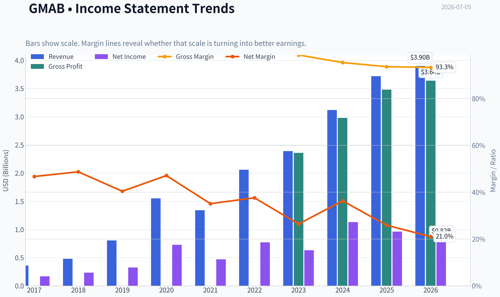

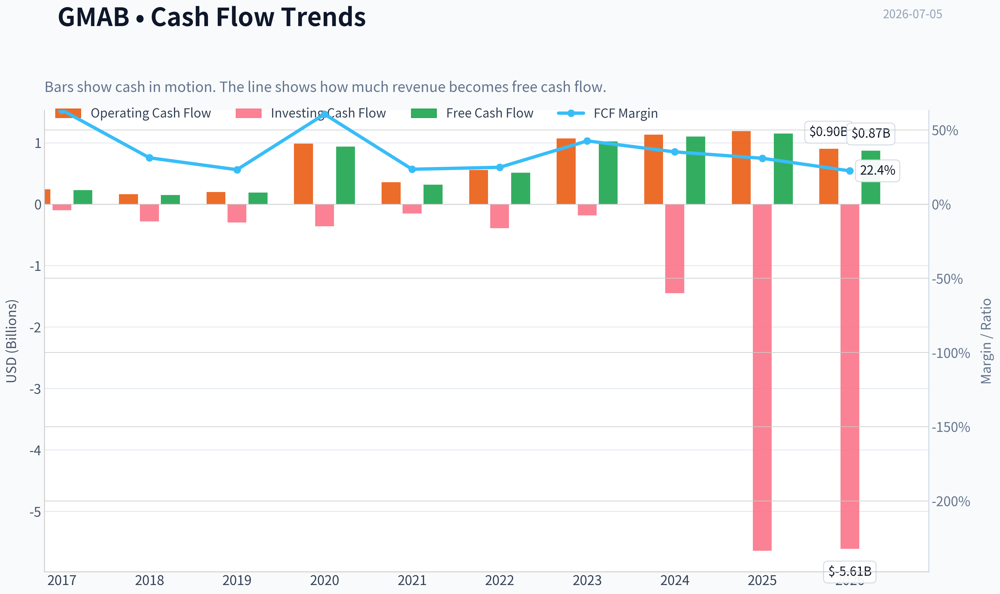

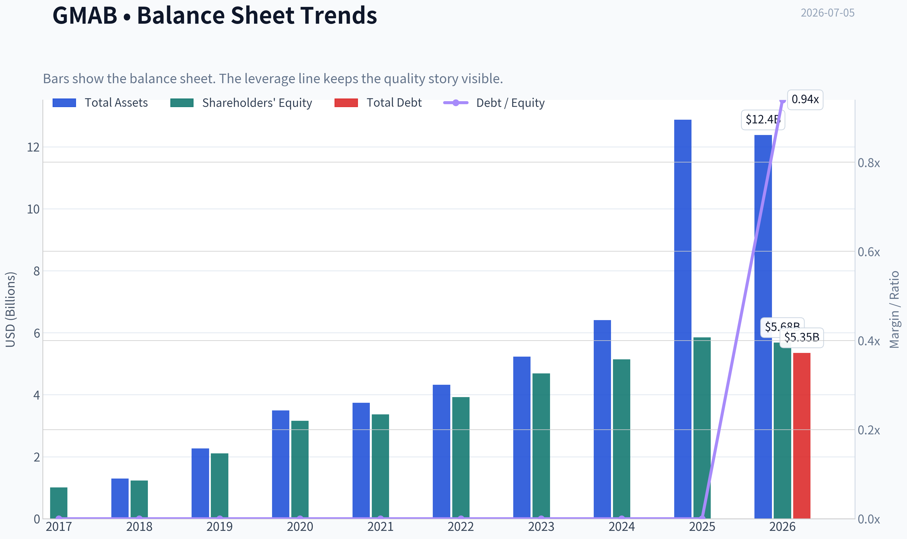

This graph tracks the profitability and return metrics (ROE, ROIC, Margins) of **GMAB** over the past decade, highlighting capital efficiency trends.

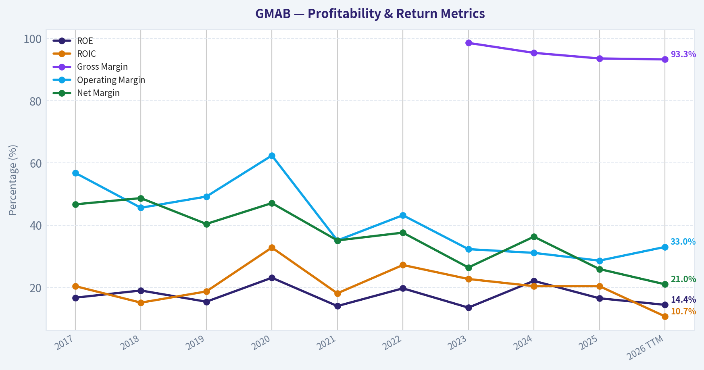

This chart illustrates the financial health of **GMAB** over the last 10 years, mapping cash equivalents and free cash flow against total obligations (Debt).

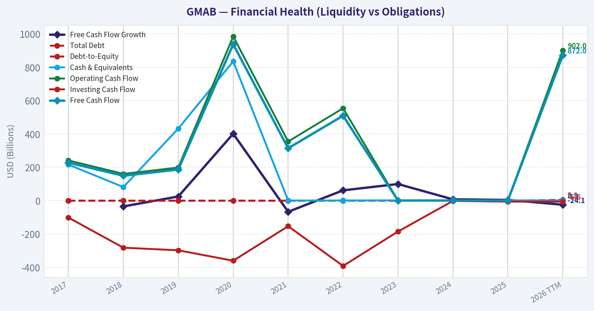

---

### Intrinsic Value Analysis (Buffett)

> *Following Warren Buffett's value investing philosophy: Circle of Competence, Economic Moat, Management Quality, and Margin of Safety.*

#### Intrinsic Value Snapshot

Price is what you pay. Intrinsic value is what the business may be worth based on the cash it can create for owners over time. We show a range, not one magic number.

- Current Price: $28.52
- Value Range (conservative to optimistic across both DCF methods): $3.49 to $113.27

##### Owner Earnings (Buffett Method)
- Net Income: $963,000,000.00
- Depreciation & Amortization: $71,000,000.00
- Capital Expenditures: $-37,000,000.00
- Working Capital Changes: $225,000,000.00
- Owner Earnings: $772,000,000.00

##### Intrinsic Value
###### Buffett Method
Uses owner earnings. Stricter, and usually more conservative.
- Conservative: $3.49
- Average: $33.48
- Optimistic: $113.27
- Discount Rate: 10.0%

###### Cash Flow Method
Uses free cash flow. Better for companies spending heavily today to grow tomorrow.
- Conservative: $12.74
- Average: $50.01
- Optimistic: $101.01
- Discount Rate: 10.0%

ANALYST STANCE: **WATCH**

#### GMAB Buffett-Style Investment Review

Genmab is a high-margin antibody-drug company. In simple words, it invents cancer and immune-disease medicines, then makes money from drug sales, royalties, and partner payments. This is understandable at a basic level, but the cash flows are less predictable than a classic consumer or software franchise because outcomes still depend on drug development, label expansion, and patent life.

---

#### 1. Go/No-Go Gate Assessment

| Gate | Verdict | Evidence |
|---|---|---|
| Gate 1: Circle of Competence & Simplicity | Pass | Business is understandable: discover/develop antibody therapies, earn product revenue, royalties, milestones. |
| Gate 1: Long-Term Predictability | Mixed Pass | Cancer biologics can remain valuable for years, but revenue mix can shift with trial outcomes, approvals, and partner execution. |
| Gate 1: Technology Risk | Pass | Technology is more of an enabler than a destroyer here, though biotech R&D risk remains inherently high. |
| Gate 2: Moat Test | Pass | Gross margin of 93.6% strongly suggests valuable IP and pricing power. |
| Gate 3: Management & Capital Allocation | Tentative Pass | Financial quality is strong, but this is not yet the kind of crystal-clear owner-operator capital allocation story Buffett usually loves most. |
| Gate 4: Industry Structure | Mixed | Biotech can be attractive when IP is strong, but it is not a naturally rational oligopoly; competition for innovation is intense. |

**Key Takeaways:** Genmab clears the basic Buffett filters better than most biotech names because the business is understandable and the economics are unusually strong. Still, this is not a simple razor-and-blades franchise or a household brand with effortless predictability. The main question is not quality, but durability and certainty.

---

#### 2. Moat Analysis

| Moat Source | Assessment | Evidence |
|---|---|---|
| Intangible Assets | Strong | Patent estate, biologics know-how, regulatory approvals, and partner relationships support premium economics. |
| Pricing Power | Strong | Gross margin of 93.6% implies substantial economic value capture and limited commodity-like pricing pressure. |
| Switching Costs | Moderate | For approved therapies, physicians and treatment pathways create some stickiness, but not software-like lock-in. |
| Cost Advantage | Limited | Advantage is more scientific/IP-driven than scale-manufacturing driven. |
| Network Effects | None | Drug development does not benefit from classic network effects. |

**Moat Quality Rating: Narrow to Wide in specific assets, but not broad corporate-wide in the Buffett sense.**

**Key Takeaways:** Genmab's moat comes mainly from intellectual property, scientific capability, and approved biologic assets. That is a real moat, but it is asset-specific rather than universal. If the pipeline and labels keep compounding, the moat can widen; if not, it can narrow quickly.

---

#### 3. Management Quality & Capital Allocation

| Question | Assessment | Comment |
|---|---|---|
| Think Like Owners? | Mixed | No strong evidence here of a classic founder-owner alignment story. |
| Honest & Candid? | Acceptable | No obvious red flags from the supplied information. |
| Rational Capital Allocation? | Good | High ROE, strong margins, and healthy cash generation suggest disciplined deployment so far. |

**Key Takeaways:** Management appears competent and commercially disciplined, but the case is stronger on operating execution than on textbook Buffett-style owner alignment. This matters because biotech capital allocation is crucial: one bad acquisition or weak internal R&D deployment can destroy value quickly.

---

#### 4. Financial Summary

| Metric | Current / Latest Shared Data |
|---|---:|
| Share Price | $29 |
| Market Cap | $17.51B |
| P/E | 21.8x |
| ROE | 16.5% |
| Gross Margin | 93.6% |
| Revenue Growth YoY | 19.2% |
| FCF Yield | 6.6% |
| Current Ratio | 2.02 |

**Key Takeaways:** These are very strong surface-level economics. A 93.6% gross margin is exceptional, ROE is comfortably above Buffett's minimum hurdle, and a 6.6% free-cash-flow yield is not demanding for a quality business. The main caution is that biotech cash flows deserve a bigger durability discount than consumer staples or entrenched software.

---

#### 5. Owner Earnings View

Using Buffett's framework, Genmab appears to be a strong owner-earnings business because it likely converts a large portion of accounting profit into free cash flow and does not appear balance-sheet stressed.

A practical approximation from the available figures:

| Item | Assessment |
|---|---|
| Net Income | Positive and meaningful |
| Depreciation & Amortization | Likely modest relative to earnings power |
| Maintenance CapEx | Likely moderate, not heavy industrial in nature |
| Working Capital Burden | Manageable given current ratio above 2 |
| Approximate Owner Earnings Character | Strong |

**Key Takeaways:** Genmab looks like a business where real cash generation matters more than accounting complexity. That is favorable. In Buffett terms, this is a company with genuine earning power, but the durability of those earnings depends heavily on the life of its drug portfolio and pipeline productivity.

---

#### 6. Three-Scenario DCF Valuation

Using the shared market cap and FCF yield:

- Approximate FCF = 6.6% x $17.51B = about **$1.16B**
- Use this as a rough owner-earnings base

| Scenario | Assumption | Implied Value |
|---|---|---:|
| A: No Growth | Owner Earnings / 10% | $11.6B |
| B: GDP Growth | Owner Earnings x 1.03 / (10% - 3%) | $17.1B |
| C: Moderate Growth | Assume 7% growth for 10 years, then 3% terminal | ~$21B-$23B |

**Key Takeaways:** On a no-growth basis, the stock is not cheap. On a modest perpetual-growth basis, it is roughly fairly valued. On a more optimistic but still reasonable growth path, there is upside, but not enough to call it a clear Buffett-style bargain without a wider margin of safety.

---

#### 7. Margin of Safety Analysis

| Measure | Value |
|---|---:|
| Current Market Cap | $17.51B |
| No-Growth Value | $11.6B |
| GDP-Growth Value | $17.1B |
| Moderate-Growth Value | ~$21B-$23B |

At today's valuation, the stock appears:

- **Above** ultra-conservative value
- **Near** conservative fair value
- **Below** optimistic intrinsic value

That means the margin of safety is **thin to moderate**, not wide.

**Key Takeaways:** This is the key issue. Genmab looks like a good business, but not obviously a bargain. Buffett wants quality plus a discount; here, investors are already paying something close to fair value for the quality.

---

#### 8. Final Buffett Scorecard

| Criterion | Score (1-5) | Weight | Weighted Score |
|---|---:|---:|---:|
| Business Understanding | 3.5 | 20% | 0.70 |
| Moat Width & Durability | 3.5 | 25% | 0.88 |
| Management Quality | 3.0 | 15% | 0.45 |
| Return on Equity | 3.5 | 15% | 0.53 |
| Reinvestment Runway | 3.5 | 10% | 0.35 |
| Balance Sheet Strength | 3.5 | 5% | 0.18 |
| Industry Structure | 2.5 | 5% | 0.13 |
| Valuation / Margin of Safety | 3.0 | 5% | 0.15 |

| Total Weighted Score | 3.36 / 5.00 |
|---|---:|

**Key Takeaways:** Genmab scores well on quality, economics, and reinvestment potential. It loses points on predictability, industry structure, and lack of a clear discount to intrinsic value. That places it in watch-list territory rather than in the "back up the truck" category.

---

#### 9. Investment Stance

**ANALYST STANCE: WATCH**

**Conviction level: Moderate**

Genmab is a strong business with unusually attractive biotech economics: very high gross margins, good ROE, healthy growth, and decent cash generation. Those are qualities worth respecting. But Buffett-style investing demands not just excellence, but excellence you can understand deeply, trust to endure, and buy with a meaningful margin of safety.

At around current levels, GMAB looks **closer to fair value than undervalued**. If the price fell enough to create a clear 25%+ discount to conservative intrinsic value, or if operating performance further de-risked the pipeline and strengthened long-term predictability, the case could improve to **ADVOCATE**. For now, it is a **WATCH**, not an **AVOID**, because the business quality is real.
#### Valuation Bridge

This bridge places the current market price beside each intrinsic value lens so readers can see whether upside depends on one method or shows up across several methods.

| Scenario | Intrinsic Value / Share |
| --- | ---: |
| Buffett Method | $33.48 |
| Cash Flow Method | $50.01 |
| Damodaran Method | $1,217.99 |
| Current Price | $28.52 |

#### Key Takeaways

If one method is far above the others, the upside case depends on a specific modelling assumption. When several methods cluster together, the valuation story is more robust.

#### Valuation Visuals

This comparison chart from *Latest Earnings Snapshot* stacks current figures against historical benchmarks for **GMAB**, making it easy to see where the company trades relative to its own averages.

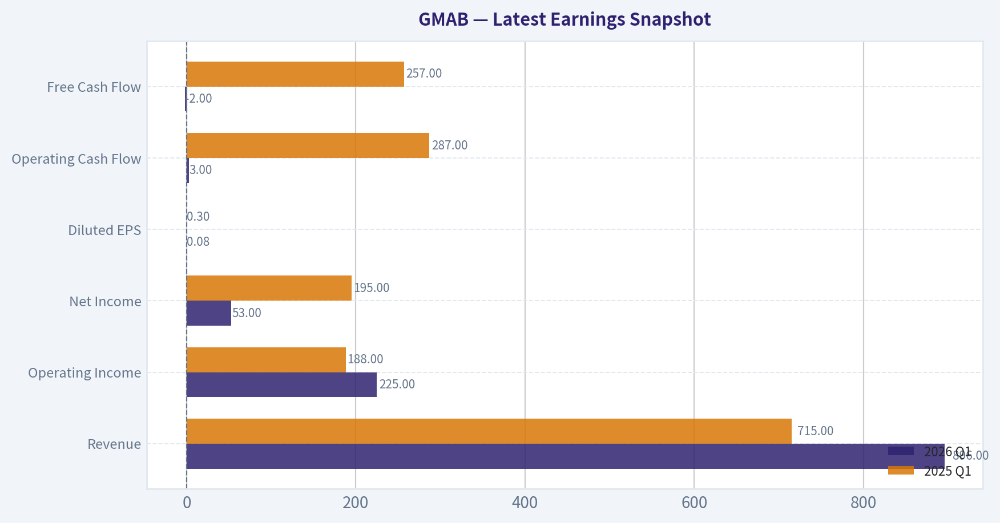

This comparison chart from *Current vs Historical Average Comparison* stacks current figures against historical benchmarks for **GMAB**, making it easy to see where the company trades relative to its own averages.

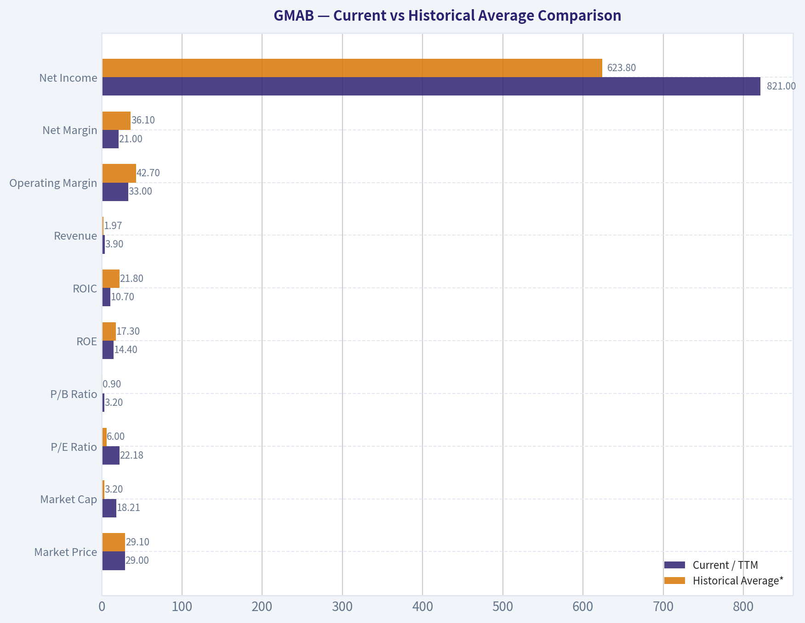

This comparison chart from *Owner Earnings DCF Valuation* stacks current figures against historical benchmarks for **GMAB**, making it easy to see where the company trades relative to its own averages.

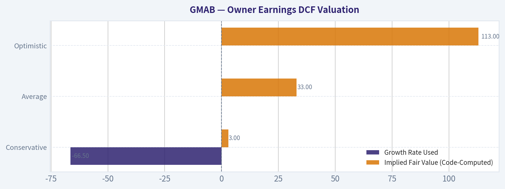

This comparison chart from *DCF Calculation Framework* stacks current figures against historical benchmarks for **GMAB**, making it easy to see where the company trades relative to its own averages.

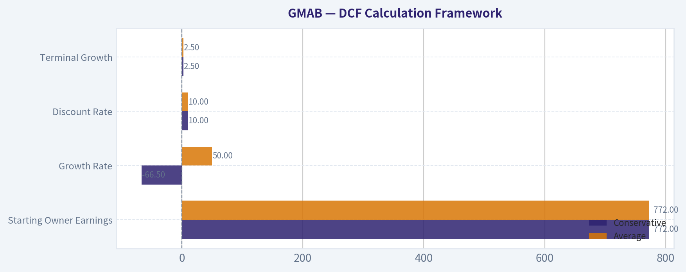

This comparison chart from *Financial Summary* stacks current figures against historical benchmarks for **GMAB**, making it easy to see where the company trades relative to its own averages.

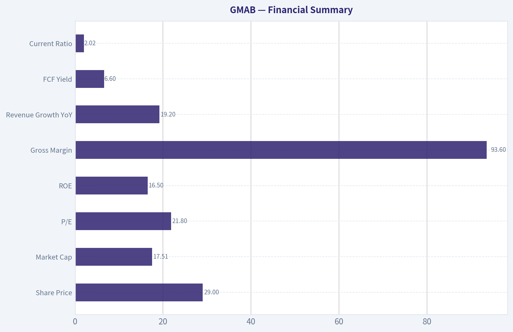

This comparison chart from *Three-Scenario DCF Valuation* stacks current figures against historical benchmarks for **GMAB**, making it easy to see where the company trades relative to its own averages.

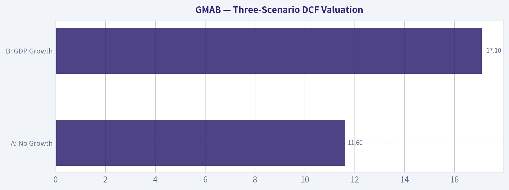

---

### Trend & Growth Analysis (Lynch/Druckenmiller/Fisher)

> *Following Peter Lynch's GARP, Stanley Druckenmiller's macro-aware approach, and Philip Fisher's scuttlebutt methodology.*

ANALYST STANCE: **WATCH**

#### GMAB Growth Analysis Snapshot

Using the shared research pack plus the tool output quality notes, GMAB looks like a **high-quality profitable biotech growth platform**, but not a clean "ADVOCATE" yet under a Lynch/Druckenmiller/Fisher lens because growth appears **solid rather than clearly inflecting**. The business quality is strong; the question is whether the next leg of growth beyond its core royalty engine is accelerating enough to justify a more aggressive stance.

---

#### 1. Lynch Classification

| Item | Assessment |
|---|---|
| Lynch category | **Fast Grower / Hybrid royalty biotech** |
| Revenue growth YoY | **19.2%** |
| Profitability | Profitable, P/E **21.8x** |
| Initial read | Fits Lynch's preferred zone on growth, but biotech lumpiness lowers conviction |

**Key Takeaways:** GMAB qualifies as a fast grower on the current numbers, with roughly 19% revenue growth and real profitability. That is attractive because many biotech names are either unprofitable or too dependent on financing. Still, the business is less straightforward than a classic consumer or software fast grower because milestones and royalties can make trends lumpy.

---

#### 2. The Story in 3 Bullets

| Simple story | Why it matters |
|---|---|
| GMAB develops antibody-based cancer drugs and earns high-margin economics from successful partnerships | Creates a capital-light profit engine |
| Its royalty base funds R&D, reducing dilution risk versus typical biotech | Stronger self-funding model |
| Upside comes from pipeline expansion and label expansion beyond the current core franchise | This is the path to a re-rating |

**Key Takeaways:** The story is easy to explain: GMAB uses antibody science to create cancer medicines and monetizes them through partnerships and product expansion. The bull case is that existing cash flows fund the next wave of drugs, turning one successful franchise into a broader oncology platform. The main issue is whether that broader platform is becoming large enough, fast enough.

---

#### 3. TAM Analysis and 10x Test

| Metric | Estimate / assessment |
|---|---|
| Current revenue base | Not fully provided here; market cap is **$17.5B** |
| Core markets | Hematologic oncology, lymphoma, broader antibody oncology markets |
| TAM direction | **Expanding**, driven by oncology innovation, bispecifics, immunotherapy combinations |
| 10x test | **Likely fails literally from current scale**, but multi-product expansion still leaves meaningful runway |
| Runway verdict | **Good, not infinite** |

**Key Takeaways:** The oncology market is massive and still expanding, so GMAB has real runway. However, from its current size, a full 10x revenue outcome is harder to underwrite than for a small-cap emerging grower. This looks more like a potential strong compounder or selective multi-bagger than a classic undiscovered ten-bagger from today's base.

---

#### 4. Revenue Growth Trend

| Metric | Value / interpretation |
|---|---|
| Revenue growth YoY | **19.2%** |
| Pattern | **Healthy growth**, but no multi-period acceleration data confirmed |
| Gross margin | **93.6%** |
| Quality of growth | Likely high-margin royalty/collaboration driven |
| Trend call | **Stable high growth, not confirmed inflection** |

**Key Takeaways:** GMAB's current growth rate is strong and the gross margin is exceptional, which points to a very attractive business model. What is missing is evidence that growth is accelerating quarter after quarter. For Druckenmiller-style inflection investing, that missing acceleration keeps this from a higher-conviction call.

---

#### 5. Unit Economics / Business Economics

| Metric | Value | Assessment |
|---|---|---|
| Gross margin | **93.6%** | Best-in-class economics |
| FCF yield | **6.6%** | Attractive cash generation |
| ROE | **16.5%** | Solid |
| Current ratio | **2.02x** | Healthy liquidity |
| NRR / LTV-CAC / Payback | Not disclosed in shared pack | Not applicable / unavailable for this biotech model |
| Rule of 40 proxy | **19.2% growth + implied healthy FCF economics** | Likely respectable, but not SaaS-style comparable |

**Key Takeaways:** GMAB's business economics are excellent where they matter most for biotech: very high gross margins, healthy returns on equity, and real free cash flow. The balance sheet also looks sound, reducing financing risk. This is a major advantage over cash-burning biotech peers.

---

#### 6. Inflection Point Assessment

| Inflection type | Evidence | View |
|---|---|---|
| Product cycle inflection | Positive Phase 3 EPCORE DLBCL-4 result | **Positive** |
| Market share inflection | Possible via label expansion, not yet quantified | **Potential** |
| Margin inflection | Already structurally high margin | **Less relevant** |
| TAM inflection | Oncology/bispecific opportunity expanding | **Positive** |
| Competitive inflection | Bigger market opportunity noted by analysts | **Early positive** |
| Overall inflection verdict | Pipeline/news flow improving, but financial acceleration not yet proven | **Emerging, not confirmed** |

**Key Takeaways:** The recent trial success is important because it suggests label expansion and a larger commercial opportunity. That is the type of catalyst growth investors want to see. But until this starts showing up in a visibly accelerating revenue base, the inflection remains promising rather than proven.

---

#### 7. Macro Setup Evaluation

| Factor | Assessment |
|---|---|
| Secular theme exposure | **Healthcare innovation / oncology biologics** |
| Rate sensitivity | Moderate; profitable biotech less rate-sensitive than long-duration unprofitable growth |
| Economic cycle sensitivity | Lower than cyclical sectors |
| Macro tailwind | Neutral to positive |
| Druckenmiller read | Better setup than cyclical growth, but less explosive than AI/software leaders |

**Key Takeaways:** GMAB benefits from a durable healthcare innovation theme rather than a short-cycle macro story. That makes the setup more resilient, though usually less explosive than the hottest tech themes. Macro is not a major obstacle here; execution is the bigger variable.

---

#### 8. Fisher 15-Point Score

| Fisher area | Score (1-5) | Comment |
|---|---:|---|
| Market potential | 5 | Oncology is large and expanding |
| New products | 4 | Pipeline and label expansion matter |
| R&D effectiveness | 4 | Strong antibody platform reputation |
| Sales organization | 3 | More partnership-driven than fully self-owned |
| Profit margin | 5 | Outstanding gross margin |
| Improving margins | 3 | Already high; less room for visible expansion |
| Labor/personnel | 3 | No strong evidence either way |
| Executive relations | 3 | Neutral |
| Management depth | 4 | Platform continuity appears solid |
| Cost analysis/accounting | 3 | Biotech accounting can be lumpy |
| Outstanding moat features | 4 | Platform, IP, partnerships |
| Long-range profit outlook | 4 | Strong if franchise broadens |
| Dilution risk | 4 | Better than peers due to self-funding |
| Candor | 3 | No special evidence from pack |
| Integrity | 3 | No red flags given |
| **Total** | **55 / 75** | **GOOD** |

**Key Takeaways:** GMAB scores well on market opportunity, R&D quality, margins, and funding strength. It scores less highly on areas where we need deeper scuttlebutt, such as management depth, sales execution, and disclosure quality. Overall, this is a good Fisher profile, but not elite on the evidence available.

---

#### 9. Valuation Analysis

| Metric | Value | Interpretation |
|---|---:|---|
| Price | **$29** |  |
| Market cap | **$17.51B** |  |
| P/E | **21.77x** | Reasonable for a profitable grower |
| Earnings growth proxy | Not directly given; revenue growth **19.2%** |  |
| PEG proxy | **~1.1x** using revenue growth as rough stand-in | Fair to slightly attractive |
| FCF yield | **6.6%** | Attractive support |
| Valuation verdict | **Not cheap, not stretched** | Reasonable quality compounder pricing |

**Key Takeaways:** GMAB's valuation looks reasonable given its profitability and growth, especially with a 6.6% free cash flow yield. The stock does not appear wildly expensive, but it also does not scream deep mispricing. This supports a watch-to-accumulate posture rather than an aggressive table-pounding call.

---

#### 10. Scenario Analysis

| Scenario | What must happen | Likely outcome |
|---|---|---|
| Bear | Core royalty growth slows, pipeline conversion disappoints | Multiple compresses; stock acts like mature biotech |
| Base | Core franchise remains durable, new indications add moderate growth | Steady compounding |
| Bull | Epcore/other assets expand faster than expected, diversification accelerates | Re-rating to higher growth biotech multiple |

**Key Takeaways:** The base case is steady compounding, which is attractive but not extraordinary. The bull case depends on pipeline execution driving visible diversification away from the current core engine. That is plausible, but still needs confirmation.

---

#### 11. Growth Investor Scorecard

| Criterion | Weight | Score | Weighted |
|---|---:|---:|---:|
| The Story | 10% | 4.0 | 0.40 |
| TAM & Runway | 20% | 3.5 | 0.70 |
| Revenue Growth | 20% | 3.5 | 0.70 |
| Unit Economics | 15% | 4.5 | 0.68 |
| Competitive Position | 10% | 4.0 | 0.40 |
| Management Quality | 10% | 3.5 | 0.35 |
| Macro Setup | 5% | 3.5 | 0.18 |
| Profitability Path | 5% | 4.5 | 0.23 |
| Valuation | 5% | 3.5 | 0.18 |
| **Total** | 100% |  | **3.8 / 5.0** |

**Key Takeaways:** GMAB scores well overall, especially on business quality and economics. The main thing holding it back from a full advocate rating is the lack of confirmed acceleration in the growth trajectory. This is a good setup, but not yet a clearly explosive one.

---

#### 12. Position Size Stance

| Stance | Suggested action |
|---|---|
| **WATCH** | Starter position only if you want quality oncology exposure; add on proof of acceleration |

**Key Takeaways:** GMAB is good enough to monitor closely and possibly own in a small size. But for concentrated growth capital, I would want clearer evidence that pipeline wins are translating into a stronger multi-year growth curve.

---

#### 13. Key Risks and Catalysts

| Risks | Catalysts |
|---|---|
| Revenue concentration in a few core assets | Positive Phase 3 and label expansions |
| Biotech pipeline failure risk | Broader commercialization success |
| Growth may remain lumpy due to milestones | Upward guidance revisions |
| Competitive pressure in oncology | Additional late-stage trial wins |
| Market may value it as mature royalty biotech, not platform growth | Revenue diversification becoming visible |

**Key Takeaways:** The biggest risk is that GMAB stays viewed as a high-quality but maturing royalty story instead of a broadening growth platform. The biggest upside catalyst is clear proof that new indications and newer assets can materially accelerate the top line.

---

#### Bottom Line

GMAB is a **high-quality, profitable fast-growing biotech with elite gross margins and solid cash generation**. That said, under a Lynch/Druckenmiller framework, I want **clearer evidence of accelerating growth and broader revenue diversification** before moving to ADVOCATE.

**Why WATCH instead of ADVOCATE:**
- Growth is good, but not clearly accelerating
- Valuation is fair, not obviously dislocated
- Pipeline/news flow is promising, but financial inflection is not yet fully visible

**What would upgrade it to ADVOCATE:**
1. Two or more quarters of visible revenue acceleration
2. More evidence that epcoritamab / new labels broaden the growth base
3. Reduced dependence on the legacy core royalty engine

If you want, I can next turn this into a **one-page investment memo** or a **bull/base/bear valuation model** for GMAB.

---

### Market Technical Analysis

#### GMAB Technical Analysis Report

GMAB has transitioned from a prolonged medium-term downtrend into a more constructive short-term recovery, but the stock is **not yet in a fully repaired long-term uptrend**. The most recent close available is **28.51 on 2026-07-02**, and that price now sits **above the 10 EMA, above the 50 SMA, and above the VWMA**, which is a meaningful improvement in tactical trend quality. However, price still remains **below the 200 SMA**, so the broader regime is still best described as a **rebound within a larger long-term recovery process**, not a confirmed secular breakout.

The indicator set I selected is the most relevant for this context because it captures four different dimensions without too much overlap: **trend structure** (close_50_sma, close_200_sma, close_10_ema), **momentum and momentum acceleration** (macd, macdh, rsi), **risk/volatility** (atr), and **volume-confirmed price quality** (vwma). This combination is especially useful when a stock is attempting to reverse higher after a weak multi-month period.

#### Selected Indicators and Why They Matter

| Indicator | Why it is relevant now | Current read |
|---|---|---|
| close_10_ema | Best short-term trend gauge for a rebound phase | Price is above it; near-term momentum is improving |
| close_50_sma | Medium-term trend filter and resistance/support reference | Price has reclaimed it, a constructive change |
| close_200_sma | Long-term regime benchmark | Price remains below it, so long-term trend is still not fully bullish |
| macd | Tracks momentum trend shift | MACD has turned positive, signaling momentum recovery |
| macdh | Shows momentum acceleration earlier than MACD alone | Histogram is strongly positive and expanding |
| rsi | Helps judge whether upside is strengthening or becoming stretched | RSI near 70 shows strong momentum, but close to short-term overbought |
| atr | Measures current trading risk and stop placement range | Volatility is elevated but not disorderly |
| vwma | Tests whether the move is supported by volume-weighted participation | Price is above VWMA, suggesting better quality buying support |

**Key Takeaways:** GMAB is showing a credible short-term recovery with improving trend, momentum, and volume confirmation. The main limitation is that the stock is still below its 200-day average, which means longer-term traders may still view this as a recovery rally rather than a full trend reversal.

---

#### Trend Structure

The **10 EMA rose to 26.73** by 2026-07-02, up sharply from **25.72 on 2026-06-29**, showing that the recent advance was not just a one-day spike but a fast improvement in short-term price trend. This matters because the 10 EMA had been flattening to weak in June, and it has now clearly turned upward.

The **50 SMA is 26.21**, and price at **28.51** stands well above it. That is important because GMAB spent much of the spring and early summer struggling underneath declining intermediate averages. Reclaiming the 50-day average after the early-June breakdown suggests the stock has repaired a meaningful portion of the prior technical damage. Even more notable, the 50 SMA itself had been drifting lower for weeks, but the stock is now trading far enough above it that the average may begin to flatten if follow-through continues.

The **200 SMA is 29.22**, still above current price. This is the critical ceiling for strategic investors. The long-term average has stopped rising aggressively and is broadly flattening around the low 29s, which means overhead resistance is now more defined than dynamic. In practical terms, GMAB has moved from being deeply below the 200-day average to being **within striking distance** of it. That is progress, but until price can establish acceptance above roughly **29.2-29.5**, long-horizon trend followers may remain cautious.

A subtle but important point is the sequence of the averages: **10 EMA > 50 SMA**, while **price < 200 SMA but approaching it**. That is often the signature of an early recovery phase rather than a mature bull trend. If price holds above the 50 SMA and the 10 EMA continues to lead higher, the next technical battle is likely to occur right at the 200-day region.

#### Momentum Analysis

Momentum has improved decisively.

The **MACD turned positive**, rising from **-0.0456 on 2026-06-29** to **0.1011 on 2026-06-30**, **0.2284 on 2026-07-01**, and **0.3953 on 2026-07-02**. This is not a marginal shift. It reflects a rapid transition from negative momentum to positive momentum with increasing force. When MACD crosses above zero after a prolonged negative period, it often indicates that the average pace of recent gains is beginning to exceed the average pace of prior losses over the intermediate lookback.

The **MACD histogram at 0.3922** is especially strong. It has been positive and expanding for several sessions, which tells us momentum is not only positive but **accelerating**. This often precedes or accompanies breakout attempts. In GMAB's case, the histogram's expansion suggests buyers have recently gained control with more urgency than earlier in June.

The **RSI at 69.94** is just below the classic 70 overbought threshold. In a weak stock, that could be a warning. In a stock transitioning from a low base into a recovery, it is better interpreted as **strong upside impulse with potential for a near-term pause**. The nuance here is important: RSI near 70 does not automatically mean "sell." Instead, it often means the move has become extended enough that traders should expect either consolidation or a smaller pullback before the next directional decision.

From a momentum-structure perspective, the strongest interpretation is this:
- MACD says the swing has turned bullish.
- MACD histogram says that bullish swing is gaining force.
- RSI says that force is now becoming strong enough to test short-term exhaustion.

That is typically the profile of a rally that is healthy but increasingly vulnerable to **profit-taking near resistance**, especially when the 200 SMA is just overhead.

#### Volume-Weighted Confirmation

The **VWMA on 2026-07-02 is 26.04**, well below the close of **28.51**. This is constructive because it suggests the recent gains are happening above the stock's volume-weighted mean price rather than only on light or distorted tape action. Put differently, buyers are not just lifting price intraday; they are lifting it above the average price level where meaningful volume has been transacted.

This is particularly useful in GMAB because the stock experienced heavy-volume downside episodes earlier in the year, especially around sharp drawdowns in January, May, and early June. A rally back above the VWMA implies that recent market participation has started to shift in favor of buyers rather than simply reflecting a dead-cat bounce. The degree of separation between price and VWMA is also meaningful: nearly **2.5 points above VWMA** is a strong short-term statement.

Still, a caveat is warranted. When price outruns VWMA too quickly, the stock can become temporarily stretched relative to its volume-supported base. That does not invalidate the move, but it increases the probability of **retest behavior**, where price revisits part of the breakout zone to see whether buyers defend it.

#### Volatility and Risk Framing

The **ATR is 0.815**, up from **0.694 on 2026-06-29**. This indicates that price ranges have widened as the rebound accelerated. Rising ATR during an upside move is often constructive because it shows expanding participation and directional conviction. But it also means traders should avoid placing stops too tightly.

At current levels, an ATR of about **0.8** implies GMAB can move roughly **2.8% in a normal session** without meaningfully changing the broader setup. That has two practical implications:

1. **Short-term traders** should allow more room for normal fluctuation and avoid overreacting to routine intraday reversals.
2. **Swing traders** should frame stops and position sizes around volatility, not just around arbitrary round-number levels.

If the stock is attempting to challenge the 200 SMA, elevated ATR means breakout attempts may come with whipsaw risk. A brief rejection near 29.2-29.5 would not be surprising and would not necessarily ruin the improving setup unless it drags price back under the 50 SMA with momentum deterioration.

#### Fine-Grained Price Action Context

Over the last 12 months, GMAB has gone through several distinct phases:

- **July to early October 2025:** strong uptrend from the low 20s into the low/mid 30s.
- **Mid-October 2025 to January 2026:** choppier high-level consolidation with occasional sharp selloffs.
- **February to early June 2026:** broad deterioration and trend decay, culminating in a notable breakdown to the **23.85** area in early June.
- **Mid-June to early July 2026:** recovery phase, with improving closes and renewed upside acceleration into the **27.5-28.5** region.

That sequence matters because the recent rally is occurring after a deep drawdown, not after a long stable base. Recoveries from that kind of structure often encounter resistance in layers:
- first at the **50 SMA**,
- then at prior breakdown zones around the **27.8-28.5** region,
- then at the **200 SMA / low 29s**,
- and only after that can traders begin talking about a larger trend resumption.

GMAB has already cleared the first layer and is pushing through the second. The third layer, near the 200 SMA, is now the key test.

#### Trading Interpretation

For **momentum traders**, the setup is constructive but somewhat extended short-term. The best-case scenario is not necessarily an immediate vertical continuation; it may be a brief sideways digestion above the 50 SMA while MACD remains positive. That would allow the 10 EMA to keep rising underneath price and improve the durability of the move.

For **swing traders**, the most important question is whether the stock can hold above roughly **26.2-26.7**, the zone defined by the 50 SMA and rising 10 EMA. If it does, then the move toward the 200 SMA looks more sustainable. If it loses that zone quickly, the latest thrust risks becoming another failed rally inside a larger long-term range.

For **position traders and longer-term investors**, the stock is improved but not yet fully confirmed. A durable move above the **29.2-29.5** area, especially if accompanied by MACD staying positive and RSI holding above 50 on pullbacks, would materially strengthen the long-term case.

#### What to Watch Next

| Focus Area | Bullish signal | Caution signal | Why it matters |
|---|---|---|---|
| Price vs 50 SMA | Holds above 26.2 and uses pullbacks as support | Falls back below 50 SMA quickly | Tests whether medium-term trend repair is real |
| Price vs 200 SMA | Breaks and holds above 29.2-29.5 | Rejected repeatedly in low 29s | Defines whether recovery becomes long-term reversal |
| MACD / MACDH | MACD stays positive and histogram remains above zero | Histogram rolls over sharply before breakout | Reveals whether upside momentum is still accelerating |
| RSI | Holds 55-70 on pullbacks | Fails back under 50 quickly | Distinguishes healthy consolidation from failed thrust |
| VWMA | Price remains above VWMA | Price slices back below VWMA | Confirms whether buyers still control volume-weighted trade |
| ATR | ATR stays elevated with orderly price action | ATR spikes while price reverses lower | Separates healthy expansion from unstable volatility |

**Key Takeaways:** The most important near-term battleground is between support near 26.2-26.7 and resistance near 29.2-29.5. If GMAB consolidates above support and then clears the 200-day average, the technical picture would improve materially; if it fails back below the 50-day area, the rally would look much less reliable.

#### Bottom Line

GMAB currently shows a **short-term bullish recovery with improving medium-term structure**, backed by positive MACD, expanding MACD histogram, strong RSI, and price leadership above both the 10 EMA and VWMA. The stock has clearly improved from its June weakness.

The main unresolved issue is the **long-term trend filter**: GMAB is still below the **200 SMA**, which keeps the larger regime from being fully bullish. So the most accurate read is: **constructive rebound, tactically favorable, but approaching a major long-term technical test**.

| Category | Current Assessment | Trading Implication |
|---|---|---|
| Short-term trend | Bullish | Price above rising 10 EMA |
| Medium-term trend | Improving to bullish | Price above 50 SMA after prior weakness |
| Long-term trend | Still incomplete | Price remains below 200 SMA |
| Momentum | Strongly improving | MACD positive, histogram expanding |
| RSI condition | Strong but near stretched | Momentum good, but pause risk rising |
| Volume confirmation | Constructive | Price above VWMA supports rally quality |
| Volatility | Elevated but manageable | Use wider stops and disciplined sizing |
| Overall stance | Positive recovery, not full confirmation | Watch 29.2-29.5 for breakout or rejection |

**Key Takeaways:** GMAB has shifted from weakness into a credible recovery phase, and the recent move is supported by both momentum and volume-weighted trend signals. The stock now looks tactically stronger, but the decisive next step is whether it can overcome the 200-day average in the low 29s without losing support near the mid-26s.

---

### Options Market Analysis

> *Reading options flow - put/call ratios, IV skew, and unusual activity - to gauge institutional positioning and event-driven risk.*

#### GMAB Options Positioning Report

GMAB's options market is **thin and somewhat uneven**, so confidence should be moderated. That said, the available data leans **cautiously bullish on positioning**, with a notable caveat: **near-term trading flow is more defensive than the open-interest structure suggests**.

#### 1. Put/Call Ratio Analysis

| Expiration | Call OI | Put OI | Put/Call OI Ratio | Call Vol | Put Vol | Put/Call Vol Ratio |
|---|---:|---:|---:|---:|---:|---:|
| 2026-07-17 | 1,882 | 1,093 | 0.58 | 253 | 736 | 2.91 |
| 2026-08-21 | 32,116 | 3,820 | 0.12 | 110 | 73 | 0.66 |
| 2026-11-20 | 799 | 547 | 0.68 | 103 | 15 | 0.15 |
| **Near-term total** | **34,797** | **5,460** | **0.16** | **466** | **824** | **1.77** |

**Key Takeaways:** GMAB's total open interest is heavily call-skewed, with a **0.16 put/call OI ratio**, far below the roughly neutral **0.7** baseline. That usually points to a bullish legacy positioning backdrop or call overwriting structures. However, the **current volume ratio of 1.77** shows that recent trading is more put-heavy, especially in the front expiry, which suggests short-term hedging or caution has picked up.

**Interpretation:**
- **OI ratio (0.16)**: Strongly below neutral, indicating a market structurally tilted toward calls.
- **Volume ratio (1.77)**: Recent flow is more put-heavy than the OI base would imply.
- **Most important shift:**
  - **Positioning stock:** bullish/call-heavy
  - **Recent tape:** more defensive, especially in **July 17**

This split often means investors already have bullish exposure but are adding short-dated protection.

---

#### 2. Implied Volatility (IV) Assessment

The data returned **no usable ATM IV values** for calls or puts, and no direct OTM put-vs-call skew readings were provided.

| IV Metric | Observation |
|---|---|
| Near-term ATM Call IV | N/A |
| Near-term ATM Put IV | N/A |
| Put Skew vs. Call Skew | Not available from returned chain |
| Catalyst-related IV read | Cannot be confirmed from provided data |

**Key Takeaways:** The IV portion of the dataset is incomplete, so there is **low confidence** in any volatility-specific conclusion. Because of that, the sentiment call must lean more heavily on open interest and volume behavior rather than volatility pricing.

**Interpretation:**
- I cannot verify whether puts are being bid up relative to calls via skew.
- I also cannot confirm whether IV is elevated ahead of a catalyst from this dataset alone.
- Since GMAB options appear relatively light outside one dominant expiry, this may partly reflect limited chain quality/liquidity.

---

#### 3. Unusual Options Activity

The scan found **no contracts with volume greater than 5x open interest** in the near-term expirations.

| Unusual Activity Screen | Result |
|---|---|
| Volume > 5x Open Interest | None detected |
| Fresh high-conviction directional bets | Not evident in returned data |
| Retail-style speculative burst | Not evident |
| Institutional sweep-like footprint | Not evident |

**Key Takeaways:** There is **no obvious high-conviction unusual flow** in the dataset. That reduces the probability that a major institution is placing fresh, aggressive directional bets through listed options right now.

**Interpretation:**
- No standout contract suggests "smart-money urgency."
- The bearish tilt in front-month volume appears broader and moderate rather than concentrated in one aggressive strike.
- Absence of unusual activity lowers conviction in any strong near-term directional call.

---

#### 4. Open Interest Concentration

The biggest concentration is clearly in **August 21, 2026**, where call open interest massively outweighs put open interest.

| Expiration | Total OI | Notable Positioning Character |
|---|---:|---|
| 2026-07-17 | 2,975 | Moderate, but near-term put volume is elevated |
| 2026-08-21 | 35,936 | Dominant OI node; heavily call-skewed |
| 2026-11-20 | 1,346 | Smaller, relatively balanced |

**Key Takeaways:** The **August 21 expiration is the clear center of gravity** in GMAB options. That makes it the most likely expiry to influence dealer hedging behavior and act as the main "positioning anchor" if price begins moving toward heavily owned strikes.

**Gamma / pinning implications:**
- Because strike-level OI was not provided, I **cannot identify exact gamma walls or max-pain strikes**.
- But at the expiry level, **August 21 is the dominant positioning bucket**, so it likely matters most for any dealer-related pinning effects.
- The heavy call OI there can either:
  - **dampen upside** if much of it is covered call inventory, or
  - **support upside acceleration** if calls were bought outright and dealers are forced to hedge on rallies.

Given the lack of strike detail, that distinction cannot be resolved cleanly.

---

#### 5. Overall Options Sentiment Signal

| Signal Category | Read |
|---|---|
| Structural positioning | Bullish |
| Recent flow | Short-term defensive |
| IV confirmation | Unavailable |
| Unusual activity confirmation | Absent |
| **Overall options sentiment** | **BULLISH, with near-term caution** |

**Key Takeaways:** The **dominant signal is still bullish** because total open interest is overwhelmingly call-heavy across the near-term chain. But the **short-dated put-heavy volume** says traders are not fully complacent and may be adding protection rather than chasing upside aggressively.

**Why BULLISH instead of NEUTRAL or BEARISH:**
- The **0.16 total put/call OI ratio** is too call-heavy to ignore.
- August positioning is especially skewed toward calls and dominates the chain.
- There is **no unusual bearish put burst** large enough to override the structural call bias.

**Primary driver of the signal:**
A **heavily call-loaded open-interest base**, especially in **August**, outweighs the recent near-term defensive put flow. The caveat is that this is **not a high-conviction bullish read** because liquidity appears limited and IV/skew confirmation is missing.

---

#### Confidence / Data Quality Note

GMAB's options market appears **relatively illiquid outside the main August expiry**, and key IV/skew fields were unavailable. That means this read should be treated as a **positioning signal with moderate-to-low confidence**, not a strong standalone trading input.

---

#### Summary Table

| Metric | Observation | Interpretation |
|---|---|---|
| Put/Call Ratio | OI ratio **0.16**; volume ratio **1.77** | Structurally bullish, but recent flow is defensive |
| IV Level | ATM IV unavailable | No strong volatility read possible |
| Skew Direction | Not available | Cannot confirm downside-fear vs upside-chase skew |
| Unusual Activity | None detected (>5x OI) | No clear fresh institutional directional bet |
| Overall Signal | **BULLISH** | Call-heavy OI dominates, though short-term hedging tempers conviction |

**Key Takeaways:** GMAB's options market says **bullish positioning remains in place**, but traders have shown **short-term caution** through heavier put trading in the nearest expiry. With no strong unusual activity and incomplete IV data, the cleanest conclusion is **bullish with caveats**, not outright aggressive upside conviction.

---

## Research Team Commentary

> *The Research Manager synthesizes the Bull vs Bear debate into action-free commentary. This is a pre-risk view, not the final stance.*

The strongest bull argument is that Genmab is not a typical speculative biotech at all. It already throws off real cash, posts extraordinary gross margins, earns decent returns on equity, and appears to have a biologics platform plus partnership model that can keep monetizing science over time. At roughly a 6.6% FCF yield and about 22x earnings, the bull case says you are not paying a crazy price for a high-quality IP-driven business with meaningful optionality.

The strongest bear argument is that Buffett-style investing is not just about high margins and good science. It is about predictability, moat durability, and a margin of safety. On that score, Genmab still falls short. Biotech cash flows are inherently tied to clinical success, royalties, patents, partners, and ongoing R&D productivity. That makes the earnings stream less stable than the headline profitability suggests. If the stock is only fairly valued rather than clearly cheap, then there may not be enough compensation for that uncertainty.

My takeaway is that the bear side is more persuasive for a strict Buffett lens, but not enough to justify a hard avoid. This is exactly where I want to learn from prior mistakes: do not turn "not a classic value buy" into "bad stock." GMAB looks like a good business, possibly a very good one, but the valuation does not appear dislocated and the long-term predictability is not strong enough for an ADVOCATE call. At the same time, the market setup is not broken, and the fundamentals are too solid for an outright AVOID. Final stance: WATCH.

Core takeaway: Genmab appears to be a high-quality biotech franchise with real economics, but it still lacks the level of earnings predictability and margin of safety I would want before advocating it as a Buffett-style portfolio holding. The right posture is interest without urgency.

Rationale: From a value investing perspective, business quality clearly clears a reasonable bar here. A 93.6% gross margin, solid ROE, and over $1 billion in rough free cash flow separate Genmab from the usual biotech story stock. That matters. The company likely has genuine scientific and partnership advantages, and its financial strength reduces the classic biotech risks of dilution and funding dependence. But Buffett's framework is stricter than simply "good company, fair price." The key questions are whether the moat is durable in a way that makes cash flows highly predictable over a decade, and whether today's price offers a real margin of safety if pipeline timing, royalty mix, or partner economics disappoint. I do not think the evidence here is strong enough to answer yes on either point. So this is not an avoid because the business is weak; it is a watch because the business may be strong but the underwriting case is still not simple enough or cheap enough.

I also want to explicitly apply the lesson from past mistakes. In GLW and FFIV-type situations, the error was overusing valuation caution and underweighting setup, trend, and improving narrative. Here, that means I should resist calling AVOID just because the valuation is not a bargain. The market analyst's read is constructive: bullish MACD, strengthening histogram, RSI nearing short-term exhaustion but not implying structural damage. So for the next 1 to 4 quarters, this looks more like a stock to monitor for either a better entry or stronger evidence of durable earnings power, not one to dismiss.

Monitoring plan: Over the next few quarters, I would watch three buckets closely. First, durability of cash generation: does free cash flow remain robust without relying too heavily on lumpy milestone revenue, and do royalties/collaboration revenues stay resilient? Second, business quality proof: are there signs that the pipeline and platform are producing repeatable commercial outcomes rather than just maintaining the current base, and do returns improve in a way that supports a true platform moat? Third, capital allocation and valuation opportunity: does management remain disciplined with R&D and partnerships, avoid empire-building, and does the stock either pull back to create a clearer margin of safety or grow into its valuation through earnings progress? Near term, I would also watch whether the bullish technical swing holds after the current momentum push, since RSI suggests some risk of short-term overheating.

What would strengthen the thesis? More visible recurring revenue durability, better clarity on concentration risk, evidence that the platform keeps generating monetizable assets, and either a cheaper price or stronger earnings growth. What would weaken it? Any signs of royalty concentration problems, pipeline slippage, heavier reinvestment just to defend growth, or evidence that current margins overstate sustainable owner earnings.

So in plain English: Genmab is interesting, financially real, and better than the average biotech. But for a Buffett-style value portfolio, I still want either more predictability or more price concession. WATCH.

---

## Value Investing Team Commentary

> *The Investor translates the research view into an investment thesis before risk review. This is still not the final stance.*

Genmab is the kind of biotech that deserves more respect than the market often gives the sector as a whole. This is not a cash-burning concept stock. It has real economics: very high gross margins, solid returns on equity, and meaningful free cash flow. That immediately puts it in a better category than most biotech names. If I were thinking like a business owner rather than a trader, the first conclusion is simple: there is a real business here, not just a science experiment.

The bull case rests on that distinction. A company with a biologics platform, partnership model, and demonstrated ability to monetize innovation can be quite valuable over a long period. The rough 6.6% free cash flow yield is not excessive for a business with intellectual property advantages and optionality. At around 22x earnings, the stock does not scream bubble. If the market is lazily throwing GMAB into the generic "biotech = unpredictable" bucket, there may be some underappreciation of the company's quality, balance sheet strength, and cash-generation profile. That is where selective contrarianism becomes useful: when sentiment discounts the entire industry, strong franchises can hide in plain sight.

But Buffett-style investing asks a harder question than "is this a good company?" It asks whether the business can be understood with enough confidence that its cash flows 5-10 years from now are reasonably predictable. That is where I become more reserved. Genmab's economics today are attractive, but biotech moats are different from consumer or insurance moats. They are tied to patents, scientific productivity, regulatory outcomes, royalty streams, collaboration structures, and continued R&D success. Those can produce excellent results, but they are inherently less linear and less predictable than the ideal Buffett business.

So the key issue is not quality alone; it is durability and underwriting simplicity. If revenue depends materially on a handful of key products, partner behavior, or pipeline conversion, then today's profitability may be less stable than it appears from headline margins. A 93.6% gross margin is wonderful, but gross margin is not the same thing as certainty. In biotech, the real question is whether owner earnings can compound with limited unpleasant surprises. I do not yet have enough confidence to say that with conviction.

On sentiment and news, the interesting contrarian angle is that a constructive tape and promising pipeline news can tempt investors into treating GMAB as either a momentum biotech or a clean quality compounder. It is neither in pure form. The bullish MACD and strengthening swing suggest the market is warming up, but RSI nearing short-term exhaustion says some optimism may already be reflected. That matters because when a stock is only fairly valued, improving sentiment alone is not enough to create a margin of safety. In other words, positive sentiment can be informative, but it should not substitute for a hard appraisal of business predictability.

What might the market be missing? Possibly the quality of the platform and the fact that this is a financially real biotech with partnership leverage. What might the market be correctly worried about? Concentration risk, dependence on continued scientific output, and the difficulty of projecting long-term normalized earnings. Both can be true at once. That is exactly why this is a nuanced case rather than an easy buy or easy rejection.

Management and capital allocation matter greatly here. In a business like Genmab, I want to see disciplined R&D, thoughtful dealmaking, and evidence that management is building per-share value rather than just enlarging the scientific empire. If management can repeatedly turn research into monetizable assets without destroying returns, the moat becomes more credible over time. If instead growth requires ever-heavier reinvestment just to stand still, then today's profitability may overstate long-run economics.

From a value standpoint, I do not see a wide margin of safety today. I see a fair price for a strong but less-than-fully-predictable business. That is not a criticism; it is simply a distinction. Great investments often require both quality and price. GMAB appears to offer quality, but not enough discount to compensate for the special uncertainties of biotech cash flows. The lesson from past mistakes is important here: do not confuse "not cheap enough for advocacy" with "bad business, avoid." This is not an AVOID. It is a disciplined refusal to overstate certainty.

What would change my mind toward a more bullish long-term ownership stance? Clearer evidence that cash generation is durable across cycles, broader revenue support beyond any concentrated product economics, repeated proof that the platform can generate commercially relevant assets, and either a cheaper entry point or sustained earnings growth that makes today's valuation more obviously attractive. If those pieces strengthen, the stock could graduate from interesting to compelling.

ANALYST STANCE: **WATCH**. Genmab looks like a high-quality biotech franchise with real cash economics and possible platform value, but under a strict Buffett-style lens the long-term earnings stream is not yet predictable enough, nor the valuation cheap enough, to justify advocacy. Worth following closely, not dismissing.

---

## Deep Values Commentary

> *The Risk Management Team debates and the Risk Judge provides the final action-free verdict. This section determines the final ADVOCATE / WATCH / AVOID stance.*

#### Final Stance Scorecard

This scorecard converts the final research view into a weighted decision frame. It does not replace the narrative judgement, but it makes the main drivers of the verdict easier to scan.

| Criterion | Score | Weight | Commentary |
| --- | ---: | ---: | --- |
| Business Quality | 4.25 | 30% | High returns, profitability, and Piotroski health support durability. |
| Valuation Support | 4.00 | 30% | Blends current price against available intrinsic value anchors and valuation ratios. |
| Financial Strength | 5.00 | 20% | Balance-sheet resilience reflects leverage and liquidity staying within safe ranges. |
| Growth Durability | 2.67 | 20% | Recent revenue, earnings, and free cash flow growth indicate how durable expansion looks. |
| TOTAL / FINAL STANCE | 4.01 | 100% | AVOID |

#### Key Takeaways

The weighted score lands at **4.01 / 5.0**, while the final stance remains **AVOID**. This is useful as a quick calibration aid rather than a mechanical signal.

#### Risk Summary

Higher scores indicate more risk pressure. The watch threshold is a simple guardrail: above it, the position needs tighter monitoring or a wider margin of safety.

| Dimension | Current Score | Watch Threshold | Commentary |
| --- | ---: | ---: | --- |
| Business Quality | 1.75 | 3.00 | High returns, profitability, and Piotroski health support durability. |
| Valuation Support | 2.00 | 3.00 | Blends current price against available intrinsic value anchors and valuation ratios. |
| Financial Strength | 1.00 | 3.00 | Balance-sheet resilience reflects leverage and liquidity staying within safe ranges. |
| Growth Durability | 3.33 | 3.00 | Recent revenue, earnings, and free cash flow growth indicate how durable expansion looks. |

#### Key Takeaways

This view helps readers separate *where* the risk sits: valuation, business quality, balance sheet, or growth durability. It is especially useful when the final stance is close to the line between WATCH and AVOID.
