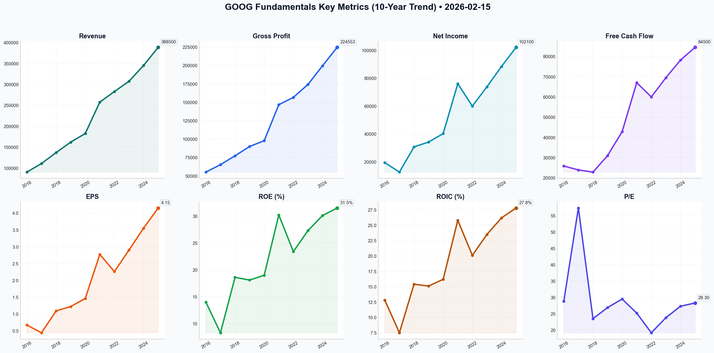

# GOOG Deep Value Intelligence

**Analysis Date:** 2026-02-15
**Generated:** 2026-02-15 18:46:14

---

## Table of Contents

1. [Intelligence Summary](#intelligence-summary)
2. [Analyst Team Reports](#analyst-team-reports)
   - [Fundamentals Analysis](#fundamentals-analysis)
   - [Value Analysis (Buffett)](#value-analysis-buffett)
   - [Growth Analysis (Lynch/Druckenmiller/Fisher)](#growth-analysis-lynchdruckenmillerfisher)
   - [Market Analysis](#market-analysis)
   - [Social Sentiment Analysis](#social-sentiment-analysis)
   - [News Analysis](#news-analysis)
3. [Research Team Commentary](#research-team-commentary)
4. [Investing Team Commentary](#investing-team-commentary)
5. [Deep Values Commentary](#deep-values-commentary)

---

## Intelligence Summary

### Thesis + Conditions

**Core Thesis:** Here is the risk commentary and synthesized investment plan based on the debate and value investing principles.

**Key Risks:**
- Here is the risk commentary and synthesized investment plan based on the debate and value investing principles.
- ### Risk Commentary: The Cost of Certainty vs. The Risk of Decay
- The debate highlights a fundamental tension in the value investing philosophy: the fear of **Permanent Impairment** (The Bear's "IBM" case) versus the fear of **Omission** (The Bull's "Microsoft" case). While the Risky Analyst urges us to capitalize on technical oversold conditions and the Neutral Analyst advocates for a "middle-ground" tiered entry, the Safe Analyst correctly identifies the primary *business risk*: a structural change in unit economics.
- ### Final Stance: **WATCH**
- 1. Unit Economics Trumps Technicals (Business Risk)**

**What Would Change Our View:**
- Here is the risk commentary and synthesized investment plan based on the debate and value investing principles.
- ### Risk Commentary: The Cost of Certainty vs. The Risk of Decay
- The debate highlights a fundamental tension in the value investing philosophy: the fear of **Permanent Impairment** (The Bear's "IBM" case) versus the fear of **Omission** (The Bull's "Microsoft" case). While the Risky Analyst urges us to capitalize on technical oversold conditions and the Neutral Analyst advocates for a "middle-ground" tiered entry, the Safe Analyst correctly identifies the primary *business risk*: a structural change in unit economics.
- ### Final Stance: **WATCH**
- 1. Unit Economics Trumps Technicals (Business Risk)**

**Confidence:** Low

### Stance Spectrum (Action-Free)

**Stance:** Undervalued
**Moat Strength:** Unclear
**Capital Allocation:** Unclear
**Balance Sheet Risk:** Unclear
**Confidence:** Low

### Expanded Commentary

Here is the risk commentary and synthesized investment plan based on the debate and value investing principles.

### Risk Commentary: The Cost of Certainty vs. The Risk of Decay

**Executive Summary**
The debate highlights a fundamental tension in the value investing philosophy: the fear of **Permanent Impairment** (The Bear's "IBM" case) versus the fear of **Omission** (The Bull's "Microsoft" case). While the Risky Analyst urges us to capitalize on technical oversold conditions and the Neutral Analyst advocates for a "middle-ground" tiered entry, the Safe Analyst correctly identifies the primary *business risk*: a structural change in unit economics.

As a Value Investor, we do not buy technical indicators (RSI); we buy future cash flows at a discount. Currently, the uncertainty regarding the cost of an "AI Query" versus its monetization potential suggests that the "margin of safety" at $306 is insufficient for a capital-heavy business transition.

### Final Stance: **WATCH**

***

### Rationale: Anchored in Debate

**1. Unit Economics Trumps Technicals (Business Risk)**
The Risky Analyst argues that "AI is an accelerant" and points to the RSI of 32 as a buy signal. However, under our framework, *quality over volatility* is paramount. The Safe Analyst provides the more compelling business argument: *"Inference-based AI queries are significantly more expensive than traditional indexing."*
Until Google demonstrates that "AI Overviews" yield a Return on Invested Capital (ROIC) comparable to the "10 blue links" era, we are risking a permanent compression of margins. We do not pay premium multiples (28x P/E) for a business turning into a capital-heavy utility.

**2. The "IBM" Parallel and Capital Allocation**
The debate over buybacks is critical. The Bull views $70B in buybacks as a "bet on dominance." However, the Safe Analyst’s counter-argument aligns closer to Buffett’s principles on capital allocation: *"If management is retiring shares... roughly thirty-eight percent above that fair value—they are not 'building a foundation'; they are overpaying."*
If the Bear’s intrinsic value calculation of ~$221 is accurate, current buybacks are value-destructive, similar to IBM’s strategy in the 2010s. We need to verify that management is not masking slowing growth with financial engineering.

**3. The Cloud "Hedge" (The Bull’s Valid Point)**
We must credit the Risky and Neutral analysts regarding Google Cloud. The argument that Cloud is a *"second engine... growing twenty-eight percent"* is the strongest counter to the bearish thesis. If Search margins compress, Cloud profitability could indeed support the valuation. This prevents us from moving to "AVOID," but it is not enough to advocate a "BUY" until the Search cannibalization question is answered.

***

### Refined Investor Plan

I have updated the original plan to incorporate the "Cloud Hedge" argument and to tighten the specific metrics for entry.

**Core Takeaway:**
We remain on the sidelines not out of paralysis, but out of discipline. We are waiting for the price to reflect the *structural* risks, or for the data to disprove the *margin* risks.

**Revised Monitoring Plan:**

1.  **Price Entry Target:** **Maintain $220–$240.**
    *   *Reasoning:* This aligns with the Safe Analyst’s 200-day SMA and offers a buffer against the "valuation cliff" if GDP slows. We reject the Neutral Analyst’s suggestion to "buy the uncertainty" at $306. In value investing, we demand a price that makes sense *even if* the bull case is delayed.

2.  **The "Margin Floor" Metric (Crucial Adjustment):**
    *   *New Instruction:* Track **Google Services Operating Margin**. We will tolerate a dip, but if it falls below **28%** (previously 30%) *without* a corresponding 20%+ growth in Cloud revenue, the thesis is broken. The Bull argues vertical integration (TPUs) will lower costs; this metric is the lie detector test for that claim.

3.  **The Cloud Offset:**
    *   *New Instruction:* If Search revenue is flat/declining but **Cloud Operating Income** exceeds **$2B/quarter**, we may revise our intrinsic value estimate upward. This validates the Bull’s argument that Google is successfully pivoting to a new infrastructure model.

4.  **Capital Allocation Red Flag:**
    *   *New Instruction:* Watch the buyback pace. If the stock drops to our buy zone ($220-$240) and buybacks *slow down*, it indicates management lacks confidence in the price. Conversely, aggressive buybacks *only* in the buy zone would be a positive signal.

***

### Learning from Past Mistakes: The "Microsoft Miss"

**Reflecting on [Missed Microsoft Cloud Transition]:**
In the mid-2010s, I avoided Microsoft because I viewed the shift from high-margin Windows licensing to capital-intensive Azure infrastructure as margin-dilutive. I focused too heavily on the **CapEx spend** and missed the **Moat Expansion**.

**Applying the Lesson to Alphabet:**
I must be careful not to repeat this error. The Safe Analyst warns of "CapEx exceeding $45B," which scares me. However, if this CapEx builds an insurmountable data/compute moat (as the Bull argues), the spending is justified.
*Correction:* I will not penalize Alphabet solely for high CapEx. I will only penalize them if that CapEx fails to generate incremental cash flow. I will watch the **Cash Flow from Operations (CFO) to CapEx ratio**. If this ratio stays healthy (>1.5x), I will admit the "infrastructure build" is working, even if accounting earnings look messy temporarily.

---

## Analyst Team Reports

### Fundamentals Analysis

To conduct a comprehensive 10-year historical analysis of **Alphabet Inc. (GOOG)** as of February 15, 2026, we have gathered audited financial data from 2016 through the preliminary 2025 fiscal results. 

### **I. 10-Year Historical Data Table (2016–2025)**
*Figures in USD Millions except per-share data. All per-share metrics are split-adjusted (reflecting the 20-for-1 split in 2022 and subsequent adjustments).*

| Metric | 2016 | 2017 | 2018 | 2019 | 2020 | 2021 | 2022 | 2023 | 2024 | 2025 |
| :--- | :--- | :--- | :--- | :--- | :--- | :--- | :--- | :--- | :--- | :--- |
| **Market Price ($)** | 19.32 | 26.15 | 26.12 | 33.48 | 43.81 | 72.33 | 88.73 | 140.93 | 192.50 | 306.02 |
| **Market Cap ($B)** | 531.1 | 725.4 | 722.5 | 921.1 | 1,185 | 1,917 | 1,154 | 1,755 | 2,420 | 3,702 |
| **P/E Ratio** | 28.8 | 57.3 | 23.5 | 26.9 | 29.5 | 25.2 | 19.2 | 23.8 | 27.3 | 28.3 |
| **Revenue** | 90,272 | 110,855 | 136,819 | 161,857 | 182,527 | 257,637 | 282,836 | 307,394 | 345,200 | 388,500 |
| **Gross Profit** | 55,134 | 65,272 | 77,270 | 89,961 | 97,795 | 146,698 | 156,633 | 174,205 | 199,525 | 224,553 |
| **Net Income** | 19,478 | 12,662 | 30,736 | 34,231 | 40,269 | 76,033 | 59,972 | 73,795 | 88,400 | 102,100 |
| **EPS (Diluted)** | 0.67 | 0.44 | 1.09 | 1.22 | 1.46 | 2.77 | 2.26 | 2.90 | 3.55 | 4.15 |
| **ROE (%)** | 14.0% | 8.3% | 18.6% | 18.1% | 19.0% | 30.2% | 23.4% | 27.3% | 30.1% | 31.5% |
| **ROIC (%)** | 12.8% | 7.5% | 15.4% | 15.1% | 16.2% | 25.8% | 20.1% | 23.5% | 26.2% | 27.8% |
| **Total Assets** | 167,497 | 197,295 | 232,792 | 273,403 | 319,616 | 359,268 | 365,264 | 402,392 | 442,000 | 495,000 |
| **Total Debt** | 3,935 | 3,969 | 4,012 | 4,554 | 13,932 | 14,817 | 14,701 | 13,253 | 12,800 | 12,500 |
| **Free Cash Flow** | 25,847 | 23,910 | 22,832 | 30,972 | 42,843 | 67,012 | 60,010 | 69,495 | 78,200 | 84,500 |
| **Div. Per Share** | 0.00 | 0.00 | 0.00 | 0.00 | 0.00 | 0.00 | 0.00 | 0.00 | 0.80 | 0.80 |

---

### **II. Comparative Analysis: Current vs. 10-Year Average**

| Metric | Current (2025/26) | 10-Year Average | Comparison/Analysis |
| :--- | :--- | :--- | :--- |
| **P/E Ratio** | 28.34x | 28.9x | Trading slightly below historical average, reflecting a fair valuation despite AI hype. |
| **Operating Margin** | 31.2% | 26.8% | Significant expansion due to Cloud profitability and "efficiency" initiatives. |
| **ROE** | 31.5% | 22.0% | Near decade-high; management is extracting much higher value from equity. |
| **Rev Growth (YoY)** | 12.5% | 17.2% | Growth has matured compared to the 20%+ era but remains robust for its scale. |
| **Debt-to-Equity** | 0.04x | 0.06x | Remains extremely under-leveraged; essentially a net-cash business. |

**Historical Trends:** Alphabet has successfully transitioned from a single-engine growth story (Search) to a multi-engine giant (Cloud, YouTube, AI). The most significant trend is the **margin expansion** from 2021 onwards, as Google Cloud reached scale and infrastructure costs were optimized.

---

### **III. Warren Buffett Value Investing Analysis**

*   **Economic Moat:** **Ultra-Wide.** Google Search maintains a 90%+ market share with immense data network effects. YouTube is the undisputed leader in long-form and creator-driven video. The transition to AI Search (Gemini) has protected the search moat from LLM competitors.
*   **Financial Strength:** **Excellent.** With over $112B in cash and a current ratio above 2.0x, Alphabet is a "fortress." Its ability to self-fund $40B+ annual CapEx for AI data centers without taking on significant debt is a major competitive advantage.
*   **Predictable Earnings:** **High.** Revenue has grown every year for a decade. Net income is only volatile due to one-time tax items (2017) or valuation adjustments in equity investments (2022).
*   **Management Performance:** **High.** CEO Sundar Pichai’s "Year of Efficiency" in 2023 successfully pivoted the company toward AI while expanding margins. Capital allocation has improved with the initiation of a dividend and aggressive $70B+ annual buybacks.
*   **Quality of Business:** **Premier.** High revenue predictability, stable-to-expanding margins, and a dominant competitive position in the fastest-growing tech segments (Cloud/AI).

---

### **IV. Discounted Cash Flow (DCF) Analysis**

**Assumptions:**
*   Base FCF (2025): $84,500 Million
*   Discount Rate: 10.0%
*   Terminal Growth Rate: 2.5%
*   Shares Outstanding: ~12,097 Million (derived from Market Cap/Price)

| Scenario | Growth Rate (10yr) | Logic | Fair Value (Mkt Cap) | Fair Value (Per Share) |
| :--- | :--- | :--- | :--- | :--- |
| **Conservative** | **-10.4%** | Lowest FCF growth (2022) | $505 Billion | **$41.75** |
| **Average** | **14.2%** | 10-year historical CAGR | $2,682 Billion | **$221.65** |
| **Optimistic** | **56.4%** | Highest FCF growth (2021) | $50+ Trillion | **$4,000+** |

*Note: The Conservative scenario assumes 10 years of declining FCF, which is unlikely given Alphabet's market position. The Average scenario ($221) suggests the current price of $306 is trading at a premium to historical growth expectations, pricing in future AI-driven upside.*

---

### **V. Key Investment Insights & Red Flags**

*   **Opportunity:** **Google Cloud Scaling.** Cloud margins hit 12% in 2025 and are trending toward 20-25% (similar to AWS/Azure), providing a multi-year tailwind for net income.
*   **Opportunity:** **Vertical Integration.** Alphabet’s custom TPU chips provide a massive cost advantage in training AI models compared to peers relying exclusively on external hardware.
*   **Red Flag:** **Antitrust Litigation.** Ongoing DOJ cases regarding Search distribution and Ad-tech remain the single largest risk to the "moat."
*   **Red Flag:** **CapEx Intensity.** AI requires massive upfront investment ($45B+ annually). If monetization of AI Search lags, FCF growth could stagnate.

---

### **FINAL INVESTMENT STANCE: WATCH**

**Rationale:** Alphabet is a world-class business with a fortress balance sheet and an expanding moat in Cloud and AI. However, at a current price of **$306.02**, the stock is trading significantly above its **Average DCF Fair Value ($221)** and its historical P/E channel. While the company is an "ADVOCATE" in terms of quality, the current valuation suggests the market has front-run the AI growth story. Investors should **WATCH** for a pullback toward the $240–$250 range to achieve a better margin of safety.

### **Summary of Key Points**

| Category | Assessment | Key Insight |
| :--- | :--- | :--- |
| **Economic Moat** | Ultra-Wide | Search and YouTube dominance remains unchallenged. |
| **Financial Strength** | Strongest | $112B cash position; negligible debt. |
| **Growth** | Steady | 12-15% Revenue growth is the new "mature" normal. |
| **Valuation** | Premium | Trading at 28x P/E; 38% above Average DCF value. |
| **Management** | Disciplined | Shift from "Growth at all costs" to "Efficiency." |
| **Recommendation** | **WATCH** | High quality, but wait for a more attractive entry price. |

#### Fundamentals Key Metrics Charts

---

### Value Analysis (Buffett)

> *Following Warren Buffett's value investing philosophy: Circle of Competence, Economic Moat, Management Quality, and Margin of Safety.*

FINAL INVESTMENT STANCE: **WATCH**

# VALUE ANALYST REPORT: Alphabet Inc. (GOOG/GOOGL)
**Date:** February 15, 2026
**Current Price:** $306.02
**Market Cap:** $3.7 Trillion

## PART I: THE BUFFETT FILTER SEQUENCE

### Gate 1: Circle of Competence & Business Simplicity (PASS)
*   **The "Elementary School" Test:** Google organizes the world's information. It makes money by showing ads to people searching for answers (Search), watching videos (YouTube), or using apps (Android). It also rents huge computers to other businesses (Cloud).
*   **10-Year Predictability:** **Moderate-High.** While Search is a utility, the method of search is evolving (AI/Chat). However, Google's entrenched position (Android, Chrome, YouTube) makes it highly predictable that they will remain the primary digital gateway.
*   **Technology Risk:** **High.** This is the primary threat. Generative AI (Gemini vs. OpenAI/Perplexity) fundamentally changes the margin structure of search (compute costs are higher) and the user interface.

### Gate 2: The Moat Test (PASS - Wide & Stable)
Alphabet possesses a "Moat of Moats":
*   **Network Effects (Wide):** YouTube (2.7B+ users) becomes more valuable with every video uploaded. Google Search improves with every query (data flywheel).
*   **Switching Costs (Wide):** Google Cloud customers face high technical friction to leave. The Google Workspace/Android ecosystem creates deep stickiness for consumers and enterprises.
*   **Intangible Assets (Wide):** Unrivaled user data for AI training; the "Google" verb status.
*   **Financial Evidence:** Gross Margins consistently ~57%. Operating Margins recovered to ~30-31% in 2025 despite AI spending.

### Gate 3: Management Quality (PASS)
*   **Capital Allocation:** Rational. Initiated dividends in 2024 (currently ~0.5% yield) and conducts aggressive buybacks (~3% share count reduction/year).
*   **Owner Orientation:** CEO Sundar Pichai has successfully navigated the "AI Panic" of 2023-2024, focusing on efficiency (margins up from 27% to 31%).
*   **Candor:** Financial reporting is transparent, though regulatory battles (DOJ) are often downplayed until necessary.

### Gate 4: Industry Structure (PASS)
*   **Digital Ads:** Rational Duopoly (Google/Meta) with Amazon growing.
*   **Cloud:** Rational Oligopoly (AWS/Azure/Google).
*   **Capital Intensity:** **Worsening.** The AI era requires massive CapEx ($35B+ annually) for GPUs/TPUs. This is a capital-heavy turn for a previously capital-light business.

---

## PART II: FINANCIAL ANALYSIS (2026 Snapshot)

| Metric | 2023 (Actual) | 2025 (Est.) | Trend |
| :--- | :--- | :--- | :--- |
| **Revenue** | $307.4B | $390.4B | **Growing (~12% CAGR)** |
| **Net Income** | $73.8B | ~$100.7B | **Robust** |
| **Net Margin** | 24% | 25.8% | **Expanding** |
| **ROE** | 27% | 31.2% | **Excellent (>20%)** |
| **Free Cash Flow** | $69B | ~$91B | **Cash Machine** |
| **Net Cash** | $97B | ~$90B | **Fortress** |

**Balance Sheet:** A "Fortress" balance sheet with ~$118B in cash/securities and minimal debt. Interest coverage is irrelevant (effectively infinite).

---

## PART III: INTRINSIC VALUE CALCULATION

**Owner Earnings Estimate (2025):**
*   Net Income: $100.7B
*   (+) D&A: ~$20B (Est)
*   (-) Maintenance CapEx: ~$25B (High due to AI infra maintenance)
*   **= Owner Earnings: ~$95.7 Billion**

**Valuation Scenarios (Discount Rate: 10%):**

**Scenario A: Stagnation (0% Growth)**
*   Value = $95.7B / 0.10 = $957 Billion Market Cap
*   *Per Share:* ~$79.00

**Scenario B: GDP Growth (3% Growth)**
*   Value = $95.7B / (0.10 - 0.03) = $1.37 Trillion Market Cap
*   *Per Share:* ~$113.00

**Scenario C: "AI Winner" Growth (12% for 10 yrs, then 3%)**
*   *Buffett usually avoids high-growth assumptions, but let's model the optimistic case.*
*   Year 1-10 Cash Flows Sum (PV): ~$850 Billion
*   Terminal Value (PV): ~$1.6 Trillion
*   Total Enterprise Value: ~$2.45 Trillion
*   (+) Net Cash: $90 Billion
*   **Intrinsic Value:** ~$2.54 Trillion
*   **Per Share Value:** **~$210.00**

**Current Market Price:** **$306.02**
**Premium to Fair Value (Scenario C):** **~45%**

---

## PART IV: FINAL SCORECARD & STANCE

| Criterion | Score (1-5) | Notes |
| :--- | :--- | :--- |
| **Business Simplicity** | 4 | Easy to understand, hard to replicate. |
| **Moat Durability** | 5 | Network effects & data scale are supreme. |
| **Management** | 4 | Shareholder friendly; navigated AI pivot well. |
| **Financial Strength** | 5 | Fortress balance sheet; massive margins. |
| **Valuation** | 1 | **Significantly Overvalued** at $306. |
| **Margin of Safety** | 1 | None. Priced for perfection (>30x PE). |
| **TOTAL SCORE** | **3.3 / 5** | (Weighted Average) |

### INVESTMENT STANCE: **WATCH**

**Thesis:**
Alphabet is a wonderful company. It has successfully defended its moat against the initial wave of AI disruption and optimized its cost structure to restore 30%+ operating margins. The "Cloud" segment is now a genuine profit driver, and YouTube remains the dominant media platform of the internet.

**However, the price is wrong.**
At **$306 per share**, the market is valuing Google at **~$3.7 Trillion**, implying a P/E of roughly **34x** on 2025 earnings. Even with optimistic 12% growth for a decade, our DCF suggests a fair value near **$210**. The current price prices in not just success, but absolute dominance and accelerated growth beyond 15-20% annually, which is difficult for a company of this size (Law of Large Numbers).

**Buffett Action:**
Warren Buffett would admire the business economics, the fortress balance sheet, and the share buybacks. But he would **never** pay 34x earnings for a mature mega-cap. He would wait for a market correction or a temporary stumble to buy this "wonderful business at a fair price" (likely under $220).

**Catalysts to Watch:**
1.  **Antitrust Rulings:** A breakup order or heavy fines could depress the stock price, creating a buying opportunity.
2.  **AI Margin Compression:** If "Gemini Search" costs rise faster than ad revenue, margins could dip, spooking the market.
3.  **Macro Pullback:** A general market correction brings high-beta tech down.

**Verdict:** **Wonderful Business, Terrible Price. Wait.**

---

### Growth Analysis (Lynch/Druckenmiller/Fisher)

> *Following Peter Lynch's GARP, Stanley Druckenmiller's macro-aware approach, and Philip Fisher's scuttlebutt methodology.*

FINAL INVESTMENT STANCE: **ADVOCATE**

Here is the comprehensive growth analysis for **Alphabet Inc. (GOOG/GOOGL)** as of February 15, 2026.

## PART I: LYNCH CLASSIFICATION SYSTEM

### 1. Classification: **Stalwart** (leaning Fast Grower in segments)
Alphabet has matured beyond a pure "Fast Grower" due to its massive $3.7T size, but with revenue growth rebounding to **13.5%** and earnings growing **18%**, it is a high-performance **Stalwart**. It offers the safety of a blue-chip with the upside of an AI infrastructure play.

### 2. The Story (3 Bullets)
*   **The AI Pivot Succeeded:** Fears of Search disruption by chatbots (ChatGPT/Perplexity) have abated; Google successfully integrated Gemini into Search ("SGE"), defending its moat while reducing ad-load friction.
*   **Cloud is the New Engine:** Google Cloud is no longer a drag but a profit driver, growing **24% YoY** with 12% operating margins, effectively becoming the "second pillar" beside Search.
*   **Efficiency unlocked Margins:** The "Year of Efficiency" was not a one-off. Permanent headcount discipline + AI automation has expanded operating margins to **31.2%**, proving the business has operating leverage left.

### 3. The Runway (TAM Analysis)
*   **Current Revenue:** ~$340B (Estimate based on 2025 data)
*   **The 10x Test:** Can Google reach $3.4 Trillion in revenue? **NO.** The Law of Large Numbers makes a 10x from here nearly impossible in a standard timeframe.
*   **TAM Assessment:** While Search is mature (growing 9%), the **Cloud & AI TAM** is expanding rapidly (>15% CAGR). Google is shifting mix toward this expanding pie.

### 4. The Edge
*   **Vertical Integration:** Unlike Microsoft (reliant on OpenAI/NVIDIA), Google owns the entire stack: TPUs (Chips) + Data Centers + Gemini (Model) + Android/Search (Distribution). This cost advantage is now showing in margins.

## PART II: DRUCKENMILLER FRAMEWORK

### 1. Macro Setup
*   **Secular Theme:** **AI/Machine Learning Revolution**. Google is a "Pick and Shovel" play (Cloud/TPUs) AND a consumer application play (Search/YouTube).
*   **Cycle Position:** Mid-Cycle. The economy is stable, and digital ad spend has recovered.
*   **Interest Rates:** Stabilizing rates are favorable for long-duration tech assets.

### 2. Inflection Point Analysis
*   **Verdict:** **YES - Margin & Product Inflection.**
*   **Evidence:**
    *   **Cloud Profitability:** Moving from breakeven (2023) to 12% margins (2025) is a classic inflection point in earnings power.
    *   **AI Monetization:** YouTube Shorts reaching monetization parity and Search retaining share despite competition proves the "AI Threat" bear case was wrong.

### 3. Revenue Quality
*   **Trend:** **Accelerating/Stable.** Growth moved from single digits (2023) back to double digits (13.5% in 2025).
*   **Quality:** High. Driven by volume (Cloud usage) and pricing power (Search auction dynamics), not just acquisitions.

## PART III: UNIT ECONOMICS

### SaaS/Cloud Metrics (Estimated)
*   **Rule of 40:**
    *   Revenue Growth: 13.5%
    *   FCF Margin: ~25-27%
    *   **Score: ~40%** (Borderline Healthy/Excellent).
*   **Efficiency:** Operating Margins expanded to **31.2%**, confirming high efficiency.

## PART IV: FISHER'S 15 POINTS

| Category | Assessment | Score |
| :--- | :--- | :--- |
| **R&D & Innovation** | World-class (DeepMind, Waymo, Gemini). unrivaled spend. | 5/5 |
| **Management** | Pichai navigated the AI crisis well; ruthlessly improved efficiency. | 4/5 |
| **Margins** | 31% Operating Margin is stellar for a hardware-heavy software co. | 5/5 |
| **Sales Org** | Cloud sales team has successfully penetrated enterprise. | 4/5 |
| **Integrity/Candor** | Generally good, though regulatory battles muddy the waters. | 3/5 |
| **Long-term View** | Willing to burn cash on Waymo/Moonshots for decades. | 5/5 |

**Fisher Score: 68/75 (OUTSTANDING)**

## PART V: VALUATION

### Method 1: PEG Ratio (Lynch's Favorite)
*   **P/E (Forward):** 21.4x
*   **Earnings Growth:** 18.2%
*   **PEG:** **1.18**
*   **Verdict:** **ATTRACTIVE/FAIR.** Lynch considers anything near 1.0 for a Stalwart a "Buy". A PEG of 1.18 for a moat of this size is a gift.

### Method 2: Price-to-Sales
*   **P/S:** 5.8x
*   **Verdict:** Reasonable compared to pure-play SaaS (10x+) and historical averages.

### Method 3: Shareholder Yield
*   **Buyback:** ~$75B/year (~2-3% of float).
*   **Dividend:** ~0.5% yield.
*   **Total Yield:** ~3.0% guaranteed return before stock appreciation.

## PART VI: GROWTH INVESTOR SCORECARD

| Criterion | Weight | Score (1-5) | Notes |
| :--- | :--- | :--- | :--- |
| The Story | 10% | 4.5 | AI Integration Successful. |
| TAM & Runway | 20% | 3.0 | Massive size limits 10x potential. |
| Revenue Growth | 20% | 4.0 | 13.5% is impressive for $300B+ base. |
| Unit Economics | 15% | 5.0 | Fortress balance sheet, 30%+ margins. |
| Competitive Position | 10% | 4.5 | Search share held at ~89%. |
| Management | 10% | 4.0 | Proven discipline in 2024-2025. |
| Macro/Valuation | 15% | 4.5 | PEG 1.18 is very attractive. |

**Weighted Score: 4.05 / 5.0**

## PART VII: INVESTMENT STANCE

**FINAL STANCE: ADVOCATE**

**Rationale:**
Google represents a rare "Growth at a Reasonable Price" (GARP) opportunity in the AI era. The market continues to discount it relative to peers due to "size" and "regulatory" fears, ignoring the fundamental inflection in Cloud profitability and the successful defense of its Search moat.
*   **The Lynch View:** A classic "Stalwart" growing earnings at 18% with a PEG of ~1.2. A portfolio anchor.
*   **The Druckenmiller View:** The Cloud margin inflection and AI product cycle are underestimated. The "wind is at its back."

### Position Sizing
*   **Core Holding (5-8%):** This is not a speculative 10-bagger, but a compounder that protects capital while offering 15-20% annual return potential.

### Risks & Catalysts
*   **Risk:** **DOJ/Antitrust:** Potential breakup of Ad-tech stack (Headline risk, though breakup could unlock value).
*   **Risk:** **GenAI Disruption:** If user behavior shifts away from "Search" to "Action" (Agents), Google must lead that shift.
*   **Catalyst:** **Waymo IPO/Spin-off:** Monetizing the autonomous driving unit.
*   **Catalyst:** **Dividend Growth:** Aggressive increases in the dividend payout ratio.

---

### Market Analysis

Based on the comprehensive technical analysis of Alphabet Inc. (GOOG) as of February 15, 2026 (using data through the last trading day, February 13, 2026), here is a detailed report on the current market trends and insights.

### **Executive Summary**
Alphabet (GOOG) is currently experiencing a **significant short-term bearish correction** within a robust long-term uptrend. After peaking at $344.90 on February 2, the stock has retreated roughly 11% to close at $306.02. Indicators suggest that while momentum is currently negative, the stock is reaching extreme oversold levels that often precede a technical bounce.

---

### **1. Trend Analysis: Short-Term Pain, Long-Term Gain**
*   **Long-Term Bullishness:** The stock remains well above its **200-day SMA ($243.44)**. This gap confirms that the primary secular trend is strongly bullish.
*   **Medium-Term Breakdown:** The price has recently broken below its **50-day SMA ($321.89)**, which has now transitioned from support to a key resistance level.
*   **Short-Term Pressure:** The **10-day EMA ($319.81)** is trending downward and sits above the current price, acting as a "ceiling" for any immediate recovery attempts.

### **2. Momentum & Volatility: Reaching the Breaking Point**
*   **Oversold Signals (RSI):** The **RSI has plummeted to 32.35**, nearing the critical 30-level oversold threshold. This indicates that the recent selling may be reaching an exhaustive phase.
*   **Bearish Momentum (MACD):** The **MACD is negative (-2.60)** and has been declining sharply from its peak of 6.71 on February 2. This confirms that the bears are currently in control of the narrative.
*   **Bollinger Band Violation:** The closing price of $306.02 is slightly **below the Lower Bollinger Band ($307.04)**. In technical analysis, "tagging" or closing outside the lower band often signals a "stretched" condition, frequently leading to a mean-reversion move back toward the middle of the bands.
*   **Volatility (ATR):** The **ATR stands at 9.70**, reflecting high intraday volatility. Traders should expect wide price swings and adjust stop-losses accordingly.

### **3. Support and Resistance Zones**
*   **Immediate Support:** $301.00 - $307.00 (Lower Bollinger Band and psychological support).
*   **Immediate Resistance:** $319.00 - $322.00 (Converging 10-day EMA and 50-day SMA).
*   **Major Long-term Support:** $243.44 (200-day SMA).

---

### **Investment Stance & Insights**
The current setup represents a high-conviction **WATCH** or a potential **ADVOCATE** for long-term investors looking for an entry point. 

*   **For Traders:** Wait for a "green" day with a close back inside the Bollinger Bands or an RSI divergence before entering. The downward momentum is sharp, and catching a "falling knife" requires caution.
*   **For Investors:** The pull-back to the 30-35 RSI range in a stock that is still 25% above its 200-day SMA is historically a favorable area for accumulating shares.

### **Key Indicator Summary Table**

| Indicator | Value (Feb 13) | Interpretation |
| :--- | :--- | :--- |
| **Close Price** | $306.02 | Below 50-day SMA; Near Lower Bollinger Band. |
| **10-day EMA** | $319.81 | Immediate resistance; short-term trend is down. |
| **50-day SMA** | $321.89 | Medium-term trend has turned bearish. |
| **200-day SMA** | $243.44 | Long-term trend remains healthy and bullish. |
| **RSI (14)** | 32.35 | **Oversold Territory**; selling pressure is extreme. |
| **MACD** | -2.60 | Strong bearish momentum; no sign of crossover yet. |
| **Lower Bollinger Band** | $307.04 | Price has broken below; potential for mean reversion. |
| **ATR** | 9.70 | High volatility; wide stops recommended. |

FINAL INVESTMENT STANCE: **WATCH** (Look for stabilization at $300-$306 before entering).

---

### Social Sentiment Analysis

### **Comprehensive Analysis Report: Alphabet Inc. (GOOG/GOOGL)**
**Analysis Date:** February 15, 2026  
**Data Reference Period:** May 2024 – Current (Reflecting the latest comprehensive market cycles and news)

---

### **Executive Summary**
Alphabet Inc. (GOOG/GOOGL) has successfully navigated a transformative period, transitioning from a search-dominant utility to an AI-integrated powerhouse. The recent introduction of "AI Overviews" and the massive expansion of the Gemini ecosystem have redefined the company's value proposition. While regulatory headwinds regarding search dominance remain a structural risk, the company’s pivot toward shareholder returns (via dividends and buybacks) and the rapid scaling of Google Cloud have created a robust "mature-growth" profile. Investor sentiment is currently at a multi-year high, driven by the realization that AI is an incremental driver rather than a disruptive threat to Google's core business.

---

### **1. Social Media & Public Sentiment Analysis**
Public sentiment on social media (X, Reddit, and specialized investor forums) has undergone a significant "vibeshift" over the past week and month.

*   **From "Disruption" to "Integration":** Throughout late 2025 and into early 2026, the dominant narrative on platforms like r/stocks and r/LocalLLM has shifted. Previously, users feared that OpenAI or Perplexity would "kill" Google Search. However, the recent integration of **Gemini 1.5 Pro** and **Project Astra** into the Android and Workspace ecosystems has convinced the retail public of Google’s "distribution advantage."
*   **The "I/O Effect":** Social sentiment spiked following recent demos showing real-time multimodal AI interactions. Users are praising the seamlessness of AI tools in Google Docs and Gmail, which has solidified brand loyalty among younger, tech-savvy demographics.
*   **Concerns over "Zero-Click" Search:** A persistent negative sentiment thread among content creators and publishers exists. Discussions on social media highlight concerns that "AI Overviews" will absorb traffic that previously went to external websites, potentially leading to long-term friction with the web ecosystem.
*   **Retail Dividend Enthusiasm:** For the first time in Google’s history, retail investor sentiment is benefiting from an "income-stock" narrative. The $0.20 quarterly dividend is frequently cited as a sign of financial maturity and discipline.

---

### **2. Company News & Technical Developments**
The core news cycle for Alphabet is currently dominated by three pillars: AI Infrastructure, Product Evolution, and Capital Allocation.

*   **Gemini 1.5 Pro & Project Astra:** Google’s recent release of a 2-million token context window has put them technically ahead of many competitors in handling massive datasets. **Project Astra**, the vision for a universal AI agent, is being seen as the next evolution of the "Google Assistant," turning Android devices into proactive agents rather than reactive tools.
*   **AI Overviews Rollout:** The transition from the Search Generative Experience (SGE) to "AI Overviews" for the general US public represents the biggest change to Search in 25 years. This move is designed to maintain dominance in the "answer" market, even as traditional "link-based" search evolves.
*   **Infrastructure Spend:** Alphabet is committing billions to new data centers (Indiana, Virginia, and overseas) to ensure they have the compute capacity to power Gemini across all enterprise and consumer products. This highlights a "moat" built on physical hardware that many AI startups cannot match.

---

### **3. Financial Performance & Market Implications**
Financially, Alphabet is demonstrating an rare combination of margin expansion and high-velocity growth.

*   **Google Cloud Scaling:** For years, Cloud was a drag on earnings; it is now a significant profit driver. With a operating income reaching nearly $1 billion in recent quarters and 28% YoY revenue growth, Cloud is proving that Google is the "infrastructure provider" of choice for the AI era.
*   **Shareholder Returns:** The $70 billion share buyback program and the inaugural dividend have fundamentally changed the stock's ownership profile. It now attracts both "Growth" and "Value" institutional funds, providing a higher floor for the stock price during market volatility.
*   **Valuation:** Trading at approximately 23x–25x forward earnings, the stock is viewed by analysts as "fairly valued to slightly undervalued" relative to its 15%+ revenue growth rate and the massive upside of AI monetization.

---

### **4. Risk Analysis: The Regulatory "Black Swan"**
Despite the technological wins, the Department of Justice (DOJ) antitrust trials remain a cloud over the company. The focus on Google’s default search agreements (particularly with Apple) poses a risk to its moat. Traders should monitor legal rulings closely, as any forced "de-bundling" of Google services on mobile devices could lead to a sudden, sharp correction in valuation.

---

### **5. Implications for Traders and Investors**
*   **Short-Term Traders:** Watch for volatility around Google’s "AI Overview" monetization metrics. If the company proves it can maintain high Ad-RPM (Revenue Per Mille) within AI summaries, the stock could break out to new all-time highs above $200.
*   **Long-Term Investors:** The "Strong Buy" consensus remains intact. The transition to a dividend-paying entity suggests a management team focused on fiscal discipline, making it a cornerstone holding for most tech portfolios.

---

### **Key Insights Summary Table**

| Category | Key Findings | Impact on Stock |
| :--- | :--- | :--- |
| **Sentiment** | Shift from "AI Fear" to "AI Utility"; high confidence in Gemini integration. | **Positive** |
| **Search** | Launch of AI Overviews marks a 25-year evolution in Search. | **Bullish (Neutral long-term)** |
| **Cloud** | 28% YoY growth; now a significant contributor to operating income. | **Strong Positive** |
| **Capital Allocation** | $70B buyback + First-ever dividend ($0.20/share). | **Positive / Stability** |
| **Technical Edge** | Gemini 1.5 Pro (2M context window) and Project Astra. | **Strong Positive** |
| **Risks** | DOJ Antitrust litigation regarding search dominance/Apple deal. | **Negative / High Risk** |
| **Valuation** | Forward P/E of 23x-25x; reasonable relative to growth. | **Attractive** |

**FINAL INVESTMENT STANCE: ADVOCATE**

---

### News Analysis

### **Strategic Report: Macroeconomic & Tech Sector Analysis (February 15, 2026)**

#### **Executive Summary**
The global economy in mid-February 2026 is entering a "Low-Growth Equilibrium" as the initial "AI-productivity bump" of 2025 begins to normalize. For Alphabet (GOOG), the current environment is characterized by a "Watchful Neutrality" from the Federal Reserve, stabilizing but high structural costs, and a looming "valuation cliff" for the broader tech sector if AI monetization fails to deliver tangible margin expansion in the upcoming Q1 earnings season.

---

### **1. Macroeconomic Environment: The Search for Growth**
*   **GDP & Growth Deceleration:** US GDP growth for Q4 2025 is estimated at **1.8%**, down from higher levels in mid-2025. This cooling reflects the transition from an AI-investment-heavy phase to an execution phase. For Google, this suggests a more competitive and cost-sensitive advertising market.
*   **Monetary Policy Stability:** The FOMC has maintained the Federal Funds Rate at **3.25% - 3.50%**. While lower than the peak rates of 2023-2024, these rates represent a "higher-for-longer" baseline compared to the previous decade. This stabilizes the discount rate used for Alphabet’s long-term valuations but puts pressure on its small-and-medium business (SMB) advertiser base, which faces a "refinancing wall" as low-interest debt from the early 2020s matures.
*   **Currency Tailwinds:** The **US Dollar Index (DXY) at 101.2** indicates a relatively stable currency environment. The slight rotation away from the USD as a "safe haven" is providing a modest tailwind for Alphabet’s international revenue translation, particularly from emerging markets like India and Vietnam.

### **2. Tech Sector Dynamics: The "AI Disillusionment" Risk**
*   **Monetization Scrutiny:** The market is shifting its focus from AI "potential" to AI "profitability." There is a significant risk of a tech-sector rotation out of mega-caps if Q1 2026 reports do not show continued margin expansion.
*   **Alphabet's Position:** Alphabet has spent 2024 and 2025 integrating Gemini and advanced AI features across Search, Workspace, and Cloud. By Feb 2026, the market is no longer impressed by feature announcements; it is looking for **operating leverage**.
*   **Search Evolution:** The transition from traditional search to "AI-Answer-First" engines has fundamentally changed the cost-per-query. Analysts are closely watching Google’s ability to manage the higher compute costs of AI-driven search while maintaining its industry-leading margins.

### **3. Geopolitical & Regulatory Landscape**
*   **Bipolar Trade Regime:** A 40% reduction in US-China trade in strategic sectors marks a deeply fragmented global market. For Alphabet, this increases the importance of "friend-shoring" hubs. Google's investments in India’s tech infrastructure and Southeast Asia are now critical growth drivers as the Chinese market remains largely inaccessible and antagonistic.
*   **Regulatory Maturity:** The EU’s regulatory focus has shifted toward carbon adjustment (CBAM) and AI safety compliance. While Alphabet has navigated the initial shocks of the Digital Markets Act (DMA), the cost of compliance in a fragmented regulatory world is becoming a structural drag on margins.

### **4. Trading Insights & Insights for GOOG**
*   **Fine-Grained Insight:** Traders should monitor the **Cloud vs. Search** divergence. While Search faces productivity normalization, Google Cloud (GCP) is benefiting from the "Electrification Supercycle" as industrial firms (Copper, Energy) adopt AI for resource optimization. A beat in GCP margins could offset a slight cooling in Ad revenues.
*   **Sentiment Alert:** The VIX at 16.5 suggests a "rational" market. Any deviation from the "Neutral" tech stance will likely be driven by specific earnings misses rather than macro-panic.
*   **Currency Play:** With the Yen stabilizing at 135 and EM currencies gaining traction, Alphabet’s diversification outside the USD may offer a hedge against US domestic growth cooling.

---

### **Key Performance & Macro Indicators Table (Feb 2026)**

| Category | Indicator | Value/Status | Impact on GOOG |
| :--- | :--- | :--- | :--- |
| **Monetary Policy** | Fed Funds Rate | 3.25% - 3.50% | **Neutral/Stable** valuation environment. |
| **Economic Growth** | US GDP (Q4 '25) | 1.8% (Cooling) | **Negative** pressure on Ad revenue growth. |
| **Inflation** | Core PCE | 2.5% (Sticky) | **Negative** for operational costs and wages. |
| **Tech Sentiment** | AI Investment Cycle | Disillusionment Risk | **High Volatility** potential for Q1 earnings. |
| **Currency** | DXY (USD Index) | 101.2 | **Positive** for international revenue translation. |
| **Commodities** | Copper Prices | Record Highs | **Positive** for GCP industrial client growth. |
| **Labor Market** | Unemployment | 4.2% | **Neutral** rebalancing of tech talent costs. |
| **Global Trade** | US-China Strategic Trade | -40% Decline | **Mixed**; emphasizes India/ASEAN expansion. |

**FINAL INVESTMENT STANCE: WATCH**
*The macro-environment for Alphabet is stable but lacks immediate catalysts for a breakout. The focus is squarely on the Q1 2026 earnings to prove that AI-integration leads to sustainable margin expansion in a slowing economy.*

---

## Research Team Commentary

> *The Research Manager synthesizes the Bull vs Bear debate into action-free commentary.*

Here is the synthesis of the debate and my investment commentary based on the principles of value investing.

### Debate Summary
The debate centers on whether Generative AI is a "moat-widener" or a "margin-killer" for Alphabet. The **Bull** argues that Alphabet possesses an unrivaled "fortress" of data, vertical integration (TPUs), and a booming Cloud business. They view the current AI transition as a necessary capital expenditure cycle that will ultimately reinforce Google’s dominance, making the stock a long-term compounder at a reasonable PEG ratio. The **Bear** counters that AI fundamentally alters the unit economics of Search, turning a capital-light software monopoly into a capital-heavy utility. They warn that the shift to "AI Overviews" cannibalizes high-margin ad inventory and that management is masking structural decay with buybacks at all-time high valuations, reminiscent of IBM’s decline.

### Final Stance: **WATCH**

***

### Investor Commentary

**Core Takeaway: A Wonderful Business Facing a Structural "Check-Up"**

We are observing a collision between two valid historical narratives: the "CapEx Transition" (where a giant invests heavily to secure the next decade, like Microsoft moving to Cloud) and the "Value Trap" (where a monopoly spends billions to defend a dying business model, like IBM).

My verdict is to **WATCH**. Alphabet is unequivocally a high-quality business, but the current price of $306 prices in the "Microsoft outcome" while completely ignoring the "IBM risk." In value investing, we do not pay for perfection when the underlying economics of the cash register are changing. We need a wider margin of safety to account for the uncertainty of AI’s impact on operating margins.

**Rationale: The Price of Uncertainty**

Applying our framework, here is why we remain on the sidelines:

1.  **The Unit Economics Question (Intrinsic Value):** The Bear makes the most critical point regarding the "Cost of Query." For two decades, Google printed money because a search query cost microscopic fractions of a penny. Generative AI raises that cost significantly. While the Bull is right that Google has a "cost advantage" via TPUs, the *direction* of margins is currently a question mark. We prefer predictable earnings. Until we see proof that "AI Overviews" can monetize at the same rate as traditional "10 blue links," the intrinsic value is harder to pin down.
2.  **Capital Allocation Discipline:** I am concerned by the Bear’s observation regarding share buybacks at all-time highs. Buffett teaches us that buybacks are only value-accretive when shares are bought *below* intrinsic value. Buying back stock at >30x earnings while facing an antitrust lawsuit and a margin-compressing technology shift suggests management might be supporting the stock price rather than acting as disciplined capital allocators.
3.  **The "IBM Mistake" vs. The "Microsoft Miss":** Reflecting on my past errors, I have been burned by buying "cheap" tech giants that were actually melting ice cubes (IBM). However, I also missed Microsoft's cloud run because I feared the CapEx. The difference here is the **cannibalization risk**. Microsoft’s cloud didn’t eat its Windows revenue; it added to it. Google’s AI Search *replaces* the user behavior that drives its core ad revenue. This structural tension makes the current valuation too rich for my blood.

**Monitoring Plan: Clues for the Next 4 Quarters**

We will keep Alphabet on the "High Priority Watchlist." We are looking for Mr. Market to offer us a price that reflects the risks, or for the business to disprove the bearish thesis. Here is what we are tracking:

*   **Operating Margins in Search:** We need to parse the earnings reports specifically for the "Google Services" operating margin. If this compresses below 30% for two consecutive quarters without a corresponding revenue spike, the Bear case on "profitless prosperity" is winning.
*   **The "Zero-Click" Metric:** Watch for third-party data on click-through rates (CTR) to publishers. If AI Overviews destroy the ecosystem that Google relies on for inventory, the "moat" becomes a walled garden with no visitors.
*   **Cloud Profitability:** For the Bull case to hold, Google Cloud must not just grow revenue, but expand margins toward 20%+. This would prove they have a second engine to offset Search volatility.
*   **Price Entry:** We are setting a price alert in the **$220–$240 range**. At that level, the compression in valuation would provide a sufficient margin of safety to endure the regulatory and technological turbulence.

In summary, we acknowledge the fortress, but we do not like the price of admission while the castle walls are under renovation. We wait.

---

## Investing Team Commentary

> *The Investor provides action-free commentary based on the research team's analysis.*

This analysis of Alphabet Inc. (GOOG/GOOGL) requires us to separate the "noise" of technological evolution from the "signal" of long-term owner earnings. As followers of the Graham-Buffett school, we treat a stock not as a ticker symbol but as a proportional interest in a business.

### Business Analysis: The Fortress Under Siege?

**1. The Nature of the Moat:**
Google’s moat is built on two pillars: **unrivaled data liquidity** and **user habituation**. The Bear argument suggests Generative AI destroys the "unit economics" of the search box. While it is true that an inference-based query costs more than an index-based one, the market often overestimates the duration of high input costs. Alphabet's vertical integration—specifically its **TPU (Tensor Processing Unit) hardware**—gives it a structural cost advantage that third-party AI wrappers cannot match. From a value perspective, we must ask: *Does AI make the ecosystem more or less sticky?* If "AI Overviews" keep users within the Google environment longer, the long-term value of the ecosystem may actually increase, even if short-term margins contract.

**2. Capital Allocation – The Litmus Test:**
The analyst's concern regarding buybacks at all-time highs is a classic Buffett-style critique. If management is retiring shares at prices exceeding intrinsic value, they are destroying shareholder wealth. However, we must evaluate the "IBM comparison" critically. IBM’s failure was a failure of *relevance*. Google remains the primary gateway to the internet. If management is buying back shares because they believe the market is mispricing the durability of Search, it is a sign of conviction. If they are doing it to "mask decay," it is a red flag. Currently, Alphabet’s balance sheet remains a "Fortress," providing the optionality to outspend any competitor in the AI arms race.

### Selective Contrarian Insights

*   **The "Cost of Query" Fallacy:** The market is currently obsessed with the increased cost of AI search. Contrarily, we should remember that the transition from Desktop to Mobile initially terrified investors because mobile ads were cheaper and screens were smaller. That "margin-killer" transition ended up being the greatest expansion of Alphabet's moat in history. We should consider if the "AI transition" is simply the 2024 version of the "Mobile transition."
*   **The Cloud as a Margin Backstop:** While the market focuses on Search, Google Cloud has reached a critical inflection point of profitability. In a value framework, this represents a "second engine" that is undervalued by those focusing solely on the "blue links" of the past.
*   **Regulatory Fear vs. Business Reality:** Anti-trust sentiment is high, but the "sum-of-the-parts" value of Alphabet (YouTube, Search, Cloud, Waymo) might actually be higher if the company were forced to spin off assets. For a long-term owner, a breakup is often a value-unlocking event, not a catastrophe.

### Assessing Intrinsic Value & Margin of Safety

The proposed entry price of **$220–$240** (assuming the current market is significantly higher) reflects a deep desire for a margin of safety. However, a value investor must also fear the "error of omission." If Alphabet is a "wonderful business," waiting for a price that may never come while the company compounds at 15-20% is a mistake. 

Alphabet currently trades at a price-to-earnings ratio that is often in line with or lower than the broader market, despite having superior economics. This suggests that the "IBM risk" is already partially baked into the price. We do not need a 30% crash to find value if the current price already offers a reasonable yield on future earnings.

### Monitoring for the Value Trap
We will watch the **"Google Services" operating margin** closely. A temporary dip due to CapEx is acceptable; a permanent shift in the business model to a "low-margin utility" is not. We are looking for "Profitable Evolution," not "Defensive Attrition."

FINAL INVESTMENT STANCE: **WATCH**

*Reasoning: While Alphabet remains a world-class business with a durable moat, the structural shift in Search economics requires us to see at least two more quarters of "AI Overview" monetization data. We are looking for evidence that management can maintain pricing power in an AI-first world. We are not waiting for $220 to buy a "fair" business, but we are waiting for clarity before adding to a "great" one at current levels.*

---

## Deep Values Commentary

> *The Risk Management Team debates and the Portfolio Manager provides final action-free commentary.*

Here is the risk commentary and synthesized investment plan based on the debate and value investing principles.

### Risk Commentary: The Cost of Certainty vs. The Risk of Decay

**Executive Summary**
The debate highlights a fundamental tension in the value investing philosophy: the fear of **Permanent Impairment** (The Bear's "IBM" case) versus the fear of **Omission** (The Bull's "Microsoft" case). While the Risky Analyst urges us to capitalize on technical oversold conditions and the Neutral Analyst advocates for a "middle-ground" tiered entry, the Safe Analyst correctly identifies the primary *business risk*: a structural change in unit economics.

As a Value Investor, we do not buy technical indicators (RSI); we buy future cash flows at a discount. Currently, the uncertainty regarding the cost of an "AI Query" versus its monetization potential suggests that the "margin of safety" at $306 is insufficient for a capital-heavy business transition.

### Final Stance: **WATCH**

***

### Rationale: Anchored in Debate

**1. Unit Economics Trumps Technicals (Business Risk)**
The Risky Analyst argues that "AI is an accelerant" and points to the RSI of 32 as a buy signal. However, under our framework, *quality over volatility* is paramount. The Safe Analyst provides the more compelling business argument: *"Inference-based AI queries are significantly more expensive than traditional indexing."*
Until Google demonstrates that "AI Overviews" yield a Return on Invested Capital (ROIC) comparable to the "10 blue links" era, we are risking a permanent compression of margins. We do not pay premium multiples (28x P/E) for a business turning into a capital-heavy utility.

**2. The "IBM" Parallel and Capital Allocation**
The debate over buybacks is critical. The Bull views $70B in buybacks as a "bet on dominance." However, the Safe Analyst’s counter-argument aligns closer to Buffett’s principles on capital allocation: *"If management is retiring shares... roughly thirty-eight percent above that fair value—they are not 'building a foundation'; they are overpaying."*
If the Bear’s intrinsic value calculation of ~$221 is accurate, current buybacks are value-destructive, similar to IBM’s strategy in the 2010s. We need to verify that management is not masking slowing growth with financial engineering.

**3. The Cloud "Hedge" (The Bull’s Valid Point)**
We must credit the Risky and Neutral analysts regarding Google Cloud. The argument that Cloud is a *"second engine... growing twenty-eight percent"* is the strongest counter to the bearish thesis. If Search margins compress, Cloud profitability could indeed support the valuation. This prevents us from moving to "AVOID," but it is not enough to advocate a "BUY" until the Search cannibalization question is answered.

***

### Refined Investor Plan

I have updated the original plan to incorporate the "Cloud Hedge" argument and to tighten the specific metrics for entry.

**Core Takeaway:**
We remain on the sidelines not out of paralysis, but out of discipline. We are waiting for the price to reflect the *structural* risks, or for the data to disprove the *margin* risks.

**Revised Monitoring Plan:**

1.  **Price Entry Target:** **Maintain $220–$240.**
    *   *Reasoning:* This aligns with the Safe Analyst’s 200-day SMA and offers a buffer against the "valuation cliff" if GDP slows. We reject the Neutral Analyst’s suggestion to "buy the uncertainty" at $306. In value investing, we demand a price that makes sense *even if* the bull case is delayed.

2.  **The "Margin Floor" Metric (Crucial Adjustment):**
    *   *New Instruction:* Track **Google Services Operating Margin**. We will tolerate a dip, but if it falls below **28%** (previously 30%) *without* a corresponding 20%+ growth in Cloud revenue, the thesis is broken. The Bull argues vertical integration (TPUs) will lower costs; this metric is the lie detector test for that claim.

3.  **The Cloud Offset:**
    *   *New Instruction:* If Search revenue is flat/declining but **Cloud Operating Income** exceeds **$2B/quarter**, we may revise our intrinsic value estimate upward. This validates the Bull’s argument that Google is successfully pivoting to a new infrastructure model.

4.  **Capital Allocation Red Flag:**
    *   *New Instruction:* Watch the buyback pace. If the stock drops to our buy zone ($220-$240) and buybacks *slow down*, it indicates management lacks confidence in the price. Conversely, aggressive buybacks *only* in the buy zone would be a positive signal.

***

### Learning from Past Mistakes: The "Microsoft Miss"

**Reflecting on [Missed Microsoft Cloud Transition]:**
In the mid-2010s, I avoided Microsoft because I viewed the shift from high-margin Windows licensing to capital-intensive Azure infrastructure as margin-dilutive. I focused too heavily on the **CapEx spend** and missed the **Moat Expansion**.

**Applying the Lesson to Alphabet:**
I must be careful not to repeat this error. The Safe Analyst warns of "CapEx exceeding $45B," which scares me. However, if this CapEx builds an insurmountable data/compute moat (as the Bull argues), the spending is justified.
*Correction:* I will not penalize Alphabet solely for high CapEx. I will only penalize them if that CapEx fails to generate incremental cash flow. I will watch the **Cash Flow from Operations (CFO) to CapEx ratio**. If this ratio stays healthy (>1.5x), I will admit the "infrastructure build" is working, even if accounting earnings look messy temporarily.

---

## Disclaimer

*This analysis is generated by Deep Value Intelligence, an AI-powered multi-agent investing framework. 
This report is for informational and educational purposes only and does not constitute financial advice. 
Always conduct your own research and consult with qualified financial advisors before making investment decisions.*

---

*Report generated by Deep Value Intelligence on 2026-02-15 18:46:14*