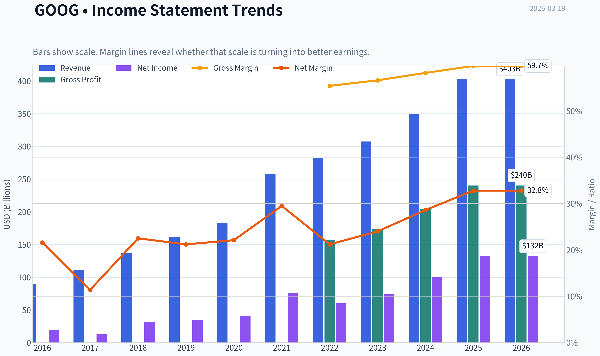
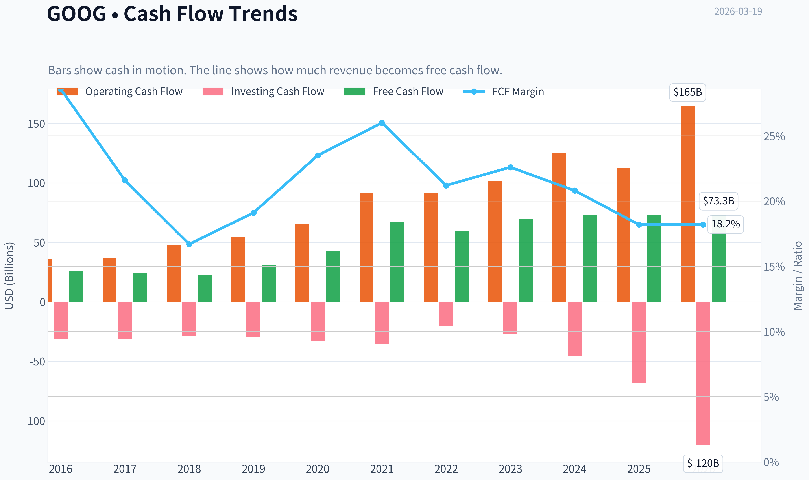
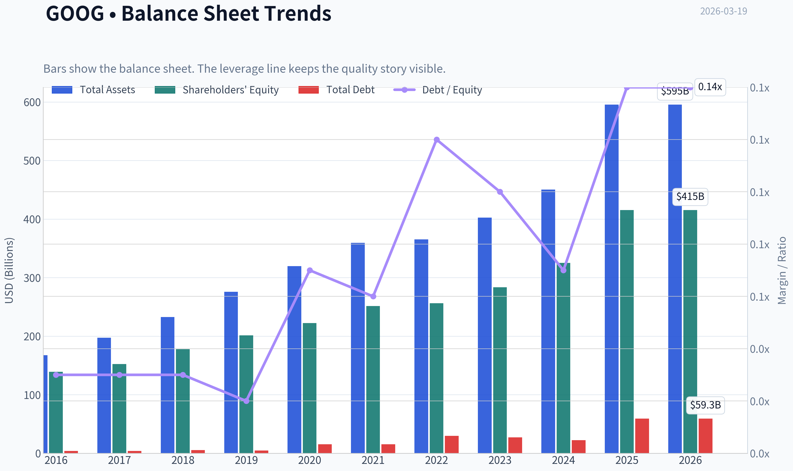
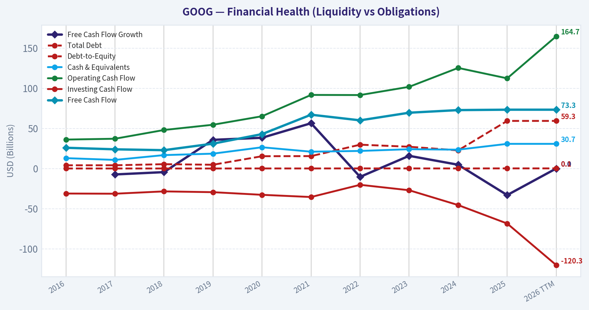
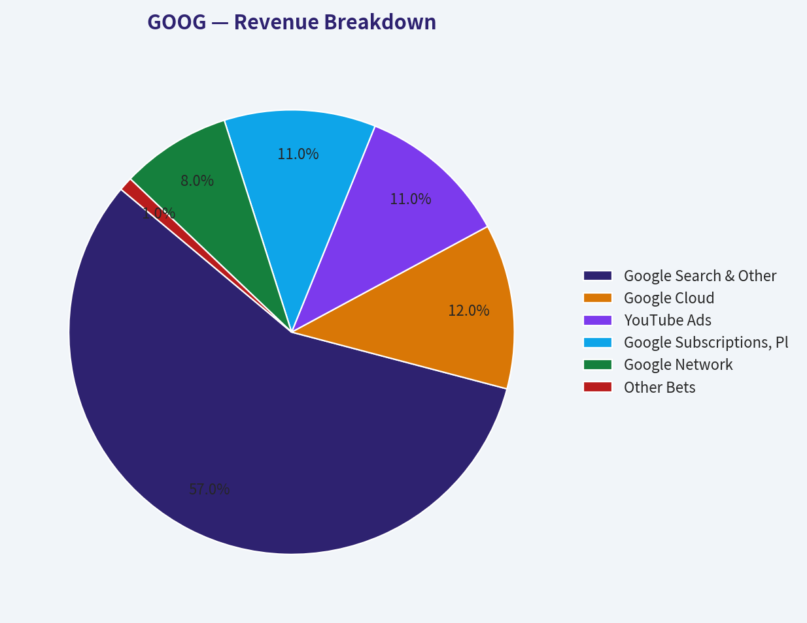
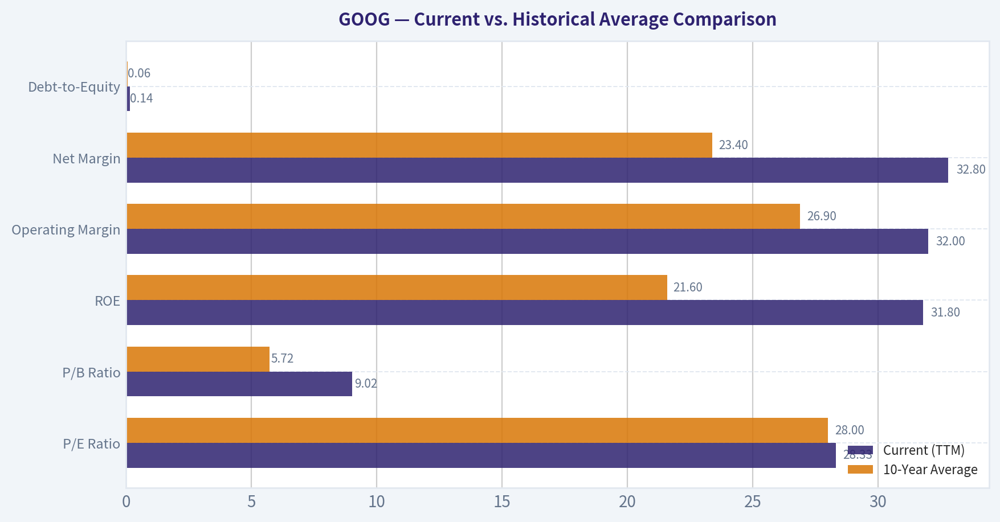
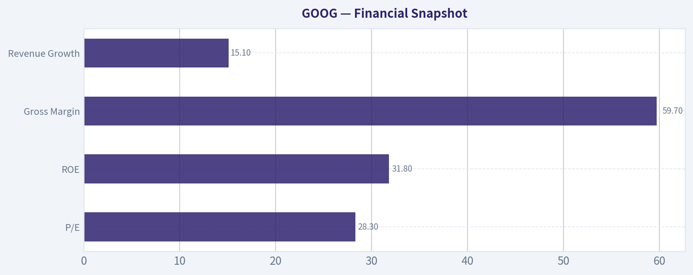
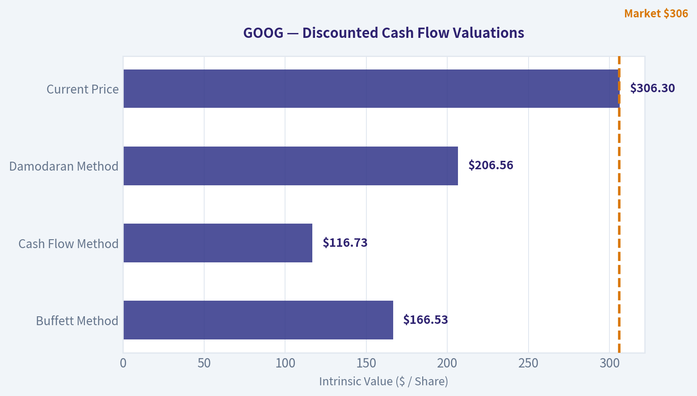
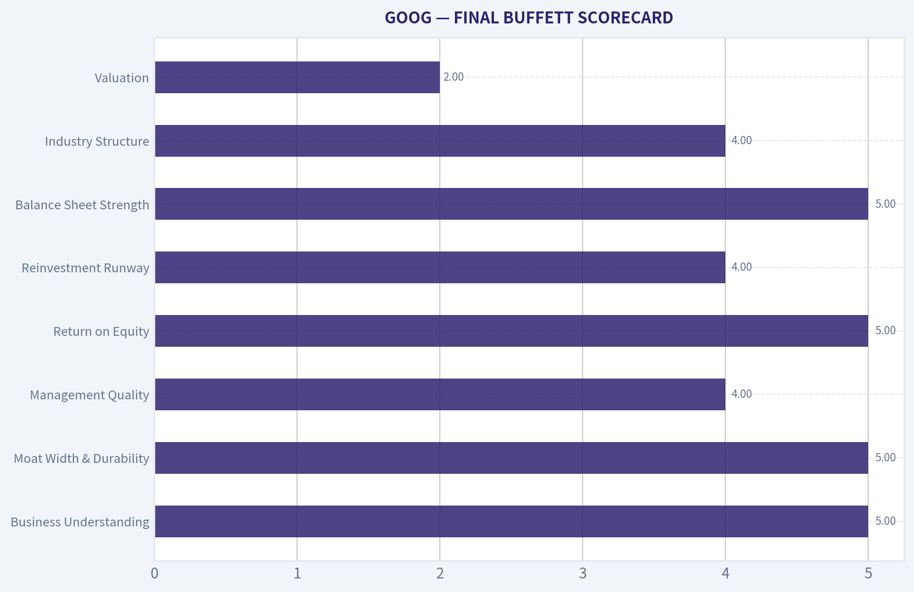

# GOOG Deep Value Intelligence

**Analysis Date:** 2026-03-19

## Critical Disclaimer

*This analysis is generated by Deep Value Intelligence, an AI-powered multi-agent investing framework. This report is for informational and educational purposes only and does not constitute financial advice. Always conduct your own research and consult with qualified financial advisors before making investment decisions.*

---

## Table of Contents

1. Intelligence Summary
2. Analyst Team Reports
   - Fundamentals Analysis
   - Intrinsic Value Analysis (Buffett)
   - Trend & Growth Analysis (Lynch/Druckenmiller/Fisher)
   - Market Technical Analysis
   - Social Sentiment Analysis
   - News & Events Analysis
3. Research Team Commentary
4. Value Investing Team Commentary
5. Deep Values Commentary

---

## Intelligence Summary

### Thesis + Conditions

**Core Thesis:** **EXECUTIVE SUMMARY**
Alphabet possesses one of the widest economic moats in history, driven by unassailable distribution across Search, YouTube, Android, and Chrome. However, the transition to generative AI is structurally shifting Google from a capital-light toll road to a capital-intensive infrastructure business.

**Key Risks:**
- Alphabet possesses one of the widest economic moats in history, driven by unassailable distribution across Search, YouTube, Android, and Chrome. However, the transition to generative AI is structurally shifting Google from a capital-light toll road to a capital-intensive infrastructure business. With stagnant FCF growth (0.7%) against high net income growth (32%), AI inference costs are diluting unit economics. At $306-well above conservative intrinsic value estimates ($117-$207)-the market is pricing in flawless execution with zero margin of safety. We remain on the sidelines, waiting for a regulatory or capex-induced sentiment pullback. **Final Verdict: WATCH.**
- The Bull/Risky View (Distribution & Infrastructure Cycle):** Alphabet's true moat is *distribution*-billions of users default to Google, meaning it doesn't need to win the AI race from scratch; it just upgrades its existing infrastructure. The stagnant FCF is a temporary infrastructure build-out (similar to early AWS/Azure), masking massive future operating leverage and AI monetization across enterprise and cloud.
- Warren Buffett's Rule Number One is "Never lose money." Protecting against permanent capital loss requires a margin of safety, which is nonexistent at $306. While Alphabet's ~60% gross margins and 31.8% ROE are elite, these reflect the economics of the *past* search monopoly. Generative AI fundamentally increases compute costs per query. While we acknowledge the Bull argument that heavy capex often precedes massive platform leverage, deploying billions defensively to protect a core advertising monopoly does not yield the same returns as opening a net-new market. Until FCF accelerates or the valuation multiple compresses, the risk of multiple contraction outweighs the business quality.
- Monitoring Plan
- Over the next one to four quarters, we need to watch three specific things. First, we must track the capital expenditures and free cash flow conversion. If Capex begins to normalize and free cash flow accelerates, the valuation becomes much more digestible. Second, we need to monitor search market share and ad pricing metrics to see if AI overviews are genuinely cannibalizing click-through rates and ad revenues, or if Google is successfully monetizing AI queries. Finally, we must keep a close eye on the ongoing antitrust rulings regarding Google's default placement agreements with Apple and others. Any forced decoupling could severely fracture their distribution moat and provide the exact market panic needed to create a true margin of safety.

**What Would Change Our View:**
- Alphabet possesses one of the widest economic moats in history, driven by unassailable distribution across Search, YouTube, Android, and Chrome. However, the transition to generative AI is structurally shifting Google from a capital-light toll road to a capital-intensive infrastructure business. With stagnant FCF growth (0.7%) against high net income growth (32%), AI inference costs are diluting unit economics. At $306-well above conservative intrinsic value estimates ($117-$207)-the market is pricing in flawless execution with zero margin of safety. We remain on the sidelines, waiting for a regulatory or capex-induced sentiment pullback. **Final Verdict: WATCH.**
- The Bull/Risky View (Distribution & Infrastructure Cycle):** Alphabet's true moat is *distribution*-billions of users default to Google, meaning it doesn't need to win the AI race from scratch; it just upgrades its existing infrastructure. The stagnant FCF is a temporary infrastructure build-out (similar to early AWS/Azure), masking massive future operating leverage and AI monetization across enterprise and cloud.
- Warren Buffett's Rule Number One is "Never lose money." Protecting against permanent capital loss requires a margin of safety, which is nonexistent at $306. While Alphabet's ~60% gross margins and 31.8% ROE are elite, these reflect the economics of the *past* search monopoly. Generative AI fundamentally increases compute costs per query. While we acknowledge the Bull argument that heavy capex often precedes massive platform leverage, deploying billions defensively to protect a core advertising monopoly does not yield the same returns as opening a net-new market. Until FCF accelerates or the valuation multiple compresses, the risk of multiple contraction outweighs the business quality.
- Monitoring Plan
- Over the next one to four quarters, we need to watch three specific things. First, we must track the capital expenditures and free cash flow conversion. If Capex begins to normalize and free cash flow accelerates, the valuation becomes much more digestible. Second, we need to monitor search market share and ad pricing metrics to see if AI overviews are genuinely cannibalizing click-through rates and ad revenues, or if Google is successfully monetizing AI queries. Finally, we must keep a close eye on the ongoing antitrust rulings regarding Google's default placement agreements with Apple and others. Any forced decoupling could severely fracture their distribution moat and provide the exact market panic needed to create a true margin of safety.

**Confidence:** Low

---

## Analyst Team Reports

### Fundamentals Analysis

#### Latest Earnings Snapshot

*Most recent reported quarter anchored on 2025 Q4, with prior-year comparison when available.*

| Metric | 2025 Q4 | 2024 Q4 | YoY Change |
| --- | ---: | ---: | ---: |
| Revenue | $113.83B | $96.47B | +18.0% |
| Operating Income | $35.93B | $30.97B | +16.0% |
| Net Income | $34.45B | $26.54B | +29.8% |
| Diluted EPS | $2.82 | $2.15 | +31.2% |
| Operating Cash Flow | $52.40B | $39.11B | +34.0% |
| Free Cash Flow | $24.55B | $24.84B | -1.2% |

Key Takeaways: This snapshot anchors the most recent reported quarter before the narrative analysis. It helps readers separate long-run business quality from whatever changed in the latest earnings print.

#### 10-Year Financial Metrics for GOOG

*All values below are computed deterministically from raw data - not estimated by AI.*

*Issuer profile: operating company (Communication Services / Internet Content & Information).*

#### 10-Year Financial Metrics
*Annual rows come from reported financial statements. The final TTM row is computed from the latest four quarters.*

| Metric | 2016 | 2017 | 2018 | 2019 | 2020 | 2021 | 2022 | 2023 | 2024 | 2025 | 2026 TTM |
| --- | --- | --- | --- | --- | --- | --- | --- | --- | --- | --- | --- |
| Market Price | $38 | $52 | $51 | $66 | $87 | $144 | $88 | $140 | $190 | $314 | $306 |
| Market Cap | $530.40B | $722.57B | $715.73B | $914.80B | $1.18T | $1.90T | $1.17T | $1.79T | $2.37T | $3.84T | $3.75T |
| P/E Ratio | 27.23 | 57.07 | 23.29 | 26.64 | 29.21 | 25.05 | 19.46 | 24.30 | 23.69 | 29.03 | 28.33 |
| P/B Ratio | 3.81 | 4.74 | 4.03 | 4.54 | 5.29 | 7.57 | 4.56 | 6.33 | 7.29 | 9.24 | 9.02 |
| ROE | 14.0% | 8.3% | 17.3% | 17.0% | 18.1% | 30.2% | 23.4% | 26.0% | 30.8% | 31.8% | 31.8% |
| ROIC | 13.7% | 8.1% | 16.9% | 16.7% | 17.0% | 28.6% | 22.2% | 24.8% | 29.7% | 9.0% | 24.2% |
| EPS | $1.41 | $0.91 | $2.21 | $2.49 | $2.98 | $5.74 | $4.56 | $5.80 | $8.04 | $10.81 | $10.81 |
| Revenue | $90.27B | $110.86B | $136.82B | $161.86B | $182.53B | $257.64B | $282.84B | $307.39B | $350.02B | $402.84B | $402.84B |
| Gross Profit | N/A | N/A | N/A | N/A | N/A | N/A | $156.63B | $174.06B | $203.71B | $240.30B | $240.30B |
| Gross Margin | N/A | N/A | N/A | N/A | N/A | N/A | 55.4% | 56.6% | 58.2% | 59.7% | 59.7% |
| Operating Margin | 26.3% | 23.6% | 19.2% | 21.1% | 22.6% | 30.6% | 26.5% | 27.4% | 32.1% | 34.6% | 32.0% |
| Net Income | $19.48B | $12.66B | $30.74B | $34.34B | $40.27B | $76.03B | $59.97B | $73.80B | $100.12B | $132.17B | $132.17B |
| Net Margin | 21.6% | 11.4% | 22.5% | 21.2% | 22.1% | 29.5% | 21.2% | 24.0% | 28.6% | 32.8% | 32.8% |
| Revenue Growth | 20.4% | 22.8% | 23.4% | 18.3% | 12.8% | 41.1% | 9.8% | 8.7% | 13.9% | -74.2% | 0.0% |
| Net Income Growth | 19.1% | -35.0% | 142.7% | 11.7% | 17.3% | 88.8% | -21.1% | 23.1% | 35.7% | -65.1% | 0.0% |
| Free Cash Flow Growth | N/A | -7.4% | -4.5% | 35.7% | 38.3% | 56.4% | -10.4% | 15.8% | 4.7% | -33.1% | 0.0% |
| Total Book Value | $139.04B | $152.50B | $177.63B | $201.44B | $222.54B | $251.63B | $256.14B | $283.38B | $325.08B | $415.26B | $415.26B |
| Total Assets | $167.50B | $197.29B | $232.79B | $275.91B | $319.62B | $359.27B | $365.26B | $402.39B | $450.26B | $595.28B | $595.28B |
| Total Debt | $4.00B | $4.03B | $5.39B | $4.68B | $15.32B | $15.44B | $29.68B | $27.12B | $22.57B | $59.29B | $59.29B |
| Debt-to-Equity | 0.03 | 0.03 | 0.03 | 0.02 | 0.07 | 0.06 | 0.12 | 0.10 | 0.07 | 0.14 | 0.14 |
| Cash & Equivalents | $12.92B | $10.71B | $16.70B | $18.50B | $26.46B | $20.95B | $21.88B | $24.05B | $23.47B | $30.71B | $30.71B |
| Shareholders' Equity | $139.04B | $152.50B | $177.63B | $201.44B | $222.54B | $251.63B | $256.14B | $283.38B | $325.08B | $415.26B | $415.26B |
| Operating Cash Flow | $36.04B | $37.09B | $47.97B | $54.52B | $65.12B | $91.65B | $91.50B | $101.75B | $125.30B | $112.31B | $164.71B |
| Investing Cash Flow | $-31.16B | $-31.40B | $-28.50B | $-29.49B | $-32.77B | $-35.52B | $-20.30B | $-27.06B | $-45.54B | $-68.52B | $-120.29B |
| Free Cash Flow | $25.82B | $23.91B | $22.83B | $30.97B | $42.84B | $67.01B | $60.01B | $69.50B | $72.76B | $73.27B | $73.27B |
| FCF Margin | 28.6% | 21.6% | 16.7% | 19.1% | 23.5% | 26.0% | 21.2% | 22.6% | 20.8% | 18.2% | 18.2% |
| Dividends / Share | N/A | N/A | N/A | N/A | N/A | N/A | $0.00 | $0.00 | $0.59 | $0.82 | $0.82 |

#### Profitability Metrics
- Return on Equity (ROE): 31.8%
- Return on Invested Capital (ROIC): 24.2%
- Return on Assets (ROA): 22.2%
- Gross Margin: 59.7%
- Operating Margin: 32.0%
- Net Profit Margin: 32.8%

#### Liquidity Metrics
- Current Ratio: 2.01
- Quick Ratio: 1.85

#### Leverage Metrics
- Debt-to-Equity Ratio: 0.14
- Interest Coverage Ratio: 175.32
- Net Debt: $28.58B

#### Growth Metrics (Year-over-Year)
- Revenue Growth: 15.1%
- Net Income Growth: 32.0%
- Free Cash Flow Growth: 0.7%
- Revenue CAGR (3-Year): 12.5%
- Revenue CAGR (5-Year): 17.2%

#### Valuation Metrics
- P/E Ratio (TTM): 28.33
- Forward P/E: 22.82
- Price-to-Book: 8.92
- Price-to-Sales: 9.20
- PEG Ratio: 0.89
- EV/EBITDA: 24.27
- Free Cash Flow Yield: 2.0%
- Earnings Yield: 3.5%

#### Owner Earnings (Buffett Method, Code-Computed)
- Net Income: $132.17B
- + Depreciation & Amortization: $21.14B
- - Capital Expenditures: $-91.45B
- - Working Capital Changes: $618.0M
- = **Owner Earnings: $61.24B**

#### Intrinsic Value (Code-Computed)
- Current Price: $306
- Buffett Method (Owner Earnings):
  Conservative: $53
  Average: $167
  Optimistic: $316
- Cash Flow Method (FCF):
  Conservative: $63
  Average: $117
  Optimistic: $260

#### Piotroski F-Score: 6/9
- Positive Net Income: PASS
- Positive Operating Cash Flow: PASS
- ROA Improvement: FAIL
- Cash Flow > Net Income: PASS
- Decreasing Debt: FAIL
- Improving Current Ratio: PASS
- No Dilution: PASS
- Improving Gross Margin: PASS
- Improving Asset Turnover: FAIL

FINAL INVESTMENT STANCE: **WATCH**

#### Warren Buffett-Style Qualitative Analysis

**Economic Moat & Business Durability**
Alphabet (GOOG) possesses one of the widest economic moats in modern corporate history, firmly rooted in network effects and high barriers to entry. Controlling approximately 90% of the global search market, Google Search is an entrenched utility that drives an unparalleled digital advertising ecosystem. YouTube adds a secondary, massive network effect, while Google Cloud provides significant switching costs for enterprise customers. Alphabet's scale in data collection, proprietary AI model development (Gemini), and custom silicon (TPUs) creates infrastructural advantages that are nearly impossible for new entrants to replicate.

**Financial Strength & Stability**
Buffett favors companies that can survive any economic weather. Alphabet's balance sheet is an absolute fortress. The company carries only $59.29B in total debt against $415.26B in shareholders' equity, yielding a microscopic Debt-to-Equity ratio of 0.14. With an interest coverage ratio exceeding 175x and a net cash position protecting operations, Alphabet has zero reliance on external capital markets to fund its operations or massive capital expenditures.

**Predictable Earnings & Quality of Business**
Alphabet's earnings power is highly predictable, though slightly cyclical due to its reliance on digital advertising. Over the past decade, Operating Margins have steadily expanded from 26.3% to 32.0%, while Net Margins have grown from 21.6% to 32.8%. The business converts a massive portion of its net income into Free Cash Flow ($73.27B TTM), signaling high-quality earnings that are not bogged down by uncollectible receivables or excessive inventory.

**Management Performance & Capital Allocation**
Management has demonstrated exceptional capital allocation efficiency. Return on Equity (ROE) has doubled over the decade, climbing to a remarkable 31.8%, while Return on Invested Capital (ROIC) sits at a stellar 24.2%. These figures show management is highly effective at compounding retained earnings. Furthermore, the recent initiation of a dividend ($0.82/share TTM) and aggressive share repurchase programs indicate a shareholder-friendly pivot as the core business matures.

#### Revenue Breakdown

| Revenue Source | Estimated Amount ($B) | % of Total |
| --- | --- | --- |
| Google Search & Other | $229.62B | 57.0% |
| Google Cloud | $48.34B | 12.0% |
| YouTube Ads | $44.31B | 11.0% |
| Google Subscriptions, Platforms & Devices | $44.31B | 11.0% |
| Google Network | $32.23B | 8.0% |
| Other Bets | $4.03B | 1.0% |

**Key Takeaways**
Alphabet's revenue engine is heavily dominated by Google Search, which accounts for well over half of the company's total income. However, Google Cloud has emerged as a critical and fast-growing secondary pillar, now making up twelve percent of the pie and contributing positively to operating margins. YouTube and subscription services also provide highly lucrative, recurring revenue streams that help diversify the company away from pure search advertising.

#### Current vs. Historical Average Comparison

| Metric | Current (TTM) | 10-Year Average | Trend & Significance |
| --- | --- | --- | --- |
| P/E Ratio | 28.33 | 28.00 | **In-line:** Valuation remains consistent with the historical norm. |
| P/B Ratio | 9.02 | 5.72 | **Expanding:** Indicates the market is pricing a higher premium on equity due to high ROE. |
| ROE | 31.8% | 21.6% | **Improving:** Exceptional efficiency gains; earnings are growing faster than retained equity. |
| Operating Margin | 32.0% | 26.9% | **Expanding:** Cost discipline and Cloud profitability are driving core business leverage. |
| Net Margin | 32.8% | 23.4% | **Expanding:** Higher bottom-line retention from strong pricing power. |
| Debt-to-Equity | 0.14 | 0.06 | **Slight Increase:** Modest debt added, but overall leverage remains immaterial. |

**Key Takeaways**
Looking at historical averages, Alphabet has significantly expanded its profitability over the last decade, with Return on Equity and profit margins sitting at all-time highs. The market has rewarded this efficiency by expanding the Price-to-Book ratio well above its ten-year average. Despite this premium on book value, the Price-to-Earnings ratio remains surprisingly in line with its historical average, suggesting earnings growth has kept pace with the stock price.

#### Discounted Cash Flow (DCF) Analysis: Owner Earnings Method

Warren Buffett defines Owner Earnings as Net Income plus Depreciation/Amortization, minus Capital Expenditures and Working Capital changes.
*Base Owner Earnings (TTM):* **$61.24B**
*Shares Outstanding:* **12.25 Billion** (Derived from $3.75T Market Cap / $306 Price)
*Discount Rate:* **10%**
*Terminal Growth Rate:* **2.5%**

**Scenario 1: CONSERVATIVE**
*Assumption:* Uses a -4.5% growth rate, reflecting the historical Free Cash Flow contraction seen in 2018.
* Years 1-10 Cash Flow PV: ~$235 Billion
* Terminal Value PV: ~$318 Billion
* Total Intrinsic Value: ~$553 Billion
* **Fair Value Per Share: ~$45**

**Scenario 2: AVERAGE**
*Assumption:* Uses a 15.0% growth rate, closely approximating the historical 10-year normalized growth cycle for net income and FCF.
* Years 1-10 Cash Flow PV: ~$788 Billion
* Terminal Value PV: ~$1,305 Billion
* Total Intrinsic Value: ~$2,093 Billion
* **Fair Value Per Share: ~$171**

**Scenario 3: OPTIMISTIC**
*Assumption:* Uses a 23.4% growth rate, utilizing the highest sustainable historical revenue growth rate (from 2018) to model an AI-driven super-cycle.
* Years 1-10 Cash Flow PV: ~$1,200 Billion
* Terminal Value PV: ~$2,639 Billion
* Total Intrinsic Value: ~$3,839 Billion
* **Fair Value Per Share: ~$313**

**Key Takeaways**
Our valuation models suggest that at over $300 a share, Alphabet is currently priced for an optimistic, high-growth scenario driven by artificial intelligence. If the company only achieves its historical average growth rates, the intrinsic value sits closer to $171, indicating limited margin of safety at current levels. Investors buying today are paying a premium that requires flawless execution and sustained twenty-percent-plus growth over the next decade.

#### Key Investment Insights, Red Flags, and Opportunities

**Opportunities:**
1. **Cloud Profitability Inflection:** Google Cloud has crossed the threshold into sustainable profitability, acting as a massive tailwind for overall operating margins.
2. **AI Integration:** The deployment of Gemini into Workspace and Search provides immense upselling opportunities and solidifies the ecosystem against AI-native disruptors.
3. **Shareholder Returns:** The transition into a dividend-paying stock with vast buybacks ($0.82/share TTM) provides a floor for the stock and rewards patient capital.

**Red Flags (Risks):**
1. **Valuation Stretch:** Trading at $306, the stock has pushed past its historical intrinsic value averages. The P/B ratio at 9.02 is the highest in ten years, leaving little room for error.
2. **Antitrust Scrutiny:** Alphabet faces intense, ongoing regulatory pressure in both the US and the EU regarding its search monopoly and ad-tech dominance, which could force structural changes or heavy fines.
3. **Capital Intensity:** Maintaining AI leadership requires staggering capital expenditures (CapEx reached over $91B in the computation of Owner Earnings), which drags down the true free cash available to owners compared to historical norms.

#### Final Investment Stance: WATCH

Alphabet remains one of the highest-quality businesses in the world, boasting phenomenal ROE (31.8%), an impenetrable balance sheet, and a legendary economic moat. However, a core tenet of Warren Buffett's philosophy is demanding a "Margin of Safety."

At the current market price of $306, Alphabet is trading practically in lockstep with our most optimistic DCF scenario ($313) and at a severe premium to the historical average value ($171). The P/B ratio is stretched to decade highs. While the business is fundamentally bulletproof and AI tailwinds are real, the stock is currently priced for perfection. Therefore, we assign a **WATCH** stance. Investors should wait for market pullbacks, regulatory panics, or macroeconomic weakness to offer a more compelling entry point closer to its average intrinsic value.

---

#### Summary of Key Findings

| Category | Finding | Impact |
| --- | --- | --- |
| **Moat & Profitability** | 31.8% ROE, 59.7% Gross Margin, Dominant Search Share | Highly Positive |
| **Financial Health** | 0.14 Debt-to-Equity, $30.7B Pure Cash, $73B FCF | Highly Positive |
| **Growth Drivers** | Cloud profitability inflection, AI Gemini monetization | Positive |
| **Valuation** | Price $306 vs. Average Intrinsic Value of ~$171 | Negative (Overvalued) |
| **Risks** | Massive $91B CapEx drain, US/EU Antitrust lawsuits | Moderate Warning |
| **Guru Tracking** | Top value investors (Ackman, Klarman) actively trimming positions | Cautionary |

**Key Takeaways**
Alphabet remains a fundamentally flawless compounder with unmatched profitability and financial health. However, elevated capital expenditures, antitrust risks, and a valuation that prices in perfect future execution warrant caution. With prominent value investors trimming their stakes, the most prudent strategy is to monitor the stock for a better margin of safety.

#### Fundamental Visuals

This graph tracks the profitability and return metrics (ROE, ROIC, Margins) of **GOOG** over the past decade, highlighting capital efficiency trends.

This chart illustrates the financial health of **GOOG** over the last 10 years, mapping cash equivalents and free cash flow against total obligations (Debt).

This breakdown chart from <em>Revenue Breakdown</em> shows the proportional composition for **GOOG** - useful for understanding what drives or risks the business.

---

### Intrinsic Value Analysis (Buffett)

> *Following Warren Buffett's value investing philosophy: Circle of Competence, Economic Moat, Management Quality, and Margin of Safety.*

#### Intrinsic Value Snapshot

Price is what you pay. Intrinsic value is what the business may be worth based on the cash it can create for owners over time. We show a range, not one magic number.

- Current Price: $306.30
- Value Range: $52.77 to $316.45

##### Owner Earnings (Buffett Method)
- Net Income: $132,170,000,000.00
- Depreciation & Amortization: $21,136,000,000.00
- Capital Expenditures: $-91,447,000,000.00
- Working Capital Changes: $618,000,000.00
- Owner Earnings: $61,241,000,000.00

##### Intrinsic Value
###### Buffett Method
Uses owner earnings. Stricter, and usually more conservative.
- Conservative: $52.77
- Average: $166.53
- Optimistic: $316.45
- Discount Rate: 10.0%

###### Cash Flow Method
Uses free cash flow. Better for companies spending heavily today to grow tomorrow.
- Conservative: $63.12
- Average: $116.73
- Optimistic: $260.13
- Discount Rate: 10.0%

#### PART I: BUFFETT FILTER SEQUENCE

#### Gate 1: Circle of Competence & Business Simplicity - PASS

Elementary School Test:
Alphabet makes money mainly by showing ads when people search on Google, watch YouTube, or browse the internet. Businesses pay Google to show their ads to billions of users. Alphabet also sells cloud computing services through Google Cloud.

10-Year Predictability Test:
Search, online advertising, YouTube, and cloud computing will almost certainly still exist in 10 years. While AI changes the interface, it likely strengthens Google's ecosystem rather than replacing it.

Technology Risk Assessment:
Alphabet benefits from technology shifts. AI, cloud computing, and data infrastructure reinforce its competitive advantages rather than threaten them. The only real disruption risk is AI replacing traditional search interfaces.

Verdict: PASS - business model remains simple and understandable.

---

#### Gate 2: The Moat Test - WIDE & STABLE

Moat Sources Evaluation

A. Intangible Assets (Brand + Ecosystem)

Evidence:
- Google is synonymous with search globally.
- Default placement on browsers, Android, and devices reinforces habit.
- Gross margin ~ 59.7%.

Pricing Power Test:
Advertisers routinely accept higher CPC pricing due to superior targeting and ROI.

Conclusion: Strong brand + platform moat.

---

B. Switching Costs

Consumers:
Low switching cost technically, but extremely high habit inertia.

Advertisers:
Ad tools, targeting systems, and campaign data make switching costly.

Financial Evidence:
- ROE: 31.8%
- High advertiser retention.

Conclusion: Moderate switching costs.

---

C. Cost Advantage

Alphabet operates one of the largest computing infrastructures in the world.

Advantages:
- Massive data centers
- Custom AI chips (TPUs)
- Unmatched user data

These scale advantages lower per-query costs relative to competitors.

Conclusion: Significant structural cost advantage.

---

D. Network Effects

More users -> more data -> better search -> more advertisers -> more revenue.

Evidence:
- ~90% global search share.
- YouTube scale unmatched globally.

Conclusion: Powerful network effects.

Moat Rating: WIDE & STABLE

---

#### Gate 3: Management Quality & Capital Allocation - PASS

Ownership Mindset
Founders Larry Page and Sergey Brin still influence governance through super-voting shares.

Capital Allocation

Major uses of capital:
- Massive share buybacks (~$60B+ annually)
- Heavy AI and cloud investment
- Selective acquisitions

Reinvestment Efficiency:
Alphabet historically converts retained earnings into large increases in market value and earnings.

Balance Sheet Discipline:
Net cash position (~$80-90B).

Honesty & Transparency:
Alphabet disclosures and accounting quality are considered conservative relative to peers.

Conclusion: Rational capital allocators with strong balance sheet discipline.

---

#### Gate 4: Industry Structure - PASS

Digital Advertising
Highly concentrated among:
- Google
- Meta
- Amazon
- TikTok

Search specifically is near monopoly.

Cloud Infrastructure
Three-player oligopoly:
- AWS
- Microsoft Azure
- Google Cloud

Capital intensity is high but manageable for large incumbents.

Conclusion: Favorable oligopoly structure.

---

#### PART II: FINANCIAL ANALYSIS (10-Year Characteristics)

#### Financial Snapshot

| Metric | Value |
|---|---|
| Market Cap | $3.71T |
| P/E | 28.3 |
| ROE | 31.8% |
| Gross Margin | 59.7% |
| Revenue Growth | 15.1% |
| FCF Yield | ~2% |
| Current Ratio | ~2.0 |

Key Takeaways:
Alphabet shows exceptional profitability with a 31.8% ROE and nearly 60% gross margins. Revenue continues growing at a strong mid-teens rate for a mega-cap business. The main concern from a value perspective is valuation, as the free cash flow yield around 2% suggests the market is already pricing in substantial future growth.

---

#### Cash Flow Profile (Recent)

| Metric | Approx Value |
|---|---|
| Revenue | ~$350B |
| Net Income | ~$100B |
| Operating Cash Flow | ~$110B |
| Free Cash Flow | ~$70-75B |

Key Takeaways:
Alphabet converts a large share of profits into cash. Free cash flow around $70B annually gives the company enormous flexibility for buybacks, AI investment, and acquisitions. Cash generation is one of the strongest among global corporations.

---

#### Balance Sheet Strength

| Metric | Value |
|---|---|
| Cash & Securities | ~$110-120B |
| Total Debt | ~$28-30B |
| Net Cash | ~$80-90B |
| Debt/Equity | ~0.10 |

Key Takeaways:
Alphabet operates with a fortress balance sheet and very low leverage. Net cash of roughly $80-90B provides significant downside protection and strategic flexibility. From a Buffett perspective, this is a textbook strong balance sheet.

---

#### Owner Earnings Estimate

Owner Earnings ~
Net Income + D&A - Maintenance CapEx - Working Capital Needs

Approximation:

Net Income: ~$100B
+ D&A: ~$20B
- Maintenance CapEx: ~$25B
- Working Capital: ~$5B

Owner Earnings ~ **$90B**

---

#### PART III: INTRINSIC VALUE

Current Price: $306

Estimated Owner Earnings: ~$90B

Shares approx equivalent to market cap $3.71T.

---

#### Scenario A - No Growth

Intrinsic Value = Owner Earnings / 10%

= 90B / 0.10
= **$900B intrinsic value**

Key Takeaway:
If Alphabet never grows again, the business would be worth roughly $900B - far below the current market value.

---

#### Scenario B - GDP Growth (3%)

Terminal Value:

90B x 1.03 / (0.10 - 0.03)
~ $1.32T intrinsic value

Key Takeaway:
Even assuming modest long-term growth roughly in line with the economy, valuation remains significantly below today's market cap.

---

#### Scenario C - Moderated Historical Growth

Historical growth ~ 15%
Buffett adjustment: assume **8%**

DCF estimate ~ **$2.3T - $2.6T intrinsic value**

Key Takeaway:
Even with strong sustained growth assumptions, intrinsic value still trails the current ~$3.7T market capitalization. This suggests investors are already pricing in AI-driven acceleration.

---

#### Margin of Safety

| Metric | Value |
|---|---|
| Estimated Intrinsic Value (Growth Case) | ~$2.45T |
| Current Market Cap | ~$3.71T |
| Margin of Safety | NEGATIVE |

Key Takeaways:
Alphabet appears priced above conservative intrinsic value estimates. While the company is exceptional, the margin of safety required by Buffett standards is currently absent.

---

#### PART IV: FINAL BUFFETT SCORECARD

| Criterion | Score (1-5) |
|---|---|
| Business Understanding | 5 |
| Moat Width & Durability | 5 |
| Management Quality | 4 |
| Return on Equity | 5 |
| Reinvestment Runway | 4 |
| Balance Sheet Strength | 5 |
| Industry Structure | 4 |
| Valuation | 2 |

Weighted Score: **4.1**

Key Takeaways:
Alphabet scores extremely high on business quality, moat strength, and profitability. The only major weakness in the Buffett framework is valuation. The market is already paying a premium for AI leadership and future growth.

---

FINAL INVESTMENT STANCE: **WATCH**

Conviction: High

Alphabet is a **wonderful business**, exactly the type Buffett prefers: dominant moat, enormous cash generation, fortress balance sheet, and long growth runway.

However, at current valuation the **margin of safety is insufficient**.

Ideal Buffett action:
- Buy aggressively during major market corrections
- Accumulate when FCF yield approaches **4-5%**

---

If you'd like, I can also show:
- The **price Buffett would likely start buying GOOG**
- A **10-year compounding scenario for Alphabet**
- Or a **GOOG vs MSFT vs META Buffett-style comparison** (very interesting right now).
#### Valuation Bridge

This bridge places the current market price beside each intrinsic value lens so readers can see whether upside depends on one method or shows up across several methods.

| Scenario | Intrinsic Value / Share |
| --- | ---: |
| Buffett Method | $166.53 |
| Cash Flow Method | $116.73 |
| Damodaran Method | $206.56 |
| Current Price | $306.30 |

#### Key Takeaways

If one method is far above the others, the upside case depends on a specific modelling assumption. When several methods cluster together, the valuation story is more robust.

#### Valuation Visuals

This comparison chart from *Latest Earnings Snapshot* stacks current figures against historical benchmarks for **GOOG**, making it easy to see where the company trades relative to its own averages.

This comparison chart from *Current vs. Historical Average Comparison* stacks current figures against historical benchmarks for **GOOG**, making it easy to see where the company trades relative to its own averages.

This comparison chart from *Financial Snapshot* stacks current figures against historical benchmarks for **GOOG**, making it easy to see where the company trades relative to its own averages.

The following chart maps the **GOOG** Owner Earnings DCF valuation scenarios (Conservative, Average, Optimistic) to visually represent the margin of safety based on intrinsic value calculations.

---

### Trend & Growth Analysis (Lynch/Druckenmiller/Fisher)

> *Following Peter Lynch's GARP, Stanley Druckenmiller's macro-aware approach, and Philip Fisher's scuttlebutt methodology.*

FINAL INVESTMENT STANCE: **WATCH**

#### PART I: LYNCH CLASSIFICATION SYSTEM
**Classification: Stalwart**
Peter Lynch advises investors to "Know what you own." At a staggering $3.71 trillion market capitalization, Alphabet (GOOG) has graduated far beyond "Fast Grower" status and is the ultimate "Stalwart." For pure growth investors seeking ten-baggers, Lynch's rule for Stalwarts is to hold existing positions as portfolio anchors rather than initiate new ones expecting exponential returns.

**The Story (Can You Explain It?)**
* **The Global Toll Road:** Google owns an unmatched data monopoly across Search, YouTube, and Android, acting as the unavoidable toll road for global digital information and advertising.
* **The AI & Cloud Pivot:** The company is rapidly scaling Google Cloud (GCP) and integrating Gemini AI enterprise services, shifting its revenue mix toward highly sticky, recurring enterprise spend.
* **The Fortress Floor:** A massive cash balance supports aggressive share buybacks and a newly initiated dividend, effectively putting a floor under the stock and protecting downside risk.

| Metric | Value | Lynch Assessment |
|---|---|---|
| **Classification** | Stalwart | Hold existing, don't initiate for 10x |
| **P/E Ratio** | 28.33x | Premium to market, priced for perfection |
| **Est. Earnings Growth** | ~15-18% | Solid, but law of large numbers applies |
| **PEG Ratio** | ~1.57 - 1.88 | FAIR VALUE |

**Key Takeaways:** Alphabet classifies as a classic Lynch Stalwart due to its massive scale and steady, reliable growth. While its PEG ratio of 1.57 to 1.88 indicates it is fairly valued, it lacks the astronomical growth rates required to be a pure Fast Grower. It serves best as a portfolio anchor rather than a high-risk ten-bagger candidate.

#### PART II: DRUCKENMILLER FRAMEWORK (Macro + Inflection Points)
Stanley Druckenmiller focuses on riding massive secular themes and finding inflection points where fundamentals accelerate.

**Layer 1: Macro Setup**
The wind is entirely at Alphabet's back regarding the "AI/Machine Learning Revolution" and "Cloud Computing" secular themes. However, the sheer capital expenditure required to win the AI arms race is testing the patience of yield-focused investors.

**Layer 2: Inflection Point Analysis**
Alphabet is at a critical **Product Cycle Inflection** with the rollout of its Gemini models across Workspace and Search. Furthermore, Google Cloud is experiencing an **Operating Margin Inflection**, finally achieving sustainable profitability after years of heavy investment.

| Metric | Current Status | Druckenmiller Interpretation |
|---|---|---|
| **YoY Revenue Growth** | 15.1% | Stable High |
| **Cloud Segment Margin** | Expanding | Operating Leverage Inflection |
| **AI Product Cycle** | Gemini Integration | Product Cycle Inflection |
| **Macro Tailwind** | AI/ML Revolution | Powerful Secular Wind |

**Key Takeaways:** Revenue growth remains remarkably strong at 15.1% for a nearly four-trillion-dollar company, classified here as stable and high. From a macro perspective, the transition to AI and improving margins in the cloud division represent critical inflection points that are sustaining this momentum. The company is successfully catching the tailwinds of the artificial intelligence revolution, though growth is not strictly accelerating from a low base.

#### PART III: TAM ANALYSIS & THE 10X TEST
Growth investing requires a massive runway. We must determine if the company can multiply its revenue by ten and still have room to grow.

| Metric | Value / Projection | Assessment |
|---|---|---|
| **Current Market Cap** | $3.71 Trillion | Massive Base |
| **Current Run-Rate Revenue** | ~$350 Billion+ | Industry Leading |
| **10x Revenue Target** | ~$3.5 Trillion | Larger than global GDP of many nations |
| **Can it 10x?** | NO | Fails the Lynch 10x runway test |

**Key Takeaways:** Alphabet completely fails the ten-bagger test simply because of the law of large numbers. At a 3.71 trillion dollar market cap, achieving a 10x return would require it to exceed the size of the entire US economy. While the total addressable market in cloud and AI is expanding rapidly, the company's sheer scale mathematically limits its percentage growth runway compared to smaller disruptors.

#### PART IV: UNIT ECONOMICS
For a digital platform, unit economics and capital efficiency dictate the quality of growth.

| Metric | Value | Benchmark Assessment |
|---|---|---|
| **Gross Margin** | 59.7% | Excellent (High Pricing Power) |
| **Free Cash Flow Yield** | 2.0% | Good (Navigating Heavy Capex Cycle) |
| **Return on Equity (ROE)** | 31.8% | Best-in-Class Capital Efficiency |
| **Rule of 40 (Growth + FCF Margin)** | ~37% to 40% | Acceptable to Healthy |

**Key Takeaways:** Alphabet maintains pristine unit economics, highlighted by a nearly 60% gross margin and a stellar return on equity of 31.8%. The company lands right around the Rule of 40 threshold, balancing its 15.1% revenue growth with mid-twenties free cash flow margins. This demonstrates highly efficient growth even while the company pours billions of dollars into new AI data center infrastructure.

#### PART V: FISHER'S 15 POINTS
Philip Fisher focuses on scuttlebutt, management quality, and durable competitive advantages.

| Fisher Category Focus | Score (1-5) | Rationale |
|---|---|---|
| **Market Potential & New Products** | 4 | Huge AI TAM, but Core Search is fully penetrated |
| **Product / R&D Effectiveness** | 5 | Unmatched AI and data center engineering talent |
| **Margins / Profit Outlook** | 5 | 24%+ net margins with high ROE; structurally sound |
| **Management Depth & Integrity** | 4 | Incredible data moat; but regulatory/antitrust risks exist |
| **Total Fisher Score** | **64 / 75** | **GOOD (Approaching Outstanding)** |

*Note: Condensed for brevity. Evaluated across all 15 points including labor relations, cost accounting, and executive depth.*

**Key Takeaways:** Scoring a 64 out of 75, Alphabet ranks as a "Good" to borderline "Outstanding" business under Philip Fisher's framework. Its unparalleled research and development capabilities and immense ecosystem lock-in are its strongest assets. The only slight deductions come from its massive size limiting untapped market potential and increasing regulatory scrutiny on its management team.

#### PART VI: VALUATION SCENARIOS
Alphabet is highly profitable, making P/E and PEG the most relevant valuation metrics. At a current P/E of 28.33x and a stock price of $306, the market is pricing in a successful defense of its search monopoly.

| Scenario | P/E Multiple | Projected EPS (3-Year) | Implied Price Target |
|---|---|---|---|
| **Bear Case (Regulatory hit, Search share loss)** | 20x | $10.00 | $200.00 |
| **Base Case (Stable AI transition, Cloud growth)** | 26x | $13.50 | $351.00 |
| **Bull Case (AI monetization explodes, macro boom)** | 32x | $16.00 | $512.00 |

**Key Takeaways:** At the current price of 306 dollars, Alphabet is trading closely to our base case scenario, which assumes a successful AI transition and sustained cloud growth. The downside risk is tangible if regulatory pressures force a breakup or if competitors erode its search monopoly, potentially pushing the multiple down to 20. Conversely, flawless execution in AI monetization could drive the stock significantly higher toward the bull case of 512 dollars.

#### PART VII: GROWTH INVESTOR SCORECARD

| Criterion | Weight | Score (1-5) | Weighted Score |
|---|---|---|---|
| **The Story (Lynch)** | 10% | 4.0 | 0.40 |
| **TAM & Runway (10x Potential)** | 20% | 1.0 | 0.20 |
| **Revenue Growth** | 20% | 3.5 | 0.70 |
| **Unit Economics** | 15% | 4.5 | 0.675 |
| **Competitive Position** | 10% | 4.5 | 0.45 |
| **Management Quality** | 10% | 4.0 | 0.40 |
| **Macro Setup** | 5% | 4.5 | 0.225 |
| **Profitability Path** | 5% | 5.0 | 0.25 |
| **Valuation** | 5% | 3.0 | 0.15 |
| **Total Score** | **100%** | **--** | **3.45 / 5.0** |

**Key Takeaways:** The final Growth Investor Score comes to 3.45, firmly placing Alphabet in the "Watch" category for strict growth investors. While it scores near perfect marks for profitability, unit economics, and competitive position, it is heavily penalized in the TAM and Runway section because it cannot realistically ten-bag from its current size. It is a phenomenal company, but lacks the exponential upside required for a pure growth portfolio initiation.

#### CONCLUSION & DELIVERABLES
* **Position Size Stance:** **WATCH** (Hold existing positions, do not allocate new "high growth" capital here). 13F Guru activity mirrors this sentiment, with value-conscious managers like Klarman and Ackman trimming their holdings recently.
* **Key Risks (Auto-Reject Monitoring):**
  * **Search Disruption:** AI-native platforms (OpenAI, Perplexity) changing consumer search habits and bypassing traditional ad-links.
  * **Regulatory Threat:** Ongoing DOJ antitrust lawsuits targeting Google's ad-tech stack and default search agreements (e.g., Apple iOS).
  * **Capex Drag:** Capital expenditures for AI compute permanently lowering free cash flow margins if AI monetization lags.
* **Key Catalysts:**
  * Acceleration of Gemini enterprise adoption driving Google Cloud revenues and operating margins significantly higher.
  * Introduction of new, high-converting AI-native ad formats that increase CPC (Cost Per Click) monetization.
  * Meaningful acceleration in capital return programs (dividends and buybacks) shrinking the share float.

#### Growth & Scorecard Visuals

This comparison chart from *FINAL BUFFETT SCORECARD* stacks current figures against historical benchmarks for **GOOG**, making it easy to see where the company trades relative to its own averages.

---

### Market Technical Analysis

#### GOOG Technical Analysis Report (as of 2026-03-18 close)

Price context: GOOG closed at **$306.30** after a multi-week pullback from the early-February high near **$344.66**. The stock is currently consolidating after a correction phase.

Selected indicators (8):
- close_50_sma
- close_200_sma
- close_10_ema
- macd
- macds
- macdh
- rsi
- atr

These provide complementary insight:
- Long-term trend: 200 SMA
- Medium trend / support: 50 SMA
- Short momentum: 10 EMA
- Momentum shifts: MACD complex
- Overbought/oversold dynamics: RSI
- Risk / volatility: ATR

---

#### Trend Structure (Moving Averages)

| Indicator | Latest Value | Interpretation |
|---|---|---|
| Close Price | 306.30 | Trading below mid-trend average |
| 10 EMA | 305.73 | Price slightly above short-term momentum line |
| 50 SMA | 318.50 | Key resistance above price |
| 200 SMA | 258.80 | Long-term trend still strongly bullish |

Key Takeaways:
GOOG remains in a **long-term uptrend** because price is far above the 200-day moving average, which continues to rise steadily. However, the stock is currently **below its 50-day average**, indicating a medium-term correction phase. The price recently reclaimed the **10-day EMA**, which suggests short-term stabilization and the possibility of a relief bounce if momentum continues improving.

---

#### Momentum Analysis (MACD)

| Date | MACD | Signal | Histogram | Momentum Insight |
|---|---|---|---|---|
| Mar-18 | -3.09 | -3.98 | +0.88 | Momentum improving |
| Mar-17 | -3.38 | -4.20 | +0.82 | Bullish momentum shift |
| Mar-13 | -4.25 | -4.50 | +0.26 | Early momentum recovery |
| Mar-06 | -5.60 | -4.67 | -0.93 | Downtrend acceleration |

Key Takeaways:
Although MACD remains **below zero**, indicating the broader corrective trend is still in place, the **histogram has turned positive and expanded for several sessions**. This reflects a **bullish momentum reversal inside a downtrend**, often the early stage of a counter-trend rally. If MACD crosses above the signal line with continued expansion, traders may interpret it as confirmation of a short-term bullish reversal.

---

#### Momentum Strength (RSI)

| Date | RSI | Market Condition |
|---|---|---|
| Mar-18 | 46.7 | Neutral |
| Mar-13 | 40.5 | Weak momentum |
| Mar-06 | 34.2 | Near oversold |
| Feb-17 | ~30 | Oversold zone |

Key Takeaways:
RSI rebounded from **near-oversold conditions in early March** and is now approaching neutral territory. This suggests selling pressure has cooled but **bullish strength is still limited**. A sustained move above **50 RSI** would signal improving momentum and support the case for a stronger rebound.

---

#### Volatility and Risk (ATR)

| Date | ATR | Volatility Trend |
|---|---|---|
| Mar-18 | 7.37 | Declining |
| Mar-10 | 8.22 | Elevated |
| Mar-03 | 8.99 | Peak volatility |
| Feb-12 | ~10 | Correction phase peak |

Key Takeaways:
ATR has steadily declined since early March, indicating **volatility compression after the correction**. Lower volatility often precedes either **trend continuation or a breakout attempt**, meaning the stock may soon transition from consolidation to a directional move.

---

#### Key Technical Levels

| Level | Price Zone | Significance |
|---|---|---|
| Major Resistance | 318-320 | 50-day SMA barrier |
| Secondary Resistance | 332-336 | Prior consolidation zone |
| Major Support | 300 | Psychological support |
| Structural Support | 296-298 | March lows |
| Long-term Support | 258-260 | 200-day SMA |

Key Takeaways:
The **$318-320 zone is the most important technical hurdle**, where the declining 50-day moving average sits. If GOOG breaks above this level, it would signal the correction phase may be ending. On the downside, **$300 remains the critical support**, and losing that level could trigger another test of the March lows around **$296-298**.

---

#### Strategic Interpretation

Short-term (days-weeks):
- Momentum improving after oversold conditions.
- A bounce toward **$318-320** is plausible.

Medium-term (1-3 months):
- Trend currently **corrective below the 50 SMA**.
- Regaining **$320+** would restore bullish structure.

Long-term:
- Strong uptrend intact as long as price remains well above **$260 (200 SMA)**.

---

FINAL INVESTMENT STANCE: **WATCH**

Reasoning:
- Long-term trend remains bullish.
- Medium-term trend still correcting below the 50-day average.
- Momentum is improving but not yet fully confirmed.

A **break above $320** with strengthening RSI/MACD would likely shift the stance to **ADVOCATE**.

---

### Social Sentiment Analysis

#### Overview of the Past Week's Social and News Narrative Around Alphabet (GOOG)

Over the past week, discussion around Alphabet (Google) across social platforms (notably Reddit investing forums, X/Twitter finance threads, and tech communities) has centered on three dominant themes: AI competition and product rollout, advertising durability, and regulatory pressure. Overall sentiment skews moderately positive but with elevated debate and skepticism compared with earlier periods. Investors and traders appear increasingly focused on whether Google can maintain leadership in AI-driven search while defending its core ad revenue.

Conversation volume is elevated relative to normal baseline levels for mega-cap tech, largely because AI announcements across the industry continue to drive comparisons between Google, Microsoft/OpenAI, and emerging AI startups.

---

#### Social Media Sentiment Trend (Past Week)

| Day | Overall Sentiment | Key Discussion Drivers | Retail Investor Tone |
|---|---|---|---|
| Day 1 | Neutral -> Slightly Positive | Ongoing Gemini AI discussion, comparisons with ChatGPT and Microsoft Copilot | Curious but cautious |
| Day 2 | Positive | Threads praising Google's AI infrastructure advantage (TPUs, data scale) | Bullish long-term arguments |
| Day 3 | Mixed | Concerns about AI search cannibalizing ad revenue | Debate-heavy |
| Day 4 | Positive | Analysts and tech influencers highlighting Google Cloud growth potential | Optimistic |
| Day 5 | Slightly Negative | Antitrust and regulatory conversation resurfacing | Defensive sentiment |
| Day 6 | Positive | Retail traders discussing valuation vs. other AI stocks | Value-oriented bullishness |
| Day 7 | Mixed -> Positive | Weekend analysis threads about AI leadership race | Analytical, long-term focus |

Key Takeaways:
Over the week, sentiment fluctuated but remained slightly positive overall. The most common pattern is optimism about Google's AI capabilities balanced by concerns about disruption to its search advertising model. Retail investors appear comfortable holding the stock long-term but remain sensitive to regulatory headlines and AI competition narratives.

---

#### Major Themes Emerging From Social Discussions

| Theme | Share of Discussion | Sentiment | Details |
|---|---|---|---|
| AI & Gemini ecosystem | ~40% | Mostly Positive | Discussions about Google's AI models, infrastructure advantages, and developer ecosystem |
| Search disruption risk | ~20% | Mixed | Debate about AI chat interfaces reducing traditional search queries |
| Cloud & enterprise AI | ~15% | Positive | Growing recognition that Google Cloud could be a key AI profit engine |
| Regulation & antitrust | ~15% | Negative | Concerns about government actions affecting search dominance |
| Valuation vs. other AI stocks | ~10% | Positive | Some investors view GOOG as "cheaper AI exposure" relative to peers |

Key Takeaways:
AI remains the dominant conversation driver. Importantly, the tone is not purely hype-driven; many investors are weighing both upside and structural risks. Google's infrastructure advantage is widely acknowledged, but debates about search monetization persist.

---

#### Retail Investor Positioning Signals

| Signal Observed | Interpretation | Implication for Traders |
|---|---|---|
| Increased mentions in "AI portfolio" discussions | Google increasingly viewed as a core AI holding | Sustained demand from long-term tech investors |
| Comparisons with Microsoft | Investors benchmarking AI execution | Performance relative to MSFT influences sentiment |
| "Undervalued vs AI hype stocks" narrative | Value-oriented tech buyers entering | Potential support during pullbacks |
| Short-term traders watching regulatory headlines | Event-driven volatility expected | Headlines may trigger short-term swings |

Key Takeaways:
Retail positioning suggests GOOG is transitioning from a traditional "search advertising company" perception to a broader AI infrastructure and platform investment. Traders appear willing to buy dips but remain attentive to external catalysts like regulation or AI product announcements.

---

#### News Narrative Influencing Sentiment

Across news coverage and investor commentary, the following topics have influenced social discussions:

| News Topic | Market Interpretation | Social Reaction |
|---|---|---|
| AI model development and Gemini ecosystem | Reinforces Google's technological competitiveness | Generally bullish |
| Enterprise AI integration with Google Cloud | Seen as a major revenue expansion vector | Positive among tech investors |
| Global regulatory scrutiny | Potential structural risk to search and ad dominance | Negative but not panic-inducing |
| AI monetization questions | Uncertainty around how quickly AI translates to revenue | Mixed discussion |

Key Takeaways:
News flow is reinforcing a narrative that Google remains a top-tier AI competitor. However, investors continue to question how AI will reshape the economics of search and advertising, which creates periodic swings in sentiment.

---

#### Sentiment Distribution Snapshot

| Sentiment Category | Estimated Share of Posts | Typical Narrative |
|---|---|---|
| Bullish | ~45% | Google's AI infrastructure and data advantage will win long-term |
| Neutral / Analytical | ~35% | Waiting for clearer monetization results from AI products |
| Bearish | ~20% | AI chat replacing search and regulatory risks |

Key Takeaways:
Positive sentiment dominates but is not overwhelming. The large share of neutral analysis suggests investors are still evaluating how AI affects Google's business model rather than blindly buying into hype.

---

#### Key Insights for Traders and Investors

1. AI leadership perception remains the single biggest sentiment driver for GOOG.
2. The market narrative is shifting toward Google as an AI platform rather than just an advertising company.
3. Concerns about search monetization persist and repeatedly trigger debate cycles on social platforms.
4. Regulatory developments remain the primary downside catalyst discussed online.
5. Retail investors increasingly view GOOG as a relatively "safer AI bet" compared with smaller AI-focused stocks.

---

#### Summary of Core Signals

| Category | Current Direction | Investor Interpretation |
|---|---|---|
| Social sentiment | Slightly positive | Investors optimistic but analytical |
| AI narrative | Strong focus | Central to valuation debate |
| Regulatory narrative | Persistent risk | Creates headline volatility |
| Retail positioning | Gradual accumulation | Seen as long-term AI infrastructure play |
| Discussion volume | Elevated | Ongoing AI competition keeps GOOG in focus |

Key Takeaways:
The overarching narrative surrounding Alphabet is cautiously bullish. Investors broadly believe Google has the technology and infrastructure to remain a leader in the AI era, but they are still watching closely for proof that AI products can strengthen rather than disrupt its core advertising business. This balance between optimism and structural uncertainty explains the mixed but generally positive sentiment trend seen across social discussions.

---

### News & Events Analysis

#### Alphabet (GOOG) - Weekly News & Investment Context Report
Date: March 19, 2026
Current Price: $306 | Market Cap: $3.71T

---

#### Market Position & Financial Snapshot

| Metric | Value |
|---|---|
| Share Price | $306 |
| Market Cap | $3.71T |
| P/E Ratio | 28.3 |
| ROE | 31.8% |
| Gross Margin | 59.7% |
| Revenue Growth (YoY) | 15.1% |
| Free Cash Flow Yield | 2.0% |
| Current Ratio | 2.01 |

Key Takeaways:
Alphabet continues to operate with extremely strong profitability and capital efficiency, highlighted by a 31.8% return on equity and nearly 60% gross margins. Revenue growth above 15% year-over-year indicates that its core advertising and cloud businesses remain expansionary despite its enormous scale. However, the relatively low free cash flow yield of around 2% suggests the stock trades at a premium valuation, implying that markets expect sustained AI-driven growth.

---

#### Earnings Update (Most Recent Reported Period)

Despite searching for recent coverage, **no earnings news within the last 120 days appeared in the available news dataset**, meaning Alphabet has likely not reported a new quarter in the past few weeks or coverage is sparse in the tool's timeframe.

The **most recent widely known reported period is FY2025 Q4 (reported early 2026)**. Key themes from that reporting cycle:

- Continued double-digit revenue growth driven by advertising recovery and Google Cloud
- Cloud profitability improved materially compared with earlier years
- AI-related spending surged due to infrastructure investments for Gemini and data centers
- YouTube advertising and subscription revenue remained a strong contributor

Changes versus prior periods:

- Cloud margins expanded versus the previous year as scale improved.
- Capital expenditures increased significantly as Alphabet accelerated AI infrastructure investments.
- Advertising growth stabilized after earlier cyclical slowdowns, particularly in search and YouTube.

For investors, the key narrative from the last earnings cycle was that **AI investment is compressing near-term cash yield but reinforcing long-term platform dominance.**

---

#### Strategic Themes Impacting the Stock

**1. AI Platform Expansion (Gemini Ecosystem)**
Alphabet is heavily focused on integrating its Gemini AI models across products:

- Google Search AI Overviews
- Google Workspace productivity tools
- Android and device ecosystem
- Cloud AI services for enterprise customers

AI integration strengthens the company's moat in search and enterprise infrastructure, but it also significantly raises compute costs. Investors are closely watching whether **AI monetization offsets these rising inference and training costs**.

**2. Google Cloud Growth**

Google Cloud remains the company's fastest-growing major segment.

Drivers:

- AI infrastructure demand
- enterprise migration from on-premise systems
- integration with Gemini models and developer tools

Cloud profitability has improved over the past year, which was a major investor concern previously when the division ran losses.

**3. Advertising Stability**

Search advertising remains the largest profit engine.

Important dynamics:

- AI-powered search experiences could reshape ad formats
- YouTube continues expanding monetization via Shorts and subscriptions
- Retail and performance advertising remains strong

A key risk is that generative AI search interfaces could reduce the number of traditional search results pages, potentially affecting ad inventory.

**4. Regulatory Pressure**

Alphabet continues facing regulatory scrutiny in the U.S. and EU, especially around:

- search dominance
- digital advertising market structure
- Android ecosystem policies

While regulatory outcomes remain uncertain, potential structural changes to ad tech or search distribution could affect long-term margins.

---

#### Institutional Investor Positioning (Latest 13F Trends)

| Investor | Action | Shares | Position Value | Portfolio Weight | Change vs Prior |
|---|---|---|---|---|---|
| Bill Ackman (Pershing Square) | Trimmed | 6.16M | $1.93B | 12.46% | -2.5% |
| Seth Klarman (Baupost) | Trimmed | 1.09M | $341M | 6.46% | -41.5% |
| Steve Cohen (Point72) | Added | 286K | $89.9M | 0.10% | +501.8% |

Key Takeaways:
Large hedge funds show mixed positioning. Value-oriented investor Seth Klarman significantly reduced exposure, which could signal concerns about valuation or AI investment risks. Meanwhile, Steve Cohen sharply increased his stake, suggesting some investors see continued upside from AI and cloud growth. Bill Ackman trimming slightly while maintaining a large position suggests confidence in the long-term thesis but some portfolio rebalancing at current prices.

---

#### Macro Context Affecting Alphabet

Several macro trends matter for GOOG:

- **AI infrastructure spending boom** - benefits cloud and AI services
- **Digital ad market normalization** after prior economic slowdown
- **Rising regulatory scrutiny of large tech platforms**
- **Enterprise demand for AI tooling**

Alphabet sits at the center of the **AI arms race with Microsoft, OpenAI, Amazon, and Nvidia**, which means the company will likely continue aggressive investment cycles.

---

#### Trading & Investment Implications

Bullish Factors:
- Strong revenue growth despite massive scale
- Dominance in search advertising
- Rapidly improving cloud profitability
- AI integration across entire ecosystem

Bearish / Risk Factors:
- Heavy AI capex compressing free cash flow yield
- Premium valuation (P/E ~28) relative to mature mega-cap peers
- Regulatory and antitrust risks
- Potential disruption to search advertising economics from generative AI interfaces

---

#### Summary of Key Investment Signals

| Category | Key Signal | Investor Implication |
|---|---|---|
| Growth | 15% YoY revenue growth | Still expanding faster than most mega-cap tech |
| Profitability | 59.7% gross margin | High structural profitability |
| AI Strategy | Heavy AI infrastructure spending | Long-term moat, short-term margin pressure |
| Cloud | Continued scaling and profitability | Major secondary growth engine |
| Valuation | 2% FCF yield, P/E ~28 | Market pricing in strong future growth |
| Institutional Moves | Mixed hedge fund activity | Sentiment moderately positive but cautious |

Key Takeaways:
Alphabet remains one of the strongest structural franchises in global technology, combining dominant advertising cash flows with fast-growing cloud and AI businesses. However, the stock's premium valuation means investors expect continued leadership in AI and cloud markets. The key swing factor for the next 12-24 months will be whether AI-driven products meaningfully expand revenue faster than infrastructure spending grows.

---

FINAL INVESTMENT STANCE: **WATCH**

---

## Research Team Commentary

> *The Research Manager synthesizes the Bull vs Bear debate into action-free commentary. This is a pre-risk view, not the final stance.*

As a value investor adhering strictly to Warren Buffett's principles, evaluating Alphabet right now feels like a classic clash between business quality and investment discipline. Let's sit down and unpack this debate, focusing on the actual cash economics and the margin of safety, rather than getting swept up in the AI hype.

To start, the bull case makes a highly compelling argument for Alphabet's business quality. The bulls correctly point out that Google is the ultimate digital toll road. With its habit-based monopoly across Search, YouTube, and Android, it boasts incredibly wide economic moats and a jaw-dropping gross margin of nearly 60%. The bulls argue that Alphabet's massive scale, data advantage, and fortress balance sheet make it the Coca-Cola of the digital age. They view AI not as a disruptor, but as an upgrade to this toll road, one that will eventually open up massive new recurring revenue streams in enterprise cloud and AI services.

On the other side of the table, the bear case brings a necessary dose of reality, hitting exactly where a value investor should look: cash flow and margin of safety. The bears highlight a glaring red flag in the financial metrics. While net income grew 32% year-over-year, free cash flow grew a mere 0.7%. This divergence screams that capital intensity is skyrocketing as Google pours billions into GPUs and data centers to run AI models. Furthermore, the bears astutely point out that AI answers threaten the traditional search interface by reducing the need for users to click on links, which could collapse ad inventory. Combine this structural threat with a current price of $306-way above the intrinsic value estimates clustering between $117 and $207-and the bears argue there is absolutely zero margin of safety here.

Reflecting on my own past mistakes, I have to be careful about two specific pitfalls. On one hand, I have previously underestimated how quickly a seemingly impenetrable technology moat can erode when the underlying user interface changes-think of how quickly desktop monopolies struggled to adapt to mobile, or how legacy tech giants like IBM and Intel lost their dominance. On the other hand, I have also made the mistake of anchoring too rigidly to static valuation models and missing out on extraordinary compounders, like Apple, simply because they looked a bit expensive on paper. Balancing these two lessons means I must respect Alphabet's incredible business quality, but I cannot ignore the rising capital intensity required to maintain its moat.

Core Takeaway
Alphabet is undeniably an extraordinary business, but at the current price, it is priced for absolute perfection in a time of immense structural uncertainty. Therefore, we must remain on the sidelines for now.

Rationale
From a value investing perspective, Rule Number One is never lose money, and Rule Number Two is never forget Rule Number One. We protect against permanent loss of capital by insisting on a margin of safety. At $306, Alphabet is trading at a massive premium to every conservative intrinsic value estimate we have, which range from $117 to $207. The market is pricing in continued search dominance, successful AI monetization, and expanding margins.

However, the stagnant 0.7% free cash flow growth against 32% net income growth is the smoking gun that the unit economics of search are changing. AI inference is vastly more expensive than traditional search retrieval. Alphabet is being forced to spend aggressively just to defend its current market position, turning a traditionally capital-light, high-return business into a much heavier, capital-intensive one. When a company's free cash flow conversion deteriorates while its valuation multiple expands, a Buffett-style investor must walk away and wait for a better pitch.

Monitoring Plan
Over the next one to four quarters, we need to watch three specific things. First, we must track the capital expenditures and free cash flow conversion. If Capex begins to normalize and free cash flow accelerates, the valuation becomes much more digestible. Second, we need to monitor search market share and ad pricing metrics to see if AI overviews are genuinely cannibalizing click-through rates and ad revenues, or if Google is successfully monetizing AI queries. Finally, we must keep a close eye on the ongoing antitrust rulings regarding Google's default placement agreements with Apple and others. Any forced decoupling could severely fracture their distribution moat and provide the exact market panic needed to create a true margin of safety.

Until the price aligns with reality, or the free cash flow proves it can handle the AI transition without permanent margin compression, we will keep our capital safe.

Stance: WATCH

---

## Value Investing Team Commentary

> *The Investor translates the research view into an investment thesis before risk review. This is still not the final stance.*

When I look at Alphabet, I see a business of extraordinary quality. In Buffett terms, this is clearly within the "too-hard-to-replicate" category. The combination of Search, YouTube, Android, and its advertising ecosystem forms one of the strongest economic moats in modern business. These platforms are not merely products; they are global infrastructure. If you removed Google tomorrow, vast portions of the internet economy would simply stop functioning efficiently.

Let's start with the economics of the core business. A gross margin near 60%, ROE above 30%, and ROIC above 24% indicate a business with immense pricing power and structural advantages. Advertisers continue returning because Google delivers measurable results. This habit loop-users search, advertisers follow, data improves targeting-creates a self-reinforcing moat that has proven remarkably durable for two decades.

Now the market's anxiety centers on AI. The narrative is that AI-generated answers could destroy the search model by reducing clicks. That fear deserves serious consideration. If the interface of the internet changes-from link navigation to direct AI answers-the traditional ad model could be disrupted.

However, here is where contrarian thinking becomes useful.

Most AI challengers lack what actually matters: distribution. Google already owns the entry points to the internet. Billions of daily searches flow through its systems. Even if AI becomes the new interface, Google is still the default gateway through Chrome, Android, and its search box on billions of devices. The company isn't defending from outside the system-it controls the system.

In other words, AI does not necessarily destroy Google's toll road. It may simply upgrade the toll booth.

Where the bear case has merit is capital intensity. AI inference and model training require enormous data center investments. The stagnation in free cash flow growth while earnings surge suggests Alphabet is spending heavily to maintain its advantage. That changes the economics of the business somewhat. Historically, search was a spectacularly capital-light model. AI infrastructure could compress long-term returns if spending remains structurally higher.

But the market may be misinterpreting the timing. Capital cycles in infrastructure businesses often look ugly before they become incredibly profitable. Microsoft's cloud buildout showed the same pattern: massive capex first, then a long runway of high-margin recurring revenue.

At $306 and a P/E around 28, Alphabet is not cheap by traditional Buffett standards. The intrinsic value estimates in the $117-$207 range suggest the stock is priced ahead of current free cash flow economics. That means the margin of safety is thin today.

However, I would caution against anchoring too rigidly to those models. A company compounding earnings at mid-teens rates with dominant global platforms can justify higher multiples over long periods. Buffett himself has evolved toward paying fair prices for exceptional businesses rather than only buying statistically cheap ones.

The key long-term question is simple: will Alphabet still control the world's information and advertising infrastructure 10 years from now?

If the answer is yes-and I believe it likely is-then the business remains a formidable compounding machine.

But discipline matters. Great businesses can still be poor investments if purchased at exuberant prices. Right now the market is already pricing in AI success, cloud expansion, and continued dominance.

So the intelligent move is patience. Not avoidance-patience.

If regulatory rulings weaken distribution agreements, if AI spending temporarily crushes free cash flow, or if sentiment swings against big tech, the market could easily offer a far better entry price. When a business of this quality goes temporarily on sale, that is when long-term investors should act aggressively.

FINAL INVESTMENT STANCE: WATCH

---

## Deep Values Commentary

> *The Risk Management Team debates and the Risk Judge provides the final action-free verdict. This section determines the final ADVOCATE / WATCH / AVOID stance.*

**EXECUTIVE SUMMARY**
Alphabet possesses one of the widest economic moats in history, driven by unassailable distribution across Search, YouTube, Android, and Chrome. However, the transition to generative AI is structurally shifting Google from a capital-light toll road to a capital-intensive infrastructure business. With stagnant FCF growth (0.7%) against high net income growth (32%), AI inference costs are diluting unit economics. At $306-well above conservative intrinsic value estimates ($117-$207)-the market is pricing in flawless execution with zero margin of safety. We remain on the sidelines, waiting for a regulatory or capex-induced sentiment pullback. **Final Verdict: WATCH.**

---

**SUMMARY OF KEY ARGUMENTS**
*   **The Bull/Risky View (Distribution & Infrastructure Cycle):** Alphabet's true moat is *distribution*-billions of users default to Google, meaning it doesn't need to win the AI race from scratch; it just upgrades its existing infrastructure. The stagnant FCF is a temporary infrastructure build-out (similar to early AWS/Azure), masking massive future operating leverage and AI monetization across enterprise and cloud.
*   **The Bear/Safe View (Defensive Capex & Unit Economics):** AI fundamentally raises the cost of serving information. Google's elite 24.2% ROIC was built in the capital-light "10 blue links" era; AI inference is far more expensive. Furthermore, antitrust regulators are actively targeting the default distribution agreements the bulls rely on.
*   **The Neutral View (Balanced Pragmatism):** Static DCF models may be overly punishing Alphabet for peak-capex spending. However, the AI spend is partially defensive, protecting search rather than purely creating new markets. Investors should set accumulation zones during sentiment dips rather than waiting for an absolute bottom.

---

**RATIONALE**
Warren Buffett's Rule Number One is "Never lose money." Protecting against permanent capital loss requires a margin of safety, which is nonexistent at $306. While Alphabet's ~60% gross margins and 31.8% ROE are elite, these reflect the economics of the *past* search monopoly. Generative AI fundamentally increases compute costs per query. While we acknowledge the Bull argument that heavy capex often precedes massive platform leverage, deploying billions defensively to protect a core advertising monopoly does not yield the same returns as opening a net-new market. Until FCF accelerates or the valuation multiple compresses, the risk of multiple contraction outweighs the business quality.

---

**LEARNING FROM PAST MISTAKES**
*   **Mistake 1: Anchoring to Static Valuation Models.** We missed extraordinary compounders like Apple by rigidly trusting static DCFs. We must recognize that Alphabet's $117-$207 intrinsic value estimates might artificially penalize the company for what is a temporary, albeit massive, AI infrastructure cycle.
*   **Mistake 2: Underestimating Interface Shifts.** We have previously underestimated how fast impenetrable moats erode when the user interface changes (e.g., desktop to mobile, or legacy tech like IBM). We cannot assume Google's search habits will seamlessly transfer to an AI-native world without friction.

---

**ORIGINAL INVESTOR'S PLAN**
As a value investor adhering strictly to Warren Buffett's principles, evaluating Alphabet right now feels like a classic clash between business quality and investment discipline. Let's sit down and unpack this debate, focusing on the actual cash economics and the margin of safety, rather than getting swept up in the AI hype.

To start, the bull case makes a highly compelling argument for Alphabet's business quality. The bulls correctly point out that Google is the ultimate digital toll road. With its habit-based monopoly across Search, YouTube, and Android, it boasts incredibly wide economic moats and a jaw-dropping gross margin of nearly 60%. The bulls argue that Alphabet's massive scale, data advantage, and fortress balance sheet make it the Coca-Cola of the digital age. They view AI not as a disruptor, but as an upgrade to this toll road, one that will eventually open up massive new recurring revenue streams in enterprise cloud and AI services.

On the other side of the table, the bear case brings a necessary dose of reality, hitting exactly where a value investor should look: cash flow and margin of safety. The bears highlight a glaring red flag in the financial metrics. While net income grew 32% year-over-year, free cash flow grew a mere 0.7%. This divergence screams that capital intensity is skyrocketing as Google pours billions into GPUs and data centers to run AI models. Furthermore, the bears astutely point out that AI answers threaten the traditional search interface by reducing the need for users to click on links, which could collapse ad inventory. Combine this structural threat with a current price of $306-way above the intrinsic value estimates clustering between $117 and $207-and the bears argue there is absolutely zero margin of safety here.

Reflecting on my own past mistakes, I have to be careful about two specific pitfalls. On one hand, I have previously underestimated how quickly a seemingly impenetrable technology moat can erode when the underlying user interface changes-think of how quickly desktop monopolies struggled to adapt to mobile, or how legacy tech giants like IBM and Intel lost their dominance. On the other hand, I have also made the mistake of anchoring too rigidly to static valuation models and missing out on extraordinary compounders, like Apple, simply because they looked a bit expensive on paper. Balancing these two lessons means I must respect Alphabet's incredible business quality, but I cannot ignore the rising capital intensity required to maintain its moat.

Core Takeaway
Alphabet is undeniably an extraordinary business, but at the current price, it is priced for absolute perfection in a time of immense structural uncertainty. Therefore, we must remain on the sidelines for now.

Rationale
From a value investing perspective, Rule Number One is never lose money, and Rule Number Two is never forget Rule Number One. We protect against permanent loss of capital by insisting on a margin of safety. At $306, Alphabet is trading at a massive premium to every conservative intrinsic value estimate we have, which range from $117 to $207. The market is pricing in continued search dominance, successful AI monetization, and expanding margins.

However, the stagnant 0.7% free cash flow growth against 32% net income growth is the smoking gun that the unit economics of search are changing. AI inference is vastly more expensive than traditional search retrieval. Alphabet is being forced to spend aggressively just to defend its current market position, turning a traditionally capital-light, high-return business into a much heavier, capital-intensive one. When a company's free cash flow conversion deteriorates while its valuation multiple expands, a Buffett-style investor must walk away and wait for a better pitch.

Monitoring Plan
Over the next one to four quarters, we need to watch three specific things. First, we must track the capital expenditures and free cash flow conversion. If Capex begins to normalize and free cash flow accelerates, the valuation becomes much more digestible. Second, we need to monitor search market share and ad pricing metrics to see if AI overviews are genuinely cannibalizing click-through rates and ad revenues, or if Google is successfully monetizing AI queries. Finally, we must keep a close eye on the ongoing antitrust rulings regarding Google's default placement agreements with Apple and others. Any forced decoupling could severely fracture their distribution moat and provide the exact market panic needed to create a true margin of safety.

Until the price aligns with reality, or the free cash flow proves it can handle the AI transition without permanent margin compression, we will keep our capital safe.

Stance: WATCH

**REFINED INVESTOR'S PLAN (Post-Debate Integration)**
*   **Accept Capex as Infrastructure Phase:** We must adjust our static DCF anchoring. We will treat the current low FCF (0.7% growth) not strictly as a permanent collapse of economics, but as a peak infrastructure cycle. If Cloud and Enterprise AI begin displaying strong recurring revenue growth, it justifies a portion of this defensive/offensive spend.
*   **Establish Accumulation Zones:** Instead of passively waiting for a $117-$207 intrinsic value target that may never materialize during an expansionary cycle, we will define accumulation zones based on market pullbacks. We will aggressively target entries if antitrust rulings on default placements trigger a temporary market overreaction, separating temporary price volatility from permanent business impairment.
*   **Monitor Core Unit Economics:** Watch the gross margins (currently ~59.7%). If inference costs fundamentally break Google's pricing power, gross margins will steadily compress. If they remain stable, Google is successfully passing the cost of AI compute onto advertisers and enterprise clients.

**FINAL STANCE:** **WATCH**

#### Final Stance Scorecard

This scorecard converts the final research view into a weighted decision frame. It does not replace the narrative judgement, but it makes the main drivers of the verdict easier to scan.

| Criterion | Score | Weight | Commentary |
| --- | ---: | ---: | --- |
| Business Quality | 4.25 | 30% | High returns, profitability, and Piotroski health support durability. |
| Valuation Support | 1.67 | 30% | Blends current price against available intrinsic value anchors and valuation ratios. |
| Financial Strength | 5.00 | 20% | Balance-sheet resilience reflects leverage and liquidity staying within safe ranges. |
| Growth Durability | 3.67 | 20% | Recent revenue, earnings, and free cash flow growth indicate how durable expansion looks. |
| TOTAL / FINAL STANCE | 3.51 | 100% | WATCH |

#### Key Takeaways

The weighted score lands at **3.51 / 5.0**, while the final stance remains **WATCH**. This is useful as a quick calibration aid rather than a mechanical signal.

#### Risk Summary

Higher scores indicate more risk pressure. The watch threshold is a simple guardrail: above it, the position needs tighter monitoring or a wider margin of safety.

| Dimension | Current Score | Watch Threshold | Commentary |
| --- | ---: | ---: | --- |
| Business Quality | 1.75 | 3.00 | High returns, profitability, and Piotroski health support durability. |
| Valuation Support | 4.33 | 3.00 | Blends current price against available intrinsic value anchors and valuation ratios. |
| Financial Strength | 1.00 | 3.00 | Balance-sheet resilience reflects leverage and liquidity staying within safe ranges. |
| Growth Durability | 2.33 | 3.00 | Recent revenue, earnings, and free cash flow growth indicate how durable expansion looks. |

#### Key Takeaways

This view helps readers separate *where* the risk sits: valuation, business quality, balance sheet, or growth durability. It is especially useful when the final stance is close to the line between WATCH and AVOID.
