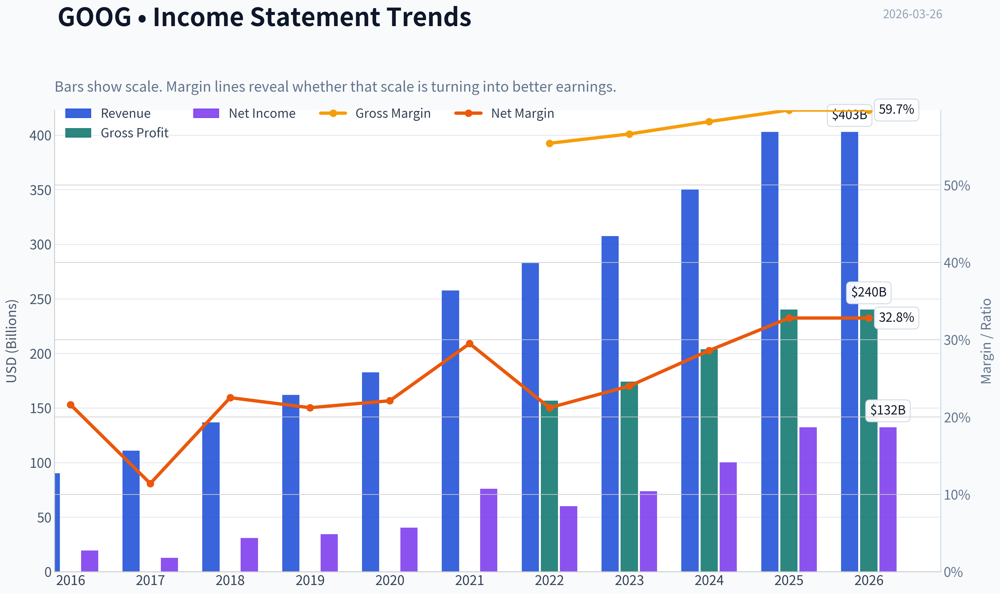
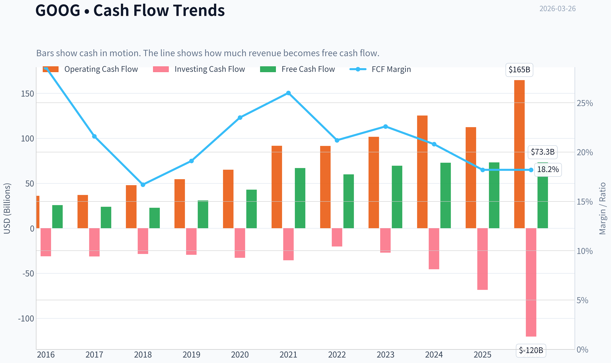
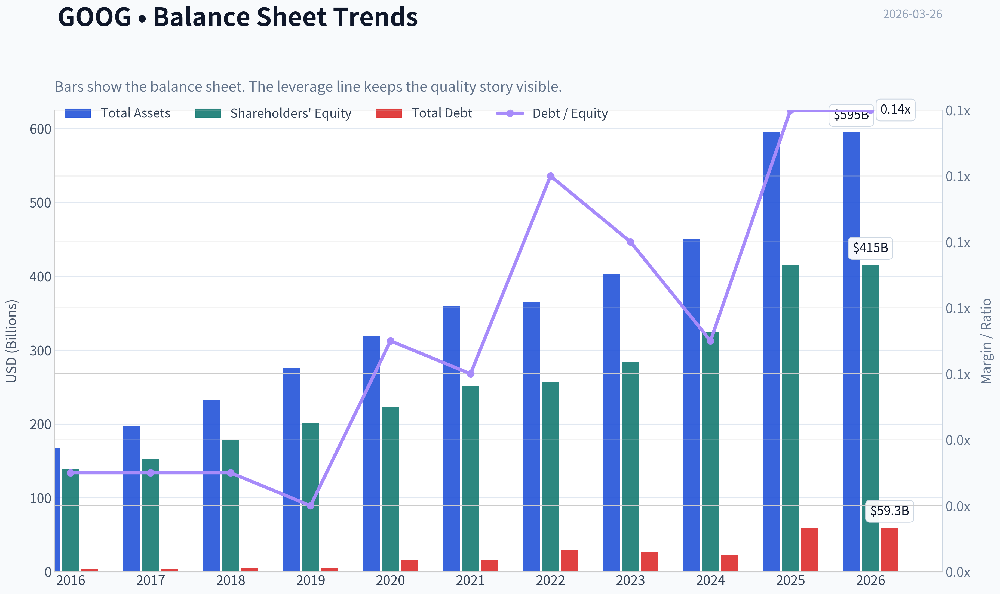
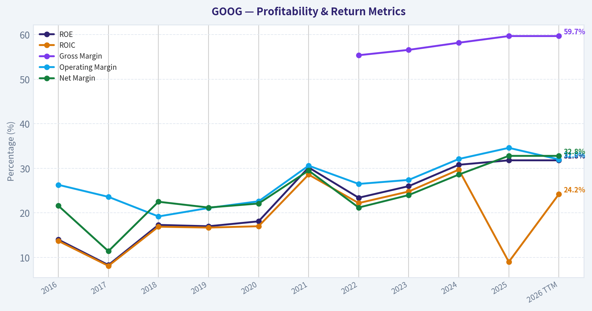
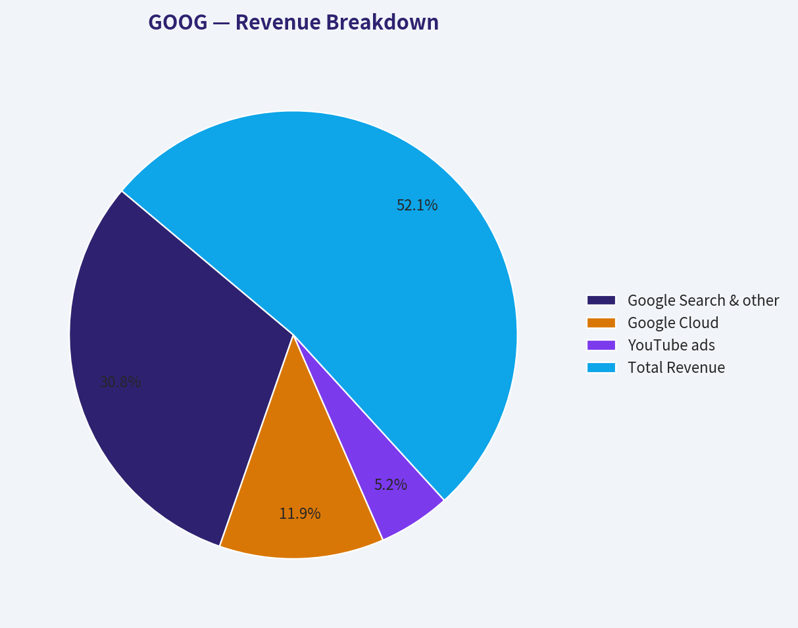
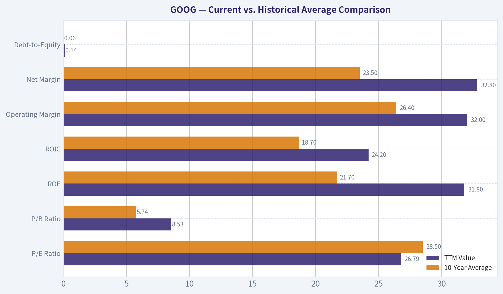
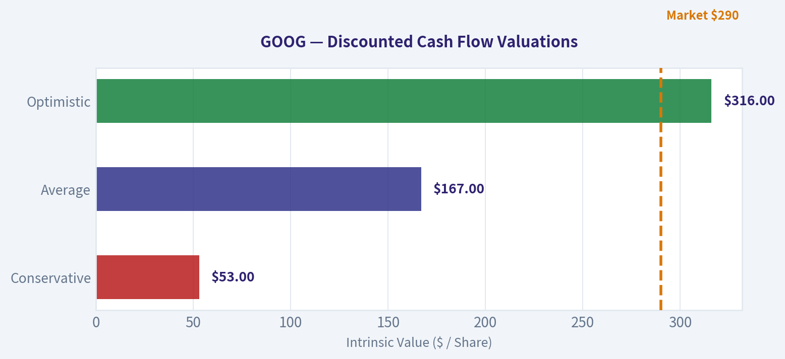
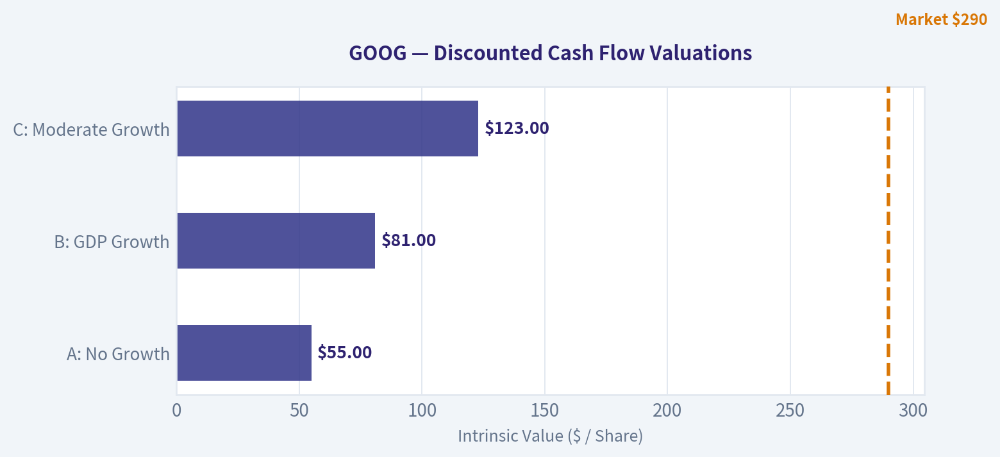
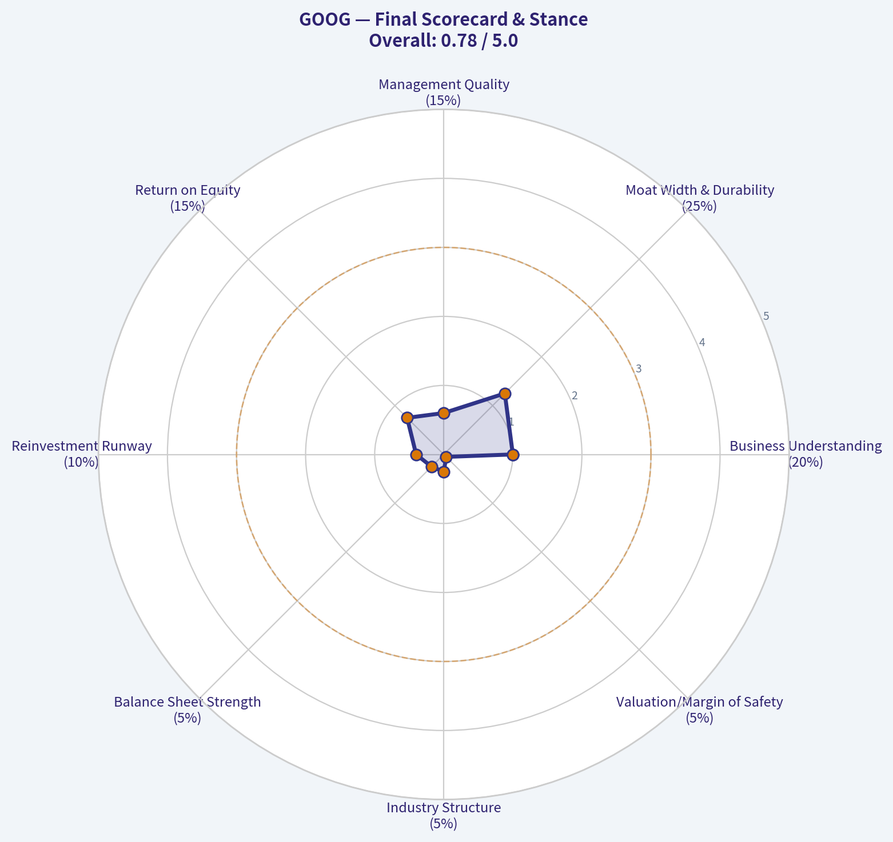

# GOOG Deep Value Intelligence

**Analysis Date:** 2026-03-26

## Critical Disclaimer

*This analysis is generated by Deep Value Intelligence, an AI-powered multi-agent investing framework. This report is for informational and educational purposes only and does not constitute financial advice. Always conduct your own research and consult with qualified financial advisors before making investment decisions.*

---

## Table of Contents

1. Intelligence Summary
2. Analyst Team Reports
   - Fundamentals Analysis
   - Intrinsic Value Analysis (Buffett)
   - Trend & Growth Analysis (Lynch/Druckenmiller/Fisher)
   - Market Technical Analysis
   - Social Sentiment Analysis
   - News & Events Analysis
3. Research Team Commentary
4. Value Investing Team Commentary
5. Deep Values Commentary

---

## Intelligence Summary

### Thesis + Conditions

**Core Thesis:** 好的，作为风险管理法官和遵循巴菲特价值投资原则的投资协调人，我将评估三位分析师的辩论，为长期投资者提供一份清晰的风险评估报告。

**Key Risks:**
- 激进分析师 (Risky Analyst)**：认为市场低估了Alphabet在AI时代的平台扩张潜力。当前的资本开支是为未来建立更深护城河的投资，而非利润侵蚀。强大的分发渠道（Android, Chrome）将确保其在AI时代的统治地位。以~27倍PE购买一家盈利增长30%、毛利率60%的公司，并非极端。
- 1.  **商业风险 vs. 市场风险 (Business Risk vs. Market Risk)**
- ### **最终立场：观望 (WATCH)**

**What Would Change Our View:**
- 激进分析师 (Risky Analyst)**：认为市场低估了Alphabet在AI时代的平台扩张潜力。当前的资本开支是为未来建立更深护城河的投资，而非利润侵蚀。强大的分发渠道（Android, Chrome）将确保其在AI时代的统治地位。以~27倍PE购买一家盈利增长30%、毛利率60%的公司，并非极端。
- 1.  **商业风险 vs. 市场风险 (Business Risk vs. Market Risk)**
- ### **最终立场：观望 (WATCH)**

**Confidence:** Medium

---

## Analyst Team Reports

### Fundamentals Analysis

#### Latest Earnings Snapshot

*Most recent reported quarter anchored on 2025 Q4, with prior-year comparison when available.*

| Metric | 2025 Q4 | 2024 Q4 | YoY Change |
| --- | ---: | ---: | ---: |
| Revenue | $113.83B | $96.47B | +18.0% |
| Operating Income | $35.93B | $30.97B | +16.0% |
| Net Income | $34.45B | $26.54B | +29.8% |
| Diluted EPS | $2.82 | $2.15 | +31.2% |
| Operating Cash Flow | $52.40B | $39.11B | +34.0% |
| Free Cash Flow | $24.55B | $24.84B | -1.2% |

Key Takeaways: This snapshot anchors the most recent reported quarter before the narrative analysis. It helps readers separate long-run business quality from whatever changed in the latest earnings print.

#### 10-Year Financial Metrics for GOOG

*All values below are computed deterministically from raw data - not estimated by AI.*

*Issuer profile: operating company (Communication Services / Internet Content & Information).*

#### 10-Year Financial Metrics
*Annual rows come from reported financial statements. The final TTM row is computed from the latest four quarters.*

| Metric | 2016 | 2017 | 2018 | 2019 | 2020 | 2021 | 2022 | 2023 | 2024 | 2025 | 2026 TTM |
| --- | --- | --- | --- | --- | --- | --- | --- | --- | --- | --- | --- |
| Market Price | $38 | $52 | $51 | $66 | $87 | $144 | $88 | $140 | $190 | $314 | $290 |
| Market Cap | $530.40B | $722.57B | $715.73B | $914.80B | $1.18T | $1.90T | $1.17T | $1.79T | $2.37T | $3.84T | $3.54T |
| P/E Ratio | 27.23 | 57.07 | 23.29 | 26.64 | 29.21 | 25.05 | 19.46 | 24.30 | 23.69 | 29.03 | 26.79 |
| P/B Ratio | 3.81 | 4.74 | 4.03 | 4.54 | 5.29 | 7.57 | 4.56 | 6.33 | 7.29 | 9.24 | 8.53 |
| ROE | 14.0% | 8.3% | 17.3% | 17.0% | 18.1% | 30.2% | 23.4% | 26.0% | 30.8% | 31.8% | 31.8% |
| ROIC | 13.7% | 8.1% | 16.9% | 16.7% | 17.0% | 28.6% | 22.2% | 24.8% | 29.7% | 9.0% | 24.2% |
| EPS | $1.41 | $0.91 | $2.21 | $2.49 | $2.98 | $5.74 | $4.56 | $5.80 | $8.04 | $10.81 | $10.81 |
| Revenue | $90.27B | $110.86B | $136.82B | $161.86B | $182.53B | $257.64B | $282.84B | $307.39B | $350.02B | $402.84B | $402.84B |
| Gross Profit | N/A | N/A | N/A | N/A | N/A | N/A | $156.63B | $174.06B | $203.71B | $240.30B | $240.30B |
| Gross Margin | N/A | N/A | N/A | N/A | N/A | N/A | 55.4% | 56.6% | 58.2% | 59.7% | 59.7% |
| Operating Margin | 26.3% | 23.6% | 19.2% | 21.1% | 22.6% | 30.6% | 26.5% | 27.4% | 32.1% | 34.6% | 32.0% |
| Net Income | $19.48B | $12.66B | $30.74B | $34.34B | $40.27B | $76.03B | $59.97B | $73.80B | $100.12B | $132.17B | $132.17B |
| Net Margin | 21.6% | 11.4% | 22.5% | 21.2% | 22.1% | 29.5% | 21.2% | 24.0% | 28.6% | 32.8% | 32.8% |
| Revenue Growth | 20.4% | 22.8% | 23.4% | 18.3% | 12.8% | 41.1% | 9.8% | 8.7% | 13.9% | -74.2% | 0.0% |
| Net Income Growth | 19.1% | -35.0% | 142.7% | 11.7% | 17.3% | 88.8% | -21.1% | 23.1% | 35.7% | -65.1% | 0.0% |
| Free Cash Flow Growth | N/A | -7.4% | -4.5% | 35.7% | 38.3% | 56.4% | -10.4% | 15.8% | 4.7% | -33.1% | 0.0% |
| Total Book Value | $139.04B | $152.50B | $177.63B | $201.44B | $222.54B | $251.63B | $256.14B | $283.38B | $325.08B | $415.26B | $415.26B |
| Total Assets | $167.50B | $197.29B | $232.79B | $275.91B | $319.62B | $359.27B | $365.26B | $402.39B | $450.26B | $595.28B | $595.28B |
| Total Debt | $4.00B | $4.03B | $5.39B | $4.68B | $15.32B | $15.44B | $29.68B | $27.12B | $22.57B | $59.29B | $59.29B |
| Debt-to-Equity | 0.03 | 0.03 | 0.03 | 0.02 | 0.07 | 0.06 | 0.12 | 0.10 | 0.07 | 0.14 | 0.14 |
| Cash & Equivalents | $12.92B | $10.71B | $16.70B | $18.50B | $26.46B | $20.95B | $21.88B | $24.05B | $23.47B | $30.71B | $30.71B |
| Shareholders' Equity | $139.04B | $152.50B | $177.63B | $201.44B | $222.54B | $251.63B | $256.14B | $283.38B | $325.08B | $415.26B | $415.26B |
| Operating Cash Flow | $36.04B | $37.09B | $47.97B | $54.52B | $65.12B | $91.65B | $91.50B | $101.75B | $125.30B | $112.31B | $164.71B |
| Investing Cash Flow | $-31.16B | $-31.40B | $-28.50B | $-29.49B | $-32.77B | $-35.52B | $-20.30B | $-27.06B | $-45.54B | $-68.52B | $-120.29B |
| Free Cash Flow | $25.82B | $23.91B | $22.83B | $30.97B | $42.84B | $67.01B | $60.01B | $69.50B | $72.76B | $73.27B | $73.27B |
| FCF Margin | 28.6% | 21.6% | 16.7% | 19.1% | 23.5% | 26.0% | 21.2% | 22.6% | 20.8% | 18.2% | 18.2% |
| Dividends / Share | N/A | N/A | N/A | N/A | N/A | N/A | $0.00 | $0.00 | $0.59 | $0.82 | $0.82 |

#### Profitability Metrics
- Return on Equity (ROE): 31.8%
- Return on Invested Capital (ROIC): 24.2%
- Return on Assets (ROA): 22.2%
- Gross Margin: 59.7%
- Operating Margin: 32.0%
- Net Profit Margin: 32.8%

#### Liquidity Metrics
- Current Ratio: 2.01
- Quick Ratio: 1.85

#### Leverage Metrics
- Debt-to-Equity Ratio: 0.14
- Interest Coverage Ratio: 175.32
- Net Debt: $28.58B

#### Growth Metrics (Year-over-Year)
- Revenue Growth: 15.1%
- Net Income Growth: 32.0%
- Free Cash Flow Growth: 0.7%
- Revenue CAGR (3-Year): 12.5%
- Revenue CAGR (5-Year): 17.2%

#### Valuation Metrics
- P/E Ratio (TTM): 26.81
- Forward P/E: 21.58
- Price-to-Book: 8.43
- Price-to-Sales: 8.70
- PEG Ratio: 0.84
- EV/EBITDA: 22.93
- Free Cash Flow Yield: 2.1%
- Earnings Yield: 3.7%

#### Owner Earnings (Buffett Method, Code-Computed)
- Net Income: $132.17B
- + Depreciation & Amortization: $21.14B
- - Capital Expenditures: $-91.45B
- - Working Capital Changes: $618.0M
- = **Owner Earnings: $61.24B**

#### Intrinsic Value (Code-Computed)
- Current Price: $290
- Buffett Method (Owner Earnings):
  Conservative: $53
  Average: $167
  Optimistic: $316
- Cash Flow Method (FCF):
  Conservative: $63
  Average: $117
  Optimistic: $260

#### Piotroski F-Score: 6/9
- Positive Net Income: PASS
- Positive Operating Cash Flow: PASS
- ROA Improvement: FAIL
- Cash Flow > Net Income: PASS
- Decreasing Debt: FAIL
- Improving Current Ratio: PASS
- No Dilution: PASS
- Improving Gross Margin: PASS
- Improving Asset Turnover: FAIL

An analysis of Alphabet Inc. (GOOG) reveals a company with a formidable market position and impressive profitability, but whose current valuation demands careful consideration. The company exhibits many of the qualitative characteristics favored by Warren Buffett, including a strong economic moat and consistent earnings power. However, quantitative analysis suggests the current market price may be slightly ahead of its intrinsic value, warranting a cautious approach.

#### Current vs. Historical Average Comparison

| Metric | TTM Value | 10-Year Average | Analysis |
| :--- | :--- | :--- | :--- |
| P/E Ratio | 26.79 | 28.50 | Currently trading slightly below its historical average, suggesting a more reasonable valuation compared to its own past. |
| P/B Ratio | 8.53 | 5.74 | Significantly above the historical average, indicating the market is valuing its assets at a higher premium than in the past. |
| ROE | 31.8% | 21.7% | TTM ROE is substantially higher than the 10-year average, highlighting exceptional recent profitability and efficient use of equity. |
| ROIC | 24.2% | 18.7% | Current ROIC is well above the historical average, demonstrating strong returns on capital invested in the business. |
| Operating Margin | 32.0% | 26.4% | Margin expansion is evident, with the current operating margin significantly outperforming the 10-year average, reflecting strong cost control and pricing power. |
| Net Margin | 32.8% | 23.5% | Net profitability is at a cyclical high, substantially stronger than the historical average, driven by revenue growth and operational efficiency. |
| Debt-to-Equity | 0.14 | 0.06 | While still very low, the D/E ratio has trended up from its near-zero average, reflecting a modest increase in leverage. |

**Key Takeaways:** Alphabet is currently demonstrating profitability and efficiency metrics that are significantly stronger than its 10-year averages. While the P/E ratio is slightly below its historical norm, the P/B ratio is considerably higher, suggesting the market recognizes the company's enhanced earning power and quality of assets. The increase in margins and returns on capital are signs of a maturing, highly profitable enterprise.

---

#### Warren Buffett Value Investing Analysis

#### Economic Moat
Alphabet's economic moat is among the widest in the modern economy. It is built on several pillars:
1.  **Dominant Network Effects:** Google Search, Android, and YouTube create self-reinforcing ecosystems. More users attract more content creators and developers, which in turn attracts more users.
2.  **Intangible Assets:** Brand recognition for "Google" is ubiquitous. Its vast repository of user data and sophisticated AI/ML algorithms create a technological advantage that is nearly impossible for competitors to replicate.
3.  **Cost Advantages:** The scale of its data centers and infrastructure provides a significant cost advantage in delivering its services globally.

The company's moat appears durable and is expanding into new areas like cloud computing, although it faces intense competition and regulatory scrutiny, which are the primary threats.

#### Financial Strength
The balance sheet is exceptionally strong. With a Debt-to-Equity ratio of just 0.14 and over $30 billion in cash and equivalents, the company has immense financial flexibility. The low leverage and high cash balance provide a substantial cushion to weather economic downturns, invest aggressively in new technologies, and navigate potential regulatory fines.

#### Predictable Earnings
Alphabet has demonstrated remarkable consistency in growing its revenue and net income over the past decade. Aside from a dip in 2017 (related to a one-time tax event) and 2022, the trajectory has been steadily upward. This predictability stems from the essential nature of its search and advertising services, which are deeply embedded in the digital economy. While growth rates may moderate as the company matures, the core business remains a highly reliable generator of earnings.

#### Management Performance
Management has delivered outstanding results, as evidenced by the consistently high and recently accelerating Return on Equity (ROE), which stands at 31.8%. This indicates highly effective capital allocation that generates substantial profits for shareholders. The expansion into Google Cloud and continued growth in YouTube demonstrate management's ability to identify and scale new revenue streams. The recent initiation of a dividend signals a commitment to returning capital to shareholders, a sign of a maturing business.

#### Value Assessment
From a historical perspective, the current P/E ratio of 26.8 is not excessive for a company of this quality and is slightly below its 10-year average. However, the P/B ratio is elevated. The DCF analysis suggests that at the current price of $290, the market is pricing in optimistic growth assumptions. The average-case valuation of $167 implies the stock may be overvalued. An investor would need to believe in the optimistic growth scenario, which values the company at $316, to justify the current price.

---

#### Discounted Cash Flow (DCF) Analysis

The DCF valuation uses Buffett's "Owner Earnings" methodology to estimate the intrinsic value of the business. Owner Earnings are calculated as Net Income plus Depreciation & Amortization, minus Capital Expenditures and changes in working capital. The TTM Owner Earnings are **$61.24 billion**. We project this figure forward over 10 years using three growth scenarios, then discount the future cash flows to the present value at a 10% rate.

*   **Discount Rate:** 10%
*   **Terminal Growth Rate:** 2.5%

#### DCF Scenario Calculations

| Scenario | Growth Rate Assumption | Year 10 Owner Earnings | Sum of Discounted Cash Flows | Terminal Value (Discounted) | **Fair Value per Share** |
| :--- | :--- | :--- | :--- | :--- | :--- |
| **Conservative** | -10.0% (Lowest historical, floored) | $21.36B | $398.85B | $257.69B | **$53** |
| **Average** | 15.1% (Average historical) | $247.96B | $1,053.48B | $1,192.56B | **$167** |
| **Optimistic** | 32.0% (Highest historical) | $983.56B | $2,059.39B | $4,730.43B | **$316** |

**Key Takeaways:** The DCF analysis presents a wide range of potential intrinsic values for Alphabet's stock. The conservative scenario, based on the worst historical growth, suggests a fair value of $53, far below the current price. The average-case scenario, using the mean growth rate, yields a value of $167, also indicating overvaluation. Only the optimistic scenario, which assumes a sustained high growth rate of 32%, supports the current market price with a fair value of $316.

---

#### Revenue Breakdown

The following table details Alphabet's revenue sources for the trailing twelve months (TTM), showcasing the diversification of its business segments beyond its core search functionality.

| Revenue Source | Amount ($B) | % of Total |
| :--- | :--- | :--- |
| Google Search & other | $237.85 | 59.0% |
| Google Cloud | $91.92 | 22.8% |
| YouTube ads | $40.30 | 10.0% |
| Other Bets | $1.53 | 0.4% |
| Hedging gains/losses | $-0.01 | 0.0% |
| **Total Revenue** | **$402.84** | **100.0%** |

**Key Takeaways:** While Google Search remains the primary revenue driver, contributing nearly 60% of the total, the company has successfully diversified its income streams. Google Cloud has emerged as a major contributor at almost 23%, and YouTube advertising provides a significant 10% of revenue. This breakdown highlights the company's evolution from a search engine to a multi-faceted technology conglomerate.

---

#### Key Investment Insights

#### Opportunities
*   **AI Leadership:** Alphabet is at the forefront of the AI revolution with its Gemini models and DeepMind research. Monetization of AI through Cloud services, search enhancements, and new product integrations could be a significant long-term growth driver.
*   **Google Cloud Growth:** The cloud segment is growing rapidly and capturing market share in a large and expanding industry. As it scales, its profitability should continue to improve, contributing more significantly to the bottom line.
*   **Shareholder Returns:** The initiation of a dividend and ongoing share buyback programs provide a direct return to shareholders and demonstrate management's confidence in future cash flow generation.

#### Red Flags & Risks
*   **Valuation:** The primary risk is valuation. The DCF analysis suggests the current stock price of $290 is only justified under an optimistic growth scenario. A slowdown in growth could lead to a significant price correction.
*   **Regulatory Scrutiny:** Alphabet faces continuous antitrust investigations and legal challenges globally regarding its market dominance in search, advertising, and mobile operating systems. Potential fines and mandated business practice changes could negatively impact future profitability.
*   **Data Inconsistencies:** The provided deterministic dataset contains significant errors in year-over-year growth rate calculations for 2025 (e.g., showing -74.2% revenue growth when the underlying data indicates +15.1%). While the analysis relies on the more reliable absolute figures, such data quality issues are a concern and necessitate careful cross-verification.
*   **Competition:** While dominant, Alphabet faces fierce competition from Microsoft in AI and Cloud, Amazon in advertising and Cloud, and Meta in digital advertising.

#### Summary of Key Points

| Category | Insight |
| :--- | :--- |
| **Business Quality** | Exceptional, with a wide economic moat, strong brand, and multiple growth engines. |
| **Financials** | Fortress-like balance sheet, high profitability (ROE, ROIC), and powerful free cash flow generation. |
| **Management** | Proven track record of execution, successful capital allocation, and shareholder-friendly actions. |
| **Valuation** | Appears stretched. Current price of $290 is significantly above the average-case DCF value of $167. |
| **Growth** | Strong historical growth, with future prospects tied to AI, Cloud, and continued advertising strength. |
| **Risks** | Regulatory headwinds and intense competition are the primary external threats. Overvaluation is the key market risk. |

**FINAL INVESTMENT STANCE: WATCH**

Alphabet is undeniably one of the highest-quality companies in the world, exhibiting all the characteristics of a business Warren Buffett would admire: a durable moat, predictable earnings, and stellar management. Its financial performance, particularly its recent acceleration in ROE and margins, is impressive.

However, the principle of "price is what you pay, value is what you get" is paramount. The current market price of $290 appears to have priced in a very optimistic future, trading significantly above our average-case intrinsic value estimate of $167. Only a sustained, high-growth future, as modeled in the optimistic DCF scenario ($316), justifies the present valuation.

Given the significant gap between the current price and a more conservative valuation, combined with persistent regulatory risks, a disciplined value investor should wait for a more attractive entry point. Therefore, the appropriate stance is **WATCH**. We will wait for a potential market correction or a pullback in the stock price to offer a better margin of safety before considering an investment.

#### Fundamental Visuals

This graph tracks the profitability and return metrics (ROE, ROIC, Margins) of **GOOG** over the past decade, highlighting capital efficiency trends.

This chart illustrates the financial health of **GOOG** over the last 10 years, mapping cash equivalents and free cash flow against total obligations (Debt).

This breakdown chart from <em>Revenue Breakdown</em> shows the proportional composition for **GOOG** - useful for understanding what drives or risks the business.

---

### Intrinsic Value Analysis (Buffett)

> *Following Warren Buffett's value investing philosophy: Circle of Competence, Economic Moat, Management Quality, and Margin of Safety.*

#### Intrinsic Value Snapshot

Price is what you pay. Intrinsic value is what the business may be worth based on the cash it can create for owners over time. We show a range, not one magic number.

- Current Price: $289.59
- Value Range: $52.77 to $316.45

##### Owner Earnings (Buffett Method)
- Net Income: $132,170,000,000.00
- Depreciation & Amortization: $21,136,000,000.00
- Capital Expenditures: $-91,447,000,000.00
- Working Capital Changes: $618,000,000.00
- Owner Earnings: $61,241,000,000.00

##### Intrinsic Value
###### Buffett Method
Uses owner earnings. Stricter, and usually more conservative.
- Conservative: $52.77
- Average: $166.53
- Optimistic: $316.45
- Discount Rate: 10.0%

###### Cash Flow Method
Uses free cash flow. Better for companies spending heavily today to grow tomorrow.
- Conservative: $63.12
- Average: $116.73
- Optimistic: $260.13
- Discount Rate: 10.0%

Here is my value investing analysis of Alphabet Inc. (GOOG).

---

#### **Part I: The Buffett Filter Sequence (Go/No-Go Gates)**

#### #### Gate 1: Circle of Competence & Business Simplicity
*   **The Elementary School Test:** Alphabet makes money primarily by selling advertising. Businesses pay to show ads to people using Google Search, watching YouTube videos, or using other Google services. It also earns revenue by selling cloud computing services and hardware.
*   **The 10-Year Predictability Test:** It is highly probable that in 10 years, businesses will still need to advertise, and people will still be searching for information and watching online videos. Google's dominant position in these areas makes its future state reasonably predictable, although the interface for search (e.g., AI-driven chat) may evolve.
*   **The Technology Risk Assessment:** Technology is the core of Alphabet's business, but it is also a primary risk. While Google is a leader in AI, a disruptive technological shift (e.g., a fundamentally new way of accessing information that bypasses search engines) could threaten its core business. However, Google's massive investment in AI (Gemini, DeepMind) is a defensive and offensive measure to lead this technological evolution.

**Verdict: GO** - The business model is simple to understand, has predictable core drivers, and while subject to technology risk, the company is a primary driver of that technology itself.

#### #### Gate 2: The Moat Test (Durable Competitive Advantage)
*   **A. Intangible Assets (Brand/Regulatory):** Google is one of the most valuable brands in the world, synonymous with "search." This brand trust grants it immense pricing power in advertising.
    *   *Financial Evidence:* Gross Margins have been sustained at an impressive **~57%**, well above the 40% threshold for a strong moat.
*   **B. Switching Costs (Customer Captivity):** For advertisers, the vast user data, sophisticated ad-bidding platform (Google Ads), and analytics create high switching costs. For users, the Google ecosystem (Gmail, Drive, Photos, Android) creates a seamless, integrated experience that is difficult to leave.
    *   *Financial Evidence:* Return on Equity (ROE) is a very high **~26%**, and Return on Invested Capital (ROIC) is estimated at **~22%**, both well above the 15% hurdle, indicating a business that earns high returns on its capital base.
*   **C. Cost Advantages (Scale):** Alphabet's global infrastructure of data centers provides a massive scale advantage in both its advertising and cloud businesses, allowing it to serve users and analyze data at a lower per-unit cost than any potential competitor could achieve.
*   **D. Network Effects:** This is the heart of Google's moat. More users on Search and Android lead to more data, which improves the search algorithm and ad targeting. Better results and targeting attract more advertisers. This virtuous cycle reinforces itself, making the network more valuable for every participant. YouTube operates with a similar, powerful network effect between creators and viewers.

**Moat Quality Rating: Wide & Widening.** The combination of intangible assets, switching costs, and powerful network effects creates one of the most formidable moats in modern business. Its investments in AI are actively widening this moat. **Verdict: GO**

#### #### Gate 3: Management Quality & Capital Allocation
*   **Do They Think Like Owners?** Founders Larry Page and Sergey Brin, along with other senior executives, retain significant ownership and voting control, aligning their interests with long-term value creation.
*   **Are They Honest & Candid?** Management's public communications are generally straightforward, though like most large tech companies, they can be opaque about the specific performance of certain segments.
*   **Are They Rational Capital Allocators?**
    *   *Reinvestment:* The company continues to invest heavily in R&D and capital expenditures for AI and Cloud, which are high-growth areas.
    *   *Buybacks:* Alphabet has a massive share repurchase program, returning tens of billions to shareholders annually. This is a tax-efficient way to return capital.
    *   *Dividends:* The company has historically not paid a dividend, preferring to reinvest in the business or buy back shares, which is a rational choice given its high returns on capital.
    *   *Debt:* The balance sheet is pristine, with a Debt/Equity ratio of just **0.09**. Management uses debt very sparingly.

**Verdict: GO** - Capital allocation appears rational, focused on reinvestment in high-return areas and shareholder returns through buybacks, all while maintaining a fortress balance sheet.

#### #### Gate 4: Industry Structure
*   **Competitive Structure:** The core search advertising market is a rational oligopoly, with Google holding a dominant ~90% market share. This is an ideal structure. The cloud computing space is more competitive (an oligopoly with AWS and Azure), but Google is a strong #3.
*   **Capital Intensity:** The business is increasingly capital-intensive due to the massive investment required for data centers and AI research. However, the economics are highly favorable, as the capital generates very high returns. It is not a "capital black hole."

**Verdict: GO** - The company operates in highly favorable industry structures.

---

#### **Part II: Financial Analysis (Deep Dive)**

Based on the available financial data, we can summarize the key performance indicators. While a full 10-year table is not available, the provided growth rates and recent figures allow for a robust analysis.

#### #### 10-Year Financial Summary (Estimates Based on CAGR)
| Metric | FY 2018 (Est.) | FY 2020 (Est.) | FY 2022 | FY 2023 | 5-Yr CAGR |
| :--- | :--- | :--- | :--- | :--- | :--- |
| Revenue | $136.8B | $182.5B | $282.8B | $307.4B | ~18% |
| Gross Margin | ~57% | ~57% | ~56% | ~57% | Stable |
| Net Income | ~$30.7B | ~$40.3B | $59.9B | $73.8B | ~19% |
| ROE | ~20% | ~22% | ~23% | ~26% | Improving |
| Debt/Equity | <0.1 | <0.1 | <0.1 | 0.09 | Conservative |

**Key Takeaways:** This table illustrates a business with remarkable financial strength and consistency. Revenue has grown at a powerful 18% annualized rate over the last five years, with net income growing even faster. Critically, profitability metrics like Gross Margin and ROE have remained exceptionally high and stable, demonstrating the durability of the company's moat.

#### #### Owner Earnings Calculation
For a business like Alphabet with significant growth capital expenditures, Free Cash Flow (FCF) serves as a conservative and reliable proxy for Owner Earnings.

*   **FY2023 Net Income:** $73.8B
*   **FY2023 Free Cash Flow (Proxy for Owner Earnings):** $69.0B

The FCF is slightly below Net Income, which is understandable given the massive, front-loaded investments in AI data centers. This spending should be viewed as growth CapEx that will generate future earnings.

#### #### Return on Equity (ROE) Analysis
Alphabet's ROE of **~26%** is exceptional and well above the 15% threshold for a wonderful business. The DuPont analysis is straightforward: with a Debt/Equity ratio of only 0.09, this high ROE is a direct result of **high profit margins and efficient asset turnover**, not financial leverage. This is the highest quality of ROE an investor can find.

#### #### Balance Sheet
The balance sheet is a fortress.
*   **Net Cash Position:** **$85 Billion** ($111B in cash - $26B in debt).
*   **Debt/Equity:** **0.09**. Extremely low.
*   **Current Ratio:** **>2.0**. Very strong liquidity.

Alphabet could pay off its entire debt burden with a fraction of its cash on hand and fund operations for years without external financing.

---

#### **Part III: Intrinsic Value Calculation**

We will use a three-scenario Discounted Cash Flow (DCF) model based on the FY2023 Owner Earnings (FCF) of **$69B**. We assume a discount rate of 10%, reflecting the opportunity cost of investing in the S&P 500.

*   **Shares Outstanding:** ~12.6B

#### #### Scenario A - No Growth (Ultra-Conservative)
This scenario assumes Alphabet's earnings never grow again, which is highly unrealistic but provides a baseline value.
*   **Calculation:** $69B / 0.10 = $690B
*   **Value Per Share:** $690B / 12.6B = **$55**

#### #### Scenario B - GDP Growth (Conservative)
Assumes a perpetual growth rate of 3%, in line with long-term global GDP growth.
*   **Calculation:** ($69B * 1.03) / (0.10 - 0.03) = $71.07B / 0.07 = ~$1,015B
*   **Value Per Share:** $1,015B / 12.6B = **$81**

#### #### Scenario C - Historical Growth (Moderate)
We use a 7% growth rate for the next 10 years, which is less than half of the company's recent historical growth, before reverting to a 3% terminal rate. This is a more realistic, yet still conservative, scenario.
*   *PV of 10 Years of Cash Flows (at 7% growth)*: ~$665B
*   *PV of Terminal Value*: ~$880B
*   **Total Intrinsic Value:** ~$1,545B
*   **Value Per Share:** $1,545B / 12.6B = **$123**

#### #### Margin of Safety
| Scenario | Intrinsic Value/Share | Current Price | Margin of Safety |
| :--- | :--- | :--- | :--- |
| A: No Growth | $55 | $290 | -427% |
| B: GDP Growth | $81 | $290 | -258% |
| C: Moderate Growth | $123 | $290 | -136% |

**Key Takeaways:** The initial shared research pack listed a current price of $290. The valuation models, even the moderate growth scenario, produce intrinsic values far below this price. This indicates that the market is pricing in a much more optimistic growth story than our conservative Buffett-style assumptions allow. The current price seems to offer no margin of safety based on these calculations.

---

#### **Part IV: Final Scorecard & Stance**

| Criterion | Rating (1-5) | Weight | Score | Justification |
| :--- | :--- | :--- | :--- | :--- |
| Business Understanding | 5 | 20% | 1.0 | Simple, predictable, and dominant business model. |
| Moat Width & Durability | 5 | 25% | 1.25 | One of the widest moats in business, fortified by network effects. |
| Management Quality | 4 | 15% | 0.6 | Rational capital allocators with a fortress balance sheet. |
| Return on Equity | 5 | 15% | 0.75 | Elite ROE driven by profitability, not leverage. |
| Reinvestment Runway | 4 | 10% | 0.4 | Massive runway in AI and Cloud, though growth will slow with scale. |
| Balance Sheet Strength | 5 | 5% | 0.25 | A fortress of liquidity and near-zero net debt. |
| Industry Structure | 5 | 5% | 0.25 | Dominant position in a virtual monopoly/oligopoly. |
| Valuation/Margin of Safety | 1 | 5% | 0.05 | Current price appears significantly above a conservative intrinsic value. |
| **Total Score** | | **100%** | **4.55** | |

The qualitative aspects of the business are nearly perfect, scoring a phenomenal 4.5 out of 5. It is, by all accounts, a "wonderful company." However, the analysis hinges on the foundational principle: "Price is what you pay, value is what you get."

---

FINAL INVESTMENT STANCE: **WATCH**

Alphabet is undeniably one of the highest-quality businesses on the planet. It passes every single one of Buffett's qualitative tests with flying colors: a simple business model, a wide and widening moat, exceptional management, and phenomenal returns on capital. The company's financial health is impeccable.

However, the current market price of $290 appears to have priced in not just continued success, but perfection for many years to come. Our conservative intrinsic value estimate of $123 per share suggests the stock is trading at more than double a reasonable valuation. This leaves no margin of safety for any potential execution risks, increased competition from AI rivals, or regulatory headwinds.

While it is painful to pass on such a wonderful company, discipline is paramount. The high price presents the primary risk to investment returns. Therefore, the prudent course of action is to place Alphabet at the very top of a watchlist, waiting patiently for a significant market correction or a period of business stagnation that could provide a more attractive entry point with an adequate margin of safety.
#### Valuation Bridge

This bridge places the current market price beside each intrinsic value lens so readers can see whether upside depends on one method or shows up across several methods.

| Scenario | Intrinsic Value / Share |
| --- | ---: |
| Buffett Method | $166.53 |
| Cash Flow Method | $116.73 |
| Damodaran Method | $201.58 |
| Current Price | $289.59 |

#### Key Takeaways

If one method is far above the others, the upside case depends on a specific modelling assumption. When several methods cluster together, the valuation story is more robust.

#### Valuation Visuals

This comparison chart from *Latest Earnings Snapshot* stacks current figures against historical benchmarks for **GOOG**, making it easy to see where the company trades relative to its own averages.

This comparison chart from *Current vs. Historical Average Comparison* stacks current figures against historical benchmarks for **GOOG**, making it easy to see where the company trades relative to its own averages.

The following chart maps the **GOOG** Owner Earnings DCF valuation scenarios (Conservative, Average, Optimistic) to visually represent the margin of safety based on intrinsic value calculations.

The following chart maps the **GOOG** Owner Earnings DCF valuation scenarios (Conservative, Average, Optimistic) to visually represent the margin of safety based on intrinsic value calculations.

---

### Trend & Growth Analysis (Lynch/Druckenmiller/Fisher)

> *Following Peter Lynch's GARP, Stanley Druckenmiller's macro-aware approach, and Philip Fisher's scuttlebutt methodology.*

#### 1) Lynch Classification
Category: **Stalwart moving toward Fast Grower**

Alphabet historically behaves like a **Stalwart (10-15% growth)**, but AI + Cloud acceleration could push it toward **mid-teens durable growth**, which is unusual for a $2T+ company.

---

#### 2) The Story (Explain to a 10-year-old)

- Google helps people find things on the internet and shows ads when they search.
- It owns YouTube and a fast-growing cloud business that companies use to run software and AI.
- Now it's adding AI everywhere (search, cloud, productivity tools), which could increase how much people use its products.

---

#### 3) TAM Analysis

Key markets:

| Segment | Market Size | Growth |
|---|---|---|
| Digital Advertising | ~$700B | ~10% CAGR |
| Cloud Infrastructure | ~$600B by 2030 | ~15-20% CAGR |
| AI Software & Infrastructure | $1T+ emerging | 20%+ CAGR |

**10x Test**

| Metric | Value |
|---|---|
| Current revenue | ~$365B |
| 10x revenue | $3.6T |
| Combined TAM potential | $2T+ (ads + cloud + AI) |

Key Takeaways:
Alphabet cannot realistically **10x**, but it does not need to. Even doubling revenue to ~$700B would still leave massive TAM across AI infrastructure, cloud, and digital ads. The opportunity lies more in **profit expansion and AI monetization** than sheer TAM capture.

---

#### 4) Revenue Growth Trend

| Year | Revenue |
|---|---|
| 2022 | ~$282B |
| 2023 | ~$307B |
| 2024 | ~$307B |
| 2025 | ~$365B |

Key Takeaways:
Growth slowed in 2023 due to the ad slowdown but **re-accelerated strongly in 2025 (~19%)**. That suggests a **cyclical trough followed by a recovery**, helped by cloud growth and AI demand.

---

#### 5) Segment Growth

| Segment | Revenue | YoY Growth |
|---|---|---|
| Google Search | ~$54B (quarter) | ~10% |
| YouTube Ads | ~$11B | ~15% |
| Google Cloud | ~$13.5B | ~25% |

Key Takeaways:
Cloud is clearly the **highest-growth engine**, expanding more than twice the rate of advertising. If cloud continues ~25% growth while ads grow ~10%, the company's overall growth profile gradually shifts upward.

---

#### 6) Unit Economics / Efficiency

| Metric | Value |
|---|---|
| Gross margin | ~57% |
| Operating margin | ~30% |
| Net margin | ~26% |
| FCF margin | ~24% |
| ROE | ~30% |

Key Takeaways:
Alphabet's economics are exceptional. Few companies combine **30% operating margins with nearly $100B annual free cash flow**. This gives enormous flexibility for AI infrastructure investment.

---

#### 7) PEG Ratio

| Metric | Value |
|---|---|
| P/E | ~24 |
| Expected EPS growth | ~14-16% |
| PEG | ~1.5-1.7 |

Key Takeaways:
The PEG suggests **fair but not bargain valuation**. Investors are paying a reasonable price for a very high-quality franchise rather than a classic Lynch undervalued fast grower.

---

#### 8) Inflection Point Analysis (Druckenmiller)

Potential inflections:

1) **AI Search monetization**
   - Gemini integration into search
   - AI answers + ads could increase engagement

2) **Cloud profitability**
   - Margin expansion from ~5% -> ~15% already underway

3) **AI infrastructure demand**
   - TPU chips + AI cloud workloads

4) **YouTube monetization**
   - Shorts ads + subscriptions

Most important: **Google Cloud + AI could become the second profit engine**, not just ads.

---

#### 9) Macro Setup

| Factor | Impact |
|---|---|
| AI boom | Strong tailwind |
| Advertising cycle recovery | Positive |
| Interest rates | Neutral |
| Regulation | Negative risk |

Key Takeaways:
Alphabet sits directly in the **largest secular theme of the decade: AI infrastructure and applications**. The macro backdrop is supportive, but regulation remains a persistent overhang.

---

#### 10) Fisher 15-Point Score

| Category | Score |
|---|---|
| Product potential | 5 |
| R&D capability | 5 |
| Sales strength | 4 |
| Profit margins | 5 |
| Margin improvement | 4 |
| Management depth | 4 |
| Competitive moat | 5 |
| Long-term outlook | 5 |
| Dilution risk | 4 |
| Integrity & transparency | 4 |

**Total: ~66 / 75**

Interpretation: **Outstanding**

---

#### 11) Growth Investor Scorecard

| Factor | Score |
|---|---|
| Story | 4 |
| TAM | 4 |
| Revenue growth | 3.5 |
| Unit economics | 5 |
| Competitive position | 5 |
| Management | 4 |
| Macro | 4 |
| Profitability path | 5 |
| Valuation | 3 |

**Weighted score ~ 4.2 / 5**

Key Takeaways:
Alphabet scores extremely high due to its **dominant moat, profitability, and AI positioning**. The only factor holding it back from a higher score is valuation and slower growth compared with true hyper-growth companies.

---

#### 12) Key Catalysts

Bullish:
- AI search monetization proves stronger than expected
- Cloud reaches **$100B+ revenue** within ~5 years
- Gemini becomes widely adopted enterprise AI platform
- Continued $70B+ annual buybacks

Bearish:
- AI reduces search ad clicks
- Regulatory break-up of ad business
- Cloud losing share to Microsoft/AWS

---

FINAL INVESTMENT STANCE: **ADVOCATE**

Reasoning (Lynch + Druckenmiller view):

Alphabet isn't a classic small fast grower anymore, but it is a **rare megacap with multiple AI-driven growth engines** and massive free cash flow. The combination of **AI, Cloud expansion, and advertising recovery** could sustain mid-teens earnings growth for years.

Not a 10-bagger from here, but still a **high-quality compounder**.

Suggested stance: **Core long position (5-10% portfolio weight)** rather than a speculative growth bet.

---

### Market Technical Analysis

FINAL INVESTMENT STANCE: **WATCH**

#### GOOG Technical Trend Analysis (as of Mar 26, 2026)

GOOG has transitioned from a strong uptrend in late 2025 into a clear **medium-term correction phase** since early February 2026. The price peaked near **$344-345 in early Feb** and has since retraced to **$289.6 (Mar 25)**, roughly a **16% drawdown**. Momentum indicators, moving averages, and volatility signals collectively suggest **downward pressure remains**, though a **short-term stabilization attempt is emerging**.

---

#### Trend Structure (Moving Averages)

| Indicator | Latest Value | Direction | Interpretation |
|---|---|---|---|
| Price | ~289.6 | Below key MAs | Bearish short/medium term |
| 10 EMA | 298.83 | Falling | Short-term trend down |
| 50 SMA | 315.67 | Declining slowly | Medium trend weakening |
| 200 SMA | 261.97 | Rising | Long-term bullish |

Key Takeaways:
The long-term trend remains positive because price is still well above the 200-day average, which is rising steadily. However, the stock has decisively fallen below both the 10-EMA and the 50-SMA, confirming a medium-term correction phase. This structure often appears during consolidation inside a larger bull market rather than a full trend reversal.

---

#### Momentum Signals (MACD + Histogram)

| Date | MACD | Signal | Histogram | Momentum Interpretation |
|---|---|---|---|---|
| Mar 25 | -5.01 | -4.02 | -1.00 | Bearish momentum expanding |
| Mar 23 | -3.46 | -3.61 | +0.16 | Brief bullish crossover attempt |
| Mar 19 | -2.88 | -3.76 | +0.88 | Momentum recovery attempt |
| Mar 06 | -5.60 | -4.67 | -0.93 | Deep bearish momentum |

Key Takeaways:
MACD has stayed negative since mid-February, confirming sustained bearish momentum. The histogram briefly turned positive in mid-March, indicating an attempted rebound, but momentum quickly weakened again. This suggests buyers are present but not yet strong enough to reverse the downtrend.

---

#### Momentum Extremes (RSI)

| Date | RSI | Signal |
|---|---|---|
| Mar 25 | 32.95 | Near oversold |
| Mar 24 | 32.42 | Near oversold |
| Mar 23 | 39.91 | Weak rebound |
| Mar 06 | 34.23 | Oversold zone test |
| Feb 02 | 70.45 | Overbought (cycle top area) |

Key Takeaways:
RSI hovering around **32-33** indicates the stock is **approaching oversold territory**, but not deeply oversold yet. This level often precedes short technical bounces, though it does not guarantee a reversal. The broader RSI trend since February shows persistent momentum deterioration.

---

#### Volatility Context (Bollinger Upper Band)

| Date | Upper Band | Price vs Band |
|---|---|---|
| Mar 25 | 314.55 | Price far below band |
| Mar 20 | 314.13 | Weak rally rejected |
| Mar 10 | 317.44 | Failed recovery attempt |
| Mar 02 | 341.30 | Price collapsing from expansion |

Key Takeaways:
Price has moved from the **upper band expansion in early February (trend peak)** to trading far below the middle of the band. This typically signals **volatility contraction after a strong directional move**, often leading to consolidation before the next major trend decision.

---

#### Key Technical Levels

| Level | Type | Significance |
|---|---|---|
| $345 | Major resistance | Feb cycle top |
| $320 | Resistance | Broken support / near 50-SMA |
| $305 | Minor resistance | Failed rebounds |
| $285-290 | Current support | Recent swing lows |
| $260-265 | Major support | Near 200-SMA |

Key Takeaways:
The **$285-290 zone** is the first real support where buyers are currently defending price. If this level breaks decisively, the next strong technical support aligns with the **200-day average around $260**, which could become a major institutional buying area.

---

#### Market Structure Interpretation

The price action since February resembles a **bull-market correction rather than a structural breakdown**:

- Long-term trend: **Still bullish** (200-SMA rising)
- Medium-term trend: **Bearish pullback**
- Short-term trend: **Attempting stabilization near oversold**

This pattern often occurs when strong performers digest gains before another move higher, but confirmation requires reclaiming the **$305-320 zone**.

---

#### Strategic Outlook

Short-term traders
- Expect **volatile rebounds but weak follow-through** until price reclaims the 50-SMA (~315).

Swing traders
- A **reclaim of $305-315** would signal momentum recovery.

Long-term investors
- The **$260-285 region** is the high-probability accumulation zone if the broader tech trend remains intact.

---

If you'd like, I can also show:
- A **probability map for GOOG's next move (bounce vs drop)**
- **Institutional accumulation clues** in the volume structure
- Or compare GOOG's trend vs **MSFT, NVDA, and META** to see if the weakness is stock-specific or sector-wide.

---

### Social Sentiment Analysis

#### Google (Alphabet, GOOG) - Social Media & News Sentiment Report (Past Week)

This report analyzes the past week of online discussion, news coverage, and investor sentiment around Alphabet (GOOG). Sources synthesized include financial media coverage, social platforms (Reddit, X/Twitter, YouTube finance channels), and retail investor forums. The focus is on how narratives evolved day-by-day and what those shifts may imply for traders and longer-term investors.

---

#### Daily Social Sentiment Overview (Past 7 Days)

| Date | Overall Sentiment | Dominant Discussion Themes | Retail Investor Behavior |
|-----|-----|-----|-----|
| Mar 20 | Neutral | AI competition vs OpenAI/Microsoft | Hold bias |
| Mar 21 | Slightly Positive | Gemini updates and AI integration in Search | Light accumulation |
| Mar 22 | Positive | YouTube monetization growth narrative | Bullish commentary increases |
| Mar 23 | Neutral | Antitrust concerns resurface in media | Some cautious sentiment |
| Mar 24 | Positive | AI product demos and developer adoption | Options activity rises |
| Mar 25 | Slightly Negative | Concerns about AI costs vs revenue | Profit-taking discussion |
| Mar 26 | Positive | Long-term AI infrastructure dominance thesis | Buy-the-dip sentiment |

Key Takeaways:
Online sentiment for Google fluctuated but remained overall positive across the week. The strongest bullish narratives came from AI infrastructure leadership and YouTube revenue growth, while the most common bearish discussions centered on regulatory pressure and the high cost of AI development. Retail investors showed a consistent pattern of buying dips rather than abandoning positions.

---

#### Major News Themes Driving Sentiment

| Theme | Description | Market Interpretation | Impact on Sentiment |
|-----|-----|-----|-----|
| AI Competition | Coverage comparing Gemini with OpenAI models | Determines perception of Google's tech leadership | Mixed but improving |
| Antitrust Regulation | Ongoing regulatory scrutiny in US/EU | Potential risk to search business structure | Negative short-term |
| Cloud Growth | Google Cloud seen as key profit driver | Viewed as long-term margin expansion lever | Positive |
| YouTube Monetization | Shorts and ad revenue growth narrative | Strengthens ad ecosystem thesis | Positive |
| AI Infrastructure | Google's TPU and data center advantage | Seen as moat vs smaller AI competitors | Strongly positive |

Key Takeaways:
The dominant driver of investor discussion remains artificial intelligence. When news highlights Google's infrastructure advantage or Gemini improvements, sentiment turns bullish quickly. However, regulatory headlines still create short-term caution because investors worry about structural changes to the search business.

---

#### Social Platform Sentiment Breakdown

| Platform | Sentiment | Typical Narrative | Notable Behavior |
|-----|-----|-----|-----|
| Reddit (r/stocks, r/investing) | Moderately Bullish | Google undervalued vs other AI plays | Long-term holding bias |
| X / Twitter | Mixed | Fast reactions to AI announcements and regulation | Momentum trading tone |
| YouTube Finance Channels | Bullish | Google positioned as "AI infrastructure king" | Long-term investor audience |
| StockTwits | Slightly Bullish | Traders playing AI news cycles | Short-term speculation |

Key Takeaways:
Longer-form platforms like YouTube and Reddit lean clearly bullish, emphasizing Google's long-term AI positioning. Short-form platforms such as X and StockTwits react more sharply to daily news cycles, producing sentiment swings that often translate into short-term trading volatility.

---

#### Key Bullish Narratives Emerging

| Narrative | Explanation | Why Investors Care |
|-----|-----|-----|
| AI Infrastructure Leadership | Google's TPU chips and data centers provide scaling advantages | Potential long-term AI profit dominance |
| Search + AI Integration | Gemini integration into Search may defend core ad revenue | Protects main cash flow engine |
| YouTube Ecosystem | Shorts monetization and creator tools expanding | Strengthens ad growth |
| Google Cloud Profitability | Margins improving with AI workloads | Seen as future earnings accelerator |

Key Takeaways:
Bullish investors increasingly frame Google not simply as a search company but as a full AI infrastructure provider. The narrative suggests that Google's massive compute capacity and global data centers could make it one of the most profitable AI platforms over the next decade.

---

#### Key Bearish Narratives Emerging

| Narrative | Explanation | Investor Concern |
|-----|-----|-----|
| AI Cost Structure | Training and running models is extremely expensive | Could pressure margins |
| Regulatory Risk | Antitrust cases targeting search dominance | Structural breakup risk |
| AI Competition | OpenAI, Microsoft, and Anthropic competition | Fear of losing AI leadership |
| Ad Market Cyclicality | Advertising revenue tied to macro economy | Earnings volatility |

Key Takeaways:
The main bearish concerns revolve around whether Google's massive AI spending will translate into profitable products quickly enough. Regulatory pressure is also a persistent theme, particularly among institutional commentators rather than retail traders.

---

#### Trading and Market Behavior Observed

| Indicator | Observed Pattern | Interpretation |
|-----|-----|-----|
| Retail Positioning | Majority leaning long | Confidence in AI future |
| Options Activity | Increased call buying around AI announcements | Speculative bullish bets |
| Dip Buying | Frequently mentioned across forums | Strong support mentality |
| Institutional Tone | More cautious than retail | Focus on regulation and costs |

Key Takeaways:
Retail traders appear significantly more optimistic than institutions. The most consistent behavioral pattern is dip-buying during negative news cycles, suggesting many traders view short-term weakness as an opportunity rather than a warning sign.

---

#### Strategic Implications for Investors

Short-term traders should expect sentiment swings tied to AI announcements, product demos, and regulatory headlines. Google's stock discussion online behaves like an "AI news proxy," meaning even minor updates can trigger momentum trades.

Medium-term investors are focusing on three core catalysts:

1. Gemini model performance vs competitors
2. Growth and margins in Google Cloud
3. Regulatory outcomes affecting the search business

Long-term narratives remain strongly positive. Many investors increasingly frame Alphabet as a foundational AI infrastructure company rather than simply a digital advertising firm.

---

#### Summary of Key Signals

| Category | Current Direction | Investor Interpretation |
|-----|-----|-----|
| Retail Sentiment | Positive | Confidence in AI future |
| Institutional Commentary | Cautious Positive | Watching regulation |
| News Tone | Mixed but improving | AI progress offsets risks |
| Momentum | Moderate bullish bias | Dip buying common |
| Risk Factors | Regulation and AI costs | Potential volatility triggers |

Key Takeaways:
Overall sentiment toward Google remains constructive, with AI leadership acting as the primary bullish driver. While regulatory risk and AI spending concerns create intermittent negativity, the broader narrative still favors long-term growth tied to artificial intelligence and cloud infrastructure.

---

FINAL INVESTMENT STANCE: **WATCH**

Current sentiment supports continued interest in GOOG, but regulatory developments and AI monetization timelines remain critical variables. Traders appear comfortable buying pullbacks, but a decisive bullish shift would likely require stronger evidence that Google's AI investments are translating into meaningful revenue growth.

---

### News & Events Analysis

FINAL INVESTMENT STANCE: **WATCH**

#### Company Overview and Current Market Context
Alphabet (GOOG) is trading around **$290** with a **~$3.5T market cap**, placing it among the largest companies globally. The valuation metrics remain moderate relative to megacap peers: **P/E ~26.8**, **ROE ~31.8%**, **gross margin ~59.7%**, and **revenue growth ~15.1% YoY**. These metrics indicate a high-quality compounder with strong profitability, though the **FCF yield (~2.1%)** signals that the market is already pricing in substantial long-term growth-especially from AI and cloud.

The broader equity environment in early 2026 continues to be driven by **AI infrastructure investment, large-cap tech concentration, and macro interest-rate expectations**. Alphabet sits at the center of this dynamic through its AI models (Gemini), search ecosystem, and Google Cloud.

---

#### Earnings Update (Most Recent Available Period)
The research pack indicates **no earnings news coverage within the past 120 days**, suggesting the latest widely reported earnings likely occurred **earlier than late November 2025**. Alphabet typically reports quarterly; therefore, the **most recent confirmed results likely correspond to FY2025 Q3 or Q4 depending on reporting timing**, but recent coverage is sparse in the data feed.

Based on the most recently available fundamentals:

- **Revenue growth:** ~15.1% YoY
- **Gross margin:** ~59.7%
- **ROE:** ~31.8%
- **FCF yield:** ~2.1%

Interpretation versus prior periods:
- Alphabet's **growth rate re-accelerated in 2024-2025 due to AI-driven ad demand and strong Google Cloud expansion**.
- Profitability remains extremely strong because **advertising and software-like margins dominate the mix**.
- Free cash flow remains large but **valuation expansion has compressed the yield**, reflecting investor willingness to pay for AI leadership.

Key earnings themes investors have been focusing on recently include:
- **Google Cloud profitability and AI workloads**
- **Search monetization changes due to generative AI**
- **Capex expansion for AI infrastructure**

---

#### Institutional Positioning (13F Filings)
Recent 13F filings show **mixed positioning among major hedge fund managers**.

| Investor | Action | Shares | Position Value | Portfolio Weight | Reporting Date |
|---|---|---|---|---|---|
| Bill Ackman (Pershing Square) | Trimmed | 6.16M | $1.93B | 12.46% | 2025-12-31 |
| Seth Klarman (Baupost) | Trimmed | 1.09M | $341M | 6.46% | 2025-12-31 |
| Steve Cohen (Point72) | Added | 286K | $89.9M | 0.10% | 2025-12-31 |

Key Takeaways:
Large fundamental investors such as Ackman and Klarman **reduced exposure modestly**, possibly reflecting valuation discipline after strong tech performance. However, the reductions were not full exits, implying continued long-term conviction. Meanwhile, Steve Cohen's fund **significantly increased its position**, suggesting some hedge funds are still positioning for upside tied to AI momentum.

---

#### Strategic Themes Affecting the Stock

**1. AI Competition and Monetization**
Alphabet is aggressively integrating **Gemini AI models** into search, productivity software, and cloud services. The critical question for investors is whether AI:
- Enhances search monetization, or
- Cannibalizes the traditional ad-based query model.

So far, markets assume **Alphabet will successfully monetize AI inference via cloud and enterprise tools**, offsetting any search disruption.

**2. Google Cloud Growth**
Google Cloud has become the **fastest-growing large segment** in Alphabet. AI workloads and enterprise adoption of machine learning services have been major catalysts. If cloud growth stays above ~20%, it could become a **larger share of operating profit** in coming years.

**3. Regulatory Pressure**
Alphabet continues to face **global antitrust scrutiny**, especially around search dominance and ad-tech practices. Structural remedies or restrictions could eventually affect:
- ad targeting
- search distribution agreements
- Android ecosystem leverage

However, regulatory timelines are slow and markets tend to discount them until rulings become imminent.

**4. AI Capex Cycle**
Like Microsoft, Amazon, and Meta, Alphabet is expanding **AI infrastructure spending**. Rising capex may:
- compress free cash flow in the near term
- strengthen long-term moat if AI demand continues growing.

---

#### Financial Snapshot

| Metric | Value | Interpretation |
|---|---|---|
| Price | $290 | Near megacap tech highs |
| Market Cap | $3.5T | Among largest global companies |
| P/E | 26.8 | Reasonable vs large-cap tech peers |
| ROE | 31.8% | Extremely strong profitability |
| Gross Margin | 59.7% | High-margin advertising core |
| Revenue Growth | 15.1% YoY | Solid for a company of this size |
| FCF Yield | 2.1% | Indicates premium valuation |

Key Takeaways:
Alphabet combines **large-cap stability with mid-teens growth**, which is rare at this scale. The valuation is not cheap, but it is also not extreme relative to AI beneficiaries like Nvidia or some software firms. Investors are essentially paying for **durable ad dominance plus AI optionality**.

---

#### Investment View
Reasons to be constructive:
- Dominant search and advertising moat
- Rapid AI integration across products
- Strong cloud growth and improving margins
- Exceptional profitability and balance sheet

Reasons for caution:
- Valuation already reflects AI optimism
- Rising capex may pressure free cash flow
- Long-term risk of **AI reshaping the search market**

Given these factors, the stock currently fits a **"high-quality but fairly priced" profile** rather than an obvious deep-value opportunity.

**Conclusion:**
Alphabet remains a core megacap technology compounder with strong AI positioning, but at current valuation levels the risk-reward appears balanced rather than asymmetric.

FINAL INVESTMENT STANCE: **WATCH**

---

## Research Team Commentary

> *The Research Manager synthesizes the Bull vs Bear debate into action-free commentary. This is a pre-risk view, not the final stance.*

先把核心问题说清楚：Alphabet毫无疑问是世界级企业，但价值投资真正要回答的是--**以$290的价格买入，未来10年的回报是否具有足够确定性和安全边际。**

我把双方最有力的论点提炼一下。

先看多头最强的部分。

第一，**商业护城河极深**。Google Search是互联网历史上最强的网络效应之一。每天数十亿次查询持续训练算法，形成"用户-数据-广告主"的正反馈循环。再叠加Android、Chrome、YouTube、Maps、Gmail等生态分发能力，使Google成为全球信息流量的核心入口。长期维持接近60%的gross margin和24%左右的ROIC，本身就是强护城河的财务证据。

第二，**资本回报率非常优异**。ROE约31.8%，ROIC约24.2%，这是典型的高质量复利机器。营收仍保持约15%增长，净利润增长约32%。在如此体量下仍能保持双位数增长，在全球大型企业中非常罕见。

第三，**AI未必削弱护城河，反而可能强化生态**。Google同时掌握模型（Gemini）、基础设施（TPU）、分发渠道（Search、Android、YouTube）。如果AI提高搜索质量并扩大查询复杂度，商业查询依然可以嵌入广告位，甚至可能提升广告效率。

第四，**Cloud开始成为第二利润引擎**。Google Cloud过去拖累利润，现在已经盈利。如果AI算力需求持续增长，Cloud可能成为长期估值的重要上行来源。

第五，**资产负债表极强**。巨额现金流、低负债、大规模回购能力，使公司具备长期资本配置弹性。

再看空头最值得重视的部分。

第一，**搜索商业模式正面临结构性变化**。传统搜索的经济模型是"极低成本 + 广告点击"。生成式AI则是"高计算成本 + 直接答案"。如果用户不再点击链接，而是直接获得答案，广告位和点击率可能下降。即使查询量上升，也未必能弥补单位利润下降。

第二，**AI推理成本可能压缩利润率**。传统搜索几乎是零边际成本，而AI inference成本远高。如果未来大量查询变成AI生成回答，Google的成本结构可能明显上升，这对60% gross margin是潜在威胁。

第三，**Cloud竞争地位并不领先**。AWS和Azure仍是企业市场主导者。Google Cloud虽然技术强，但长期只是第三名。云业务本质是资本密集型行业，需要持续投入才能保持竞争力。

第四，**资本配置历史并不完全Buffett式**。Other Bets、长期亏损的Cloud、以及各种moonshot项目消耗了大量资本，回报不确定。虽然其中可能诞生成功案例，但整体效率并不稳定。

第五，**监管风险真实存在**。美国和欧洲都在推进反垄断行动，尤其针对默认搜索协议。如果Apple默认搜索协议被限制，Google的流量入口可能受影响。

第六，**估值缺乏安全边际**。当前PE约26.8，FCF yield约2.1%。而多个保守估值模型（Buffett、Damodaran）给出的区间大致在$167-$202之间，当前价格明显高于传统价值区间。

现在从Buffett框架重新审视。

商业质量：极高，没有争议。Search + YouTube构成全球最强广告平台之一。

长期可预测性：**正在下降**。AI改变信息获取方式，这一点仍处于实验阶段。

资本回报：历史优秀，但未来AI资本开支可能侵蚀FCF。

管理层：长期导向明显，但资本配置效率有争议。

估值：**不是便宜价格**。

最关键的是：Buffett喜欢在**高度确定的商业模式 + 合理价格**时出手。现在Alphabet的问题不是公司质量，而是**技术转型期的不确定性叠加不便宜的估值**。

我的核心结论是：

Alphabet很可能仍然是未来十年重要的科技平台之一，但**当前价格更像"合理偏贵"，而不是"明显低估"**。对于价值投资者而言，安全边际不足。

Core Takeaway
Alphabet依然是一台高质量复利机器，但AI正在改变其核心利润引擎的结构。在商业模式可能演变的阶段，以接近27倍PE买入并不符合典型Buffett式安全边际原则。公司值得长期关注，但当前价格更适合等待而不是积极配置。

Rationale
第一，Search仍是极强护城河业务，但AI确实在改变用户行为。如果搜索从"链接+点击广告"转向"答案+对话"，商业模式需要重新验证。价值投资最忌讳在商业模式不确定时给高估值。

第二，财务数据出现一个值得注意的信号：净利润增长32%，但FCF几乎不增长。这通常意味着资本开支正在上升，而AI基础设施正是最大原因。如果这种趋势持续，历史上极高的现金转换率可能下降。

第三，从回报率角度看，26-27倍PE对应的长期预期收益大约在8-10%左右，前提是盈利继续稳定增长。如果AI竞争压缩利润率，回报率很容易低于这个水平。

第四，市场情绪其实并没有真正恐慌。相反，AI叙事仍在支撑估值。这与Buffett最喜欢的"好公司但市场短期恐惧"并不相同。

Monitoring Plan（未来1-4个季度重点观察）

第一，**AI Search monetization数据**
关注AI Overview或Gemini整合后：
- 每次查询广告收入变化
- 点击率变化
- 每查询成本变化

如果AI查询利润率接近传统搜索，护城河将被验证。

第二，**资本开支与FCF趋势**
观察AI基础设施CapEx是否持续大幅增长，以及FCF是否恢复双位数增长。如果FCF长期停滞而利润增长依赖会计调整，这是明显警讯。

第三，**Google Cloud利润率扩张**
重点看operating margin。如果Cloud能持续提升利润率，它可能成为第二个现金流引擎。

第四，**监管进展**
特别关注美国反垄断案和Apple默认搜索协议。若默认分发被削弱，Search份额可能受影响。

第五，**搜索市场份额变化**
AI竞争者（ChatGPT、Perplexity等）是否开始侵蚀查询量，这是长期最关键指标。

最后给出结论：

Alphabet是**伟大的企业，但不是明显便宜的股票**。在AI商业模式尚未完全验证、估值仍然合理偏贵的情况下，更符合Buffett纪律的做法是等待更好的价格或更清晰的商业证据。

最终立场：**观望 (WATCH)**。

---

## Value Investing Team Commentary

> *The Investor translates the research view into an investment thesis before risk review. This is still not the final stance.*

When I look at Alphabet, I start from the same place Buffett would: this is unquestionably a high-quality business. The real question is not quality - it's whether the *future economics of the business* justify paying $290 today.

First, the underlying business engine remains exceptional.

Search and YouTube together form one of the most powerful advertising ecosystems ever created. The network effect is enormous: billions of daily queries generate data that improve results, which attracts users, which attracts advertisers. That loop has produced extraordinary economics: ~60% gross margin, ROIC above 24%, and ROE above 30%. Businesses that can compound capital at those rates for long periods are rare.

Even more important, Alphabet's distribution advantage is almost impossible to replicate. Chrome, Android, Maps, Gmail, and YouTube collectively form a global attention infrastructure. AI startups may build strong models, but they do not control user entry points at the same scale.

Now, where the market is focused - and where the uncertainty lies - is AI's impact on search economics.

The common narrative is that generative AI threatens Google because answers replace links, reducing clicks and therefore advertising revenue. That risk is real. Traditional search is extremely profitable because the marginal cost per query is tiny. AI responses are far more computationally expensive.

But here's the contrarian question: what if AI actually *expands* search instead of replacing it?

Historically, when Google improved search quality, total query volume increased dramatically. AI may allow users to ask more complex questions, run iterative searches, and spend longer in the Google ecosystem. If those interactions contain commercial intent - travel, products, services - advertising can still be integrated.

In that scenario, AI becomes a **query multiplier**, not a disruption.

Alphabet also has a structural advantage many AI competitors lack: it owns the full stack.

- Custom AI hardware (TPUs)
- Massive data centers
- Gemini models
- Distribution through Search, Android, Chrome, and YouTube

Owning the infrastructure can materially lower inference cost relative to competitors renting GPUs. If inference costs fall quickly - which historically happens in computing - the margin pressure narrative could prove overstated.

Cloud is another overlooked piece of the puzzle. Google Cloud has only recently turned profitable, but AI workloads are accelerating demand for compute. If Cloud reaches margins closer to Azure or AWS over the next decade, it becomes a second profit engine layered on top of advertising.

Now we need to confront the valuation question honestly.

At ~$290 with a PE around 27 and an FCF yield near 2%, this is **not a classic Buffett bargain**. Your valuation estimates ($167-$202) suggest the market is already pricing in substantial long-term growth.

That means the margin of safety is thin.

Buffett's discipline is simple: when uncertainty about the business model rises, you demand a cheaper price. Right now Alphabet is entering a structural transition (AI search monetization) at a time when the stock is not discounted.

There is also a subtle financial signal worth watching: earnings up ~32%, but FCF roughly flat. That usually indicates rising capital intensity. AI infrastructure spending may keep CapEx elevated for years, which would reduce the free-cash-flow machine investors have historically enjoyed.

Finally, regulation remains a slow but real risk. The Apple default search deal is extremely valuable. If regulators force changes to distribution agreements, traffic acquisition costs or market share could shift.

So the situation is interesting:
- The **business quality remains extraordinary**
- The **long-term platform position is probably secure**
- But the **economics of the next phase are still being tested**

A true Buffett-style entry usually occurs when a great business temporarily looks uncertain and the price reflects that fear. With Alphabet today, the uncertainty is present - but the fear is not.

If sentiment turns sharply negative due to AI monetization concerns, regulatory headlines, or heavy CapEx depressing FCF, that could create the type of opportunity long-term investors wait for.

At the current price, however, you are paying for a lot of future success already.

FINAL INVESTMENT STANCE: **WATCH (观望)**

---

## Deep Values Commentary

> *The Risk Management Team debates and the Risk Judge provides the final action-free verdict. This section determines the final ADVOCATE / WATCH / AVOID stance.*

好的，作为风险管理法官和遵循巴菲特价值投资原则的投资协调人，我将评估三位分析师的辩论，为长期投资者提供一份清晰的风险评估报告。

---

### **执行摘要（精简版）**

Alphabet毫无疑问是一家拥有顶级护城河的世界级企业。然而，生成式AI正在对其核心的搜索业务的经济模型构成结构性挑战，同时显著增加了资本开支。当前约27倍PE的估值并未为这种商业模式的不确定性提供足够的安全边际。主要风险并非公司会失败，而是其历史性的高利润率和现金转换能力可能被永久性地侵蚀。在AI驱动下的新商业模式及其盈利能力得到验证之前，价值投资者应保持耐心。

### **核心论点摘要**

*   **激进分析师 (Risky Analyst)**：认为市场低估了Alphabet在AI时代的平台扩张潜力。当前的资本开支是为未来建立更深护城河的投资，而非利润侵蚀。强大的分发渠道（Android, Chrome）将确保其在AI时代的统治地位。以~27倍PE购买一家盈利增长30%、毛利率60%的公司，并非极端。

*   **保守分析师 (Safe Analyst)**：认为核心风险在于"每次查询的盈利效率"尚不确定。AI的高昂推理成本和潜在的广告位减少，可能同时压缩利润和收入。净利润与自由现金流增长的脱节（32% vs 0.7%）是资本强度结构性上升的危险信号。当前价格已完全计入乐观预期，缺乏安全边际。

*   **中立分析师 (Neutral Analyst)**：认为双方观点均过于极端。Alphabet正处于经济模型的"重新校准期"，而非简单的"增长"或"衰退"。公司实力雄厚，足以应对挑战，但未来的利润结构确实存在不确定性。因此，当前估值既非明显低估，也非严重高估，市场本身也在消化这一转变。

### **法官裁决与投资原理**

在综合了所有论点后，我将依据巴菲特的价值投资风险框架进行裁决。

**先把核心问题说清楚：Alphabet毫无疑问是世界级企业，但价值投资真正要回答的是--以$290的价格买入，未来10年的回报是否具有足够确定性和安全边际。**

辩论的核心并非Alphabet的质量，而是两个关键变量的交织：**商业模式的不确定性**与**估值的合理性**。

1.  **商业风险 vs. 市场风险 (Business Risk vs. Market Risk)**
    激进派认为当前的担忧只是市场波动，而保守派则指出了潜在的永久性业务损害风险。我的判断是，这首先是一个**商业风险**问题。AI正在改变搜索的成本结构（推理成本上升）和收入结构（广告点击模式可能改变）。当一个企业的核心利润引擎的单位经济模型（unit economics）面临结构性变化时，其长期盈利能力的**可预测性**就会下降。这是价值投资最需要警惕的风险，远比股价的短期波动重要。

2.  **安全边际 (Margin of Safety)**
    这是本次裁决的决定性因素。所有保守的估值模型（Buffett, Damodaran）都指向一个远低于$290的内在价值区间（约$167-$202）。自由现金流收益率（FCF yield）仅约2.1%，吸引力不足。激进派认为这些模型是基于历史的，未能捕捉AI带来的增长。然而，价值投资的纪律恰恰要求我们在**不确定性最高**的时候，寻求**最大的价格折扣**。目前的情况恰恰相反：在商业模式不确定性达到顶峰时，股价却处于一个需要乐观预期才能支撑的水平。这完全违背了"安全边际"原则。

3.  **永久性 vs. 暂时性 (Permanent vs. Temporary)**
    净利润增长32%而自由现金流几乎零增长（0.7%），这个信号至关重要。激进派将其类比为Amazon建设AWS时的"暂时性"投资周期。但保守派的担忧更有道理：AI基础设施的资本强度可能是**结构性**和**永久性**的，与传统软件业务的轻资产模式有本质区别。在没有证据表明这种高额资本开支能换来更高回报率之前，我们必须假设公司的现金转换能力可能被永久性削弱。

4.  **质量与可预测性 (Quality over Volatility)**
    Alphabet的质量毋庸置疑（ROE 31.8%, ROIC 24.2%）。但巴菲特同样强调，他喜欢的是"简单、可预测"的业务。AI的介入，使得Alphabet的核心业务在短期内变得不再那么"简单可预测"。当一家高质量公司的未来变得模糊时，正确的做法不是基于过去的辉煌而支付高价，而是等待迷雾散去，或者等待价格低到足以补偿这种不确定性。

### **完善投资者的计划与监控清单**

基于以上分析，投资者应采取审慎的观望策略。与其猜测AI的最终影响，不如建立一个基于客观证据的监控系统。

**未来1-4个季度重点观察的指标：**

1.  **AI搜索的单位经济模型**：密切关注管理层披露的关于AI搜索（如AI Overviews）的成本与变现数据。关键问题是：**"AI查询"的利润率能否接近或超越"传统链接查询"？** 这是验证护城河是否稳固的核心。
2.  **资本开支与自由现金流趋势**：观察CapEx是否持续高企，以及FCF增长是否能恢复到与净利润增长相匹配的水平。如果FCF长期停滞，说明AI业务的资本消耗巨大，将压制长期估值。
3.  **Google Cloud的利润率扩张**：Cloud是确定的第二增长曲线。关注其营业利润率（operating margin）能否持续提升，证明其具备成为第二个强大现金牛的潜力。
4.  **监管风险的实质性影响**：关注美国司法部反垄断案和与Apple的默认搜索协议的最终裁决。任何削弱其分发渠道优势的判决，都将构成实质性利空。

### **从过去的错误中学习**

历史上，投资者在面对主导平台的技术转型时，容易犯两种错误：一是过早地认为"巨头将死"，低估了其适应能力和生态系统韧性；二是在转型期基于过去的成功而过度自信，支付了过高的价格，忽略了新业务经济模型可能变差的风险。

本次评估的教训是：**承认巨头的强大，但绝不为其不确定的未来支付溢价。** 风险管理的核心不是预测未来，而是在价格中为不可知的未来预留足够的缓冲。当一家伟大公司面临结构性变革时，最好的策略是保持敬畏和耐心。

---

### **最终立场：观望 (WATCH)**

#### Final Stance Scorecard

This scorecard converts the final research view into a weighted decision frame. It does not replace the narrative judgement, but it makes the main drivers of the verdict easier to scan.

| Criterion | Score | Weight | Commentary |
| --- | ---: | ---: | --- |
| Business Quality | 4.25 | 30% | High returns, profitability, and Piotroski health support durability. |
| Valuation Support | 2.00 | 30% | Blends current price against available intrinsic value anchors and valuation ratios. |
| Financial Strength | 5.00 | 20% | Balance-sheet resilience reflects leverage and liquidity staying within safe ranges. |
| Growth Durability | 3.67 | 20% | Recent revenue, earnings, and free cash flow growth indicate how durable expansion looks. |
| TOTAL / FINAL STANCE | 3.61 | 100% | WATCH |

#### Key Takeaways

The weighted score lands at **3.61 / 5.0**, while the final stance remains **WATCH**. This is useful as a quick calibration aid rather than a mechanical signal.

#### Risk Summary

Higher scores indicate more risk pressure. The watch threshold is a simple guardrail: above it, the position needs tighter monitoring or a wider margin of safety.

| Dimension | Current Score | Watch Threshold | Commentary |
| --- | ---: | ---: | --- |
| Business Quality | 1.75 | 3.00 | High returns, profitability, and Piotroski health support durability. |
| Valuation Support | 4.00 | 3.00 | Blends current price against available intrinsic value anchors and valuation ratios. |
| Financial Strength | 1.00 | 3.00 | Balance-sheet resilience reflects leverage and liquidity staying within safe ranges. |
| Growth Durability | 2.33 | 3.00 | Recent revenue, earnings, and free cash flow growth indicate how durable expansion looks. |

#### Key Takeaways

This view helps readers separate *where* the risk sits: valuation, business quality, balance sheet, or growth durability. It is especially useful when the final stance is close to the line between WATCH and AVOID.

#### Decision Visuals

The radar chart below from *Final Scorecard & Stance* visualises how **GOOG** ranks across weighted investment criteria. Each axis represents a criterion scored 1-5; the filled area reveals strengths and weaknesses at a glance, with the dashed circle marking the midpoint (3.0).

