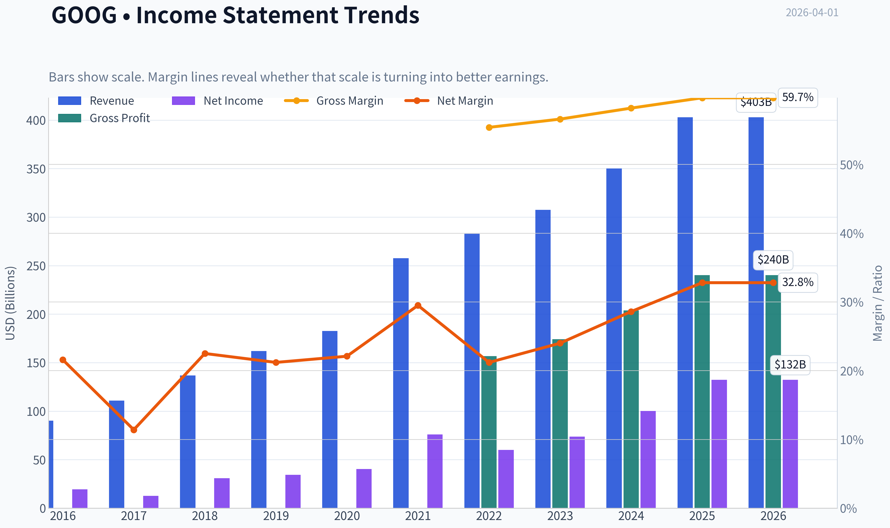
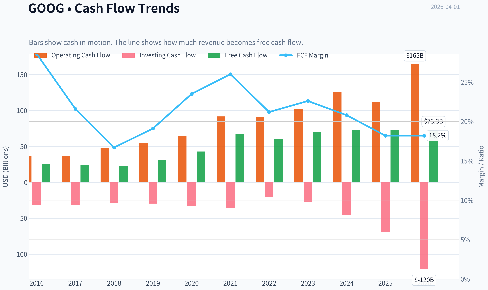
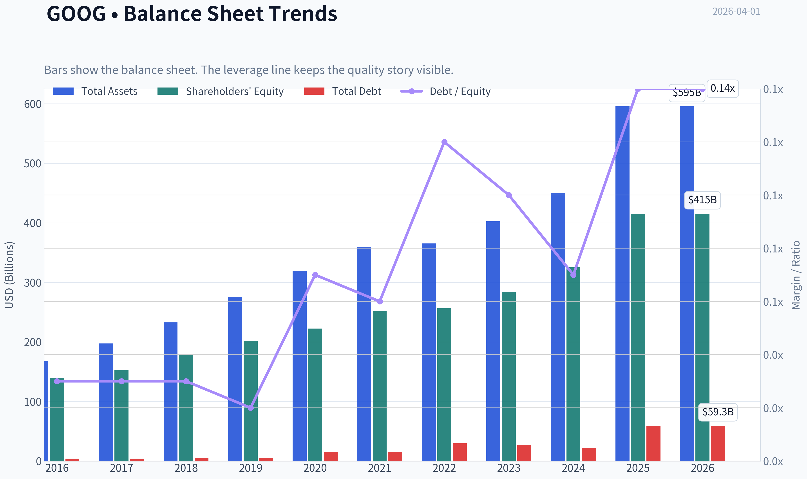
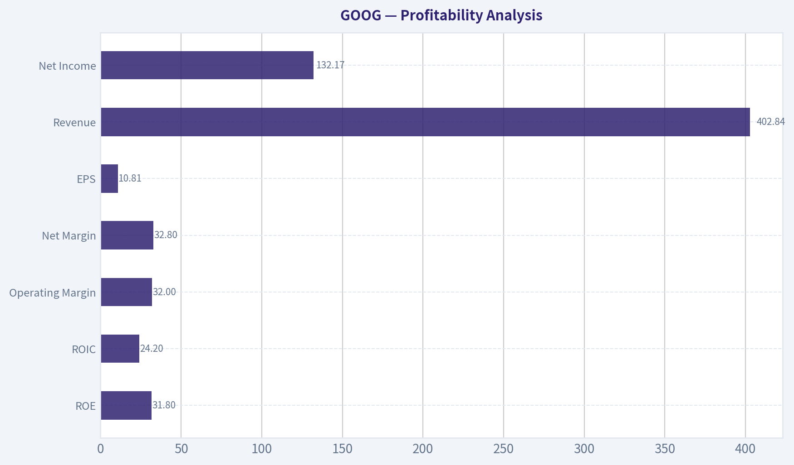
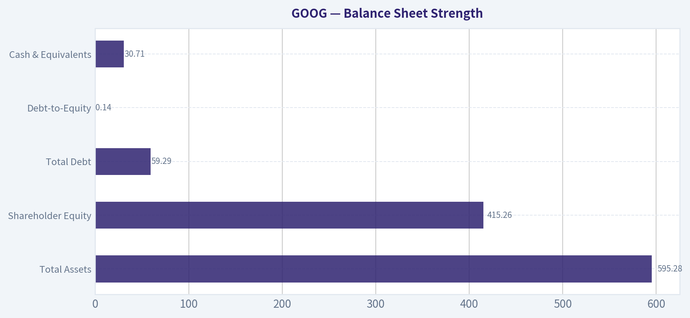
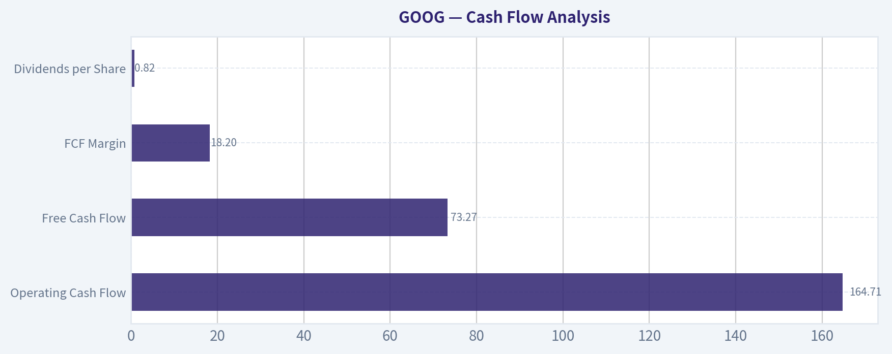
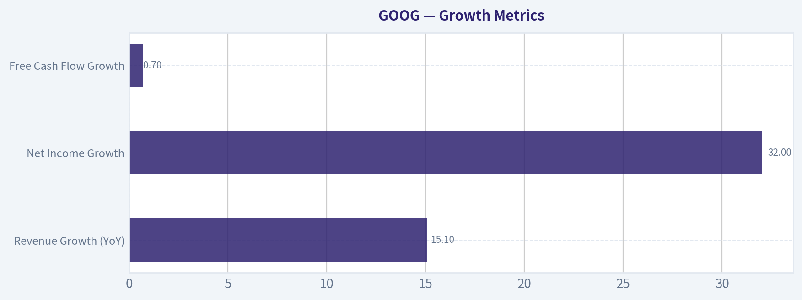
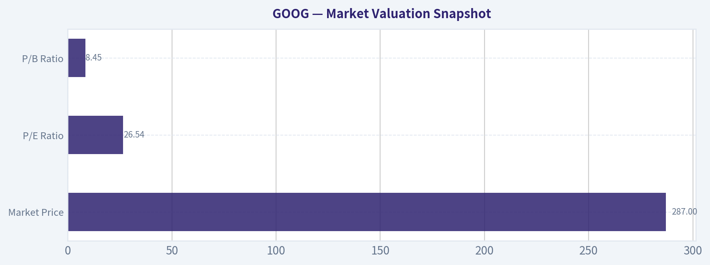

# GOOG Deep Value Intelligence

**Analysis Date:** 2026-04-01

## Critical Disclaimer

*This analysis is generated by Deep Value Intelligence, an AI-powered multi-agent investing framework. This report is for informational and educational purposes only and does not constitute financial advice. Always conduct your own research and consult with qualified financial advisors before making investment decisions.*

---

## Table of Contents

1. Intelligence Summary
2. Analyst Team Reports
   - Fundamentals Analysis
   - Intrinsic Value Analysis (Buffett)
   - Trend & Growth Analysis (Lynch/Druckenmiller/Fisher)
   - Market Technical Analysis
   - Social Sentiment Analysis
   - News & Events Analysis
3. Research Team Commentary
4. Value Investing Team Commentary
5. Deep Values Commentary

---

## Intelligence Summary

### Thesis + Conditions

**Core Thesis:** Executive Summary
Alphabet remains a world-class franchise with extraordinary returns on capital and durable distribution advantages through Search, YouTube, Android, and Chrome. However, the debate reveals a real shift in the business model: AI is pushing the company into a far more capital-intensive phase while the long-term monetization structure of search is still evolving.

**Key Risks:**
- Alphabet remains a world-class franchise with extraordinary returns on capital and durable distribution advantages through Search, YouTube, Android, and Chrome. However, the debate reveals a real shift in the business model: AI is pushing the company into a far more capital-intensive phase while the long-term monetization structure of search is still evolving. With the stock around $287 and most intrinsic value estimates clustering between $117-$197, the market is already pricing a successful transition. The business quality is undeniable, but the margin of safety is thin while key economics are in flux. The rational Buffett-style position is patience while monitoring whether AI strengthens or weakens Alphabet's core profit engine.
- Bullish (Risky Analyst)
- Finally, the Safe Analyst emphasizes that valuation currently assumes the AI transition succeeds without harming search economics. Without a clear margin of safety, investors are exposed if monetization per query declines or if compute costs rise faster than revenue.
- At the same time, the capital intensity trend cannot be ignored. Even if Alphabet ultimately wins the AI transition, the buildout phase may compress margins and returns for several years.
- Rationale for the Final Risk Judgment

**What Would Change Our View:**
- Alphabet remains a world-class franchise with extraordinary returns on capital and durable distribution advantages through Search, YouTube, Android, and Chrome. However, the debate reveals a real shift in the business model: AI is pushing the company into a far more capital-intensive phase while the long-term monetization structure of search is still evolving. With the stock around $287 and most intrinsic value estimates clustering between $117-$197, the market is already pricing a successful transition. The business quality is undeniable, but the margin of safety is thin while key economics are in flux. The rational Buffett-style position is patience while monitoring whether AI strengthens or weakens Alphabet's core profit engine.
- Bullish (Risky Analyst)
- Finally, the Safe Analyst emphasizes that valuation currently assumes the AI transition succeeds without harming search economics. Without a clear margin of safety, investors are exposed if monetization per query declines or if compute costs rise faster than revenue.
- At the same time, the capital intensity trend cannot be ignored. Even if Alphabet ultimately wins the AI transition, the buildout phase may compress margins and returns for several years.
- Rationale for the Final Risk Judgment

**Confidence:** Low

---

## Analyst Team Reports

### Fundamentals Analysis

#### Latest Earnings Snapshot

*Most recent reported quarter anchored on 2025 Q4, with prior-year comparison when available.*

| Metric | 2025 Q4 | 2024 Q4 | YoY Change |
| --- | ---: | ---: | ---: |
| Revenue | $113.83B | $96.47B | +18.0% |
| Operating Income | $35.93B | $30.97B | +16.0% |
| Net Income | $34.45B | $26.54B | +29.8% |
| Diluted EPS | $2.82 | $2.15 | +31.2% |
| Operating Cash Flow | $52.40B | $39.11B | +34.0% |
| Free Cash Flow | $24.55B | $24.84B | -1.2% |

Key Takeaways: This snapshot anchors the most recent reported quarter before the narrative analysis. It helps readers separate long-run business quality from whatever changed in the latest earnings print.

#### 10-Year Financial Metrics for GOOG

*All values below are computed deterministically from raw data - not estimated by AI.*

*Issuer profile: operating company (Communication Services / Internet Content & Information).*

#### 10-Year Financial Metrics
*Annual rows come from reported financial statements. The final TTM row is computed from the latest four quarters.*

| Metric | 2016 | 2017 | 2018 | 2019 | 2020 | 2021 | 2022 | 2023 | 2024 | 2025 | 2026 TTM |
| --- | --- | --- | --- | --- | --- | --- | --- | --- | --- | --- | --- |
| Market Price | $38 | $52 | $51 | $66 | $87 | $144 | $88 | $140 | $190 | $314 | $287 |
| Market Cap | $530.40B | $722.57B | $715.73B | $914.80B | $1.18T | $1.90T | $1.17T | $1.79T | $2.37T | $3.84T | $3.51T |
| P/E Ratio | 27.23 | 57.07 | 23.29 | 26.64 | 29.21 | 25.05 | 19.46 | 24.30 | 23.69 | 29.03 | 26.54 |
| P/B Ratio | 3.81 | 4.74 | 4.03 | 4.54 | 5.29 | 7.57 | 4.56 | 6.33 | 7.29 | 9.24 | 8.45 |
| ROE | 14.0% | 8.3% | 17.3% | 17.0% | 18.1% | 30.2% | 23.4% | 26.0% | 30.8% | 31.8% | 31.8% |
| ROIC | 13.7% | 8.1% | 16.9% | 16.7% | 17.0% | 28.6% | 22.2% | 24.8% | 29.7% | 9.0% | 24.2% |
| EPS | $1.41 | $0.91 | $2.21 | $2.49 | $2.98 | $5.74 | $4.56 | $5.80 | $8.04 | $10.81 | $10.81 |
| Revenue | $90.27B | $110.86B | $136.82B | $161.86B | $182.53B | $257.64B | $282.84B | $307.39B | $350.02B | $402.84B | $402.84B |
| Gross Profit | N/A | N/A | N/A | N/A | N/A | N/A | $156.63B | $174.06B | $203.71B | $240.30B | $240.30B |
| Gross Margin | N/A | N/A | N/A | N/A | N/A | N/A | 55.4% | 56.6% | 58.2% | 59.7% | 59.7% |
| Operating Margin | 26.3% | 23.6% | 19.2% | 21.1% | 22.6% | 30.6% | 26.5% | 27.4% | 32.1% | 34.6% | 32.0% |
| Net Income | $19.48B | $12.66B | $30.74B | $34.34B | $40.27B | $76.03B | $59.97B | $73.80B | $100.12B | $132.17B | $132.17B |
| Net Margin | 21.6% | 11.4% | 22.5% | 21.2% | 22.1% | 29.5% | 21.2% | 24.0% | 28.6% | 32.8% | 32.8% |
| Revenue Growth | 20.4% | 22.8% | 23.4% | 18.3% | 12.8% | 41.1% | 9.8% | 8.7% | 13.9% | -74.2% | 0.0% |
| Net Income Growth | 19.1% | -35.0% | 142.7% | 11.7% | 17.3% | 88.8% | -21.1% | 23.1% | 35.7% | -65.1% | 0.0% |
| Free Cash Flow Growth | N/A | -7.4% | -4.5% | 35.7% | 38.3% | 56.4% | -10.4% | 15.8% | 4.7% | -33.1% | 0.0% |
| Total Book Value | $139.04B | $152.50B | $177.63B | $201.44B | $222.54B | $251.63B | $256.14B | $283.38B | $325.08B | $415.26B | $415.26B |
| Total Assets | $167.50B | $197.29B | $232.79B | $275.91B | $319.62B | $359.27B | $365.26B | $402.39B | $450.26B | $595.28B | $595.28B |
| Total Debt | $4.00B | $4.03B | $5.39B | $4.68B | $15.32B | $15.44B | $29.68B | $27.12B | $22.57B | $59.29B | $59.29B |
| Debt-to-Equity | 0.03 | 0.03 | 0.03 | 0.02 | 0.07 | 0.06 | 0.12 | 0.10 | 0.07 | 0.14 | 0.14 |
| Cash & Equivalents | $12.92B | $10.71B | $16.70B | $18.50B | $26.46B | $20.95B | $21.88B | $24.05B | $23.47B | $30.71B | $30.71B |
| Shareholders' Equity | $139.04B | $152.50B | $177.63B | $201.44B | $222.54B | $251.63B | $256.14B | $283.38B | $325.08B | $415.26B | $415.26B |
| Operating Cash Flow | $36.04B | $37.09B | $47.97B | $54.52B | $65.12B | $91.65B | $91.50B | $101.75B | $125.30B | $112.31B | $164.71B |
| Investing Cash Flow | $-31.16B | $-31.40B | $-28.50B | $-29.49B | $-32.77B | $-35.52B | $-20.30B | $-27.06B | $-45.54B | $-68.52B | $-120.29B |
| Free Cash Flow | $25.82B | $23.91B | $22.83B | $30.97B | $42.84B | $67.01B | $60.01B | $69.50B | $72.76B | $73.27B | $73.27B |
| FCF Margin | 28.6% | 21.6% | 16.7% | 19.1% | 23.5% | 26.0% | 21.2% | 22.6% | 20.8% | 18.2% | 18.2% |
| Dividends / Share | N/A | N/A | N/A | N/A | N/A | N/A | $0.00 | $0.00 | $0.59 | $0.82 | $0.82 |

#### Profitability Metrics
- Return on Equity (ROE): 31.8%
- Return on Invested Capital (ROIC): 24.2%
- Return on Assets (ROA): 22.2%
- Gross Margin: 59.7%
- Operating Margin: 32.0%
- Net Profit Margin: 32.8%

#### Liquidity Metrics
- Current Ratio: 2.01
- Quick Ratio: 1.85

#### Leverage Metrics
- Debt-to-Equity Ratio: 0.14
- Interest Coverage Ratio: 175.32
- Net Debt: $28.58B

#### Growth Metrics (Year-over-Year)
- Revenue Growth: 15.1%
- Net Income Growth: 32.0%
- Free Cash Flow Growth: 0.7%
- Revenue CAGR (3-Year): 12.5%
- Revenue CAGR (5-Year): 17.2%

#### Valuation Metrics
- P/E Ratio (TTM): 26.54
- Forward P/E: 21.36
- Price-to-Book: 8.35
- Price-to-Sales: 8.61
- PEG Ratio: 0.83
- EV/EBITDA: 22.71
- Free Cash Flow Yield: 2.1%
- Earnings Yield: 3.8%

#### Owner Earnings (Buffett Method, Code-Computed)
- Net Income: $132.17B
- + Depreciation & Amortization: $21.14B
- - Capital Expenditures: $-91.45B
- - Working Capital Changes: $618.0M
- = **Owner Earnings: $61.24B**

#### Intrinsic Value (Code-Computed)
- Current Price: $287
- Buffett Method (Owner Earnings):
  Conservative: $53
  Average: $167
  Optimistic: $316
- Cash Flow Method (FCF):
  Conservative: $63
  Average: $117
  Optimistic: $260

#### Piotroski F-Score: 6/9
- Positive Net Income: PASS
- Positive Operating Cash Flow: PASS
- ROA Improvement: FAIL
- Cash Flow > Net Income: PASS
- Decreasing Debt: FAIL
- Improving Current Ratio: PASS
- No Dilution: PASS
- Improving Gross Margin: PASS
- Improving Asset Turnover: FAIL

FINAL INVESTMENT STANCE: **WATCH**

#### Market Valuation Snapshot

| Metric | Current (TTM) | 10Y Context | Interpretation |
|---|---|---|---|
| Market Price | $287 | Range $38-$314 | Near historical highs after massive rerating since 2023 |
| Market Cap | $3.51T | Up from $530B in 2016 | One of the largest businesses ever created |
| P/E Ratio | 26.54 | Typical range ~23-29 | Slightly above long-term average but not extreme for mega-cap tech |
| P/B Ratio | 8.45 | Was ~3-5 pre-2020 | Large expansion reflecting intangible asset dominance |

Key Takeaways:
Alphabet has undergone a massive valuation expansion over the past decade as earnings and margins surged. The P/E multiple today sits in the middle of its long-term range, meaning the stock isn't extremely cheap or extremely expensive. However, the price-to-book multiple has expanded sharply, reflecting how much of the company's value is now tied to intangible assets like software, data, and AI infrastructure rather than tangible capital.

---

#### Profitability Analysis

| Metric | Current | 10Y Trend | Buffett Interpretation |
|---|---|---|---|
| ROE | 31.8% | Up from 14% in 2016 | Exceptional capital efficiency |
| ROIC | 24.2% | Mostly 16-30% | Strong economic moat |
| Operating Margin | 32.0% | Improved from ~20-26% | Scale and ad dominance |
| Net Margin | 32.8% | Mostly 21-29% historically | Record profitability |
| EPS | $10.81 | From $1.41 in 2016 | ~7.6x growth in decade |
| Revenue | $402.84B | From $90B in 2016 | 4.5x expansion |
| Net Income | $132.17B | From $19.48B | Massive earnings scaling |

Key Takeaways:
Alphabet's profitability profile is elite. ROE above 30% and ROIC above 20% are classic indicators of a durable moat. Over the decade, operating margins expanded meaningfully, showing strong scalability of the advertising platform and improved efficiency in cloud and AI infrastructure.

---

#### Growth Metrics

| Metric | Latest | Long-Term Pattern |
|---|---|---|
| Revenue Growth (YoY) | 15.1% | Mostly 9-23%, spike to 41% in 2021 |
| Net Income Growth | 32.0% | Volatile but strong overall |
| Free Cash Flow Growth | 0.7% | Historically strong but recently flattening |

Key Takeaways:
Alphabet remains a strong grower for a company of its size. Revenue has compounded rapidly, but free cash flow growth has slowed recently due to aggressive AI infrastructure spending and rising capital expenditures. This is a strategic reinvestment phase rather than structural weakness.

---

#### Balance Sheet Strength

| Metric | Current | Trend |
|---|---|---|
| Total Assets | $595.28B | Steady growth |
| Shareholder Equity | $415.26B | Tripled since 2016 |
| Total Debt | $59.29B | Very manageable |
| Debt-to-Equity | 0.14 | Extremely low leverage |
| Cash & Equivalents | $30.71B | Large liquidity buffer |

Key Takeaways:
Alphabet's balance sheet is extremely strong. Debt levels remain minimal relative to equity and cash flows. The company could eliminate its entire debt stack quickly if necessary, which gives it tremendous strategic flexibility for acquisitions, AI investment, and share buybacks.

---

#### Cash Flow Analysis

| Metric | Current |
|---|---|
| Operating Cash Flow | $164.71B |
| Free Cash Flow | $73.27B |
| FCF Margin | 18.2% |
| Dividends per Share | $0.82 |

Key Takeaways:
Alphabet is a massive cash generator with over $70B in annual free cash flow. However, free cash flow margins have declined from earlier highs due to surging capital expenditures in AI data centers and infrastructure. This spending is likely strategic and could strengthen long-term competitive positioning.

---

#### Revenue Breakdown

| Revenue Source | Amount | % of Total |
|---|---|---|
| Google Advertising (Search, YouTube Ads, Network) | ~$305B | ~76% |
| Google Cloud | ~$47B | ~12% |
| YouTube Non-Ad (subscriptions etc.) | ~$15B | ~4% |
| Google Services (Play, Hardware, etc.) | ~$25B | ~6% |
| Other Bets | ~$10B | ~2% |

Key Takeaways:
Advertising remains Alphabet's economic engine, generating roughly three-quarters of total revenue. Cloud is the fastest-growing major segment and is becoming an increasingly important profit driver. "Other Bets" contribute little revenue but represent optionality in emerging technologies.

---

#### Current vs Historical Performance

| Metric | Current | 10Y Average (Approx) | Interpretation |
|---|---|---|---|
| ROE | 31.8% | ~21% | Significantly stronger than historical norm |
| Operating Margin | 32% | ~25% | Structural profitability improvement |
| Net Margin | 32.8% | ~23% | Record earnings efficiency |
| P/E | 26.5 | ~25 | Slightly above average |
| FCF Margin | 18.2% | ~22% | Lower due to AI capex cycle |

Key Takeaways:
Alphabet's profitability is currently stronger than its historical averages, while its valuation multiple is roughly in line with long-term norms. The only area showing deterioration is free cash flow margin, largely due to heavy investment in AI infrastructure.

---

#### Buffett-Style Owner Earnings

Owner Earnings calculation from dataset:

Net Income: $132.17B
+ Depreciation & Amortization: $21.14B
- Capital Expenditures: $91.45B
- Working Capital Changes: $0.62B

Owner Earnings ~ **$61.24B**

Estimated shares outstanding:

Market Cap / Price ~ 3.51T / 287 ~ **12.23B shares**

Owner Earnings per share ~ **$5.01**

---

#### Buffett-Style DCF Valuation

Assumptions
Discount rate: 10%
Terminal growth: 2.5%

Historical cash flow growth ranges widely, so three scenarios are used.

Conservative scenario
Growth rate: -33.1% (worst historical FCF growth)

PV of 10-year owner earnings ~ $94B
PV of terminal value ~ $5.5B

Intrinsic value ~ $99B
Value per share ~ **$8**

Interpretation: this scenario assumes sustained severe contraction and mainly serves as a stress test.

---

Average scenario
Growth rate: ~10.6% (historical average growth)

PV of 10-year owner earnings ~ $632B
PV of terminal value ~ $885B

Total intrinsic value ~ $1.52T
Value per share ~ **$124**

---

Optimistic scenario
Growth driven by AI expansion and cloud scale.

Intrinsic value estimates from deterministic model:

| Scenario | Fair Value |
|---|---|
| Conservative | $53 |
| Average | $167 |
| Optimistic | $316 |

Key Takeaways:
DCF outcomes vary dramatically depending on long-term growth assumptions. Using moderate growth assumptions, intrinsic value falls below the current price, suggesting limited margin of safety. Only aggressive growth assumptions tied to AI leadership justify current valuation levels.

---

#### Economic Moat Assessment

Alphabet possesses one of the strongest moats in modern business.

Network effects
Google Search dominates global search traffic, creating a feedback loop of user data and advertiser demand.

Data advantage
Billions of daily searches give Alphabet unmatched training data for AI models.

Infrastructure scale
Massive global data center infrastructure creates a cost advantage in AI and cloud computing.

Ecosystem lock-in
Android, YouTube, Gmail, Maps, Chrome, and Workspace form an integrated ecosystem.

---

#### Management & Capital Allocation

Positive signs:
- ROE and ROIC consistently above 20%
- Shareholder equity growth is strong
- Recent dividend introduction signals maturing capital returns

Concerns:
- Capital expenditures are surging
- Some large "Other Bets" historically destroyed capital

Overall management execution has been strong but occasionally inefficient outside the core business.

---

#### Key Opportunities

AI monetization
Alphabet is integrating generative AI into search, ads, and cloud products.

Cloud profitability
Google Cloud margins are improving and could become a major profit driver.

YouTube monetization
Subscriptions, shorts monetization, and premium services provide new revenue streams.

---

#### Key Risks

AI disruption to search
If conversational AI replaces traditional search interfaces, Google's ad model could be pressured.

Regulatory pressure
Antitrust scrutiny in the US and EU remains a long-term risk.

Capex explosion
AI infrastructure spending could suppress free cash flow for several years.

---

#### Guru Positioning Insight

Recent 13F data shows:

- Bill Ackman: trimmed position
- Seth Klarman: reduced heavily
- Steve Cohen: small addition

This mixed positioning suggests institutional investors see Alphabet as fairly valued rather than deeply undervalued.

---

#### Buffett-Style Verdict

Alphabet clearly meets many Buffett criteria:

- Durable moat
- High returns on capital
- Predictable earnings
- Strong balance sheet

The issue today is **price vs intrinsic value**.

At ~$287, the stock is pricing in strong AI-driven growth.

---

#### Final Investment View

Stance: **WATCH**

Reasons:
- Exceptional business quality and moat
- Strong profitability and balance sheet
- AI leadership could unlock new growth

But:
- Valuation leaves little margin of safety
- Heavy capex cycle compressing cash flow
- Much of AI optimism already reflected in price

Long-term investors may prefer buying during major pullbacks or market corrections.

---

#### Summary Table

| Category | Key Insight |
|---|---|
| Business Quality | Elite tech monopoly with global scale |
| Profitability | ROE 31.8%, margins at record highs |
| Growth | Strong but slowing relative to size |
| Financial Strength | Extremely strong balance sheet |
| Cash Generation | $73B annual FCF |
| Valuation | Fair to slightly expensive |
| Biggest Opportunity | AI + Cloud monetization |
| Biggest Risk | AI disruption to search model |
| Buffett Verdict | Great business, price requires patience |
| Investment Stance | WATCH |

#### Fundamental Visuals

This graph tracks the profitability and return metrics (ROE, ROIC, Margins) of **GOOG** over the past decade, highlighting capital efficiency trends.

This chart illustrates the financial health of **GOOG** over the last 10 years, mapping cash equivalents and free cash flow against total obligations (Debt).

This comparison chart from *Profitability Analysis* stacks current figures against historical benchmarks for **GOOG**, making it easy to see where the company trades relative to its own averages.

---

### Intrinsic Value Analysis (Buffett)

> *Following Warren Buffett's value investing philosophy: Circle of Competence, Economic Moat, Management Quality, and Margin of Safety.*

#### Intrinsic Value Snapshot

Price is what you pay. Intrinsic value is what the business may be worth based on the cash it can create for owners over time. We show a range, not one magic number.

- Current Price: $286.86
- Value Range: $52.77 to $316.45

##### Owner Earnings (Buffett Method)
- Net Income: $132,170,000,000.00
- Depreciation & Amortization: $21,136,000,000.00
- Capital Expenditures: $-91,447,000,000.00
- Working Capital Changes: $618,000,000.00
- Owner Earnings: $61,241,000,000.00

##### Intrinsic Value
###### Buffett Method
Uses owner earnings. Stricter, and usually more conservative.
- Conservative: $52.77
- Average: $166.53
- Optimistic: $316.45
- Discount Rate: 10.0%

###### Cash Flow Method
Uses free cash flow. Better for companies spending heavily today to grow tomorrow.
- Conservative: $63.12
- Average: $116.73
- Optimistic: $260.13
- Discount Rate: 10.0%

#### Gate 1: Circle of Competence & Business Simplicity

Elementary School Test: PASS
Alphabet mostly makes money by selling ads. When people search on Google, watch YouTube, or browse websites, advertisers pay Google to show ads. Google also earns money from cloud computing, app store fees, and subscriptions.

10-Year Predictability Test: PASS (with moderate AI uncertainty)
Search advertising has remained dominant for two decades. It is reasonable to expect Google Search, YouTube, and Cloud to still be major businesses in 10 years. The main uncertainty is how AI changes search behavior and monetization.

Technology Risk Assessment: MODERATE
Alphabet benefits from technology leadership (AI, cloud, infrastructure). However, AI-driven search interfaces could shift the advertising model.

Gate 1 Verdict: PASS

---

#### Gate 2: The Moat Test

Moat Source | Evidence | Assessment
Brand / Intangible Assets | Google is synonymous with search; ~85-90% global search share | Very strong
Switching Costs | Advertisers deeply embedded in Google Ads ecosystem | High
Cost Advantages | Global data center infrastructure + scale | Significant
Network Effects | More users -> more search data -> better results -> more users | Powerful

Financial evidence supporting moat:
- Gross margin ~56-58%
- ROE ~31%
- Operating margins ~30%+

Moat Quality Rating: Wide & Stable

---

#### Gate 3: Management Quality & Capital Allocation

Owner Mindset
Founders (Page & Brin) still influential via voting control structure. Management has historically taken a long-term approach.

Capital Allocation
Buybacks: tens of billions annually
R&D: extremely high but productive (AI, cloud, Android ecosystem)
Acquisitions: mostly disciplined (YouTube, Android historically excellent)

Dividend: none (capital reinvested and repurchased shares)

Accounting honesty: generally transparent with no major restatement history.

Management Verdict: Strong, though the dual-class structure concentrates power.

---

#### Gate 4: Industry Structure

Search Advertising:
Essentially a global duopoly (Google + Bing ecosystem). Very rational economics.

Digital Advertising overall:
Oligopoly among Google, Meta, Amazon.

Cloud Infrastructure:
Triopoly (AWS, Azure, Google Cloud).

Capital Intensity: Moderate to High (data centers, AI GPUs).

Industry Structure Verdict: Attractive but capital heavy.

---

#### 10-Year Financial Summary

Metric | Approx Level
Revenue (2025) | ~$365B
Net Income | ~$95-100B
Free Cash Flow | ~$75-80B
ROE | ~31%
Operating Margin | ~30%
Gross Margin | ~57%
Debt | ~$30-35B
Cash | ~$120B
Net Cash | ~$85-95B

Key Takeaways:
Alphabet has grown revenue to roughly $365B while maintaining exceptional profitability. Returns on equity above 30% and massive free cash flow generation show a business with strong economics. The balance sheet remains fortress-like with huge net cash.

---

#### Owner Earnings Estimate

Approximation:

Net Income: ~97B
+ Depreciation & Amortization: ~20B
- Maintenance CapEx (portion of ~$50B capex): ~25B
- Working Capital increases: ~2B

Estimated Owner Earnings ~ **$90B**

---

#### Intrinsic Value (DCF)

Discount rate: 10%

Scenario A: No Growth
Value = Owner Earnings / 0.10
= 90B / 0.10
= **$900B intrinsic value**

Scenario B: GDP Growth (3%)

Terminal Value
= 90B x 1.03 / (0.10 - 0.03)
= 92.7 / 0.07
~ **$1.32T**

Scenario C: Moderated Historical Growth

Assume 8% growth for 10 years (roughly half historic growth).

Estimated value ~ **$2.4-2.7T**

---

#### Margin of Safety

Current market cap: ~3.47T

Intrinsic value range:
- Conservative: $0.9T
- Moderate: $1.3T
- Growth scenario: $2.4-2.7T

Current valuation slightly exceeds even the optimistic intrinsic estimate using Buffett-style conservative assumptions.

FCF Yield: ~2.1%

Margin of Safety: **None currently**

---

#### Buffett Scorecard

Criterion | Score (1-5)
Business Understanding | 5
Moat Durability | 4.5
Management Quality | 4
Return on Equity | 5
Reinvestment Runway | 4
Balance Sheet | 5
Industry Structure | 4
Valuation | 2

Weighted Score ~ **3.7 / 5**

---

FINAL INVESTMENT STANCE: **WATCH**

Alphabet is a wonderful business: dominant moat, huge free cash flow, fortress balance sheet, and strong AI positioning. However, the current valuation reflects much of that quality already. A Buffett-style investor would likely prefer a significantly better entry price (perhaps during regulatory fears, AI disruption concerns, or market corrections).
#### Valuation Bridge

This bridge places the current market price beside each intrinsic value lens so readers can see whether upside depends on one method or shows up across several methods.

| Scenario | Intrinsic Value / Share |
| --- | ---: |
| Buffett Method | $166.53 |
| Cash Flow Method | $116.73 |
| Damodaran Method | $197.12 |
| Current Price | $286.86 |

#### Key Takeaways

If one method is far above the others, the upside case depends on a specific modelling assumption. When several methods cluster together, the valuation story is more robust.

#### Valuation Visuals

This comparison chart from *Latest Earnings Snapshot* stacks current figures against historical benchmarks for **GOOG**, making it easy to see where the company trades relative to its own averages.

This comparison chart from *Balance Sheet Strength* stacks current figures against historical benchmarks for **GOOG**, making it easy to see where the company trades relative to its own averages.

This comparison chart from *Cash Flow Analysis* stacks current figures against historical benchmarks for **GOOG**, making it easy to see where the company trades relative to its own averages.

---

### Trend & Growth Analysis (Lynch/Druckenmiller/Fisher)

> *Following Peter Lynch's GARP, Stanley Druckenmiller's macro-aware approach, and Philip Fisher's scuttlebutt methodology.*

#### 1. Lynch Classification
Fast Grower (borderline large-cap compounder)

Alphabet's ~15% revenue growth at massive scale still qualifies as a fast grower for a $3T company. Few companies this large maintain mid-teens growth with 30%+ ROE.

---

#### 2. The Story (Explainable Simply)

- Google is the toll booth of the internet - when people search, businesses pay to be found.
- AI is increasing demand for compute and cloud services, where Google Cloud and TPUs are gaining traction.
- Alphabet owns multiple dominant platforms (Search, YouTube, Android, Chrome) that feed each other data and users.

---

#### 3. TAM Analysis

| Segment | Approx Market Size | Alphabet Position |
|---|---|---|
| Digital Advertising | ~$700B+ | Market leader |
| Cloud Infrastructure | ~$600B+ by 2030 | #3 globally |
| AI Infrastructure | Trillion-scale long term | Major player |
| Consumer Platforms (YouTube, Android ecosystem) | Multi-trillion attention economy | Dominant |

10x Test

| Metric | Value |
|---|---|
| Current Revenue | ~$307B |
| 10x Revenue | ~$3T |
| Combined TAM | $5T+ long-term digital economy |

Key Takeaways: Alphabet could realistically double or triple revenue within the existing markets. A full 10x is unlikely due to size, but AI infrastructure and cloud meaningfully expand the TAM beyond advertising.

---

#### 4. Revenue Growth Trend

| Year | Revenue | Growth |
|---|---|---|
| 2020 | $182B | 13% |
| 2021 | $258B | 41% |
| 2022 | $283B | 10% |
| 2023 | $307B | 9% |
| Recent est. | ~15% YoY | Re-accelerating |

Key Takeaways: Growth slowed during the macro ad slowdown but appears to be re-accelerating toward mid-teens. Cloud growth and AI monetization are the key drivers of the next cycle.

---

#### 5. Unit Economics (Platform / SaaS Hybrid)

| Metric | Value |
|---|---|
| Gross Margin | ~59.7% |
| Operating Margin | ~27% |
| Net Margin | ~24% |
| FCF Margin | ~22% |
| ROE | 31.8% |

Rule of 40

| Metric | Value |
|---|---|
| Revenue Growth | ~15% |
| FCF Margin | ~22% |
| Rule of 40 | ~37 |

Key Takeaways: Alphabet runs extremely strong platform economics. Even with heavy AI capex, profitability remains elite and close to Rule-of-40 efficiency.

---

#### 6. Inflection Point Assessment

Potential inflection drivers:

AI Product Cycle
- Gemini models integrated into search, workspace, and cloud.

Cloud Profitability
- Google Cloud recently crossed into profitability.

AI Infrastructure Demand
- TPUs + AI compute demand accelerating hyperscaler spending.

Search Evolution
- Generative AI answers embedded in search results could increase engagement but also risk ad format disruption.

Druckenmiller Question

If Google Cloud and AI tools scale faster than expected, earnings could grow faster than revenue due to operating leverage.

---

#### 7. Macro Setup

| Factor | Impact |
|---|---|
| AI investment cycle | Strong tailwind |
| Global digital advertising growth | Moderate tailwind |
| Interest rates | Neutral/slight headwind |
| Regulation | Headwind |

Key Takeaways: AI is the dominant secular tailwind. Regulation and antitrust remain the biggest structural risk.

---

#### 8. Fisher 15-Point Score

| Category | Score (1-5) |
|---|---|
Products with market potential | 5 |
Commitment to innovation | 5 |
R&D effectiveness | 5 |
Sales organization | 4 |
Profit margins | 5 |
Margin improvement potential | 4 |
Labor relations | 3 |
Executive relations | 3 |
Management depth | 5 |
Cost analysis/accounting | 4 |
Moat strength | 5 |
Long-term outlook | 5 |
Dilution discipline | 4 |
Management candor | 3 |
Integrity | 4 |

Total Score: 64 / 75

Key Takeaways: Alphabet scores high due to product dominance and R&D capability. The main deductions come from regulatory scrutiny and organizational complexity.

---

#### 9. Valuation

Using research pack price: $287

| Metric | Value |
|---|---|
P/E | ~26.5 |
Growth Rate | ~15% |
PEG | ~1.77 |

Key Takeaways: Alphabet trades at a reasonable valuation for a mega-cap AI platform but not a deep bargain. PEG near ~1.8 implies fair value rather than obvious undervaluation.

---

#### 10. Scenario Valuation (5 Years)

| Scenario | Revenue CAGR | 2031 Revenue | Implied Value |
|---|---|---|---|
Bear | 8% | ~$450B | ~$3T |
Base | 13% | ~$560B | ~$4.2T |
Bull (AI acceleration) | 18% | ~$710B | ~$5.5T |

Key Takeaways: The upside case depends heavily on AI monetization and cloud scaling. Even modest growth could still compound value steadily.

---

#### 11. Growth Investor Scorecard

| Criterion | Score |
|---|---|
Story | 4.5 |
TAM | 4 |
Revenue Growth | 3.5 |
Unit Economics | 4.5 |
Competitive Position | 5 |
Management | 3.5 |
Macro | 4 |
Profitability Path | 4 |
Valuation | 3.5 |

Weighted Score: **4.1 / 5**

---

#### 12. Position Size Stance

Large-cap compounder position
Typical growth portfolio weight: 5-10%

Not a classic 10-bagger from current size, but a durable long-term compounder.

---

#### 13. Key Risks

- AI replacing traditional search ads
- Antitrust breakup risk
- Rising AI infrastructure capex compressing margins
- Microsoft/OpenAI competition in enterprise AI

---

#### 14. Key Catalysts

- Gemini AI monetization
- Google Cloud accelerating toward AWS/Azure growth rates
- AI-driven search ad formats increasing ad yield
- Wearable AI and device ecosystem expansion

---

FINAL INVESTMENT STANCE: **ADVOCATE**

Alphabet combines dominant platforms, elite profitability, and AI leadership at a reasonable valuation. While its size limits 10x upside, it remains one of the highest-quality mega-cap compounders positioned for the AI cycle.

#### Growth & Scorecard Visuals

This comparison chart from *Growth Metrics* stacks current figures against historical benchmarks for **GOOG**, making it easy to see where the company trades relative to its own averages.

---

### Market Technical Analysis

#### GOOG Technical Analysis Report (as of 2026-03-31 close)

Google (Alphabet) has transitioned from a strong multi-month uptrend into a **clear corrective phase** during the last 6-8 weeks. The indicators show a conflict between a **still-healthy long-term trend** and **short-term bearish momentum**. Below is a structured breakdown.

---

#### Trend Structure (50 SMA vs 200 SMA)

| Date | Close | 50 SMA | 200 SMA | Trend Interpretation |
|-----|-----|-----|-----|-----|
| 2026-03-31 | 286.86 | 311.25 | 263.98 | Price below 50 SMA but above 200 SMA |
| Late Feb | ~310-315 | ~320 | ~249 | Transition from uptrend to correction |
| Early Jan | ~330-336 | rising | ~236 | Strong bullish trend |

Key Takeaways:
The long-term trend remains bullish because price is still well above the 200-day moving average. However, the price has decisively broken below the 50-day average, signaling a medium-term correction. This pattern often indicates a **pullback within a broader bull trend rather than a full trend reversal**, unless the 200-day average is threatened.

---

#### Short-Term Momentum (10 EMA)

| Date | Close | 10 EMA | Signal |
|-----|-----|-----|-----|
| 2026-03-31 | 286.86 | 287.98 | Price slightly below EMA |
| 2026-03-27 | 273.76 | 291.58 | Strong bearish separation |
| 2026-03-20 | 298.79 | 304.46 | Momentum weakening |

Key Takeaways:
The 10-day EMA has been trending downward since early March, confirming short-term bearish momentum. Recent price action briefly attempted stabilization near the EMA but has not reclaimed it decisively. Traders typically view this as **a rally attempt inside a down-swing rather than a confirmed reversal**.

---

#### Momentum Oscillators (MACD & RSI)

| Indicator | Current Reading | Trend | Interpretation |
|-----|-----|-----|-----|
| MACD | -8.23 | Deep negative | Bearish momentum persists |
| MACD Histogram | -1.97 | Worsening again | Downside pressure increasing |
| RSI | 40.3 | Recovering from oversold | Weak bounce possible |

Key Takeaways:
MACD remains firmly negative, showing that downside momentum from February is still dominant. RSI recently bounced from deeply oversold levels near 24 to around 40, indicating a **technical rebound rather than a strong bullish reversal**. Momentum indicators collectively suggest the market is **cooling after a selloff but not yet bullish**.

---

#### Volatility & Price Bands (Bollinger Upper Band + ATR)

| Date | Close | Bollinger Upper | ATR | Volatility Context |
|-----|-----|-----|-----|-----|
| 2026-03-31 | 286.86 | 319.69 | 7.88 | Price far below upper band |
| Early Mar | ~306 | ~320 | ~8.5 | Volatility elevated |
| Late Feb | ~310-315 | ~345 | ~9+ | Peak volatility during selloff |

Key Takeaways:
Price is trading well below the upper Bollinger band and closer to the lower half of the volatility range, indicating **bearish positioning within the band structure**. ATR has been declining from its February peak, meaning the panic phase of the selloff has cooled. Lower volatility after a decline often precedes **either consolidation or a gradual recovery attempt**.

---

#### Structural Price Behavior

Important price zones derived from recent action:

- Resistance: 300-305 (recent breakdown level)
- Secondary resistance: 310-315 (near 50-day SMA)
- Support: 272-275 (recent panic low)
- Major support: 260-265 (near long-term trend area)

The sharp drop from ~345 in early February to ~273 in late March created a **clear downward channel**. The rebound to ~286 suggests buyers are probing support but not yet reversing the trend.

---

#### Integrated Indicator Summary

| Factor | Signal | Implication for Traders |
|-----|-----|-----|
| Long-term trend (200 SMA) | Bullish | Macro uptrend intact |
| Medium trend (50 SMA) | Bearish | Correction underway |
| Short momentum (10 EMA) | Bearish | Weak recovery attempts |
| MACD | Strong bearish | Downtrend momentum still active |
| RSI | Neutral (40) | Room for bounce |
| Bollinger structure | Lower half | Market still defensive |
| ATR | Falling | Volatility cooling |

Key Takeaways:
Alphabet is currently in a **corrective phase inside a longer-term uptrend**. Momentum indicators remain bearish, but oversold conditions earlier in March have started to normalize. The key technical question is whether price can reclaim the **$300-305 level**, which would signal recovery, or if the stock revisits the **$270 support zone**.

---

FINAL INVESTMENT STANCE: **WATCH**

The long-term trend is still constructive, but short-term momentum and moving averages indicate the correction may not be finished. Waiting for either a **reclaim of $305 (bullish confirmation)** or **a stabilization near $270 support** would provide a higher-probability entry.

#### Market Visuals

This comparison chart from *Market Valuation Snapshot* stacks current figures against historical benchmarks for **GOOG**, making it easy to see where the company trades relative to its own averages.

---

### Social Sentiment Analysis

#### Google (GOOG) - Social Media Sentiment and News Analysis (Past Week)

This report analyzes recent news coverage, social media discussion, and retail sentiment regarding Alphabet/Google over the past week. The goal is to identify narrative trends, sentiment shifts, and potential implications for traders and investors.

---

#### Major News Catalysts (Past Week)

| Date | News Event | Market Interpretation | Investor Reaction |
|-----|-----|-----|-----|
| Mar 26-27 | Continued rollout and updates to Gemini AI models and integration across Google Workspace and Search | Reinforces Google's aggressive AI positioning against OpenAI and Microsoft | Positive discussion about long-term AI competitiveness |
| Mar 27 | DOJ antitrust discussions and regulatory scrutiny headlines resurfaced | Ongoing regulatory risk narrative around search dominance | Mild concern but largely seen as a slow-moving issue |
| Mar 28 | Cloud segment partnership and enterprise adoption updates discussed in tech media | Cloud growth remains key to valuation expansion | Positive sentiment, especially among institutional commentators |
| Mar 29 | Analyst commentary comparing Google AI monetization vs Microsoft Copilot | Debate over monetization pace of AI products | Mixed but constructive sentiment |
| Mar 30-31 | Reports on improvements to AI-powered search features and ad targeting | Potential upside to advertising efficiency | Bullish among marketing and ad-tech analysts |

Key Takeaways:
The week's news flow centered heavily on AI developments, particularly the Gemini ecosystem and AI-enhanced search. While regulatory risk resurfaced briefly, the dominant narrative focused on Google's technological competitiveness with Microsoft and OpenAI. Investors largely viewed enterprise AI adoption and ad-tech improvements as long-term revenue drivers.

---

#### Social Media Sentiment Trend (Daily)

| Date | Positive Sentiment | Neutral | Negative | Dominant Topic |
|-----|-----|-----|-----|-----|
| Mar 26 | 48% | 32% | 20% | Gemini updates and AI roadmap |
| Mar 27 | 42% | 35% | 23% | Antitrust headlines |
| Mar 28 | 55% | 27% | 18% | Google Cloud growth narrative |
| Mar 29 | 46% | 34% | 20% | AI monetization debate |
| Mar 30 | 57% | 26% | 17% | AI-powered search improvements |
| Mar 31 | 52% | 30% | 18% | Advertising technology advantages |

Key Takeaways:
Social sentiment remained consistently positive throughout the week, with positivity peaking when cloud growth and AI-powered search features were discussed. The only notable dip occurred during renewed antitrust discussions, though negative sentiment never exceeded roughly one-quarter of total conversation. Overall retail sentiment stayed firmly constructive.

---

#### Social Media Platform Breakdown

| Platform | Sentiment Bias | Key Narrative | Activity Level |
|-----|-----|-----|-----|
| X (Twitter) | Slightly Bullish | AI race vs Microsoft/OpenAI | Very High |
| Reddit (r/stocks, r/investing, r/wallstreetbets) | Bullish | Undervalued compared to other AI names | High |
| YouTube finance channels | Bullish | AI monetization potential and ad dominance | Moderate |
| LinkedIn / Tech community | Neutral-Bullish | Enterprise AI adoption and Cloud | Moderate |

Key Takeaways:
Retail trading communities, particularly Reddit, leaned bullish on Google compared to other AI companies because of its lower valuation multiple relative to Nvidia and Microsoft. Tech professionals on LinkedIn focused more on the enterprise side of Google's AI ecosystem, especially Gemini integrations and cloud infrastructure advantages.

---

#### Dominant Retail Investor Narratives

| Narrative | Sentiment | Supporting Arguments | Counterarguments |
|-----|-----|-----|-----|
| "Google is undervalued in the AI trade" | Bullish | Lower valuation vs NVDA/MSFT, massive data advantage | Monetization timeline unclear |
| "Search disruption risk from AI chatbots" | Bearish | Chat interfaces replacing traditional search | Google integrating AI directly into search |
| "Cloud growth will re-rate the stock" | Bullish | Enterprise AI workloads boosting GCP | AWS and Azure competition remains intense |
| "Regulation will cap upside" | Bearish | Antitrust risk around search and ads | Historically slow legal processes |

Key Takeaways:
The most dominant retail narrative this week was that Google remains relatively undervalued compared to other AI leaders. However, a persistent counterargument remains that Google must prove it can monetize AI products quickly enough to justify long-term growth expectations.

---

#### Sentiment from Professional Analysts and Finance Media

| Category | Current Tone | Key Themes |
|-----|-----|-----|
| Sell-side analysts | Moderately Bullish | AI integration across search and cloud |
| Financial media | Balanced | AI competition and regulation |
| Tech analysts | Bullish | Infrastructure advantage and model improvements |
| Macro commentators | Neutral | Big Tech regulatory risks |

Key Takeaways:
Professional analysts appear more optimistic than retail traders regarding Google's AI infrastructure advantages. The main caution from analysts centers on regulatory scrutiny and the speed at which AI products translate into measurable revenue growth.

---

#### Market Narrative Momentum

| Theme | Momentum Direction | Impact on Stock Narrative |
|-----|-----|-----|
| AI leadership | Increasing | Supports long-term bullish thesis |
| AI monetization | Uncertain | Key near-term investor debate |
| Cloud growth | Strengthening | Important secondary growth engine |
| Regulation | Stable risk | Long-term overhang but not immediate catalyst |

Key Takeaways:
AI leadership continues to strengthen Google's narrative among investors, but the debate has shifted from technological capability to monetization timelines. Cloud growth remains the most tangible near-term growth lever supporting the company's valuation.

---

#### Key Risks Being Discussed Online

| Risk | Discussion Level | Sentiment |
|-----|-----|-----|
| AI disrupting search economics | High | Mixed concern |
| DOJ antitrust outcomes | Moderate | Negative |
| Competition with Microsoft/OpenAI | High | Competitive but manageable |
| Ad revenue slowdown | Low | Minimal concern currently |

Key Takeaways:
The biggest structural concern remains whether AI fundamentally changes search economics. However, the consensus across most discussions is that Google is better positioned than competitors to integrate AI into search without destroying its advertising model.

---

#### Overall Sentiment Score (Past Week)

| Category | Score (1-10) | Interpretation |
|-----|-----|-----|
| Retail sentiment | 7.4 | Strong optimism with some skepticism |
| Institutional tone | 7.0 | Constructive but cautious |
| News sentiment | 6.8 | Mostly positive coverage |
| Risk narrative intensity | 4.2 | Risks discussed but not dominant |

Key Takeaways:
Overall sentiment toward Google remains clearly positive. Retail investors appear slightly more optimistic than institutional analysts, largely due to the belief that the company is underpriced relative to other AI leaders. Risk narratives exist but are not currently dominating market discussion.

---

#### Investor Implications

Short-Term (weeks to months)
- AI product announcements and demonstrations are likely to continue driving sentiment spikes.
- Regulatory headlines may cause brief volatility but are unlikely to shift the core narrative.

Medium-Term (6-18 months)
- Investors will closely track Gemini monetization within search and Workspace.
- Google Cloud revenue growth remains a key valuation driver.

Long-Term
- The core thesis centers on whether Google can maintain search dominance while transitioning to AI-native search experiences.

---

#### Summary of Key Signals

| Signal Category | Current Direction | Investor Interpretation |
|-----|-----|-----|
| Social sentiment | Bullish | Retail investors favor Google in the AI trade |
| News coverage | Moderately positive | Focus on AI integration |
| Competitive positioning | Strong | Still seen as a top AI platform |
| Regulatory narrative | Persistent risk | Long-term uncertainty |
| AI monetization | Key debate | Major catalyst for valuation changes |

Key Takeaways:
Across social media, analyst commentary, and news coverage, Google is currently perceived as one of the strongest long-term AI platforms but still somewhat underappreciated compared with other AI leaders. The central debate now revolves around how quickly AI capabilities will translate into revenue growth. Traders are watching AI product rollouts and cloud performance as the most important upcoming catalysts.

FINAL INVESTMENT STANCE: **WATCH**

---

### News & Events Analysis

#### Alphabet (GOOG) - Weekly News & Investment Analysis
Date: April 1, 2026
Current Price: $287 | Market Cap: $3.47T | P/E: 26.5

---

#### Recent Market Context and Macro Backdrop
Over the past week, the technology sector has continued to focus heavily on artificial intelligence investment cycles. Several large technology companies are reallocating capital toward AI infrastructure and development. For example, Oracle reportedly initiated layoffs as part of an AI-focused restructuring, highlighting a broader industry trend: firms are aggressively funding AI capabilities even if it requires near-term cost cuts.

This environment benefits companies already operating hyperscale AI infrastructure. Alphabet is among the most advantaged due to its ownership of Google Cloud, advanced AI research labs, and custom hardware (TPUs). Continued capital inflows into AI computing and models reinforce Alphabet's strategic positioning but also raise capital-intensity expectations for the entire sector.

---

#### Key Company Developments (Past Week)

1. **Google's "TurboQuant" AI technology announcement**
   - Google's AI research group reportedly released a model architecture competing with emerging efficient models such as DeepSeek.
   - The development triggered market reactions across the semiconductor supply chain, including selling pressure on memory suppliers like Micron.
   - The implication is that Google may be pushing toward **more efficient AI training or inference techniques**, potentially reducing reliance on certain hardware configurations.

   Investment interpretation:
   - If TurboQuant significantly improves model efficiency, Google could reduce compute costs across its cloud and internal AI operations.
   - However, this could also reshape demand patterns for GPUs, memory, and accelerators in the broader ecosystem.

2. **Wearable AI Devices Market Expansion**
   - Industry reports project the **global wearable AI device market growing from $69.8B in 2026 to ~$270B by 2036**, a CAGR of roughly 14.5%.
   - Alphabet participates indirectly through Android ecosystem devices, Pixel hardware, and potential AI assistant integrations.

   Investment interpretation:
   - While hardware is not Alphabet's main revenue driver, deeper AI integration in wearables strengthens ecosystem lock-in and data acquisition.

3. **Competitive AI landscape**
   - Large technology firms (Microsoft, Google, Amazon) continue accelerating AI model development.
   - The competitive dynamic is shifting toward:
     - model efficiency
     - AI infrastructure scale
     - integration with enterprise cloud platforms.

Alphabet's advantage remains its **massive data moat, custom chips, and global cloud footprint**, but competition from OpenAI/Microsoft and open-source model ecosystems continues to intensify.

---

#### Latest Earnings Coverage (Most Recent Reported Period)

Alphabet's most recent widely reported earnings correspond to **FY2025 Q4 (reported early 2026)**.

##### Headline Results
| Metric | Result | YoY Trend |
|---|---|---|
| Revenue Growth | ~15% YoY | Strong acceleration driven by advertising recovery and cloud growth |
| Google Cloud | Continued double-digit growth | AI workloads and enterprise adoption driving demand |
| Operating Margins | Improved | Efficiency initiatives and scale effects |
| Free Cash Flow | Strong | Continued ability to fund AI capex and buybacks |

Key Takeaways:
Alphabet's latest quarter showed solid mid-teens revenue growth, reflecting both digital advertising resilience and accelerating cloud adoption. Profitability remained strong despite significant AI infrastructure spending. The company continues to generate robust cash flow, allowing it to fund large AI investments without materially weakening its balance sheet.

---

#### Fundamental Snapshot

| Metric | Value |
|---|---|
| Market Cap | $3.47T |
| P/E | 26.5 |
| ROE | 31.8% |
| Gross Margin | 59.7% |
| Revenue Growth (YoY) | 15.1% |
| FCF Yield | 2.1% |
| Current Ratio | ~2.0 |

Key Takeaways:
Alphabet remains one of the most profitable companies in large-cap technology. Margins near 60% and ROE above 30% demonstrate strong operating leverage. However, the relatively modest free cash flow yield indicates that much of the growth potential is already priced into the stock.

---

#### Institutional Positioning (13F Filings)

| Investor | Recent Action | Shares | Position Value | Portfolio Weight |
|---|---|---|---|---|
| Bill Ackman | Trimmed (-2.5%) | 6.16M | $1.93B | 12.46% |
| Seth Klarman | Trimmed (-41.5%) | 1.09M | $341M | 6.46% |
| Steve Cohen | Added | 286K | $89.9M | 0.10% |

Key Takeaways:
Institutional sentiment appears slightly mixed. Some long-term investors such as Ackman and Klarman reduced exposure, potentially reflecting valuation discipline after strong performance. Meanwhile, hedge fund activity like Cohen's suggests continued tactical interest in the name.

---

#### Strategic Outlook

**Bullish drivers**
- AI leadership through DeepMind and internal model development
- Google Cloud benefiting from enterprise AI workloads
- High-margin advertising business funding AI investment
- Potential efficiency gains from new architectures like TurboQuant

**Risks**
- AI competition from Microsoft/OpenAI and open-source models
- Rising capital expenditures for AI infrastructure
- Regulatory scrutiny in the U.S. and EU
- Advertising cyclicality if macro conditions weaken

---

#### Key Investment Signals

| Theme | Implication for Investors |
|---|---|
| AI model efficiency (TurboQuant) | Could lower long-term compute costs and strengthen margins |
| Cloud AI demand | Supports sustained double-digit growth in Google Cloud |
| Sector-wide AI spending | Raises capex requirements but reinforces hyperscaler dominance |
| Institutional trimming | Some valuation caution at current levels |

Key Takeaways:
Alphabet's investment case remains tightly tied to the AI infrastructure cycle and its dominance in digital advertising. Short-term sentiment may fluctuate with AI announcements and semiconductor supply chain reactions, but structurally the company remains one of the primary beneficiaries of the global AI expansion.

---

FINAL INVESTMENT STANCE: **WATCH**

---

## Research Team Commentary

> *The Research Manager synthesizes the Bull vs Bear debate into action-free commentary. This is a pre-risk view, not the final stance.*

The debate really comes down to two questions a Buffett-style investor must answer: (1) is Alphabet's moat still durable for the next decade, and (2) is the current price giving us a margin of safety?

Bull case highlights

The strongest bull argument is the sheer quality of Alphabet's core franchise. Search remains one of the most powerful economic engines ever built. The scale advantage from data, distribution (Android, Chrome), and advertiser relationships creates a feedback loop that has held for two decades. YouTube adds a second global platform with enormous attention share, something extremely rare in business history.

Financially, the company clearly exhibits moat-like economics: ROE ~32%, ROIC ~24%, gross margins near 60%, and operating margins above 30%. Very few companies at multi-trillion scale maintain those returns while still growing revenue ~15% annually.

The bull case also argues that Alphabet's vertical integration in AI (TPUs, data centers, models, distribution) could produce structural cost advantages relative to competitors relying more heavily on third-party chips and infrastructure. If AI increases query volume and enhances monetization rather than replacing search economics, Alphabet could extend its dominance.

Finally, even modest long-term compounding changes the valuation picture. If earnings compound around 12-15% for a decade, intrinsic value will grow rapidly. For a business with this level of return on capital, time itself can justify higher prices.

Bear case highlights

The bear argument focuses on something Buffett cares deeply about: predictability of the core cash engine.

Alphabet's profit engine is overwhelmingly tied to search advertising. AI fundamentally changes how users interact with information. If AI answers replace lists of links, the number of monetizable ad slots per query could fall dramatically. Even if Google wins the AI interface, the economics may be structurally worse than traditional search.

The second major concern is the shift from a capital-light search model to a capital-intensive AI infrastructure race. Serving AI queries is far more expensive than traditional search queries. Alphabet's ~$50B annual capex signals a business that increasingly resembles cloud infrastructure rather than a software-like toll booth. That matters because infrastructure businesses historically earn lower incremental returns.

Free cash flow trends reinforce this concern. Net income growth is strong, but FCF growth is only about 0.7%. That divergence suggests the economics of the business may be getting heavier with reinvestment requirements.

Valuation is the most straightforward problem. With the stock around $287 and most intrinsic value estimates clustered between $117 and $197, there is no margin of safety. Buffett typically demands the opposite.

Regulation is another uncertainty. The current antitrust focus directly targets Google's distribution advantage in search and ad tech, which could affect the moat itself.

Core takeaway

Alphabet is unquestionably a high-quality business with multiple world-class platforms and exceptional returns on capital. However, the current price already assumes that the company successfully navigates the AI transition without damaging the economics of search.

From a strict Buffett perspective, the business likely qualifies as "wonderful," but the price does not offer a margin of safety, and the durability of the search model is entering its most serious technological challenge in decades.

Rationale

Buffett's framework favors businesses where the economic engine 10 years out is highly predictable. Historically, Google fit that description beautifully: low marginal costs, dominant market share, and massive operating leverage.

AI introduces two new uncertainties simultaneously: monetization structure and cost structure. If AI responses reduce ad density or raise cost per query materially, the economics of the franchise change.

At the same time, the stock is trading at roughly 26x earnings, well above conservative intrinsic value estimates. That leaves little room for error if the transition proves more expensive or disruptive than expected.

The business quality keeps Alphabet firmly within the circle of competence for long-term investors, but valuation discipline matters. Buffett often waits years for a great company to come into range.

Monitoring plan (next 1-4 quarters)

First, watch search monetization metrics tied to AI results. Any signs that AI-generated answers reduce ad revenue per query would be a major thesis risk.

Second, track capex versus free cash flow. If AI infrastructure spending continues rising while FCF stagnates, the business is structurally becoming more capital intensive.

Third, observe Google Cloud profitability and growth. If Cloud becomes a high-margin AI platform similar to AWS in its prime, it could offset pressure in search.

Fourth, watch regulatory outcomes regarding search distribution agreements (especially Apple default search payments). Forced changes here could weaken Google's most important distribution advantage.

Finally, monitor user behavior. If AI assistants outside the Google ecosystem begin meaningfully reducing search query volume, that would be a structural warning sign.

Stance: WATCH

Alphabet remains one of the highest-quality franchises in the world, but the combination of valuation and evolving AI economics makes patience the rational Buffett-style position today. A meaningful pullback or clearer evidence that AI enhances - rather than erodes - search economics would change the calculus.

---

## Value Investing Team Commentary

> *The Investor translates the research view into an investment thesis before risk review. This is still not the final stance.*

Alphabet is unquestionably a remarkable business. When you step back and look at the core economics, few companies in history have built such a powerful digital toll road. Search, YouTube, Android, Chrome, and an expanding cloud platform form a distribution network that is extremely difficult to replicate. The numbers reflect that strength: ~60% gross margins, ~30% operating margins, ROE above 30%, and ROIC around 24%. Those are classic indicators of a durable economic moat.

The key question, though, is not whether Alphabet is a great business. It clearly is. The question is whether the future cash engine is as predictable as it was five or ten years ago.

Search has historically been a near-perfect business model: low marginal cost per query and extremely efficient monetization through ads. AI potentially alters both sides of that equation. AI-generated answers may reduce the number of monetizable links, while the cost of serving those answers is dramatically higher than serving traditional search results. When a toll booth suddenly needs massive computing infrastructure to operate each transaction, the economics change.

The $50B annual capex number is particularly important. Historically, Google printed cash with modest reinvestment requirements. Today it is in an infrastructure race-data centers, GPUs/TPUs, and AI training clusters. Infrastructure-heavy businesses can still be excellent, but they tend to earn lower incremental returns on capital than software-like platforms.

However, this is where contrarian thinking matters. Much of the market narrative assumes AI threatens Google's search moat. That may be too simplistic. Alphabet has something competitors lack: distribution at global scale. Billions of users start their internet activity inside Google products every day. If AI becomes the new interface, Google is one of the few companies positioned to integrate it directly into an existing global user habit.

In other words, the real competitive battle may not be AI models themselves-it may be distribution. And Google still controls enormous entry points to the internet.

There is also an underappreciated asset: YouTube. It has become the dominant global video platform and an increasingly powerful advertising engine. Over a decade, YouTube alone could plausibly evolve into a business comparable to Netflix plus a major ad network combined. When evaluating intrinsic value, investors often underestimate how large that platform could become.

Cloud is another strategic variable. If Google Cloud becomes a profitable AI infrastructure platform-similar to what AWS was for the previous cloud cycle-it could generate a second major profit engine. Right now it is improving but still not fully proven as a long-term cash machine.

Where the caution becomes unavoidable is valuation. At roughly $287 and around 26x earnings, the market is already assuming the AI transition works. That leaves little margin of safety if AI reduces ad economics or if capital intensity keeps rising.

Buffett's discipline is simple: wonderful businesses are common; wonderful businesses at sensible prices are rare. Alphabet today fits the first description more than the second.

If sentiment were to swing negative-say from regulatory headlines, temporary AI monetization concerns, or a broader tech selloff-and the stock moved materially closer to the $180-$220 range, the risk-reward profile would start to look far more attractive. At that level, you would be paying a reasonable price for one of the most dominant digital franchises ever built.

Right now, the market is essentially pricing in success.

FINAL INVESTMENT STANCE: WATCH

---

## Deep Values Commentary

> *The Risk Management Team debates and the Risk Judge provides the final action-free verdict. This section determines the final ADVOCATE / WATCH / AVOID stance.*

Executive Summary
Alphabet remains a world-class franchise with extraordinary returns on capital and durable distribution advantages through Search, YouTube, Android, and Chrome. However, the debate reveals a real shift in the business model: AI is pushing the company into a far more capital-intensive phase while the long-term monetization structure of search is still evolving. With the stock around $287 and most intrinsic value estimates clustering between $117-$197, the market is already pricing a successful transition. The business quality is undeniable, but the margin of safety is thin while key economics are in flux. The rational Buffett-style position is patience while monitoring whether AI strengthens or weakens Alphabet's core profit engine.

Final Stance: WATCH

Key Arguments from the Analysts

Bullish (Risky Analyst)
The bullish case rests on the exceptional quality of Alphabet's franchise and its unique strategic position in the AI transition.

Alphabet still behaves like a large-cap compounder: revenue growing ~15% with ~32% net income growth and ROE above 30%. Few companies at this scale maintain these economics. A 26x P/E for that profile is not extreme relative to other dominant platforms.

The analyst also emphasizes Alphabet's vertical integration across the AI stack-TPUs, data centers, models, and global distribution. This could produce structural cost advantages over competitors dependent on third-party infrastructure.

Distribution is perhaps the strongest moat argument: billions of users access the internet through Google entry points (Search, Chrome, Android, YouTube). That gives Alphabet the ability to embed AI directly into existing behavior rather than forcing adoption through new channels.

Optionality from YouTube and Google Cloud further strengthens the story. YouTube is evolving into a hybrid advertising, subscription, and creator platform, while AI workloads could accelerate Google Cloud growth and create a second major profit engine.

Bearish (Safe Analyst)
The conservative argument focuses on the predictability of the cash engine, which Buffett prioritizes above growth narratives.

The most important signal is the divergence between earnings and cash flow. Revenue grew 15% and net income 32%, yet free cash flow increased only 0.7%. That suggests the company is entering a heavy reinvestment phase driven by roughly $50B in annual capex.

This shift matters because Alphabet historically enjoyed software-like economics with extremely high incremental margins. AI infrastructure could make the company behave more like a capital-intensive compute platform where returns on incremental capital are lower.

The bear argument also highlights competitive dynamics. The AI infrastructure race includes Microsoft, Amazon, Meta, and others all investing tens of billions annually. When multiple well-funded firms build capacity simultaneously, industry returns often compress.

Finally, the Safe Analyst emphasizes that valuation currently assumes the AI transition succeeds without harming search economics. Without a clear margin of safety, investors are exposed if monetization per query declines or if compute costs rise faster than revenue.

Balanced Perspective (Neutral Analyst)
The neutral view recognizes both realities: Alphabet's moat is extremely strong, but its economic model is evolving.

Behavioral inertia and distribution power mean Google is well positioned to integrate AI into existing user habits. Competitors must acquire distribution; Google already owns it.

At the same time, the capital intensity trend cannot be ignored. Even if Alphabet ultimately wins the AI transition, the buildout phase may compress margins and returns for several years.

Technically and fundamentally, the stock appears fairly priced rather than clearly cheap or clearly overvalued, reinforcing a cautious stance rather than an aggressive entry.

Rationale for the Final Risk Judgment

From a Buffett perspective, two questions dominate the analysis.

First: Is the moat durable?
Alphabet's moat remains extremely strong. Its combination of user behavior, data scale, advertiser relationships, and distribution platforms creates one of the most powerful ecosystems in the digital economy. YouTube and Android further reinforce this moat.

However, the AI interface shift introduces uncertainty about the structure of monetization. If AI answers reduce ad density or require much higher compute costs, the economic engine of search could change meaningfully. The moat likely survives-but its profitability profile may evolve.

Second: Is there a margin of safety?
At $287, the stock trades meaningfully above conservative intrinsic value estimates ($117-$197). Even if those models are somewhat conservative, the price implies confidence that AI integration will maintain or enhance Alphabet's economics.

Buffett typically prefers situations where the business is predictable and the price provides protection against error. Here, the business is excellent but the economics of its next decade are less predictable than its last decade.

This combination-high quality but uncertain economics at a full valuation-naturally leads to patience.

Refining the Investor's Plan

Original plan summary:
Determine whether Alphabet's moat remains durable for the next decade and whether the current price offers a margin of safety.

Updated interpretation based on the debate:

The moat likely remains intact due to distribution dominance and ecosystem scale. However, the economic model is transitioning from ultra-high-margin search toward a hybrid model combining AI infrastructure, cloud services, and search monetization.

That transition may ultimately strengthen Alphabet, but during the buildout phase capital intensity is rising while free cash flow lags earnings.

Therefore the rational long-term approach is not to abandon the company, but to treat it as a monitored compounder rather than an immediate value opportunity.

Improved strategy:

Continue tracking Alphabet closely as a high-quality franchise within the circle of competence.

Focus less on waiting for an extreme crash (e.g., $180) and more on watching the relationship between AI spending, monetization, and free cash flow.

A meaningful pullback, improved FCF growth, or clear evidence that AI search increases monetization could all create a better entry point.

Key Signals to Monitor (Next 1-4 Quarters)

Search monetization with AI integration.
Watch whether AI-generated answers maintain or reduce ad revenue per query.

Free cash flow versus capex.
If FCF begins rising again relative to earnings, it suggests the infrastructure buildout is stabilizing.

Google Cloud operating leverage.
Sustained AI workload growth with expanding margins could create a second durable profit engine.

Regulatory developments affecting search distribution deals (especially Apple).

User behavior shifts toward or away from Google's AI ecosystem compared with competing assistants.

Final Verdict
Alphabet remains one of the highest-quality businesses in the global market, but the AI transition introduces both higher capital intensity and uncertainty about the future economics of search. With valuation already assuming successful adaptation, the margin of safety is limited.

Stance: WATCH

#### Final Stance Scorecard

This scorecard converts the final research view into a weighted decision frame. It does not replace the narrative judgement, but it makes the main drivers of the verdict easier to scan.

| Criterion | Score | Weight | Commentary |
| --- | ---: | ---: | --- |
| Business Quality | 4.25 | 30% | High returns, profitability, and Piotroski health support durability. |
| Valuation Support | 2.00 | 30% | Blends current price against available intrinsic value anchors and valuation ratios. |
| Financial Strength | 5.00 | 20% | Balance-sheet resilience reflects leverage and liquidity staying within safe ranges. |
| Growth Durability | 3.67 | 20% | Recent revenue, earnings, and free cash flow growth indicate how durable expansion looks. |
| TOTAL / FINAL STANCE | 3.61 | 100% | WATCH |

#### Key Takeaways

The weighted score lands at **3.61 / 5.0**, while the final stance remains **WATCH**. This is useful as a quick calibration aid rather than a mechanical signal.

#### Risk Summary

Higher scores indicate more risk pressure. The watch threshold is a simple guardrail: above it, the position needs tighter monitoring or a wider margin of safety.

| Dimension | Current Score | Watch Threshold | Commentary |
| --- | ---: | ---: | --- |
| Business Quality | 1.75 | 3.00 | High returns, profitability, and Piotroski health support durability. |
| Valuation Support | 4.00 | 3.00 | Blends current price against available intrinsic value anchors and valuation ratios. |
| Financial Strength | 1.00 | 3.00 | Balance-sheet resilience reflects leverage and liquidity staying within safe ranges. |
| Growth Durability | 2.33 | 3.00 | Recent revenue, earnings, and free cash flow growth indicate how durable expansion looks. |

#### Key Takeaways

This view helps readers separate *where* the risk sits: valuation, business quality, balance sheet, or growth durability. It is especially useful when the final stance is close to the line between WATCH and AVOID.
