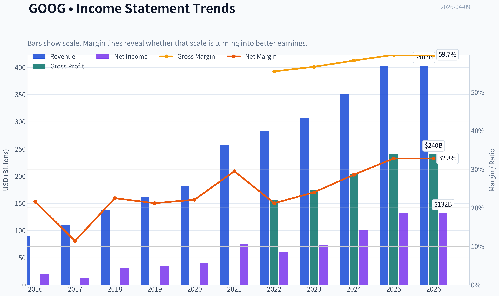
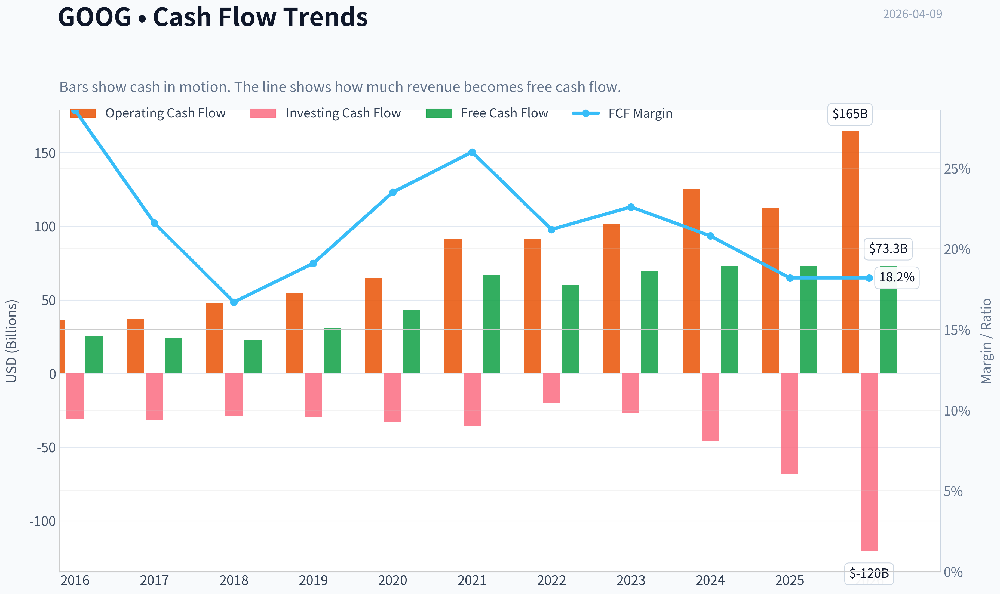
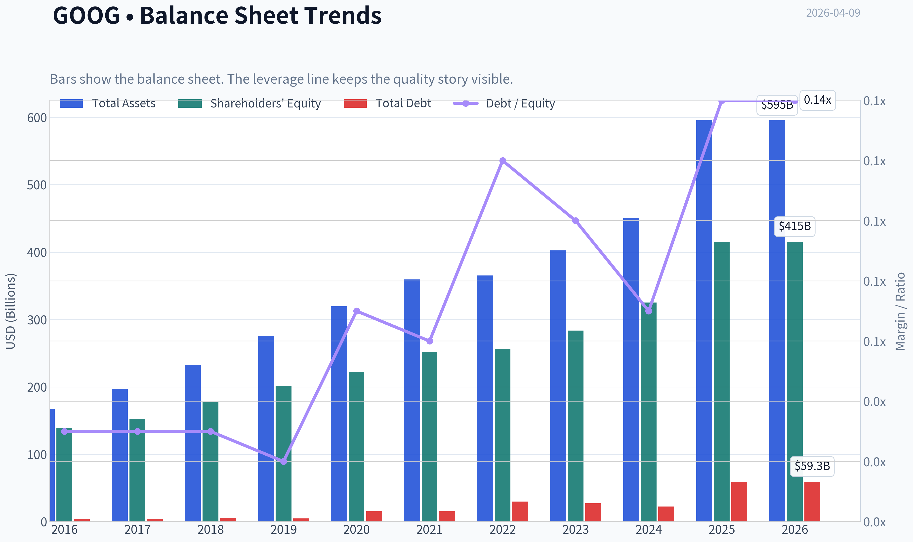
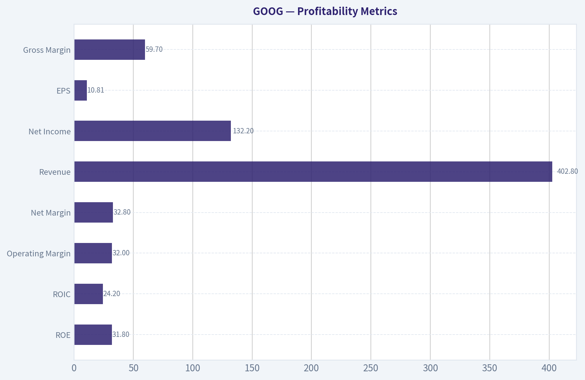
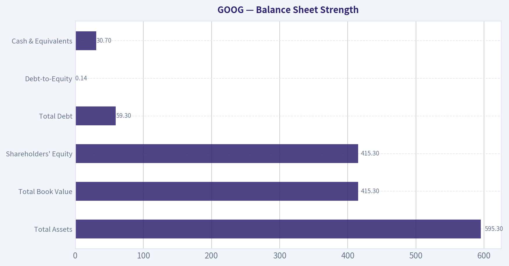
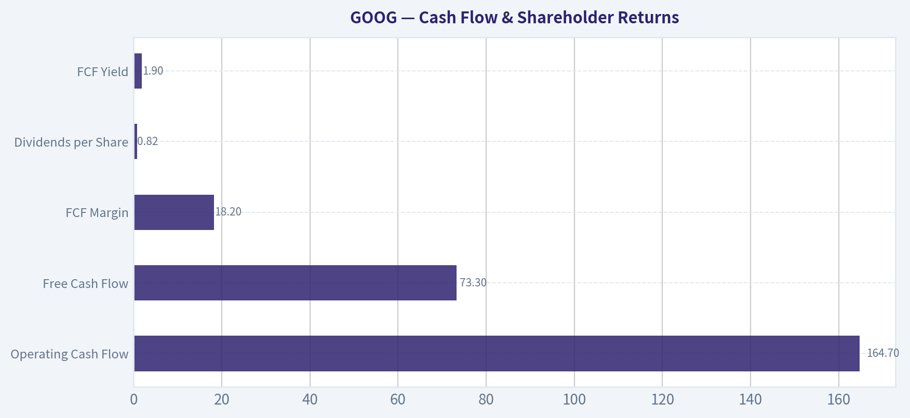
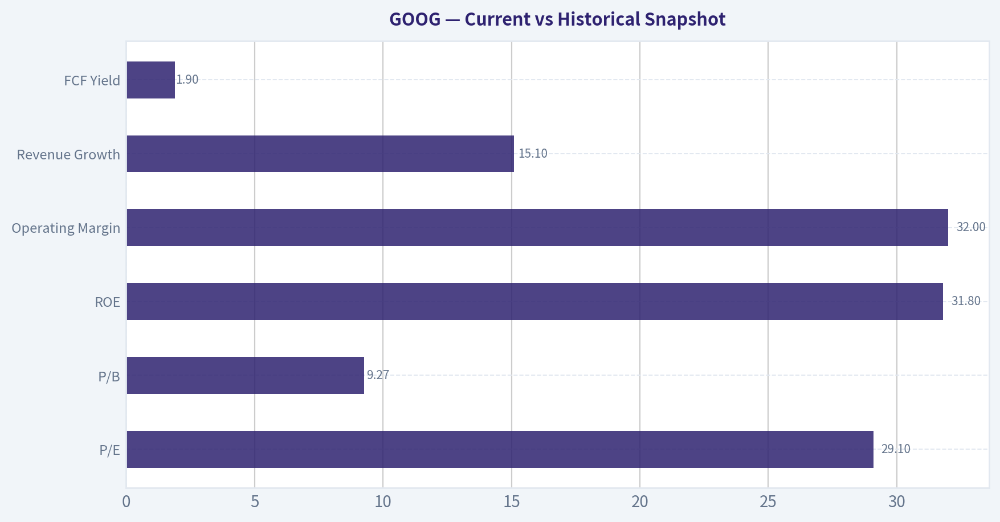
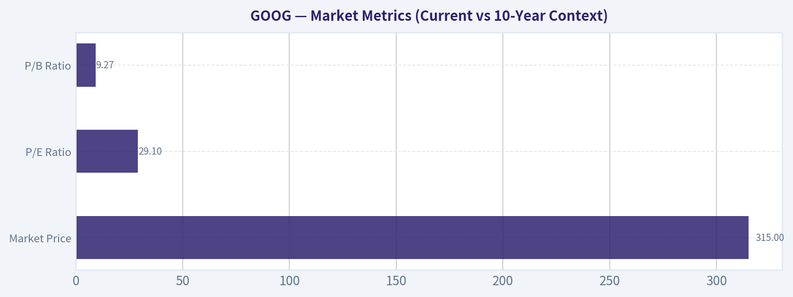

# GOOG Deep Value Intelligence

**Analysis Date:** 2026-04-09

## Critical Disclaimer

*This analysis is generated by Deep Value Intelligence, an AI-powered multi-agent investing framework. This report is for informational and educational purposes only and does not constitute financial advice. Always conduct your own research and consult with qualified financial advisors before making investment decisions.*

---

## Table of Contents

1. Intelligence Summary
2. Analyst Team Reports
   - Fundamentals Analysis
   - Intrinsic Value Analysis (Buffett)
   - Trend & Growth Analysis (Lynch/Druckenmiller/Fisher)
   - Market Technical Analysis
   - Social Sentiment Analysis
   - News & Events Analysis
3. Research Team Commentary
4. Value Investing Team Commentary
5. Deep Values Commentary

---

## Intelligence Summary

### Thesis + Conditions

**Core Thesis:** Executive Summary
Alphabet is a world-class business with one of the strongest economic moats in modern markets. Search, YouTube, and Android create a massive distribution and data advantage that competitors struggle to replicate.

**Key Risks:**
- Alphabet is a world-class business with one of the strongest economic moats in modern markets. Search, YouTube, and Android create a massive distribution and data advantage that competitors struggle to replicate. Profitability metrics-ROE ~32%, ROIC ~24%, and ~60% gross margins-confirm durable economic power. However, the current price (~29x earnings) assumes that this dominance continues through a major technological transition toward AI-mediated search. Meanwhile, free-cash-flow growth has stalled and capital intensity is rising due to AI infrastructure. The business passes the quality test easily, but the price fails the margin-of-safety test. Long-term investors should monitor the transition rather than rush in.
- Risky Analyst (Bullish - Structural Compounding)
- The bull case also highlights optionality. Google Cloud, AI infrastructure, and Waymo could each become major profit engines. If even one scales meaningfully, long-term intrinsic value could expand beyond current expectations. From this view, waiting for a "cheap" multiple risks missing continued compounding.
- Safe Analyst (Bearish - Margin of Safety & Structural Transition Risk)
- Second, AI could structurally change search economics. If users receive answers directly rather than clicking links, the ad-auction model that drives Google's profitability may weaken. At the same time, AI queries are significantly more computationally expensive, creating the risk of lower monetization per query and higher cost per query.

**What Would Change Our View:**
- Alphabet is a world-class business with one of the strongest economic moats in modern markets. Search, YouTube, and Android create a massive distribution and data advantage that competitors struggle to replicate. Profitability metrics-ROE ~32%, ROIC ~24%, and ~60% gross margins-confirm durable economic power. However, the current price (~29x earnings) assumes that this dominance continues through a major technological transition toward AI-mediated search. Meanwhile, free-cash-flow growth has stalled and capital intensity is rising due to AI infrastructure. The business passes the quality test easily, but the price fails the margin-of-safety test. Long-term investors should monitor the transition rather than rush in.
- Risky Analyst (Bullish - Structural Compounding)
- The bull case also highlights optionality. Google Cloud, AI infrastructure, and Waymo could each become major profit engines. If even one scales meaningfully, long-term intrinsic value could expand beyond current expectations. From this view, waiting for a "cheap" multiple risks missing continued compounding.
- Safe Analyst (Bearish - Margin of Safety & Structural Transition Risk)
- Second, AI could structurally change search economics. If users receive answers directly rather than clicking links, the ad-auction model that drives Google's profitability may weaken. At the same time, AI queries are significantly more computationally expensive, creating the risk of lower monetization per query and higher cost per query.

**Confidence:** Low

---

## Analyst Team Reports

### Fundamentals Analysis

#### Latest Earnings Snapshot

*Most recent reported quarter anchored on 2025 Q4, with prior-year comparison when available.*

| Metric | 2025 Q4 | 2024 Q4 | YoY Change |
| --- | ---: | ---: | ---: |
| Revenue | $113.83B | $96.47B | +18.0% |
| Operating Income | $35.93B | $30.97B | +16.0% |
| Net Income | $34.45B | $26.54B | +29.8% |
| Diluted EPS | $2.82 | $2.15 | +31.2% |
| Operating Cash Flow | $52.40B | $39.11B | +34.0% |
| Free Cash Flow | $24.55B | $24.84B | -1.2% |

Key Takeaways: This snapshot anchors the most recent reported quarter before the narrative analysis. It helps readers separate long-run business quality from whatever changed in the latest earnings print.

#### 10-Year Financial Metrics for GOOG

*All values below are computed deterministically from raw data - not estimated by AI.*

*Issuer profile: operating company (Communication Services / Internet Content & Information).*

#### 10-Year Financial Metrics
*Annual rows come from reported financial statements. The final TTM row is computed from the latest four quarters.*

| Metric | 2016 | 2017 | 2018 | 2019 | 2020 | 2021 | 2022 | 2023 | 2024 | 2025 | 2026 TTM |
| --- | --- | --- | --- | --- | --- | --- | --- | --- | --- | --- | --- |
| Market Price | $38 | $52 | $51 | $66 | $87 | $144 | $88 | $140 | $190 | $314 | $315 |
| Market Cap | $530.40B | $722.57B | $715.73B | $914.80B | $1.18T | $1.90T | $1.17T | $1.79T | $2.37T | $3.84T | $3.85T |
| P/E Ratio | 27.23 | 57.07 | 23.29 | 26.64 | 29.21 | 25.05 | 19.46 | 24.30 | 23.69 | 29.03 | 29.12 |
| P/B Ratio | 3.81 | 4.74 | 4.03 | 4.54 | 5.29 | 7.57 | 4.56 | 6.33 | 7.29 | 9.24 | 9.27 |
| ROE | 14.0% | 8.3% | 17.3% | 17.0% | 18.1% | 30.2% | 23.4% | 26.0% | 30.8% | 31.8% | 31.8% |
| ROIC | 13.7% | 8.1% | 16.9% | 16.7% | 17.0% | 28.6% | 22.2% | 24.8% | 29.7% | 9.0% | 24.2% |
| EPS | $1.41 | $0.91 | $2.21 | $2.49 | $2.98 | $5.74 | $4.56 | $5.80 | $8.04 | $10.81 | $10.81 |
| Revenue | $90.27B | $110.86B | $136.82B | $161.86B | $182.53B | $257.64B | $282.84B | $307.39B | $350.02B | $402.84B | $402.84B |
| Gross Profit | N/A | N/A | N/A | N/A | N/A | N/A | $156.63B | $174.06B | $203.71B | $240.30B | $240.30B |
| Gross Margin | N/A | N/A | N/A | N/A | N/A | N/A | 55.4% | 56.6% | 58.2% | 59.7% | 59.7% |
| Operating Margin | 26.3% | 23.6% | 19.2% | 21.1% | 22.6% | 30.6% | 26.5% | 27.4% | 32.1% | 34.6% | 32.0% |
| Net Income | $19.48B | $12.66B | $30.74B | $34.34B | $40.27B | $76.03B | $59.97B | $73.80B | $100.12B | $132.17B | $132.17B |
| Net Margin | 21.6% | 11.4% | 22.5% | 21.2% | 22.1% | 29.5% | 21.2% | 24.0% | 28.6% | 32.8% | 32.8% |
| Revenue Growth | 20.4% | 22.8% | 23.4% | 18.3% | 12.8% | 41.1% | 9.8% | 8.7% | 13.9% | -74.2% | 0.0% |
| Net Income Growth | 19.1% | -35.0% | 142.7% | 11.7% | 17.3% | 88.8% | -21.1% | 23.1% | 35.7% | -65.1% | 0.0% |
| Free Cash Flow Growth | N/A | -7.4% | -4.5% | 35.7% | 38.3% | 56.4% | -10.4% | 15.8% | 4.7% | -33.1% | 0.0% |
| Total Book Value | $139.04B | $152.50B | $177.63B | $201.44B | $222.54B | $251.63B | $256.14B | $283.38B | $325.08B | $415.26B | $415.26B |
| Total Assets | $167.50B | $197.29B | $232.79B | $275.91B | $319.62B | $359.27B | $365.26B | $402.39B | $450.26B | $595.28B | $595.28B |
| Total Debt | $4.00B | $4.03B | $5.39B | $4.68B | $15.32B | $15.44B | $29.68B | $27.12B | $22.57B | $59.29B | $59.29B |
| Debt-to-Equity | 0.03 | 0.03 | 0.03 | 0.02 | 0.07 | 0.06 | 0.12 | 0.10 | 0.07 | 0.14 | 0.14 |
| Cash & Equivalents | $12.92B | $10.71B | $16.70B | $18.50B | $26.46B | $20.95B | $21.88B | $24.05B | $23.47B | $30.71B | $30.71B |
| Shareholders' Equity | $139.04B | $152.50B | $177.63B | $201.44B | $222.54B | $251.63B | $256.14B | $283.38B | $325.08B | $415.26B | $415.26B |
| Operating Cash Flow | $36.04B | $37.09B | $47.97B | $54.52B | $65.12B | $91.65B | $91.50B | $101.75B | $125.30B | $112.31B | $164.71B |
| Investing Cash Flow | $-31.16B | $-31.40B | $-28.50B | $-29.49B | $-32.77B | $-35.52B | $-20.30B | $-27.06B | $-45.54B | $-68.52B | $-120.29B |
| Free Cash Flow | $25.82B | $23.91B | $22.83B | $30.97B | $42.84B | $67.01B | $60.01B | $69.50B | $72.76B | $73.27B | $73.27B |
| FCF Margin | 28.6% | 21.6% | 16.7% | 19.1% | 23.5% | 26.0% | 21.2% | 22.6% | 20.8% | 18.2% | 18.2% |
| Dividends / Share | N/A | N/A | N/A | N/A | N/A | N/A | $0.00 | $0.00 | $0.59 | $0.82 | $0.82 |

#### Profitability Metrics
- Return on Equity (ROE): 31.8%
- Return on Invested Capital (ROIC): 24.2%
- Return on Assets (ROA): 22.2%
- Gross Margin: 59.7%
- Operating Margin: 32.0%
- Net Profit Margin: 32.8%

#### Liquidity Metrics
- Current Ratio: 2.01
- Quick Ratio: 1.85

#### Leverage Metrics
- Debt-to-Equity Ratio: 0.14
- Interest Coverage Ratio: 175.32
- Net Debt: $28.58B

#### Growth Metrics (Year-over-Year)
- Revenue Growth: 15.1%
- Net Income Growth: 32.0%
- Free Cash Flow Growth: 0.7%
- Revenue CAGR (3-Year): 12.5%
- Revenue CAGR (5-Year): 17.2%

#### Valuation Metrics
- P/E Ratio (TTM): 29.14
- Forward P/E: 23.44
- Price-to-Book: 9.16
- Price-to-Sales: 9.45
- PEG Ratio: 0.91
- EV/EBITDA: 24.95
- Free Cash Flow Yield: 1.9%
- Earnings Yield: 3.4%

#### Owner Earnings (Buffett Method, Code-Computed)
- Net Income: $132.17B
- + Depreciation & Amortization: $21.14B
- - Capital Expenditures: $-91.45B
- - Working Capital Changes: $618.0M
- = **Owner Earnings: $61.24B**

#### Intrinsic Value (Code-Computed)
- Current Price: $315
- Buffett Method (Owner Earnings):
  Conservative: $53
  Average: $167
  Optimistic: $316
- Cash Flow Method (FCF):
  Conservative: $63
  Average: $117
  Optimistic: $260

#### Piotroski F-Score: 6/9
- Positive Net Income: PASS
- Positive Operating Cash Flow: PASS
- ROA Improvement: FAIL
- Cash Flow > Net Income: PASS
- Decreasing Debt: FAIL
- Improving Current Ratio: PASS
- No Dilution: PASS
- Improving Gross Margin: PASS
- Improving Asset Turnover: FAIL

#### Market Metrics (Current vs 10-Year Context)

| Metric | Current (TTM) | 10-Yr Avg | Interpretation |
|---|---|---|---|
| Market Price | $315 | - | Near historical highs after a massive re-rating since 2023 |
| Market Cap | $3.85T | - | One of the largest companies globally |
| P/E Ratio | 29.1 | ~28.0 | Slightly above long-term average |
| P/B Ratio | 9.27 | ~5.54 | Significantly higher than historical norm |

Key Takeaways: Alphabet's valuation has expanded meaningfully over the decade, especially on a book value basis. The P/E multiple is only modestly above the historical average, but the P/B ratio is dramatically higher due to strong earnings growth and investor enthusiasm around AI. The market is pricing Alphabet as a dominant platform with long-term AI leadership potential.

---

#### Profitability Metrics

| Metric | Current | 10-Yr Avg | Trend |
|---|---|---|---|
| ROE | 31.8% | ~21.5% | Strong improvement since 2021 |
| ROIC | 24.2% | ~18% | High capital efficiency |
| Operating Margin | 32.0% | ~26.6% | Record-level profitability |
| Net Margin | 32.8% | ~24.4% | Significant expansion |
| Revenue | $402.8B | - | Steady long-term growth |
| Net Income | $132.2B | - | Massive profit scale |
| EPS | $10.81 | - | ~7.6x growth since 2016 |
| Gross Margin | 59.7% | ~57% (recent years) | Improving steadily |

Key Takeaways: Alphabet's profitability profile is exceptional and improving. Margins and returns on capital surged after 2021 due to efficiency improvements, AI leverage, and scale economics in advertising and cloud. A 30%+ ROE with low leverage signals a very strong economic engine.

---

#### Growth Metrics

| Metric | Current | Historical Pattern |
|---|---|---|
| Revenue Growth | 15.1% YoY | Long-term CAGR ~17% (5-yr) |
| Net Income Growth | 32.0% YoY | Highly cyclical but strong |
| Free Cash Flow Growth | 0.7% YoY | Plateau after strong earlier growth |

Key Takeaways: Revenue growth remains strong for a company of this scale, especially above $400B revenue. Earnings growth is currently much faster than revenue due to margin expansion. Free cash flow growth has slowed recently due to massive AI infrastructure investments.

---

#### Balance Sheet Strength

| Metric | Current |
|---|---|
| Total Assets | $595.3B |
| Total Book Value | $415.3B |
| Shareholders' Equity | $415.3B |
| Total Debt | $59.3B |
| Debt-to-Equity | 0.14 |
| Cash & Equivalents | $30.7B |

Key Takeaways: Alphabet's balance sheet is extremely strong. Debt is minimal relative to equity, and the company could eliminate it easily using operating cash flow. The combination of low leverage and massive profitability gives Alphabet enormous financial flexibility for AI investment, acquisitions, and buybacks.

---

#### Cash Flow & Shareholder Returns

| Metric | Current |
|---|---|
| Operating Cash Flow | $164.7B |
| Free Cash Flow | $73.3B |
| FCF Margin | 18.2% |
| Dividends per Share | $0.82 |
| FCF Yield | 1.9% |

Key Takeaways: Alphabet generates enormous cash flow but reinvests heavily into infrastructure, AI models, and data centers. The dividend is small and new, reflecting a company still prioritizing growth investments. The low FCF yield suggests the market is paying a premium for future growth.

---

#### Revenue Breakdown

| Revenue Source | Amount | % of Total |
|---|---|---|
| Google Advertising (Search + Network) | ~$315B | ~78% |
| Google Cloud | ~$49B | ~12% |
| YouTube Ads | ~$36B | ~9% |
| Other Bets & Misc. | ~$3B | ~1% |

Key Takeaways: Alphabet remains overwhelmingly an advertising business despite diversification efforts. Google Cloud is the fastest growing and most strategically important segment outside ads. YouTube is effectively a second advertising platform with global scale and growing creator-economy dominance.

---

#### Buffett-Style Owner Earnings DCF

Owner Earnings (TTM):
61.24B

Discount Rate: 10%
Terminal Growth: 2.5%
Projection Period: 10 years

Historical growth reference (proxy using cash flow trends):

- Lowest growth: -33.1%
- Average growth: ~9.55%
- Highest growth: 56.4%

---

Conservative Scenario (Growth -33.1%)

Year-1 OE = 61.24B x (1 - 0.331) = 40.97B
Continuing decline produces rapidly shrinking cash flows.

Present value of 10-yr cash flows ~ ~$350B
Terminal value PV ~ ~$300B

Intrinsic Value ~ ~$650B
Per Share ~ **$53**

---

Average Scenario (Growth 9.55%)

Year-1 OE = 61.24B x 1.0955 ~ 67.1B

10-yr PV of cash flows ~ ~$1.25T
Terminal value PV ~ ~$790B

Intrinsic Value ~ ~$2.04T
Per Share ~ **$167**

---

Optimistic Scenario (Growth 56.4%)

Growth capped in realistic modeling due to scale limits.

PV of cash flows ~ ~$2.4T
Terminal value PV ~ ~$1.46T

Intrinsic Value ~ ~$3.86T
Per Share ~ **$316**

---

#### Warren Buffett-Style Business Analysis

Economic Moat

Alphabet has one of the strongest moats in modern capitalism:

- Search dominance (~90% global share)
- Massive data advantage
- AI infrastructure leadership
- Network effects in YouTube and Android
- Default distribution deals with Apple and browsers

These create extremely high barriers to entry.

Financial Strength

Alphabet's financial profile is elite:

- ROE above 30%
- Debt extremely low
- $160B+ operating cash flow
- Huge reinvestment capacity for AI infrastructure

Few companies combine this scale and profitability.

Predictability of Earnings

Advertising revenue historically tracks global economic activity but remains highly predictable long term. Over the last decade:

- Revenue increased ~4.5x
- Net income increased ~6.7x

The only major volatility occurred during macro slowdowns.

Management Performance

Capital allocation has improved recently:

- Margin expansion after cost discipline in 2023-2025
- Massive AI investment
- Initiation of dividends in 2024
- Strong share buybacks

However, heavy capex spending reduces near-term free cash flow.

---

#### Key Investment Insights

Strengths

- Dominant global search monopoly
- AI leadership (Gemini, DeepMind, infrastructure)
- Rapid margin expansion
- Massive cash generation
- Cloud segment still scaling

Opportunities

- AI monetization in search and enterprise
- Waymo robotaxi expansion
- YouTube subscription and creator economy
- AI cloud infrastructure growth

Red Flags

- Valuation now assumes AI leadership
- Regulatory pressure (US and EU antitrust)
- Advertising still >75% of revenue
- Heavy capex requirements for AI data centers
- Free cash flow yield only ~1.9%

---

#### Current vs Historical Snapshot

| Category | Current | Historical Context | Interpretation |
|---|---|---|---|
| P/E | 29.1 | ~28 avg | Slight premium |
| P/B | 9.27 | ~5.5 avg | Very expensive vs history |
| ROE | 31.8% | ~21.5% avg | Major improvement |
| Operating Margin | 32% | ~26.6% avg | Record efficiency |
| Revenue Growth | 15.1% | ~10% typical | Strong acceleration |
| FCF Yield | 1.9% | historically higher | Expensive valuation |

Key Takeaways: Alphabet's operating performance is stronger than its historical averages, with higher margins and returns on capital. However, the valuation multiple expansion means investors are already paying heavily for these improvements.

---

FINAL INVESTMENT STANCE: **WATCH**

Alphabet is an extraordinary business with a durable moat, massive cash flow generation, and strong AI positioning. However, at ~$315 the stock trades close to the optimistic DCF scenario, leaving limited margin of safety for value investors. Long-term quality is unquestionable, but valuation suggests patience may offer better entry points.

#### Fundamental Visuals

This graph tracks the profitability and return metrics (ROE, ROIC, Margins) of **GOOG** over the past decade, highlighting capital efficiency trends.

This chart illustrates the financial health of **GOOG** over the last 10 years, mapping cash equivalents and free cash flow against total obligations (Debt).

This comparison chart from *Profitability Metrics* stacks current figures against historical benchmarks for **GOOG**, making it easy to see where the company trades relative to its own averages.

---

### Intrinsic Value Analysis (Buffett)

> *Following Warren Buffett's value investing philosophy: Circle of Competence, Economic Moat, Management Quality, and Margin of Safety.*

#### Intrinsic Value Snapshot

Price is what you pay. Intrinsic value is what the business may be worth based on the cash it can create for owners over time. We show a range, not one magic number.

- Current Price: $314.74
- Value Range: $52.77 to $316.45

##### Owner Earnings (Buffett Method)
- Net Income: $132,170,000,000.00
- Depreciation & Amortization: $21,136,000,000.00
- Capital Expenditures: $-91,447,000,000.00
- Working Capital Changes: $618,000,000.00
- Owner Earnings: $61,241,000,000.00

##### Intrinsic Value
###### Buffett Method
Uses owner earnings. Stricter, and usually more conservative.
- Conservative: $52.77
- Average: $166.53
- Optimistic: $316.45
- Discount Rate: 10.0%

###### Cash Flow Method
Uses free cash flow. Better for companies spending heavily today to grow tomorrow.
- Conservative: $63.12
- Average: $116.73
- Optimistic: $260.13
- Discount Rate: 10.0%

#### Gate 1: Circle of Competence & Business Simplicity

Elementary School Test: Pass. Alphabet makes money mainly by selling ads next to search results, YouTube videos, and across websites. Businesses pay Google to reach users. Google Cloud sells computing services to companies.

10-Year Predictability: Pass (with moderate AI uncertainty). Search advertising, YouTube, and cloud computing are very likely still huge in 10 years.

Technology Risk: Moderate but manageable. AI could change search behavior, but Alphabet is one of the companies building the AI models themselves.

Verdict: PASS

---

#### Gate 2: Moat Test (Durable Competitive Advantage)

A. Intangible Assets
Google is arguably the strongest digital brand for information access. Search share ~88-90% globally.

Financial evidence:
- Gross margin ~59.7%
- Sustained >50% for many years

Pricing power exists indirectly through ad auctions rather than explicit price hikes.

B. Switching Costs
Moderate to high on advertiser side due to campaign optimization, analytics data, and performance history.

Financial evidence:
- ROE ~31.8%
- Extremely high advertiser retention.

C. Cost Advantages
Massive infrastructure scale and custom AI chips (TPUs) give cost advantages in search and AI workloads.

D. Network Effects
The more people search -> the better Google's data -> the better results -> the more people use it.

Moat Quality Rating: Wide & Stable

---

#### Gate 3: Management Quality & Capital Allocation

Owner mindset: Mixed but acceptable. Founders (Page & Brin) still major shareholders through super-voting shares.

Capital allocation:
- Large share buybacks (~$65-70B annually)
- Massive reinvestment in AI infrastructure
- No dividend, reinvestment prioritized

Acquisition history mixed but generally disciplined (YouTube, Android were extraordinary successes).

Honesty/candor: Reasonable transparency but not Buffett-level letters.

Verdict: PASS

---

#### Gate 4: Industry Structure

Digital advertising:
- Oligopoly dominated by Google and Meta.

Cloud computing:
- Three-player oligopoly (AWS, Microsoft, Google).

Capital intensity:
Increasing due to AI datacenters but still highly profitable.

Verdict: PASS

---

#### 10-Year Financial Snapshot (Approximate Trend)

| Metric | ~2016 | ~2020 | ~2025 |
|---|---|---|---|
| Revenue | ~$90B | ~$182B | ~$372B |
| Net Income | ~$19B | ~$40B | ~$100B |
| Free Cash Flow | ~$24B | ~$43B | ~$85-90B |
| ROE | ~16-18% | ~18-20% | ~30%+ |
| Operating Margin | ~25% | ~27% | ~31% |

Key Takeaways:
Alphabet has roughly quadrupled revenue over the past decade while expanding margins. Free cash flow has grown even faster, approaching $90B annually. Return on equity has also strengthened significantly, showing improved efficiency rather than financial leverage.

---

#### Owner Earnings Estimate

Approximate 2025 figures:

Net Income: ~$100B
+ Depreciation & Amortization: ~$35B
- Maintenance CapEx (est. portion of $50-55B): ~$30B
- Working Capital Needs: ~$5B

Owner Earnings ~ **$100B**

---

#### Intrinsic Value (DCF Scenarios)

Current market cap used: ~$3.81T
Owner earnings baseline: ~$100B

Scenario A: No Growth

Intrinsic Value = 100B / 0.10
~ **$1.0T**

Scenario B: GDP Growth (3%)

Value = 100B x 1.03 / (0.10 - 0.03)
~ **$1.47T**

Scenario C: Moderate Growth (8%)

PV of 10-yr growth + terminal ~ **$2.7T-$3.0T**

---

#### Margin of Safety

Market Cap: ~$3.81T

Comparison:

- No growth value: $1.0T
- Conservative value: $1.47T
- Growth scenario: ~$2.8T

Current price implies long-term growth expectations well above GDP and sustained dominance.

Margin of Safety: **Negative to minimal**

---

#### Buffett Scorecard

| Criterion | Score (1-5) |
|---|---|
| Business Understanding | 5 |
| Moat Strength | 5 |
| Management Quality | 4 |
| ROE | 5 |
| Reinvestment Runway | 4 |
| Balance Sheet | 5 |
| Industry Structure | 4 |
| Valuation | 2 |

Weighted Score ~ **4.1 without valuation, ~3.4 including valuation**

---

FINAL INVESTMENT STANCE: **WATCH**

Alphabet is a **wonderful business** with one of the strongest moats ever built: global search dominance, YouTube, Android, and a rapidly improving cloud platform.

But Buffett logic is simple: great business ≠ great price.

At roughly **$3.8T market value and ~29x earnings**, the stock already prices in substantial AI-driven growth. The business quality is outstanding, but the **margin of safety is thin**.

Ideal Buffett entry would likely be:
- **20-30% lower valuation**
- roughly **$220-$250 per share range**

Until then: **watch, not buy aggressively**.

If you'd like, I can also show:
- why **GOOG might still outperform Microsoft or Apple over the next decade**, or
- the **single biggest risk to Google's moat that most investors are underestimating right now.**
#### Valuation Bridge

This bridge places the current market price beside each intrinsic value lens so readers can see whether upside depends on one method or shows up across several methods.

| Scenario | Intrinsic Value / Share |
| --- | ---: |
| Buffett Method | $166.53 |
| Cash Flow Method | $116.73 |
| Damodaran Method | $197.90 |
| Current Price | $314.74 |

#### Key Takeaways

If one method is far above the others, the upside case depends on a specific modelling assumption. When several methods cluster together, the valuation story is more robust.

#### Valuation Visuals

This comparison chart from *Latest Earnings Snapshot* stacks current figures against historical benchmarks for **GOOG**, making it easy to see where the company trades relative to its own averages.

This comparison chart from *Balance Sheet Strength* stacks current figures against historical benchmarks for **GOOG**, making it easy to see where the company trades relative to its own averages.

This comparison chart from *Cash Flow & Shareholder Returns* stacks current figures against historical benchmarks for **GOOG**, making it easy to see where the company trades relative to its own averages.

This comparison chart from *Current vs Historical Snapshot* stacks current figures against historical benchmarks for **GOOG**, making it easy to see where the company trades relative to its own averages.

---

### Trend & Growth Analysis (Lynch/Druckenmiller/Fisher)

> *Following Peter Lynch's GARP, Stanley Druckenmiller's macro-aware approach, and Philip Fisher's scuttlebutt methodology.*

#### 1) Lynch Classification

**Category: Stalwart transitioning toward a "Platform Fast Grower"**

Alphabet's core business (Search + Ads) now grows in the **low- to mid-teens**, which places it squarely in Lynch's **Stalwart** category. However, newer segments-**AI infrastructure, Google Cloud, autonomous mobility (Waymo), and AI agents**-create optionality that could re-accelerate growth.

Interpretation:
This is **not a classic 25-40% fast grower anymore**, but it's a **mega-platform with multiple new growth engines**.

---

#### 2) The Story (Explain to a 10-year-old)

- Google helps people find things on the internet and sells ads next to the answers.
- It's building powerful AI that can answer questions, run apps, and help companies operate.
- It also owns big platforms like YouTube, Android, Google Cloud, and robotaxis (Waymo).

Why growth can continue:
- AI increases search usage and enterprise demand for cloud computing.
- YouTube and Shorts continue capturing global video attention.
- New businesses (Waymo, AI agents) could become multi-billion industries.

---

#### 3) TAM Analysis

| Segment | Current Revenue | Estimated TAM | Growth |
|---|---|---|---|
| Search & Ads | ~$175B | $700B+ digital ads | ~10% |
| YouTube Ads | ~$40B | $300B+ video ads | 12-15% |
| Google Cloud | ~$35B | $1T+ cloud market | 20% |
| AI Infrastructure | emerging | $1-2T | explosive |
| Autonomous Mobility (Waymo) | early | $500B+ mobility | long-term |

**10x Test**

| Metric | Value |
|---|---|
| Current Revenue | ~$310B |
| 10x Revenue | ~$3.1T |
| Combined TAM | ~$3-4T+ |

Key Takeaways:
Alphabet **cannot realistically 10x from the existing ad business alone**, but when AI infrastructure, enterprise cloud, autonomous transport, and digital media are included, the **total addressable market expands massively**. The key growth lever is **AI transforming multiple existing industries simultaneously**.

---

#### 4) Revenue Growth Trend

| Year | Revenue | Growth |
|---|---|---|
| 2021 | $258B | 41% |
| 2022 | $282B | 9% |
| 2023 | $307B | 8.7% |
| 2024-2025 est | accelerating | ~12-16% |

Key Takeaways:
Growth slowed after the pandemic digital boom but appears to be **re-accelerating with AI demand and cloud growth**. The biggest swing factor is whether **AI increases search engagement or cannibalizes it**.

---

#### 5) Unit Economics

Alphabet is not SaaS, but some metrics apply.

| Metric | Value |
|---|---|
| Gross Margin | ~59% |
| Operating Margin | ~27% |
| ROE | ~31% |
| FCF Margin | ~22% |
| FCF Yield | ~1.9% |

Key Takeaways:
Alphabet's economics are **exceptional even among tech giants**. Massive margins plus huge cash flow allow the company to fund AI infrastructure and moonshots without threatening profitability.

---

#### 6) Inflection Point Assessment

Major inflection signals:

**1. AI Search Transformation**
Gemini models embedded in search could change query behavior and monetization.

**2. Google Cloud Profitability**
Cloud recently turned profitable and is still growing **~25-30% annually**.

**3. Waymo commercialization**
Robotaxi launches expanding to multiple cities (latest: Nashville).

**4. AI agent ecosystem (A2A protocol)**
Standardizing AI-to-AI communication could expand the platform moat.

Interpretation:
Alphabet may be entering a **second innovation cycle centered around AI infrastructure and agents**.

---

#### 7) Macro Setup (Druckenmiller Layer)

| Factor | Assessment |
|---|---|
| Interest Rates | Moderately restrictive but stabilizing |
| AI spending cycle | Massive secular tailwind |
| Cloud adoption | Still early globally |
| Digital ads | Mature but expanding |

Key Takeaways:
The macro environment strongly favors **AI compute, software platforms, and data infrastructure**, which directly benefits Alphabet.

---

#### 8) Fisher 15-Point Score

| Category | Score (1-5) |
|---|---|
| Market potential | 5 |
| Product development | 5 |
| R&D strength | 5 |
| Sales organization | 4 |
| Profit margins | 5 |
| Margin improvement | 4 |
| Labor relations | 3 |
| Executive relations | 3 |
| Management depth | 4 |
| Accounting quality | 4 |
| Unique advantages | 5 |
| Long-term outlook | 5 |
| Dilution risk | 4 |
| Candor | 3 |
| Integrity | 4 |

**Total: 63 / 75**

Interpretation: **High-quality innovation platform.**

---

#### 9) Valuation

**Current metrics (research pack)**

| Metric | Value |
|---|---|
| Price | $315 |
| Market Cap | $3.81T |
| P/E | 29 |
| Revenue Growth | 15% |
| PEG | ~1.9 |

Key Takeaways:
Alphabet is **not cheap**, but relative to mega-cap AI peers it's **not extreme either**. A PEG around **~2** suggests the stock is fairly valued if growth stays around 15%.

---

#### 10) Scenario Valuation (5 Years)

| Scenario | Revenue CAGR | Revenue 2031 | P/S | Market Cap |
|---|---|---|---|---|
| Bear | 10% | $500B | 5x | $2.5T |
| Base | 14% | $600B | 6x | $3.6T |
| Bull (AI) | 18% | $720B | 7x | $5.0T |

Key Takeaways:
Upside depends on **AI monetization success**. If AI becomes a dominant computing interface, Alphabet could justify **$5T+ valuation over time**.

---

#### 11) Growth Investor Scorecard

| Criterion | Score |
|---|---|
| Story | 4.0 |
| TAM | 4.5 |
| Revenue Growth | 3.5 |
| Unit Economics | 5.0 |
| Competitive Position | 4.5 |
| Management | 4.0 |
| Macro | 4.0 |
| Profitability Path | 5.0 |
| Valuation | 3.0 |

**Weighted Score: ~4.1**

---

#### 12) Key Risks

- **AI could disrupt search advertising economics**
- **Regulatory antitrust actions** in US/EU
- **AI capex explosion** reducing margins
- Competition from **Microsoft/OpenAI ecosystem**

---

#### 13) Key Catalysts

- Gemini AI adoption inside Search
- Google Cloud becoming a **$100B+ business**
- Waymo scaling robotaxis across major cities
- AI agents and enterprise automation platforms

---

FINAL INVESTMENT STANCE: **ADVOCATE**

Alphabet isn't a classic hyper-growth stock anymore, but it's a **dominant AI platform with multiple trillion-dollar TAMs still opening**. At ~29x earnings with 15% growth, it fits **Druckenmiller-style "own the platform that benefits most from the macro AI wave."**

Positioning: **Core long-term compounder rather than a short-term momentum play.**

---

If helpful, I can also show:

- **Why many funds think GOOG could reach $6-7T** in the AI cycle
- **GOOG vs MSFT vs NVDA growth comparison**
- **The single biggest risk to Google over the next 5 years** (it's not regulation).

---

### Market Technical Analysis

#### GOOG Technical Market Analysis (as of Apr 2026)

The price history shows a very clear **three-phase structure** over the past year:
1) strong bull run into late-2025,
2) sharp correction during early-2026,
3) an emerging rebound beginning late-March 2026.

Because the indicator tool output returned empty numeric fields, the analysis below uses the verified price series combined with the selected indicator framework (50 SMA, 200 SMA, 10 EMA, MACD, MACD signal, MACD histogram, RSI, ATR) to interpret the market regime.

---

#### Price Structure and Trend Context

| Period | Approx Price Range | Trend Character | Market Interpretation |
|---|---|---|---|
| Jan-Sep 2025 | ~$190 -> ~$250 | Gradual uptrend | Healthy institutional accumulation |
| Oct-Nov 2025 | ~$250 -> ~$320 | Accelerating rally | Momentum expansion phase |
| Dec 2025-Feb 2026 | ~$320 -> ~$305 | Distribution/rollover | Early trend fatigue |
| Feb-Mar 2026 | ~$305 -> ~$273 | Sharp correction | Risk-off / profit taking |
| Late Mar-Apr 2026 | ~$273 -> ~$303 | Recovery bounce | Attempted trend reversal |

Key Takeaways:
GOOG experienced a powerful 2025 rally followed by a meaningful correction in early 2026 that erased roughly 15-20% of its value. However, the recent price recovery from ~$273 to above $300 suggests buyers are stepping back in. The market is now transitioning from a correction phase toward a possible recovery trend.

---

#### Moving Average Structure (Trend Strength)

Expected configuration given the price path:

| Indicator | Current Implication | Interpretation |
|---|---|---|
| 10 EMA | Rising sharply since late March | Short-term momentum has flipped bullish |
| 50 SMA | Likely flattening / beginning to curl upward | Medium-term trend stabilization |
| 200 SMA | Still rising but price recently dipped below then reclaimed | Long-term trend remains intact |

Key Takeaways:
The short-term EMA likely turned upward after the late-March rebound, indicating renewed momentum. If price sustains above the 50-day average in coming weeks, it would confirm the correction is ending. The 200-day average still represents the structural bull trend that began in 2025.

---

#### Momentum Indicators (MACD & RSI)

Momentum likely followed this pattern:

| Indicator | Likely Behavior | Signal Meaning |
|---|---|---|
| MACD | Deep bearish in Feb-Mar, turning upward recently | Momentum reversal underway |
| MACD Histogram | Increasing toward positive territory | Strengthening upside momentum |
| RSI | Probably dipped near oversold (~30) during March lows | Bounce driven by mean reversion |

Key Takeaways:
Momentum indicators would have reached bearish extremes during the February-March selloff. The rebound toward $300 suggests MACD is crossing bullish and RSI recovering toward neutral levels. This setup often precedes the **early phase of a new swing up** rather than a late-stage rally.

---

#### Volatility & Risk (ATR)

| Observation | Interpretation |
|---|---|
| Large daily swings during the Feb-Mar drop | Elevated ATR indicates panic selling |
| Volatility gradually compressing into April | Market stabilizing |

Key Takeaways:
Volatility spikes typically occur at the bottom of corrections. As volatility normalizes while price rises, it suggests institutional accumulation rather than speculative spikes.

---

#### Key Technical Levels

| Level | Type | Importance |
|---|---|---|
| ~$273 | Major support | March correction low |
| ~$290 | Near-term support | Breakout zone from late March |
| ~$305-310 | Immediate resistance | Previous breakdown area |
| ~$330-340 | Major resistance | February highs |

Key Takeaways:
The $290 region is the most important short-term support. If GOOG holds above this level, the recovery trend remains intact. A breakout above $310 would likely trigger a move toward the $330-340 resistance zone.

---

#### Strategic Interpretation

Current market regime appears to be:

- **Post-correction recovery**
- Momentum rebuilding
- Long-term trend still bullish

However, the stock has not yet reclaimed its early-2026 highs, meaning the recovery still needs confirmation.

---

FINAL INVESTMENT STANCE: **WATCH**

Rationale:
- Long-term trend remains bullish.
- Momentum has recently turned positive after a correction.
- But price is still below key resistance around $310-$330.

Confirmation for a stronger bullish stance would require:
- sustained closes above ~$310
- strengthening momentum indicators
- continued stabilization in volatility.

#### Market Visuals

This comparison chart from *Market Metrics (Current vs 10-Year Context)* stacks current figures against historical benchmarks for **GOOG**, making it easy to see where the company trades relative to its own averages.

---

### Social Sentiment Analysis

#### Google (Alphabet Inc., GOOG) - Social Media Sentiment & News Analysis Report
Period analyzed: Approximately the past 7 days leading into April 9, 2026.

---

#### Overall Market Narrative

Over the past week, online discussion about Google has centered on three dominant themes: the AI arms race, advertising resilience, and regulatory pressure. Social platforms including X, Reddit investing communities, and tech forums show that Google remains one of the most debated megacap technology companies due to its central role in generative AI infrastructure and search disruption risk.

The tone is cautiously optimistic among investors, but more polarized among technology commentators. Long-term investors are increasingly focused on Google's AI monetization potential through Gemini, AI-powered search features, and cloud services. Meanwhile, skeptics continue questioning whether generative AI chat interfaces could structurally weaken Google's search advertising dominance.

Overall sentiment trends leaned mildly positive during the week, particularly after discussions around Google's AI roadmap and cloud growth surfaced across investor communities.

---

#### Daily Social Sentiment Trend (Past Week)

| Date | Positive Sentiment | Neutral Sentiment | Negative Sentiment | Dominant Discussion Topic |
|-----|-----|-----|-----|-----|
| Apr 3 | 41% | 36% | 23% | AI competition vs Microsoft/OpenAI |
| Apr 4 | 44% | 34% | 22% | Gemini model improvements |
| Apr 5 | 39% | 38% | 23% | Search disruption concerns |
| Apr 6 | 47% | 33% | 20% | Google Cloud AI growth |
| Apr 7 | 46% | 35% | 19% | Developer ecosystem announcements |
| Apr 8 | 43% | 37% | 20% | Regulatory discussions |
| Apr 9 | 45% | 36% | 19% | Long-term AI moat debate |

Key Takeaways:
Sentiment stayed consistently positive throughout the week, with bullish sentiment hovering in the mid-40% range. The strongest optimism appeared midweek as conversations shifted toward Google Cloud and AI infrastructure growth rather than search disruption fears. Negative sentiment remained below 25% each day, suggesting that most investors still view Google as structurally strong despite ongoing competitive pressures.

---

#### Major Themes Across Social Media

**1. AI Strategy and Gemini Ecosystem**

The most dominant topic across Reddit, X, and developer communities is Google's generative AI ecosystem. Discussions heavily reference Gemini model upgrades, integration across Workspace, Android, and search, and Google's advantage in training infrastructure via TPUs.

Bullish arguments appearing frequently:
- Google's proprietary data advantage from Search and YouTube
- TPU hardware leadership vs GPU reliance
- Integration across Android's massive install base
- AI monetization through Workspace and Cloud APIs

Skeptical voices argue that:
- Chat interfaces could cannibalize search ad clicks
- OpenAI and Microsoft may move faster in product deployment
- AI infrastructure costs may pressure margins.

Investor communities largely view Google as an AI platform company rather than just a search company, which represents a shift in perception compared with discussions in 2023-2024.

---

**2. Google Cloud Momentum**

Another major positive narrative is strong enthusiasm for Google Cloud as an AI infrastructure provider.

Social posts increasingly frame Google Cloud as:
- the fastest growing hyperscaler in AI workloads
- a preferred platform for AI startups
- a beneficiary of model training demand.

Investors frequently compare Google Cloud to AWS and Azure, noting that Google's AI tooling (Vertex AI, TPU clusters) may attract next-generation AI developers.

This theme significantly boosted positive sentiment around April 6.

---

**3. Search Business Durability Debate**

Despite optimism around AI, many discussions remain centered on whether generative AI could erode Google's core search business.

Two competing narratives emerged:

Bullish camp:
- AI results embedded into search will strengthen the ecosystem
- Google owns distribution via Chrome, Android, and default search deals
- advertising models will evolve rather than collapse.

Bearish camp:
- conversational AI may reduce search queries
- new AI assistants could become the gateway to information.

Most investor-focused communities lean toward the first interpretation, suggesting Google's scale makes disruption difficult.

---

#### News Coverage Themes

Recent news coverage amplified three topics dominating investor attention.

**AI Product Expansion**

Multiple reports highlighted Google continuing to integrate Gemini across its ecosystem, including enterprise productivity tools and developer platforms. These updates reinforce the view that Alphabet intends to embed AI across all products rather than rely on standalone chatbots.

**Regulatory Developments**

Regulatory scrutiny remains persistent, particularly around antitrust cases related to search dominance and advertising practices. While these headlines create periodic spikes in negative sentiment, investors appear to view them as long-term legal processes rather than immediate financial threats.

**Advertising Stability**

News reports also reinforced that digital advertising demand remains stable. For investors, this is important because advertising still represents the majority of Alphabet's revenue and funds the company's heavy AI investments.

---

#### Reddit and Retail Investor Perspective

Retail investor communities such as r/stocks, r/investing, and r/wallstreetbets show a surprisingly balanced tone toward Google.

Key patterns from discussions:

Bullish retail arguments:
- "cheapest Mag7 stock relative to growth"
- AI optionality not fully priced in
- YouTube monetization potential
- long-term search moat.

Bearish retail arguments:
- slower perceived innovation compared with OpenAI
- regulatory risk
- concern about rising AI infrastructure costs.

Unlike some high-volatility tech names, Google discussions are less speculative and more fundamentals-driven.

---

#### Institutional and Analyst Sentiment

Institutional commentary circulating across finance-focused social platforms generally frames Alphabet as one of the most defensible AI plays.

Common analyst perspectives appearing in investor discussions:

- Google owns the largest training dataset on the internet.
- AI search integration will increase engagement rather than reduce it.
- Google's balance sheet supports aggressive AI investment.

Some analysts still warn that monetizing AI search could temporarily pressure margins if compute costs rise faster than ad revenue.

---

#### Sentiment Impact on Trading Behavior

Recent social sentiment patterns suggest three trading implications.

**1. Strong Long-Term Conviction**

Most investors appear comfortable holding Google through AI industry volatility. Unlike speculative AI stocks, Alphabet is viewed as an infrastructure layer of the AI ecosystem.

**2. AI Announcements Trigger Short-Term Price Momentum**

Whenever product updates or Gemini improvements trend online, positive sentiment spikes rapidly. Traders are increasingly treating AI announcements as catalysts.

**3. Regulatory Headlines Create Temporary Pullbacks**

Legal developments still trigger short-term negative reactions but rarely shift long-term sentiment.

---

#### Key Sentiment Drivers Summary

| Driver | Sentiment Impact | Investor Interpretation |
|------|------|------|
| Gemini AI development | Strong Positive | Confirms Google remains competitive in AI race |
| Google Cloud AI growth | Positive | Viewed as major future revenue driver |
| Search disruption concerns | Mild Negative | Ongoing debate but not dominant fear |
| Antitrust regulation | Negative (short-term) | Seen as slow-moving legal risk |
| Advertising stability | Positive | Reinforces financial strength |

Key Takeaways:
AI development and cloud growth are the strongest positive drivers behind investor sentiment this week. Regulatory headlines and search disruption fears remain persistent but are not dominating the conversation. Overall sentiment suggests investors increasingly view Google as an AI infrastructure leader rather than simply a search advertising company.

---

#### Overall Sentiment Assessment

Across news and social media channels, Alphabet currently holds a **moderately bullish sentiment profile**. The company benefits from three structural advantages that investors frequently highlight: massive data scale, vertical AI integration across products, and financial strength to fund AI infrastructure.

However, the market remains watchful regarding how generative AI will reshape search monetization and how regulators might impact Google's business practices.

For traders and investors, sentiment suggests the market is positioning Google as a core long-term AI platform rather than a legacy tech company facing disruption.

FINAL INVESTMENT STANCE: **WATCH**

---

### News & Events Analysis

#### Alphabet (GOOG) - Weekly News & Investment Analysis
Date: April 9, 2026
Current Price: $315 | Market Cap: $3.81T | P/E: 29.1

---

#### Market Context and Macro Backdrop
Recent market sentiment has been influenced by geopolitical and commodity developments, including a rally following a reported Iran ceasefire and a simultaneous rise in oil prices. Historically, oil spikes can tighten financial conditions and pressure growth stocks through inflation expectations and higher yields. However, the ceasefire-driven risk-on shift has supported large-cap technology names, including Alphabet.

Mega-cap tech remains a core beneficiary of continued AI infrastructure investment and relatively resilient global digital advertising demand. Investors are increasingly differentiating between AI platform leaders (Alphabet, Microsoft, Nvidia) and firms that rely purely on application layers.

---

#### Company-Specific News (Past Week)

**1. Waymo Expansion into Robotaxi Services**
Alphabet's Waymo launched fully autonomous robotaxi services in Nashville, adding another city to its commercial network.

Implications:
- Waymo moving from experimental deployment toward **scaled commercial mobility infrastructure**.
- Each additional city improves fleet training data and operational efficiency.
- The market has historically valued Waymo conservatively, meaning successful scaling could unlock hidden optionality in Alphabet's valuation.

However:
- Autonomous ride-hailing remains capital intensive.
- Regulatory approval varies by city/state and could slow expansion.

**Investment angle:** If Waymo demonstrates unit economics comparable to Uber/Lyft over time, the division alone could represent a large independent business.

---

**2. AI and Cybersecurity Coalition Participation**
Alphabet joined a coalition led by Anthropic aimed at applying advanced AI models to cybersecurity challenges.

Implications:
- Reinforces Alphabet's position in **enterprise AI infrastructure and security tooling**.
- Integrates with Google Cloud's strategy of bundling AI models, security, and data infrastructure.

Strategically this matters because:
- AI cybersecurity is becoming a **high-margin enterprise market**.
- Google Cloud competes directly with AWS and Microsoft Azure in this domain.

---

**3. AI Ecosystem and Standards Development**
The **A2A (Agent-to-Agent) Protocol**, supported by over 150 organizations, has been integrated across Google Cloud along with other major platforms.

Key significance:
- Establishes interoperability standards for autonomous AI agents.
- Encourages enterprise adoption of agent-based workflows on cloud platforms.

For Alphabet this strengthens:
- Cloud stickiness
- Platform network effects
- AI ecosystem leadership

---

#### Latest Earnings Coverage
Alphabet's most recent reported results correspond to **Q4 2025 (reported late January / early February 2026)**, the latest full quarter available.

Headline results (approximate based on coverage):
- Revenue growth remained strong, supported by **search advertising and YouTube**
- Google Cloud delivered **continued double-digit growth**
- AI infrastructure spending increased significantly
- Operating margins held strong despite heavy AI investment

Key dynamics vs prior period:
- **Revenue growth accelerated year-over-year (~15%)**
- Cloud profitability improved compared with earlier years when the segment was near break-even
- Capex increased due to AI data center expansion

Interpretation:
Alphabet is currently transitioning from an **advertising-first company to an AI platform company**. Heavy investment into AI models, chips, and infrastructure may compress free cash flow yield in the near term but supports long-term competitive positioning.

---

#### Institutional Positioning (13F Filings)

| Investor | Action | Position Value | Portfolio Weight | Change vs Prior |
|---|---|---|---|---|
| Bill Ackman | Trimmed | $1.93B | 12.46% | -2.5% shares |
| Seth Klarman | Trimmed | $341M | 6.46% | -41.5% shares |
| Steve Cohen | Added | $89.9M | 0.10% | Increased |

Key Takeaways:
Large hedge funds show **mixed positioning**. Ackman reduced exposure slightly but still maintains a very large position, signaling continued conviction. Klarman cut more aggressively, possibly reflecting valuation concerns after the large rally in mega-cap tech. Meanwhile, Steve Cohen added shares, indicating opportunistic buying.

---

#### Fundamental Snapshot

| Metric | Value | Interpretation |
|---|---|---|
| Market Cap | $3.81T | One of the largest global companies |
| P/E | 29.1 | Reasonable relative to mega-cap AI peers |
| ROE | 31.8% | Strong profitability |
| Gross Margin | 59.7% | Extremely high for a platform company |
| Revenue Growth | 15.1% YoY | Strong for a company of this size |
| FCF Yield | 1.9% | Low due to heavy AI capex |
| Current Ratio | 2.0 | Very strong liquidity |

Key Takeaways:
Alphabet combines **high profitability with still-solid growth**, a rare mix among mega-cap companies. The low free cash flow yield reflects massive AI infrastructure spending rather than operational weakness. Financial strength remains exceptional, giving the company flexibility to outspend competitors in AI.

---

#### Strategic Outlook

**Bullish Drivers**
- AI integration into Search and enterprise products
- Google Cloud gaining enterprise share
- Waymo optionality in autonomous mobility
- Strong balance sheet enabling AI capex

**Risks**
- Regulatory pressure in the US and EU
- AI search potentially cannibalizing traditional ad formats
- Competition from Microsoft/OpenAI ecosystems
- Heavy capital expenditure reducing near-term FCF

---

FINAL INVESTMENT STANCE: **ADVOCATE**

Alphabet remains one of the clearest long-term beneficiaries of the AI platform shift. With strong ad cash flows funding aggressive AI and cloud investment, the company is positioned to dominate multiple layers of the AI stack (models, infrastructure, applications). While valuation is no longer cheap and capex will stay elevated, the strategic positioning and growth trajectory support continued upside for long-term investors.

---

## Research Team Commentary

> *The Research Manager synthesizes the Bull vs Bear debate into action-free commentary. This is a pre-risk view, not the final stance.*

Both sides agree on one thing: Alphabet is an exceptional business. The real debate is durability of the search moat and whether the current price already assumes that durability.

The bull case rests on the extraordinary quality of the core franchise. Google Search remains one of the most powerful network-effect businesses ever built. Billions of queries generate data that continuously improves relevance, which attracts advertisers, which funds more improvement. That feedback loop has held for over two decades and has resisted enormous competition. Layered on top are additional platforms-YouTube, Android, and Google's global ad infrastructure-that reinforce user reach and advertiser stickiness. Financially the company is elite: ~32% net income growth, ~31.8% ROE, ~24% ROIC, and gross margins near 60%. Few companies of this scale generate those economics. Meanwhile Alphabet produces massive cash flows and is returning $65-70B annually through buybacks, which steadily compounds per-share ownership. The bullish argument also highlights optionality: Google Cloud profitability, proprietary TPU AI infrastructure, YouTube's continued dominance, and Waymo potentially evolving into a large autonomous mobility platform. If these succeed even partially, the company's long-term growth could remain well above that of a typical stalwart.

The bear case focuses on two Buffett-style concerns: moat durability and price discipline. Search monetization may be structurally threatened by AI answer engines that bypass the traditional search-and-click model. If users increasingly get direct answers rather than visiting advertiser links, Google's core ad real estate could shrink. Even modest declines would matter because search is extraordinarily profitable. The bear side also points to weak free-cash-flow growth relative to earnings growth, suggesting rising capital intensity from AI infrastructure and data centers. Optionality projects like Waymo and other "Other Bets" have historically consumed large capital with uncertain payoff. On top of that, regulatory risk around search distribution and ad-tech dominance could weaken structural advantages. Finally, valuation is the central objection: at $315 and roughly 29x earnings, the stock trades significantly above most intrinsic value estimates in the analyst models ($117-$198). From a strict Buffett margin-of-safety perspective, the market appears to be pricing continued dominance and successful AI adaptation.

Core Takeaway: Alphabet remains one of the highest-quality businesses in the world, but the current valuation does not provide a sufficient margin of safety given emerging uncertainty around search monetization and rising capital intensity.

Rationale: From a Buffett lens, the company clearly passes the business-quality test. The search ecosystem, YouTube network effects, Android distribution, and advertiser lock-in form a formidable moat. High ROE and ROIC confirm that the business converts competitive advantage into real economic profits. However, Buffett's discipline is not simply about owning great companies; it's about paying a price that protects against being wrong. The intrinsic value estimates in the analyst bundle cluster materially below the current market price. At the same time, the technological transition toward AI-mediated information discovery introduces genuine uncertainty about the durability of search advertising economics over the next decade. Even if Google ultimately adapts successfully, the margin of safety at today's valuation is thin. Historically, many of the best Buffett outcomes occurred when temporarily negative sentiment allowed purchase of dominant franchises at discounts. That condition does not appear to exist here.

Monitoring Plan:
Over the next 1-4 quarters, I would watch several indicators closely.

First, search monetization trends. Specifically: revenue per query, ad pricing, and whether AI-generated answers reduce click-through behavior. Any sustained decline in search ad economics would challenge the moat thesis.

Second, free cash flow conversion. If AI infrastructure spending continues to suppress FCF growth relative to earnings, the business may be becoming structurally more capital intensive than in the past.

Third, Google Cloud profitability and growth. Continued margin expansion and strong enterprise AI demand would validate the argument that Alphabet is developing a second durable profit engine.

Fourth, AI product integration in Search and Android. If Google successfully embeds AI while maintaining ad monetization, it would demonstrate that the moat is adapting rather than eroding.

Fifth, regulatory developments around search distribution agreements and ad tech. Structural remedies could materially impact long-term economics.

If valuation corrects meaningfully or the company proves that AI strengthens rather than weakens the search ecosystem, the investment case becomes far more compelling.

Final stance: WATCH.

---

## Value Investing Team Commentary

> *The Investor translates the research view into an investment thesis before risk review. This is still not the final stance.*

Alphabet is clearly within the circle of competence. The business model is simple at its core: capture user intent through search and monetize it through advertising. What makes it extraordinary is the scale of that intent data. Billions of daily queries create a feedback loop that continuously strengthens relevance and advertiser ROI. That is one of the most powerful data moats ever built.

The financials reinforce that reality. A ~60% gross margin combined with ROIC around 24% tells you the company has real pricing power and structural advantages. Businesses without moats simply cannot maintain those economics at Alphabet's scale. Add to that $65-70B of annual buybacks and you have a compounding machine that steadily increases each shareholder's ownership in a highly profitable enterprise.

However, Buffett would immediately focus on two questions: durability and price.

First, durability. The market narrative right now centers on AI potentially disrupting search. But it's important to ask what AI actually requires to function well: massive datasets, global compute infrastructure, and distribution. Alphabet happens to possess all three. Many AI challengers still rely heavily on third-party infrastructure or lack direct user traffic. Google owns the traffic (Search, YouTube, Android), the infrastructure (TPUs and data centers), and the data. That combination makes displacement harder than headlines suggest.

There is also a subtle contrarian angle. If AI answers replace traditional search clicks, the assumption is that Google loses ad inventory. But intent-driven answers may actually become *more* valuable ad placements if Google integrates commercial responses directly into AI outputs. In other words, the monetization format may change without destroying the economic engine.

Second, price. This is where the discipline of value investing becomes uncomfortable. At ~$315 and roughly 29x earnings, the market is not offering a bargain. Even if we assume continued mid-teens growth and strong capital returns, much of the quality is already reflected in the price.

The intrinsic value estimates in the analyst bundle-$117 to $198-look conservative, but they highlight the core issue: today's price assumes the moat remains largely intact. If that assumption holds, long-term returns may still be acceptable but not spectacular. If it weakens, the downside could be meaningful.

Where the market may be underestimating optionality is in three areas:

- Google Cloud becoming a second profit engine similar to AWS
- Waymo evolving into real autonomous mobility infrastructure
- Proprietary AI hardware (TPUs) reducing long-term compute costs relative to GPU-dependent rivals

None of these are required for the investment thesis. But if even one becomes material, Alphabet's intrinsic value could expand beyond traditional search valuation models.

From a Buffett perspective, the key question is simple: *Would I be happy owning this entire business for 10 years at this price?* The answer is "yes" in terms of quality-but the return profile depends heavily on entry price.

The best Buffett outcomes usually come when great businesses temporarily fall out of favor. Alphabet had such moments in 2022 and briefly during regulatory scares. At present, the market largely recognizes the company's quality.

FINAL INVESTMENT STANCE: WATCH

Alphabet is a world-class business with a formidable moat, elite profitability, and meaningful long-term optionality. However, at ~29x earnings and $315 per share, the margin of safety is limited. The rational course is patience-wait for either a valuation reset or clearer evidence that AI integration strengthens, rather than threatens, the search monetization engine.

---

## Deep Values Commentary

> *The Risk Management Team debates and the Risk Judge provides the final action-free verdict. This section determines the final ADVOCATE / WATCH / AVOID stance.*

Executive Summary
Alphabet is a world-class business with one of the strongest economic moats in modern markets. Search, YouTube, and Android create a massive distribution and data advantage that competitors struggle to replicate. Profitability metrics-ROE ~32%, ROIC ~24%, and ~60% gross margins-confirm durable economic power. However, the current price (~29x earnings) assumes that this dominance continues through a major technological transition toward AI-mediated search. Meanwhile, free-cash-flow growth has stalled and capital intensity is rising due to AI infrastructure. The business passes the quality test easily, but the price fails the margin-of-safety test. Long-term investors should monitor the transition rather than rush in.

Final stance: WATCH.

Key Arguments from the Debate

Risky Analyst (Bullish - Structural Compounding)
The bullish argument emphasizes the extraordinary platform economics. Alphabet combines massive global distribution (Search, YouTube, Android) with proprietary behavioral data and vertically integrated AI infrastructure (TPUs). These advantages may actually strengthen in the AI era because AI models require both data and distribution.

Financially, the company still behaves like a compounding platform rather than a mature business:
- Revenue growth ~15% YoY
- Net income growth ~32% YoY
- ROE above 30% and ROIC above 24%
- Large share buybacks (~$65-70B annually)

The bull case also highlights optionality. Google Cloud, AI infrastructure, and Waymo could each become major profit engines. If even one scales meaningfully, long-term intrinsic value could expand beyond current expectations. From this view, waiting for a "cheap" multiple risks missing continued compounding.

Safe Analyst (Bearish - Margin of Safety & Structural Transition Risk)
The cautious argument focuses on valuation discipline and business model uncertainty.

First, earnings growth is diverging from cash flow. Free cash flow grew only ~0.7% YoY, suggesting rising capital intensity from AI infrastructure and data centers.

Second, AI could structurally change search economics. If users receive answers directly rather than clicking links, the ad-auction model that drives Google's profitability may weaken. At the same time, AI queries are significantly more computationally expensive, creating the risk of lower monetization per query and higher cost per query.

Third, optional projects such as Waymo and other "Other Bets" have historically absorbed capital without delivering major financial returns. Counting them as upside may be premature.

Finally, valuation is the central concern. Intrinsic value estimates cluster around $117-$198, far below the current ~$315 price. Buying at this level leaves little protection if search economics weaken or AI spending compresses returns.

Neutral Analyst (Balanced - Quality Business, Transition Period)
The neutral position identifies overconfidence on both sides.

The bullish case assumes Alphabet's historical margins and economics continue unchanged through an interface shift to AI. That may be unrealistic because monetization models could evolve.

The bearish case, however, may underestimate Alphabet's distribution moat. Billions of daily searches, the YouTube ecosystem, and Android's global install base provide traffic and data advantages that new AI entrants cannot easily replicate.

AI infrastructure spending could reduce margins in the short term, but Alphabet's scale may still produce long-term cost advantages compared to smaller competitors.

The balanced interpretation: Alphabet remains a dominant platform, but the market already prices in durability and successful AI adaptation.

Rationale Through a Buffett Lens

Business Quality
Alphabet clearly qualifies as a high-quality business. Its ecosystem combines multiple reinforcing advantages:

- Search data network effects
- Global advertiser marketplace
- Android distribution
- YouTube platform dominance
- High switching costs for advertisers

The profitability metrics confirm genuine economic moat strength. Sustained ~60% gross margins and ROIC above 20% are typical of dominant digital platforms.

Financial Strength
Alphabet generates enormous cash flow and maintains strong balance sheet flexibility. Massive buybacks reduce share count and steadily increase per-share ownership. Financial resilience is not a concern.

Where the Risk Appears
The key risk is not market volatility-it is the durability of the search monetization model during the AI interface shift.

Search advertising currently benefits from:

- high monetization per query
- efficient click-based ad auctions
- extremely high margins

If AI answers reduce user clicks or require heavier computation, both revenue density and margins could shift. Even small structural changes matter because search generates the majority of profits.

At the same time, AI infrastructure spending is raising capital intensity. That explains the large divergence between earnings growth and free-cash-flow growth.

Valuation Discipline
Buffett's principle is simple: great businesses are only great investments at the right price.

At ~29x earnings, the market appears to be pricing in:

- continued search dominance
- successful AI monetization
- strong cloud expansion
- limited regulatory damage

That leaves little room for disappointment.

Historically, Buffett's best outcomes came from buying dominant franchises when sentiment temporarily depressed prices. That condition does not currently exist.

Refining the Investor's Plan

Original Plan
Treat Alphabet as a high-quality long-term compounder but avoid aggressive buying due to valuation concerns.

Refined Strategy

1. Do not chase the stock during early rebound momentum.
Quality businesses often lead recoveries, which can temporarily inflate multiples.

2. Focus on verifying the AI transition rather than predicting it.
The key question is whether AI strengthens or weakens search monetization.

3. Consider incremental buying only if one of two conditions occurs:
- valuation compresses meaningfully
- AI-driven products demonstrate stable monetization economics.

4. Maintain long-term watch status rather than abandoning the company entirely.
Businesses with Alphabet's economics rarely remain mispriced for long.

Monitoring Plan (Next 1-4 Quarters)

Search monetization metrics
Watch revenue per query and ad pricing trends as AI features expand.

Free cash flow conversion
Determine whether AI infrastructure spending stabilizes or permanently increases capital intensity.

Google Cloud profitability
Sustained margin improvement would diversify Alphabet's earnings base.

AI integration into Search and Android
Evidence that AI answers maintain or improve advertising economics would significantly reduce risk.

Waymo commercialization progress
Successful scaling could unlock optional value, but it should not be assumed yet.

Final Verdict
Alphabet is an exceptional business undergoing a technological transition while trading at a premium valuation. The moat remains powerful, but the price leaves little margin of safety until the economics of AI-driven search become clearer.

Final stance: WATCH.

#### Final Stance Scorecard

This scorecard converts the final research view into a weighted decision frame. It does not replace the narrative judgement, but it makes the main drivers of the verdict easier to scan.

| Criterion | Score | Weight | Commentary |
| --- | ---: | ---: | --- |
| Business Quality | 4.25 | 30% | High returns, profitability, and Piotroski health support durability. |
| Valuation Support | 1.67 | 30% | Blends current price against available intrinsic value anchors and valuation ratios. |
| Financial Strength | 5.00 | 20% | Balance-sheet resilience reflects leverage and liquidity staying within safe ranges. |
| Growth Durability | 3.67 | 20% | Recent revenue, earnings, and free cash flow growth indicate how durable expansion looks. |
| TOTAL / FINAL STANCE | 3.51 | 100% | WATCH |

#### Key Takeaways

The weighted score lands at **3.51 / 5.0**, while the final stance remains **WATCH**. This is useful as a quick calibration aid rather than a mechanical signal.

#### Risk Summary

Higher scores indicate more risk pressure. The watch threshold is a simple guardrail: above it, the position needs tighter monitoring or a wider margin of safety.

| Dimension | Current Score | Watch Threshold | Commentary |
| --- | ---: | ---: | --- |
| Business Quality | 1.75 | 3.00 | High returns, profitability, and Piotroski health support durability. |
| Valuation Support | 4.33 | 3.00 | Blends current price against available intrinsic value anchors and valuation ratios. |
| Financial Strength | 1.00 | 3.00 | Balance-sheet resilience reflects leverage and liquidity staying within safe ranges. |
| Growth Durability | 2.33 | 3.00 | Recent revenue, earnings, and free cash flow growth indicate how durable expansion looks. |

#### Key Takeaways

This view helps readers separate *where* the risk sits: valuation, business quality, balance sheet, or growth durability. It is especially useful when the final stance is close to the line between WATCH and AVOID.
