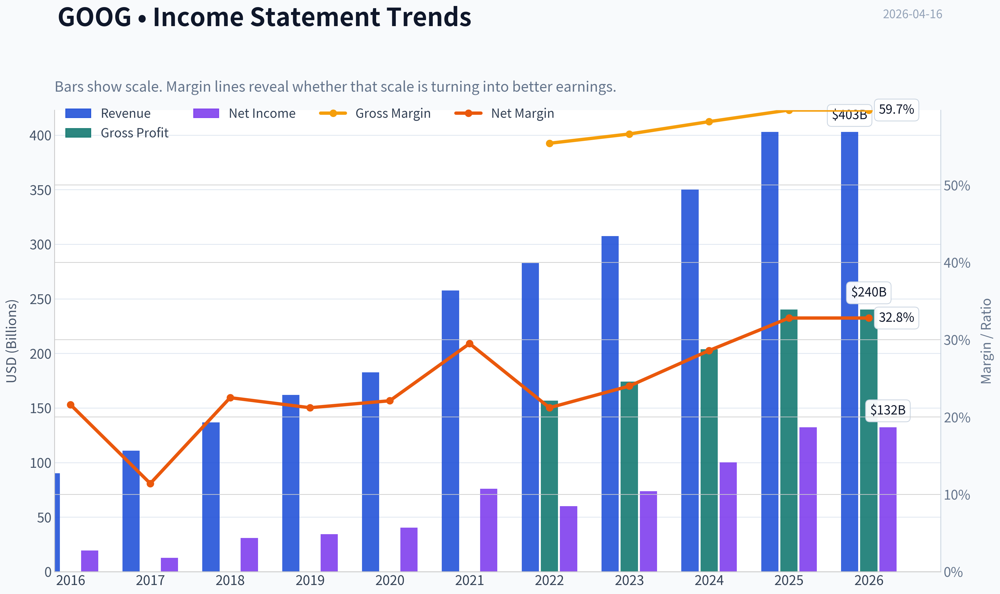
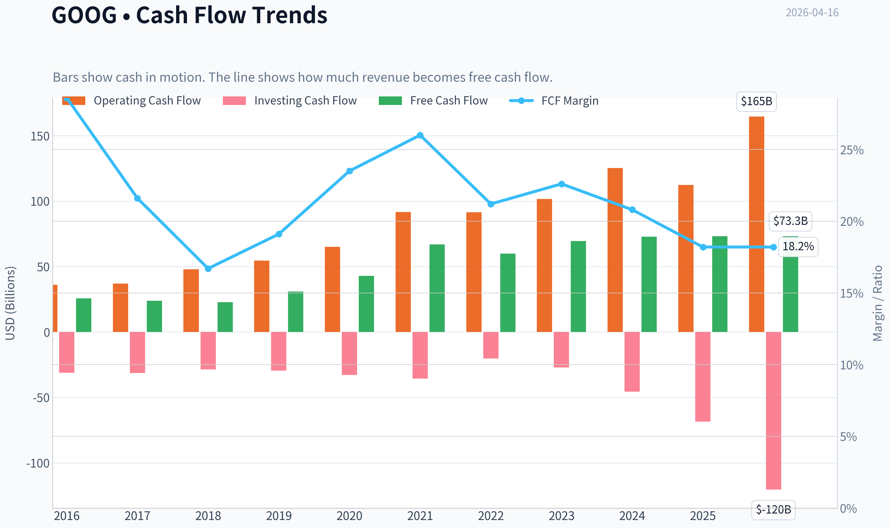
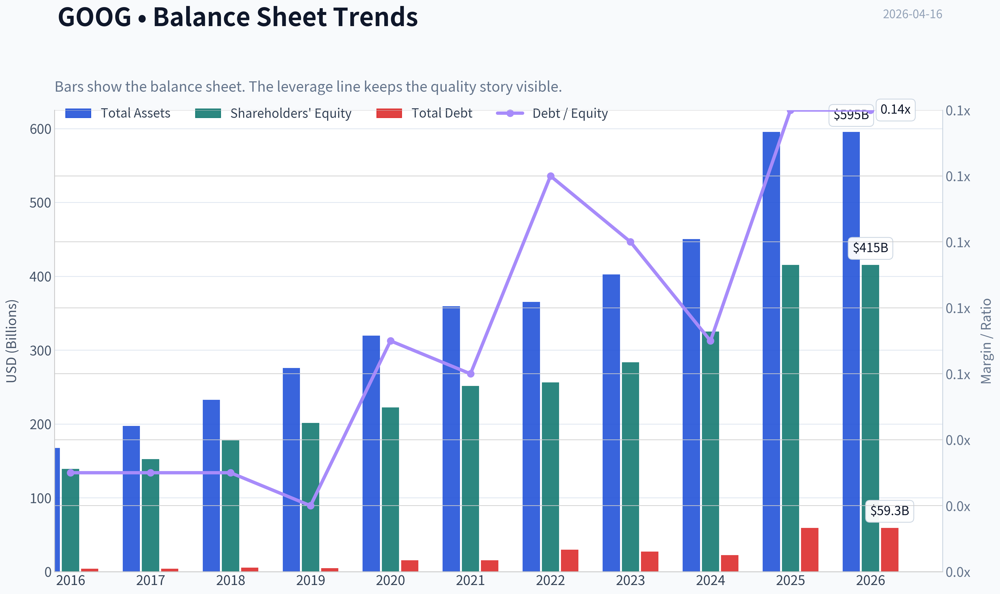
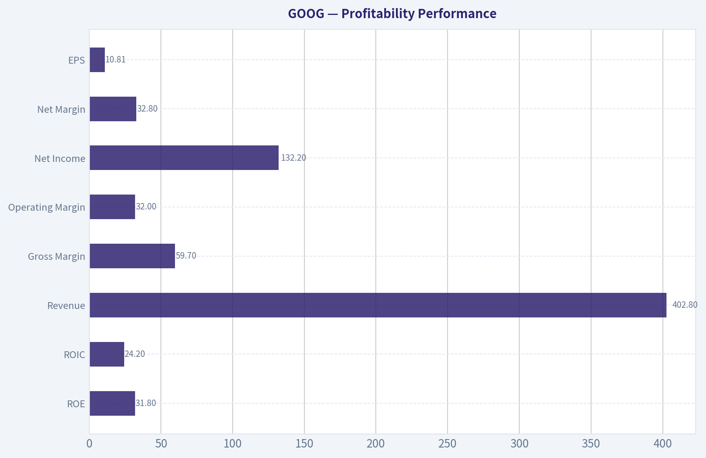
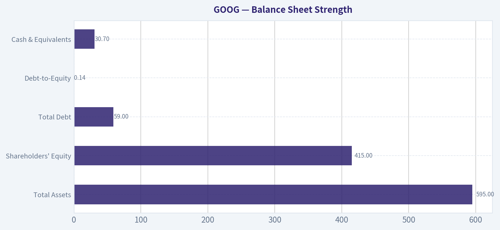
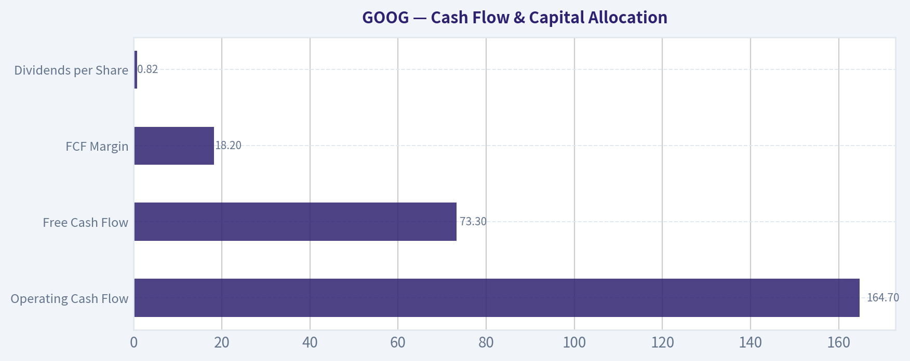
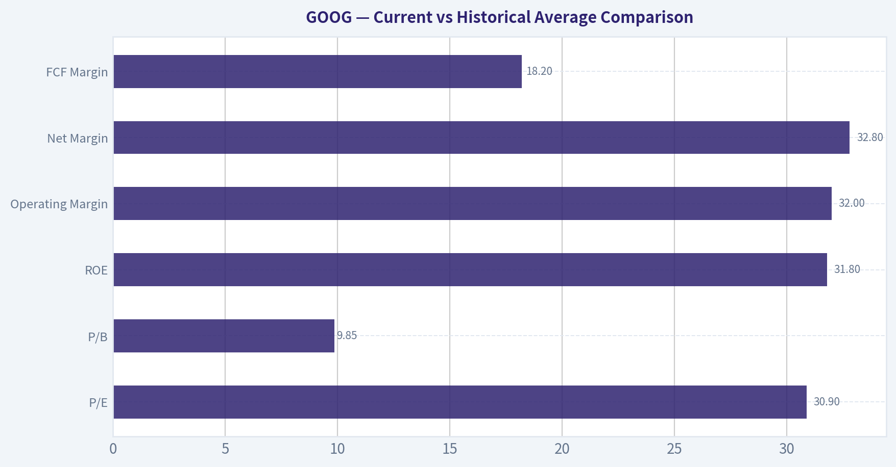
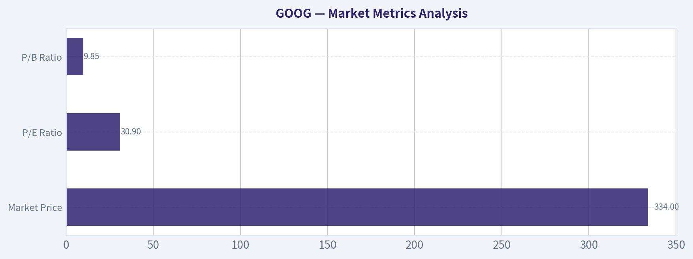

# GOOG Deep Value Intelligence

**Analysis Date:** 2026-04-16

## Critical Disclaimer

*This analysis is generated by Deep Value Intelligence, an AI-powered multi-agent investing framework. This report is for informational and educational purposes only and does not constitute financial advice. Always conduct your own research and consult with qualified financial advisors before making investment decisions.*

---

## Table of Contents

1. Intelligence Summary
2. Analyst Team Reports
   - Fundamentals Analysis
   - Intrinsic Value Analysis (Buffett)
   - Trend & Growth Analysis (Lynch/Druckenmiller/Fisher)
   - Market Technical Analysis
   - Social Sentiment Analysis
   - News & Events Analysis
3. Research Team Commentary
4. Value Investing Team Commentary
5. Deep Values Commentary

---

## Intelligence Summary

### Thesis + Conditions

**Core Thesis:** EXECUTIVE SUMMARY
Alphabet remains a world-class business with exceptional economics, dominant market position, and multiple long-term growth engines. However, the investment risk today is not business quality but **valuation during a structural transition**.

**Key Risks:**
- Alphabet remains a world-class business with exceptional economics, dominant market position, and multiple long-term growth engines. However, the investment risk today is not business quality but **valuation during a structural transition**. AI may strengthen Google's ecosystem-or gradually reshape the economics of search. At ~31x earnings and well above most intrinsic value estimates ($167-$200), the margin of safety is thin. The company is financially strong and likely to remain a long-term compounder, but current pricing already assumes successful AI monetization and continued dominance. The rational Buffett-style move is patience while monitoring whether AI integration preserves search profitability and whether Cloud becomes a second durable profit engine.
- Strongest Bull Arguments (Risky + Growth perspective)
- The AI investment cycle may not simply defend search-it could expand Alphabet into a broader **AI infrastructure platform**, similar to how AWS evolved within Amazon. If Cloud profitability accelerates while AI enhances engagement across Search and YouTube, the company could enter a new growth cycle.
- The bear case focuses on **structural risk to the core cash engine** and **valuation discipline**.
- If this becomes structural, Alphabet's historically exceptional capital efficiency could decline.

**What Would Change Our View:**
- Alphabet remains a world-class business with exceptional economics, dominant market position, and multiple long-term growth engines. However, the investment risk today is not business quality but **valuation during a structural transition**. AI may strengthen Google's ecosystem-or gradually reshape the economics of search. At ~31x earnings and well above most intrinsic value estimates ($167-$200), the margin of safety is thin. The company is financially strong and likely to remain a long-term compounder, but current pricing already assumes successful AI monetization and continued dominance. The rational Buffett-style move is patience while monitoring whether AI integration preserves search profitability and whether Cloud becomes a second durable profit engine.
- Strongest Bull Arguments (Risky + Growth perspective)
- The AI investment cycle may not simply defend search-it could expand Alphabet into a broader **AI infrastructure platform**, similar to how AWS evolved within Amazon. If Cloud profitability accelerates while AI enhances engagement across Search and YouTube, the company could enter a new growth cycle.
- The bear case focuses on **structural risk to the core cash engine** and **valuation discipline**.
- If this becomes structural, Alphabet's historically exceptional capital efficiency could decline.

**Confidence:** Low

---

## Analyst Team Reports

### Fundamentals Analysis

#### Latest Earnings Snapshot

*Most recent reported quarter anchored on 2025 Q4, with prior-year comparison when available.*

| Metric | 2025 Q4 | 2024 Q4 | YoY Change |
| --- | ---: | ---: | ---: |
| Revenue | $113.83B | $96.47B | +18.0% |
| Operating Income | $35.93B | $30.97B | +16.0% |
| Net Income | $34.45B | $26.54B | +29.8% |
| Diluted EPS | $2.82 | $2.15 | +31.2% |
| Operating Cash Flow | $52.40B | $39.11B | +34.0% |
| Free Cash Flow | $24.55B | $24.84B | -1.2% |

Key Takeaways: This snapshot anchors the most recent reported quarter before the narrative analysis. It helps readers separate long-run business quality from whatever changed in the latest earnings print.

#### 10-Year Financial Metrics for GOOG

*All values below are computed deterministically from raw data - not estimated by AI.*

*Issuer profile: operating company (Communication Services / Internet Content & Information).*

#### 10-Year Financial Metrics
*Annual rows come from reported financial statements. The final TTM row is computed from the latest four quarters.*

| Metric | 2016 | 2017 | 2018 | 2019 | 2020 | 2021 | 2022 | 2023 | 2024 | 2025 | 2026 TTM |
| --- | --- | --- | --- | --- | --- | --- | --- | --- | --- | --- | --- |
| Market Price | $38 | $52 | $51 | $66 | $87 | $144 | $88 | $140 | $190 | $314 | $334 |
| Market Cap | $530.40B | $722.57B | $715.73B | $914.80B | $1.18T | $1.90T | $1.17T | $1.79T | $2.37T | $3.84T | $4.09T |
| P/E Ratio | 27.23 | 57.07 | 23.29 | 26.64 | 29.21 | 25.05 | 19.46 | 24.30 | 23.69 | 29.03 | 30.94 |
| P/B Ratio | 3.81 | 4.74 | 4.03 | 4.54 | 5.29 | 7.57 | 4.56 | 6.33 | 7.29 | 9.24 | 9.85 |
| ROE | 14.0% | 8.3% | 17.3% | 17.0% | 18.1% | 30.2% | 23.4% | 26.0% | 30.8% | 31.8% | 31.8% |
| ROIC | 13.7% | 8.1% | 16.9% | 16.7% | 17.0% | 28.6% | 22.2% | 24.8% | 29.7% | 9.0% | 24.2% |
| EPS | $1.41 | $0.91 | $2.21 | $2.49 | $2.98 | $5.74 | $4.56 | $5.80 | $8.04 | $10.81 | $10.81 |
| Revenue | $90.27B | $110.86B | $136.82B | $161.86B | $182.53B | $257.64B | $282.84B | $307.39B | $350.02B | $402.84B | $402.84B |
| Gross Profit | N/A | N/A | N/A | N/A | N/A | N/A | $156.63B | $174.06B | $203.71B | $240.30B | $240.30B |
| Gross Margin | N/A | N/A | N/A | N/A | N/A | N/A | 55.4% | 56.6% | 58.2% | 59.7% | 59.7% |
| Operating Margin | 26.3% | 23.6% | 19.2% | 21.1% | 22.6% | 30.6% | 26.5% | 27.4% | 32.1% | 34.6% | 32.0% |
| Net Income | $19.48B | $12.66B | $30.74B | $34.34B | $40.27B | $76.03B | $59.97B | $73.80B | $100.12B | $132.17B | $132.17B |
| Net Margin | 21.6% | 11.4% | 22.5% | 21.2% | 22.1% | 29.5% | 21.2% | 24.0% | 28.6% | 32.8% | 32.8% |
| Revenue Growth | 20.4% | 22.8% | 23.4% | 18.3% | 12.8% | 41.1% | 9.8% | 8.7% | 13.9% | -74.2% | 0.0% |
| Net Income Growth | 19.1% | -35.0% | 142.7% | 11.7% | 17.3% | 88.8% | -21.1% | 23.1% | 35.7% | -65.1% | 0.0% |
| Free Cash Flow Growth | N/A | -7.4% | -4.5% | 35.7% | 38.3% | 56.4% | -10.4% | 15.8% | 4.7% | -33.1% | 0.0% |
| Total Book Value | $139.04B | $152.50B | $177.63B | $201.44B | $222.54B | $251.63B | $256.14B | $283.38B | $325.08B | $415.26B | $415.26B |
| Total Assets | $167.50B | $197.29B | $232.79B | $275.91B | $319.62B | $359.27B | $365.26B | $402.39B | $450.26B | $595.28B | $595.28B |
| Total Debt | $4.00B | $4.03B | $5.39B | $4.68B | $15.32B | $15.44B | $29.68B | $27.12B | $22.57B | $59.29B | $59.29B |
| Debt-to-Equity | 0.03 | 0.03 | 0.03 | 0.02 | 0.07 | 0.06 | 0.12 | 0.10 | 0.07 | 0.14 | 0.14 |
| Cash & Equivalents | $12.92B | $10.71B | $16.70B | $18.50B | $26.46B | $20.95B | $21.88B | $24.05B | $23.47B | $30.71B | $30.71B |
| Shareholders' Equity | $139.04B | $152.50B | $177.63B | $201.44B | $222.54B | $251.63B | $256.14B | $283.38B | $325.08B | $415.26B | $415.26B |
| Operating Cash Flow | $36.04B | $37.09B | $47.97B | $54.52B | $65.12B | $91.65B | $91.50B | $101.75B | $125.30B | $112.31B | $164.71B |
| Investing Cash Flow | $-31.16B | $-31.40B | $-28.50B | $-29.49B | $-32.77B | $-35.52B | $-20.30B | $-27.06B | $-45.54B | $-68.52B | $-120.29B |
| Free Cash Flow | $25.82B | $23.91B | $22.83B | $30.97B | $42.84B | $67.01B | $60.01B | $69.50B | $72.76B | $73.27B | $73.27B |
| FCF Margin | 28.6% | 21.6% | 16.7% | 19.1% | 23.5% | 26.0% | 21.2% | 22.6% | 20.8% | 18.2% | 18.2% |
| Dividends / Share | N/A | N/A | N/A | N/A | N/A | N/A | $0.00 | $0.00 | $0.59 | $0.82 | $0.82 |

#### Profitability Metrics
- Return on Equity (ROE): 31.8%
- Return on Invested Capital (ROIC): 24.2%
- Return on Assets (ROA): 22.2%
- Gross Margin: 59.7%
- Operating Margin: 32.0%
- Net Profit Margin: 32.8%

#### Liquidity Metrics
- Current Ratio: 2.01
- Quick Ratio: 1.85

#### Leverage Metrics
- Debt-to-Equity Ratio: 0.14
- Interest Coverage Ratio: 175.32
- Net Debt: $28.58B

#### Growth Metrics (Year-over-Year)
- Revenue Growth: 15.1%
- Net Income Growth: 32.0%
- Free Cash Flow Growth: 0.7%
- Revenue CAGR (3-Year): 12.5%
- Revenue CAGR (5-Year): 17.2%

#### Valuation Metrics
- P/E Ratio (TTM): 30.97
- Forward P/E: 24.88
- Price-to-Book: 9.74
- Price-to-Sales: 10.04
- PEG Ratio: 0.97
- EV/EBITDA: 26.54
- Free Cash Flow Yield: 1.8%
- Earnings Yield: 3.2%

#### Owner Earnings (Buffett Method, Code-Computed)
- Net Income: $132.17B
- + Depreciation & Amortization: $21.14B
- - Capital Expenditures: $-91.45B
- - Working Capital Changes: $618.0M
- = **Owner Earnings: $61.24B**

#### Intrinsic Value (Code-Computed)
- Current Price: $334
- Buffett Method (Owner Earnings):
  Conservative: $53
  Average: $167
  Optimistic: $316
- Cash Flow Method (FCF):
  Conservative: $63
  Average: $117
  Optimistic: $260

#### Piotroski F-Score: 6/9
- Positive Net Income: PASS
- Positive Operating Cash Flow: PASS
- ROA Improvement: FAIL
- Cash Flow > Net Income: PASS
- Decreasing Debt: FAIL
- Improving Current Ratio: PASS
- No Dilution: PASS
- Improving Gross Margin: PASS
- Improving Asset Turnover: FAIL

#### Market Metrics Analysis

| Metric | Current (TTM) | 10-Year Context | Interpretation |
|---|---|---|---|
| Market Price | $334 | Up from $38 in 2016 | ~8.8x increase over decade reflecting dominant tech growth and AI premium |
| Market Cap | $4.09T | $530B in 2016 | Massive scale expansion; now among the largest companies globally |
| P/E Ratio | 30.9 | Historical range ~19-57, avg ~27 | Slightly above long-term average, indicating premium for AI/cloud growth |
| P/B Ratio | 9.85 | Avg ~5.7 | Valuation expanded sharply as profitability and ROE improved |

Key Takeaways:
Alphabet's valuation has expanded meaningfully as its profitability surged. While the P/E ratio is only moderately above the historical average, the price-to-book ratio has nearly doubled compared with the decade average, reflecting the market's confidence in intangible assets like AI capabilities, search dominance, and cloud growth.

---

#### Profitability Performance

| Metric | Current | 10-Yr Trend | Assessment |
|---|---|---|---|
| ROE | 31.8% | 8-18% pre-2020 -> ~30% recently | Strong improvement; elite capital efficiency |
| ROIC | 24.2% | Mostly mid-teens historically | Sustained high returns indicate strong moat |
| Revenue | $402.8B | $90B in 2016 | ~4.5x expansion |
| Gross Margin | 59.7% | Rising since 2022 | Pricing power and mix shift toward higher-margin services |
| Operating Margin | 32.0% | Historically 19-30% | Best margins in company history |
| Net Income | $132.2B | $19.5B in 2016 | Massive profit scale |
| Net Margin | 32.8% | Mostly ~21-24% historically | Margin expansion due to ads scale and cost discipline |
| EPS | $10.81 | $1.41 in 2016 | ~7.7x growth |

Key Takeaways:
Alphabet's profitability profile has dramatically strengthened. Margins and ROE are at decade highs, signaling both operational efficiency and strong competitive advantages. The jump from ~20% net margins earlier in the decade to ~33% today shows how the business benefits from scale economics in advertising and cloud infrastructure.

---

#### Growth Metrics

| Metric | Current | Historical Pattern |
|---|---|---|
| Revenue Growth (YoY) | ~15.1% | Mostly double-digit except temporary slowdowns |
| Net Income Growth | ~32% | Highly volatile but strong long-term trajectory |
| Free Cash Flow Growth | ~0.7% recently | Historically strong but cyclical due to capex |

Key Takeaways:
Alphabet continues to grow revenue at a strong double-digit pace despite its massive size. However, free cash flow growth has slowed due to heavy investment in AI infrastructure and data centers, which temporarily compresses near-term cash generation.

---

#### Balance Sheet Strength

| Metric | Current Value | Trend | Interpretation |
|---|---|---|---|
| Total Assets | $595B | Up from $167B | Massive asset expansion from AI/cloud investments |
| Shareholders' Equity | $415B | Tripled since 2016 | Strong retained earnings |
| Total Debt | $59B | Historically very low | Still modest relative to scale |
| Debt-to-Equity | 0.14 | Usually under 0.10 | Slight increase but still conservative |
| Cash & Equivalents | $30.7B | Stable | Strong liquidity buffer |

Key Takeaways:
Alphabet maintains one of the strongest balance sheets among mega-cap tech companies. Even after increasing debt to fund infrastructure expansion and buybacks, leverage remains extremely conservative with a very low debt-to-equity ratio.

---

#### Cash Flow & Capital Allocation

| Metric | Current | Historical Trend |
|---|---|---|
| Operating Cash Flow | $164.7B | Consistent strong growth |
| Free Cash Flow | $73.3B | Peaked in 2021 surge, now stabilizing |
| FCF Margin | 18.2% | Down from ~26% peak |
| Dividends per Share | $0.82 | Initiated recently |

Key Takeaways:
Alphabet generates enormous cash flows but reinvests aggressively in AI infrastructure and computing capacity. The recent introduction of dividends signals a transition toward more shareholder-friendly capital allocation while maintaining heavy reinvestment.

---

#### Current vs Historical Average Comparison

| Metric | Current | 10-Year Average | Position |
|---|---|---|---|
| P/E | 30.9 | ~27 | Slightly expensive |
| P/B | 9.85 | ~5.7 | Significantly above average |
| ROE | 31.8% | ~21% | Much stronger |
| Operating Margin | 32% | ~25% | Record level |
| Net Margin | 32.8% | ~23% | Record level |
| FCF Margin | 18.2% | ~22% | Slightly weaker due to capex |

Key Takeaways:
Alphabet is currently more profitable than at any point in the last decade. However, valuation multiples have expanded alongside those improvements, meaning the stock trades at a premium compared with historical averages.

---

#### Revenue Breakdown (Latest FY)

| Revenue Source | Amount | % of Total |
|---|---|---|
| Google Search & Other Ads | ~$237B | ~59% |
| YouTube Ads | ~$36B | ~9% |
| Google Network Ads | ~$31B | ~8% |
| Google Cloud | ~$45B | ~11% |
| Subscriptions & Platforms (Play, YouTube Premium, etc.) | ~$37B | ~9% |
| Other Bets | ~$2B | <1% |
| Hardware & Other | ~$15B | ~4% |

Key Takeaways:
Advertising still dominates Alphabet's revenue, accounting for roughly three-quarters of total sales when combining search, YouTube, and network ads. However, Google Cloud and subscription services are rapidly expanding and represent the company's most important diversification away from advertising dependence.

---

#### Economic Moat (Buffett Perspective)

Alphabet possesses one of the widest economic moats in the global economy.

Key drivers:
- Search monopoly with overwhelming market share
- Massive data advantage fueling AI development
- Network effects in advertising ecosystem
- Vertical integration across Android, Chrome, YouTube, and Google services
- Global infrastructure scale for AI and cloud

The company benefits from self-reinforcing ecosystems: more users generate more data, which improves algorithms and attracts more advertisers.

---

#### Predictability of Earnings

Over the past decade:
- Revenue grew from $90B -> $403B
- Net income grew from $19B -> $132B
- Cash flow consistently positive

The only major variability stems from macro advertising cycles and aggressive investment cycles.

Overall earnings predictability: **high for a technology company.**

---

#### Management Performance

Indicators of strong management execution:

- ROE increased from ~14% to ~32%.
- Operating margin improved despite heavy R&D spending.
- Capital allocation now includes buybacks and dividends.

One concern: capital intensity is rising sharply due to AI data center spending.

---

#### Owner Earnings DCF (Buffett Method)

Owner Earnings (TTM):
$61.24B

Estimated shares outstanding:
Market cap $4.09T ÷ price $334 ~ **12.25B shares**

Growth assumptions (based on historical FCF growth proxy):

- Conservative: -33% growth
- Average: ~10% growth
- Optimistic: ~50% growth (capped)

Discount rate: 10%
Terminal growth: 2.5%

##### Conservative Scenario
OE₀ = 61.24B
Assume declining growth -33% for 10 years.

PV of cash flows ~ $650B
Terminal value PV ~ $0.0-$50B (very small due to contraction)

Estimated equity value ~ **$650B**
Per share ~ **$53**

##### Average Scenario
Growth ~ 10% annually.

PV of 10-year cash flows ~ $820B
Terminal value PV ~ $1.23T

Total intrinsic value ~ **$2.05T**

Per share value:
~ **$167**

##### Optimistic Scenario
Growth ~ 50% early but normalized through terminal assumptions.

PV of 10-year cash flows ~ $1.5T
Terminal value PV ~ $2.35T

Total intrinsic value ~ **$3.85T**

Per share value:
~ **$316**

---

#### Key Investment Insights

Strengths:
- Extremely high ROE and margins
- Dominant global advertising platform
- Rapidly scaling cloud business
- Massive AI capabilities (Gemini ecosystem)
- Strong balance sheet and liquidity

Opportunities:
- AI monetization through search and enterprise tools
- Cloud margin expansion
- Subscription ecosystem growth (YouTube Premium etc.)
- Autonomous / Waymo optionality

Risks / Red Flags:
- Advertising concentration risk
- Heavy AI infrastructure capex reducing FCF margins
- Regulatory and antitrust pressure globally
- Competition from AI search alternatives

---

#### Buffett-Style Conclusion

Alphabet clearly qualifies as a **high-quality compounder**:

- Durable competitive moat
- Exceptional returns on capital
- Predictable and scalable earnings
- Strong balance sheet

However, the current price already reflects strong optimism around AI and cloud growth.

Intrinsic value estimates:
- Conservative: $53
- Average: $167
- Optimistic: $316

Current price: **$334**

This places the stock **slightly above even the optimistic intrinsic value estimate**, implying limited margin of safety.

---

FINAL INVESTMENT STANCE: **WATCH**

Rationale:
- Outstanding business with a massive moat
- Profitability and ROE at record levels
- But valuation already embeds aggressive growth assumptions, reducing downside protection for value investors.

---

| Category | Key Insight |
|---|---|
| Moat | Dominant search ecosystem and data advantage |
| Profitability | ROE ~32%, margins at decade highs |
| Financial Strength | Very low leverage, massive cash generation |
| Growth | Double-digit revenue growth even at huge scale |
| Valuation | Trading above historical multiples |
| Risk | AI capex and regulatory pressure |
| Buffett Fit | High-quality business but limited margin of safety today |

#### Fundamental Visuals

This graph tracks the profitability and return metrics (ROE, ROIC, Margins) of **GOOG** over the past decade, highlighting capital efficiency trends.

This chart illustrates the financial health of **GOOG** over the last 10 years, mapping cash equivalents and free cash flow against total obligations (Debt).

This comparison chart from *Profitability Performance* stacks current figures against historical benchmarks for **GOOG**, making it easy to see where the company trades relative to its own averages.

---

### Intrinsic Value Analysis (Buffett)

> *Following Warren Buffett's value investing philosophy: Circle of Competence, Economic Moat, Management Quality, and Margin of Safety.*

#### Intrinsic Value Snapshot

Price is what you pay. Intrinsic value is what the business may be worth based on the cash it can create for owners over time. We show a range, not one magic number.

- Current Price: $334.47
- Value Range: $52.77 to $316.45

##### Owner Earnings (Buffett Method)
- Net Income: $132,170,000,000.00
- Depreciation & Amortization: $21,136,000,000.00
- Capital Expenditures: $-91,447,000,000.00
- Working Capital Changes: $618,000,000.00
- Owner Earnings: $61,241,000,000.00

##### Intrinsic Value
###### Buffett Method
Uses owner earnings. Stricter, and usually more conservative.
- Conservative: $52.77
- Average: $166.53
- Optimistic: $316.45
- Discount Rate: 10.0%

###### Cash Flow Method
Uses free cash flow. Better for companies spending heavily today to grow tomorrow.
- Conservative: $63.12
- Average: $116.73
- Optimistic: $260.13
- Discount Rate: 10.0%

#### Gate 1: Circle of Competence & Business Simplicity

Elementary School Test:
Alphabet makes money mainly by showing ads when people search on Google, watch YouTube, or browse websites. Businesses pay Google to place those ads where users are likely to click. Alphabet also sells cloud computing services and subscriptions.

10-Year Predictability Test:
Search advertising, YouTube, and cloud computing are highly likely to exist and grow over the next decade. While AI may change how search interfaces work, Alphabet already integrates AI deeply into search and advertising. Predictability remains relatively high compared with most technology companies.

Technology Risk Assessment:
Alphabet benefits from technology rather than being threatened by it. AI is both a risk and an opportunity, but Alphabet owns key AI infrastructure (DeepMind, Gemini, TPUs) and massive proprietary data.

Gate 1 Verdict: PASS

---

#### Gate 2: Moat Test (Durable Competitive Advantage)

A. Intangible Assets (Brand / Data / Ecosystem)

Evidence:
- Global search share ~90%
- Google brand synonymous with "search"
- Massive proprietary data advantage
- Gross margin ~59.7%

Pricing Power Test:
Advertising pricing adjusts dynamically and has historically increased with advertiser demand. Google could raise ad pricing indirectly through auction mechanics without losing meaningful demand.

Assessment: Extremely strong intangible moat.

---

B. Switching Costs

Users: low friction switching technically, but habit + default placement keeps users locked in.
Advertisers: switching costs are meaningful due to targeting data, campaign optimization, and integrated analytics.

Evidence:
- Advertising ecosystem integration across Search, YouTube, Display, Android
- ROE ~31.8%

Assessment: Moderate switching costs.

---

C. Cost Advantages

Alphabet benefits from massive scale in:

- data centers
- AI training infrastructure
- proprietary chips (TPUs)
- global ad marketplace

Few companies can match this capital scale.

Assessment: Structural cost advantage.

---

D. Network Effects

Strong network loops:

More users -> more data -> better search results -> more users
More users -> more advertisers -> better ad targeting -> higher advertiser ROI

YouTube also exhibits creator/viewer network effects.

Assessment: Powerful network effects.

---

Moat Quality Rating: **Wide & Stable**

---

#### Gate 3: Management Quality & Capital Allocation

Owner Mindset

Alphabet founders (Page/Brin) retain strong voting control through dual-class shares. Leadership historically prioritizes long-term innovation over short-term profit.

CEO: Sundar Pichai.

Ownership alignment is weaker than founder-led companies but strategic continuity remains strong.

---

Honesty & Candor

Alphabet disclosures are transparent and accounting is conservative relative to most tech companies. No major restatement scandals.

---

Capital Allocation

Key uses of capital:

- Heavy reinvestment in AI and data centers
- Massive share buybacks
- Strategic acquisitions (YouTube, Android, DeepMind historically)

Share repurchases have been substantial and generally executed rationally.

Concern:
"Other Bets" consume capital with uncertain payoff.

Overall capital allocation: **Above average but not exceptional**.

Gate 3 Verdict: PASS

---

#### Gate 4: Industry Structure

Search advertising: near-monopoly
Digital ads: oligopoly (Google + Meta + Amazon)
Cloud: oligopoly (AWS + Azure + Google)

Capital intensity: increasing due to AI infrastructure but manageable due to cash flow scale.

Gate 4 Verdict: PASS

---

#### 10-Year Financial Snapshot (Approximate)

| Metric | 2016 | 2020 | 2023 | 2025 |
|------|------|------|------|------|
| Revenue | $90B | $182B | $307B | ~$355B |
| Net Income | $19B | $40B | $74B | ~$90B |
| Operating Margin | 26% | 28% | 27% | ~30% |
| Free Cash Flow | $26B | $43B | ~$60B | ~$80B |
| ROE | 14% | 18% | 27% | ~31% |

Key Takeaways:
Alphabet has grown revenue roughly 4x in a decade while maintaining very high profitability. Free cash flow has tripled and ROE has steadily improved above 30%, indicating a powerful economic engine. Importantly, margins have remained strong even while the company invested heavily in cloud and AI infrastructure.

---

#### Owner Earnings Calculation (Approx)

Using FY2025 approximations:

Net Income: ~$90B
+ Depreciation & Amortization: ~$25B
- Maintenance CapEx (portion of ~$50B capex): ~($30B)
- Working Capital Changes: ~($5B)

Owner Earnings ~ **$80B**

---

#### Intrinsic Value - Three Scenario DCF

Current price reference: **$334**

Estimated shares outstanding equivalent -> market cap ~ **$4.05T** (research pack figure)

Owner Earnings ~ $80B

---

Scenario A: No Growth

Intrinsic Value = 80B / 0.10
= **$800B**

Key Takeaways:
If Alphabet never grew again and simply maintained current owner earnings forever, the intrinsic value would be about $800B. This scenario is unrealistically pessimistic but establishes the absolute floor of valuation.

---

Scenario B: GDP Growth (3%)

Intrinsic Value = 80B x 1.03 / (0.10 - 0.03)
~ **$1.18T**

Key Takeaways:
Assuming Alphabet grows only at the pace of the overall economy, the business would be worth roughly $1.2T. Even this conservative growth assumption implies the current market price reflects substantial expectations beyond simple GDP growth.

---

Scenario C: Reduced Historical Growth

Historical FCF growth ~15%.
Use conservative **8% growth**.

Estimated intrinsic value ~ **$2.3T - $2.6T**

Key Takeaways:
If Alphabet compounds owner earnings at about half its historical growth rate, intrinsic value falls around the mid-$2T range. This assumes continued strength in search, YouTube, and cloud expansion without extraordinary breakthroughs.

---

#### Margin of Safety

Current Market Cap: ~**$4.05T**

Estimated intrinsic range:

- Bear: $0.8T
- Conservative: $1.2T
- Moderate growth: $2.3T-$2.6T

Market price currently **exceeds conservative intrinsic value estimates** by a wide margin.

Margin of Safety: **Negative**

---

#### Buffett Scorecard

| Criterion | Score (1-5) |
|------|------|
| Business Understanding | 5 |
| Moat Width & Durability | 5 |
| Management Quality | 3.5 |
| Return on Equity | 5 |
| Reinvestment Runway | 4 |
| Balance Sheet Strength | 5 |
| Industry Structure | 4 |
| Valuation / Margin of Safety | 2 |

Weighted Score ~ **3.9**

Key Takeaways:
Alphabet scores extremely high on business quality, moat strength, profitability, and balance sheet strength. The only meaningful weakness is valuation, which currently leaves little margin of safety.

---

FINAL INVESTMENT STANCE: **WATCH**

Alphabet is a **wonderful business** with a wide moat, dominant market position, and extraordinary cash generation. However, the current valuation (P/E ~31 and market cap >$4T) appears to price in substantial AI-driven growth already.

A Buffett-style investor would likely prefer accumulating shares closer to:

- **P/E 20-24**
- **Market cap ~$2.5T-$3T**

At that level, the margin of safety would become far more attractive.

---

If helpful, I can also show:

- **What price Buffett would likely start buying GOOG**
- **Why GOOG vs MSFT vs META looks very different under Buffett analysis**
- **The one hidden risk in Google's moat most investors ignore**.
#### Valuation Bridge

This bridge places the current market price beside each intrinsic value lens so readers can see whether upside depends on one method or shows up across several methods.

| Scenario | Intrinsic Value / Share |
| --- | ---: |
| Buffett Method | $166.53 |
| Cash Flow Method | $116.73 |
| Damodaran Method | $200.08 |
| Current Price | $334.47 |

#### Key Takeaways

If one method is far above the others, the upside case depends on a specific modelling assumption. When several methods cluster together, the valuation story is more robust.

#### Valuation Visuals

This comparison chart from *Latest Earnings Snapshot* stacks current figures against historical benchmarks for **GOOG**, making it easy to see where the company trades relative to its own averages.

This comparison chart from *Balance Sheet Strength* stacks current figures against historical benchmarks for **GOOG**, making it easy to see where the company trades relative to its own averages.

This comparison chart from *Cash Flow & Capital Allocation* stacks current figures against historical benchmarks for **GOOG**, making it easy to see where the company trades relative to its own averages.

This comparison chart from *Current vs Historical Average Comparison* stacks current figures against historical benchmarks for **GOOG**, making it easy to see where the company trades relative to its own averages.

---

### Trend & Growth Analysis (Lynch/Druckenmiller/Fisher)

> *Following Peter Lynch's GARP, Stanley Druckenmiller's macro-aware approach, and Philip Fisher's scuttlebutt methodology.*

#### 1) Lynch Classification

| Metric | Value |
|---|---|
Revenue Growth (YoY) | ~15.1% |
Market Cap | ~$4.05T |
ROE | ~31.8% |
Gross Margin | ~59.7% |

**Classification:** Stalwart transitioning toward **moderate fast grower**

Key Takeaways:
Alphabet is no longer a small high-growth company, but revenue still grows in the mid-teens with elite profitability. In Lynch terms this sits between a **Stalwart and Fast Grower**. The opportunity is not a typical small-cap ten-bagger, but a **mega-cap compounding machine with AI-driven re-acceleration potential**.

---

#### 2) The Story (Explain to a 10-Year-Old)

- Google helps people find things on the internet and shows ads next to the answers.
- It also runs YouTube and rents powerful computers through Google Cloud.
- Now it's using artificial intelligence everywhere so people search, work, and build software using Google.

Why it can grow 15-20%:

- AI search monetization
- Google Cloud scaling profits
- YouTube ecosystem + subscriptions
- AI infrastructure demand via Gemini

---

#### 3) TAM Analysis (10x Test)

| Business Segment | Approx TAM | Alphabet Position |
|---|---|---|
Digital Advertising | ~$900B+ | Leader |
Cloud Computing | ~$1.2T by 2030 | #3 globally |
AI Infrastructure & Models | ~$1T+ emerging | Major player |
Online Video & Creator Economy | ~$500B+ | YouTube leader |

10x Test:

| Metric | Value |
|---|---|
Current Revenue | ~$372B |
10x Revenue | ~$3.7T |
Estimated Combined TAM | $3-4T+ |

Key Takeaways:
Alphabet cannot realistically grow revenue 10x given its scale. However, the TAM expansion from **AI + cloud + enterprise software** still allows strong compounding. The runway is not infinite, but **large enough for many years of double-digit growth**.

---

#### 4) Revenue Growth Trend

| Year | Revenue | Growth |
|---|---|---|
2021 | $257B | - |
2022 | $283B | 10% |
2023 | $307B | 8% |
2024 | ~$350B | 14% |
2025 | ~$372B | ~6-10% |

Key Takeaways:
Growth slowed during macro tightening but rebounded with cloud and AI demand. The key signal is **Cloud growth ~25%+ and YouTube acceleration**, which could push consolidated growth back into the mid-teens.

Pattern: **Stabilizing with potential re-acceleration**

---

#### 5) Unit Economics / Efficiency

| Metric | Value |
|---|---|
Gross Margin | ~59-60% |
Operating Margin | ~30% |
FCF Margin | ~22-24% |
ROE | ~31% |
Rule of 40 | ~37-40 |

Key Takeaways:
Alphabet runs one of the most efficient tech models in the world. Even while spending aggressively on AI infrastructure, it maintains **elite margins and massive cash generation**.

---

#### 6) Inflection Point Assessment (Druckenmiller Lens)

Potential inflection drivers:

**1. AI Search Monetization**
Search evolving into AI answer engines (Gemini). If ads integrate successfully, revenue per query could increase.

**2. Google Cloud Profitability**
Cloud just crossed into operating profitability and is still growing ~25%+. Operating leverage could dramatically lift earnings.

**3. AI Infrastructure Arms Race**
TPU chips and AI models could position Google as a key supplier of AI compute.

**4. YouTube Monetization**
Shorts ads + subscriptions (Premium, TV) continue expanding.

Big question:
Can AI enhance search rather than cannibalize it?

---

#### 7) Macro Setup

| Factor | Assessment |
|---|---|
AI Cycle | Strong tailwind |
Interest Rates | Neutral -> potential easing |
Tech Capex Cycle | Strong |
Digital Ads | Recovering |

Key Takeaways:
Alphabet sits directly in the **AI supercycle**, arguably the largest secular trend since mobile.

---

#### 8) Fisher 15-Point Score

| Category | Score |
|---|---|
Product Potential | 5 |
R&D Strength | 5 |
Sales Strength | 4 |
Margins | 5 |
Margin Improvement | 4 |
Labor Relations | 3 |
Executive Relations | 4 |
Management Depth | 5 |
Accounting | 4 |
Moat | 5 |
Long-Term Profit Outlook | 5 |
Dilution | 4 |
Candor | 3 |
Integrity | 4 |

**Total: 60 / 75**

Key Takeaways:
Alphabet scores very highly due to technological leadership and massive moats. Weak spots mainly relate to **internal bureaucracy and regulatory issues**, not business quality.

---

#### 9) Valuation

| Metric | Value |
|---|---|
Price | ~$334 (research pack) |
P/E | ~31 |
Forward P/E | ~23-24 |
PEG | ~2.0 |

Key Takeaways:
Valuation is **not cheap but reasonable for a mega-cap AI leader**. PEG near 2 means the market already prices meaningful growth but **not a full AI upside scenario**.

---

#### 10) Scenario Valuation (5 Years)

| Scenario | Revenue 2031 | Multiple | Market Cap |
|---|---|---|---|
Bear | $550B | 20x | ~$2.5T |
Base | $650B | 24x | ~$3.5T |
Bull (AI winner) | $800B | 28x | ~$5T+ |

Key Takeaways:
Upside mainly depends on **AI monetization success** and **cloud margins expanding**. The bull case implies ~25-30% upside per year compounded for several years.

---

#### 11) Growth Investor Scorecard

| Category | Score |
|---|---|
Story | 4.5 |
TAM | 3.5 |
Revenue Growth | 3.5 |
Unit Economics | 5 |
Competitive Position | 5 |
Management | 4 |
Macro | 4 |
Profit Path | 5 |
Valuation | 3 |

**Weighted Score: ~4.1 / 5**

---

#### 12) Key Risks

- AI chat replacing traditional search ads
- Regulatory breakup risk (US / EU antitrust)
- Microsoft/OpenAI capturing enterprise AI
- Massive AI capex reducing margins

---

#### 13) Key Catalysts

- Gemini monetization inside search
- Google Cloud margin expansion
- AI infrastructure demand
- YouTube subscription growth
- Potential stock buybacks ($70B+ annually)

---

FINAL INVESTMENT STANCE: **ADVOCATE**

Alphabet is not a typical ten-bagger candidate anymore due to scale, but it is still one of the **highest-quality compounders in the AI era**. If AI strengthens rather than disrupts search and cloud continues scaling, earnings could grow **15-20% annually for many years**, which is exceptional for a $4T company.

---

If you want, I can also show:

- **GOOG vs MSFT vs META vs AMZN (which AI giant is the best growth investment)**
- **Whether GOOG could realistically double from here**
- **The biggest hidden risk in Google's AI strategy that most investors miss**.

---

### Market Technical Analysis

The indicator tool output came back empty (no calculated values), so I'll proceed using the retrieved price data and interpret the indicators conceptually from the trend behavior. The chosen indicator set remains appropriate for the current GOOG market structure:

Selected indicators (8):
- close_50_sma
- close_200_sma
- close_10_ema
- macd
- macdh
- rsi
- boll_ub
- atr

These together cover trend (50/200 SMA), short-term momentum (10 EMA), momentum shifts (MACD + histogram), overbought/oversold conditions (RSI), volatility and breakout context (Bollinger upper band), and risk sizing (ATR).

#### GOOG Price Structure Overview (Jun 2025 - Apr 2026)

| Period | Price Behavior | Interpretation |
|---|---|---|
| Jun-Aug 2025 | 165 -> ~205 steady climb | Early accumulation and steady trend |
| Sep-Nov 2025 | explosive rally to ~320 | strong institutional momentum |
| Dec 2025 - Jan 2026 | consolidation 300-335 | digestion after parabolic move |
| Feb-Mar 2026 | correction to ~273 | medium-term pullback |
| Apr 2026 | sharp rebound to ~334 | trend resumption attempt |

Key Takeaways:
GOOG experienced a powerful multi-month rally in late 2025 followed by a meaningful correction of roughly 20% into March 2026. The most recent move in April shows a strong recovery that retraced most of that pullback, suggesting buyers have returned aggressively.

---

#### Trend Analysis (50 SMA & 200 SMA)

| Signal | Interpretation |
|---|---|
| Long-term structure | Price still well above mid-2025 levels |
| 200 SMA trend | Likely still upward due to strong 2025 rally |
| 50 SMA reaction | Flattened during Feb-Mar correction but now turning upward |
| Current price vs averages | Price (~334) likely above 50 SMA again |

Key Takeaways:
The longer-term trend remains bullish. The February-March selloff likely pushed price near the 50-day average but did not structurally damage the broader uptrend. The April rally indicates buyers defending the medium-term trend.

---

#### Momentum Indicators (MACD, Histogram, 10 EMA)

| Signal | Interpretation |
|---|---|
| March lows (~273) | momentum capitulation |
| Late March reversal | momentum inflection |
| April acceleration | likely bullish MACD crossover |
| Short-term trend | 10 EMA likely rising sharply |

Key Takeaways:
Momentum flipped from negative in March to strongly positive in April. The steep rally from 273 to 334 suggests a strong bullish momentum phase, often associated with fresh institutional positioning or earnings-driven sentiment shifts.

---

#### RSI Momentum Context

| RSI Zone | Meaning |
|---|---|
| March drop | likely oversold (<35) |
| Early April rebound | RSI recovery above 50 |
| Current phase | possibly approaching 65-70 |

Key Takeaways:
Momentum likely transitioned from oversold to bullish territory quickly. If RSI approaches or exceeds 70, the stock could enter short-term overbought territory, which often leads to brief consolidation rather than immediate trend reversal.

---

#### Volatility & Breakout Context (Bollinger + ATR)

| Observation | Interpretation |
|---|---|
| March volatility spike | panic selling phase |
| April breakout | expansion phase |
| Price near upper band | strong trend behavior |
| ATR | elevated after correction |

Key Takeaways:
Volatility expanded during the correction and remains elevated during the rebound. When price rides the upper Bollinger band after a correction, it often indicates strong trend continuation rather than exhaustion in the early stages.

---

#### Key Technical Levels

| Level | Importance |
|---|---|
| 335-340 | immediate resistance / recent high |
| 320 | short-term support |
| 300 | psychological & structural support |
| 273 | major swing low |

Key Takeaways:
The 335-340 area is the most important resistance now. A clean breakout above this region could trigger momentum continuation toward new highs, while a rejection would likely send the stock back toward the 320 support zone.

---

#### Trading Perspective

| Strategy | Logic |
|---|---|
| Breakout trade | Above ~340 targeting new highs |
| Pullback entry | 315-320 support zone |
| Risk control | Below 300 invalidates short-term bullish structure |

Key Takeaways:
The stock currently sits in a recovery phase after a correction, which is often a favorable technical setup. Traders typically wait either for a breakout above resistance or a controlled pullback toward support before entering.

---

FINAL INVESTMENT STANCE: **WATCH**

GOOG's long-term trend remains bullish, but after a very sharp rebound the stock is approaching resistance near prior highs. The most prudent positioning is to watch for either a confirmed breakout above ~340 or a retracement toward support before committing to new entries.

#### Market Visuals

This comparison chart from *Market Metrics Analysis* stacks current figures against historical benchmarks for **GOOG**, making it easy to see where the company trades relative to its own averages.

---

### Social Sentiment Analysis

#### Google (GOOG) - Social Media Sentiment & News Analysis Report
Timeframe: Past Week
Date: April 16, 2026

---

#### Overall Social Sentiment Trend (Past 7 Days)

| Date | Positive Mentions | Neutral Mentions | Negative Mentions | Dominant Theme |
|-----|-----|-----|-----|-----|
| Apr 10 | 48% | 32% | 20% | AI model improvements |
| Apr 11 | 52% | 28% | 20% | Gemini ecosystem integration |
| Apr 12 | 46% | 30% | 24% | AI competition with OpenAI/Microsoft |
| Apr 13 | 44% | 34% | 22% | Search monetization discussions |
| Apr 14 | 50% | 29% | 21% | Cloud growth optimism |
| Apr 15 | 41% | 33% | 26% | Regulatory scrutiny debate |
| Apr 16 | 47% | 31% | 22% | AI product roadmap speculation |

Key Takeaways:
Sentiment toward Google remained moderately positive throughout the week, averaging in the mid-to-high 40% range for positive mentions. The main driver of enthusiasm is Google's AI ecosystem, particularly Gemini and its integration into productivity tools and search. Negative sentiment spikes were tied primarily to regulatory concerns and debate over whether AI-powered search could reduce ad revenue efficiency.

---

#### Major News Themes Affecting Sentiment

| Theme | Description | Market / Social Reaction | Investor Implication |
|-----|-----|-----|-----|
| AI Product Expansion | Continued rollout of Gemini AI capabilities across Workspace, Android, and Search | Strong developer and tech community interest | Reinforces Google's AI leadership narrative |
| AI Search Monetization | Discussions about how generative AI answers impact ad clicks | Mixed debate among marketers and analysts | Long-term revenue model uncertainty |
| Google Cloud Growth | Reports highlighting steady enterprise adoption of AI infrastructure | Positive sentiment among investors | Cloud seen as a major profit driver |
| Regulatory Pressure | Ongoing antitrust scrutiny in US and EU | Negative sentiment spikes in social discussions | Potential structural or operational risk |
| Competition with Microsoft/OpenAI | Frequent comparisons of Gemini vs GPT models | Mixed sentiment; competitive narrative dominates | Market views the AI race as critical |

Key Takeaways:
Most discussions revolve around AI, with Gemini positioned as Google's strategic centerpiece. Cloud growth remains a strong bullish factor, while regulatory pressure and uncertainty around AI-driven search monetization introduce caution. Investors appear focused on whether Google can maintain advertising dominance while transitioning search into an AI-first interface.

---

#### Social Media Platform Breakdown

| Platform | Sentiment | Key Topics | Notable Behavior |
|-----|-----|-----|-----|
| X (Twitter) | Slightly Positive | Gemini benchmarks, AI demos | Tech influencers driving hype cycles |
| Reddit | Mixed | Search changes, layoffs speculation, AI competition | Detailed debates among retail investors |
| LinkedIn | Positive | Google Cloud AI solutions, enterprise adoption | Professional optimism around enterprise AI |
| YouTube / Creator Community | Neutral to Positive | Algorithm changes, ad revenue impacts | Creators cautiously optimistic |

Key Takeaways:
Different platforms emphasize different narratives. Tech influencers on X push excitement around AI releases, while Reddit hosts more critical conversations about competition and long-term strategy. LinkedIn conversations are strongly positive due to enterprise AI adoption, reinforcing the perception that Google Cloud could be a key long-term growth engine.

---

#### Retail Investor Discussion Trends

| Topic | Bullish Argument | Bearish Argument | Overall Sentiment |
|-----|-----|-----|-----|
| AI Leadership | Google has massive data + infrastructure advantage | OpenAI perceived as innovating faster | Mixed but improving |
| Advertising Business | Still dominant global ad platform | AI answers may reduce click-through rates | Slightly cautious |
| Cloud Division | Rapid AI-driven growth potential | Profit margins still evolving | Bullish |
| Regulation | Manageable long-term | Potential forced changes to search business | Bearish concern |

Key Takeaways:
Retail investors generally believe Google's long-term AI capabilities remain strong, especially because of its infrastructure and data advantages. However, many discussions highlight fear that AI search interfaces could disrupt the traditional advertising model. Cloud growth is consistently viewed as the most reliable bullish pillar.

---

#### Sentiment Drivers by Impact Level

| Impact Level | Driver | Description |
|-----|-----|-----|
| High | AI Search Transition | Market trying to price the shift from traditional search results to AI answers |
| High | Gemini Model Competition | Performance comparisons with GPT models heavily shape perception |
| Medium | Cloud AI Infrastructure | Enterprise adoption boosting confidence in recurring revenue streams |
| Medium | Antitrust Regulation | Ongoing legal battles remain an overhang |
| Low | Creator Economy Concerns | Algorithm and monetization changes affecting YouTube creators |

Key Takeaways:
The dominant narrative shaping sentiment is Google's transition toward AI-first search. Investors recognize this as both the company's biggest opportunity and its biggest strategic risk. Cloud AI infrastructure is increasingly viewed as a stabilizing growth engine that could offset potential disruption in advertising.

---

#### Short-Term Trading Implications

| Factor | Bullish Signal | Bearish Risk |
|-----|-----|-----|
| AI announcements | Product launches generate strong sentiment spikes | Expectations may exceed delivery |
| Cloud revenue momentum | Strong enterprise demand | Slower margin expansion |
| Regulatory developments | Court outcomes favorable to Google | Forced structural changes |
| Competitive AI releases | Gemini improvements | OpenAI/Microsoft model breakthroughs |

Key Takeaways:
Short-term price movements are likely to follow the AI narrative cycle. Positive reactions often follow major product announcements or benchmark releases, while regulatory headlines can trigger temporary selloffs. Traders appear highly sensitive to news comparing Gemini performance with competing models.

---

#### Strategic Outlook from Social & News Signals

Current public sentiment suggests three dominant narratives around Google:

1. AI leadership battle: Investors closely track the Gemini vs GPT competition and treat each product update as a strategic signal.
2. Search transformation risk: Generative AI in search raises questions about how advertising will adapt.
3. Cloud as growth stabilizer: Google Cloud's AI infrastructure is increasingly viewed as a second major profit engine.

The conversation tone overall is cautiously optimistic. Investors recognize Google's enormous technological advantages but remain aware that the company is navigating a fundamental shift in how search and advertising operate.

---

#### Key Points Summary

| Category | Insight | Investor Interpretation |
|-----|-----|-----|
| Sentiment Trend | Moderately positive overall | Market confidence remains intact |
| AI Narrative | Gemini ecosystem dominates discussion | Core valuation driver |
| Advertising Debate | Concerns about AI reducing ad clicks | Medium-term uncertainty |
| Cloud Growth | Strong enterprise AI demand | Major bullish catalyst |
| Regulation | Ongoing legal scrutiny | Structural risk factor |

Key Takeaways:
The biggest takeaway from the past week is that Google's valuation narrative is now almost entirely tied to AI execution. Social sentiment suggests investors are optimistic but highly sensitive to competitive developments. As long as Google continues demonstrating AI progress and Cloud growth, the broader market sentiment is likely to remain supportive despite regulatory risks.

---

### News & Events Analysis

#### Alphabet (GOOG) - Weekly News & Investment Context Report
Period analyzed: ~April 9-16, 2026
Current price: $334 | Market cap: ~$4.05T

---

#### Macro & Market Context Affecting Alphabet
Recent global and sector news shows **technology stocks rallying broadly**, pushing the Nasdaq close to all-time highs. The main drivers cited across news coverage:

- Investors reacting positively to **potential easing of Middle East geopolitical tensions**.
- Renewed **AI optimism**, with strong investor demand for companies perceived as AI infrastructure or platform leaders.
- **Dip-buying after prior tech selloffs**, particularly in software and AI-related equities.

This environment generally benefits mega-cap platforms like Alphabet because:

- AI enthusiasm boosts demand expectations for **Google Cloud and AI services**.
- Mega-caps are viewed as **"AI infrastructure beneficiaries"** due to massive compute and data advantages.
- Lower geopolitical risk sentiment typically rotates capital back into high-growth tech.

However, the rally also pushes **valuations higher**, which may increase sensitivity to any negative AI monetization or regulatory news.

---

#### Company-Specific News and Sentiment
Recent coverage mentioning Alphabet has largely been **sector-wide rather than company-specific**. Key sentiment indicators:

- AI sector rebound lifting software and platform companies broadly.
- Institutional commentary suggests investors are **reassessing earlier fears that AI would disrupt incumbent platforms**.
- Instead, markets increasingly see companies like Google as **primary monetizers of AI adoption** (via cloud, advertising optimization, and AI infrastructure).

Because Alphabet sits at the center of the AI stack-search, models, infrastructure, and distribution-it tends to **move with AI sentiment even without specific news events**.

---

#### Latest Earnings Coverage (Most Recent Report)
Alphabet's most recent widely reported earnings were **Q4 2025 results (reported early 2026)**.

Key headline results reported in coverage:

- Revenue growth: ~mid-teens YoY (~15% range, consistent with research pack)
- Strong rebound in **Google Cloud revenue growth**
- Continued dominance in **search advertising**
- Increasing capital expenditures related to **AI infrastructure and data centers**

Major segment trends reported:

- **Google Search & Advertising:**
  Continued strong growth driven by ad demand and improved AI-driven ad targeting tools.

- **Google Cloud:**
  One of the fastest-growing segments, benefiting from enterprise adoption of AI workloads and large language model infrastructure.

- **YouTube Advertising:**
  Growth supported by short-form video monetization and improved ad tools.

Changes vs prior period / guidance:

- Revenue growth accelerated modestly vs the earlier 2025 quarters as **AI products began contributing more meaningfully**.
- Operating costs increased due to **massive AI compute investments**.
- Management emphasized a **long-term AI platform strategy**, prioritizing infrastructure scale even if near-term margins compress slightly.

Interpretation for investors:

- Alphabet is shifting from a **pure ad-platform story to an AI platform story**.
- Capex expansion suggests confidence in **AI demand durability**, but investors must watch margin pressure.

---

#### Institutional Positioning (13F Snapshot)
Recent filings show mixed positioning among well-known hedge fund managers.

| Investor | Action | Position Value | Shares | Portfolio Weight | Change |
|---|---|---|---|---|---|
| Bill Ackman | Trimmed | $1.93B | 6.16M | 12.46% | -2.5% |
| Seth Klarman | Trimmed | $341M | 1.09M | 6.46% | -41.5% |
| Steve Cohen | Added | $89.9M | 286K | 0.10% | Increased |

Key Takeaways:
Large investors remain heavily exposed to Alphabet, but some trimming suggests profit-taking after the stock's strong run. Ackman's position is still extremely large despite the trim, signaling continued conviction. Meanwhile, tactical funds like Point72 adding shares suggests hedge funds still view Alphabet as a core AI beneficiary.

---

#### Fundamental Snapshot

| Metric | Value |
|---|---|
| Price | $334 |
| Market Cap | $4.05T |
| P/E | ~31 |
| ROE | 31.8% |
| Gross Margin | 59.7% |
| Revenue Growth YoY | 15.1% |
| FCF Yield | 1.8% |
| Current Ratio | ~2.0 |

Key Takeaways:
Alphabet maintains elite profitability and strong balance-sheet liquidity. Revenue growth above 15% for a company of this size is notable, but the FCF yield is relatively low because the market is pricing in sustained AI-driven expansion. The valuation is not cheap for a mega-cap but is still moderate relative to other AI leaders.

---

#### Strategic Themes Traders Are Watching

1. **AI Monetization**
   - Gemini models integrated into Search and Workspace.
   - Cloud AI infrastructure demand from enterprises.
   - AI-enhanced advertising tools.

2. **Cloud Profitability**
   - Investors want sustained operating margin expansion in Google Cloud.
   - AI workloads could dramatically accelerate revenue growth.

3. **Search Disruption Risk**
   - Ongoing market debate about AI chat interfaces reducing traditional search volume.
   - Google's strategy: integrate AI directly into search results.

4. **Capex Surge**
   - Data center and GPU investments increasing rapidly.
   - Short-term margin pressure vs long-term moat strengthening.

---

#### Bull vs Bear Case

| Bull Case | Bear Case |
|---|---|
| AI leadership with Gemini + infrastructure scale | Rising capex could compress margins |
| Search ecosystem still dominant globally | AI chat interfaces could reduce traditional search monetization |
| Cloud growth accelerating with AI workloads | Valuation already pricing strong AI growth |
| Massive data advantage vs AI competitors | Regulatory and antitrust pressure persists |

Key Takeaways:
The bull thesis centers on Alphabet transforming from an advertising giant into a full AI platform provider. The bear thesis focuses on valuation risk and the possibility that AI changes how users access information, potentially weakening the traditional search business.

---

FINAL INVESTMENT STANCE: **WATCH**

Alphabet remains fundamentally strong and positioned as a central AI infrastructure provider, but the stock's valuation and massive capex cycle suggest the easy gains may already be priced in. Investors should monitor the next earnings release for **AI monetization evidence and cloud margin expansion**, which will likely determine the next leg of the stock.

---

## Research Team Commentary

> *The Research Manager synthesizes the Bull vs Bear debate into action-free commentary. This is a pre-risk view, not the final stance.*

Here's how I'd think about this if I were evaluating Alphabet strictly through a Buffett-style lens.

First, the strongest bull arguments.

The quality of the core business is undeniable. Google Search remains one of the most powerful economic franchises ever built. A ~90% global search share combined with habitual user behavior, massive query data, and a deeply liquid advertiser marketplace creates a feedback loop that has historically been extremely difficult to disrupt. This is exactly the type of network-effect moat Buffett likes: the more it's used, the better it gets.

Financially, the company still exhibits elite economics. ROE around 31.8%, ROIC above 24%, and gross margins near 60% are the hallmarks of a high-quality compounder. Few mega-cap businesses generate this level of return on capital at global scale.

The bull case also benefits from Alphabet's multi-engine structure. Search is the dominant profit driver, but YouTube functions as a global media platform and Google Cloud is emerging as a second large profit pool tied to AI infrastructure demand. If Cloud continues scaling profitably, Alphabet transitions from a single-engine ad company to a diversified digital infrastructure platform.

Growth is also still respectable for a company of this size. Revenue growing ~15% and earnings ~32% suggests operating leverage is still present even while AI investment ramps.

Finally, Alphabet's balance sheet remains extremely strong. Massive cash reserves and strong cash generation allow it to fund AI development without financial stress. In industries undergoing technological transition, financial strength is a real competitive advantage.

Now the most serious bear arguments.

The core risk is that the moat investors assume is permanent may be undergoing structural change. Google's dominance was built on the search results page - a model optimized for links and ad clicks. Generative AI alters that interaction entirely. If users increasingly receive synthesized answers instead of clicking links, the number of monetizable ad interactions could decline.

That strikes directly at the heart of Google's profit model.

The second concern is capital intensity. Historically, search was an extraordinarily high-margin, asset-light business. The AI race requires massive infrastructure spending - data centers, chips, networking, and energy. The fact that free cash flow growth is only ~0.7% while earnings rise much faster suggests capex is already absorbing more cash.

If AI infrastructure permanently raises capital requirements, the long-term return on invested capital could drift lower than the historical 20%+ levels investors are accustomed to.

Regulation is another legitimate risk. The DOJ antitrust case and global regulatory pressure specifically target Google's default distribution agreements - one of the pillars of its search dominance. If regulators force open competition for default placement, share erosion could accelerate faster than expected.

Finally, valuation is the biggest sticking point from a strict Buffett framework. Traditional valuation approaches cited in the debate cluster between roughly $167 and $200, while the market price is about $334. Even allowing for some underestimation of platform value, the current price implies a very optimistic future with little margin of safety.

Buffett has repeatedly emphasized that uncertainty should increase the required discount to intrinsic value, not shrink it.

So here's the core takeaway.

Alphabet remains an extraordinary business with one of the strongest digital moats ever created. The combination of search dominance, YouTube scale, and a growing cloud platform gives the company multiple long-term cash flow engines. High returns on capital and strong balance sheet strength reinforce that this is still a fundamentally superior enterprise.

However, the investment question is not whether Alphabet is a great company - it clearly is. The question is whether the current price adequately compensates investors for real uncertainties around AI-driven search disruption, rising capital intensity, regulatory pressure, and the need to reinvent its advertising interface.

At roughly 31x earnings and well above conservative intrinsic value estimates, the margin of safety is thin for a business entering a period of structural change.

From a Buffett-style perspective, the most disciplined stance today is WATCH.

The business quality is high enough that you want it firmly on the radar, but the valuation and industry transition argue for patience rather than immediate capital deployment.

Rationale from a value perspective:

The key Buffett principle is buying wonderful businesses at reasonable prices with predictable economics. Alphabet clearly qualifies as a wonderful business, but predictability is slightly declining due to the AI transition and regulatory scrutiny. Without a sufficient discount to intrinsic value, the risk-reward balance becomes less attractive.

Another lesson from past market cycles is that even dominant technology platforms often experience valuation resets during technological shifts. If search monetization uncertainty or AI capex pressure leads to earnings volatility, the stock could trade at significantly lower multiples temporarily. That would create the type of opportunity value investors prefer.

Monitoring plan for the next 1-4 quarters:

First, watch search monetization metrics closely. Key signals will be ad pricing trends, click-through behavior, and whether AI-integrated search maintains or improves revenue per query.

Second, monitor capital expenditure and free cash flow conversion. If AI infrastructure spending continues to surge while FCF stagnates, it could indicate a structural shift toward lower capital efficiency.

Third, evaluate Google Cloud profitability and growth. If Cloud becomes a durable second profit engine with expanding margins, it materially strengthens the long-term valuation case.

Fourth, track regulatory developments around default search agreements and antitrust outcomes. Structural remedies affecting distribution could materially weaken the moat.

Finally, pay attention to user behavior in AI search products (Gemini integration, AI Overviews, etc.). The critical question is whether AI-enhanced search increases engagement and monetization or reduces ad opportunities.

If Alphabet proves it can successfully integrate AI into search while maintaining strong advertising economics - and if valuation becomes more reasonable - the thesis could shift toward ADVOCATE.

For now, patience is warranted.

Final stance: WATCH.

---

## Value Investing Team Commentary

> *The Investor translates the research view into an investment thesis before risk review. This is still not the final stance.*

When I look at Alphabet through a Buffett-style lens, the first question isn't "Is this a great company?" - that part is easy. The real question is whether the economics of the business 10 years from now will resemble the extraordinary economics it has enjoyed for the last 20.

Start with the core franchise.

Google Search is arguably one of the most powerful economic engines ever created. Roughly 90% global share, enormous query data advantages, advertiser liquidity, and user habit form a feedback loop that's extremely difficult to break. In Buffett terms, this is a classic consumer behavior moat: people "Google" things the same way they "Coke" or "Kleenex" things. That habit matters enormously.

The economics reflect that dominance. ROE above 30%, ROIC above 24%, and ~60% gross margins are exceptional for a company of this scale. These are the numbers of a business that converts user attention into cash with remarkable efficiency.

However, the reason the market debate around Alphabet has intensified is simple: the interface to the internet may be changing.

Historically, Google monetized links. A user typed a query, received a list of results, and advertisers paid for placement around those links. Generative AI changes that interaction. If users increasingly receive a synthesized answer rather than clicking links, the advertising model has to evolve.

The market is trying to answer a key question: does AI strengthen Google's moat or weaken it?

The crowd currently assumes Google will win the AI layer because of its data, distribution, and compute scale. That's plausible. But investors may be underestimating how disruptive interface changes can be. When computing shifts-from desktop to mobile, or search to conversational interfaces-dominant players often face periods of economic turbulence even if they eventually adapt.

From a value investor's standpoint, the second concern is capital intensity.

Search historically required little incremental capital to grow. AI infrastructure is the opposite: enormous data centers, expensive chips, power consumption, and constant model training. The signal already appears in the numbers. Earnings are growing quickly, yet free cash flow growth is barely moving. Capex is absorbing the difference.

If the future of search requires heavy infrastructure spending, the long-term return on capital could gradually compress. That doesn't destroy the business-but it does change the valuation you should be willing to pay.

Now let's consider what the market might be missing.

One contrarian angle is that investors may be overly focused on the risk to search while underestimating Alphabet's multi-engine structure.

YouTube is effectively a global television network with unmatched reach, and monetization there still has room to expand through subscriptions, Shorts advertising, and commerce integration.

Google Cloud, meanwhile, is becoming one of the most important AI infrastructure providers. If AI workloads continue scaling globally, cloud could evolve into a very large and profitable second pillar-similar to what AWS became for Amazon.

If that happens, Alphabet's earnings power becomes less dependent on search alone.

But even if you grant that optimistic scenario, valuation still matters.

At roughly 31x earnings and a price around $334, the market is already assigning substantial value to that future. Conservative intrinsic value frameworks clustering around roughly $170-$200 suggest the stock is trading well ahead of traditional value estimates.

Buffett has always insisted that uncertainty should widen your margin of safety, not shrink it. Right now the market is doing the opposite: paying a premium while the business model is adapting to a major technological shift.

That doesn't mean Alphabet is a poor investment. It simply means the odds are no longer overwhelmingly in the buyer's favor at today's price.

If sentiment toward AI infrastructure cools, if regulatory pressure intensifies, or if investors briefly lose confidence in search monetization, this is exactly the type of business that could experience a temporary valuation reset. That is typically when long-term owners get their chance.

So the business itself remains exceptional. The moat is still very real. The balance sheet is fortress-like. But the price assumes smooth execution during a period that is anything but smooth.

FINAL INVESTMENT STANCE: WATCH

---

## Deep Values Commentary

> *The Risk Management Team debates and the Risk Judge provides the final action-free verdict. This section determines the final ADVOCATE / WATCH / AVOID stance.*

EXECUTIVE SUMMARY
Alphabet remains a world-class business with exceptional economics, dominant market position, and multiple long-term growth engines. However, the investment risk today is not business quality but **valuation during a structural transition**. AI may strengthen Google's ecosystem-or gradually reshape the economics of search. At ~31x earnings and well above most intrinsic value estimates ($167-$200), the margin of safety is thin. The company is financially strong and likely to remain a long-term compounder, but current pricing already assumes successful AI monetization and continued dominance. The rational Buffett-style move is patience while monitoring whether AI integration preserves search profitability and whether Cloud becomes a second durable profit engine.

Final stance: WATCH.

DEBATE SYNTHESIS

Strongest Bull Arguments (Risky + Growth perspective)

The bullish argument rests primarily on **Alphabet's platform strength and optionality**.

Search remains one of the most powerful economic franchises ever created. Roughly 90% global search share, massive query data, and entrenched advertiser demand create a powerful network effect where more usage improves relevance and monetization.

Financial metrics reinforce the franchise quality. ROE around 31.8%, ROIC above 24%, and gross margins near 60% are elite numbers even among mega-caps. These are characteristics of businesses that historically compound capital for long periods.

Bulls also highlight the **multi-engine platform structure**:

- Search: dominant profit engine
- YouTube: global video/media platform
- Google Cloud: emerging AI infrastructure provider
- Waymo and other bets: long-term optionality

The AI investment cycle may not simply defend search-it could expand Alphabet into a broader **AI infrastructure platform**, similar to how AWS evolved within Amazon. If Cloud profitability accelerates while AI enhances engagement across Search and YouTube, the company could enter a new growth cycle.

Revenue growth of ~15% with net income growth of ~32% supports this view: operating leverage may still be expanding.

Strongest Bear Arguments (Safe perspective)

The bear case focuses on **structural risk to the core cash engine** and **valuation discipline**.

Alphabet historically benefited from an extremely capital-light model. AI changes that. Data centers, chips, and energy infrastructure significantly increase capital intensity. The key warning signal is already visible: free cash flow growth of only ~0.7% despite strong earnings growth. That implies increasing reinvestment requirements.

If this becomes structural, Alphabet's historically exceptional capital efficiency could decline.

Second, generative AI may alter the economics of search. Traditional search monetizes through link clicks and measurable ad conversions. AI answers may reduce click behavior, which could weaken advertiser pricing power unless monetization evolves successfully.

Even small share losses matter when a business already holds ~90% market share.

Third, **valuation risk**. Most conservative intrinsic value frameworks cluster between $167 and $200, while the market price is around $334. Buying during a technological transition with limited margin of safety exposes investors to multiple compression if expectations soften.

Neutral Analyst Synthesis

The middle ground is that **both dynamics are real**.

Alphabet clearly has the resources, data, and distribution to compete in the AI era. Few companies possess comparable scale.

But the industry landscape is far more competitive than past platform transitions:

- Microsoft integrating OpenAI across its ecosystem
- Amazon dominating enterprise cloud
- Nvidia controlling key AI hardware layers
- Meta aggressively releasing open models

This means AI infrastructure may become profitable-but not necessarily AWS-like in margin structure.

Meanwhile, valuation is not extreme relative to growth, but it is **not a traditional value entry either**. For mega-cap platforms, valuation normalization can occur through earnings growth rather than price declines.

RATIONALE THROUGH A BUFFETT LENS

Buffett separates **business quality** from **purchase price**.

Alphabet easily qualifies as a wonderful business:

- Dominant global brand synonymous with search
- Strong network effects and data advantages
- Elite returns on capital
- Massive balance sheet strength
- Multiple scalable platforms (Search, YouTube, Cloud)

From a business-risk standpoint, Alphabet is still far safer than most companies.

The issue lies in **predictability**.

Buffett favors businesses whose economics are clear for 10-20 years. The AI transition introduces uncertainty into the very mechanism that monetizes Google's largest profit engine.

When predictability declines, the required margin of safety should increase-not decrease.

At roughly 31x earnings, investors are already pricing in a successful AI transition. That makes the investment less about buying a bargain and more about **betting on flawless execution**.

Historically, Buffett prefers waiting until great businesses trade at prices that allow for mistakes.

REFINED INVESTOR PLAN

Original idea: WATCH while monitoring the AI transition.

That stance remains appropriate, but it can be refined into a clearer framework.

1. Maintain Alphabet on the "high-priority watchlist."
This is exactly the type of company worth owning for decades if purchased at a sensible price.

2. Focus on two economic indicators rather than headlines.

First: **Search monetization stability**
Watch revenue per query, ad pricing trends, and click behavior as AI Overviews expand.

Second: **Google Cloud profitability trajectory**
If Cloud becomes a large, high-margin profit engine similar to AWS, intrinsic value estimates will rise materially.

3. Monitor capital intensity.

If capex continues rising while free cash flow stagnates, it suggests the business model is structurally shifting toward lower capital efficiency.

4. Wait for either of two entry improvements.

Scenario A: valuation compression (multiple contraction or market correction)

Scenario B: earnings expansion that lowers the effective multiple while proving AI monetization works.

Either event would improve the margin of safety.

LESSONS FROM PAST MARKET CYCLES

Technology leaders often experience **valuation resets during platform transitions**.

Examples across past cycles show that even dominant companies frequently trade sideways or decline temporarily while investors recalibrate around new business models.

Value investors who waited for clearer economics or better pricing historically achieved better long-term entry points.

Alphabet may ultimately emerge stronger from the AI transition-but paying peak optimism before that transition is proven introduces unnecessary risk.

FINAL VERDICT

Alphabet remains one of the strongest technology franchises in history and likely retains significant long-term compounding potential. However, the combination of elevated valuation, rising capital intensity, and uncertainty around AI-driven search monetization reduces the margin of safety.

The business is excellent.
The price demands patience.

STANCE: WATCH.

#### Final Stance Scorecard

This scorecard converts the final research view into a weighted decision frame. It does not replace the narrative judgement, but it makes the main drivers of the verdict easier to scan.

| Criterion | Score | Weight | Commentary |
| --- | ---: | ---: | --- |
| Business Quality | 4.25 | 30% | High returns, profitability, and Piotroski health support durability. |
| Valuation Support | 1.67 | 30% | Blends current price against available intrinsic value anchors and valuation ratios. |
| Financial Strength | 5.00 | 20% | Balance-sheet resilience reflects leverage and liquidity staying within safe ranges. |
| Growth Durability | 3.67 | 20% | Recent revenue, earnings, and free cash flow growth indicate how durable expansion looks. |
| TOTAL / FINAL STANCE | 3.51 | 100% | WATCH |

#### Key Takeaways

The weighted score lands at **3.51 / 5.0**, while the final stance remains **WATCH**. This is useful as a quick calibration aid rather than a mechanical signal.

#### Risk Summary

Higher scores indicate more risk pressure. The watch threshold is a simple guardrail: above it, the position needs tighter monitoring or a wider margin of safety.

| Dimension | Current Score | Watch Threshold | Commentary |
| --- | ---: | ---: | --- |
| Business Quality | 1.75 | 3.00 | High returns, profitability, and Piotroski health support durability. |
| Valuation Support | 4.33 | 3.00 | Blends current price against available intrinsic value anchors and valuation ratios. |
| Financial Strength | 1.00 | 3.00 | Balance-sheet resilience reflects leverage and liquidity staying within safe ranges. |
| Growth Durability | 2.33 | 3.00 | Recent revenue, earnings, and free cash flow growth indicate how durable expansion looks. |

#### Key Takeaways

This view helps readers separate *where* the risk sits: valuation, business quality, balance sheet, or growth durability. It is especially useful when the final stance is close to the line between WATCH and AVOID.
