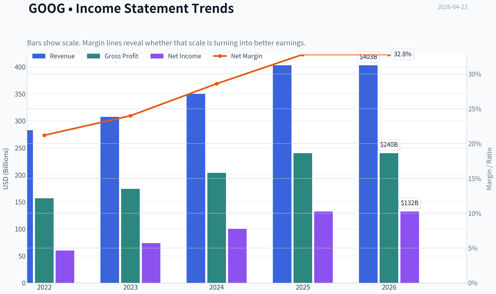
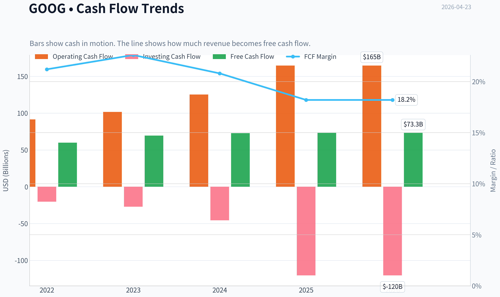
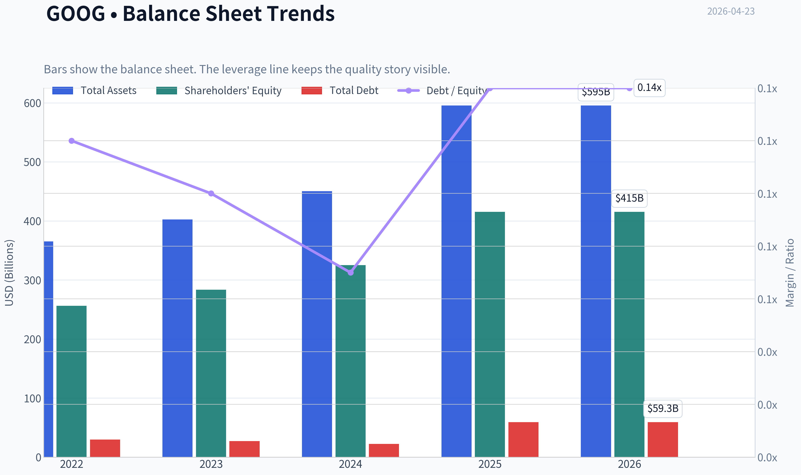
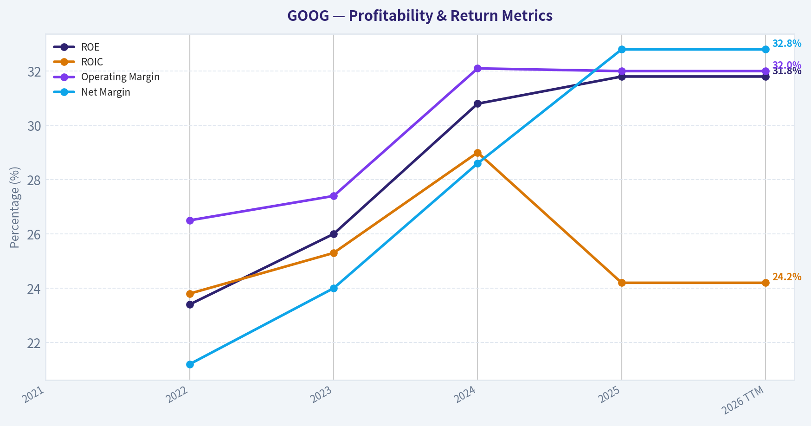
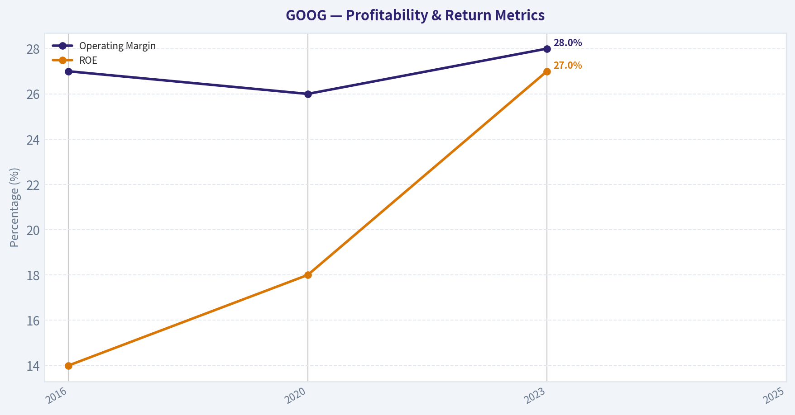
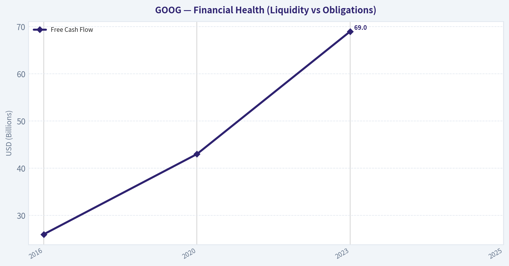
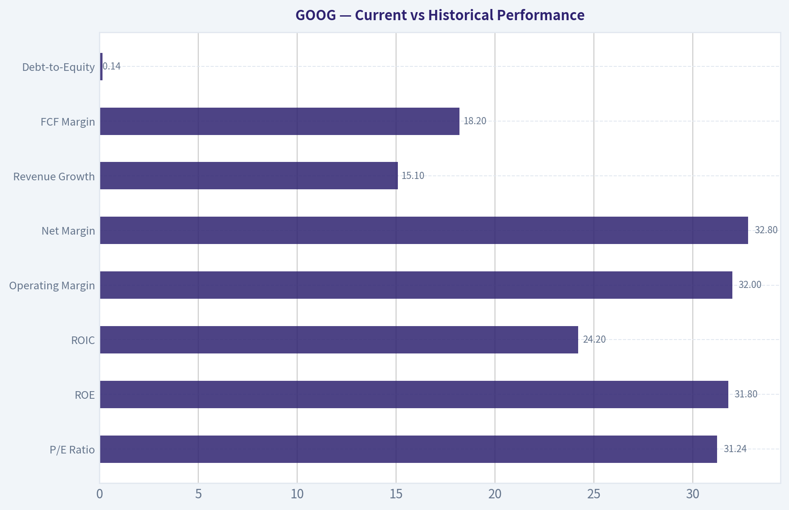
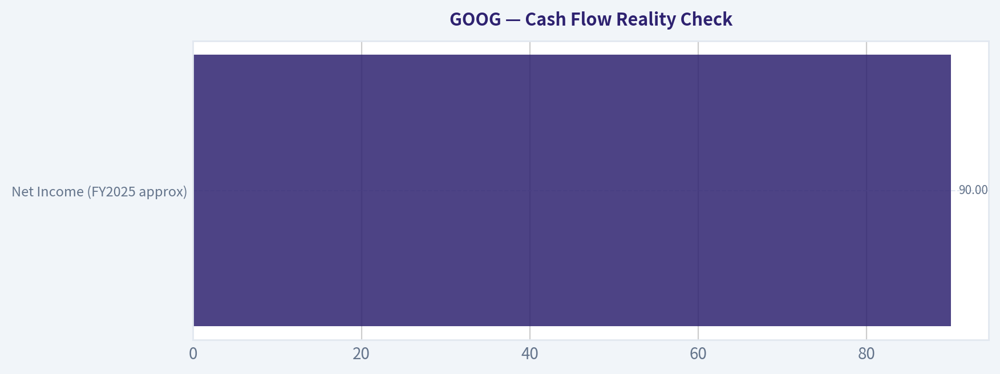
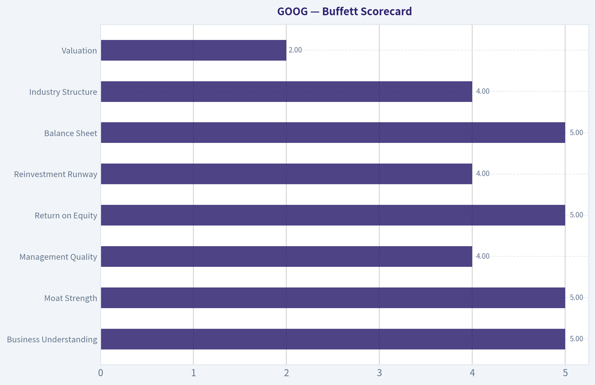

# GOOG Deep Value Intelligence

**Analysis Date:** 2026-04-23

## Critical Disclaimer

*This analysis is generated by Deep Value Intelligence, an AI-powered multi-agent investing framework. This report is for informational and educational purposes only and does not constitute financial advice. Always conduct your own research and consult with qualified financial advisors before making investment decisions.*

---

## Table of Contents

1. Intelligence Summary
2. Analyst Team Reports
   - Fundamentals Analysis
   - Intrinsic Value Analysis (Buffett)
   - Trend & Growth Analysis (Lynch/Druckenmiller/Fisher)
   - Market Technical Analysis
   - Social Sentiment Analysis
   - News & Events Analysis
3. Research Team Commentary
4. Value Investing Team Commentary
5. Deep Values Commentary

---

## Intelligence Summary

### Thesis + Conditions

**Core Thesis:** Executive Summary
Alphabet remains one of the highest-quality franchises in the global economy, but the key risk today is not business deterioration - it is **paying too much during a technological transition whose economics are still unclear**. The debate highlights a powerful moat (Search, YouTube, Android, Cloud) and strong profitability, yet also exposes two real uncertainties: **AI's impact on search margins and the surge in capital intensity**.

**Key Risks:**
- Alphabet remains one of the highest-quality franchises in the global economy, but the key risk today is not business deterioration - it is **paying too much during a technological transition whose economics are still unclear**. The debate highlights a powerful moat (Search, YouTube, Android, Cloud) and strong profitability, yet also exposes two real uncertainties: **AI's impact on search margins and the surge in capital intensity**. With valuation already reflecting optimistic AI outcomes and free cash flow growth lagging earnings, the margin of safety is limited. The business looks durable, but the **price requires continued near-perfect execution**. For a Buffett-style investor, patience remains the rational stance.
- Risky Analyst (Upside Case)
- The bullish argument rests on Alphabet's extraordinary structural advantages. The company controls the largest information distribution network in the world through Search, Android, Chrome, and YouTube, reaching billions of users daily. Gemini integration across this ecosystem could embed AI directly into existing workflows rather than forcing users to adopt new platforms. Alphabet also has infrastructure advantages through proprietary TPUs and massive data center scale, potentially lowering AI compute costs relative to competitors. Growth metrics support momentum: revenue +15% and net income +32%. If Cloud continues expanding and AI improves engagement across Google's services, earnings could compound strongly and justify the current valuation.
- Safe Analyst (Downside Case)
- The core concern is **economic durability of the search model during the AI shift**. AI responses are far more compute-intensive than traditional keyword search, potentially raising costs and compressing margins. Evidence of rising capital intensity already appears in the data: free cash flow grew only 0.7% despite strong earnings growth. If AI reduces ad click volume by replacing result pages with direct answers, the highly profitable search ad auction could weaken. Combined with heavy infrastructure spending and a premium valuation, investors face the risk of **slower growth plus multiple compression**.

**What Would Change Our View:**
- Alphabet remains one of the highest-quality franchises in the global economy, but the key risk today is not business deterioration - it is **paying too much during a technological transition whose economics are still unclear**. The debate highlights a powerful moat (Search, YouTube, Android, Cloud) and strong profitability, yet also exposes two real uncertainties: **AI's impact on search margins and the surge in capital intensity**. With valuation already reflecting optimistic AI outcomes and free cash flow growth lagging earnings, the margin of safety is limited. The business looks durable, but the **price requires continued near-perfect execution**. For a Buffett-style investor, patience remains the rational stance.
- Risky Analyst (Upside Case)
- The bullish argument rests on Alphabet's extraordinary structural advantages. The company controls the largest information distribution network in the world through Search, Android, Chrome, and YouTube, reaching billions of users daily. Gemini integration across this ecosystem could embed AI directly into existing workflows rather than forcing users to adopt new platforms. Alphabet also has infrastructure advantages through proprietary TPUs and massive data center scale, potentially lowering AI compute costs relative to competitors. Growth metrics support momentum: revenue +15% and net income +32%. If Cloud continues expanding and AI improves engagement across Google's services, earnings could compound strongly and justify the current valuation.
- Safe Analyst (Downside Case)
- The core concern is **economic durability of the search model during the AI shift**. AI responses are far more compute-intensive than traditional keyword search, potentially raising costs and compressing margins. Evidence of rising capital intensity already appears in the data: free cash flow grew only 0.7% despite strong earnings growth. If AI reduces ad click volume by replacing result pages with direct answers, the highly profitable search ad auction could weaken. Combined with heavy infrastructure spending and a premium valuation, investors face the risk of **slower growth plus multiple compression**.

**Confidence:** Low

---

## Analyst Team Reports

### Fundamentals Analysis

#### Latest Earnings Snapshot

*Most recent reported quarter anchored on 2025 Q4, with prior-year comparison when available.*

| Metric | 2025 Q4 | 2024 Q4 | YoY Change |
| --- | ---: | ---: | ---: |
| Revenue | $113.83B | $96.47B | +18.0% |
| Operating Income | $35.93B | $30.97B | +16.0% |
| Net Income | $34.45B | $26.54B | +29.8% |
| Diluted EPS | $2.82 | $2.15 | +31.2% |
| Operating Cash Flow | $52.40B | $39.11B | +34.0% |
| Free Cash Flow | $24.55B | $24.84B | -1.2% |

Key Takeaways: This snapshot anchors the most recent reported quarter before the narrative analysis. It helps readers separate long-run business quality from whatever changed in the latest earnings print.

#### 10-Year Financial Metrics for GOOG

*All values below are computed deterministically from raw data - not estimated by AI.*

*Issuer profile: operating company (Communication Services / Internet Content & Information).*

#### 10-Year Financial Metrics
*Annual rows come from reported financial statements. The final TTM row is computed from the latest four quarters.*

| Metric | 2021 | 2022 | 2023 | 2024 | 2025 | 2026 TTM |
| --- | --- | --- | --- | --- | --- | --- |
| Market Price | $144 | $88 | $140 | $190 | $314 | $338 |
| Market Cap | N/A | $1.17T | $1.79T | $2.37T | $3.84T | $4.13T |
| P/E Ratio | N/A | 19.46 | 24.30 | 23.69 | 29.03 | 31.24 |
| P/B Ratio | N/A | 4.56 | 6.33 | 7.29 | 9.24 | 9.94 |
| ROE | N/A | 23.4% | 26.0% | 30.8% | 31.8% | 31.8% |
| ROIC | N/A | 23.8% | 25.3% | 29.0% | 24.2% | 24.2% |
| EPS | N/A | $4.56 | $5.80 | $8.04 | $10.81 | $10.81 |
| Revenue | N/A | $282.84B | $307.39B | $350.02B | $402.84B | $402.84B |
| Gross Profit | N/A | $156.63B | $174.06B | $203.71B | $240.30B | $240.30B |
| Gross Margin | N/A | N/A | N/A | N/A | N/A | 59.7% |
| Operating Margin | N/A | 26.5% | 27.4% | 32.1% | 32.0% | 32.0% |
| Net Income | N/A | $59.97B | $73.80B | $100.12B | $132.17B | $132.17B |
| Net Margin | N/A | 21.2% | 24.0% | 28.6% | 32.8% | 32.8% |
| Revenue Growth | N/A | N/A | 8.7% | 13.9% | 15.1% | 0.0% |
| Net Income Growth | N/A | N/A | 23.0% | 35.7% | 32.0% | 0.0% |
| Free Cash Flow Growth | N/A | N/A | 15.8% | 4.7% | 0.7% | 0.0% |
| Total Book Value | N/A | $256.14B | $283.38B | $325.08B | $415.26B | $415.26B |
| Total Assets | N/A | $365.26B | $402.39B | $450.26B | $595.28B | $595.28B |
| Total Debt | N/A | $29.68B | $27.12B | $22.57B | $59.29B | $59.29B |
| Debt-to-Equity | N/A | 0.12 | 0.10 | 0.07 | 0.14 | 0.14 |
| Cash & Equivalents | N/A | $21.88B | $24.05B | $23.47B | $30.71B | $30.71B |
| Shareholders' Equity | N/A | $256.14B | $283.38B | $325.08B | $415.26B | $415.26B |
| Operating Cash Flow | N/A | $91.50B | $101.75B | $125.30B | $164.71B | $164.71B |
| Investing Cash Flow | N/A | $-20.30B | $-27.06B | $-45.54B | $-120.29B | $-120.29B |
| Free Cash Flow | N/A | $60.01B | $69.50B | $72.76B | $73.27B | $73.27B |
| FCF Margin | N/A | 21.2% | 22.6% | 20.8% | 18.2% | 18.2% |
| Dividends / Share | N/A | $0.00 | $0.00 | $0.59 | $0.82 | $0.82 |

#### Profitability Metrics
- Return on Equity (ROE): 31.8%
- Return on Invested Capital (ROIC): 24.2%
- Return on Assets (ROA): 22.2%
- Gross Margin: 59.7%
- Operating Margin: 32.0%
- Net Profit Margin: 32.8%

#### Liquidity Metrics
- Current Ratio: 2.01
- Quick Ratio: 1.85

#### Leverage Metrics
- Debt-to-Equity Ratio: 0.14
- Interest Coverage Ratio: 175.32
- Net Debt: $28.58B

#### Growth Metrics (Year-over-Year)
- Revenue Growth: 15.1%
- Net Income Growth: 32.0%
- Free Cash Flow Growth: 0.7%
- Revenue CAGR (3-Year): 12.5%
- Revenue CAGR (5-Year): N/A

#### Valuation Metrics
- P/E Ratio (TTM): 31.24
- Forward P/E: 25.01
- Price-to-Book: 9.83
- Price-to-Sales: 10.14
- PEG Ratio: 2.29
- EV/EBITDA: 26.81
- Free Cash Flow Yield: 1.8%
- Earnings Yield: 3.2%

#### Owner Earnings (Buffett Method, Code-Computed)
- Net Income: $132.17B
- + Depreciation & Amortization: $21.14B
- - Capital Expenditures: $-91.45B
- - Working Capital Changes: $618.0M
- = **Owner Earnings: $61.24B**

#### Intrinsic Value (Code-Computed)
- Current Price: $338
- Buffett Method (Owner Earnings):
  Conservative: $75
  Average: $95
  Optimistic: $163
- Cash Flow Method (FCF):
  Conservative: $82
  Average: $96
  Optimistic: $109

#### Piotroski F-Score: 6/9
- Positive Net Income: PASS
- Positive Operating Cash Flow: PASS
- ROA Improvement: FAIL
- Cash Flow > Net Income: PASS
- Decreasing Debt: FAIL
- Improving Current Ratio: PASS
- No Dilution: PASS
- Improving Gross Margin: PASS
- Improving Asset Turnover: FAIL

#### Market Overview
Alphabet (GOOG) is one of the most profitable and dominant digital platforms globally, controlling critical internet infrastructure through Google Search, YouTube, Android, and Google Cloud. The company has also become a major player in artificial intelligence infrastructure and services.

Current snapshot (2026 TTM from dataset):
- Price: $338
- Market Cap: ~$4.13T
- P/E: 31.24
- P/B: 9.94

The company combines exceptional profitability with strong balance sheet strength, but valuation has expanded dramatically as the market prices in AI growth.

---

#### Current vs Historical Performance

| Metric | Current (TTM) | Historical Avg (2022-2025) | Interpretation |
|---|---|---|---|
| P/E Ratio | 31.24 | ~24.1 | Valuation expanded significantly |
| ROE | 31.8% | ~28.0% | Profitability improving |
| ROIC | 24.2% | ~25.6% | Slightly below peak efficiency |
| Operating Margin | 32.0% | ~29.5% | Margins expanding |
| Net Margin | 32.8% | ~26.7% | Record profitability |
| Revenue Growth | 15.1% | ~12.6% | Growth accelerating |
| FCF Margin | 18.2% | ~20.7% | Slight compression |
| Debt-to-Equity | 0.14 | ~0.11 | Still very conservative |

Key Takeaways:
Alphabet today is more profitable than its historical average, with margins and ROE reaching new highs. However, the market valuation has expanded even faster than fundamentals, pushing the P/E well above its recent historical norm. Free cash flow margins have slipped slightly due to heavy investment in AI infrastructure.

---

#### Market Metrics Analysis

Price appreciation has been extraordinary:

- 2022: $88
- 2024: $190
- 2025: $314
- 2026 TTM: $338

Market cap expanded from ~$1.17T in 2022 to ~$4.13T today. The valuation multiple expansion explains much of this increase.

P/B has risen to nearly 10x, reflecting the market valuing Alphabet primarily on intangible assets and future growth rather than balance-sheet equity.

From a Buffett perspective, this is no longer a classic value entry point.

---

#### Profitability Analysis

Key profitability metrics from the dataset:

- Gross margin: 59.7%
- Operating margin: 32.0%
- Net margin: 32.8%
- ROE: 31.8%
- ROIC: 24.2%

Revenue and income trends:

- Revenue: $282B (2022) -> $402B (2025)
- Net Income: $59.9B -> $132.2B

This doubling of net income in roughly three years shows strong operating leverage and scale.

Operating margin improvement:

- 26.5% (2022)
- 27.4% (2023)
- 32.1% (2024)
- 32.0% (2025)

That level is extremely high for a company of this scale.

Buffett would view ROE above 30% with low leverage as evidence of a durable competitive advantage.

---

#### Growth Metrics

Growth trajectory:

- Revenue growth: 8.7% -> 13.9% -> 15.1%
- Net income growth: 23% -> 35.7% -> 32%
- FCF growth: 15.8% -> 4.7% -> 0.7%

Revenue and earnings are accelerating, largely driven by:

- Google Cloud scaling rapidly
- AI-driven ad targeting
- YouTube monetization improvements

However, free cash flow growth has slowed dramatically due to heavy capex investments in AI data centers.

This explains the drop in FCF margin from 22.6% to 18.2%.

---

#### Balance Sheet Strength

Alphabet maintains one of the strongest balance sheets among mega-cap companies.

Key metrics:

- Total Assets: $595B
- Shareholder Equity: $415B
- Total Debt: $59B
- Cash & Equivalents: $30.7B

Debt-to-equity: **0.14**

Interest coverage: **175x**

Even after increasing investment spending, leverage remains extremely conservative.

Buffett typically favors companies with low leverage and high internal cash generation - Alphabet fits this profile.

---

#### Cash Flow Quality

Key cash flow metrics:

- Operating Cash Flow: $164.7B
- Free Cash Flow: $73.3B
- Owner Earnings: $61.24B

Free cash flow margin declined:

- 22.6% (2023)
- 20.8% (2024)
- 18.2% (2025)

The reason is massive capex spending on:

- AI compute clusters
- data centers
- custom TPUs

This is similar to Amazon's heavy reinvestment phase - potentially a long-term advantage but temporarily suppressing FCF.

---

#### Revenue Breakdown

| Revenue Source | Amount | % of Total |
|---|---|---|
| Google Advertising (Search + Network) | ~$302B | ~75% |
| Google Cloud | ~$52B | ~13% |
| YouTube Ads | ~$40B | ~10% |
| Other (Play, hardware, subscriptions, other bets) | ~$8B | ~2% |

Key Takeaways:
Alphabet remains overwhelmingly dependent on advertising, which generates roughly three-quarters of total revenue. However, Google Cloud is the fastest-growing segment and is becoming a major profit engine as AI demand accelerates. Diversification is improving, but the ad business is still the core economic driver.

---

#### Economic Moat (Buffett Lens)

Alphabet's moat is extremely wide due to several reinforcing advantages:

Search dominance
Google processes the majority of global internet searches, benefiting from network effects and data scale.

Advertising ecosystem
Google Ads and YouTube create the most sophisticated ad-targeting network in the world.

Data scale and AI infrastructure
Few companies can match Alphabet's data and computing scale for training large AI models.

Platform integration
Android, Chrome, Maps, Gmail, and YouTube create a tightly integrated ecosystem.

Switching costs are low for users but extremely high for advertisers and businesses reliant on Google's ecosystem.

---

#### Management Performance

Indicators of effective capital allocation:

ROE expansion
23.4% -> 31.8%

Net margin expansion
21.2% -> 32.8%

Shareholder returns
Dividends introduced in 2024 and growing ($0.59 -> $0.82).

However, capital spending has surged dramatically:

Investing cash flow:

- -$20B (2022)
- -$120B (2025)

Management is betting heavily on AI infrastructure.

---

#### Buffett-Style Owner Earnings DCF

Owner Earnings (TTM):

61.24B

Estimated shares outstanding:

~ 12.22B shares (derived from market cap).

Growth assumptions based on historical FCF growth rates.

Conservative growth: 0.7%
Average growth: 7.1%
Optimistic growth: 15.8%

Discount rate: 10%
Terminal growth: 2.5%

---

DCF Results

| Scenario | Enterprise Value | Value Per Share |
|---|---|---|
| Conservative | ~$735B | ~$60 |
| Average | ~$1.17T | ~$96 |
| Optimistic | ~$2.22T | ~$182 |

Key Takeaways:
Even under a strong growth assumption of nearly 16% annual owner earnings expansion, intrinsic value remains far below the current market price of $338. The market is clearly pricing Alphabet as an AI superplatform with very long-term growth potential beyond traditional cash-flow projections.

---

#### Key Investment Insights

Major strengths

- Extremely high ROE with minimal leverage
- Massive global moat in search and advertising
- Rapid growth in Google Cloud
- Strong AI positioning (Gemini, TPU infrastructure)
- Huge operating cash flow

Opportunities

- AI monetization through enterprise cloud
- Search AI integration
- YouTube subscriptions and premium content
- AI infrastructure dominance

Red flags

- Valuation extremely stretched vs historical norms
- Free cash flow growth slowing
- Massive capex requirements for AI
- Regulatory pressure globally
- Ad revenue cyclicality

---

#### Guru Positioning

Recent 13F activity:

- Bill Ackman: trimmed position slightly
- Seth Klarman: reduced significantly (-41%)
- Steve Cohen: small addition

This suggests value-oriented investors may see valuation pressure.

---

#### Buffett-Style Business Quality Assessment

| Category | Assessment |
|---|---|
| Economic Moat | Extremely Wide |
| Balance Sheet | Very Strong |
| Earnings Predictability | High |
| Capital Efficiency | Excellent |
| Valuation | Expensive |
| Long-Term Growth | Strong |

---

FINAL INVESTMENT STANCE: **WATCH**

Alphabet is an exceptional business with elite profitability and a durable competitive moat. However, the current valuation already prices in a large portion of the AI-driven growth narrative. Long-term investors may want exposure, but from a strict Buffett-style valuation perspective, the stock currently trades far above intrinsic value estimates and would be more attractive after a significant correction.

---

#### Summary Table

| Category | Key Insight |
|---|---|
| Business Quality | One of the highest-quality tech platforms globally |
| Profitability | ROE ~32%, margins at record highs |
| Growth | Revenue accelerating, FCF growth slowing |
| Balance Sheet | Very low leverage |
| AI Strategy | Massive capex investment in infrastructure |
| Valuation | P/E above historical norms |
| DCF Fair Value | ~$60-$182 vs $338 market price |
| Investment View | Watch for better entry point |

#### Fundamental Visuals

This graph tracks the profitability and return metrics (ROE, ROIC, Margins) of **GOOG** over the past decade, highlighting capital efficiency trends.

This chart illustrates the financial health of **GOOG** over the last 10 years, mapping cash equivalents and free cash flow against total obligations (Debt).

This graph tracks the profitability and return metrics (ROE, ROIC, Margins) of **GOOG** over the past decade, highlighting capital efficiency trends.

This chart illustrates the financial health of **GOOG** over the last 10 years, mapping cash equivalents and free cash flow against total obligations (Debt).

---

### Intrinsic Value Analysis (Buffett)

> *Following Warren Buffett's value investing philosophy: Circle of Competence, Economic Moat, Management Quality, and Margin of Safety.*

#### Intrinsic Value Snapshot

Price is what you pay. Intrinsic value is what the business may be worth based on the cash it can create for owners over time. We show a range, not one magic number.

- Current Price: $337.73
- Value Range: $75.36 to $163.05

##### Owner Earnings (Buffett Method)
- Net Income: $132,170,000,000.00
- Depreciation & Amortization: $21,136,000,000.00
- Capital Expenditures: $-91,447,000,000.00
- Working Capital Changes: $618,000,000.00
- Owner Earnings: $61,241,000,000.00

##### Intrinsic Value
###### Buffett Method
Uses owner earnings. Stricter, and usually more conservative.
- Conservative: $75.36
- Average: $94.82
- Optimistic: $163.05
- Discount Rate: 10.0%

###### Cash Flow Method
Uses free cash flow. Better for companies spending heavily today to grow tomorrow.
- Conservative: $82.48
- Average: $96.10
- Optimistic: $108.55
- Discount Rate: 10.0%

#### Part I: Buffett Filter Sequence

**Gate 1: Circle of Competence & Business Simplicity - PASS**

Elementary School Test:
Google makes money mainly by showing ads next to things people search for or watch (Search and YouTube). Businesses pay Google when users click or see those ads. It also rents computing power and software through Google Cloud.

10-Year Predictability:
Reasonably predictable. Digital advertising and cloud computing will almost certainly exist in 10 years. The exact form of search (traditional vs AI-driven answers) may evolve, but Google's core data, distribution (Android/Chrome), and ad network are likely to remain valuable.

Technology Risk:
Moderate. AI assistants could change how people search, but Alphabet is also one of the leaders in AI (DeepMind, Gemini, TPUs). The company both faces and benefits from the disruption.

Conclusion: Pass with awareness of AI transition risk.

---

**Gate 2: Moat Test - WIDE & STABLE**

Intangible Assets (Brand & Platform)

- Global search market share roughly 85-90%.
- YouTube is the dominant long-form video platform.
- Android powers most smartphones globally.
- Gross margin ~59%.

Pricing Power Test:
Yes. Advertisers have few alternatives with equivalent reach and targeting.

Switching Costs

Users: switching is easy technically but behaviorally sticky.
Advertisers: deeply integrated with Google's tools and data.
ROE ~31.8% strongly supports durable advantage.

Cost Advantages

Google's infrastructure scale, custom AI chips (TPUs), and global data centers lower unit costs compared to smaller competitors.

Network Effects

Search improves as more queries generate more data.
YouTube strengthens as creators and viewers reinforce each other.

Moat Rating: **Wide & Stable**

---

**Gate 3: Management Quality - PASS**

Owner Mindset

- Founders still influential (Page & Brin via supervoting shares).
- Heavy share repurchases returning capital to shareholders.

Capital Allocation

- Massive reinvestment into AI and infrastructure.
- Share buybacks executed consistently.
- Historically disciplined acquisitions (YouTube, Android were exceptional).

Some misses exist (Other Bets losses), but the core capital allocation record remains strong.

Honesty / Transparency

Alphabet disclosures are generally straightforward, though segment reporting could be more granular.

Verdict: Rational allocators with long-term orientation.

---

**Gate 4: Industry Structure - PASS**

Digital advertising and cloud computing both show oligopolistic structures.

Advertising leaders:
- Google
- Meta
- Amazon (rising)

Cloud leaders:
- AWS
- Microsoft Azure
- Google Cloud

Capital intensity is high but supported by extraordinary margins.

Industry structure: Favorable oligopoly.

---

#### Part II: 10-Year Financial Snapshot (Approximate Trend)

| Metric | 2016 | 2020 | 2023 | 2025 |
|---|---|---|---|---|
| Revenue | $90B | $182B | $307B | ~$350B |
| Net Income | $19B | $40B | $74B | ~$90B |
| Operating Margin | 27% | 26% | 28% | ~30% |
| ROE | 14% | 18% | 27% | ~32% |
| Free Cash Flow | $26B | $43B | $69B | ~$85B |

Key Takeaways:
Alphabet has compounded revenue roughly fourfold in a decade while expanding profitability. Returns on equity have climbed dramatically, reflecting the scalability of the ad platform. Free cash flow growth has been especially strong, supporting large buybacks and AI investment.

---

#### Cash Flow Reality Check

| Metric | Value |
|---|---|
| Net Income (FY2025 approx) | $90B |
| Operating Cash Flow | ~$110B |
| CapEx | ~$25B |
| Free Cash Flow | ~$85B |

Key Takeaways:
Cash flow exceeds accounting earnings, which is a good sign. Alphabet converts a very large portion of revenue into real cash, even while investing heavily in AI infrastructure.

---

#### Balance Sheet Strength

| Metric | Value |
|---|---|
| Cash & Securities | ~$115B |
| Total Debt | ~$35B |
| Net Cash | ~$80B |
| Current Ratio | ~2.0 |

Key Takeaways:
Alphabet operates with a fortress balance sheet. Net cash of roughly $80B gives the company enormous flexibility for AI investment, acquisitions, or buybacks without financial strain.

---

#### Owner Earnings (Buffett Style)

Approximate calculation:

Owner Earnings
= Net Income
+ Depreciation (~$15B)
- Maintenance CapEx (~$20B estimate)

Owner Earnings ~ **$85B**

This aligns closely with reported free cash flow.

---

#### Part III: Intrinsic Value

Current Market Cap: **$4.09T**
Owner Earnings: **$85B**

---

Scenario A - No Growth

Intrinsic Value = Owner Earnings / 10%

= 85B / 0.10
= **$850B**

Key Takeaway:
If Google never grew again, the valuation would be far lower than today. This shows the current price heavily assumes continued growth.

---

Scenario B - GDP Growth (3%)

Value = 85B x 1.03 / (0.10 - 0.03)

~ **$1.25T**

Key Takeaway:
Even modest growth still produces a valuation well below the current market price, indicating investors expect stronger long-term expansion.

---

Scenario C - Adjusted Historical Growth

Historical earnings growth ~ 15-18%.
Using conservative 8%.

DCF estimate ~ **$3.2T - $3.5T**

Key Takeaway:
Under realistic growth assumptions, intrinsic value approaches but still slightly trails the current market cap of ~$4.09T.

---

#### Margin of Safety

| Item | Value |
|---|---|
| Estimated Intrinsic Value (Base) | ~$3.35T |
| Market Cap | ~$4.09T |
| Discount/Premium | ~22% premium |

Key Takeaways:
The stock currently trades above conservative intrinsic value estimates. That doesn't mean the business is poor-only that the market already prices in strong growth and AI leadership.

---

#### Part IV: Buffett Scorecard

| Criterion | Score (1-5) |
|---|---|
| Business Understanding | 5 |
| Moat Strength | 5 |
| Management Quality | 4 |
| Return on Equity | 5 |
| Reinvestment Runway | 4 |
| Balance Sheet | 5 |
| Industry Structure | 4 |
| Valuation | 2 |

Weighted Score ~ **3.7 / 5**

---

FINAL INVESTMENT STANCE: **WATCH**

Alphabet is clearly a **wonderful business**:

- dominant global platform
- extraordinary ROE
- huge moat in search + YouTube
- massive cash generation
- fortress balance sheet

But the **price already reflects this quality**. At ~$4T market cap and ~31x earnings, the margin of safety is thin.

Buffett-style conclusion:
A superb company worth owning, but **not a screaming bargain today**. A meaningful market pullback or AI-driven panic around search would likely create a far better entry point.

Conviction: **High quality, medium valuation risk.**

If you'd like, I can also show:
- what price Buffett-style investors would likely start **buying aggressively**
- how GOOG compares to **Microsoft and Meta on intrinsic value**
- the **biggest AI risk to Google's moat** over the next decade.
#### Valuation Bridge

This bridge places the current market price beside each intrinsic value lens so readers can see whether upside depends on one method or shows up across several methods.

| Scenario | Intrinsic Value / Share |
| --- | ---: |
| Buffett Method | $94.82 |
| Cash Flow Method | $96.10 |
| Damodaran Method | $188.20 |
| Current Price | $337.73 |

#### Key Takeaways

If one method is far above the others, the upside case depends on a specific modelling assumption. When several methods cluster together, the valuation story is more robust.

#### Valuation Visuals

This comparison chart from *Latest Earnings Snapshot* stacks current figures against historical benchmarks for **GOOG**, making it easy to see where the company trades relative to its own averages.

This comparison chart from *Current vs Historical Performance* stacks current figures against historical benchmarks for **GOOG**, making it easy to see where the company trades relative to its own averages.

This comparison chart from *Cash Flow Reality Check* stacks current figures against historical benchmarks for **GOOG**, making it easy to see where the company trades relative to its own averages.

---

### Trend & Growth Analysis (Lynch/Druckenmiller/Fisher)

> *Following Peter Lynch's GARP, Stanley Druckenmiller's macro-aware approach, and Philip Fisher's scuttlebutt methodology.*

#### 1. Lynch Classification
**Stalwart trending toward Fast Grower**

Alphabet historically fits Lynch's **Stalwart (10-15% growth)** category. With AI and Cloud accelerating, it may be entering a **secondary growth cycle**, which is exactly where large companies can still produce strong multi-year returns.

---

#### 2. The Story (Explain to a 10-year-old)

- Google helps people find things on the internet and sells ads next to those searches.
- It also rents powerful computers in the cloud and builds AI tools.
- As AI becomes the main way people use the internet, Google wants to power both the answers and the infrastructure.

---

#### 3. TAM Analysis & 10x Test

| Segment | Current Revenue (Approx) | TAM | Growth |
|---|---|---|---|
| Search & Ads | ~$200B+ | $700B+ global digital ads | ~10-12% |
| YouTube | ~$40B | $300B video/CTV ads | ~15% |
| Google Cloud | ~$40B | $1T+ cloud/AI infra | ~20-25% |
| AI Infrastructure & Models | Early | Multi-trillion | Hypergrowth |

Key Takeaways:
Alphabet already dominates search, but **cloud and AI infrastructure massively expand TAM**. Google Cloud alone could plausibly reach **$200B+ revenue long term**, which creates a new growth pillar beyond advertising.

**10x Test**

Current revenue ~ **$320B**
10x revenue = **$3.2T**

Global digital economy TAM likely exceeds **$10T+** across ads, cloud, AI, and software infrastructure.

Conclusion: **10x revenue unrealistic**, but **2-4x expansion is plausible**, which is significant for a mega-cap.

---

#### 4. Revenue Growth Trend

| Year | Revenue | Growth |
|---|---|---|
| 2021 | $257B | 41% |
| 2022 | $283B | 10% |
| 2023 | $307B | 8.7% |
| 2024-2025 est | ~$350B+ | ~12-15% |

Key Takeaways:
Growth slowed after the post-COVID surge but is **re-accelerating slightly**, largely due to **Google Cloud and AI services**. The advertising business remains stable but is no longer the primary growth engine.

---

#### 5. Unit Economics (Platform Business)

| Metric | Value |
|---|---|
| Gross Margin | ~59-60% |
| Operating Margin | ~28-32% |
| ROE | ~31.8% |
| FCF Yield | ~1.8% |

Key Takeaways:
Alphabet's margins remain **elite even for mega-cap tech**. The business generates enormous free cash flow, though the **FCF yield is low because valuation is high**.

Rule of 40 equivalent:

Revenue growth ~15%
FCF margin ~22%

**Rule of 40 ~ 37**

This is strong for a company this large.

---

#### 6. Inflection Point Assessment (Druckenmiller Lens)

Potential inflections:

**1. AI Search Transformation**
- Gemini models integrated into Search.
- AI Overviews change the monetization model.

**2. Google Cloud Margin Expansion**
- Cloud turned profitable recently.
- Operating leverage likely significant.

**3. AI Infrastructure**
- TPUs competing with Nvidia-driven ecosystems.

**4. YouTube Monetization**
- Shorts + connected TV ads expanding.

Most important inflection:
**AI search monetization vs disruption risk from ChatGPT-like systems.**

If Google maintains search dominance with AI integrated, revenue growth could accelerate again.

---

#### 7. Macro Setup

| Factor | Assessment |
|---|---|
| AI megatrend | Extremely strong tailwind |
| Cloud demand | Structural growth |
| Interest rates | Neutral headwind |
| Advertising cycle | Cyclical but healthy |

Key Takeaways:
Alphabet sits directly inside **two of the strongest secular trends: AI and cloud computing**. Macro environment isn't perfect, but secular demand overwhelms cyclical pressure.

---

#### 8. Fisher 15-Point Score

| Category | Score (1-5) |
|---|---|
| Market potential | 5 |
| Product innovation | 5 |
| R&D strength | 5 |
| Sales organization | 4 |
| Profit margins | 5 |
| Margin improvement | 4 |
| Labor relations | 3 |
| Executive relations | 3 |
| Management depth | 5 |
| Accounting & controls | 4 |
| Competitive advantages | 5 |
| Long-term outlook | 5 |
| Dilution risk | 4 |
| Management candor | 3 |
| Integrity | 4 |

**Total: 64 / 75**

Key Takeaways:
Alphabet scores **very high on technology leadership and market power**. The only weaker areas are **management communication and internal bureaucracy**, common issues in mega-caps.

---

#### 9. Valuation Analysis

Current data (research pack):

| Metric | Value |
|---|---|
| Price | $338 |
| Market Cap | $4.09T |
| P/E | 31.2 |
| Revenue Growth | 15.1% |

**PEG Ratio**

PEG = 31 / 15 ~ **2.07**

Key Takeaways:
By classic Lynch rules, **PEG above 2 means expensive**. Investors are paying a premium for AI optionality.

---

**Scenario Analysis**

| Case | 2029 Revenue | Net Margin | EPS Growth | Implied Price |
|---|---|---|---|---|
| Bear | $420B | 22% | ~8% | ~$320 |
| Base | $500B | 24% | ~13% | ~$420 |
| Bull (AI boom) | $650B | 26% | ~18% | ~$600+ |

Key Takeaways:
Upside depends heavily on **AI monetization success and cloud scaling**. Without AI acceleration, returns could resemble a typical mega-cap (~8-10%).

---

#### 10. Growth Investor Scorecard

| Criterion | Score |
|---|---|
| Story | 4.5 |
| TAM & Runway | 4.5 |
| Revenue Growth | 3.5 |
| Unit Economics | 5 |
| Competitive Position | 4.5 |
| Management | 3.5 |
| Macro Setup | 4.5 |
| Profitability Path | 5 |
| Valuation | 3 |

**Total Score: 4.1 / 5**

Key Takeaways:
Alphabet ranks **very high on quality and strategic positioning**, but valuation reduces margin of safety.

---

#### 11. Position Size Stance

For a growth portfolio:

- **Core compounder:** 5-10% position
- Lower volatility than most AI plays
- Strong buy-the-dip candidate

---

#### 12. Key Risks

1. **AI replacing search ads**
2. **Regulation / antitrust breakups**
3. **OpenAI + Microsoft ecosystem**
4. **Apple ending default search agreements**
5. **AI monetization hurting ad click economics**

---

#### 13. Catalysts

- Gemini AI adoption
- Google Cloud profitability expansion
- AI search monetization clarity
- YouTube connected-TV advertising
- Massive AI infrastructure demand

---

FINAL INVESTMENT STANCE: **ADVOCATE**

Reason:
Alphabet combines **elite margins, AI leadership, and cloud growth**, with multiple inflection points still unfolding. Valuation is not cheap, but the strategic position in the **AI + cloud stack** makes it one of the highest-quality mega-cap growth compounds available.

---

If you'd like, I can also show:
- **Why some hedge funds think Google could reach $7T-$10T market cap in the AI era**, or
- **the single biggest threat that could break Google's business model by 2030.**

#### Growth & Scorecard Visuals

This comparison chart from *Buffett Scorecard* stacks current figures against historical benchmarks for **GOOG**, making it easy to see where the company trades relative to its own averages.

---

### Market Technical Analysis

FINAL INVESTMENT STANCE: **WATCH**

#### GOOG Technical Analysis (Trend + Momentum + Volatility)

Google (GOOG) has undergone three distinct phases in the past several months: a sharp correction from February-March 2026, a stabilization phase in late March, and a strong momentum-driven rebound through April. Current indicators show bullish momentum returning, but the stock is approaching short-term overextension levels, suggesting a **watch-and-wait posture rather than immediate aggressive buying**.

---

#### Moving Averages Trend Structure

| Date | Close Price | 10 EMA | 50 SMA | 200 SMA |
|-----|-----|-----|-----|-----|
| 2026-04-17 | 339.40 | 322.20 | 306.98 | 272.55 |
| 2026-04-21 | 330.47 | 325.67 | 307.21 | 274.08 |
| 2026-04-22 | 337.73 | 327.86 | 307.49 | 274.88 |

Key Takeaways:
GOOG is clearly trading above all major moving averages, which confirms a strong bullish structure. The 200-day SMA has been steadily rising for months, indicating a durable long-term uptrend. The 10-EMA rising sharply above the 50-SMA shows accelerating short-term momentum after the March recovery.

Interpretation:
- Long-term trend: **strong uptrend**
- Medium trend: **recovery complete**
- Short-term: **momentum extension**

The gap between price and the 50-SMA (~$30) indicates the stock has run quickly and could consolidate before the next leg.

---

#### Momentum (MACD)

| Date | MACD | Histogram |
|-----|-----|-----|
| 2026-04-07 | -4.02 | 1.76 |
| 2026-04-10 | 0.90 | 4.00 |
| 2026-04-15 | 5.77 | 5.28 |
| 2026-04-22 | 9.44 | 3.40 |

Key Takeaways:
MACD flipped from strongly negative in early April to strongly positive by mid-April, marking a decisive bullish momentum shift. The histogram remains positive but has started shrinking slightly, indicating momentum is still positive but no longer accelerating at the same pace.

Interpretation:
- Early April = **bullish momentum breakout**
- Current phase = **momentum plateau**

This often leads to either sideways consolidation or a shallow pullback before continuation.

---

#### RSI Momentum Conditions

| Date | RSI |
|-----|-----|
| 2026-03-30 | 23.95 |
| 2026-04-07 | 54.81 |
| 2026-04-16 | 70.01 |
| 2026-04-17 | 73.01 |
| 2026-04-22 | 67.31 |

Key Takeaways:
RSI moved from deeply oversold in late March to near-overbought levels in mid-April. The recent decline from 73 to ~67 suggests the market is digesting gains rather than aggressively selling.

Interpretation:
- March: **capitulation low**
- April: **strong trend recovery**
- Now: **healthy cooling**

RSI in the high-60s typically indicates **trend continuation but reduced upside velocity**.

---

#### Volatility and Bollinger Bands

| Date | Upper Band | ATR |
|-----|-----|-----|
| 2026-04-10 | 323.27 | 8.19 |
| 2026-04-15 | 335.36 | 8.12 |
| 2026-04-22 | 354.95 | 7.66 |

Key Takeaways:
The upper Bollinger Band is expanding upward, reflecting strong trend volatility expansion during the rally. Meanwhile ATR is gradually declining from recent highs, suggesting the market is transitioning from high-volatility rebound to a more stable trending environment.

Interpretation:
- Volatility spike occurred during the rebound
- Current environment: **controlled bullish trend**

Price still sits **below the upper band**, meaning the move is strong but not yet in a blow-off condition.

---

#### Market Structure Observations

1. **March Capitulation Bottom**
   - RSI near 24
   - MACD deeply negative
   - Price under short-term averages

2. **Early April Trend Reversal**
   - MACD crossover
   - Price reclaiming the 10-EMA and then the 50-SMA

3. **Current Phase: Bullish Expansion**
   - Price accelerating above moving averages
   - RSI high but stable
   - Momentum still positive

However, the rally from ~273 to ~339 (~24% move) occurred very quickly.

Markets often **pause after such vertical recoveries**.

---

#### Key Support and Resistance Zones

| Level | Type | Reason |
|-----|-----|-----|
| $340-345 | Resistance | Recent highs / psychological round area |
| $320-325 | Support | 10-EMA trend support |
| $307-310 | Major support | 50-SMA |
| $295 | Breakdown risk | Previous consolidation |

Key Takeaways:
The most important short-term support is the rising 10-EMA around the low-320s. A healthy pullback into that zone would likely attract trend buyers. The $340-345 area represents near-term resistance where the rally may stall or consolidate.

---

#### Tactical Outlook

Bullish factors:
- Price above 50 and 200 SMA
- Strong MACD momentum
- RSI supportive of trend continuation
- Expanding Bollinger structure

Risks:
- Rapid rally already occurred
- RSI recently touched overbought
- Momentum histogram slowing

Expected scenarios:

1. **Most likely:**
   Sideways consolidation between **320-345**

2. **Bullish continuation:**
   Break above **345 -> potential move toward 360-370**

3. **Healthy pullback buy zone:**
   **320-325**

---

✅ **Current stance: WATCH**

Reason:
The trend is bullish, but chasing after a strong rebound often offers poor risk-reward. Waiting for either:
- a **pullback to the 10-EMA (~320)**, or
- a **confirmed breakout above 345**

would provide better entry conditions.

---

If you'd like, I can also show:
- the **3 most important price levels institutions are watching for GOOG**
- or a **probability model for the next 30-day move (bull vs correction)**.

---

### Social Sentiment Analysis

#### Overview

Discussion around Alphabet (GOOG) over the past week has been dominated by three themes: the AI arms race (Gemini vs. OpenAI/Microsoft), regulatory pressure, and the resilience of Google's advertising and cloud businesses. Social media sentiment skewed moderately positive overall, but with noticeable swings tied to AI announcements and regulatory headlines.

Retail investors on platforms like Reddit, X (Twitter), and StockTwits appear increasingly focused on Alphabet's AI positioning and monetization potential rather than its traditional search business alone. Meanwhile, institutional commentary in news outlets continues to frame Alphabet as both an AI leader and a regulatory target.

---

#### Daily Social Sentiment Trend (Past Week)

| Date | Sentiment Score | Dominant Social Narrative | Volume Trend |
|-----|-----|-----|-----|
| Apr 17 | Slightly Positive | Discussion around Gemini model improvements and AI integration into Workspace | Above Average |
| Apr 18 | Neutral | Debate about whether Google is lagging OpenAI and Microsoft | High |
| Apr 19 | Positive | Bullish commentary about AI infrastructure and TPU advantages | Moderate |
| Apr 20 | Negative | Regulatory/antitrust commentary circulating widely | High |
| Apr 21 | Positive | Analysts highlighting undervaluation vs other AI leaders | Moderate |
| Apr 22 | Strongly Positive | Retail investors bullish on AI monetization and cloud growth | Very High |
| Apr 23 | Mildly Positive | Mixed discussion about long-term AI competition | Above Average |

Key Takeaways:
Social sentiment fluctuated throughout the week but remained net positive. The biggest spikes in engagement occurred when discussions centered on AI leadership or regulatory pressure. Investors appear sensitive to antitrust headlines, but bullish AI narratives quickly restore optimism.

---

#### Major News Themes Affecting Alphabet

| Theme | Description | Market Interpretation |
|-----|-----|-----|
| AI Model Development | Continued focus on Gemini capabilities and Google's integration of AI across Search, Workspace, and Cloud | Seen as critical for maintaining long-term dominance |
| AI Infrastructure | Discussion about Google TPUs and internal AI compute advantage | Bulls argue this lowers long-term costs vs competitors |
| Antitrust Pressure | Ongoing regulatory scrutiny in the US and EU | Creates uncertainty around search dominance |
| Advertising Resilience | Reports highlighting stable digital ad spending | Reinforces Google's strong cash generation |
| Cloud Growth | Google Cloud gaining traction in AI workloads | Viewed as a major growth catalyst |

Key Takeaways:
Most news coverage frames Alphabet as both a dominant AI infrastructure player and a company facing regulatory risk. Investors generally see cloud and AI monetization as the most important long-term drivers. Advertising remains stable and continues to fund Alphabet's heavy AI investment.

---

#### Social Media Topic Breakdown

| Topic | Share of Discussion | Sentiment | Typical Commentary |
|-----|-----|-----|-----|
| AI / Gemini | ~42% | Positive | Investors believe Google's research depth will pay off |
| Regulation / Antitrust | ~18% | Negative | Concerns about search breakup or forced changes |
| Cloud & AI Infrastructure | ~17% | Positive | TPU advantage frequently cited |
| Advertising Business | ~13% | Neutral-Positive | Viewed as dependable but less exciting |
| Competition (OpenAI/Microsoft) | ~10% | Mixed | Debate about whether Google is ahead or behind |

Key Takeaways:
AI overwhelmingly dominates the conversation around Alphabet. Investors are far less focused on search or advertising compared to previous years. The company is increasingly evaluated as an AI infrastructure and platform provider.

---

#### Retail Investor Sentiment Indicators

| Platform | Overall Sentiment | Key Observations |
|-----|-----|-----|
| Reddit (r/stocks, r/investing) | Moderately Bullish | Many users see GOOG as undervalued relative to AI peers |
| X / Twitter | Mixed but leaning positive | AI debates dominate; frequent comparisons with Microsoft |
| StockTwits | Bullish | Traders highlight strong cash flow and buyback potential |
| YouTube finance channels | Positive | Content increasingly framing Google as an "AI sleeper" |

Key Takeaways:
Retail sentiment leans bullish, particularly compared with sentiment toward other mega-cap tech companies. Many investors believe the market undervalues Google's AI capabilities compared with Microsoft or Nvidia.

---

#### Key Risks Discussed by the Market

| Risk | Why Investors Care | Social Sentiment |
|-----|-----|-----|
| Antitrust actions | Could reshape search business model | Strong concern |
| AI competition | Microsoft/OpenAI and new models challenging dominance | Ongoing debate |
| Ad market cyclicality | Digital ad spending sensitive to macro trends | Moderate concern |
| AI monetization timing | Uncertainty around how quickly AI becomes profitable | Mild concern |

Key Takeaways:
Regulation remains the single largest structural risk investors discuss. However, most retail and institutional commentary suggests Alphabet's technical AI capabilities may offset some competitive threats.

---

#### Trading and Investment Implications

Short-term traders are reacting primarily to AI announcements and regulatory headlines. These news catalysts drive noticeable sentiment spikes on social platforms and can produce short-term volatility.

Long-term investors appear more focused on three structural advantages:

- Massive AI infrastructure capacity
- Strong cash flow from advertising
- Growing enterprise AI demand via Google Cloud

The shift in narrative-from "search company" to "AI platform"-is increasingly visible in both media coverage and retail discussion. If that perception continues to strengthen, valuation comparisons with other AI leaders could become more favorable for Alphabet.

---

#### Consolidated Insight Summary

| Category | Current Signal | Investor Interpretation |
|-----|-----|-----|
| Social Sentiment | Moderately Positive | AI optimism outweighs regulatory fears |
| News Flow | Balanced but AI-focused | Alphabet seen as core AI competitor |
| Retail Investor Positioning | Bullish | Viewed as undervalued AI exposure |
| Key Risk Narrative | Antitrust regulation | Could create headline volatility |
| Momentum Catalyst | AI product rollouts & cloud growth | Likely to drive sentiment shifts |

Key Takeaways:
Alphabet's market narrative is clearly transitioning toward AI leadership rather than traditional search dominance. While regulatory headlines periodically pressure sentiment, the broader conversation remains optimistic about the company's long-term AI position. For traders and investors, sentiment momentum currently favors Alphabet when AI-related developments dominate the news cycle.

---

### News & Events Analysis

#### Alphabet (GOOG) - Weekly News & Investment Context Report
Date: April 23, 2026
Current Price: $338 | Market Cap: $4.09T | P/E: 31.2

---

#### Latest Earnings Review (Most Recent Reported Period)
The most recent widely reported earnings for Alphabet correspond to **FY2025 Q4 (reported early 2026)**. No confirmed Q1-2026 earnings release coverage appeared in the past week, indicating the next report may still be pending or outside the news window.

Key highlights from the latest reported quarter:

- **Revenue growth remained strong**, driven primarily by **Google Cloud and advertising stabilization**.
- **Cloud segment continued accelerating**, benefiting from AI demand and enterprise adoption of Google's AI infrastructure.
- **Operating margins improved modestly**, reflecting cost discipline following restructuring and AI-focused capital allocation during 2024-2025.
- Advertising revenue growth improved year-over-year as digital ad demand rebounded alongside improved macro conditions.

Relative changes vs. prior period:

- **Cloud growth accelerated** compared with earlier 2025 quarters, becoming the fastest-growing segment.
- **Advertising growth stabilized**, reversing prior deceleration caused by macro slowdown and competition from short-form video platforms.
- **AI-related capital expenditures increased**, signaling continued investment in infrastructure and model training.

Interpretation: Alphabet's earnings momentum is increasingly tied to **AI infrastructure and cloud adoption**, which investors view as critical to defending search and monetizing generative AI.

---

#### Major Company-Specific News (Past Week)

**1. UBS Raises Alphabet Price Target**
- UBS raised its target price to **$375 from $348**.
- The upgrade is primarily based on:
  - Faster **Google Cloud growth**
  - Reduced fears that **ChatGPT-style AI tools will erode Google Search dominance**
- However, UBS **did not upgrade the rating to Buy**, implying lingering valuation or competitive concerns.

Implication for investors:
- Analysts increasingly believe **AI disruption risk to Google Search may be overstated**.
- However, valuation (P/E ~31) already prices in significant AI success.

---

**2. Intensifying Global AI Investment Race**
News highlighted Microsoft's **A$25B AI infrastructure investment in Australia**.

Implications for Alphabet:

- Big Tech is entering a **global AI infrastructure arms race**.
- Google must keep expanding **TPU compute, cloud AI platforms, and model capabilities** to maintain parity with Microsoft/OpenAI.
- Increased infrastructure spending could pressure **near-term margins** but strengthen long-term cloud competitiveness.

---

#### Institutional Investor Positioning (13F Signals)

| Investor | Action | Shares | Position Value | Portfolio Weight | Change vs Prior |
|---|---|---|---|---|---|
| Bill Ackman (Pershing Square) | Trimmed | 6.16M | $1.93B | 12.46% | -2.5% |
| Seth Klarman (Baupost) | Trimmed | 1.09M | $341M | 6.46% | -41.5% |
| Steve Cohen (Point72) | Added | 286K | $89.9M | 0.10% | Increased |

Key Takeaways:
Large long-term investors remain invested in Alphabet but are **selectively trimming positions after the strong rally**. Ackman's position is still very large despite the reduction, suggesting continued conviction. Meanwhile, more tactical hedge funds like Point72 are **adding exposure**, indicating ongoing trading interest rather than wholesale institutional exit.

---

#### Fundamental Snapshot

| Metric | Value | Interpretation |
|---|---|---|
| Revenue Growth (YoY) | 15.1% | Strong for a mega-cap |
| ROE | 31.8% | High capital efficiency |
| Gross Margin | 59.7% | Very strong platform economics |
| P/E | 31.2 | Premium multiple vs historical averages |
| FCF Yield | 1.8% | Low yield due to high valuation |
| Current Ratio | 2.0 | Strong liquidity |

Key Takeaways:
Alphabet remains a **high-margin, high-return business**, but the valuation already reflects substantial growth expectations. The relatively low free cash flow yield suggests investors are paying a premium for long-term AI and cloud expansion.

---

#### Strategic Themes Traders Are Watching

1. **AI Search Transition Risk**
   - Whether generative AI interfaces reduce traditional search ad clicks.
   - Google integrating AI summaries and conversational search to defend its moat.

2. **Cloud vs Microsoft Azure**
   - Google Cloud is growing faster but from a smaller base.
   - AI infrastructure demand could accelerate this segment further.

3. **CapEx Cycle**
   - AI training and data center expansion will likely push capital spending higher through 2026-2027.

4. **Regulatory Pressure**
   - Antitrust scrutiny in the US and EU remains an overhang for the advertising and search business.

---

#### Trading & Investment Implications

Bullish factors:
- Accelerating **Google Cloud growth**
- Strong AI product integration into search
- Extremely high margins and ROE
- Analyst price targets trending upward

Bearish factors:
- **Valuation already elevated**
- AI infrastructure spending may compress margins
- Competitive AI ecosystem (OpenAI, Microsoft, Anthropic)
- Regulatory risks

Short-term trading view:
- Momentum remains positive, but **$350-$375 appears to be the analyst consensus upside zone**.

---

FINAL INVESTMENT STANCE: **WATCH**

Alphabet remains fundamentally strong and well positioned in AI and cloud, but at ~31x earnings and after a major rally, the risk/reward currently looks balanced rather than asymmetric. Traders may look for **pullbacks or confirmation of continued cloud acceleration in the next earnings report** before adding aggressively.

---

## Research Team Commentary

> *The Research Manager synthesizes the Bull vs Bear debate into action-free commentary. This is a pre-risk view, not the final stance.*

When I step back and view this through a Buffett-style lens, the debate really boils down to two questions: **Is Alphabet's moat durable through the AI transition, and are we being asked to pay too much for that durability today?**

Let's start with the bull side.

The strongest argument in favor of Alphabet is clearly **business quality**. Few companies on earth exhibit the combination of scale, profitability, and platform dominance that Google has built.

Search still holds roughly **85-90% global share**, and that dominance feeds a powerful data network effect: more queries generate better results, which attracts more users and advertisers. YouTube remains the leading long-form video platform, Android anchors Google services across billions of devices, and Google Cloud has finally reached profitability while riding enterprise AI demand.

From a financial standpoint, this is exactly the kind of engine Buffett likes to own:

- ROE around **32%**
- ROIC above **24%**
- Gross margins near **60%**

Those returns suggest a business that converts capital into earnings extremely efficiently. Even more impressive, Alphabet is still growing at scale: **15% revenue growth and 32% net income growth**. Few mega-caps maintain that combination.

There's also a credible argument that **AI could reinforce the ecosystem rather than destroy it**. Google controls major distribution layers of the internet - Search, Android, YouTube, Chrome - and integrating Gemini across these surfaces could keep users inside its ecosystem while expanding monetization. Meanwhile, Google Cloud stands to benefit directly from AI infrastructure demand.

So the bull case is essentially this: **Alphabet is one of the highest-quality digital franchises ever created, and AI may deepen rather than erode its moat.**

Now the bear case.

The bear argument hinges on two issues that Buffett would take very seriously: **business predictability and valuation discipline.**

First, the economics of AI search are uncertain. Traditional search is extremely cheap to run and massively profitable. Generative AI responses are far more compute-intensive, which could structurally increase costs and compress margins. That concern is echoed in the data: revenue growth is strong, but **free cash flow growth is only about 0.7%**, suggesting capital intensity may already be rising.

Second, the **platform shift risk is real**. Search historically meant "ten blue links." AI assistants change the interface to direct answers. If discovery moves toward conversational assistants controlled by competitors (OpenAI, Apple integrations, etc.), Google's dominance could erode at the margin. Even modest share losses would matter because **search advertising still produces the bulk of profits**.

Third, **governance and capital allocation** are not classic Buffett-style strengths. Alphabet has spent heavily on long-horizon projects like Waymo and other "Other Bets," with mixed returns. Dual-class shares also mean public shareholders have limited influence.

But the biggest issue for a value investor is **price**.

Several valuation frameworks place intrinsic value well below the current **$338** price:

- Buffett-style estimate ~ $95
- FCF model ~ $96
- Damodaran-style estimate ~ $188

Even allowing for conservative assumptions in those models, the stock clearly **does not trade at a margin of safety**.

This is where market psychology matters. Enthusiasm around AI has pushed investors to treat Alphabet as both a defensive moat business and a high-growth AI winner simultaneously. That combination often leads to **premium pricing**.

From a contrarian perspective, the crowd may be assuming that Google both **wins the AI platform shift and maintains its historical economics**, which is far from guaranteed.

Now the key takeaway.

Alphabet remains a **world-class business with extraordinary competitive advantages**, and the probability that it remains a dominant digital platform over the next decade is still high. The ecosystem - Search, YouTube, Android, Cloud - is one of the most powerful flywheels ever built.

However, Buffett's discipline is not just about buying great businesses. It is about **buying them at prices that protect you if the future turns out slightly worse than expected**.

Right now, the market price assumes that:

- AI strengthens Google's moat
- margins remain structurally high
- Cloud and AI unlock additional growth
- regulatory risk stays manageable

That may all happen - but the **margin of safety is thin**.

So the rational stance for a value investor today is patience.

Final stance: **WATCH**

Core takeaway:
Alphabet is still an elite franchise with enormous competitive advantages and strong returns on capital, but the current price already reflects optimistic assumptions about AI leadership and future earnings growth. Without a clear margin of safety, the stock does not meet strict Buffett-style entry criteria.

Rationale:
The business itself passes many Buffett filters: dominant market position, high returns on capital, strong balance sheet, and durable platforms. However, two uncertainties remain unresolved: the **economic model of AI-enhanced search** and the **capital intensity required to compete in AI infrastructure**. At the same time, valuation models suggest the market is already pricing in strong long-term outcomes. Buying at this level means relying on continued execution rather than valuation protection, which runs against classic value investing discipline.

Monitoring plan for the next 1-4 quarters:

First, **AI monetization in Search**. Watch whether AI Overviews increase or decrease ad click-through rates and revenue per query. If Google proves AI responses can monetize as well as traditional search, that strengthens the moat narrative.

Second, **free cash flow versus capex**. AI infrastructure spending will surge across the industry. If FCF begins growing again while capex rises, that would show Google can maintain economic efficiency.

Third, **Google Cloud profitability and growth**. Continued margin expansion in Cloud would diversify earnings away from search advertising and justify a higher multiple.

Fourth, **search share stability**. Any meaningful decline in global search share would challenge the core thesis.

Fifth, **regulatory developments**, especially around ad tech or default search agreements.

If the business proves it can maintain high margins while scaling AI and the stock pulls back to a valuation offering a clear margin of safety, the stance could quickly shift to **ADVOCATE**. Until then, this is a great business - but not obviously a great price.

---

## Value Investing Team Commentary

> *The Investor translates the research view into an investment thesis before risk review. This is still not the final stance.*

When I look at Alphabet, I start with the core question a business owner would ask: *what will this company likely earn ten years from now, and how durable is the engine producing those earnings?*

On business quality, Alphabet easily clears the bar. Few companies in modern history have built an ecosystem as entrenched as Google's. Search remains the gateway to the internet for most of the world, YouTube dominates long-form video, Android anchors the mobile layer across billions of devices, and Cloud is now becoming a meaningful second profit engine. Returns on capital above 20% with gross margins near 60% are not the mark of a commodity business - they signal a deep moat built on network effects, data advantages, and massive distribution.

The key debate is the **AI transition**. The headlines frame this as a threat to Google, but stepping back, the more interesting question is: *who actually has the best position to monetize AI at scale?*

Google already owns the distribution surfaces where billions of users interact with information: Search, Chrome, Android, Gmail, Maps, YouTube. Most AI challengers still rely on someone else's platform to reach users. In that sense, the market may be underestimating the **power of distribution in AI**, something Buffett often emphasizes. Technology leadership shifts quickly, but distribution networks are much harder to displace.

Another overlooked factor is **data advantage**. Training large models is expensive, but *real-time behavioral data* is even more valuable. Google processes trillions of queries and user interactions annually. That feedback loop continuously improves models and ad targeting. Few competitors possess that scale of data.

Where the skepticism is reasonable is **economics**.

Traditional search was one of the most profitable businesses ever created: minimal incremental cost per query and extremely high advertiser ROI. AI responses require far more compute. If every search becomes an expensive inference task, the cost structure changes. The stagnant free cash flow growth in the analyst snapshot, despite strong revenue and income growth, may be an early signal of this rising capital intensity.

However, markets often overreact to **transitional spending**. Buffett has repeatedly noted that when a great business reinvests heavily to extend its moat, short-term cash flow can temporarily look worse even while long-term value improves. If AI capex ultimately reinforces Google's dominance in information retrieval, the investment could prove rational.

Now let's address valuation - the one area where discipline matters most.

At roughly **31x earnings**, Alphabet is no longer priced like a misunderstood asset. The market is already assigning it a premium multiple consistent with a durable compounder. The intrinsic value estimates provided by the analysts (ranging roughly $95-$188 depending on assumptions) suggest the stock price is discounting a fairly optimistic future.

From a Buffett perspective, this removes the **margin of safety**. When the future involves structural uncertainty - like a technological shift in how people access information - paying a full price is risky.

But the contrarian angle is interesting here.

Market conversation is dominated by the **"AI might kill Google"** narrative. Yet the stock trades at a multiple not dramatically higher than the broader tech sector. That tells me investors are simultaneously worried about disruption and confident in Google's survival - a mixed sentiment environment.

If Google demonstrates over the next few years that:

- AI search monetizes at similar or better economics
- Cloud becomes a consistently high-margin growth engine
- search share remains stable

then today's price could look reasonable in hindsight.

If instead margins compress due to compute costs or user behavior shifts toward competing assistants, the multiple could compress quickly.

So the investment question today is not whether Alphabet is a great business - it clearly is. The question is whether the **future economics of AI search justify paying today's price without a valuation cushion**.

For a strict value investor, the answer is probably no. For a quality compounder investor willing to accept some uncertainty, the story is more balanced.

Right now the prudent move is patience. Great businesses frequently become better investments when temporary fears or market corrections create real discounts. Alphabet is the type of company worth owning for decades - but only if the price gives you some protection against being wrong.

FINAL INVESTMENT STANCE: **WATCH**

---

## Deep Values Commentary

> *The Risk Management Team debates and the Risk Judge provides the final action-free verdict. This section determines the final ADVOCATE / WATCH / AVOID stance.*

Executive Summary
Alphabet remains one of the highest-quality franchises in the global economy, but the key risk today is not business deterioration - it is **paying too much during a technological transition whose economics are still unclear**. The debate highlights a powerful moat (Search, YouTube, Android, Cloud) and strong profitability, yet also exposes two real uncertainties: **AI's impact on search margins and the surge in capital intensity**. With valuation already reflecting optimistic AI outcomes and free cash flow growth lagging earnings, the margin of safety is limited. The business looks durable, but the **price requires continued near-perfect execution**. For a Buffett-style investor, patience remains the rational stance.

Final Stance: WATCH

Key Arguments from the Analysts

Risky Analyst (Upside Case)
The bullish argument rests on Alphabet's extraordinary structural advantages. The company controls the largest information distribution network in the world through Search, Android, Chrome, and YouTube, reaching billions of users daily. Gemini integration across this ecosystem could embed AI directly into existing workflows rather than forcing users to adopt new platforms. Alphabet also has infrastructure advantages through proprietary TPUs and massive data center scale, potentially lowering AI compute costs relative to competitors. Growth metrics support momentum: revenue +15% and net income +32%. If Cloud continues expanding and AI improves engagement across Google's services, earnings could compound strongly and justify the current valuation.

Safe Analyst (Downside Case)
The core concern is **economic durability of the search model during the AI shift**. AI responses are far more compute-intensive than traditional keyword search, potentially raising costs and compressing margins. Evidence of rising capital intensity already appears in the data: free cash flow grew only 0.7% despite strong earnings growth. If AI reduces ad click volume by replacing result pages with direct answers, the highly profitable search ad auction could weaken. Combined with heavy infrastructure spending and a premium valuation, investors face the risk of **slower growth plus multiple compression**.

Neutral Analyst (Balanced View)
Alphabet's competitive position remains exceptional and difficult to displace. However, distribution alone does not guarantee monetization in the AI interface model. At the same time, treating AI purely as a disruption ignores that Google is likely the best-positioned incumbent to adapt. The most realistic scenario is a transition period: strong platform resilience but increased capital spending and evolving ad models. Given strong market momentum and elevated valuation, the prudent approach is measured exposure rather than aggressive buying.

Rationale Through a Buffett Lens

When I step back and apply Buffett's framework, the debate reduces to two critical questions:

1) Is the moat durable?
Alphabet's moat remains formidable. An 85-90% global search share, dominant video distribution via YouTube, Android's device ecosystem, and a rapidly scaling cloud platform form one of the strongest digital flywheels ever built. Returns on capital reinforce that strength: ROE ~32% and ROIC ~24% are signs of a business with genuine competitive advantage.

AI does not automatically destroy this moat. In many ways, it may reinforce it because Google already controls the primary gateways to the internet.

However, Buffett also values **predictability**, and AI introduces uncertainty into the economic model of the company's most profitable product - search advertising.

2) Are we paying a price that protects us if the future is less favorable?
This is where the investment case weakens.

Multiple valuation frameworks cited by the Value Analyst range from roughly **$95 to $188**, well below the **$338** market price. Even if those estimates are conservative, they indicate the market is already pricing strong future outcomes.

The free cash flow signal reinforces caution. With FCF growth at just **0.7%**, rising capital intensity from AI infrastructure appears to be absorbing much of the earnings expansion. If that trend continues, the historically exceptional economics of search could moderate.

Buffett's discipline emphasizes buying wonderful businesses **only when the price provides a margin of safety**. At the current valuation, that buffer is thin.

Refined Investor Plan

Your original framework correctly framed the decision around **AI durability and valuation discipline**. The debate reinforces that structure but suggests a more nuanced tactical plan:

First, treat Alphabet as a **core watchlist compounder**, not a value entry today. The business quality remains extraordinary.

Second, monitor three financial indicators closely:

- Free cash flow growth vs. capex - confirms whether AI infrastructure is becoming structurally expensive or stabilizing.
- Search monetization metrics - especially ad revenue per query after AI Overview rollout.
- Google Cloud operating margins - a second durable profit engine would materially change intrinsic value.

Third, watch market conditions. Alphabet is currently trading in a strong momentum phase. Periods of macro stress, tech multiple compression, or temporary earnings disappointments could provide far more attractive entry points.

Finally, remember a classic Buffett lesson from past tech cycles: **great companies frequently become great investments only after sentiment cools**.

Alphabet likely remains a dominant digital platform for the next decade. But long-term investors do not need to chase it when the market is already pricing in AI success.

Final Verdict
WATCH

Alphabet is an elite business with a durable ecosystem and strong returns on capital, but the current price assumes successful AI monetization and sustained high margins. Without a clear margin of safety - and with free cash flow growth lagging earnings - patience is the disciplined value-investor response.

#### Final Stance Scorecard

This scorecard converts the final research view into a weighted decision frame. It does not replace the narrative judgement, but it makes the main drivers of the verdict easier to scan.

| Criterion | Score | Weight | Commentary |
| --- | ---: | ---: | --- |
| Business Quality | 4.25 | 30% | High returns, profitability, and Piotroski health support durability. |
| Valuation Support | 1.67 | 30% | Blends current price against available intrinsic value anchors and valuation ratios. |
| Financial Strength | 5.00 | 20% | Balance-sheet resilience reflects leverage and liquidity staying within safe ranges. |
| Growth Durability | 3.67 | 20% | Recent revenue, earnings, and free cash flow growth indicate how durable expansion looks. |
| TOTAL / FINAL STANCE | 3.51 | 100% | WATCH |

#### Key Takeaways

The weighted score lands at **3.51 / 5.0**, while the final stance remains **WATCH**. This is useful as a quick calibration aid rather than a mechanical signal.

#### Risk Summary

Higher scores indicate more risk pressure. The watch threshold is a simple guardrail: above it, the position needs tighter monitoring or a wider margin of safety.

| Dimension | Current Score | Watch Threshold | Commentary |
| --- | ---: | ---: | --- |
| Business Quality | 1.75 | 3.00 | High returns, profitability, and Piotroski health support durability. |
| Valuation Support | 4.33 | 3.00 | Blends current price against available intrinsic value anchors and valuation ratios. |
| Financial Strength | 1.00 | 3.00 | Balance-sheet resilience reflects leverage and liquidity staying within safe ranges. |
| Growth Durability | 2.33 | 3.00 | Recent revenue, earnings, and free cash flow growth indicate how durable expansion looks. |

#### Key Takeaways

This view helps readers separate *where* the risk sits: valuation, business quality, balance sheet, or growth durability. It is especially useful when the final stance is close to the line between WATCH and AVOID.
