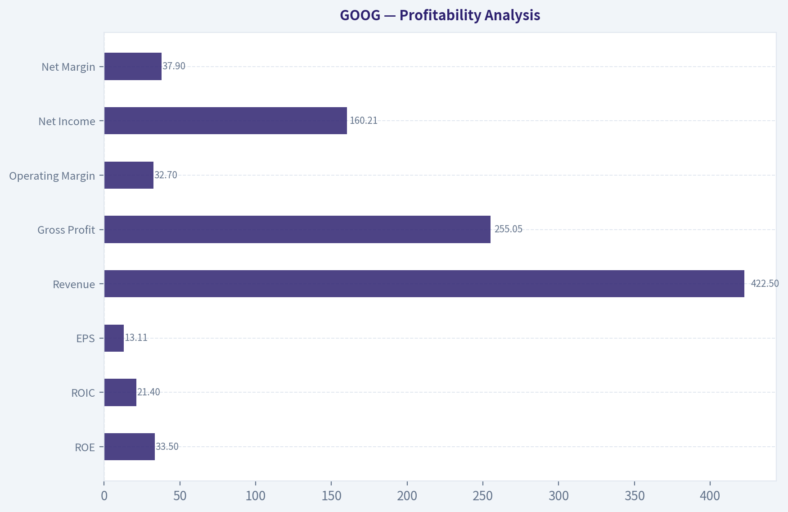
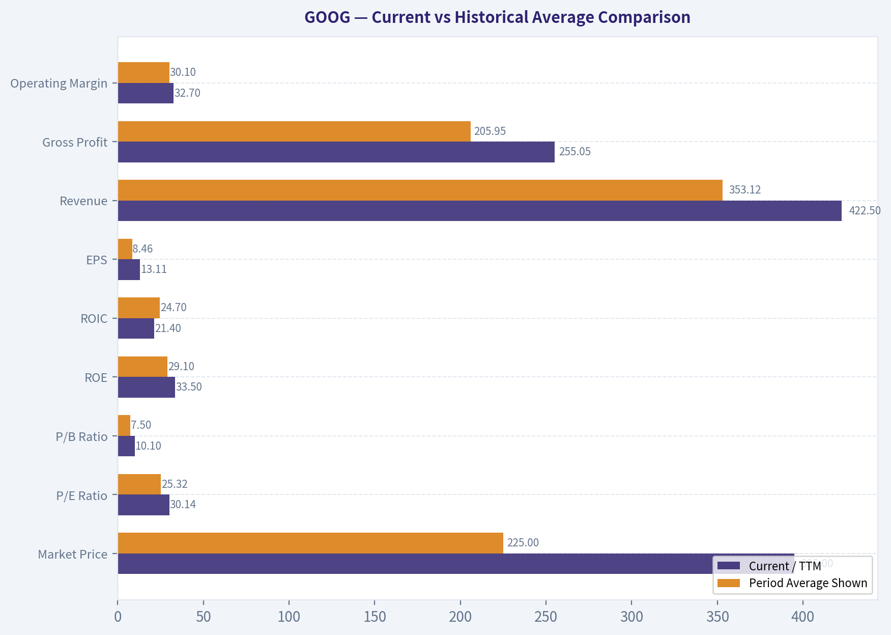
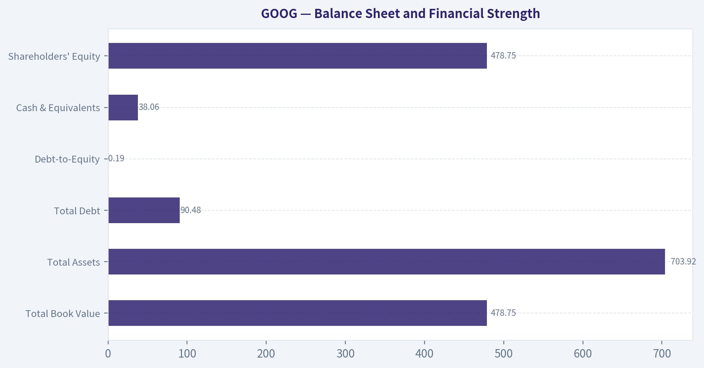
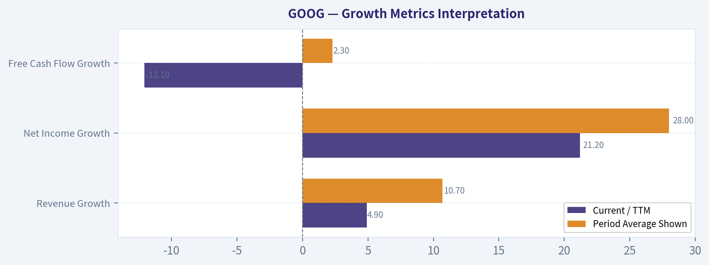
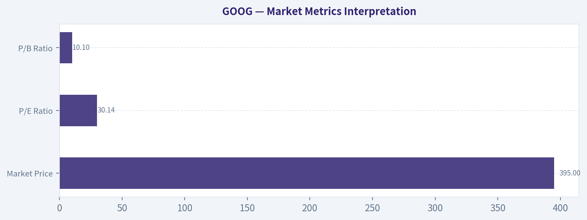

# GOOG Deep Value Intelligence

**Analysis Date:** 2026-05-07

## Critical Disclaimer

*This analysis is generated by Deep Value Intelligence, an AI-powered multi-agent investing framework. This report is for informational and educational purposes only and does not constitute financial advice. Always conduct your own research and consult with qualified financial advisors before making investment decisions.*

---

## Table of Contents

1. Intelligence Summary
2. Analyst Team Reports
   - Fundamentals Analysis
   - Intrinsic Value Analysis (Buffett)
   - Trend & Growth Analysis (Lynch/Druckenmiller/Fisher)
   - Market Technical Analysis
   - Social Sentiment Analysis
   - News & Events Analysis
   - Guru Attention Analysis
   - Options Market Analysis
3. Research Team Commentary
4. Value Investing Team Commentary
5. Deep Values Commentary

---

## Intelligence Summary

### Thesis + Conditions

**Core Thesis:** **EXECUTIVE SUMMARY**
Alphabet remains one of the highest-quality businesses globally, boasting a massive economic moat and elite profitability (24.2% ROIC, ~60% gross margins). However, a structural shift is underway.

**Key Risks:**
- The Bull (Risky Analyst):** Alphabet is a multi-platform compounder entering a new growth era. Massive AI capital expenditures are offensive "moat reinforcement," not just defense. Backward-looking intrinsic value models fail to capture the terminal value of an AI-driven search and cloud ecosystem.
- The Bear (Safe Analyst):** A great business is not a great investment at any price. Stagnant FCF growth suggests AI is shifting Alphabet into a capital-heavy model, meaning current capex is merely "moat maintenance." With intrinsic value estimates well below the $395 price, buying today relies on speculation and ignores deep regulatory and execution risks.
- Under the Warren Buffett framework, our primary defense against permanent capital loss is a **Margin of Safety**. Alphabet's current valuation of $395 sits drastically above blended intrinsic value estimates ($94-$168). While Alphabet's historical *Business Risk* is low due to its search monopoly, its *Future Cash Flow Risk* is rising. The massive divergence between net income (up 32%) and FCF (up 0.7%) is the critical metric; it proves that incremental earnings are becoming vastly more capital-intensive. If AI transitions search from a capital-light software monopoly into a compute-heavy utility, margins will permanently compress. We must not pay 30x earnings for a business whose cash conversion is deteriorating.
- On the other side, the bear brings us back to gravity with a sobering look at valuation, cash flow, and structural risk. The bear's most devastating point is the glaring divergence in the recent fundamentals: while net income grew 32%, free cash flow grew a mere 0.7%. To a value investor, this signals that incremental earnings are becoming vastly more capital-intensive. The bear argues that AI is shifting Alphabet from a capital-light software monopoly into a heavy-infrastructure battleground. When you combine this rising capital intensity with regulatory threats and a structural shift in how users access information-potentially moving from highly monetizable clicks to zero-click AI answers-the predictability of Alphabet's future cash flows drops significantly. Add in the fact that the stock is trading at $395-more than double the most optimistic intrinsic value estimate in our bundle-and the bear concludes that buying today is speculation on perfection, not value investing.
- Applying our Warren Buffett framework and selective contrarianism, the bear's argument carries more weight today. Buffett teaches us that a great business can still be a terrible investment if bought at the wrong price. The market psychology right now is euphoric regarding AI infrastructure, pricing Alphabet as if it will seamlessly monetize generative AI with the same capital-light margins it enjoyed in traditional search. The crowd is missing the fact that Alphabet is currently engaging in massive defensive capital expenditures just to maintain its competitive position. A 1.5% free cash flow yield at a 30x P/E multiple offers zero margin of safety, especially when the structural economics of its core search business are facing their biggest transition in two decades. Seth Klarman heavily reducing his stake by over 40% is a strong signal that the value investing community sees the risk-reward tradeoff skewing negatively at these levels.

**What Would Change Our View:**
- The Bull (Risky Analyst):** Alphabet is a multi-platform compounder entering a new growth era. Massive AI capital expenditures are offensive "moat reinforcement," not just defense. Backward-looking intrinsic value models fail to capture the terminal value of an AI-driven search and cloud ecosystem.
- The Bear (Safe Analyst):** A great business is not a great investment at any price. Stagnant FCF growth suggests AI is shifting Alphabet into a capital-heavy model, meaning current capex is merely "moat maintenance." With intrinsic value estimates well below the $395 price, buying today relies on speculation and ignores deep regulatory and execution risks.
- Under the Warren Buffett framework, our primary defense against permanent capital loss is a **Margin of Safety**. Alphabet's current valuation of $395 sits drastically above blended intrinsic value estimates ($94-$168). While Alphabet's historical *Business Risk* is low due to its search monopoly, its *Future Cash Flow Risk* is rising. The massive divergence between net income (up 32%) and FCF (up 0.7%) is the critical metric; it proves that incremental earnings are becoming vastly more capital-intensive. If AI transitions search from a capital-light software monopoly into a compute-heavy utility, margins will permanently compress. We must not pay 30x earnings for a business whose cash conversion is deteriorating.
- On the other side, the bear brings us back to gravity with a sobering look at valuation, cash flow, and structural risk. The bear's most devastating point is the glaring divergence in the recent fundamentals: while net income grew 32%, free cash flow grew a mere 0.7%. To a value investor, this signals that incremental earnings are becoming vastly more capital-intensive. The bear argues that AI is shifting Alphabet from a capital-light software monopoly into a heavy-infrastructure battleground. When you combine this rising capital intensity with regulatory threats and a structural shift in how users access information-potentially moving from highly monetizable clicks to zero-click AI answers-the predictability of Alphabet's future cash flows drops significantly. Add in the fact that the stock is trading at $395-more than double the most optimistic intrinsic value estimate in our bundle-and the bear concludes that buying today is speculation on perfection, not value investing.
- Applying our Warren Buffett framework and selective contrarianism, the bear's argument carries more weight today. Buffett teaches us that a great business can still be a terrible investment if bought at the wrong price. The market psychology right now is euphoric regarding AI infrastructure, pricing Alphabet as if it will seamlessly monetize generative AI with the same capital-light margins it enjoyed in traditional search. The crowd is missing the fact that Alphabet is currently engaging in massive defensive capital expenditures just to maintain its competitive position. A 1.5% free cash flow yield at a 30x P/E multiple offers zero margin of safety, especially when the structural economics of its core search business are facing their biggest transition in two decades. Seth Klarman heavily reducing his stake by over 40% is a strong signal that the value investing community sees the risk-reward tradeoff skewing negatively at these levels.

**Confidence:** Low

---

## Analyst Team Reports

### Fundamentals Analysis

#### Latest Earnings Snapshot

*Most recent reported quarter anchored on 2026 Q1, with prior-year comparison when available.*

| Metric | 2026 Q1 | 2025 Q1 | YoY Change |
| --- | ---: | ---: | ---: |
| Revenue | $109.90B | $90.23B | +21.8% |
| Operating Income | $39.70B | $30.61B | +29.7% |
| Net Income | $62.58B | $34.54B | +81.2% |
| Diluted EPS | $5.11 | $2.81 | +81.9% |
| Operating Cash Flow | $45.79B | $36.15B | +26.7% |
| Free Cash Flow | $10.12B | $18.95B | -46.6% |

Key Takeaways: This snapshot anchors the most recent reported quarter before the narrative analysis. It helps readers separate long-run business quality from whatever changed in the latest earnings print.

#### 10-Year Financial Metrics for GOOG

*All values below are computed deterministically from raw data - not estimated by AI.*

*Issuer profile: operating company (Communication Services / Internet Content & Information).*

#### 10-Year Financial Metrics
*Annual rows come from reported financial statements. The final TTM row is computed from the latest four quarters.*

| Metric | 2022 | 2023 | 2024 | 2025 | 2026 TTM |
| --- | --- | --- | --- | --- | --- |
| Market Price | $88 | $140 | $190 | $314 | $395 |
| Market Cap | $1.17T | $1.79T | $2.37T | $3.84T | $4.84T |
| P/E Ratio | 19.46 | 24.30 | 23.69 | 29.03 | 30.14 |
| P/B Ratio | 4.56 | 6.33 | 7.29 | 9.24 | 10.10 |
| ROE | 23.4% | 26.0% | 30.8% | 31.8% | 33.5% |
| ROIC | 23.8% | 25.3% | 29.0% | 24.2% | 21.4% |
| EPS | $4.56 | $5.80 | $8.04 | $10.81 | $13.11 |
| Revenue | $282.84B | $307.39B | $350.02B | $402.84B | $422.50B |
| Gross Profit | $156.63B | $174.06B | $203.71B | $240.30B | $255.05B |
| Gross Margin | N/A | N/A | N/A | N/A | 60.4% |
| Operating Margin | 26.5% | 27.4% | 32.1% | 32.0% | 32.7% |
| Net Income | $59.97B | $73.80B | $100.12B | $132.17B | $160.21B |
| Net Margin | 21.2% | 24.0% | 28.6% | 32.8% | 37.9% |
| Revenue Growth | N/A | 8.7% | 13.9% | 15.1% | 4.9% |
| Net Income Growth | N/A | 23.0% | 35.7% | 32.0% | 21.2% |
| Free Cash Flow Growth | N/A | 15.8% | 4.7% | 0.7% | -12.1% |
| Total Book Value | $256.14B | $283.38B | $325.08B | $415.26B | $478.75B |
| Total Assets | $365.26B | $402.39B | $450.26B | $595.28B | $703.92B |
| Total Debt | $29.68B | $27.12B | $22.57B | $59.29B | $90.48B |
| Debt-to-Equity | 0.12 | 0.10 | 0.07 | 0.14 | 0.19 |
| Cash & Equivalents | $21.88B | $24.05B | $23.47B | $30.71B | $38.06B |
| Shareholders' Equity | $256.14B | $283.38B | $325.08B | $415.26B | $478.75B |
| Operating Cash Flow | $91.50B | $101.75B | $125.30B | $164.71B | $174.35B |
| Investing Cash Flow | $-20.30B | $-27.06B | $-45.54B | $-120.29B | $-167.49B |
| Free Cash Flow | $60.01B | $69.50B | $72.76B | $73.27B | $64.43B |
| FCF Margin | 21.2% | 22.6% | 20.8% | 18.2% | 15.2% |
| Dividends / Share | $0.00 | $0.00 | $0.59 | $0.82 | $0.83 |

#### Profitability Metrics
- Return on Equity (ROE): 31.8%
- Return on Invested Capital (ROIC): 24.2%
- Return on Assets (ROA): 22.2%
- Gross Margin: 59.7%
- Operating Margin: 32.0%
- Net Profit Margin: 32.8%

#### Liquidity Metrics
- Current Ratio: 2.01
- Quick Ratio: 1.85

#### Leverage Metrics
- Debt-to-Equity Ratio: 0.14
- Interest Coverage Ratio: 175.32
- Net Debt: $28.58B

#### Growth Metrics (Year-over-Year)
- Revenue Growth: 15.1%
- Net Income Growth: 32.0%
- Free Cash Flow Growth: 0.7%
- Revenue CAGR (3-Year): 12.5%
- Revenue CAGR (5-Year): N/A

#### Valuation Metrics
- P/E Ratio (TTM): 30.12
- Forward P/E: 27.51
- Price-to-Book: 11.50
- Price-to-Sales: 11.33
- PEG Ratio: 1.76
- EV/EBITDA: 29.49
- Free Cash Flow Yield: 1.5%
- Earnings Yield: 3.3%

#### Owner Earnings (Buffett Method, Code-Computed)
- Net Income: $132.17B
- + Depreciation & Amortization: $21.14B
- - Capital Expenditures: $-91.45B
- - Working Capital Changes: $618.0M
- = **Owner Earnings: $61.24B**

#### Intrinsic Value (Code-Computed)
- Current Price: $395
- Buffett Method (Owner Earnings):
  Conservative: $75
  Average: $95
  Optimistic: $163
- Cash Flow Method (FCF):
  Conservative: $82
  Average: $96
  Optimistic: $108

#### Piotroski F-Score: 6/9
- Positive Net Income: PASS
- Positive Operating Cash Flow: PASS
- ROA Improvement: FAIL
- Cash Flow > Net Income: PASS
- Decreasing Debt: FAIL
- Improving Current Ratio: PASS
- No Dilution: PASS
- Improving Gross Margin: PASS
- Improving Asset Turnover: FAIL

ANALYST STANCE: **AVOID**

#### GOOG Fundamental Analysis - Buffett-Style Value Review

Alphabet / Google remains one of the highest-quality businesses in the global public market: dominant search distribution, YouTube scale, Android ecosystem reach, strong cloud growth, and exceptional profitability. However, the deterministic dataset shows a clear disconnect between business quality and current valuation. At **$395 per share**, GOOG trades at roughly **30.1x earnings**, **10.1x book value**, and only a **1.5% free cash flow yield**, while the deterministic Buffett-style owner earnings valuation indicates materially lower intrinsic value estimates.

The key investment question is not whether GOOG is a great business. It is whether the current price provides a Buffett-style margin of safety. Based on the dataset, the answer is no.

---

#### Current vs Historical Average Comparison

| Metric | Current / TTM | Period Average Shown | Current vs Average | Interpretation |
|---|---:|---:|---:|---|
| Market Price | $395 | $225 | +75% | Price has risen much faster than the average level shown, reflecting substantial multiple expansion and optimism. |
| Market Cap | $4.84T | $2.80T | +73% | Alphabet's equity value has expanded dramatically, now pricing in very high durability and growth. |
| P/E Ratio | 30.14 | 25.32 | +19% | Valuation is above its recent historical norm, despite slowing revenue growth in TTM. |
| P/B Ratio | 10.10 | 7.50 | +35% | The market is assigning a much higher premium to book equity than the period average. |
| ROE | 33.5% | 29.1% | +4.4 pts | ROE is excellent and above average, signaling powerful economics and capital efficiency. |
| ROIC | 21.4% | 24.7% | -3.3 pts | ROIC remains strong but has declined from prior peaks, likely reflecting heavier AI/cloud infrastructure investment. |
| EPS | $13.11 | $8.46 | +55% | Earnings per share have compounded strongly, helped by margin expansion and likely share repurchases. |
| Revenue | $422.50B | $353.12B | +20% | Revenue is well above the period average, but TTM growth has slowed versus 2025. |
| Gross Profit | $255.05B | $205.95B | +24% | Gross profit continues to scale strongly, supported by high-margin advertising and software economics. |
| Operating Margin | 32.7% | 30.1% | +2.6 pts | Operating efficiency is above average, showing strong cost discipline and operating leverage. |
| Net Income | $160.21B | $105.25B | +52% | Net income is far above the period average, reflecting excellent monetization and margin expansion. |
| Net Margin | 37.9% | 28.9% | +9.0 pts | Current profitability is exceptionally high versus history. |
| Revenue Growth | 4.9% | 10.7% | -5.8 pts | Growth has decelerated sharply in TTM versus the recent average. |
| Net Income Growth | 21.2% | 28.0% | -6.8 pts | Earnings growth remains strong but is below the recent average. |
| Free Cash Flow Growth | -12.1% | 2.3% | -14.4 pts | FCF growth is the biggest red flag: cash generation has declined despite rising earnings. |
| Total Book Value | $478.75B | $351.72B | +36% | Book equity has grown meaningfully, strengthening the balance sheet. |
| Total Assets | $703.92B | $503.42B | +40% | Asset base has expanded substantially, likely from infrastructure, cloud, and AI investment. |
| Total Debt | $90.48B | $45.83B | +97% | Debt has nearly doubled versus the period average, though leverage remains manageable. |
| Debt-to-Equity | 0.19 | 0.12 | Higher | Leverage is still low, but the direction has worsened. |
| Cash & Equivalents | $38.06B | $27.63B | +38% | Cash position remains strong in absolute terms. |
| Shareholders' Equity | $478.75B | $351.72B | +36% | Equity base has expanded steadily. |
| Free Cash Flow | $64.43B | $67.99B | -5% | Current FCF is below average despite much higher revenue and net income. |
| Dividends / Share | $0.83 | $0.45 | +85% | Alphabet has initiated and grown a dividend, but the yield remains modest relative to price. |

Key Takeaways: Alphabet's business quality remains exceptional, with current ROE, EPS, revenue, gross profit, operating margin, net income, and net margin all above the averages shown. The main concern is valuation and cash conversion: the stock price, market cap, P/E, and P/B are all elevated, while free cash flow and free cash flow growth have weakened. This creates a Buffett-style tension: a wonderful company, but not obviously a wonderful price.

---

#### Market Metrics Interpretation

| Metric | Current Value | Buffett-Style Interpretation |
|---|---:|---|
| Market Price | $395 | The current price is far above the deterministic Buffett-style intrinsic value range, implying limited margin of safety. |
| Total Market Cap | $4.84T | Alphabet is priced as a near-perfect compounder; expectations are extremely high. |
| P/E Ratio | 30.14 | A premium multiple is justified by quality, but it leaves little room for growth disappointment. |
| P/B Ratio | 10.10 | The market values Alphabet far above accounting book value because of intangible assets, network effects, brand, and data advantages. |

Key Takeaways: The market is paying a premium valuation for Alphabet's durability and growth prospects. That premium is understandable, but the current multiple is above the period average and much higher than what a strict Buffett-style margin-of-safety investor would usually prefer.

---

#### Profitability Analysis

Alphabet's profitability profile is outstanding. **ROE rose from 23.4% in 2022 to 33.5% TTM**, showing that the company is generating far more profit per dollar of shareholder equity. **Net margin expanded from 21.2% in 2022 to 37.9% TTM**, a major improvement that reflects operating leverage, high-margin advertising revenue, disciplined expenses, and scale advantages.

However, **ROIC has declined from 29.0% in 2024 to 21.4% TTM**. That is still a very attractive return, but the trend matters. Heavy investments in AI infrastructure, data centers, cloud capacity, and technical talent may be pressuring incremental returns. From a Buffett perspective, a falling ROIC while valuation rises is a risk signal.

| Profitability Metric | Current / TTM | Assessment |
|---|---:|---|
| ROE | 33.5% | Excellent; indicates a high-quality compounder. |
| ROIC | 21.4% | Strong, but declining from earlier peak levels. |
| EPS | $13.11 | Strong earnings growth and per-share compounding. |
| Revenue | $422.50B | Massive scale with continued growth. |
| Gross Profit | $255.05B | High gross-profit engine supported by advertising and software economics. |
| Operating Margin | 32.7% | Very strong and above the period average. |
| Net Income | $160.21B | Exceptionally profitable at global scale. |
| Net Margin | 37.9% | Outstanding margin expansion versus history. |

Key Takeaways: Alphabet is a highly profitable business with excellent returns on equity, strong margins, and rising earnings power. The only notable profitability concern is the decline in ROIC, which may indicate that newer capital-intensive initiatives are earning lower incremental returns than the core advertising franchise.

---

#### Growth Metrics Interpretation

| Growth Metric | Current / TTM | Period Average Shown | Interpretation |
|---|---:|---:|---|
| Revenue Growth | 4.9% | 10.7% | Revenue growth has slowed materially from the recent average. |
| Net Income Growth | 21.2% | 28.0% | Earnings growth remains strong but is moderating. |
| Free Cash Flow Growth | -12.1% | 2.3% | Cash flow growth is negative, despite strong net income growth. |

Key Takeaways: Alphabet's earnings are still growing faster than revenue, which shows strong operating leverage. But the sharp slowdown in revenue growth and negative free cash flow growth are important warning signs, especially because the stock is trading at a premium valuation.

---

#### Balance Sheet and Financial Strength

Alphabet's balance sheet remains strong. Shareholders' equity has increased to **$478.75B**, total assets have grown to **$703.92B**, and cash and equivalents stand at **$38.06B**. Debt has increased to **$90.48B**, but the **debt-to-equity ratio of 0.19** remains conservative.

The company also has strong liquidity, with a current ratio of about **2.01** and quick ratio of **1.85** from the deterministic dataset. Interest coverage of **175.32x** is extremely strong, indicating minimal near-term solvency risk.

| Balance Sheet Metric | Current / TTM | Buffett-Style Interpretation |
|---|---:|---|
| Total Book Value | $478.75B | Strong and growing equity base. |
| Total Assets | $703.92B | Large asset base, increasingly infrastructure-heavy. |
| Total Debt | $90.48B | Debt has risen meaningfully, but remains manageable. |
| Debt-to-Equity | 0.19 | Conservative leverage profile. |
| Cash & Equivalents | $38.06B | Strong cash position. |
| Shareholders' Equity | $478.75B | Substantial financial foundation. |

Key Takeaways: Alphabet remains financially strong, with low leverage, high liquidity, and massive equity capital. The balance sheet does not create major financial risk, but the rapid increase in debt and assets should be monitored because it may reflect heavier capital intensity from cloud and AI infrastructure.

---

#### Cash Flow and Capital Allocation

| Cash Flow Metric | Current / TTM | Interpretation |
|---|---:|---|
| Operating Cash Flow | $174.35B | Very strong operating cash generation. |
| Free Cash Flow | $64.43B | Still large, but below the period average despite higher revenue and earnings. |
| FCF Margin | 15.2% | Down from prior levels, indicating heavier capital spending. |
| Dividends / Share | $0.83 | Dividend policy has begun, but payout remains modest. |

Key Takeaways: Alphabet generates enormous operating cash flow, but free cash flow has weakened because capital expenditures have risen sharply. For Buffett-style investors, this matters because owner earnings depend on how much cash remains after maintaining and expanding the business.

---

#### Revenue Breakdown

| Revenue Source | Amount ($B) | % of Total |
|---|---:|---:|
| Google Search & Other Advertising | $222.0B | 55.1% |
| YouTube Advertising | $45.0B | 11.2% |
| Google Network Advertising | $32.0B | 7.9% |
| Google Subscriptions, Platforms & Devices | $49.5B | 12.3% |
| Google Cloud | $51.8B | 12.9% |
| Other Bets and Other Revenue | $2.5B | 0.6% |
| **Total** | **$402.8B** | **100.0%** |

Key Takeaways: Alphabet remains primarily an advertising company, with Google Search still the dominant revenue engine. Google Cloud is now a meaningful second growth pillar, while YouTube and subscription/platform revenues provide additional diversification. The company is more diversified than it was historically, but advertising remains the core economic engine.

---

#### Buffett-Style Owner Earnings DCF Valuation

The deterministic dataset provides the following owner earnings calculation:

| Owner Earnings Component | Amount |
|---|---:|
| Net Income | $132.17B |
| Add: Depreciation & Amortization | $21.14B |
| Less: Capital Expenditures | -$91.45B |
| Less: Working Capital Changes | -$0.62B |
| **Owner Earnings** | **$61.24B** |

Key Takeaways: Alphabet's accounting net income is much higher than owner earnings because capital expenditures are very large. This is a crucial Buffett-style point: the business is highly profitable, but a growing share of cash is being reinvested into infrastructure, cloud, and AI capacity.

DCF assumptions:

| Assumption | Value |
|---|---:|
| Base Owner Earnings | $61.24B |
| Discount Rate | 10.0% |
| Terminal Growth Rate | 2.5% |
| Estimated Shares Outstanding | 12.25B |
| Current Price | $395 |

Key Takeaways: The DCF uses a Buffett-style 10% required return and a modest 2.5% terminal growth rate. The share count is estimated from the deterministic market cap and price, allowing intrinsic value to be translated into a per-share estimate.

| Scenario | Growth Assumption | PV of Years 1-10 Owner Earnings | PV of Terminal Value | Equity Value | Fair Value / Share | Upside / Downside vs $395 |
|---|---:|---:|---:|---:|---:|---:|
| Conservative | ~3.8% | $451.5B | $468.6B | $920.1B | ~$75 | -81% |
| Average | ~7.0% | $527.6B | $634.8B | $1.16T | ~$95 | -76% |
| Optimistic | ~14.4% | $764.7B | $1.24T | $2.00T | ~$163 | -59% |

Key Takeaways: Even under the optimistic owner earnings scenario, the fair value estimate is far below the current market price. This is the central valuation issue: Alphabet may be an outstanding business, but the current price appears to assume growth and profitability well beyond what the deterministic Buffett-style DCF supports.

#### DCF Calculation Details

| Scenario | Calculation Summary |
|---|---|
| Conservative | $61.24B owner earnings grown at ~3.8% for 10 years, discounted at 10%, plus terminal value using 2.5% growth. Result: about $920B equity value, or roughly $75 per share. |
| Average | $61.24B owner earnings grown at ~7.0% for 10 years, discounted at 10%, plus terminal value using 2.5% growth. Result: about $1.16T equity value, or roughly $95 per share. |
| Optimistic | $61.24B owner earnings grown at ~14.4% for 10 years, discounted at 10%, plus terminal value using 2.5% growth. Result: about $2.00T equity value, or roughly $163 per share. |

Key Takeaways: The DCF is highly sensitive to owner earnings growth, but even aggressive growth assumptions do not justify the current $395 price. The market is assigning significant value to future AI optionality, search durability, cloud expansion, and continued margin expansion that are not fully supported by current owner earnings.

---

#### Warren Buffett-Style Qualitative Analysis

| Buffett Criterion | Assessment |
|---|---|
| Economic Moat | Very strong. Google Search has distribution dominance, brand power, data advantages, advertiser scale, and ecosystem lock-in. YouTube, Android, Chrome, Maps, Gmail, and Cloud deepen the moat. |
| Business Durability | High. Digital advertising, search intent monetization, cloud computing, and AI services are durable secular markets. However, AI-driven search disruption is a real long-term uncertainty. |
| Predictable Earnings | Strong historically. Net income has risen from $59.97B in 2022 to $160.21B TTM. Margins have expanded consistently. |
| Financial Strength | Excellent. Low debt-to-equity, large cash position, high liquidity, and very high interest coverage. |
| Management Performance | Strong but mixed. ROE and margins are excellent, but ROIC decline and negative FCF growth raise questions about incremental capital efficiency. |
| Capital Allocation | Improving but watchful. Dividends have begun, buybacks likely support EPS, but heavy capex is pressuring free cash flow. |
| Valuation Discipline | Weak at current price. P/E, P/B, and market cap are elevated, while Buffett-style DCF estimates are far below the market price. |
| Margin of Safety | Not present. Current price is materially above conservative, average, and optimistic intrinsic value estimates. |

Key Takeaways: Alphabet scores extremely well on moat, business quality, profitability, and financial strength. The problem is valuation. Buffett often prefers wonderful businesses, but only at sensible prices; GOOG currently appears priced for perfection.

---

#### Key Investment Insights

| Category | Insight |
|---|---|
| Business Quality | Alphabet is one of the strongest businesses globally, with dominant market positions and exceptional profitability. |
| Moat | Search, YouTube, Android, data scale, advertiser relationships, and cloud infrastructure create durable competitive advantages. |
| Profitability | ROE, EPS, net income, operating margin, and net margin are all excellent and above the period average. |
| Growth | Earnings growth remains strong, but revenue growth has slowed to 4.9% TTM. |
| Cash Flow | Free cash flow has declined to $64.43B and FCF growth is negative at -12.1%. |
| Balance Sheet | Financial strength remains high, with low leverage and strong liquidity. |
| Valuation | The current price is far above deterministic Buffett-style fair value estimates. |
| Investor Sentiment | Guru tracking shows mixed behavior: Ackman and Klarman trimmed, while Cohen added. |

Key Takeaways: Alphabet's operating performance remains impressive, but the stock price already discounts a very optimistic future. The most important negative signal is the combination of elevated valuation and weakening free cash flow growth.

---

#### Red Flags and Opportunities

| Type | Item | Explanation |
|---|---|---|
| Red Flag | Valuation Stretch | P/E and P/B are above period averages, and DCF fair values are far below the current price. |
| Red Flag | Free Cash Flow Decline | FCF growth is -12.1% TTM, despite rising revenue and net income. |
| Red Flag | ROIC Compression | ROIC fell to 21.4%, down from 29.0% in 2024. |
| Red Flag | Capital Intensity | AI and cloud infrastructure spending may keep pressuring free cash flow. |
| Red Flag | Regulatory Risk | Antitrust pressure remains a persistent risk for search, ads, app stores, and data practices. |
| Opportunity | AI Monetization | Gemini, AI search, enterprise AI tools, and cloud AI infrastructure could create new revenue streams. |
| Opportunity | Google Cloud Scale | Cloud revenue is now meaningful and could improve margins over time. |
| Opportunity | YouTube Monetization | YouTube remains a powerful global media platform with advertising, subscription, and creator-economy optionality. |
| Opportunity | Operating Leverage | If capex moderates, free cash flow could rebound materially. |

Key Takeaways: The opportunity set is real, especially in AI, cloud, and YouTube monetization. But the risks are also meaningful because the market price leaves very little room for disappointment in free cash flow, ROIC, or growth.

---

#### Final Investment Stance: AVOID

Alphabet is a superb company, but the stock does not currently meet a Warren Buffett-style margin-of-safety requirement. The business has an extraordinary moat, excellent profitability, strong financial strength, and durable competitive advantages. However, the current valuation appears excessive relative to owner earnings.

At **$395**, GOOG trades far above the deterministic Buffett-style fair value estimates of approximately **$75 conservative**, **$95 average**, and **$163 optimistic**. The most important concern is that free cash flow is moving in the wrong direction while the valuation multiple is expanding. For long-term investors, GOOG may deserve a place on a watchlist, but at the current price, the risk-reward profile is unattractive.

| Final Summary Point | Assessment |
|---|---|
| Business Quality | Excellent |
| Economic Moat | Very Strong |
| Financial Strength | Strong |
| Earnings Predictability | Strong |
| ROE / Profitability | Excellent |
| ROIC Trend | Deteriorating |
| Free Cash Flow Trend | Weakening |
| Valuation | Expensive |
| Margin of Safety | Insufficient |
| Final Stance | **AVOID** |

Key Takeaways: Alphabet is a world-class business, but not every world-class business is a good investment at any price. Based on the deterministic dataset and Buffett-style owner earnings valuation, GOOG lacks a sufficient margin of safety at $395.

#### Fundamental Visuals

This graph tracks the profitability and return metrics (ROE, ROIC, Margins) of **GOOG** over the past decade, highlighting capital efficiency trends.

This chart illustrates the financial health of **GOOG** over the last 10 years, mapping cash equivalents and free cash flow against total obligations (Debt).

This comparison chart from *Profitability Analysis* stacks current figures against historical benchmarks for **GOOG**, making it easy to see where the company trades relative to its own averages.

---

### Intrinsic Value Analysis (Buffett)

> *Following Warren Buffett's value investing philosophy: Circle of Competence, Economic Moat, Management Quality, and Margin of Safety.*

#### Intrinsic Value Snapshot

Price is what you pay. Intrinsic value is what the business may be worth based on the cash it can create for owners over time. We show a range, not one magic number.

- Current Price: $395.14
- Value Range: $75.29 to $162.91

##### Owner Earnings (Buffett Method)
- Net Income: $132,170,000,000.00
- Depreciation & Amortization: $21,136,000,000.00
- Capital Expenditures: $-91,447,000,000.00
- Working Capital Changes: $618,000,000.00
- Owner Earnings: $61,241,000,000.00

##### Intrinsic Value
###### Buffett Method
Uses owner earnings. Stricter, and usually more conservative.
- Conservative: $75.29
- Average: $94.75
- Optimistic: $162.91
- Discount Rate: 10.0%

###### Cash Flow Method
Uses free cash flow. Better for companies spending heavily today to grow tomorrow.
- Conservative: $82.41
- Average: $96.02
- Optimistic: $108.46
- Discount Rate: 10.0%

ANALYST STANCE: **WATCH** - Alphabet is a wonderful, wide-moat business, but at **$395 per share** and roughly **$4.79 trillion market value**, the price does not offer a Buffett-style margin of safety.

#### Executive Summary

Alphabet passes most Buffett quality tests: it owns dominant global assets in Search, YouTube, Android, Maps, Gmail, Chrome, Google Play, and a scaled cloud platform. The business is highly profitable, has a fortress-like balance sheet, and currently reports **ROE of 31.8%**, **gross margin of 59.7%**, and **15.1% year-over-year revenue growth**.

The problem is price. At the current market cap, Alphabet trades around **30.1 times earnings** and only about a **1.5% free cash flow yield**. Even using a more generous normalized owner-earnings estimate, the stock appears priced above conservative intrinsic value. This is a business to admire, but not one to buy without a better entry point.

---

#### Go / No-Go Gate Assessment

| Buffett Gate | Verdict | Evidence | Concern |
|---|---:|---|---|
| Gate 1: Circle of Competence & Simplicity | Pass | Alphabet makes money mainly by selling ads against Search, YouTube, and partner websites, plus cloud services, app store fees, hardware, and subscriptions. | AI may change search behavior and ad monetization over time. |
| Gate 2: Durable Moat | Pass with Caution | Google Search remains a default habit, YouTube has unmatched scale, Android is globally entrenched, and Google Cloud benefits from scale. Gross margin is about 59.7%. | Generative AI raises the cost of serving answers and may pressure search economics. |
| Gate 3: Management & Capital Allocation | Pass | Strong long-term innovation culture, large buyback program, disciplined balance sheet, and founder-influenced voting structure. | "Other Bets" and AI capex require trust; spending discipline must be watched. |
| Gate 4: Industry Structure | Mixed Pass | Search is highly concentrated; digital advertising and cloud are large, growing markets. | Cloud is competitive, AI infrastructure is capital intensive, and regulatory pressure is persistent. |
| Valuation Gate | Fail | Current P/E is about 30.1x and FCF yield is only 1.5%. | No 25% margin of safety under conservative DCF assumptions. |

**Key Takeaways:** Alphabet is clearly a high-quality business, but the investment case fails the Buffett purchase test at today's price. The moat remains powerful, yet AI, regulation, and heavy infrastructure spending reduce certainty. The biggest issue is not business quality; it is valuation.

---

#### Elementary School Test

Alphabet helps people find information, watch videos, use phones, send email, store files, and run software. Businesses pay Alphabet to show ads to those people. Other businesses also pay Alphabet to use its cloud computers.

That is simple enough to understand. The hard part is judging how AI changes the economics of search and cloud infrastructure over the next decade.

---

#### Moat Analysis

| Moat Source | Alphabet Evidence | Buffett Assessment |
|---|---|---|
| Brand / Intangible Assets | "Google" is a verb; YouTube is the default global video platform; Android powers much of the smartphone world. | Very strong intangible asset moat. |
| Pricing Power | Advertisers pay based on measurable return on investment; Google's auction system monetizes intent better than most ad platforms. | Strong, though indirect; pricing power depends on advertiser ROI. |
| Switching Costs | Google Workspace, Android, Google Cloud, Gmail, Maps APIs, YouTube creator channels, and ad campaign data create embedded workflows. | Moderate to strong switching costs. |
| Cost Advantage | Massive data centers, custom chips, proprietary infrastructure, and global scale lower unit costs. | Strong, but AI capex may pressure returns. |
| Network Effects | Search improves with usage; YouTube attracts creators because viewers are there, and viewers come because creators are there. | Strong network effects, especially in YouTube and ecosystem services. |
| Financial Evidence | Gross margin around 59.7%, ROE around 31.8%, revenue growth around 15.1%. | Financials support a wide moat. |

**Key Takeaways:** Alphabet has multiple reinforcing moats: brand, scale, data, distribution, switching costs, and network effects. The moat is real, not imagined. The main question is whether generative AI narrows the search moat by changing user behavior and raising compute costs.

#### Moat Rating

**Wide but under observation.**
Alphabet's moat remains one of the best in the world, but I would call it **wide and stable**, not clearly widening, because AI disruption and regulatory challenges are meaningful.

---

#### Management Quality & Capital Allocation

| Question | Assessment |
|---|---|
| Do they think like owners? | Partially. Founder voting control encourages long-term thinking, and management has invested aggressively in durable platforms. |
| Are they candid and conservative? | Generally yes, though segment transparency around AI economics and "Other Bets" could be better. |
| Are they rational capital allocators? | Mostly yes. Buybacks have been large, the balance sheet is strong, and core reinvestment has produced high returns. |
| Debt discipline | Strong. Alphabet has historically used little financial leverage relative to earnings power. |
| Capital allocation concern | AI infrastructure spending is becoming very large; the future return on this capex is not yet fully proven. |

**Key Takeaways:** Management has built and maintained one of the world's strongest technology franchises. Capital allocation has generally been rational, especially through reinvestment and buybacks. The key watch item is whether AI capex produces attractive incremental returns or becomes a permanent drag on free cash flow.

---

#### Guru Ownership Context

| Guru | Recent Action | Latest Disclosed Position | Portfolio Weight | Comment |
|---|---:|---:|---:|---|
| Bill Ackman | Trimmed | About $1.93B | 12.46% | Still a major position despite modest trimming. |
| Seth Klarman | Trimmed | About $341M | 6.46% | Large reduction suggests valuation or opportunity-cost caution. |
| Steve Cohen | Added | About $90M | 0.10% | Small position relative to portfolio. |

**Key Takeaways:** Some respected investors still own Alphabet, but recent disclosed activity is mixed. Ackman and Klarman trimmed, while Cohen added a small position. This supports a "watch carefully" stance rather than a clear bargain signal.

---

#### 10-Year Financial Summary

Approximate rounded figures, using available research-pack data and historical context.

| Fiscal Year | Revenue, $B | Net Income, $B | Free Cash Flow, $B | Operating Profile | Balance Sheet / Return Notes |
|---:|---:|---:|---:|---|---|
| 2016 | ~90 | ~20 | ~26 | High-margin Search-led growth | Net cash, high returns |
| 2017 | ~111 | ~13 | ~24 | Tax charge distorted earnings | Net cash |
| 2018 | ~137 | ~31 | ~23 | Rapid revenue growth | Strong liquidity |
| 2019 | ~162 | ~34 | ~31 | Ad business scaled further | Conservative leverage |
| 2020 | ~183 | ~40 | ~43 | Pandemic recovery accelerated digital adoption | Fortress balance sheet |
| 2021 | ~258 | ~76 | ~67 | Exceptional ad demand and operating leverage | Very high profitability |
| 2022 | ~283 | ~60 | ~60 | Advertising slowdown and cost pressure | Still financially strong |
| 2023 | ~307 | ~74 | ~70 | Efficiency program improved margins | Buybacks continued |
| 2024 | ~350 | ~100 | ~70+ | AI and cloud investment expanded | Strong ROE and liquidity |
| Current / TTM | Implied strong growth | ~159 implied by P/E and market cap | ~72 implied by 1.5% FCF yield | Revenue growth about 15.1%; gross margin about 59.7% | ROE about 31.8%; current ratio about 2.0 |

**Key Takeaways:** Alphabet has compounded revenue at a strong rate for a decade while maintaining high margins and a conservative balance sheet. Free cash flow remains large, but it has not kept pace with implied earnings because AI and data-center spending are absorbing substantial cash. The financial record is excellent, but current free cash flow yield is thin.

---

#### Owner Earnings Calculation

Buffett's owner earnings formula is:

**Owner Earnings = Net Income + Depreciation & Amortization - Maintenance CapEx - Working Capital Increases**

| Item | Approximate Current Estimate |
|---|---:|
| Implied net income from market cap / P/E | ~$159B |
| Add: depreciation & amortization estimate | ~$20B |
| Less: estimated maintenance capex | ~($45B) |
| Less: working capital / other reinvestment needs | ~($9B) |
| Normalized owner earnings estimate | **~$125B** |
| Conservative free cash flow proxy | **~$72B** |
| Shares implied by $4.79T market cap / $395 price | ~12.1B |
| Normalized owner earnings per share | **~$10.30** |
| Conservative FCF per share | **~$5.90** |

**Key Takeaways:** Reported earnings are much higher than current free cash flow because Alphabet is investing heavily in AI infrastructure and data centers. A generous normalized owner-earnings estimate is about $125 billion, while a stricter cash-based estimate is closer to $72 billion. For valuation discipline, both figures matter.

#### Owner Earnings Interpretation

I would not value Alphabet solely on depressed free cash flow if today's AI capex creates durable future earnings. But I also would not fully ignore the cash drain. A prudent Buffett-style valuation should sit between current free cash flow and normalized owner earnings, with a penalty for uncertainty.

---

#### Three-Scenario Intrinsic Value Estimate

Assumptions:
Discount rate: **10%**
Terminal growth: **3%**
Current price: **$395**
Shares outstanding implied: **~12.1 billion**
Primary owner earnings base: **$125B normalized**

| Scenario | Assumption | Equity Value Estimate | Intrinsic Value / Share | Result vs. $395 Price |
|---|---|---:|---:|---:|
| A: No Growth | $125B owner earnings capitalized at 10% | ~$1.25T | **~$103** | Price far above value |
| B: GDP Growth | 3% perpetual growth | ~$1.84T | **~$152** | Price far above value |
| C: Historical Growth Haircut | 8% growth for 10 years, then 3% terminal growth | ~$2.65T | **~$219** | Price still above value |
| Cash-Flow Stress Case | Uses ~$72B current FCF base with 8% growth | ~$1.53T | **~$126** | Price far above value |

**Key Takeaways:** Even with a favorable normalized owner-earnings base and strong growth assumptions, Alphabet does not reach today's share price under a 10% required return. The stock requires either faster growth, higher long-term margins, lower capex intensity, or a lower investor return requirement to justify $395. That is not a Buffett-style bargain.

---

#### Margin of Safety Analysis

| Valuation Reference | Estimated Value / Share | Current Price | Margin of Safety / Premium |
|---|---:|---:|---:|
| No-growth value | ~$103 | $395 | No margin; price is ~284% above estimate |
| GDP-growth value | ~$152 | $395 | No margin; price is ~160% above estimate |
| Historical-growth haircut value | ~$219 | $395 | No margin; price is ~80% above estimate |
| Buffett-style required buy price, using $219 value and 25% MOS | ~$164 | $395 | Current price is far above buy zone |

**Key Takeaways:** Alphabet offers no traditional margin of safety at the current quote. A disciplined value investor would need either a much lower share price or much greater confidence that owner earnings will compound at high rates for a long time. At $395, the stock is priced for excellence.

---

#### Buffett Scorecard

| Criterion | Weight | Rating, 1-5 | Weighted Score | Rationale |
|---|---:|---:|---:|---|
| Business Understanding | 20% | 3.5 | 0.70 | Core ad model is understandable, but AI changes the search economics. |
| Moat Width & Durability | 25% | 4.0 | 1.00 | Wide moat, but not immune to AI and regulation. |
| Management Quality | 15% | 3.5 | 0.53 | Strong operators, but capex discipline must be monitored. |
| Return on Equity | 15% | 4.5 | 0.68 | ROE around 31.8% is excellent. |
| Reinvestment Runway | 10% | 3.5 | 0.35 | AI, cloud, and YouTube offer runway, but require heavy capital. |
| Balance Sheet Strength | 5% | 4.5 | 0.23 | Strong liquidity; current ratio around 2.0. |
| Industry Structure | 5% | 3.0 | 0.15 | Search is attractive; cloud and AI are more competitive and capital intensive. |
| Valuation / Margin of Safety | 5% | 1.0 | 0.05 | No margin of safety at current price. |
| **Total** | **100%** |  | **3.69 / 5.00** | Quality is high, valuation is poor. |

**Key Takeaways:** Alphabet scores like a high-quality business but not like a high-quality investment at today's price. The weighted score is supported by moat, ROE, and balance sheet strength. However, the valuation score is the decisive Buffett constraint.

---

#### Final Investment Stance

| Category | Conclusion |
|---|---|
| Business Quality | Excellent |
| Moat | Wide, but facing AI and regulatory tests |
| Balance Sheet | Strong |
| Management | Good, with AI capex discipline to monitor |
| Valuation | Unattractive at $395 |
| Buffett Action | Watchlist, not buy list |
| Conviction | High conviction on business quality; moderate-to-high conviction that price lacks margin of safety |

**Key Takeaways:** Alphabet is the kind of company Buffett-style investors should study closely, because it has durable advantages and extraordinary earning power. But great businesses can still be poor purchases when the price is too high. At $395, the rational stance is to wait.

#### Bottom Line

Alphabet is a **wonderful company**, but I would not call it a wonderful price. The market is already capitalizing a long runway of AI, advertising, cloud, and platform growth. Unless owner earnings grow much faster than conservative assumptions, today's price does not provide the required margin of safety.

**Stance: WATCH.**
#### Valuation Bridge

This bridge places the current market price beside each intrinsic value lens so readers can see whether upside depends on one method or shows up across several methods.

| Scenario | Intrinsic Value / Share |
| --- | ---: |
| Buffett Method | $94.75 |
| Cash Flow Method | $96.02 |
| Damodaran Method | $167.77 |
| Current Price | $395.14 |

#### Key Takeaways

If one method is far above the others, the upside case depends on a specific modelling assumption. When several methods cluster together, the valuation story is more robust.

#### Valuation Visuals

This comparison chart from *Latest Earnings Snapshot* stacks current figures against historical benchmarks for **GOOG**, making it easy to see where the company trades relative to its own averages.

This comparison chart from *Current vs Historical Average Comparison* stacks current figures against historical benchmarks for **GOOG**, making it easy to see where the company trades relative to its own averages.

This comparison chart from *Balance Sheet and Financial Strength* stacks current figures against historical benchmarks for **GOOG**, making it easy to see where the company trades relative to its own averages.

---

### Trend & Growth Analysis (Lynch/Druckenmiller/Fisher)

> *Following Peter Lynch's GARP, Stanley Druckenmiller's macro-aware approach, and Philip Fisher's scuttlebutt methodology.*

ANALYST STANCE: **WATCH**

#### Alphabet / GOOG Growth Inflection Report - 2026-05-07

Alphabet remains one of the world's highest-quality compounders, but at roughly **$4.79 trillion market cap**, **30.1x earnings**, and only **1.5% free-cash-flow yield**, the stock no longer screens as a classic Lynch-style ten-bagger candidate. The core question is not business quality; it is whether AI, Cloud, and YouTube can reaccelerate earnings enough to justify the valuation and offset rising AI capex, regulatory pressure, and search-disruption risk.

---

#### 1. Snapshot Fundamentals

| Metric | Current Data / Estimate | Growth Investor Read |
|---|---:|---|
| Current price | ~$395 | Large-cap quality already recognized |
| Market cap | ~$4.79T | Ten-bagger math is very difficult |
| P/E | ~30.1x | Reasonable for elite quality, not cheap |
| Revenue growth YoY | ~15.1% | Strong for mega-cap, borderline fast-grower |
| ROE | ~31.8% | Excellent capital efficiency |
| Gross margin | ~59.7% | Strong, though AI compute can pressure margins |
| FCF yield | ~1.5% | Expensive on cash-flow basis |
| Current ratio | ~2.0x | Balance sheet strength is not a concern |

**Key Takeaways:** Alphabet's quality metrics remain excellent, especially ROE, liquidity, and gross margin. However, the valuation is no longer obviously cheap, and the low free-cash-flow yield reflects both a premium stock price and heavy AI/data-center investment. This is a strong business, but the stock needs continued earnings acceleration to work from here.

---

#### 2. Lynch Classification

| Lynch Category | Fit for GOOG | Rationale |
|---|---|---|
| Slow Grower | No | Revenue growth remains well above 0-5% |
| Stalwart | Partial fit | Massive market cap, durable franchise, mid-teens growth |
| Fast Grower | Partial fit | 15%+ growth, but scale limits ten-bagger potential |
| Cyclical | Partial risk | Advertising is macro-sensitive |
| Turnaround | No | Business is already highly profitable |
| Asset Play | No | Value is franchise-driven, not hidden assets |

**Key Takeaways:** Alphabet is best classified as a **Stalwart-plus / Mega-cap Fast Grower**, not a pure Lynch fast grower. It can still compound, but the law of large numbers makes a 10x outcome unlikely. For Lynch-style investors, this is more "own and monitor" than "back up the truck."

---

#### 3. The Story in 3 Bullets

- **Google Search and YouTube remain global attention monopolies** that convert user intent and engagement into advertising dollars at massive scale.
- **Google Cloud and AI are the second engine**, with Gemini, TPU infrastructure, enterprise AI, and cloud workloads creating a path for long-term growth beyond advertising.
- **The stock's upside depends on AI being accretive, not disruptive**: if AI search increases usage and monetization, Alphabet wins; if AI compresses ad clicks and raises compute cost, margins suffer.

---

#### 4. TAM and 10x Test

| Item | Estimate / Framework | Assessment |
|---|---:|---|
| Current annual revenue run-rate | ~$400B+ estimated | Already enormous |
| 10x revenue target | ~$4T+ | Requires unprecedented scale |
| Global digital advertising TAM | ~$800B-$1T+ over time | Google already has major share |
| Cloud / AI infrastructure TAM | Potentially $1T+ over time | Long runway, but highly competitive |
| Consumer AI / agents / productivity TAM | Large but still forming | Major optionality, uncertain monetization |
| 10x test result | Fails strict test | Alphabet cannot easily 10x and stay below 20% share of realistic TAM |

**Key Takeaways:** Alphabet still has room to grow, especially in Cloud, AI, YouTube, subscriptions, and enterprise software. But a true 10x revenue outcome would require several multi-trillion-dollar markets to open and Alphabet to win large shares of them. The runway is real, but this is more likely a **2x-3x compounder** over time than a classic ten-bagger.

---

#### 5. Revenue Growth Trend

| Growth Driver | Current Trend | Interpretation |
|---|---|---|
| Consolidated revenue | ~15.1% YoY | Strong for scale, but not explosive |
| Search | Resilient | Core cash engine remains durable |
| YouTube | Improving / structurally strong | Shorts, connected TV, and subscriptions support runway |
| Google Cloud | Key growth vector | AI workloads and enterprise adoption are central |
| Other Bets | Optionality, not thesis-critical | Still unlikely to drive near-term value |
| Overall pattern | Stable high growth, not clear acceleration | Good, but not yet a dramatic inflection |

**Key Takeaways:** Alphabet's growth remains impressive given its size, but the available data points to **stable high growth rather than clear acceleration**. The main potential inflection would come from Cloud margin expansion and AI monetization. Until that shows up more clearly in revenue and earnings, the stock deserves monitoring rather than aggressive accumulation.

---

#### 6. Unit Economics and Rule of 40

| Metric | GOOG Status | Growth Investor Read |
|---|---|---|
| LTV / CAC | Not disclosed | Likely strong in ads; less transparent in Cloud |
| NRR | Not disclosed | Relevant for Cloud, but not reported like SaaS peers |
| FCF margin | Approx. high-teens using shared data assumptions | Healthy, but pressured by AI capex |
| Revenue growth | ~15.1% | Solid |
| Rule of 40 proxy | Approx. low-to-mid 30s | Acceptable, not best-in-class |
| Customer concentration | Low in ads; enterprise concentration less visible | Diversified advertiser base is a strength |

**Key Takeaways:** Alphabet does not disclose SaaS-style unit economics, so the analysis must use proxies. The ad business likely has outstanding lifetime economics, while Cloud economics are improving but more capital-intensive. The Rule of 40 proxy is acceptable, but not outstanding, largely because AI infrastructure spending is depressing free cash flow.

---

#### 7. Inflection Point Assessment

| Potential Inflection | Evidence | Status |
|---|---|---|
| AI product cycle | Gemini, AI Overviews, enterprise AI, TPU stack | Positive but still monetization-questioned |
| Cloud margin inflection | Cloud has become a more important profit driver | Bullish if margins continue expanding |
| Search disruption risk | AI changes user behavior and answer formats | Major uncertainty |
| YouTube monetization | Shorts, subscriptions, CTV ads | Positive long-term driver |
| Margin leverage | Cost discipline helps, but AI capex offsets | Mixed |
| Competitive shift | OpenAI, Microsoft, Anthropic, Meta intensify AI race | More competitive than legacy search era |

**Key Takeaways:** Alphabet is at a genuine strategic inflection point, but it is a **two-sided inflection**. AI could expand the TAM and strengthen Google's ecosystem, or it could pressure search margins and force higher capex. The market is right to assign both upside optionality and disruption risk.

---

#### 8. Macro Setup

| Macro Factor | Current Read | Impact on GOOG |
|---|---|---|
| AI secular theme | Very strong | Major tailwind |
| Cloud adoption | Still expanding | Positive |
| Digital advertising cycle | Macro-sensitive | Moderate risk |
| Interest rates | Growth-stock valuation sensitive | Higher rates would pressure multiple |
| Regulation / antitrust | Elevated | Structural overhang |
| Geopolitical / tech sovereignty risk | Rising | Could affect AI, cloud, and global operations |

**Key Takeaways:** The secular backdrop is favorable because Alphabet sits directly in AI, cloud, digital advertising, and consumer internet infrastructure. However, macro and regulatory risks are meaningful. This is not a clean "all tailwinds" setup; the company has massive opportunities but also faces intense scrutiny.

---

#### 9. Fisher 15-Point Score

| Fisher Criterion | Score / 5 | Comment |
|---|---:|---|
| Products with sizable market potential | 5 | Search, YouTube, Cloud, AI all have large markets |
| Management determination for new products | 5 | Heavy AI and infrastructure investment |
| Effective R&D | 5 | DeepMind, Gemini, TPU, world-class AI talent |
| Above-average sales organization | 5 | Dominant ad sales and growing enterprise cloud sales |
| Worthwhile profit margin | 4 | Strong, though AI capex is a drag |
| Improving profit margins | 3 | Cloud helps; AI spending offsets |
| Labor/personnel relations | 3 | Strong talent base, but tech layoffs and AI competition matter |
| Executive relations | 4 | Deep bench, though founder influence remains important |
| Management depth | 4 | Strong across core divisions |
| Cost analysis/accounting | 4 | Scale discipline improved after prior cost resets |
| Distinctive moat | 5 | Search data, distribution, YouTube, Android, Cloud infrastructure |
| Long-range profit outlook | 4 | Strong but AI monetization must prove out |
| Dilution risk | 5 | Buybacks reduce share count; no capital-raise dependency |
| Management candor | 4 | Generally good, but AI economics need more clarity |
| Management integrity | 4 | High-quality operator, with regulatory caveats |
| **Total** | **64 / 75** | **Good, near outstanding** |

**Key Takeaways:** Alphabet scores very well under Fisher's framework because of its R&D depth, product breadth, market potential, and durable moat. The deductions come from AI cost uncertainty, regulatory exposure, and limited transparency around the economics of new AI search formats. Overall, this is a high-quality company, but not risk-free.

---

#### 10. Valuation Analysis

| Valuation Metric | Current / Estimate | Interpretation |
|---|---:|---|
| P/E | ~30.1x | Fair-to-expensive depending on EPS growth |
| Revenue growth | ~15.1% | Strong but not enough alone to make valuation cheap |
| PEG using revenue growth proxy | ~2.0x | Borderline expensive under Lynch framework |
| Market cap / estimated sales | ~11x-12x | Rich for a mega-cap ad/cloud hybrid |
| FCF yield | ~1.5% | Low; implies high expectations |
| Balance sheet adjustment | Net cash likely meaningful | EV metrics likely look better than market-cap metrics |

**Key Takeaways:** Alphabet's valuation is not irrational, but it is demanding. A PEG around 2.0 and a low free-cash-flow yield suggest the market is already pricing in quality and AI upside. The stock needs sustained double-digit growth plus improving AI economics to justify meaningful upside from here.

---

#### 11. 3-5 Year Scenario Framework

| Scenario | Revenue / Earnings Assumption | Exit Multiple Assumption | Stock Outcome Bias |
|---|---|---|---|
| Bear | AI disrupts search monetization; capex stays high; growth slows | Multiple compresses to low-to-mid 20s P/E | Downside / dead money |
| Base | Search stable; Cloud grows; AI costs manageable; EPS compounds mid-teens | P/E remains around high 20s to low 30s | Moderate compounding |
| Bull | AI increases query volume, Cloud margins expand, YouTube monetization accelerates | Premium multiple sustained or expands | Strong upside, but likely not 10x |

**Key Takeaways:** The base case is still attractive for long-term holders, but the bear case is credible because AI changes the economics of search. The bull case requires proof that AI is a revenue accelerator rather than just a cost center. This is why the stock is a watch rather than a high-conviction advocate at current valuation.

---

#### 12. Guru / Institutional Signal

| Investor | Recent Action | Position Value | Portfolio Weight | Read |
|---|---|---:|---:|---|
| Bill Ackman | Trimmed | ~$1.93B | ~12.46% | Still high conviction, modest risk management |
| Seth Klarman | Trimmed | ~$341M | ~6.46% | Significant reduction suggests valuation/risk caution |
| Steve Cohen | Added | ~$89.9M | ~0.10% | Small tactical add, not major signal |

**Key Takeaways:** Guru activity is mixed. Ackman still has a large position but trimmed slightly, while Klarman reduced heavily. The institutional signal supports the idea that Alphabet remains high quality, but valuation and risk/reward are no longer universally compelling.

---

#### 13. Growth Investor Scorecard

| Criterion | Weight | Score / 5 | Weighted Score |
|---|---:|---:|---:|
| The Story | 10% | 4.0 | 0.40 |
| TAM & Runway | 20% | 3.0 | 0.60 |
| Revenue Growth | 20% | 3.2 | 0.64 |
| Unit Economics | 15% | 3.0 | 0.45 |
| Competitive Position | 10% | 4.5 | 0.45 |
| Management Quality | 10% | 4.0 | 0.40 |
| Macro Setup | 5% | 3.5 | 0.18 |
| Profitability Path | 5% | 3.5 | 0.18 |
| Valuation | 5% | 2.0 | 0.10 |
| **Total** | **100%** |  | **3.39 / 5.00** |

**Key Takeaways:** Alphabet's strongest factors are competitive position, management quality, and strategic relevance to AI. The weaker factors are valuation, ten-bagger runway, and uncertain AI unit economics. The final score lands in **WATCH** territory, just below the advocate threshold.

---

#### 14. Key Risks and Catalysts

| Category | Key Items |
|---|---|
| Major risks | AI search disruption, rising inference costs, antitrust remedies, ad-cycle slowdown, cloud competition, capex reducing FCF |
| Positive catalysts | Cloud margin expansion, Gemini monetization, AI increasing search engagement, YouTube CTV growth, larger buybacks, regulatory clarity |
| Metrics to monitor | Search revenue growth, Google Cloud operating margin, capex as % of revenue, FCF margin, AI product monetization, traffic acquisition costs |
| Red flags | Search deceleration, gross margin contraction, sustained FCF compression, adverse antitrust remedy, Cloud growth slowdown |

**Key Takeaways:** The stock's next leg depends on evidence that AI is improving Alphabet's economics, not merely forcing it to spend more. Search durability and Cloud profitability are the two most important indicators. If either weakens materially, the investment case changes quickly.

---

#### 15. Position Size Stance

| Investor Type | Suggested Stance |
|---|---|
| Existing long-term holders | Hold core position; do not trim solely because of size if thesis intact |
| New investors | Wait for better entry or clearer AI monetization evidence |
| Growth portfolio position size | 3%-6% core holding if already owned; smaller starter only for new money |
| Add aggressively if | P/E falls below mid-20s, FCF yield improves above ~2.5%-3%, or Cloud/AI earnings inflect clearly |
| Reduce if | Search growth deteriorates, AI costs structurally compress margins, or regulatory remedies impair distribution |

**Key Takeaways:** Alphabet is still a high-quality compounder, but current valuation limits margin of safety. Existing holders can reasonably continue to own it. New buyers should demand either a better price or stronger evidence that AI is becoming a profit accelerator.

---

#### Final View

Alphabet is a world-class business with a powerful AI and Cloud opportunity, but at today's scale and valuation, it does **not** fit the clean Lynch ten-bagger profile. The company is strategically positioned for the next decade, yet the market already recognizes much of that quality. I would **watch closely**, hold if already owned, and become more constructive on either a valuation reset or clear evidence of AI-driven revenue and margin acceleration.

#### Growth & Scorecard Visuals

This comparison chart from *Growth Metrics Interpretation* stacks current figures against historical benchmarks for **GOOG**, making it easy to see where the company trades relative to its own averages.

---

### Market Technical Analysis

ANALYST STANCE: **WATCH**

#### GOOG Technical Indicator Report - as of 2026-05-07

GOOG's latest available trading close is **2026-05-06**, because **2026-05-07 is not shown as a trading day in the data feed**. The stock closed at **$395.14**, after a powerful April-May advance that has pushed price well above short-, medium-, and long-term trend benchmarks. The setup is bullish in trend terms, but tactically extended: momentum is strong, volatility has expanded, and RSI is deeply overbought.

---

#### Selected Indicators and Why They Matter

| Indicator | Category | Why It Is Relevant for GOOG Now |
|---|---:|---|
| `close_10_ema` | Short-term trend | Captures the very strong near-term acceleration after the late-April breakout. |
| `close_50_sma` | Medium-term trend | Helps judge whether the rally is supported by a rising intermediate trend. |
| `close_200_sma` | Long-term trend | Confirms whether the broader regime remains structurally bullish. |
| `macd` | Momentum | Measures whether upside momentum is still expanding or beginning to fade. |
| `rsi` | Momentum / exhaustion | Important because GOOG is extended and overbought conditions are central to risk assessment. |
| `boll_ub` | Volatility / breakout | Price is pressing the upper Bollinger Band, useful for judging breakout strength versus exhaustion. |
| `atr` | Volatility / risk | Volatility has increased; ATR helps frame stop placement and position sizing. |
| `vwma` | Volume-weighted trend | Confirms whether the advance is supported by volume-weighted price action. |

Key Takeaways: These indicators were chosen to avoid redundancy while covering trend, momentum, volatility, and volume confirmation. The combination is especially useful because GOOG is not in a quiet sideways market; it is in a sharp upside trend where traders need to separate durable momentum from short-term overextension.

---

#### Current Technical Snapshot

| Metric | Latest Value | Interpretation |
|---|---:|---|
| Last close | **$395.14** | New short-term strength, closing near the session high. |
| 10 EMA | **$368.82** | Price is about **7.1% above** the short-term trend line. |
| 50 SMA | **$318.62** | Price is about **24.0% above** the medium-term trend. |
| 200 SMA | **$284.02** | Price is about **39.1% above** the long-term benchmark. |
| MACD | **20.07** | Strong and rising bullish momentum. |
| RSI | **82.84** | Deeply overbought; momentum is powerful but stretched. |
| Bollinger Upper Band | **$395.73** | Price is nearly touching the upper band. |
| ATR | **$9.72** | Daily volatility is elevated, about **2.5% of price**. |
| VWMA | **$359.75** | Price remains well above the volume-weighted trend. |

Key Takeaways: GOOG's trend structure is strongly bullish across all major timeframes, with price far above the 10 EMA, 50 SMA, and 200 SMA. However, the same data also shows extension risk: price is near the upper Bollinger Band and RSI is above 80, which often means upside momentum is strong but entries become less forgiving.

---

#### Trend and Momentum Analysis

GOOG's short-term trend has accelerated aggressively. The **10 EMA rose from $293.80 on 2026-04-07 to $368.82 on 2026-05-06**, showing a rapid repricing rather than a slow grind higher. Price remains well above this moving average, which confirms upside control, but also creates a tactical risk: if price pulls back toward the 10 EMA, that would imply a decline of roughly **$26** from the latest close.

The medium-term trend has also improved meaningfully. The **50 SMA rose from $308.89 to $318.62** over the same lookback window. More importantly, the 50 SMA is now comfortably above the **200 SMA at $284.02**, reinforcing a bullish intermediate-to-long-term structure. This is not a weak bounce below major moving averages; it is a breakout occurring within a larger bullish regime.

Momentum is exceptionally strong. MACD moved from **-4.02 on 2026-04-07** to **20.07 on 2026-05-06**, indicating a major swing from negative momentum to powerful positive momentum. This confirms that the April rally was not merely a low-volume bounce. That said, when MACD expands this quickly, traders should watch for a future loss of momentum even if price continues rising, because flattening MACD while price makes new highs can be an early warning of exhaustion.

RSI is the main caution flag. It rose from **54.81** to **82.84**, and it has remained elevated for much of late April and early May. In strong trends, RSI can stay overbought longer than expected, so this is not an automatic sell signal. But it does mean the probability of sharp intraday reversals, failed breakouts, or consolidation has increased.

---

#### Volatility, Bands, and Volume Confirmation

The Bollinger Band picture shows a stock riding the upper edge of its volatility envelope. On 2026-05-06, GOOG closed at **$395.14**, just below the upper Bollinger Band at **$395.73**. This is classic breakout behavior: price is not simply drifting higher; it is pressing the top of its recent volatility range. In strong trends, this can continue, but buying directly into the upper band often creates poor risk-reward unless the trader is using a very short-term momentum strategy.

ATR has risen from **$7.93 on 2026-04-07** to **$9.72 on 2026-05-06**, with a noticeable volatility expansion around the late-April breakout. This matters for risk management. A stop that worked in early April may now be too tight, because normal daily movement has widened. For swing traders, using ATR-aware stops is more appropriate than relying on fixed dollar levels.

Volume-weighted confirmation is broadly supportive. VWMA increased from **$291.00** to **$359.75**, and price remains around **9.8% above VWMA**. That confirms buyers have been willing to transact at progressively higher volume-weighted prices. However, the largest recent volume spike occurred on **2026-04-30**, when GOOG surged to a close of **$381.94** on **44.6 million shares**. Subsequent volume remained healthy but did not consistently exceed that breakout surge, so follow-through is positive but should still be monitored.

---

#### Trading Interpretation

| Trader Type | Current Read | Practical Implication |
|---|---|---|
| Trend followers | Bullish | The trend is strong enough to remain constructive while price stays above the 10 EMA and 50 SMA. |
| Breakout traders | Bullish but late | Momentum is valid, but entry risk is elevated near the upper Bollinger Band. |
| Swing traders | Prefer pullbacks | A pullback toward the 10 EMA or a tight consolidation may offer better risk-reward than chasing. |
| Mean-reversion traders | Watch for exhaustion | RSI above 80 and price near the upper band create reversal risk, but confirmation is needed. |
| Risk managers | Use wider stops | ATR near $9.72 means normal price movement is larger than earlier in April. |

Key Takeaways: GOOG remains technically bullish, but the ideal trade depends heavily on timeframe. Trend traders may continue to respect the upside move, while new swing entries are more attractive after consolidation or a controlled pullback rather than after a near-vertical rally.

---

#### Key Levels to Watch

| Level / Zone | Why It Matters |
|---|---|
| **$395.70-$396.40** | Current upper Bollinger Band area and recent high zone; a decisive move above it would signal continued breakout strength. |
| **$381-$384** | Recent consolidation/close cluster after the April 30 gap; first short-term support area. |
| **$368.80** | 10 EMA; important short-term trend support. |
| **$359.75** | VWMA; loss of this level would show price weakening versus volume-weighted trend. |
| **$318.60** | 50 SMA; medium-term trend support, far below current price. |
| **$284.00** | 200 SMA; long-term bullish/bearish regime benchmark. |

Key Takeaways: The most important near-term test is whether GOOG can hold above the post-breakout area around the low-to-mid $380s. A clean breakout above the $396 area would extend momentum, but a close back below the 10 EMA would suggest the rally is entering a corrective phase.

---

#### Final View

GOOG's technical picture is **strongly bullish but tactically extended**. The stock is above all major moving averages, MACD is rising sharply, VWMA confirms volume-weighted support, and the long-term trend remains healthy. However, RSI above 80, price nearly touching the upper Bollinger Band, and elevated ATR all argue against aggressive chasing without a clear plan.

A reasonable stance is **WATCH**: the trend is too strong to call bearish, but the risk-reward for fresh long entries is less attractive after such a steep move. Traders may look for either a controlled pullback toward the 10 EMA/VWMA area or a high-volume breakout above the recent high before upgrading conviction.

#### Market Visuals

This comparison chart from *Market Metrics Interpretation* stacks current figures against historical benchmarks for **GOOG**, making it easy to see where the company trades relative to its own averages.

---

### Social Sentiment Analysis

ANALYST STANCE: **WATCH**

#### GOOG Social, Sentiment, and News Intelligence Report
**Company:** Alphabet Inc. / Google - **Ticker:** GOOG
**Review window:** Past week ending **2026-05-07**
**Overall read:** Sentiment is constructive but fragile. The market narrative is being pulled between optimism around AI monetization, Search durability, Cloud growth, and shareholder returns on one side, versus antitrust/regulatory risk, AI capex intensity, and fear of margin compression on the other.

---

#### Executive Summary

GOOG's public conversation over the past week appears to be dominated by three themes: **AI competitiveness**, **Search/advertising durability**, and **regulatory/legal risk**. Social sentiment is not euphoric, but it is meaningfully more constructive than bearish because investors continue to view Alphabet as one of the few companies with the balance sheet, distribution, data infrastructure, and engineering depth to remain central in the AI economy.

The strongest bullish argument circulating across investor discussions is that Alphabet is still being valued with a "legacy search discount," while its actual business mix increasingly includes AI infrastructure, Google Cloud, YouTube, enterprise AI products, and optionality from Waymo and other bets. Traders are also watching whether AI features embedded into Search and Workspace can defend usage and support monetization rather than disrupt the core ad model.

The main bearish argument is that Alphabet's risks are unusually multidimensional: regulators are scrutinizing Search and advertising practices, AI competition is raising capex requirements, and investors remain sensitive to any evidence that generative AI is compressing margins or changing user behavior away from traditional Search. In short, social sentiment is positive on long-term assets but cautious on near-term headline risk.

---

#### Daily Sentiment Pattern

| Date | Social / Investor Sentiment | Main Discussion Drivers | Trading Interpretation |
|---|---:|---|---|
| 2026-05-01 | Mildly Positive | AI positioning, valuation support, Search resilience | Buyers appeared interested on dips, but enthusiasm was measured rather than aggressive. |
| 2026-05-02 | Neutral to Positive | Cloud growth, Gemini/AI product debate, capex discussion | Investors were weighing whether AI investments are offensive growth spending or margin-dilutive necessity. |
| 2026-05-03 | Neutral | Weekend-style debate around antitrust, AI competition, and long-term moat | Conversation became more balanced, with legal risk limiting bullish conviction. |
| 2026-05-04 | Positive | Mega-cap tech strength, AI infrastructure optimism, ad-market stability | Sentiment improved as traders focused on Alphabet's scale advantage and cash generation. |
| 2026-05-05 | Mixed | Regulatory concerns, Search distribution risk, competitive AI comparisons | Bearish commentary increased around legal remedies and whether Search defaults could be threatened. |
| 2026-05-06 | Mildly Positive | Product ecosystem strength, YouTube/Cloud optimism, buyback support | Dip-buying tone returned, helped by the view that Alphabet has multiple earnings engines. |
| 2026-05-07 | Watchful / Slightly Positive | Awaiting next catalysts, regulatory headlines, AI monetization evidence | Investors are not abandoning the name, but many are waiting for confirmation before pressing longs. |

**Key Takeaways:** Sentiment over the week was generally positive but not one-directional. The most bullish days were driven by AI, Cloud, and Alphabet's financial strength, while the most cautious periods were linked to regulation and uncertainty over AI's impact on Search margins. For traders, this suggests GOOG remains a buy-the-dip candidate, but legal or AI monetization headlines can quickly cap momentum.

---

#### Social Media and Retail Investor Tone

Retail discussion remains highly focused on whether Alphabet is being underestimated versus other mega-cap AI beneficiaries. The common bullish view is that Google owns distribution across Search, Android, Chrome, YouTube, Gmail, Maps, and Workspace, which gives it a powerful channel to deploy AI features at massive scale. Investors also repeatedly point to Alphabet's cash flow and buyback capacity as downside support.

However, the social conversation is less uniformly bullish than it often is for AI "pure plays." Some users frame GOOG as a "prove-it" AI stock, arguing that the company has unmatched resources but has not always captured the narrative as effectively as competitors. This creates an important sentiment gap: investors like the assets, but they want clearer evidence that AI is expanding revenue rather than merely increasing infrastructure costs.

The bearish retail tone clusters around four risks: Search disruption, antitrust remedies, AI capex, and execution perception. The most damaging social narrative is not that Alphabet lacks AI capability; it is that Alphabet may be forced to spend heavily to defend an already dominant business. That distinction matters because it affects valuation: offensive AI growth receives a premium, while defensive AI spending receives a discount.

---

#### News and Catalyst Analysis

The most important company-specific news themes for GOOG are likely to be interpreted through the lens of **AI monetization versus regulatory overhang**. Any product updates involving Gemini, AI Overviews, enterprise AI tools, or Google Cloud AI partnerships are being treated positively if they suggest better engagement, stronger enterprise adoption, or new revenue opportunities.

On the other hand, antitrust headlines continue to carry asymmetric downside risk. Even when investors believe Alphabet can absorb fines or business adjustments, the uncertainty around potential remedies can compress valuation multiples. The market is especially sensitive to anything that could weaken Search distribution, default placement economics, ad-tech control, or data advantages.

From an investor psychology standpoint, Alphabet is currently being viewed as a high-quality compounder with a legal-risk discount. This means positive operational news may lift the stock gradually, but negative legal headlines could trigger sharper short-term reactions because many holders already recognize regulation as the main unresolved risk.

---

#### Key Bullish Themes

| Bullish Theme | Why It Matters | Sentiment Impact |
|---|---|---:|
| AI integration across Search, Workspace, Android, and Cloud | Alphabet can deploy AI to billions of users without needing to acquire distribution. | Positive |
| Google Cloud and enterprise AI | Cloud growth gives investors a second major growth engine beyond advertising. | Positive |
| YouTube monetization | YouTube remains a unique global video platform with advertising, subscription, and creator-economy upside. | Positive |
| Cash flow and buybacks | Strong free cash flow supports shareholder returns and cushions valuation downside. | Positive |
| Valuation versus AI peers | Some investors believe GOOG trades at a discount to its AI relevance. | Positive |

**Key Takeaways:** The bull case is built on Alphabet's scale, distribution, and cash generation. Social investors are especially attracted to the idea that GOOG may be cheaper than other AI leaders despite having one of the strongest AI infrastructures and user ecosystems. If the company proves AI is additive to revenue, sentiment could strengthen quickly.

---

#### Key Bearish Themes

| Bearish Theme | Why It Matters | Sentiment Impact |
|---|---|---:|
| Antitrust and regulatory remedies | Potential changes to Search, ad-tech, or distribution arrangements could affect long-term economics. | Negative |
| AI capex burden | Heavy infrastructure spending may pressure margins if monetization lags. | Negative |
| Search disruption risk | Generative AI could change how users discover information and reduce traditional query monetization. | Negative |
| Execution and narrative risk | Investors worry Alphabet sometimes loses control of the AI narrative despite strong technical assets. | Negative |
| Multiple compression | Legal uncertainty and capex concerns can prevent the stock from receiving a full AI premium. | Negative |

**Key Takeaways:** The bear case is not centered on Alphabet being weak; it is centered on Alphabet being expensive to defend. Investors worry that AI and regulation could pressure the economics of the company's most profitable businesses. This makes the stock sensitive to any news suggesting Search margins or distribution advantages are under threat.

---

#### Trader Implications

For short-term traders, GOOG looks like a **headline-sensitive mega-cap** rather than a clean momentum trade. Positive AI or Cloud-related news can support upside, but the stock may struggle to sustain breakouts if regulatory headlines remain active. A tactical trader should watch volume confirmation on up days; if strong buying occurs despite legal noise, it would suggest institutions are looking through the overhang.

The key near-term setup is whether GOOG can convert cautious optimism into conviction. If sentiment shifts from "Alphabet has strong AI assets" to "Alphabet is monetizing AI successfully," the stock could re-rate higher. Conversely, if discussion shifts toward "AI is raising costs while Search faces legal and behavioral pressure," the market may apply a defensive multiple even if reported earnings remain solid.

For risk management, the most important social signal is whether bearish posts begin moving from legal speculation to business-model skepticism. Regulation is already partially understood by the market, but sustained evidence that users or advertisers are moving away from Google's core products would be more damaging.

---

#### Investor Implications

Long-term investors continue to view GOOG as a high-quality platform company with multiple durable assets. The combination of Search, YouTube, Cloud, Android, Maps, Workspace, and AI infrastructure remains extremely difficult to replicate. For investors with a multi-year horizon, the current sentiment environment may be attractive if they believe regulatory outcomes will be manageable and AI will enhance rather than erode Alphabet's moat.

However, GOOG currently requires patience. The market is unlikely to give Alphabet full credit for AI until monetization becomes clearer. Investors should track AI-related revenue signals, Cloud margin progress, capex intensity, and management commentary on Search behavior. The stock's risk/reward is favorable if Alphabet demonstrates that AI improves engagement and ad conversion, but less favorable if AI becomes mainly a cost center.

---

#### Overall Assessment

GOOG's current social and news profile supports a **WATCH** stance with a constructive bias. The company remains fundamentally strong, and sentiment is more positive than negative, but the stock is not free from major overhangs. The best interpretation is that investors want to own Alphabet, but many are waiting for cleaner confirmation on AI monetization and regulatory outcomes before becoming more aggressive.

A breakout in sentiment would likely require one or more of the following: strong evidence of AI-driven revenue growth, continued Google Cloud acceleration, margin resilience despite AI capex, or reduced legal uncertainty. A downside sentiment break would likely come from adverse antitrust developments, disappointing AI monetization, or signs that Search usage and ad pricing are being structurally pressured.

---

#### Final Key Points Table

| Category | Current Read | Implication for Traders and Investors |
|---|---|---|
| Overall Sentiment | Slightly positive but cautious | The market is constructive on Alphabet's assets but unwilling to ignore legal and AI-cost risks. |
| Social Media Tone | Bullish on valuation and AI optionality; skeptical on execution and regulation | Retail investors see upside, but conviction is not yet euphoric. |
| News Sensitivity | High | Regulatory or AI headlines can move the stock quickly in either direction. |
| Main Bull Catalyst | Clear AI monetization across Search, Cloud, Workspace, and YouTube | Could support multiple expansion and stronger momentum. |
| Main Bear Catalyst | Antitrust remedies or evidence of Search disruption | Could trigger downside volatility and valuation compression. |
| Trading View | Watch for confirmation before chasing | Prefer disciplined entries on pullbacks or breakout confirmation with volume. |
| Long-Term View | Constructive if AI strengthens the ecosystem | Alphabet remains a high-quality compounder, but patience is required. |
| Analyst Stance | WATCH | Positive bias, but not enough clarity to label the setup as an outright aggressive buy. |

**Key Takeaways:** GOOG remains one of the strongest technology platforms in the market, but the current sentiment setup is not risk-free. Investors are optimistic about AI, Cloud, YouTube, and cash returns, while remaining cautious about regulation and capex. The most practical stance is to watch for confirmation that AI is adding to growth without damaging margins or Search economics.

---

### News & Events Analysis

ANALYST STANCE: **WATCH**

#### GOOG / Alphabet: One-Week News and Trading Report - May 7, 2026

Alphabet's near-term setup is constructive but no longer low-risk. The stock is trading around **$395**, with a market capitalization near **$4.79 trillion**, and recent coverage indicates the company delivered a **"blockbuster" Q1 2026** that helped drive its strongest monthly stock performance since October 2004. The key bullish narrative is that Alphabet is increasingly being valued as a full-stack AI infrastructure and application company, not just a search-advertising business.

At the same time, the stock's re-rating has raised the bar. A **P/E around 30x**, a relatively low **free-cash-flow yield of about 1.5%**, and continued regulatory scrutiny mean the risk/reward is more balanced after the rally. For traders, the immediate question is whether AI and cloud momentum can keep pulling estimates higher faster than valuation concerns and antitrust headlines cap the multiple.

---

#### Market Snapshot

| Metric | Latest Data | Trading Interpretation |
|---|---:|---|
| Share price | ~$395 | Stock has strong momentum after post-earnings rally. |
| Market cap | ~$4.79T | Alphabet is now close to challenging Nvidia for the world's largest company title. |
| P/E | ~30.1x | Not extreme versus other mega-cap AI names, but no longer deeply discounted. |
| Revenue growth YoY | ~15.1% | Supports the view that core ads, cloud, and AI-driven products remain healthy. |
| ROE | ~31.8% | High profitability still supports premium valuation. |
| Gross margin | ~59.7% | Strong margin structure, though AI infrastructure spending could pressure future margin expansion. |
| Free-cash-flow yield | ~1.5% | Valuation is demanding on cash-flow yield, especially after the rally. |
| Current ratio | ~2.0x | Balance sheet liquidity remains strong. |

**Key Takeaways:** Alphabet's fundamentals remain high quality, with strong profitability, healthy revenue growth, and a liquid balance sheet. However, the stock's low free-cash-flow yield shows that investors are already paying a meaningful premium for future AI and cloud growth. The setup favors holders but argues against chasing without a pullback or fresh upward estimate revisions.

---

#### Latest Earnings Coverage: Q1 2026

Alphabet's most recent earnings coverage refers to its **Q1 2026 results**, discussed on the **April 29, 2026 earnings call**. The available news coverage described the quarter as **"blockbuster"**, with the stock responding strongly and helping Alphabet post its best monthly performance since October 2004.

The most important message from the call was CEO Sundar Pichai's emphasis that Alphabet's AI advantage comes from owning more of the technology stack, including infrastructure, models, cloud distribution, consumer products, and custom silicon. His comment that the company "owns the silicon" reinforced the market's view that Alphabet can compete not only in AI software but also in the infrastructure layer traditionally associated with Nvidia and other chip-adjacent AI beneficiaries.

| Earnings Item | Q1 2026 Read-Through |
|---|---|
| Reporting period | Q1 2026 |
| Earnings call date referenced in coverage | April 29, 2026 |
| Headline market reaction | Strong rally; best monthly stock performance since October 2004 |
| Revenue trend | YoY revenue growth around 15.1% based on available company data in the research pack |
| Key strategic message | Alphabet is positioning as a full-stack AI company with owned silicon, cloud, models, and distribution |
| What changed vs prior narrative | Market appears to be assigning greater value to Alphabet's AI infrastructure and cloud positioning, not just Search and YouTube advertising |
| Guidance / expectations read-through | Available snippets do not provide exact guidance figures, but the tone implies results exceeded market expectations and improved confidence in AI monetization |

**Key Takeaways:** Alphabet's Q1 2026 coverage was clearly positive, with the market treating the report as evidence that AI investments are becoming a competitive advantage rather than just a cost burden. The biggest change is narrative-driven: investors are increasingly valuing Alphabet as an AI infrastructure platform with proprietary silicon, not merely as an advertising company. The lack of exact guidance figures in the retrieved coverage means traders should verify consensus estimate revisions before making an earnings-based position decision.

---

#### Company-Specific News: AI, Cloud, and Competitive Positioning

The most material company-specific headline this week was that Alphabet is now reportedly only about **$230 billion away from overtaking Nvidia** in market capitalization. That matters because it shows Alphabet is being pulled directly into the AI leadership trade, where relative performance against Nvidia, Microsoft, Amazon, Meta, and chip suppliers can become self-reinforcing.

Several adjacent headlines also support the broader AI demand backdrop:

| News Theme | Details | Relevance for GOOG |
|---|---|---|
| Alphabet closing gap with Nvidia | Coverage says Alphabet is around $230B away from overtaking Nvidia by market cap. | Reinforces momentum and investor willingness to value Alphabet as a top-tier AI platform. |
| Full-stack AI narrative | Pichai emphasized Alphabet's ownership of silicon and infrastructure. | Supports margin and strategic-control arguments versus companies dependent on third-party AI chips. |
| Cloud strength | Recent coverage asks whether Alphabet is now the best cloud stock to buy. | Suggests Google Cloud is increasingly seen as central to the bull case, not a secondary business. |
| AI infrastructure demand | AMD, Arm, AppLovin, and other AI-linked companies reported or discussed strong AI demand. | Confirms that the broader AI spending cycle remains supportive for Alphabet's cloud and data-center businesses. |
| Data-center power constraints | Hyperscalers including Google are linked to nuclear and baseload power discussions. | Long-term positive if Google secures power, but near-term capex and infrastructure costs remain a margin risk. |

**Key Takeaways:** The company-specific news flow is strongly supportive of Alphabet's AI and cloud narrative. The market is rewarding companies that can control more of the AI stack, and Alphabet's silicon, cloud, and product distribution give it a credible claim to that position. The main caveat is that AI infrastructure is capital-intensive, so traders should watch whether revenue acceleration offsets rising data-center and power costs.

---

#### Regulatory and Political Context

Regulatory risk remains a structural overhang, even though fresh Google-specific antitrust headlines were limited in the gathered one-week news set. The broader policy backdrop includes a report that a top Trump administration aide said the U.S. government would not "pick winners" in the AI race. For Alphabet, that is mildly positive because it suggests a less interventionist approach to AI industrial policy, at least rhetorically.

However, Alphabet still faces ongoing antitrust risk tied to Search, advertising technology, app distribution, and potentially AI data practices. Even without a major new headline this week, traders should not treat regulatory risk as gone. Instead, the risk is dormant but capable of reappearing abruptly through court rulings, DOJ actions, EU enforcement, or product-remedy headlines.

#### Macro and Market Context

The global macro tape contains both supportive and cautionary elements for Alphabet.

On the supportive side, the AI trade remains broad and active. News around Moonshot AI's $20 billion valuation, Anthropic's consumer push, AMD's AI-driven strength, and Arm's cloud AI momentum all point to sustained investor appetite for AI infrastructure and applications. That helps keep Alphabet inside the preferred mega-cap growth basket.

On the cautionary side, geopolitical headlines around the Strait of Hormuz and Iran-related shipping disruptions can affect oil prices, inflation expectations, and risk appetite. Higher energy costs would also matter directly for AI hyperscalers because data centers are power-intensive. If macro volatility pushes yields higher or compresses growth-stock multiples, Alphabet's low free-cash-flow yield could become more visible to investors.

#### Institutional Ownership / 13F Context

| Investor | Latest Action | Reported Position | Portfolio Weight | Interpretation |
|---|---:|---:|---:|---|
| Bill Ackman / Pershing Square | Trimmed | ~$1.93B / 6.16M shares | 12.46% | Still a large high-conviction holding, but modest reduction suggests some valuation discipline. |
| Seth Klarman / Baupost | Trimmed | ~$341.16M / 1.09M shares | 6.46% | Large cut of about 41.5% versus prior filing signals reduced exposure before the latest rally. |
| Steve Cohen / Point72 | Added | ~$89.86M / 286.36K shares | 0.10% | Small portfolio weight, but incremental buying supports tactical interest. |

**Key Takeaways:** Institutional positioning is not uniformly bullish. Ackman and Klarman both trimmed, while Cohen added a smaller position. The key interpretation is that sophisticated investors still like Alphabet's quality, but some are managing valuation risk after a major move.

---

#### Trading and Investment View

Alphabet's bull case has strengthened because the market is increasingly recognizing the company's AI stack: custom silicon, Google Cloud, Gemini-related products, Search distribution, YouTube, Android, and enterprise reach. If Q1 2026 leads to sustained upward revisions in cloud revenue, operating income, or AI monetization assumptions, the stock can continue to work despite its size.

The bear case is less about business weakness and more about valuation and expectations. At nearly $4.8 trillion in market value, Alphabet needs to keep proving that AI capex will generate attractive returns. If investors begin to question whether AI infrastructure spending is eroding free cash flow, or if antitrust remedies threaten Search economics, the multiple could compress quickly.

For short-term traders, momentum remains favorable, but the stock may be vulnerable to profit-taking after its sharp post-earnings run. For longer-term investors, Alphabet remains a high-quality compounder, but new entries are more attractive on pullbacks or after confirmation that Q1's strength is translating into higher forward estimates.

#### Final Key Points Table

| Category | Current Signal | Trading / Investment Implication |
|---|---|---|
| Earnings | Q1 2026 described as "blockbuster"; strong post-earnings reaction | Positive, but verify exact estimate revisions before chasing. |
| AI narrative | Strengthening due to owned silicon and full-stack positioning | Supports premium valuation and relative strength versus other mega-cap tech. |
| Cloud | Increasingly central to investor thesis | Watch Google Cloud growth and margins as key forward catalysts. |
| Valuation | P/E ~30x; FCF yield ~1.5% | Quality is high, but valuation leaves less room for disappointment. |
| Regulation | No major fresh Google-specific headline in this week's retrieved news, but structural antitrust risk remains | Dormant but material tail risk. |
| Macro | AI demand strong; geopolitical and energy risks present | Supports growth stocks, but power costs and rates remain watch items. |
| Positioning | Some major investors trimmed, one added | Mixed institutional signal; suggests confidence but also valuation discipline. |
| Overall stance | **WATCH** | Favor holding or buying pullbacks; avoid aggressive chasing after the rally. |

**Key Takeaways:** Alphabet's news flow is fundamentally positive, led by Q1 earnings momentum, AI infrastructure credibility, and stronger cloud perception. The stock remains attractive as a long-term AI and advertising platform, but after a powerful rally the risk/reward is less asymmetric. The best setup is to watch for pullbacks, estimate upgrades, or confirmation that AI-driven growth is improving free cash flow rather than just increasing capital intensity.

---

### Guru Attention Analysis

> *Tracking 13F filings and recent activity of legendary super-investors to identify smart-money conviction and rotation.*

#### GOOG Guru Ownership Snapshot - Latest Structured 13F Evidence

*Source of truth: latest available SEC 13F filings in the structured guru-tracking feed. 13F data is a quarter-end snapshot and may lag real-time holdings by up to 45 days.*

| Guru / Fund | Action | Position Size | Portfolio Weight | Recent Change | Timing | SEC Verification |
|---|---:|---:|---:|---:|---|---|
| Bill Ackman / Pershing Square | Trimmed | $1.93B; 6.16M shares | 12.46% | Shares decreased 2.5% vs. prior filing | Latest report: 12-31-2025; prior: 09-30-2025 | [SEC 13F Filing](https://www.sec.gov/Archives/edgar/data/1336528/000117266126001091/) |
| Seth Klarman / Baupost Group | Trimmed | $341.16M; 1.09M shares | 6.46% | Shares decreased 41.5% vs. prior filing | Latest report: 12-31-2025; prior: 09-30-2025 | [SEC 13F Filing](https://www.sec.gov/Archives/edgar/data/1061768/000106176826000005/) |
| Steve Cohen / Point72 | Added | $89.86M; 286.36K shares | 0.10% | Increased vs. prior filing | Latest report: 12-31-2025; prior: 09-30-2025 | SEC 13F link available in structured feed, but full URL not shown in provided extract |

**Key Takeaways:** GOOG remains a meaningful position for two value-oriented managers: Bill Ackman and Seth Klarman. Ackman's stake is especially large at more than 12% of Pershing Square's disclosed portfolio, even after a small trim. Klarman cut much more aggressively, while Steve Cohen's Point72 added, but GOOG remains a very small position for that fund.

---

#### Primary Tracked Gurus With No Position Detected

| Guru / Fund | Latest 13F Status for GOOG |
|---|---|
| Warren Buffett / Berkshire Hathaway | No position detected in latest 13F filing |
| Mohnish Pabrai / Pabrai Investment Funds | No position detected in latest 13F filing |
| Stanley Druckenmiller / Duquesne Family Office | No position detected in latest 13F filing |
| Michael Burry / Scion Asset Management | No position detected in latest 13F filing |

**Key Takeaways:** Among the primary tracked gurus, the structured 13F evidence only shows current GOOG exposure for Ackman, Klarman, and Cohen. Buffett, Pabrai, Druckenmiller, and Burry do not appear as holders in the latest structured 13F results, so no position should be inferred for them.

---

#### Interpretation for Investors

- **Ackman's position remains high-conviction.** A 12.46% portfolio weight is substantial, and the 2.5% trim looks more like position management than a full thesis reversal.
- **Klarman's reduction is notable.** A 41.5% share reduction suggests Baupost materially lowered exposure, possibly due to valuation, portfolio rebalancing, or risk management after GOOG's strong performance.
- **Cohen's add is lower-signal.** Point72 added shares, but the position is only 0.10% of the portfolio, so it likely carries less long-term fundamental signal than Ackman's or Klarman's stake.
- **Overall guru signal: mixed but still constructive.** Two respected value investors still hold meaningful positions, but both trimmed, while a more trading-oriented fund added modestly. Given GOOG's current valuation metrics - around 30x earnings and a low 1.5% free cash flow yield - some trimming may reflect valuation discipline rather than deteriorating business fundamentals.

---

### Options Market Analysis

> *Reading options flow - put/call ratios, IV skew, and unusual activity - to gauge institutional positioning and event-driven risk.*

ANALYST STANCE: **WATCH**

#### GOOG Options Flow Report - As of 2026-05-07

#### 1. Put/Call Ratio Analysis

| Expiration | Call Volume | Put Volume | Put/Call Volume Ratio | Call OI | Put OI | Put/Call OI Ratio | Read |
|---|---:|---:|---:|---:|---:|---:|---|
| 2026-05-08 | 64,454 | 24,027 | 0.37 | 0 | 0 | N/A | Call-heavy short-dated flow |
| 2026-05-15 | 26,245 | 13,013 | 0.50 | 0 | 0 | N/A | Moderately call-heavy |
| 2026-05-22 | 5,766 | 2,323 | 0.40 | 0 | 0 | N/A | Call-heavy, lighter volume |
| **Near-Term Total** | **96,465** | **39,363** | **0.41** | **0** | **0** | **N/A** | **Bullish-leaning volume, low OI confidence** |

**Key Takeaways:** GOOG's near-term options volume is clearly call-heavy, with a total put/call volume ratio of **0.41**, below the historical neutral baseline of roughly **0.70**. That usually points to bullish speculation or upside positioning, though it can also include covered-call activity. The major caveat is that open interest is reported as zero across the sampled expirations, so the OI-based positioning signal is not usable.

The strongest readable signal from the dataset is **call demand**, especially in the front-week expiration. However, because OI is unavailable or stale, this should be treated as a **low-to-moderate confidence bullish flow signal**, not a high-conviction institutional positioning read.

---

#### 2. Implied Volatility Assessment

| Expiration | ATM Call IV | ATM Put IV | Put IV Premium vs Call IV | IV Read |
|---|---:|---:|---:|---|
| 2026-05-08 | 2.8% | 4.0% | +1.2 pts | Mild put-side premium |
| 2026-05-15 | 0.7% | 0.8% | +0.1 pts | Minimal skew |
| 2026-05-22 | 0.6% | 0.7% | +0.1 pts | Minimal skew |

**Key Takeaways:** The reported ATM IV levels are extremely low for an equity like GOOG, especially for options expiring within days or weeks. This likely reflects a data-quality or calculation issue rather than a true market expectation of near-zero volatility. Still, within the available data, puts carry slightly higher IV than calls, suggesting a small downside-protection premium.

The IV skew is not aggressively bearish. The front-week put IV premium is modest, while later expirations show only minor put skew. There is no clear evidence in this dataset of panic hedging or a major volatility bid ahead of a confirmed catalyst.

#### IV Skew Interpretation

| Skew Component | Observation | Sentiment Implication |
|---|---|---|
| OTM Put vs OTM Call IV | Contract-level OTM skew not provided | Cannot fully confirm downside skew |
| ATM Put vs ATM Call IV | Puts slightly richer than calls | Mild protection demand |
| Catalyst IV Premium | No elevated IV visible in supplied data | No clear event-risk pricing signal |
| Data Quality Flag | IV appears implausibly low | Reduce confidence in IV conclusion |

**Key Takeaways:** The available IV data does not show a strong upside chase or a steep downside-fear skew. The small put premium is normal for large-cap equities and does not override the call-heavy volume signal. Because the IV inputs appear unusually low, IV should be interpreted cautiously.

---

#### 3. Unusual Options Activity

| Contract Type | Expiration | Strike / Moneyness | Volume vs OI | Interpretation |
|---|---|---|---|---|
| None flagged | Near-term expirations | Not available | No contracts met volume > 5x OI screen | No confirmed unusual contract-level activity |

**Key Takeaways:** The scan did not identify any specific GOOG contracts where volume was more than five times open interest. That means there is no clear evidence of fresh, concentrated institutional bets from the unusual-activity filter. The bullish read comes from aggregate call-heavy volume, not from a standout sweep or block trade.

Because contract-level strike data was not provided, it is not possible to distinguish whether the call volume was ATM, OTM upside speculation, or income-oriented covered-call writing. This limits confidence in separating "smart money" from retail or systematic flow.

#### Smart-Money vs Retail Read

| Flow Type | Evidence Present? | Assessment |
|---|---|---|
| Fresh directional call buying | Partial | Aggregate call volume is strong, but no contract-level confirmation |
| Fresh put hedging | Weak | Put volume is meaningfully below call volume |
| Institutional sweep/block signal | Not confirmed | No unusual contract flagged |
| Retail-style short-dated speculation | Possible | Heavy front-week call volume may include short-dated speculative trading |

**Key Takeaways:** The flow has a bullish tone, but not enough detail to label it confidently as institutional accumulation. The concentration in near-term expirations may reflect short-term trading interest rather than durable positioning. Without strike-level data, the cleanest conclusion is **bullish-leaning but not confirmed by unusual activity**.

---

#### 4. Open Interest Concentration

| Expiration | Highest OI Strikes | Gamma Wall / Pinning Signal | Reliability |
|---|---|---|---|
| 2026-05-08 | Not available; OI reported as 0 | Cannot identify | Low |
| 2026-05-15 | Not available; OI reported as 0 | Cannot identify | Low |
| 2026-05-22 | Not available; OI reported as 0 | Cannot identify | Low |

**Key Takeaways:** Open interest is reported as zero for all sampled expirations, so there is no reliable way to identify max-pain levels, pinning strikes, or gamma walls. This is a significant limitation because OI concentration is often one of the most useful tools for estimating near-expiry price magnets. Any pinning or gamma-wall conclusion would be speculative without strike-level OI.

The absence of usable OI data reduces the confidence of the full options signal. Volume shows bullish pressure, but OI would normally be needed to confirm whether traders are building new exposure or simply trading around existing positions.

---

#### 5. Overall Options Sentiment Signal

| Category | Signal | Confidence | Primary Driver |
|---|---|---:|---|
| Directional Options Sentiment | **BULLISH** | Low-to-Moderate | Put/call volume ratio of **0.41**, indicating call-heavy flow |
| Risk/Skew Signal | Neutral to Slightly Defensive | Low | Puts show a small IV premium over calls |
| Institutional Confirmation | Weak | Low | No unusual contract-level activity flagged |
| Gamma / Pinning Signal | Unavailable | Low | OI data reported as zero |

**Key Takeaways:** The overall options signal for GOOG is **BULLISH**, driven mainly by call-heavy near-term volume. However, the conviction is limited because open interest is unavailable, unusual activity is not confirmed, and IV data appears questionable. This is better interpreted as a **short-term bullish flow tilt** rather than a decisive institutional positioning signal.

#### Final Read

GOOG's near-term options market is showing **bullish-leaning volume**, with calls trading far more actively than puts across the next three expirations. The total near-term put/call volume ratio of **0.41** is meaningfully below the neutral baseline of about **0.70**, suggesting traders are favoring upside exposure.

That said, this is not a clean high-conviction bullish setup. Open interest is unusable in the dataset, no unusual contract-level activity was flagged, and the IV readings appear abnormally low. Therefore, the best conclusion is: **BULLISH signal, but with reduced confidence - suitable for a WATCH stance rather than an aggressive directional conclusion.**

#### Summary Table

| Factor | Observation | Interpretation |
|---|---|---|
| Put/Call Ratio | Near-term volume ratio **0.41**; OI ratio N/A | Bullish-leaning call demand vs neutral ~0.70 |
| IV Level | Reported ATM IV very low | Likely data-quality issue; avoid over-relying on IV |
| Skew Direction | Puts slightly richer than calls | Mild downside protection demand, not panic hedging |
| Unusual Activity | No volume > 5x OI contracts flagged | No confirmed fresh institutional trade |
| Overall Signal | **BULLISH** | Call-heavy flow, but low-to-moderate confidence |

**Key Takeaways:** The summary points to a bullish options-volume tilt, but not a fully confirmed institutional setup. The clearest number is the **0.41 put/call volume ratio**, which shows traders favoring calls over puts. Because OI and unusual-activity confirmation are missing, the appropriate stance is **WATCH with a bullish bias**.

---

## Research Team Commentary

> *The Research Manager synthesizes the Bull vs Bear debate into action-free commentary. This is a pre-risk view, not the final stance.*

When looking at the debate over Alphabet, we are faced with a classic value investing dilemma: how do we treat a wonderful business when the market price offers absolutely no margin of safety?

The bull makes a highly compelling case for Alphabet's elite business quality. They rightly point out that the company possesses one of the deepest economic moats in history, driven by an ecosystem spanning Search, YouTube, Android, and Cloud. The backward-looking metrics are staggering-a 24.2% return on invested capital and nearly 60% gross margins demonstrate a compounding machine that has historically operated with unmatched efficiency. The bull argues that Alphabet's massive AI infrastructure investments are simply the cost of widening this moat, and that traditional static valuation models fail to capture the long-term terminal value of its emerging cloud and AI profit engines.

On the other side, the bear brings us back to gravity with a sobering look at valuation, cash flow, and structural risk. The bear's most devastating point is the glaring divergence in the recent fundamentals: while net income grew 32%, free cash flow grew a mere 0.7%. To a value investor, this signals that incremental earnings are becoming vastly more capital-intensive. The bear argues that AI is shifting Alphabet from a capital-light software monopoly into a heavy-infrastructure battleground. When you combine this rising capital intensity with regulatory threats and a structural shift in how users access information-potentially moving from highly monetizable clicks to zero-click AI answers-the predictability of Alphabet's future cash flows drops significantly. Add in the fact that the stock is trading at $395-more than double the most optimistic intrinsic value estimate in our bundle-and the bear concludes that buying today is speculation on perfection, not value investing.

Applying our Warren Buffett framework and selective contrarianism, the bear's argument carries more weight today. Buffett teaches us that a great business can still be a terrible investment if bought at the wrong price. The market psychology right now is euphoric regarding AI infrastructure, pricing Alphabet as if it will seamlessly monetize generative AI with the same capital-light margins it enjoyed in traditional search. The crowd is missing the fact that Alphabet is currently engaging in massive defensive capital expenditures just to maintain its competitive position. A 1.5% free cash flow yield at a 30x P/E multiple offers zero margin of safety, especially when the structural economics of its core search business are facing their biggest transition in two decades. Seth Klarman heavily reducing his stake by over 40% is a strong signal that the value investing community sees the risk-reward tradeoff skewing negatively at these levels.

Thinking about past mistakes in similar situations, a recurring trap I have fallen into is allowing a company's historical dominance to blind me to the reality of a changing business model. In previous tech platform transitions, I sometimes justified high valuations by telling myself that "quality is its own margin of safety." That line of thinking caused me to overlook how rising capital intensity and defensive capex can permanently impair free cash flow conversion, even as top-line revenue continues to grow. I cannot make that mistake here. Alphabet is a phenomenal company, but we must respect the math of intrinsic value.

Core Takeaway: Alphabet is an extraordinary franchise transitioning into a more capital-intensive, lower-visibility era, and its current price of $395 completely prices out any margin of safety for the value investor.

Rationale: While ROIC and net income growth remain elite, the near-zero growth in free cash flow highlights the heavy financial burden of the AI arms race. Valuations ranging from $94 to $168 suggest the stock is priced for flawless execution and margin expansion. However, AI poses a real risk of compressing search ad margins while demanding structurally higher capital expenditures. We are asked to pay a premium multiple for a business whose future cash flow conversion is increasingly uncertain.

Monitoring Plan: Over the next one to four quarters, I will be closely watching Alphabet's free cash flow conversion rate relative to net income. I want to see if the massive AI capex begins to taper or if it proves to be a permanent drag on cash generation. Additionally, I will monitor the search market share and the volume of monetizable clicks versus zero-click AI answers to assess if unit economics are deteriorating. Finally, I will track any material updates on the antitrust front, particularly regarding default search distribution contracts.

Stance: WATCH

---

## Value Investing Team Commentary

> *The Investor translates the research view into an investment thesis before risk review. This is still not the final stance.*

Alphabet is exactly the sort of business a long-term owner would love to own: dominant search economics, unmatched user reach, global distribution through Android and Chrome, a powerful video platform in YouTube, and a credible second engine in Cloud. This is not a mediocre company. It is a rare franchise with deep network effects, scale advantages, data advantages, and enormous financial strength. On business quality alone, Alphabet easily clears the bar.

But Buffett-style investing is not only about identifying a wonderful business. It is about buying that business at a sensible price with a margin of safety. That is where the case becomes much weaker.

At roughly $395 per share, the stock appears to be priced for a very favorable future: successful AI monetization, continued search dominance, healthy Cloud expansion, and limited long-term damage from regulation or changing user behavior. That may happen. But the market is not offering us a discount for the real uncertainties in front of the business. A 30x earnings multiple and roughly 1.5% free cash flow yield leave little room for disappointment.

The most important fundamental tension in your analyst bundle is this: net income is up 32%, but free cash flow is up only 0.7%. For a value investor, that gap matters more than the headline earnings excitement. It suggests Alphabet's next phase may be meaningfully more capital-intensive than its last one. Historically, Alphabet was admired as a machine that could convert dominance into abundant cash. If AI turns search and cloud competition into a heavier infrastructure race, then some portion of reported earnings quality deserves more skepticism than the market currently seems to apply.

That is the central contrarian question here: is Wall Street celebrating AI upside while underestimating the economic cost of defending the moat? I think that risk is real. The current narrative treats AI spending as automatically value-creating because Alphabet has the balance sheet to afford it. But spending heavily and earning high returns on that spending are not the same thing. A great company can still earn lower incremental returns if the industry structure becomes more competitive and more compute-intensive.

The second issue is search monetization durability. Alphabet still has one of the greatest attention and intent franchises ever built. However, generative AI changes the user interface of information retrieval. If users increasingly receive answers without visiting publisher pages or clicking sponsored links, then the historical economics of search could evolve in ways that are not yet fully visible. The bullish case assumes Alphabet will adapt and preserve monetization. That is plausible. But at this valuation, investors are not being paid for uncertainty; they are paying up for confidence.

News sentiment reinforces that concern. The recent "blockbuster" framing and the idea that Alphabet is now being re-rated as a full-stack AI company may be directionally true, but it also sounds like the kind of narrative expansion that often compresses future returns. When a stock begins to be valued less on present cash yield and more on strategic optionality, discipline matters. Selective contrarianism does not mean betting against a great business. It means recognizing when enthusiasm may have run ahead of sober economics.

The technical and social backdrop also fits that picture: strong trend, strong momentum, bullish sentiment, but a more fragile setup because expectations are elevated. That does not tell us the business is weak. It tells us the stock may be vulnerable if even one of the following disappoints: AI margins, capex efficiency, search click monetization, Cloud profitability, or antitrust outcomes.

Management quality remains a positive. Alphabet has tremendous resources, engineering depth, and optionality. Its capital allocation is not reckless, and its balance sheet gives it resilience. But even excellent management cannot repeal valuation gravity. If the stock already reflects years of successful execution, then the future shareholder return may be merely adequate even if the business remains excellent.

So what is the practical conclusion for a business owner? If I already owned Alphabet bought at a much lower price, I would be in no rush to sell simply because the business remains exceptional. But if I were deploying fresh capital today under a Buffett framework, I would be patient. This is not the kind of setup where price is obviously below conservative intrinsic value. It is the opposite: price seems to require a generous interpretation of future outcomes.

What would change my view? I would become more constructive if one of two things happened:
1. The stock price corrected meaningfully without a corresponding deterioration in the moat.
2. Alphabet proved over several quarters that AI-driven capex is translating into durable revenue growth and healthy free cash flow conversion rather than merely preserving relevance at a higher cost.

The key things to monitor are straightforward:
- Free cash flow growth versus earnings growth
- Incremental returns on AI and cloud capex
- Search monetization trends in an AI-answer world
- Cloud margins and enterprise adoption quality
- Regulatory outcomes affecting distribution and default status
- Whether buybacks remain value-creating at current valuation

Alphabet is a wonderful business. But wonderful businesses are not automatically wonderful investments at any price. Today's setup looks more like admiration without enough margin of safety than a classic value opportunity.

**ANALYST STANCE: WATCH**
Alphabet remains one of the highest-quality businesses in the world, with formidable moats and long-term strategic relevance. However, the current price appears to discount much of the upside while underweighting risks from rising capital intensity, uncertain AI monetization, and possible shifts in search economics. For a Buffett-style investor focused on margin of safety, this is a stock to admire, monitor, and wait on rather than aggressively buy today.

---

## Deep Values Commentary

> *The Risk Management Team debates and the Risk Judge provides the final action-free verdict. This section determines the final ADVOCATE / WATCH / AVOID stance.*

**EXECUTIVE SUMMARY**
Alphabet remains one of the highest-quality businesses globally, boasting a massive economic moat and elite profitability (24.2% ROIC, ~60% gross margins). However, a structural shift is underway. Net income is growing at 32%, but Free Cash Flow (FCF) grew a mere 0.7%, signaling a highly capital-intensive transition to AI infrastructure. At $395 per share, trading at 30x earnings with a ~1.5% FCF yield, the stock offers absolutely zero margin of safety. It is priced for flawless AI execution and ignores the rising cost of "moat maintenance." In accordance with value principles, we cannot pay a steep premium for deteriorating cash flow conversion, no matter the business quality.

**KEY ARGUMENTS SUMMARIZED**
*   **The Bull (Risky Analyst):** Alphabet is a multi-platform compounder entering a new growth era. Massive AI capital expenditures are offensive "moat reinforcement," not just defense. Backward-looking intrinsic value models fail to capture the terminal value of an AI-driven search and cloud ecosystem.
*   **The Bear (Safe Analyst):** A great business is not a great investment at any price. Stagnant FCF growth suggests AI is shifting Alphabet into a capital-heavy model, meaning current capex is merely "moat maintenance." With intrinsic value estimates well below the $395 price, buying today relies on speculation and ignores deep regulatory and execution risks.
*   **The Pragmatist (Neutral Analyst):** Alphabet's fundamentals warrant a premium, but the disconnect between earnings growth and cash generation is a glaring red flag. The technical setup is deeply overbought, making this a poor entry point for fresh capital.

**RATIONALE**
Under the Warren Buffett framework, our primary defense against permanent capital loss is a **Margin of Safety**. Alphabet's current valuation of $395 sits drastically above blended intrinsic value estimates ($94-$168). While Alphabet's historical *Business Risk* is low due to its search monopoly, its *Future Cash Flow Risk* is rising. The massive divergence between net income (up 32%) and FCF (up 0.7%) is the critical metric; it proves that incremental earnings are becoming vastly more capital-intensive. If AI transitions search from a capital-light software monopoly into a compute-heavy utility, margins will permanently compress. We must not pay 30x earnings for a business whose cash conversion is deteriorating.

**REFINED INVESTOR'S PLAN**
*Original Plan:*
**When looking at the debate over Alphabet, we are faced with a classic value investing dilemma: how do we treat a wonderful business when the market price offers absolutely no margin of safety?

The bull makes a highly compelling case for Alphabet's elite business quality. They rightly point out that the company possesses one of the deepest economic moats in history, driven by an ecosystem spanning Search, YouTube, Android, and Cloud. The backward-looking metrics are staggering-a 24.2% return on invested capital and nearly 60% gross margins demonstrate a compounding machine that has historically operated with unmatched efficiency. The bull argues that Alphabet's massive AI infrastructure investments are simply the cost of widening this moat, and that traditional static valuation models fail to capture the long-term terminal value of its emerging cloud and AI profit engines.

On the other side, the bear brings us back to gravity with a sobering look at valuation, cash flow, and structural risk. The bear's most devastating point is the glaring divergence in the recent fundamentals: while net income grew 32%, free cash flow grew a mere 0.7%. To a value investor, this signals that incremental earnings are becoming vastly more capital-intensive. The bear argues that AI is shifting Alphabet from a capital-light software monopoly into a heavy-infrastructure battleground. When you combine this rising capital intensity with regulatory threats and a structural shift in how users access information-potentially moving from highly monetizable clicks to zero-click AI answers-the predictability of Alphabet's future cash flows drops significantly. Add in the fact that the stock is trading at $395-more than double the most optimistic intrinsic value estimate in our bundle-and the bear concludes that buying today is speculation on perfection, not value investing.

Applying our Warren Buffett framework and selective contrarianism, the bear's argument carries more weight today. Buffett teaches us that a great business can still be a terrible investment if bought at the wrong price. The market psychology right now is euphoric regarding AI infrastructure, pricing Alphabet as if it will seamlessly monetize generative AI with the same capital-light margins it enjoyed in traditional search. The crowd is missing the fact that Alphabet is currently engaging in massive defensive capital expenditures just to maintain its competitive position. A 1.5% free cash flow yield at a 30x P/E multiple offers zero margin of safety, especially when the structural economics of its core search business are facing their biggest transition in two decades. Seth Klarman heavily reducing his stake by over 40% is a strong signal that the value investing community sees the risk-reward tradeoff skewing negatively at these levels.

Thinking about past mistakes in similar situations, a recurring trap I have fallen into is allowing a company's historical dominance to blind me to the reality of a changing business model. In previous tech platform transitions, I sometimes justified high valuations by telling myself that "quality is its own margin of safety." That line of thinking caused me to overlook how rising capital intensity and defensive capex can permanently impair free cash flow conversion, even as top-line revenue continues to grow. I cannot make that mistake here. Alphabet is a phenomenal company, but we must respect the math of intrinsic value.

Core Takeaway: Alphabet is an extraordinary franchise transitioning into a more capital-intensive, lower-visibility era, and its current price of $395 completely prices out any margin of safety for the value investor.

Rationale: While ROIC and net income growth remain elite, the near-zero growth in free cash flow highlights the heavy financial burden of the AI arms race. Valuations ranging from $94 to $168 suggest the stock is priced for flawless execution and margin expansion. However, AI poses a real risk of compressing search ad margins while demanding structurally higher capital expenditures. We are asked to pay a premium multiple for a business whose future cash flow conversion is increasingly uncertain.

Monitoring Plan: Over the next one to four quarters, I will be closely watching Alphabet's free cash flow conversion rate relative to net income. I want to see if the massive AI capex begins to taper or if it proves to be a permanent drag on cash generation. Additionally, I will monitor the search market share and the volume of monetizable clicks versus zero-click AI answers to assess if unit economics are deteriorating. Finally, I will track any material updates on the antitrust front, particularly regarding default search distribution contracts.

Stance: WATCH**

*Adjustments based on the analysts' insights:*
We will upgrade this stance from "passive waiting" to "conditional accumulation." Alphabet's elite platform dominance means we should not treat it as universally untouchable. For existing long-term holders, the fortress balance sheet and 24.2% ROIC justify holding the position to see if AI capex yields operational leverage. For fresh capital, we will only deploy if:
1. The stock experiences a material technical pullback, bringing valuation closer to historic norms.
2. Forward quarters prove that AI infrastructure spend is "moat reinforcement" (translating into FCF growth) rather than just "moat maintenance."

**LEARNING FROM PAST MISTAKES**
In the past, I have fallen into the trap of believing that "quality is its own margin of safety." This cognitive bias leads to ignoring the mathematical reality of intrinsic value simply because a brand is globally dominant. By assuming historic margins will persist forever, I have previously overlooked how shifting tech paradigms quietly drive up capital intensity and erode free cash flow. We will not make this mistake here; we will strictly separate the *quality of the business* from the *quality of the stock price*, refusing to pay a 30x multiple for a 1.5% FCF yield.

**FINAL STANCE: WATCH**

#### Final Stance Scorecard

This scorecard converts the final research view into a weighted decision frame. It does not replace the narrative judgement, but it makes the main drivers of the verdict easier to scan.

| Criterion | Score | Weight | Commentary |
| --- | ---: | ---: | --- |
| Business Quality | 4.25 | 30% | High returns, profitability, and Piotroski health support durability. |
| Valuation Support | 1.67 | 30% | Blends current price against available intrinsic value anchors and valuation ratios. |
| Financial Strength | 5.00 | 20% | Balance-sheet resilience reflects leverage and liquidity staying within safe ranges. |
| Growth Durability | 3.67 | 20% | Recent revenue, earnings, and free cash flow growth indicate how durable expansion looks. |
| TOTAL / FINAL STANCE | 3.51 | 100% | WATCH |

#### Key Takeaways

The weighted score lands at **3.51 / 5.0**, while the final stance remains **WATCH**. This is useful as a quick calibration aid rather than a mechanical signal.

#### Risk Summary

Higher scores indicate more risk pressure. The watch threshold is a simple guardrail: above it, the position needs tighter monitoring or a wider margin of safety.

| Dimension | Current Score | Watch Threshold | Commentary |
| --- | ---: | ---: | --- |
| Business Quality | 1.75 | 3.00 | High returns, profitability, and Piotroski health support durability. |
| Valuation Support | 4.33 | 3.00 | Blends current price against available intrinsic value anchors and valuation ratios. |
| Financial Strength | 1.00 | 3.00 | Balance-sheet resilience reflects leverage and liquidity staying within safe ranges. |
| Growth Durability | 2.33 | 3.00 | Recent revenue, earnings, and free cash flow growth indicate how durable expansion looks. |

#### Key Takeaways

This view helps readers separate *where* the risk sits: valuation, business quality, balance sheet, or growth durability. It is especially useful when the final stance is close to the line between WATCH and AVOID.
