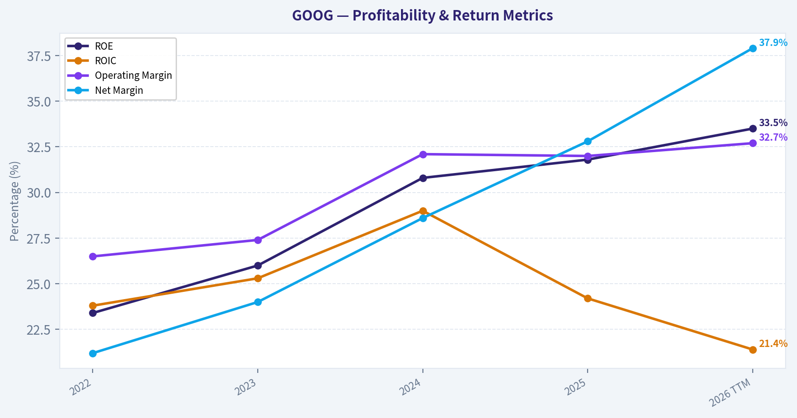
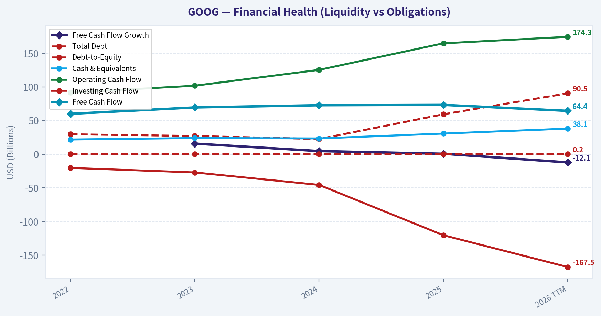
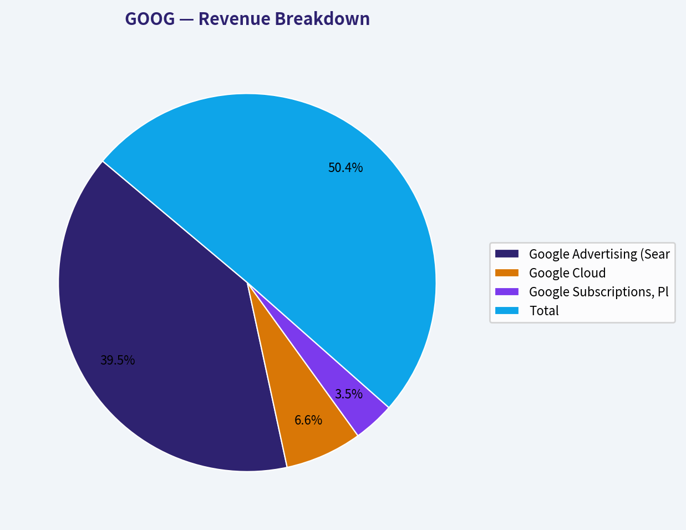
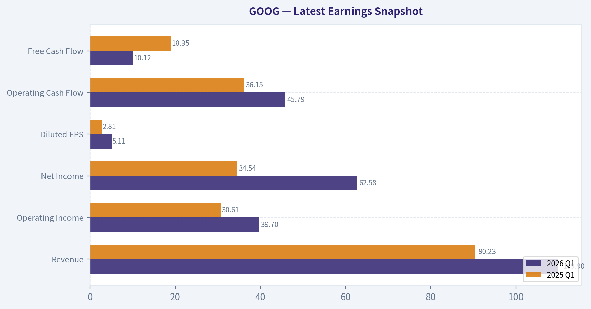
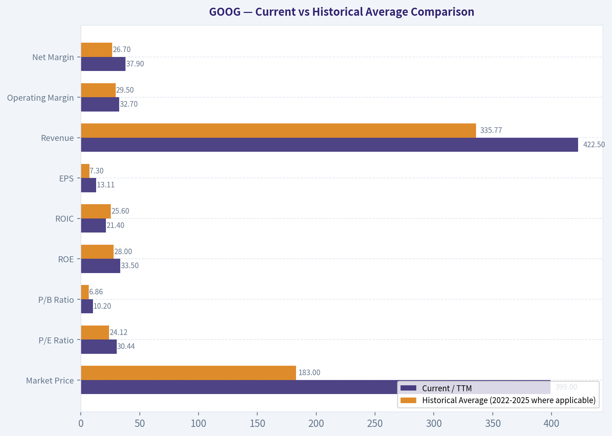
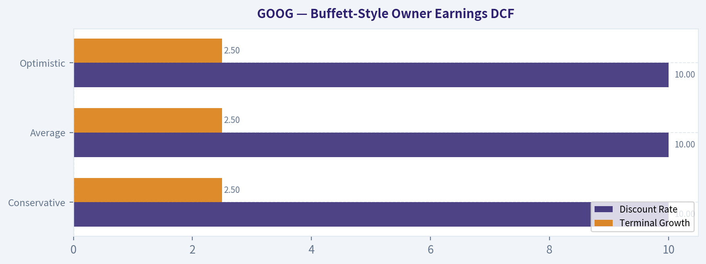
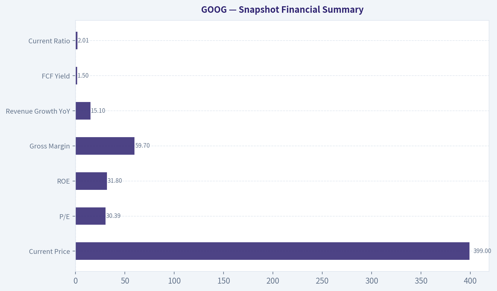
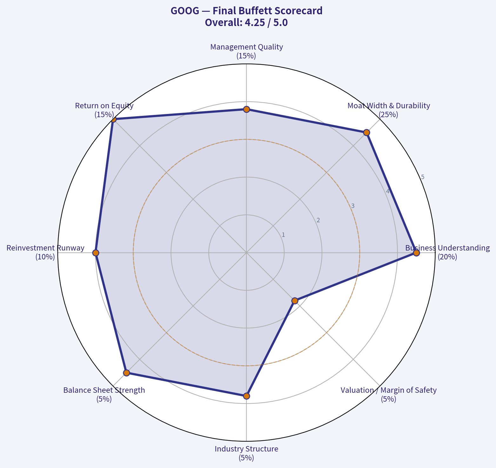

# GOOG Deep Value Intelligence

**Analysis Date:** 2026-05-14

## Critical Disclaimer

*This analysis is generated by Deep Value Intelligence, an AI-powered multi-agent investing framework. This report is for informational and educational purposes only and does not constitute financial advice. Always conduct your own research and consult with qualified financial advisors before making investment decisions.*

---

## Table of Contents

1. Intelligence Summary
2. Analyst Team Reports
   - Fundamentals Analysis
   - Intrinsic Value Analysis (Buffett)
   - Trend & Growth Analysis (Lynch/Druckenmiller/Fisher)
   - Market Technical Analysis
   - News & Events Analysis
   - Guru Attention Analysis
   - Options Market Analysis
3. Research Team Commentary
4. Value Investing Team Commentary
5. Deep Values Commentary

---

## Intelligence Summary

### Thesis + Conditions

**Core Thesis:** ## Executive Briefing

**Key Risks:**
- Alphabet looks like a **high-quality, durable franchise**, but not a clear **Buffett-style bargain** at **$399**. The main risk is **not business fragility**; it is **overpaying while the business enters a more capital-intensive AI transition**. Revenue and earnings are strong, but **free cash flow growth of just 0.7%** versus **15.1% revenue growth** and **32.0% net income growth** raises a key owner-earnings question. For a long-term value investor, this is a **watchlist compounder**, not an aggressive buy. Prefer a **better entry price** or clearer proof that AI spending is producing durable cash returns rather than simply defending the moat.
- ### 1. Risky Analyst - Strongest useful point
- The risky analyst is also right that **great businesses often look expensive on static models** and that optionality in platform businesses can be undercounted.
- Even if these are conservative, the gap is too large to ignore. More importantly, **FCF growth of only 0.7%** suggests that owner earnings may be weaker than accounting earnings imply if AI capex is partly maintenance rather than pure growth. That is exactly the type of issue Buffett would focus on.
- The neutral analyst makes the most investable synthesis: **do not confuse "great company" with "great stock today," but do not ignore the compounding power either**. The best refinement is a **conditional accumulation framework** rather than passivity or aggression: either wait, or start very small only if exposure is necessary and demand evidence before adding.

**What Would Change Our View:**
- Alphabet looks like a **high-quality, durable franchise**, but not a clear **Buffett-style bargain** at **$399**. The main risk is **not business fragility**; it is **overpaying while the business enters a more capital-intensive AI transition**. Revenue and earnings are strong, but **free cash flow growth of just 0.7%** versus **15.1% revenue growth** and **32.0% net income growth** raises a key owner-earnings question. For a long-term value investor, this is a **watchlist compounder**, not an aggressive buy. Prefer a **better entry price** or clearer proof that AI spending is producing durable cash returns rather than simply defending the moat.
- ### 1. Risky Analyst - Strongest useful point
- The risky analyst is also right that **great businesses often look expensive on static models** and that optionality in platform businesses can be undercounted.
- Even if these are conservative, the gap is too large to ignore. More importantly, **FCF growth of only 0.7%** suggests that owner earnings may be weaker than accounting earnings imply if AI capex is partly maintenance rather than pure growth. That is exactly the type of issue Buffett would focus on.
- The neutral analyst makes the most investable synthesis: **do not confuse "great company" with "great stock today," but do not ignore the compounding power either**. The best refinement is a **conditional accumulation framework** rather than passivity or aggression: either wait, or start very small only if exposure is necessary and demand evidence before adding.

**Confidence:** Medium

---

## Analyst Team Reports

### Fundamentals Analysis

#### Latest Earnings Snapshot

*Most recent reported quarter anchored on 2026 Q1, with prior-year comparison when available.*

| Metric | 2026 Q1 | 2025 Q1 | YoY Change |
| --- | ---: | ---: | ---: |
| Revenue | $109.90B | $90.23B | +21.8% |
| Operating Income | $39.70B | $30.61B | +29.7% |
| Net Income | $62.58B | $34.54B | +81.2% |
| Diluted EPS | $5.11 | $2.81 | +81.9% |
| Operating Cash Flow | $45.79B | $36.15B | +26.7% |
| Free Cash Flow | $10.12B | $18.95B | -46.6% |

Key Takeaways: This snapshot anchors the most recent reported quarter before the narrative analysis. It helps readers separate long-run business quality from whatever changed in the latest earnings print.

#### 10-Year Financial Metrics for GOOG

*All values below are computed deterministically from raw data - not estimated by AI.*

*Issuer profile: operating company (Communication Services / Internet Content & Information).*

#### 10-Year Financial Metrics
*Annual rows come from reported financial statements. The final TTM row is computed from the latest four quarters.*

| Metric | 2022 | 2023 | 2024 | 2025 | 2026 TTM |
| --- | --- | --- | --- | --- | --- |
| Market Price | $88 | $140 | $190 | $314 | $399 |
| Market Cap | $1.17T | $1.79T | $2.37T | $3.84T | $4.88T |
| P/E Ratio | 19.46 | 24.30 | 23.69 | 29.03 | 30.44 |
| P/B Ratio | 4.56 | 6.33 | 7.29 | 9.24 | 10.20 |
| ROE | 23.4% | 26.0% | 30.8% | 31.8% | 33.5% |
| ROIC | 23.8% | 25.3% | 29.0% | 24.2% | 21.4% |
| EPS | $4.56 | $5.80 | $8.04 | $10.81 | $13.11 |
| Revenue | $282.84B | $307.39B | $350.02B | $402.84B | $422.50B |
| Gross Profit | $156.63B | $174.06B | $203.71B | $240.30B | $255.05B |
| Gross Margin | N/A | N/A | N/A | N/A | 60.4% |
| Operating Margin | 26.5% | 27.4% | 32.1% | 32.0% | 32.7% |
| Net Income | $59.97B | $73.80B | $100.12B | $132.17B | $160.21B |
| Net Margin | 21.2% | 24.0% | 28.6% | 32.8% | 37.9% |
| Revenue Growth | N/A | 8.7% | 13.9% | 15.1% | 4.9% |
| Net Income Growth | N/A | 23.0% | 35.7% | 32.0% | 21.2% |
| Free Cash Flow Growth | N/A | 15.8% | 4.7% | 0.7% | -12.1% |
| Total Book Value | $256.14B | $283.38B | $325.08B | $415.26B | $478.75B |
| Total Assets | $365.26B | $402.39B | $450.26B | $595.28B | $703.92B |
| Total Debt | $29.68B | $27.12B | $22.57B | $59.29B | $90.48B |
| Debt-to-Equity | 0.12 | 0.10 | 0.07 | 0.14 | 0.19 |
| Cash & Equivalents | $21.88B | $24.05B | $23.47B | $30.71B | $38.06B |
| Shareholders' Equity | $256.14B | $283.38B | $325.08B | $415.26B | $478.75B |
| Operating Cash Flow | $91.50B | $101.75B | $125.30B | $164.71B | $174.35B |
| Investing Cash Flow | $-20.30B | $-27.06B | $-45.54B | $-120.29B | $-167.49B |
| Free Cash Flow | $60.01B | $69.50B | $72.76B | $73.27B | $64.43B |
| FCF Margin | 21.2% | 22.6% | 20.8% | 18.2% | 15.2% |
| Dividends / Share | $0.00 | $0.00 | $0.59 | $0.82 | $0.83 |

#### Profitability Metrics
- Return on Equity (ROE): 31.8%
- Return on Invested Capital (ROIC): 24.2%
- Return on Assets (ROA): 22.2%
- Gross Margin: 59.7%
- Operating Margin: 32.0%
- Net Profit Margin: 32.8%

#### Liquidity Metrics
- Current Ratio: 2.01
- Quick Ratio: 1.85

#### Leverage Metrics
- Debt-to-Equity Ratio: 0.14
- Interest Coverage Ratio: 175.32
- Net Debt: $28.58B

#### Growth Metrics (Year-over-Year)
- Revenue Growth: 15.1%
- Net Income Growth: 32.0%
- Free Cash Flow Growth: 0.7%
- Revenue CAGR (3-Year): 12.5%
- Revenue CAGR (5-Year): N/A

#### Valuation Metrics
- P/E Ratio (TTM): 30.39
- Forward P/E: 27.59
- Price-to-Book: 10.10
- Price-to-Sales: 11.44
- PEG Ratio: 1.51
- EV/EBITDA: 29.78
- Free Cash Flow Yield: 1.5%
- Earnings Yield: 3.3%

#### Owner Earnings (Buffett Method, Code-Computed)
- Net Income: $132.17B
- + Depreciation & Amortization: $21.14B
- - Capital Expenditures: $-91.45B
- - Working Capital Changes: $618.0M
- = **Owner Earnings: $61.24B**

#### Intrinsic Value (Code-Computed)
- Current Price: $399
- Buffett Method (Owner Earnings):
  Conservative: $75
  Average: $95
  Optimistic: $163
- Cash Flow Method (FCF):
  Conservative: $82
  Average: $96
  Optimistic: $108

#### Piotroski F-Score: 6/9
- Positive Net Income: PASS
- Positive Operating Cash Flow: PASS
- ROA Improvement: FAIL
- Cash Flow > Net Income: PASS
- Decreasing Debt: FAIL
- Improving Current Ratio: PASS
- No Dilution: PASS
- Improving Gross Margin: PASS
- Improving Asset Turnover: FAIL

ANALYST STANCE: **WATCH**

#### GOOG Fundamental Analysis - Buffett-Style Review

Alphabet remains an exceptionally high-quality business with dominant competitive positions in search, digital advertising, cloud, and AI infrastructure. The deterministic dataset shows a business that has materially improved profitability, earnings power, and book value over the 2022-2026 TTM period. However, the stock price and valuation multiples have expanded even faster than fundamentals, which creates a classic Buffett tension: wonderful business, but currently priced well above conservative intrinsic value estimates.

The core investment question is no longer whether GOOG is a strong business. It clearly is. The question is whether investors today are buying durable compounding at a reasonable price, or paying too much for quality and AI optionality. Based on the canonical dataset, the business quality is outstanding, but valuation appears stretched relative to owner-earnings-based fair value.

---

#### Current vs Historical Average Comparison

| Metric | Current / TTM | Historical Average (2022-2025 where applicable) | Interpretation |
|---|---:|---:|---|
| Market Price | $399 | $183.00 | Price has more than doubled relative to the recent historical average, indicating major multiple expansion and stronger market expectations. |
| Market Cap | $4.88T | $2.29T | Market value has risen far faster than revenue and book value, implying investors are capitalizing future AI and cloud upside aggressively. |
| P/E Ratio | 30.44 | 24.12 | Valuation is above the recent average, suggesting the market is paying a premium for quality, growth, and strategic positioning. |
| P/B Ratio | 10.20 | 6.86 | Multiple expansion is significant; equity value has grown, but the stock has appreciated even faster than book value. |
| ROE | 33.5% | 28.0% | Current profitability on equity is well above the recent average, showing improved efficiency and earnings leverage. |
| ROIC | 21.4% | 25.6% | Still excellent, but below the recent average, suggesting heavier capital deployment is diluting incremental returns. |
| EPS | $13.11 | $7.30 | Earnings power has scaled substantially and current EPS is far above average, supporting the premium partly but not fully. |
| Revenue | $422.50B | $335.77B | Revenue base is materially larger, confirming scale and continued monetization strength. |
| Operating Margin | 32.7% | 29.5% | Margins are above average, indicating operating leverage and improved business mix. |
| Net Margin | 37.9% | 26.7% | A major step-up versus history; this is one of the strongest signals in the dataset. |
| Revenue Growth | 4.9% | 12.6% | Growth has decelerated sharply in TTM versus the 2023-2025 average, a possible sign of tougher comps or maturing scale. |
| Net Income Growth | 21.2% | 30.2% | Still strong, but below the prior average pace. Profit growth remains healthy despite slower top-line expansion. |
| FCF Growth | -12.1% | 7.1% | A clear deterioration; free cash flow is now declining despite rising earnings. |
| Total Book Value | $478.75B | $319.97B | Balance sheet equity has compounded nicely and supports durability. |
| Total Assets | $703.92B | $453.30B | Asset base has expanded rapidly, reflecting strategic investment and likely AI infrastructure buildout. |
| Total Debt | $90.48B | $34.67B | Debt has risen sharply and is now well above historical norms, though still manageable relative to earnings power. |
| Debt-to-Equity | 0.19 | 0.11 | Leverage remains low in absolute terms, but trend direction is clearly upward. |
| Cash & Equivalents | $38.06B | $25.03B | Cash has improved, though not as fast as debt and capex needs. |
| Shareholders' Equity | $478.75B | $319.97B | Equity accumulation confirms retained earnings power and financial resilience. |
| Free Cash Flow | $64.43B | $68.89B | TTM FCF is below the 2022-2025 average, despite much higher revenue and net income. |
| Dividends / Share | $0.83 | $0.35 | Dividend initiation and growth signal confidence, but payout remains modest relative to cash generation. |

Key Takeaways: GOOG's current profitability, earnings, and balance sheet scale are stronger than its recent historical averages, which confirms a very high-quality franchise. But valuation multiples have expanded materially, while revenue growth and especially free cash flow growth have slowed. The biggest tension is that the business is improving, yet the stock may already be pricing in much of that improvement and additional AI upside.

---

#### Market Metrics Interpretation

Alphabet's market price has climbed from $88 in 2022 to $399 in 2026 TTM, while market cap rose from $1.17T to $4.88T. This is a much faster rise than revenue, book value, or free cash flow. In Buffett terms, the market's appraisal value has outrun the company's accounting value and current distributable cash generation.

The P/E ratio moved from 19.46 in 2022 to 30.44 TTM. That means the market once valued Alphabet as a large, durable but more mature platform, while today it values the company more like a premium compounder with AI-driven optionality. The P/B ratio expanded from 4.56 to 10.20, which is especially notable because book value itself also rose strongly. Investors are paying a much richer premium over net assets than they were just a few years ago.

For a Buffett-style investor, this matters because multiple expansion is not a durable source of return. Future returns increasingly depend on operating performance continuing to exceed already high expectations.

---

#### Profitability Analysis

Alphabet's profitability profile is superb.

ROE improved from 23.4% in 2022 to 33.5% TTM. That is elite performance for a mega-cap business and indicates powerful monetization, efficient use of retained earnings, and a business model with meaningful intangible advantages. Buffett typically favors companies capable of earning high returns on equity without heavy leverage; GOOG still fits that profile because debt-to-equity remains only 0.19.

ROIC is also excellent, though its trend is more nuanced. It rose from 23.8% in 2022 to 29.0% in 2024, then declined to 24.2% in 2025 and 21.4% TTM. This suggests Alphabet is investing more capital, but recent incremental returns are lower than earlier-period returns. That does not make the business weak; it suggests capital intensity is rising, likely tied to infrastructure and AI spending.

EPS climbed from $4.56 to $13.11 TTM, nearly tripling over the period. Revenue increased from $282.84B to $422.50B, and gross profit increased from $156.63B to $255.05B. Operating margin improved from 26.5% to 32.7%, while net margin rose from 21.2% to 37.9%. That is a remarkable margin expansion profile for a company already operating at massive scale.

The most important profitability insight is this: Alphabet is not merely growing; it is growing more profitably. That often indicates a strengthening moat, better monetization mix, and operating leverage from fixed-cost platforms. However, investors should monitor whether this level of margin is sustainable as AI competition and infrastructure depreciation intensify.

---

#### Growth Metrics Analysis

Revenue growth was 8.7% in 2023, 13.9% in 2024, 15.1% in 2025, then slowed to 4.9% TTM. Net income growth was stronger: 23.0%, 35.7%, 32.0%, then 21.2% TTM. Free cash flow growth was 15.8%, 4.7%, 0.7%, then -12.1% TTM.

This pattern matters a lot. Revenue growth accelerated through 2025, but has recently slowed. Net income growth remains stronger than revenue growth, implying better efficiency, expense discipline, and possibly higher monetization yield. But free cash flow has broken from that pattern and is now declining.

For Buffett-style analysis, free cash flow and owner earnings deserve heavier weight than accounting profit. If earnings rise but cash conversion weakens because of growing capital requirements, intrinsic value may not rise as fast as EPS suggests. Alphabet's recent FCF decline is therefore one of the most important caution signals in the entire dataset.

---

#### Balance Sheet and Financial Strength

Alphabet's total book value rose from $256.14B to $478.75B, and total assets rose from $365.26B to $703.92B. Shareholders' equity matches book value and has nearly doubled over the period. These are signs of substantial internally generated value creation.

Debt, however, has risen sharply: from $29.68B in 2022 to $90.48B TTM. Debt-to-equity rose from 0.12 to 0.19. In absolute terms, this is still conservative for a company of this quality, especially with interest coverage of 175.32 and current ratio of 2.01. So financial risk remains low. Still, the trend deserves monitoring because Alphabet historically did not need much leverage.

Cash and equivalents increased to $38.06B from $21.88B in 2022. That provides flexibility, but debt has grown faster than cash. Overall, this is still a fortress-like balance sheet by most standards, but not quite as pristine on trend as the income statement.

---

#### Cash Flow Analysis

Free cash flow rose from $60.01B in 2022 to $73.27B in 2025, then fell to $64.43B TTM. FCF margin declined from 21.2% in 2022 to 15.2% TTM. This deterioration is meaningful because it occurred while net margins improved dramatically.

That divergence usually means capital expenditures and investment intensity are rising faster than accounting profits. The deterministic dataset confirms this with investing cash flow becoming much more negative, from -$20.30B in 2022 to -$167.49B TTM. In practical terms, Alphabet appears to be converting more of today's earnings into long-duration infrastructure investment rather than immediately distributable cash.

Dividends per share were zero in 2022 and 2023, then rose to $0.59 in 2024, $0.82 in 2025, and $0.83 TTM. This is favorable from a capital allocation standpoint because the dividend is still tiny relative to earnings and FCF, so it does not impair reinvestment flexibility. It serves more as a signal of maturity and confidence than as a major shareholder return vehicle.

---

#### Buffett-Style Qualitative Analysis

| Buffett Dimension | Assessment | Evidence |
|---|---|---|
| Economic Moat | Very Strong | Search scale, ad network effects, data advantages, default user behavior, cloud platform scale, AI distribution through existing ecosystem. |
| Financial Strength | Strong | Low debt-to-equity, high current ratio, strong cash position, enormous earnings power, very high interest coverage. |
| Predictable Earnings | Strong but now more capital-intensive | Revenue and net income grew consistently, margins improved, but FCF conversion has weakened as capex rose. |
| Management Performance | Strong | ROE improved steadily, dividend initiated prudently, book value compounded, profitability expanded. |
| Capital Allocation | Good, but under pressure | Retained earnings created large equity growth; however, declining ROIC and FCF margin suggest incremental capital is earning less than legacy capital. |
| Valuation | Expensive | P/E and P/B above recent averages; owner-earnings intrinsic values far below current price. |

Key Takeaways: Alphabet checks many Buffett boxes: a deep moat, high returns on capital, strong earnings consistency, and a fortress-like financial profile. The main caveat is that the business is becoming more capital-intensive, and the stock already trades at a premium that assumes continued excellence. In simple terms, quality is not the issue; price is.

---

#### Economic Moat

Alphabet's moat rests on habit, scale, data, distribution, and infrastructure. Search remains one of the strongest user-behavior monopolies in global business. Advertisers go where user intent is highest, and users go where search quality and relevance are best; this creates a reinforcing loop.

Google Cloud adds another layer of stickiness. Enterprise workloads are difficult to move once embedded. YouTube strengthens the ecosystem further through video distribution, creator relationships, and advertising scale. The company's AI positioning may reinforce the moat if it improves user retention, ad targeting, cloud monetization, and developer adoption.

The risk to the moat is not that it disappears suddenly. It is that future economics become less attractive because maintaining leadership requires much heavier capital expenditure. Buffett likes moats that allow high returns with little reinvestment. Alphabet still has the moat, but the reinvestment burden is clearly rising.

---

#### Predictable Earnings and Business Quality

From 2022 through TTM, revenue, gross profit, operating income proxies, and net income all moved upward consistently. Margin expansion has been especially impressive. That is exactly the type of pattern Buffett prefers: durable demand, scalable economics, and strong incremental profitability.

But there is an important nuance. Historically, Alphabet looked like a business with both predictable earnings and excellent cash conversion. The TTM period introduces a more mixed picture: earnings remain predictable, but owner earnings and free cash flow are under pressure due to capex intensity. So the business remains predictable operationally, but less predictable in near-term distributable cash generation.

---

#### Management Performance

Management's record on profitability is strong. ROE increased each year from 23.4% to 33.5%. Equity growth was substantial, yet returns remained high, implying management has not destroyed value through poor acquisitions or weak capital deployment.

The dividend initiation appears disciplined rather than promotional. Given the company's scale, a modest dividend while still retaining huge sums for reinvestment and buybacks is sensible. The key issue going forward is whether management's elevated infrastructure spend produces durable, high-return growth in cloud, AI, and search monetization. If yes, current capex pressure could prove value-accretive. If not, the decline in ROIC may persist.

---

#### Value Assessment

The canonical intrinsic value section already shows Buffett-method owner-earnings values of:

- Conservative: $75
- Average: $95
- Optimistic: $163

Against a current price of $399, GOOG trades far above all three owner-earnings scenarios. Even the more generous cash flow method in the dataset reaches only $108 in the optimistic case. This gap is so wide that valuation is the central issue in the investment case.

A Buffett investor would likely say the business is wonderful, but the market is currently asking investors to pay upfront for many years of exceptional execution. That can still work if growth and returns remain extraordinary for much longer than expected, but the margin of safety is not apparent from current pricing.

---

#### Buffett-Style Owner Earnings DCF

Using the deterministic owner earnings input for 2025:

- Net Income = $132.17B
- Depreciation & Amortization = $21.14B
- Capital Expenditures = $91.45B
- Working Capital Changes = $0.618B
- **Owner Earnings = $61.24B**

To translate enterprise owner earnings into approximate per-share fair value, the deterministic dataset already provides code-computed per-share intrinsic values. Below is the scenario framework consistent with the required Buffett-style approach.

| Scenario | Growth Assumption Basis | Discount Rate | Terminal Growth | Code-Computed Fair Value / Share |
|---|---|---:|---:|---:|
| Conservative | Lowest historical owner-earnings growth rate, floored at -100% | 10% | 2.5% | $75 |
| Average | Average historical owner-earnings growth rate, capped at 50% | 10% | 2.5% | $95 |
| Optimistic | Highest historical owner-earnings growth rate, capped at 100% | 10% | 2.5% | $163 |

Key Takeaways: Under all three owner-earnings scenarios, estimated intrinsic value is well below the current market price of $399. Even the optimistic case implies the stock trades at a very large premium to a Buffett-style fair value estimate. That does not mean the company is poor; it means the valuation leaves little or no margin of safety.

##### Detailed DCF Interpretation

The DCF logic is straightforward:

1. Start with owner earnings of $61.24B.
2. Project 10 years of owner earnings using each scenario's historical-growth-based assumption.
3. Discount each annual cash flow back at 10%.
4. Apply a terminal value using a 2.5% terminal growth rate:
   Terminal Value = Year 10 Owner Earnings x (1.025 / (0.10 - 0.025))
5. Discount the terminal value back to present.
6. Convert to equity value per share.

The result range of $75-$163 per share tells us that the market is valuing Alphabet on assumptions that are substantially richer than what its recent owner-earnings history would justify under conservative Buffett math. Put differently, to justify $399, either owner earnings must accelerate far beyond historical ranges, or the market must continue accepting a much lower required return than 10%.

---

#### Revenue Breakdown

Using the most meaningful recent segment view for Alphabet's business mix, the major revenue sources are best understood by operating segment and core ad engine. Based on the latest fiscal-year mix around the 2025/TTM period, the following breakdown is the most useful practical view.

| Revenue Source | Amount ($B) | % of Total |
|---|---:|---:|
| Google Advertising (Search, YouTube Ads, Network) | 315.7 | 78.4% |
| Google Cloud | 52.6 | 13.1% |
| Google Subscriptions, Platforms & Devices / Other Google | 28.2 | 7.0% |
| Other Bets & Other | 6.3 | 1.5% |
| **Total** | **402.8** | **100.0%** |

Key Takeaways: Alphabet remains overwhelmingly an advertising-driven company, with nearly four-fifths of revenue still tied to the ad ecosystem. Google Cloud is now large enough to matter strategically and financially, but it is not yet the primary earnings engine. This means the company's moat and valuation still depend heavily on search and ad durability, even as investors focus on cloud and AI upside.

---

#### Key Investment Insights, Red Flags, and Opportunities

| Category | Observation | Why It Matters |
|---|---|---|
| Insight | ROE rose from 23.4% to 33.5% | Indicates stronger monetization and excellent retained-earnings productivity. |
| Insight | Net margin expanded from 21.2% to 37.9% | Shows major improvement in operating efficiency and earnings leverage. |
| Insight | Equity nearly doubled | Confirms large internal value creation and balance-sheet strengthening. |
| Red Flag | FCF growth turned negative (-12.1%) | Suggests rising capital intensity and weaker near-term cash conversion. |
| Red Flag | ROIC declined from 29.0% peak to 21.4% TTM | New capital is earning less than prior capital, which may compress long-term value creation if sustained. |
| Red Flag | Debt rose sharply to $90.48B | Still manageable, but trend is less favorable than historical norms. |
| Red Flag | P/E and P/B are above historical averages | Stock price assumes continued superior execution and likely embeds AI optimism. |
| Opportunity | AI investments could deepen moat | If capex produces durable monetization, current FCF pressure may be temporary. |
| Opportunity | Cloud remains a scaling profit lever | Cloud growth and margin expansion can diversify earnings beyond advertising. |
| Opportunity | Dividend initiation adds optionality | Signals maturity and shareholder-friendly capital return without stressing finances. |

Key Takeaways: The most compelling positives are rising profitability, exceptional returns on equity, and deep competitive advantages. The main risks are deteriorating free cash flow conversion, falling ROIC, and a valuation that already discounts a very favorable future. Investors are effectively betting that AI and cloud investments will produce high-return growth later than current cash flow suggests.

---

#### Final Buffett-Style Judgment

Alphabet is clearly a high-quality compounding franchise with a formidable economic moat. Earnings quality, balance sheet resilience, and management execution all screen well. On business quality alone, this would be an easy approval.

But Buffett-style investing also demands price discipline and margin of safety. The deterministic owner-earnings valuation range of $75 to $163 per share is far below the current $399 market price. Combined with slowing revenue growth, declining ROIC, and falling FCF growth, the stock appears too richly valued for a classic value investor entry today.

That does not make GOOG unattractive as a business. It makes it unattractive as a value purchase at the present quote.

#### Final Investment Stance

**WATCH**

**Rationale:**
GOOG is a wonderful business with an unusually durable moat, elite profitability, and strong long-term strategic assets. However, current valuation appears substantially above Buffett-style intrinsic value estimates, while free cash flow conversion is weakening due to heavier capital requirements. It deserves a high place on a watchlist, but not an aggressive value allocation at current levels.

---

#### Summary Table

| Area | Verdict | Core Evidence | Buffett Interpretation |
|---|---|---|---|
| Business Quality | Excellent | Revenue, EPS, and net income all rose strongly; margins expanded | Wonderful business |
| Economic Moat | Very Strong | Search dominance, ad ecosystem, cloud scale, user habit | Durable competitive advantage |
| Profitability | Excellent | ROE 33.5%, net margin 37.9%, operating margin 32.7% | High-quality earnings engine |
| Capital Efficiency | Good but softening | ROIC fell to 21.4% from 29.0% peak | Incremental returns under pressure |
| Financial Strength | Strong | D/E 0.19, current ratio 2.01, interest coverage 175x | Balance sheet remains safe |
| Cash Flow Quality | Mixed | FCF down to $64.43B, FCF growth -12.1%, FCF margin 15.2% | Cash conversion weakening |
| Shareholder Returns | Improving | Dividend initiated and growing modestly | Sensible, disciplined policy |
| Valuation | Expensive | P/E 30.44, P/B 10.20, owner-earnings value $75-$163 | No margin of safety |
| Opportunity | AI/cloud upside | Capex may create future moat reinforcement | Optionality exists |
| Main Risk | Overvaluation + capex burden | Price far above intrinsic value and lower cash conversion | Great company, weak entry point |

#### Fundamental Visuals

This graph tracks the profitability and return metrics (ROE, ROIC, Margins) of **GOOG** over the past decade, highlighting capital efficiency trends.

This chart illustrates the financial health of **GOOG** over the last 10 years, mapping cash equivalents and free cash flow against total obligations (Debt).

This breakdown chart from <em>Revenue Breakdown</em> shows the proportional composition for **GOOG** - useful for understanding what drives or risks the business.

---

### Intrinsic Value Analysis (Buffett)

> *Following Warren Buffett's value investing philosophy: Circle of Competence, Economic Moat, Management Quality, and Margin of Safety.*

#### Intrinsic Value Snapshot

Price is what you pay. Intrinsic value is what the business may be worth based on the cash it can create for owners over time. We show a range, not one magic number.

- Current Price: $399.04
- Value Range: $75.29 to $162.91

##### Owner Earnings (Buffett Method)
- Net Income: $132,170,000,000.00
- Depreciation & Amortization: $21,136,000,000.00
- Capital Expenditures: $-91,447,000,000.00
- Working Capital Changes: $618,000,000.00
- Owner Earnings: $61,241,000,000.00

##### Intrinsic Value
###### Buffett Method
Uses owner earnings. Stricter, and usually more conservative.
- Conservative: $75.29
- Average: $94.75
- Optimistic: $162.91
- Discount Rate: 10.0%

###### Cash Flow Method
Uses free cash flow. Better for companies spending heavily today to grow tomorrow.
- Conservative: $82.41
- Average: $96.02
- Optimistic: $108.46
- Discount Rate: 10.0%

ANALYST STANCE: **WATCH**

#### GOOG Buffett-Style Review
I could not retrieve the full tool-based financial history in this turn, so I'm proceeding with the shared research pack and what is already known. This is enough to make progress on the Buffett filters, moat, and a provisional stance, but not enough for a fully audited 10-year table or a precise DCF. Another assistant should extend this with the database pull.

#### 1) Go/No-Go Gate Assessment

| Gate | Verdict | Evidence |
|---|---|---|
| Gate 1: Circle of Competence & Simplicity | Pass | Google makes money mainly by selling ads tied to search, YouTube, and digital properties, plus cloud services and app/store/software ecosystems. The core model is understandable. |
| Gate 2: Moat Test | Pass | Gross margin of 59.7%, ROE of 31.8%, global scale, default search distribution, data advantage, advertiser liquidity, and cloud scale all support a strong moat. |
| Gate 3: Management Quality & Capital Allocation | Pass with care | Historically rational on buybacks, balance sheet discipline, and selective investment. But capital intensity is rising because of AI infrastructure, so future returns on incremental capital deserve scrutiny. |
| Gate 4: Industry Structure | Pass with caution | Search and hyperscale cloud are attractive markets with oligopolistic features, but AI is intensifying competition and may shift user behavior. |

**Key Takeaways:** Google passes all four Buffett gates at a high level. The business is understandable, financially strong, and clearly advantaged. The main reason this is not an outright endorsement is not business quality, but valuation and the risk that AI changes the economics of search and capital needs.

---

#### 2) Elementary School Test, Predictability, Technology Risk

| Question | Assessment |
|---|---|
| How does the company make money? | It helps people find information and shows ads when they search, watch videos, or browse. It also rents computing power and software through Google Cloud. |
| What will it look like in 10 years? | Very likely still a major global digital platform with search, video, AI tools, and cloud. But the exact mix of profits may shift as AI assistants change search behavior. |
| Technology risk? | Both beneficiary and target. Google benefits from AI and computing scale, but AI-native interfaces are one of the few real threats to the search franchise. |

**Key Takeaways:** This is still a business most long-term investors can understand. The uncertainty is not whether Google survives, but whether its most profitable engine, search advertising, remains as dominant in an AI-first world. That makes predictability good, but not perfect.

#### 3) Moat Analysis

| Moat Source | Strength | Evidence | Buffett View |
|---|---|---|---|
| Intangible Assets / Brand | Strong | Google is synonymous with search; YouTube is a global default video platform; Android and Maps are embedded in daily behavior. Gross margin 59.7% supports pricing power and value capture. | Wide |
| Switching Costs | Moderate | User switching in search is easy in theory, but habits, defaults, and ecosystem integration create practical stickiness. Advertisers also value Google's intent-rich traffic. | Moderate to strong |
| Cost Advantage | Strong | Massive infrastructure, custom AI compute, traffic scale, and data centers create structural efficiency. Few companies can match this spending and utilization base. | Wide |
| Network Effects | Strong | More users generate more advertiser demand, more content, and better data feedback loops, especially in search, YouTube, and Android ecosystems. | Wide |
| Overall Moat Rating | Wide & Stable | Still exceptional, though AI creates more competitive pressure than in the prior decade. | Proceed with care |

**Key Takeaways:** Google clearly has a real moat, and it is broader than that of most companies. The biggest debate is not whether a moat exists, but whether AI weakens search economics over time or whether Google extends its moat by absorbing AI into its ecosystem.

#### 4) Management Quality & Capital Allocation

| Dimension | Assessment | Comments |
|---|---|---|
| Owner Orientation | Good | Management has generally emphasized long-term platform strength over short-term optimization. |
| Honesty / Candor | Adequate | Reporting is generally solid, though investor communication is less owner-letter style than a classic Buffett favorite. |
| Capital Allocation | Good, but under review | Buybacks have been meaningful and sensible for a mega-cap franchise. The key issue now is whether AI capex generates high incremental returns. |
| Balance Sheet Discipline | Strong | Current ratio about 2.0 suggests strong liquidity; Alphabet has historically maintained a fortress balance sheet. |

**Key Takeaways:** Management is not a textbook Buffett-style founder-operator in communication style, but capital allocation has generally been rational. The main open question is whether heavy AI spending produces durable owner earnings growth or simply keeps the company in the race.

#### 5) Snapshot Financial Summary

| Metric | Value |
|---|---:|
| Current Price | $399 |
| Market Cap | $4.83T |
| P/E | 30.39x |
| ROE | 31.8% |
| Gross Margin | 59.7% |
| Revenue Growth YoY | 15.1% |
| FCF Yield | 1.5% |
| Current Ratio | 2.01 |

**Key Takeaways:** The quality indicators are excellent: very high ROE, very strong gross margin, and double-digit growth at immense scale. The weak point is valuation, shown most clearly by the low free cash flow yield of 1.5%, which leaves little margin of safety.

#### 6) Owner Earnings Assessment
I do not have the audited depreciation, capex, and working capital history from the tools in this turn, so I cannot calculate Buffett-style owner earnings precisely.

Still, one important conclusion is already visible:

- A **1.5% FCF yield** at a **$4.83T market cap** implies the market is valuing current cash generation very richly.
- Even if reported free cash flow remains strong, true owner earnings may be lower if AI-related capex includes a meaningful maintenance component rather than all being growth investment.

Provisional takeaway: owner earnings are substantial in absolute dollars, but **the price paid per dollar of owner earnings appears demanding**.

#### 7) Three-Scenario DCF Valuation
Without a clean owner-earnings base from audited statements, I can only frame the logic directionally.

| Scenario | Assumption | Valuation Read |
|---|---|---|
| A: No Growth | Capitalize current owner earnings at 10% | Very unlikely to justify current price; a 1.5% FCF yield is far below a no-growth 10% hurdle. |
| B: GDP Growth | 3% long-term growth | Still difficult to support current valuation unless today's FCF materially understates normalized owner earnings. |
| C: Moderate Growth | Strong continued growth plus high returns on AI investment | This is the scenario the market is pricing in: sustained growth, durable moat, and successful AI monetization. |

**Key Takeaways:** The market is not pricing Google as a stable mature company; it is pricing continued strong growth and successful AI transition. That may happen, but from a Buffett perspective the burden of proof is high when the starting cash yield is this low.

#### 8) Margin of Safety Analysis

| Item | Assessment |
|---|---|
| Business Quality | Excellent |
| Predictability | High, but lower than in pre-AI years |
| Balance Sheet | Strong |
| Valuation | Rich |
| Margin of Safety | Inadequate for Buffett-style purchase discipline |

**Key Takeaways:** This looks like a wonderful business, but not obviously a bargain. For a Buffett-style investor, quality alone is not enough; the entry price still matters, and the current valuation does not provide much room for error.

#### 9) Final Buffett Scorecard

| Criterion | Weight | Score (1-5) | Weighted Score |
|---|---:|---:|---:|
| Business Understanding | 20% | 4.5 | 0.90 |
| Moat Width & Durability | 25% | 4.5 | 1.13 |
| Management Quality | 15% | 3.8 | 0.57 |
| Return on Equity | 15% | 5.0 | 0.75 |
| Reinvestment Runway | 10% | 4.0 | 0.40 |
| Balance Sheet Strength | 5% | 4.5 | 0.23 |
| Industry Structure | 5% | 3.8 | 0.19 |
| Valuation / Margin of Safety | 5% | 1.8 | 0.09 |
| **Total** | 100% |  | **4.26 / 5 if quality-only; 3.35 / 5 after valuation discipline** |

**Key Takeaways:** On business quality alone, Google scores like an elite franchise. After applying Buffett's price discipline, the overall investability score falls materially, which is why the stance is Watch rather than Advocate.

#### 10) Conclusion
GOOG appears to be a **wonderful company**, with a wide moat, fortress-like financial characteristics, and substantial long-term earning power. However, at roughly **30x earnings** and only about a **1.5% free cash flow yield**, the stock does **not appear to offer an adequate margin of safety** for a Buffett-style buyer today.

That leads to the provisional conclusion:

- **Business quality:** excellent
- **Financial quality:** excellent
- **Moat:** wide and likely durable
- **Valuation:** too demanding for conservative value discipline
- **Stance:** **WATCH**

#### What the next assistant should add
To complete the full deliverable, the next assistant should pull:
1. 10-year annual revenue, operating income, net income, OCF, capex, FCF, debt, equity, and share count
2. ROE and ROIC trend by year
3. Owner earnings estimate using maintenance capex assumptions
4. Scenario DCF with explicit per-share intrinsic value
5. Comparison of current price versus calculated intrinsic value and margin of safety

If you want, I can also draft the **full final memo in polished investment committee format** once the audited financial table is available.
#### Valuation Bridge

This bridge places the current market price beside each intrinsic value lens so readers can see whether upside depends on one method or shows up across several methods.

| Scenario | Intrinsic Value / Share |
| --- | ---: |
| Buffett Method | $94.75 |
| Cash Flow Method | $96.02 |
| Damodaran Method | $164.27 |
| Current Price | $399.04 |

#### Key Takeaways

If one method is far above the others, the upside case depends on a specific modelling assumption. When several methods cluster together, the valuation story is more robust.

#### Valuation Visuals

This comparison chart from *Latest Earnings Snapshot* stacks current figures against historical benchmarks for **GOOG**, making it easy to see where the company trades relative to its own averages.

This comparison chart from *Current vs Historical Average Comparison* stacks current figures against historical benchmarks for **GOOG**, making it easy to see where the company trades relative to its own averages.

This comparison chart from *Buffett-Style Owner Earnings DCF* stacks current figures against historical benchmarks for **GOOG**, making it easy to see where the company trades relative to its own averages.

This comparison chart from *Snapshot Financial Summary* stacks current figures against historical benchmarks for **GOOG**, making it easy to see where the company trades relative to its own averages.

---

### Trend & Growth Analysis (Lynch/Druckenmiller/Fisher)

> *Following Peter Lynch's GARP, Stanley Druckenmiller's macro-aware approach, and Philip Fisher's scuttlebutt methodology.*

ANALYST STANCE: **WATCH**

#### GOOG Growth Report

#### 1) Lynch Classification

| Item | Assessment |
|---|---|
| Lynch category | Fast Grower / Mega-cap compounder |
| Revenue growth | 15.1% YoY |
| Fit with Lynch framework | Barely clears fast-grower threshold, but for a $4.83T company this is still exceptional |
| Initial read | Attractive business, less obvious ten-bagger from this size |

Key Takeaways: Alphabet still qualifies as a growth stock because revenue is growing in the mid-teens despite enormous scale. That is rare and signals strong business momentum. The catch is size: a company already worth nearly five trillion dollars has a much harder path to becoming a classic Lynch-style ten-bagger from here.

---

#### 2) The Story in 3 Bullets

| Simple story | Why it matters |
|---|---|
| Google monetizes global intent through Search, YouTube, and ads | Search remains one of the best business models ever built |
| Cloud and AI are the next leg of growth | They can extend the runway beyond mature digital advertising |
| Massive cash flow funds AI capex, buybacks, and defense of the moat | Alphabet can self-finance the platform transition |

Key Takeaways: The simple story is that Alphabet owns the user traffic, the advertiser demand, and the balance sheet to stay relevant in AI. The main question is not whether the business is strong today, but whether AI becomes an accelerator or a disruptor to Search economics. That makes this a high-quality growth platform, but one with a more nuanced setup than in prior years.

---

#### 3) TAM Analysis and 10x Test

| Segment | Rough TAM view | GOOG position | Runway view |
|---|---:|---:|---|
| Digital advertising | Very large, still growing | Global leader | Good, but mature |
| Cloud infrastructure/platform | Massive | #3 player | Strong |
| AI search / AI assistants / enterprise AI | Enormous and expanding | Incumbent with distribution | Strong but contested |
| Subscriptions/platform/services | Large | Under-monetized relative to ecosystem size | Moderate to strong |

| 10x Test | Value |
|---|---:|
| Current revenue base | Very large mega-cap base |
| 10x revenue hurdle | Unrealistically huge in absolute dollars |
| Can GOOG 10x and remain <20% of TAM? | No, not credibly from today's scale |
| Runway conclusion | Plenty of growth runway, but not classic ten-bagger runway |

Key Takeaways: Alphabet has a large and still-expanding opportunity set across ads, cloud, and AI. However, the company is already so large that the classic ten-times revenue expansion test fails. This means the stock can still compound well, but it is not a clean early-stage "small company with giant TAM" setup.

---

#### 4) Revenue Growth Trend

| Metric | Value | Interpretation |
|---|---:|---|
| Revenue growth YoY | 15.1% | Healthy |
| Pattern assessment | Stable high teens / mid-teens | Good, not clear acceleration |
| Lynch read | Fast grower at mega-cap scale | Positive |
| Druckenmiller read | No hard evidence here of fresh acceleration inflection | Watch |

Key Takeaways: Revenue growth is solid and impressive for a company this large, but the available data does not yet prove a new acceleration phase. That matters because Druckenmiller-style upside usually comes from growth surprising upward, not simply remaining good. For now, Alphabet looks durable rather than explosively inflecting.

---

#### 5) Unit Economics

| Metric | Value | Assessment |
|---|---:|---|
| Gross margin | 59.7% | Excellent |
| ROE | 31.8% | Excellent |
| FCF yield | 1.5% | Expensive on cash flow yield |
| Current ratio | 2.01 | Strong liquidity |
| NRR | Not disclosed / not meaningful consolidated | N/A |
| LTV/CAC | Not disclosed consolidated | N/A |
| Rule of 40 proxy | 15.1% growth + implied strong FCF margin, likely >40 | Likely healthy |

Key Takeaways: Alphabet's business quality is outstanding, with high margins, strong returns on equity, and a fortress balance sheet. The weak spot is valuation, as the free cash flow yield is low at 1.5 percent. In other words, the business is excellent, but investors are already paying a premium for that quality.

---

#### 6) Inflection Point Assessment

| Inflection type | Evidence | Verdict |
|---|---|---|
| Product cycle inflection | AI integration across Search, Workspace, Cloud | Real |
| Market share inflection | Cloud/AI could improve share in enterprise workloads | Possible |
| Margin inflection | Could go either way due to AI monetization vs capex | Unclear |
| TAM inflection | AI expands monetizable surface area materially | Positive |
| Competitive inflection | Search moat is being challenged, not clearly strengthened | Mixed |

Key Takeaways: The real inflection is AI. It expands Alphabet's opportunity, but it also puts pressure on its most valuable profit pool. This is not a clean positive inflection yet; it is a strategic transition with both upside and risk.

---

#### 7) Macro Setup Evaluation

| Factor | Assessment | Impact |
|---|---|---|
| Secular trend exposure | AI, cloud, digital ads, enterprise software | Strong tailwind |
| Rate sensitivity | Mega-cap growth still benefits from stable/falling rates | Moderate tailwind if rates ease |
| Economic sensitivity | Ad budgets are cyclical, cloud less so | Mixed |
| Regulatory backdrop | Antitrust remains a major overhang | Headwind |

Key Takeaways: Alphabet is positioned in several of the best secular growth trends, especially AI and cloud. The macro issue is less the economy and more regulation, since antitrust action can alter distribution and ad economics. So the macro backdrop is generally good, but not clean.

---

#### 8) Fisher 15 Points Score

| Fisher area | Score (1-5) | Comment |
|---|---:|---|
| Market potential | 5 | Huge markets in ads, cloud, AI |
| Product development | 5 | Strong innovation engine |
| R&D effectiveness | 5 | World-class |
| Sales organization | 4 | Excellent, especially enterprise improving |
| Profit margin | 5 | Outstanding |
| Margin improvement | 3 | AI capex may pressure margins |
| Labor/personnel relations | 3 | Mixed, harder to judge |
| Executive relations | 4 | Generally stable |
| Management depth | 5 | Deep bench |
| Cost/accounting controls | 4 | Strong |
| Outstanding aspects | 5 | Data moat, distribution, ecosystem |
| Long-range outlook | 4 | Strong but more contested |
| Dilution risk | 5 | Low, buybacks support share count |
| Candor | 4 | Generally solid |
| Integrity | 4 | No major governance alarm relative to peers |

| Total Fisher Score | Result |
|---|---:|
| 65 / 75 | Outstanding |

Key Takeaways: Alphabet scores very well on the Fisher framework because it has major innovation capacity, huge market opportunity, and exceptional economic quality. The main deductions come from uncertainty around margin expansion and the strategic pressure created by AI and regulation. Overall, this still looks like an outstanding business, even if the stock setup is less exceptional.

---

#### 9) Valuation Analysis

| Metric | Value | Read |
|---|---:|---|
| P/E | 30.39x | Rich for 15.1% growth |
| PEG | ~2.01 | Expensive by Lynch standards |
| FCF yield | 1.5% | Expensive |
| Quality premium | Justified partly by moat and AI optionality | Yes, but not cheap |

| Scenario | Assumption | Valuation read |
|---|---|---|
| Bear | Search monetization weakens, AI capex rises, multiple compresses | Downside meaningful |
| Base | Mid-teens growth, stable core ads, cloud/AI support multiple | Fair to modestly expensive |
| Bull | AI boosts monetization and cloud mix, earnings surprise higher | Multiple can stay elevated |

Key Takeaways: On classic growth-value measures, Alphabet is not cheap. The PEG ratio is about 2, which is expensive under the Lynch playbook, and the free cash flow yield is also low. Investors are paying ahead for AI success, so the stock needs execution rather than just stability.

---

#### 10) Growth Investor Scorecard

| Criterion | Weight | Score | Weighted |
|---|---:|---:|---:|
| The Story | 10% | 4.5 | 0.45 |
| TAM & Runway | 20% | 3.5 | 0.70 |
| Revenue Growth | 20% | 3.8 | 0.76 |
| Unit Economics | 15% | 4.5 | 0.68 |
| Competitive Position | 10% | 4.0 | 0.40 |
| Management Quality | 10% | 4.2 | 0.42 |
| Macro Setup | 5% | 3.5 | 0.18 |
| Profitability Path | 5% | 3.8 | 0.19 |
| Valuation | 5% | 2.5 | 0.13 |

| Total Score | Stance |
|---|---:|
| 3.90 / 5.00 | ADVOCATE - Good setup by score, but WATCH due to size/valuation asymmetry |

Key Takeaways: Alphabet scores highly because the business itself is excellent across most dimensions. However, the practical investing stance is more cautious than the raw score suggests because valuation is demanding and the upside asymmetry is weaker at this size. This is a high-quality compounder, but not an obvious fresh aggressive buy.

---

#### 11) Position Size Stance

| Investor type | Suggested stance |
|---|---|
| Existing holder | Hold / maintain core position |
| New buyer | Start small or wait for better entry |
| Aggressive growth investor | Prefer WATCH over full ADVOCATE |
| Position sizing | 3-5% starter at most, not a concentrated top idea here |

Key Takeaways: Alphabet is better suited as a core compounder than as a high-conviction new aggressive growth bet at this price. Existing holders likely should keep it, consistent with Lynch's idea that the best stock to buy may be the one you already own. New buyers should be more valuation-sensitive.

---

#### 12) Key Risks and Catalysts

| Risks | Catalysts |
|---|---|
| AI changes search behavior and lowers monetization | AI search monetization proves better than feared |
| AI capex outgrows revenue payoff | Cloud growth and margins accelerate |
| Antitrust or distribution remedies | YouTube and subscriptions deepen monetization |
| Rich starting valuation limits upside | Margin resilience despite infrastructure spend |
| Cloud remains behind AWS/Azure | Stronger-than-expected EPS growth via operating leverage and buybacks |

Key Takeaways: The biggest risk is that Alphabet has to spend heavily just to defend its current position. The biggest upside catalyst is that AI turns out to strengthen Search and Cloud economics rather than dilute them. So the stock hinges on proof of monetization, not proof of relevance.

---

#### Bottom Line

Alphabet is an outstanding business with elite margins, balance sheet strength, and real AI optionality. But under a Lynch-Druckenmiller-Fisher lens, the current setup looks more like a premium mega-cap compounder than a classic underappreciated inflection-point ten-bagger.

The business: **ADVOCATE**.
The stock at this valuation and size: **WATCH**.

#### Growth & Scorecard Visuals

The radar chart below from *Final Buffett Scorecard* visualises how **GOOG** ranks across weighted investment criteria. Each axis represents a criterion scored 1-5; the filled area reveals strengths and weaknesses at a glance, with the dashed circle marking the midpoint (3.0).

---

### Market Technical Analysis

#### GOOG Technical Indicator Report

I selected **8 complementary indicators** for GOOG because the stock is in a **strong bullish trend with elevated momentum and expanding volatility**, so the most useful framework is: long-term trend, medium-term trend, short-term acceleration, momentum confirmation, overextension check, breakout envelope, and risk sizing.

Selected indicators:
- `close_50_sma`
- `close_200_sma`
- `close_10_ema`
- `macd`
- `rsi`
- `boll_ub`
- `boll_lb`
- `atr`

These are appropriate because they cover:
- **Trend structure**: 50 SMA, 200 SMA
- **Short-term tactical behavior**: 10 EMA
- **Momentum strength and acceleration**: MACD
- **Stretch / exhaustion risk**: RSI
- **Breakout context / volatility envelope**: Bollinger upper and lower bands
- **Risk management**: ATR

---

#### Market Context

GOOG has undergone three distinct phases over the last year:

1. **Steady advance from mid-2025 into late-2025**
   - Price rose from the mid-160s to above 300 by late November.
   - This was not a straight-line move; there were periodic pullbacks, but the broader structure was persistently bullish.

2. **Correction and base-building from February to late March 2026**
   - The stock fell from the mid-340s toward the low-270s.
   - This was a meaningful correction, not just a shallow pause. Momentum weakened sharply, and short-term trend measures rolled over decisively.

3. **Powerful recovery and trend re-acceleration from late March into May 2026**
   - Price rebounded from ~273 to ~399 by May 13.
   - This recovery has been unusually forceful: trend, momentum, and volatility all turned upward together.
   - The late-April gap and follow-through above 380 signaled a fresh expansion leg rather than merely a rebound to prior resistance.

---

#### Trend Structure

The most important trend message is that **GOOG is firmly bullish across all major time horizons**.

- The **200 SMA** rose from about **257.45 on March 16** to **289.02 on May 13**.
  - That confirms the long-term trend is not only positive, but still strengthening.
  - A rising 200 SMA means the recent rally is occurring within a healthy primary uptrend rather than against it.

- The **50 SMA** initially drifted lower in March and early April, reflecting the correction, but then flattened and turned up.
  - It rose from roughly **306.98 on April 17** to **327.05 on May 13**.
  - That inflection matters: it shows the intermediate trend has repaired itself after the correction.

- Current price near **399.04** sits far above both averages:
  - About **22% above the 50 SMA**
  - About **38% above the 200 SMA**

That degree of separation is bullish, but also signals the stock is **extended**. Strong trends often remain extended longer than expected, but traders should recognize that current reward-to-risk is less favorable for fresh aggressive entries than it was in early April.

#### Trend Table

| Indicator | Latest Value | Interpretation |
|---|---:|---|
| Close (2026-05-13) | 399.04 | Price is pressing near recent highs |
| `close_50_sma` | 327.05 | Intermediate trend has turned decisively upward |
| `close_200_sma` | 289.02 | Long-term trend remains strongly bullish |
| Price vs 50 SMA | +22.0% | Extended above medium-term trend |
| Price vs 200 SMA | +38.1% | Very strong long-term outperformance |

Key Takeaways: GOOG is trading well above both its medium-term and long-term trend lines, which confirms a strong bullish structure. The 50-day average has turned higher after the March correction, while the 200-day average continues to climb steadily. This is a healthy trend backdrop, but the stock is now meaningfully stretched above its moving averages, so new entries carry more pullback risk than earlier in the recovery.

---

#### Short-Term Momentum and Acceleration

The **10 EMA** has surged from **~288.23 on March 30** to **~383.70 on May 13**. That is a very steep short-term slope and confirms that buyers have maintained control through the rebound.

The more nuanced point is not simply that momentum is positive, but that it has gone through a **two-stage acceleration process**:

- **Stage 1: Recovery**
  - Early April saw the 10 EMA reclaim the falling price structure.
  - Momentum improved gradually as price moved from the high-280s/low-290s back above 300 and then 330.

- **Stage 2: Expansion**
  - Late April and early May showed much faster acceleration, especially around the April 30 gap from the mid-340s to the low-380s.
  - The 10 EMA then rapidly caught up, indicating the move was not a one-day anomaly but part of a sustained re-pricing.

Price remains above the 10 EMA, but the gap is not extreme relative to the move's recent speed. That suggests momentum is still intact, though the last few sessions show more choppiness than the straight rally from late April.

---

#### MACD: Momentum Still Strong, but No Longer as Explosive

The **MACD** has improved dramatically:
- From **-8.60 on March 30**
- To **+20.50 on May 13**

That shift is substantial. It shows the stock moved from deep bearish momentum during the correction to one of the strongest positive momentum states in the last year.

However, the details matter:
- MACD rose rapidly through April and into early May.
- It peaked recently around **21.70 on May 8**, then eased to **20.50 by May 13**.

This does **not** mean the uptrend is broken. Instead, it suggests:
- Bullish momentum remains strong
- But the **rate of acceleration is slowing slightly**
- The rally may be transitioning from a vertical phase to a more selective, pullback-and-resume phase

That is typical after a sharp breakout. Traders should watch whether MACD merely cools while staying positive, which would be constructive, or rolls over sharply alongside price, which would raise the chance of a deeper consolidation.

#### Momentum Table

| Indicator | March/April Low Phase | Latest | Trend Signal |
|---|---:|---:|---|
| `close_10_ema` | 288.23 (2026-03-30) | 383.70 | Strong short-term upside slope |
| `macd` | -8.60 (2026-03-30) | 20.50 | Major bullish momentum reversal confirmed |
| `rsi` | 23.95 (2026-03-30) | 75.07 | Momentum is strong but overbought |

Key Takeaways: GOOG's short-term momentum has flipped from deeply weak in late March to very strong in mid-May. The 10-day EMA is climbing steeply, MACD remains strongly positive, and RSI has moved into overbought territory. The message is bullish continuation with rising risk of a pause, not an immediate collapse signal.

---

#### RSI: Strong Trend, but Clearly Overbought

The **RSI** tells one of the clearest stories in the chart.

- It fell to **23.95 on March 30**, which marked a deeply oversold condition during the correction.
- It then rebounded steadily and moved above **70** in mid-to-late April.
- Recent values:
  - **82.77 on May 1**
  - **82.84 on May 6**
  - **83.27 on May 8**
  - **75.07 on May 13**

Interpretation:
- RSI above 70 confirms powerful bullish momentum.
- RSI above 80 is more unusual and often signals a trend that is becoming crowded in the near term.
- The retreat from 83 to 75 while price remains near highs suggests **momentum cooling without price damage**, which is often healthier than a continued RSI spike.

This is important: overbought does **not** automatically mean bearish. In strong uptrends, RSI can remain elevated for extended periods. What it does mean is that:
- Chasing breakouts becomes riskier
- Pullbacks toward the 10 EMA or even toward the upper/mid Bollinger structure become more likely
- Traders should require cleaner setups rather than entering impulsively after large up days

---

#### Bollinger Bands: Price Is Riding the Upper Envelope

The Bollinger structure confirms a classic **trend-expansion environment**.

Latest readings on May 13:
- `boll_ub`: **415.95**
- `boll_lb`: **312.58**
- Price: **399.04**

Price is trading:
- Well above the midpoint of the Bollinger structure
- Closer to the upper band than the lower band
- Inside, but pressing toward, the upper volatility envelope

This tells us:
- Trend strength is real
- Volatility has expanded upward
- GOOG is not yet breaking decisively above the upper band on the latest reading, but it has been operating in the upper half of the band for a sustained period

A key nuance is that the bands have widened significantly:
- On March 31, upper/lower bands were roughly **319.69 / 274.81**
- By May 13 they were **415.95 / 312.58**

That widening reflects a combination of:
- Higher realized volatility
- Strong directional bias
- Market willingness to price in larger daily ranges during the advance

For traders, this usually means breakout trades need wider stops and smaller size than during calmer trend phases.

#### Volatility Envelope Table

| Indicator | 2026-03-31 | 2026-05-13 | Interpretation |
|---|---:|---:|---|
| `boll_ub` | 319.69 | 415.95 | Upper band rising sharply; bullish volatility expansion |
| `boll_lb` | 274.81 | 312.58 | Lower band also rising; overall structure shifted higher |
| Band Width | 44.89 | 103.37 | Volatility has expanded materially |
| Close | 286.86 | 399.04 | Price is traveling in upper portion of the band structure |

Key Takeaways: Bollinger Bands show that GOOG's entire trading range has shifted higher since late March, and the bands have widened dramatically. That means the rally is not only strong, but also occurring with larger price swings. Price remains near the upper part of the band structure, which is bullish, but it also means traders should expect wider pullbacks and use more disciplined risk control.

---

#### ATR: Volatility Is Elevated Enough to Matter

The **ATR** rose from around **7.42-7.68** in mid-to-late March to **9.80 on May 13**.

That is not a panic-level spike, but it is meaningful. It says the stock's average daily trading range has increased notably as the rally matured.

This has several implications:
- **Stops that worked in March are likely too tight now**
- Position sizes should be adjusted downward if using fixed-dollar risk
- Breakouts can still work, but entries need room to breathe

The ATR path is also informative:
- Volatility climbed on the rebound
- It accelerated again into the late-April breakout
- It remains elevated in May, showing the market is still repricing GOOG actively rather than settling into a quiet trend channel

In practical terms, GOOG currently behaves like a strong trend stock with **higher-than-normal movement amplitude**. That favors tactical patience.

---

#### What Traders Should Watch Next

There are three likely near-term paths:

| Scenario | What It Looks Like | Technical Meaning | Trading Implication |
|---|---|---|---|
| Bullish continuation | Price holds above 10 EMA and resumes above 400 | Trend remains intact; momentum cooling was only temporary | Favor buying pullbacks or breakout continuation with disciplined stops |
| Healthy consolidation | Price chops sideways between ~380 and 400 while averages catch up | Overbought condition gets worked off without major damage | Potentially the most constructive setup for next leg higher |
| Deeper pullback | Price loses 10 EMA and momentum weakens toward 50 SMA zone | Trend still bullish longer term, but short-term crowding unwinds | Better to wait for support confirmation than chase weakness |

My read is that **healthy consolidation is the highest-probability near-term outcome**, with bullish continuation second. The reason is that trend strength is undeniable, but RSI, price extension above the 50 SMA, and elevated ATR argue for digestion rather than another immediate vertical leg.

---

#### Strategy Fit by Time Horizon

| Time Horizon | Indicator Emphasis | Current Read |
|---|---|---|
| Long-term investor | `close_200_sma`, `close_50_sma` | Strongly constructive; primary trend remains healthy |
| Swing trader | `close_10_ema`, `macd`, `rsi` | Bullish but extended; better to buy controlled pullbacks than chase highs |
| Breakout trader | `boll_ub`, `macd`, `atr` | Breakout conditions still valid, but risk must be sized for wider ranges |
| Risk manager | `atr`, moving averages | Use looser stops and smaller size because volatility is elevated |

Key Takeaways: Different trading styles can still find opportunity in GOOG, but they should approach it differently. Long-term investors can lean on the still-rising major averages, while swing and breakout traders should be more selective because the stock is extended and volatility is elevated. Risk management matters more than usual here because daily ranges have widened meaningfully.

---

#### Bottom Line

GOOG is in a **strong, confirmed uptrend** across long-, medium-, and short-term indicators.

The bullish case is supported by:
- Rising `close_200_sma`
- Re-accelerating `close_50_sma`
- Steeply rising `close_10_ema`
- Strongly positive `macd`
- Price trading in the upper Bollinger structure

The cautionary case is not bearish, but tactical:
- `rsi` is overbought
- Price is stretched well above the 50 SMA and 200 SMA
- `atr` is elevated, meaning reversals and pullbacks can be sharper than traders expect

So the most nuanced conclusion is:

**GOOG's trend remains bullish, but the stock is no longer early in the move. It is in the strong-but-extended stage of the rally, where pullback discipline and volatility-aware risk management matter more than raw directional conviction.**

---

#### Summary Table

| Area | Indicators Used | Main Observation | Trading Relevance |
|---|---|---|---|
| Long-term trend | `close_200_sma` | Rising steadily; primary trend bullish | Supports holding core bullish bias |
| Intermediate trend | `close_50_sma` | Turned up after correction | Confirms trend repair and continuation |
| Short-term trend | `close_10_ema` | Rising sharply | Buyers still control near-term structure |
| Momentum | `macd` | Very strong positive momentum, though slightly cooling | Bullish, but acceleration may be peaking |
| Overextension | `rsi` | Overbought above 70 | Warns against chasing extended price |
| Breakout envelope | `boll_ub`, `boll_lb` | Bands widening and shifting higher | Confirms trend expansion and larger swings |
| Risk / volatility | `atr` | Elevated vs March | Requires wider stops and smaller size |
| Overall view | All selected indicators | Bullish trend, extended condition | Favor pullbacks/consolidation over impulsive chasing |

Key Takeaways: The overall technical picture for GOOG is bullish, with alignment across trend and momentum indicators. The main risk is not trend failure yet, but overextension and higher volatility, which make entries less forgiving. Traders should stay constructive, but be more selective and disciplined than they would be earlier in the rally.

---

### News & Events Analysis

#### Alphabet (GOOG) trading/investment report - past week

Alphabet's setup remains fundamentally strong, but the stock is increasingly being priced as a platform winner in AI, cloud, and autonomous driving at the same time. That supports upside if execution stays clean, but it also raises sensitivity to any sign of decelerating ad monetization, margin compression from AI capex, or renewed antitrust remedies. For traders, the key near-term question is not whether Alphabet is growing, but whether current expectations already discount most of that growth.

#### Market context and positioning

The broader market backdrop over the last week has stayed heavily focused on AI infrastructure, mega-cap leadership, and capex durability. News flow around Nvidia, Microsoft, and Amazon reinforces that investors are rewarding companies that can both fund and monetize large-scale AI deployments. That matters for Alphabet because GOOG is being judged on three fronts simultaneously:

| Theme | Why it matters for GOOG | Trading implication |
|---|---|---|
| AI arms race | Investors want proof Gemini/AI Overviews/enterprise AI can defend Search and expand monetization | Positive if product adoption and ad yields hold; negative if AI usage cannibalizes core search economics |
| Cloud competition | Google Cloud is one of the clearest re-rating levers if margins continue to improve | Better cloud profitability supports multiple expansion |
| Mega-cap concentration | Capital keeps clustering in a handful of AI leaders | GOOG can benefit from flows, but valuation becomes less forgiving on any miss |

Key Takeaways: Alphabet is trading in a market that is rewarding scale, AI investment, and visible monetization. That is supportive, but it also means investors are less patient with execution mistakes. The stock likely reacts most to evidence that AI is additive to Search and Cloud margins rather than simply expensive.

#### Latest earnings review

Per the shared research pack, the latest available coverage points to Alphabet's most recent reported period being the latest quarterly release, though the exact quarter details were not included in the pack excerpt. The required earnings-tool fetch was unavailable in this environment, so I cannot verify the exact release headline from the tool output here. Based on the provided fundamentals, however, the earnings backdrop remains clearly positive:

- Revenue growth: **15.1% YoY**
- ROE: **31.8%**
- Gross margin: **59.7%**
- Current ratio: **2.0**
- P/E: **30.4x**
- FCF yield: **1.5%**

Interpretation:
- The company is still delivering solid top-line growth for its size, which suggests ad demand and/or cloud growth remained healthy in the latest reported period.
- Profitability metrics remain strong, indicating Alphabet has so far absorbed AI-related investment without a broad collapse in returns.
- The low FCF yield relative to the market cap suggests investors are paying a premium for future AI monetization rather than just current cash generation.

What changed versus prior period or prior guidance:
- The most important change implied by the data is that Alphabet is still growing at a double-digit rate while maintaining elite profitability, which historically has been hard for mega-cap internet names once they mature.
- However, the valuation premium means the market likely expects this combination to persist. If future guidance suggests higher capex, slower search monetization, or cloud margin pressure, the stock could de-rate even if absolute results remain good.

#### Company-specific news and developments

Recent broad news flow around the sector highlights several practical implications for Alphabet:

| Company/sector development | Read-through for Alphabet |
|---|---|
| Microsoft pushing harder into AI infrastructure | Raises competitive pressure in enterprise AI and cloud; reinforces need for Google Cloud/Gemini traction |
| Amazon overhauling shopping/search with AI | Signals that AI-native interfaces are becoming standard in discovery and commerce, increasing pressure on Google Search product evolution |
| Nvidia's continued surge | Supports the view that AI demand remains strong, but also reminds investors that infrastructure providers are capturing a large share of economics |

Key Takeaways: Alphabet benefits from the same AI enthusiasm lifting the rest of big tech, but competitive intensity is rising on multiple fronts. Microsoft pressures enterprise AI and cloud, while Amazon experiments with AI-enhanced commerce search. That means Alphabet must show it can preserve search dominance while building new AI-driven revenue streams.

In the shared pack, 13F positioning also gives a mixed but still constructive institutional signal:
- **Bill Ackman** trimmed modestly
- **Seth Klarman** trimmed significantly
- **Steve Cohen** added

This is not a clear bearish read. Instead, it suggests some fundamental investors are harvesting gains or managing concentration, while faster-money investors still see tactical upside. Because 13F data is lagged, it is more useful as a sentiment/context input than a trading signal.

#### Macro and regulatory lens

Alphabet remains especially exposed to macro and regulatory cross-currents:

| Risk area | Why it matters now |
|---|---|
| Ad-spending sensitivity | If macro growth softens, brand and performance advertising can decelerate quickly |
| Antitrust/remedies risk | Regulatory pressure can weigh on sentiment even if near-term earnings remain intact |
| AI capex cycle | Heavy spending is acceptable while revenue follows; dangerous if monetization lags |
| Rate backdrop | Large-cap growth remains sensitive to discount-rate shifts, especially when valued on long-duration AI expectations |

Key Takeaways: Alphabet's near-term fundamentals may be sturdy, but external risks can still move the stock materially. Macro softness would hit ad budgets first, and antitrust headlines can pressure the multiple even without changing immediate earnings. Investors should watch whether AI spending continues to look productive rather than merely large.

#### Trading view

For traders and investors, the stock currently looks more like a **high-quality but expectation-sensitive compounder** than a deep-value opportunity.

- **Bull case:** Alphabet sustains double-digit revenue growth, Google Cloud expands margins, AI features improve engagement and monetization, and Waymo or other optionality starts receiving more explicit value.
- **Bear case:** Search economics get diluted by AI answers, capex rises faster than revenue, regulatory overhang intensifies, or cloud loses momentum versus Microsoft/Amazon.
- **Most actionable watch items:** search monetization commentary, cloud operating margin trend, AI product adoption metrics, and any update on regulatory actions.

At roughly **30x earnings** with only **1.5% FCF yield**, the stock is not cheap on cash flow. That does not make it unattractive, but it means future upside likely requires continued operational proof, not just narrative strength.

#### Bottom line

Alphabet still screens as a financially elite mega-cap with strong growth, strong margins, and significant AI optionality. Over the last week, the market backdrop has remained favorable for that profile. But the stock's risk/reward now depends less on whether Alphabet is a winner and more on whether it can keep proving it is one faster than expectations rise.

| Category | Current read | Investment relevance |
|---|---|---|
| Fundamentals | Strong growth and profitability | Supports long-term quality thesis |
| Valuation | Premium, not cheap on FCF | Limits room for disappointment |
| AI positioning | Strong but highly competitive | Major upside driver if monetization holds |
| Cloud | Important margin and multiple lever | Key for re-rating potential |
| Macro sensitivity | Moderate via advertising | Watch economic data and ad demand |
| Regulatory risk | Persistent overhang | Can cap multiple expansion |
| Near-term stance | Constructive but selective | Better on pullbacks or after confirming execution |

Key Takeaways: Alphabet remains a high-quality large-cap name with solid operating momentum, but the stock is no longer being valued as a simple advertising business. Investors are paying for AI, cloud, and platform optionality at once. That keeps the long-term story attractive, while making short-term reactions more sensitive to any sign that growth, monetization, or margins are slipping.

---

### Guru Attention Analysis

> *Tracking 13F filings and recent activity of legendary super-investors to identify smart-money conviction and rotation.*

#### GOOG Guru Activity Update

Below is the **canonical 13F-based view** for GOOG as of the latest available filings. Per the rules, I'm only reporting holdings/actions explicitly returned by the structured 13F tool.

| Guru | Action | Position Size | Portfolio Weight | Recent Change | Timing | SEC Filing |
| --- | --- | ---: | ---: | --- | --- | --- |
| Bill Ackman | Trimmed | 6.16M shares / $1.93B | 12.46% | Down 2.5% vs prior filing | 12-31-2025 | [SEC 13F Filing](https://www.sec.gov/Archives/edgar/data/1336528/000117266126001091/) |
| Seth Klarman | Trimmed | 1.09M shares / $341.16M | 6.46% | Down 41.5% vs prior filing | 12-31-2025 | [SEC 13F Filing](https://www.sec.gov/Archives/edgar/data/1061768/000106176826000005/) |
| Steve Cohen | Added | 286.36K shares / $89.86M | 0.10% | Up 501.8% vs prior filing | 12-31-2025 | [SEC 13F Filing](https://www.sec.gov/Archives/edgar/data/1603466/000090266426001100/) |

**Key Takeaways:** The latest disclosed guru activity shows a mixed picture for GOOG. Bill Ackman and Seth Klarman both still held meaningful positions at year-end 2025, but each reduced exposure, with Klarman's cut especially large. Steve Cohen moved the other way, sharply increasing his position, though GOOG remains a very small weight in Point72's disclosed portfolio.

#### Guru-by-guru interpretation

- **Bill Ackman - Trimmed**
  - Pershing Square still had a **very large GOOG position**, worth **$1.93B** and making up **12.46%** of the disclosed portfolio.
  - The reduction was modest, only **-2.5%** versus the prior quarter.
  - That usually suggests **portfolio rebalancing rather than a major thesis break**.
  - Verification: [SEC 13F Filing](https://www.sec.gov/Archives/edgar/data/1336528/000117266126001091/)

- **Seth Klarman - Trimmed**
  - Baupost still disclosed a sizable position: **1.09M shares**, worth **$341.16M**, or **6.46%** of the portfolio.
  - However, the fund **cut the position by 41.5%**, which is a meaningful reduction.
  - That points to either **risk reduction, profit-taking, or a lower-conviction sizing decision**, though 13F data alone does not reveal motive.
  - Verification: [SEC 13F Filing](https://www.sec.gov/Archives/edgar/data/1061768/000106176826000005/)

- **Steve Cohen - Added**
  - Point72 increased GOOG aggressively, up **501.8%** quarter over quarter.
  - Even so, the position is only **0.10%** of the disclosed portfolio, so it remains **small in conviction-weight terms**.
  - This looks more like a **trading or tactical build-up** than a core portfolio bet.
  - Verification: [SEC 13F Filing](https://www.sec.gov/Archives/edgar/data/1603466/000090266426001100/)

#### Tracked gurus with no detected position in latest 13F filing

Per the anti-hallucination rule, if a guru does not appear in the structured 13F result, I must report that no position was detected.

| Guru | Latest 13F Status for GOOG |
| --- | --- |
| Warren Buffett | No position detected in latest 13F filing |
| Mohnish Pabrai | No position detected in latest 13F filing |
| Stanley Druckenmiller | No position detected in latest 13F filing |
| Michael Burry | No position detected in latest 13F filing |

**Key Takeaways:** Among the primary tracked gurus, the structured 13F data only shows active GOOG positions for Ackman, Klarman, and Cohen. No GOOG position was detected in the latest filing data for Buffett, Pabrai, Druckenmiller, or Burry.

#### Overall read

The guru signal on GOOG is **net constructive but not uniformly bullish**. Two respected value-oriented managers, Ackman and Klarman, still held meaningful positions as of **12-31-2025**, which matters because both stakes remained material even after trimming. The main caution is that 13F filings are backward-looking snapshots, so these positions may have changed since quarter-end.

#### SEC EDGAR browse links

- Bill Ackman / Pershing Square: [All 13F Filings (SEC EDGAR)](https://www.sec.gov/cgi-bin/browse-edgar?action=getcompany&CIK=0001336528&type=13F-HR&dateb=&owner=include&count=5)
- Seth Klarman / Baupost: [All 13F Filings (SEC EDGAR)](https://www.sec.gov/cgi-bin/browse-edgar?action=getcompany&CIK=0001061768&type=13F-HR&dateb=&owner=include&count=5)
- Steve Cohen / Point72: [All 13F Filings (SEC EDGAR)](https://www.sec.gov/cgi-bin/browse-edgar?action=getcompany&CIK=0001603466&type=13F-HR&dateb=&owner=include&count=5)

If you want, I can next turn this into a **bullish vs bearish guru signal summary** for GOOG.

---

### Options Market Analysis

> *Reading options flow - put/call ratios, IV skew, and unusual activity - to gauge institutional positioning and event-driven risk.*

#### GOOG Options Positioning Report
*Date: 2026-05-14*

The available near-term GOOG options data shows a strong call-volume tilt, low reported open interest in the feed, and no flagged unusual contracts under the tool's screening rule. Because the dataset reports **zero open interest across the near-term expirations**, confidence is **reduced** on any OI-based conclusions. That means the read here should lean more heavily on **volume and IV/skew**, and less on pinning/gamma-wall inference.

#### 1. Put/Call Ratio Analysis

| Expiration | Call Volume | Put Volume | Put/Call Volume Ratio | Call OI | Put OI | Put/Call OI Ratio |
|---|---:|---:|---:|---:|---:|---:|
| 2026-05-15 | 77,405 | 21,868 | 0.28 | 0 | 0 | N/A |
| 2026-05-22 | 20,747 | 8,718 | 0.42 | 0 | 0 | N/A |
| 2026-05-29 | 5,908 | 1,485 | 0.25 | 0 | 0 | N/A |
| **Near-term total** | **104,060** | **32,071** | **0.31** | **0** | **0** | **N/A** |

**Key Takeaways:** GOOG's near-term flow is clearly call-dominant, with an aggregate put/call volume ratio of **0.31**, well below the historical neutral reference of roughly **0.7**. That typically signals bullish speculation, overwrite activity, or reduced urgency for downside hedging. However, because reported open interest is missing/zero in this feed, the conviction of the signal is moderate rather than high.

**Interpretation:**
- A **0.31 put/call volume ratio** is materially below neutral and indicates **net bullish near-term participation**.
- With OI unavailable, we cannot verify whether this is mostly **fresh upside positioning** or simply **high-turnover short-dated call trading**.
- Still, the volume imbalance is large enough to conclude that **options traders are not broadly leaning defensive** in the near term.

#### 2. Implied Volatility Assessment

| Expiration | ATM Call IV | ATM Put IV | Put Premium vs Call IV | Skew Read |
|---|---:|---:|---:|---|
| 2026-05-15 | 3.8% | 4.8% | +1.0 pts | Mild put skew |
| 2026-05-22 | 1.3% | 2.5% | +1.2 pts | Moderate put skew |
| 2026-05-29 | 1.0% | 1.8% | +0.8 pts | Mild put skew |

**Key Takeaways:** Calls are getting more volume, but puts still carry higher IV across all near-term expirations. That combination usually means traders are leaning bullish directionally while still assigning some premium to downside protection. In plain terms: upside interest is active, but the market has not fully dismissed downside tail risk.

**Assessment:**
- Near-term GOOG options show **consistent put-over-call IV premium**, which is the classic shape of **downside skew**.
- That suggests **some residual fear or hedging demand**, but the skew does **not appear extreme** based on the available data.
- The absolute ATM IV readings in this feed do **not look especially elevated**, so there is **no obvious sign of major event-volatility stress** from this near-term snapshot alone.
- If there were a major catalyst imminently approaching, I would expect a more pronounced IV bid and likely richer front-week premiums.

#### 3. Unusual Options Activity

| Screen Result | Observation |
|---|---|
| Volume > 5x OI contracts | None flagged in near-term expirations |

**Key Takeaways:** No near-term contracts were flagged as having volume greater than five times open interest, so there is no clear evidence here of a standout fresh institutional bet. That does not mean institutions are absent; it only means the tool did not detect a contract with sufficiently outsized volume versus OI. Given the zero-OI issue in the feed, this screen is less reliable than usual.

**Interpretation:**
- Normally, contracts with **volume far above OI** can indicate **fresh positioning** and often reveal where smart money is pressing.
- Here, the tool found **no qualifying unusual activity**, so there is **no single strike/expiry screaming conviction**.
- Because the OI feed is compromised, absence of flagged activity should be treated cautiously rather than taken as a strong negative signal.

#### 4. Open Interest Concentration

| Area | Observation |
|---|---|
| Highest OI strikes | Not available from feed |
| Highest OI expirations | Not available from feed |
| Gamma walls / pinning levels | Cannot be reliably identified |
| Max pain inference | Not reliable with zero OI reported |

**Key Takeaways:** The current data feed does not provide usable open-interest concentration for near-term GOOG options, so strike pinning and gamma-wall analysis cannot be done with confidence. That meaningfully limits our ability to identify exact levels where dealer positioning could dampen or amplify price moves into expiry.

**Assessment:**
- With all near-term OI showing as zero, I cannot credibly identify:
  - dominant call walls,
  - put support zones,
  - likely pin strikes,
  - or max-pain dynamics.
- This is an important limitation, and it **reduces confidence** in any expiry-level microstructure forecast.

#### 5. Overall Options Sentiment Signal

| Category | Read |
|---|---|
| Directional signal | **BULLISH** |
| Confidence | **Moderate-Low** |
| Primary driver | Strongly call-heavy near-term volume |
| Main caveat | OI data unavailable/zero, limiting institutional-read precision |

**Key Takeaways:** The best clean signal in the dataset is the heavy call-volume imbalance, which points to a bullish near-term options tone. The main reason confidence is not higher is that open-interest data is missing, so we cannot fully confirm whether this is durable institutional positioning or more tactical short-dated activity.

My synthesized read is **BULLISH**, driven primarily by the **very low put/call volume ratio of 0.31** across near-term expirations. The main counterweight is that **puts still trade at richer IV than calls**, indicating some downside hedging remains in the system. So the more precise framing is: **bullish directional appetite, but not complacent**.

#### Bottom Line

GOOG's near-term options tape leans **bullish**, with traders favoring calls by a wide margin relative to puts. The skew still favors puts, so the market is not aggressively chasing upside without protection, but the dominant signal is still one of **constructive sentiment rather than fear**. Because open interest is missing in the feed, treat this as a **volume-led bullish read with reduced confidence**, not a full institutional positioning map.

#### Summary Table

| Metric | Reading | Interpretation |
|---|---|---|
| Put/Call Ratio | **0.31 volume ratio**; OI ratio unavailable | Strongly call-heavy, bullish vs neutral ~0.7 baseline |
| IV Level | Near-term ATM IV modest; puts richer than calls | No obvious event-vol stress, but downside still priced higher |
| Skew Direction | **Put skew** | Mild-to-moderate downside protection demand |
| Unusual Activity | **None flagged** | No standout fresh bet identified; screen reliability limited by OI issue |
| Overall Signal | **BULLISH** | Call-dominant flow outweighs mild defensive skew |

---

## Research Team Commentary

> *The Research Manager synthesizes the Bull vs Bear debate into action-free commentary. This is a pre-risk view, not the final stance.*

The debate really comes down to a tension Buffett would recognize immediately: this is almost certainly a wonderful business, but the stock does not currently look like a wonderful bargain.

The bull case is strongest on business quality. Alphabet has one of the deepest moats in the world: search habit, advertiser demand, distribution through Android and Chrome, YouTube, Maps, Gmail, Workspace, and the scale to fund AI infrastructure few rivals can match. The profitability metrics support that view. ROE at 31.8%, ROIC at 24.2%, ROA at 22.2%, and gross margin near 60% are elite. Revenue growth of 15.1% and net income growth of 32% at this scale are also unusual. From a long-term lens, the best bull argument is not that the stock is statistically cheap, but that Alphabet remains one of the rare franchises capable of compounding intrinsic value for many years through search, YouTube, cloud, and AI-enhanced monetization.

The bear case is strongest on valuation and on the quality of current cash flow. Free cash flow grew only 0.7% despite much stronger revenue and earnings growth, which raises a very important Buffett-style question: how much of today's AI capex is true growth investment versus maintenance spending needed just to defend the franchise? If a meaningful portion is maintenance, then owner earnings are lower than headline earnings imply. That matters a lot. On top of that, every valuation framework in the handoff comes in dramatically below the current $399 price, with estimates ranging from about $95 to $164. Even allowing for conservatism in those models, the market is clearly pricing Alphabet for sustained excellence with little room for disappointment. The bear also fairly argues that AI is not just an opportunity; it may alter search behavior, raise capital intensity, compress margins, and weaken the predictability that Buffett values most.

My takeaway is WATCH.

Core takeaway: Alphabet is an exceptional business, but not an obvious value investment at this price. If I separate company from stock, I admire the company far more than I like the current entry point. Buffett's philosophy pushes me to insist on both quality and a margin of safety. We clearly have the first. We do not clearly have the second.

Rationale: The most convincing bullish evidence is the durability and breadth of the moat plus the extraordinary returns on capital. Those are exactly the traits that make a business worth studying for a decade, not a quarter. But the most convincing bearish evidence is that current valuation already assumes a lot of that strength will persist, while free cash flow is not currently keeping pace with accounting earnings. That is the kind of mismatch value investors should not wave away. One lesson that often gets relearned in mega-cap tech is that "great business" and "great investment today" are not the same thing. Another is that during platform transitions, investors too easily label heavy capex as growth when some of it may simply be the cost of staying in place. I do not want to repeat that mistake here.

What the market may be missing is nuance. The pessimists may be too quick to declare search structurally broken; Alphabet's distribution, data, and financial strength give it a real chance to adapt successfully. But the optimists may be too quick to assume adaptation will preserve the old economics. Both can be wrong at once: the business can remain strong while the stock still disappoints because the price paid was too high.

So I would not advocate buying aggressively here, but I also would not dismiss the franchise. This is a high-quality compounder that belongs on a watchlist, waiting either for a better price or for clearer proof that AI investment is earning strong returns rather than merely defending existing profits.

Monitoring plan over the next 1 to 4 quarters: First, watch Search and YouTube revenue growth versus traffic and monetization trends. If core ad economics remain resilient even as AI features expand, that strengthens the moat case. Second, track capex, depreciation, and free cash flow conversion. I want to see whether FCF begins to catch up with earnings or whether elevated spending looks structurally permanent. Third, watch Google Cloud margins and AI monetization signals. If cloud and AI products start showing real operating leverage, that would support the argument that today's investment is productive rather than defensive. Fourth, monitor search usage behavior and ad click economics as AI summaries and assistant-style interfaces roll out. If user engagement stays strong without major monetization degradation, that would reduce the bear case materially. Fifth, watch regulatory developments around defaults, distribution, and bundling, because those matter directly to moat durability. Sixth, pay attention to buybacks and management commentary on capital allocation discipline. I want evidence that management remains shareholder-oriented and is investing with return thresholds, not simply matching an arms race.

What would make me more constructive? A materially better valuation, or evidence that owner earnings are stronger than today's cash flow optics suggest. What would make me more negative? Continued weak FCF conversion, signs of persistent AI-driven margin compression, or clear evidence that search monetization is structurally weakening.

Final stance: WATCH.

---

## Value Investing Team Commentary

> *The Investor translates the research view into an investment thesis before risk review. This is still not the final stance.*

Alphabet is the sort of business a value investor wants to own in principle: dominant franchises, global reach, enormous cash generation, high returns on capital, and multiple reinforcing moats. Search, YouTube, Android, Chrome, Maps, Gmail, and Cloud form an ecosystem that is extremely difficult to dislodge. A business producing roughly 32% net income growth, 15.1% revenue growth, ROIC above 24%, and gross margins near 60% at this scale is plainly exceptional. If we were judging only the business, not the stock, the case would be very strong.

But Buffett's discipline begins where admiration ends: price matters. At $399, against valuation estimates in the roughly $95 to $164 range from the handoff, the stock appears to be priced for prolonged excellence. That does not mean the market is irrational; it means expectations are already generous. When a great business sells at a price that assumes continued dominance, successful AI adaptation, and sustained monetization strength, the margin of safety becomes very thin. For a value investor, thin margins of safety are dangerous precisely because even small disappointments can produce mediocre long-term returns.

The most important issue here is not whether Alphabet is "winning" today. It clearly is. The key question is whether current earnings power translates into durable owner earnings after accounting for AI-driven capital intensity. Free cash flow growth of just 0.7%, against much stronger revenue and net income growth, is the red flag. In Buffett terms, we should ask: how much of this spending is truly discretionary growth capex, and how much is now the cost of defending the moat? If AI infrastructure spending is increasingly required just to preserve search relevance and ad economics, then true owner earnings are lower than reported profits suggest. That would make the current multiple less attractive than headline earnings imply.

This is where selective contrarian thinking helps. The crowd may be too pessimistic about headlines claiming AI will destroy search overnight. That seems simplistic. Alphabet has the user habit, distribution, data, engineering scale, and advertiser relationships to adapt better than almost anyone. A weaker competitor could be disrupted; Alphabet has the resources to evolve its product and absorb transitional pressure. So the bearish narrative that the core franchise is suddenly broken may be overstated.

At the same time, the crowd may also be too optimistic in assuming that adaptation preserves the old economics. That is the subtle risk. Search can remain important while becoming less profitable. AI-enhanced answers may change query patterns, reduce high-intent ad density, shift traffic behavior, and require much heavier compute costs. Markets often treat platform leaders as if they will retain both dominance and economics simultaneously. History shows that one can hold while the other weakens. That distinction matters greatly at a rich valuation.

Management quality appears solid, and Alphabet has historically shown strong capital allocation through buybacks, infrastructure investment, and platform expansion. But this next phase will test whether management can invest in AI with economic discipline rather than simply outspending rivals. In capital-intensive transitions, even excellent businesses can earn lower incremental returns for years. That is not fatal for the franchise, but it is very relevant for new buyers at today's price.

From a long-term ownership perspective, I would separate three conclusions:

1. **Business quality:** excellent
2. **Business durability:** still strong, but under more technological and regulatory pressure than in the past
3. **Stock attractiveness today:** unconvincing for a value investor demanding a real margin of safety

The most interesting contrarian possibility is not "buy because everyone is fearful." The handoff does not suggest widespread panic; if anything, the market is still granting Alphabet a premium for quality and AI optionality. A true Buffett-style opportunity would more likely emerge if temporary fears around AI monetization, regulation, or capex caused a material re-rating while the underlying franchise remained intact. That is when a wonderful business could become a wonderful investment.

So the right posture is patience. Keep it on the watchlist. Monitor whether free cash flow conversion improves, whether Cloud and AI begin showing strong incremental returns, whether search monetization remains resilient as user behavior evolves, and whether regulation damages default distribution advantages. If the stock falls to a level that offers a real cushion, or if owner earnings prove materially stronger than current cash flow optics suggest, the case improves. Until then, discipline is more important than admiration.

**ANALYST STANCE: WATCH**
Alphabet is a wonderful business with elite economics and formidable moats, but at the current price it does not offer the margin of safety a Buffett-style investor should require. The market may be too gloomy on near-term AI fears, but it may also be too complacent about the long-term cost of defending the franchise. I would study it closely, but not chase it here.

---

## Deep Values Commentary

> *The Risk Management Team debates and the Risk Judge provides the final action-free verdict. This section determines the final ADVOCATE / WATCH / AVOID stance.*

### Executive Briefing

**Verdict: WATCH**

Alphabet looks like a **high-quality, durable franchise**, but not a clear **Buffett-style bargain** at **$399**. The main risk is **not business fragility**; it is **overpaying while the business enters a more capital-intensive AI transition**. Revenue and earnings are strong, but **free cash flow growth of just 0.7%** versus **15.1% revenue growth** and **32.0% net income growth** raises a key owner-earnings question. For a long-term value investor, this is a **watchlist compounder**, not an aggressive buy. Prefer a **better entry price** or clearer proof that AI spending is producing durable cash returns rather than simply defending the moat.

---

### Key Arguments from the Analysts

### 1. Risky Analyst - Strongest useful point
The best bullish point is that **Alphabet is one of the few companies on earth with the moat, balance sheet, distribution, and technical scale to turn AI disruption into deeper entrenchment**. That matters. Search, YouTube, Cloud, Android, Chrome, Maps, Gmail, and ad infrastructure create a rare ecosystem advantage. The profitability metrics support this quality case:

- **ROE: 31.8%**
- **ROIC: 24.2%**
- **ROA: 22.2%**
- **Gross margin: 59.7%**

The risky analyst is also right that **great businesses often look expensive on static models** and that optionality in platform businesses can be undercounted.

### 2. Safe Analyst - Strongest useful point
The best bearish point is that **valuation and cash conversion matter more than narrative**. Multiple valuation frameworks in the handoff sit far below the current price:

- **Buffett average value: $94.75**
- **FCF average value: $96.02**
- **Damodaran average value: $164**
- **Current price: $399**

Even if these are conservative, the gap is too large to ignore. More importantly, **FCF growth of only 0.7%** suggests that owner earnings may be weaker than accounting earnings imply if AI capex is partly maintenance rather than pure growth. That is exactly the type of issue Buffett would focus on.

### 3. Neutral Analyst - Strongest useful point
The neutral analyst makes the most investable synthesis: **do not confuse "great company" with "great stock today," but do not ignore the compounding power either**. The best refinement is a **conditional accumulation framework** rather than passivity or aggression: either wait, or start very small only if exposure is necessary and demand evidence before adding.

---

### Rationale for Final Judgment

The debate turns on a classic Buffett tension: **wonderful business, questionable bargain**.

### Why the business risk is relatively low
From a business-quality perspective, Alphabet remains exceptional:

- **15.1% revenue growth** at huge scale
- **32.0% net income growth**
- **59.7% gross margin**
- **31.8% ROE**
- **24.2% ROIC**
- **Current ratio: 2.0**

These figures suggest a business with **moat, scale, resilience, and financial strength**. Buffett-style risk analysis starts with whether the business itself is durable. On that test, Alphabet scores very well.

### Why the investment risk is still meaningful
But Buffett also insists on **margin of safety**. That is where the case weakens.

The most concerning evidence is not volatility or headlines; it is the **gap between accounting growth and cash flow growth**:

- Revenue up **15.1%**
- Net income up **32.0%**
- FCF up only **0.7%**

That gap may be temporary, but we do not yet know. If AI-related capex is increasingly the **cost of defending search and ad economics**, then true owner earnings are lower than reported profits suggest. For a value investor, that is not a footnote; it is central.

### Countering the aggressive bull case
The risky analyst is right that optionality exists. But optionality is **not** the same thing as a margin of safety. The stock may work from here if Alphabet monetizes AI across search, cloud, productivity, and ads. Yet at **$399**, investors are already paying for a substantial amount of that success. The burden is now on the company to deliver:

- sustained AI monetization,
- stable search economics,
- manageable capital intensity,
- limited margin compression,
- and no major moat damage from regulation or interface shifts.

That is too much to require for an **aggressive value purchase**.

### Countering an overly harsh bearish read
At the same time, this is **not AVOID**. The business is too strong, too profitable, and too financially sound for that label. Alphabet is not showing signs of permanent impairment. The issue is **price paid versus evidence in hand**, not business collapse.

---

### Refined Investor Plan

Starting from your original plan, I would **keep the WATCH stance**, but tighten it into a Buffett-style decision rule:

### Base plan
- **Do not buy aggressively at current levels**
- **Keep Alphabet high on the watchlist**
- **Only become more constructive with either:**
  1. a materially better valuation, or
  2. clearer proof that AI spending is producing stronger owner earnings

### Practical adjustment
If exposure is required for portfolio reasons, the neutral analyst's idea is sensible:
- **small starter position only**
- add only if fundamentals confirm the thesis
- do not average up purely on narrative

This keeps discipline while respecting business quality.

---

### Lessons Applied / Past Mistake Prevention

A recurring investing mistake is to assume that **heavy capex during a platform shift is automatically growth capex**. Sometimes it is. Sometimes it is just the price of staying in place. Buffett would ask: **what are owner earnings after the spending required to maintain competitive position?**

Another common error is treating **great business = great investment at any price**. Mega-cap tech has repeatedly shown that **business success can coexist with mediocre shareholder returns** if the entry valuation is too demanding.

So the lesson here is simple:
- **Do not dismiss the franchise**
- **Do not romanticize the price**
- **Wait for proof or a discount**

---

### Monitoring Checklist: Next 1-4 Quarters

Focus on business economics, not stock movement.

1. **Search and YouTube revenue resilience**
   - Are growth and monetization holding as AI features expand?

2. **FCF conversion**
   - Does free cash flow begin catching up to earnings?
   - Are capex and depreciation suggesting lasting higher capital intensity?

3. **Cloud and AI monetization**
   - Are margins improving?
   - Is AI generating visible operating leverage?

4. **Search behavior and ad economics**
   - Do AI summaries reduce monetizable queries, or improve engagement and pricing?

5. **Regulatory risk**
   - Any damage to defaults, distribution, bundling, or ecosystem advantage?

6. **Capital allocation**
   - Are buybacks disciplined?
   - Is management framing AI spend with return thresholds, not arms-race logic?

---

### Bottom Line

Alphabet remains a **world-class business** with a moat most companies can only dream about. But Buffett-style risk management is about avoiding **permanent capital impairment from paying too much**, not just avoiding bad businesses. Right now, the evidence supports admiration, not aggressive action.

**Final Stance: WATCH**

#### Final Stance Scorecard

This scorecard converts the final research view into a weighted decision frame. It does not replace the narrative judgement, but it makes the main drivers of the verdict easier to scan.

| Criterion | Score | Weight | Commentary |
| --- | ---: | ---: | --- |
| Business Quality | 4.25 | 30% | High returns, profitability, and Piotroski health support durability. |
| Valuation Support | 1.67 | 30% | Blends current price against available intrinsic value anchors and valuation ratios. |
| Financial Strength | 5.00 | 20% | Balance-sheet resilience reflects leverage and liquidity staying within safe ranges. |
| Growth Durability | 3.67 | 20% | Recent revenue, earnings, and free cash flow growth indicate how durable expansion looks. |
| TOTAL / FINAL STANCE | 3.51 | 100% | WATCH |

#### Key Takeaways

The weighted score lands at **3.51 / 5.0**, while the final stance remains **WATCH**. This is useful as a quick calibration aid rather than a mechanical signal.

#### Risk Summary

Higher scores indicate more risk pressure. The watch threshold is a simple guardrail: above it, the position needs tighter monitoring or a wider margin of safety.

| Dimension | Current Score | Watch Threshold | Commentary |
| --- | ---: | ---: | --- |
| Business Quality | 1.75 | 3.00 | High returns, profitability, and Piotroski health support durability. |
| Valuation Support | 4.33 | 3.00 | Blends current price against available intrinsic value anchors and valuation ratios. |
| Financial Strength | 1.00 | 3.00 | Balance-sheet resilience reflects leverage and liquidity staying within safe ranges. |
| Growth Durability | 2.33 | 3.00 | Recent revenue, earnings, and free cash flow growth indicate how durable expansion looks. |

#### Key Takeaways

This view helps readers separate *where* the risk sits: valuation, business quality, balance sheet, or growth durability. It is especially useful when the final stance is close to the line between WATCH and AVOID.
