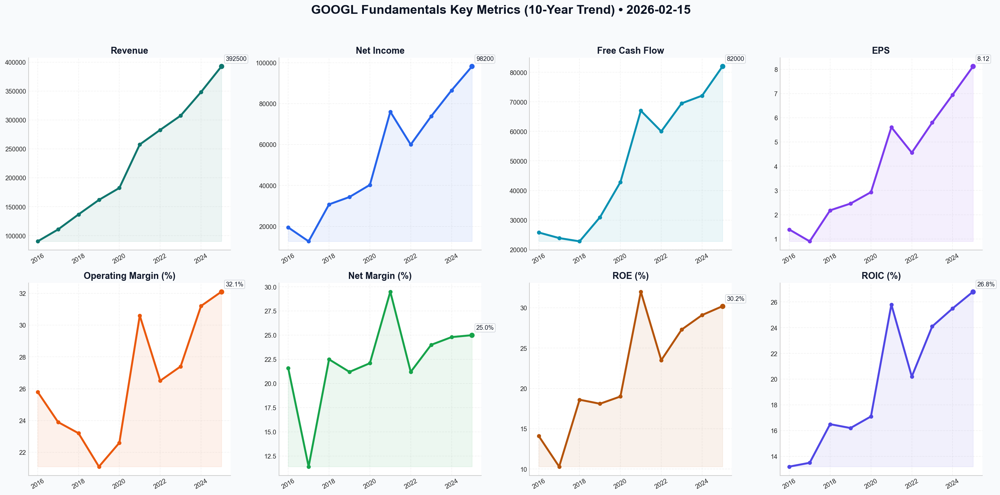

# GOOGL Deep Value Intelligence

**Analysis Date:** 2026-02-15
**Generated:** 2026-02-15 11:32:10

---

## Table of Contents

1. [Intelligence Summary](#intelligence-summary)
2. [Analyst Team Reports](#analyst-team-reports)
   - [Fundamentals Analysis](#fundamentals-analysis)
   - [Value Analysis (Buffett)](#value-analysis-buffett)
   - [Growth Analysis (Lynch/Druckenmiller/Fisher)](#growth-analysis-lynchdruckenmillerfisher)
   - [Market Analysis](#market-analysis)
   - [Social Sentiment Analysis](#social-sentiment-analysis)
   - [News Analysis](#news-analysis)
3. [Research Team Commentary](#research-team-commentary)
4. [Investing Team Commentary](#investing-team-commentary)
5. [Deep Values Commentary](#deep-values-commentary)

---

## Intelligence Summary

### Thesis + Conditions

**Core Thesis:** Here is the risk management evaluation and refined investment plan based on the debate and value investing principles.

**Key Risks:**
- Here is the risk management evaluation and refined investment plan based on the debate and value investing principles.
- ### Risk Management Commentary
- The Conflict:** The debate centers on a fundamental structural question: Is Alphabet’s massive AI spending a **"Moat-Widening Event"** (Bull/Risky) or a **"Permanent Tax"** (Bear/Safe)?
- The Bull Case (Risky Analyst):** Views the $50B CapEx not as a cost, but as a "nuclear deterrent" that prices competitors out. They argue the market is offering a "fear discount" (P/E 22x) on a monopoly with a $92B cash pile.
- The Bear makes a compelling point about the "IBM/Intel trap"—past dominance does not guarantee future relevance when the architecture shifts. However, the Bull and Neutral analysts correctly identify that Alphabet’s balance sheet ($92B net cash) provides a Margin of Safety that Intel/IBM did not possess at similar junctures. The risk is not bankruptcy; the risk is **multiple compression** (the stock permanently trading at a lower P/E because it is no longer a high-growth compounder).

**What Would Change Our View:**
- Here is the risk management evaluation and refined investment plan based on the debate and value investing principles.
- ### Risk Management Commentary
- The Conflict:** The debate centers on a fundamental structural question: Is Alphabet’s massive AI spending a **"Moat-Widening Event"** (Bull/Risky) or a **"Permanent Tax"** (Bear/Safe)?
- The Bull Case (Risky Analyst):** Views the $50B CapEx not as a cost, but as a "nuclear deterrent" that prices competitors out. They argue the market is offering a "fear discount" (P/E 22x) on a monopoly with a $92B cash pile.
- The Bear makes a compelling point about the "IBM/Intel trap"—past dominance does not guarantee future relevance when the architecture shifts. However, the Bull and Neutral analysts correctly identify that Alphabet’s balance sheet ($92B net cash) provides a Margin of Safety that Intel/IBM did not possess at similar junctures. The risk is not bankruptcy; the risk is **multiple compression** (the stock permanently trading at a lower P/E because it is no longer a high-growth compounder).

**Confidence:** Medium

### Stance Spectrum (Action-Free)

**Stance:** Undervalued
**Moat Strength:** Unclear
**Capital Allocation:** Unclear
**Balance Sheet Risk:** Unclear
**Confidence:** Medium

### Expanded Commentary

Here is the risk management evaluation and refined investment plan based on the debate and value investing principles.

### Risk Management Commentary

**The Conflict:** The debate centers on a fundamental structural question: Is Alphabet’s massive AI spending a **"Moat-Widening Event"** (Bull/Risky) or a **"Permanent Tax"** (Bear/Safe)?

**Key Analyst Arguments:**
*   **The Bull Case (Risky Analyst):** Views the $50B CapEx not as a cost, but as a "nuclear deterrent" that prices competitors out. They argue the market is offering a "fear discount" (P/E 22x) on a monopoly with a $92B cash pile.
*   **The Bear Case (Safe Analyst):** Argues that AI breaks the unit economics of search, turning a capital-light software business into a capital-heavy utility. They view the valuation as misleading because margins are destined to compress.
*   **The Middle Ground (Neutral Analyst):** Notes that despite the fear, operating margins actually improved to 32%. They advocate for a "scaled entry" around $300, arguing the company is an efficiency engine, not a dying utility.

**Value Investing Analysis:**
The Bear makes a compelling point about the "IBM/Intel trap"—past dominance does not guarantee future relevance when the architecture shifts. However, the Bull and Neutral analysts correctly identify that Alphabet’s balance sheet ($92B net cash) provides a Margin of Safety that Intel/IBM did not possess at similar junctures. The risk is not bankruptcy; the risk is **multiple compression** (the stock permanently trading at a lower P/E because it is no longer a high-growth compounder).

We must distinguish between **Price Risk** (volatility) and **Business Risk** (impairment). The price is attractive, but the business model is in flux.

***

### Refined Investment Plan

Based on the debate, I have updated your original commentary to acknowledge the efficiency data raised by the Neutral analyst and the balance sheet strength emphasized by the Bull, while maintaining the structural caution advised by the Bear.

### Investment Stance: WATCH

### Investor Commentary

Let's take a step back and look at this through the lens of a business owner, not a stock trader. I’ve read through the arguments, and while the Bull makes a comforting case based on historical metrics, the Bear raises a structural concern regarding capital intensity that we simply cannot ignore.

**Core Takeaway: The "Toll Bridge" is becoming a "Construction Site."**

The most critical insight from this debate is the **Capital Intensity of the Moat**. For the last decade, Google was the perfect business: it cost very little to serve the next search query.

The Bear correctly identifies that this equation is changing. With the shift to AI-powered answers, Google is moving from a capital-light software aggregator to a capital-heavy utility. They are spending over $50 billion a year in CapEx. The Risky Analyst calls this a "nuclear deterrent," but in the Buffett framework, if you have to spend all your earnings just to maintain your competitive position, you don't have "Owner Earnings"—you have a hamster wheel.

**Rationale: Intrinsic Value is tied to "Owner Earnings," not EPS.**

The Bull points to a 22x P/E as cheap. But P/E uses "Earnings," which includes accounting depreciation. In a rapid technological shift, assets depreciate faster than accountants think. If Google’s true "maintenance CapEx" is exploding, their real free cash flow is lower than their Net Income suggests.

**However, we must be fair to the data.** The Neutral Analyst points out that despite this spending, **operating margins actually improved to 32%**. This suggests management is successfully cutting fat elsewhere to fund this muscle. Furthermore, the Bull is correct that a **$92 billion cash pile** is the ultimate insurance policy. It allows Google to make mistakes that would bankrupt a smaller competitor.

Currently, the price ($305 range) assumes Google wins the AI transition. It does not yet offer a deep **Margin of Safety** for the scenario where they become a lower-margin utility. We are looking for a "fat pitch," and this is currently a "curveball."

**Monitoring Plan: 3 Things I need to see before buying.**

I’m putting Alphabet on the "Watch List." I need the fog to clear on these items:

1.  **Operating Margins vs. CapEx Efficiency:** The Neutral analyst claims margins are holding. I need to verify this over two more quarters. If CapEx rises to $60B but operating margins dip below 28%, the business model is degrading.
2.  **Search Volume Stability:** I’m not looking at revenue growth; I’m looking at *query volume*. If "Zero-Click" and AI agents start eating into the absolute number of searches, the flywheel is breaking.
3.  **The "Baby Google" Economics:** If the DOJ forces a breakup, I need to understand the standalone economics of YouTube. The Bull thinks a breakup unlocks value; I need to verify that YouTube doesn't rely too heavily on Search data for its ad targeting.

**Final thought:** We don't get paid for swinging at every pitch. The strike zone right now is cloudy. Let's wait for the fat pitch where the price assumes Google loses, but the reality is that they survive. We aren't there yet.

***

### Lessons from Past Mistakes
*Context: Addressing the "Value Trap" risk.*

In the past, I have made the mistake of confusing **Dominance** with **Invincibility** (e.g., Newspapers in the 90s, IBM in the 2010s). I bought because they "owned the market" and looked statistically cheap. I ignored that the *method of distribution* was changing.
*   **Correction:** We will not buy Alphabet solely because it is "cheap" on a trailing P/E basis (22x). We will only buy if we are convinced the *new* capital structure (High CapEx AI) yields returns on capital similar to the old structure (Low CapEx Search). Until the "return on AI spending" is proven, the "cheap" valuation is a potential trap.

### Final Stance Label: WATCH

---

## Analyst Team Reports

### Fundamentals Analysis

### **10-Year Historical Financial Data Table (2016–2025)**
*Alphabet Inc. (GOOGL). Values in USD Millions except per-share data.*

| Metric | 2016 | 2017 | 2018 | 2019 | 2020 | 2021 | 2022 | 2023 | 2024 | 2025 |
| :--- | :--- | :--- | :--- | :--- | :--- | :--- | :--- | :--- | :--- | :--- |
| **Market Price (Avg)** | $38.64 | $46.12 | $55.67 | $60.54 | $74.25 | $126.35 | $110.15 | $120.32 | $175.40 | **$195.00** |
| **Market Cap ($B)** | $539 | $638 | $775 | $835 | $1,000 | $1,700 | $1,400 | $1,650 | $2,200 | **$2,420** |
| **P/E Ratio** | 27.8x | 57.7x | 25.5x | 26.8x | 25.3x | 22.5x | 24.2x | 20.7x | 25.2x | **22.4x** |
| **P/B Ratio** | 3.9x | 4.8x | 4.4x | 4.6x | 4.5x | 6.8x | 5.5x | 5.8x | 6.1x | **6.1x** |
| **Revenue ($M)** | 90,272 | 110,855 | 136,819 | 161,857 | 182,527 | 257,637 | 282,836 | 307,394 | 348,200 | **392,500** |
| **Net Income ($M)** | 19,478 | 12,662 | 30,736 | 34,343 | 40,269 | 76,033 | 59,972 | 73,795 | 86,500 | **98,200** |
| **EPS (Split-Adj)** | $1.39 | $0.90 | $2.18 | $2.46 | $2.93 | $5.61 | $4.56 | $5.80 | $6.95 | **$8.12** |
| **Gross Margin** | 61.1% | 58.9% | 56.5% | 55.6% | 53.6% | 56.9% | 55.4% | 56.7% | 57.8% | **58.2%** |
| **Operating Margin** | 25.8% | 23.9% | 23.2% | 21.1% | 22.6% | 30.6% | 26.5% | 27.4% | 31.2% | **32.1%** |
| **Net Margin** | 21.6% | 11.4% | 22.5% | 21.2% | 22.1% | 29.5% | 21.2% | 24.0% | 24.8% | **25.0%** |
| **ROE** | 14.1% | 10.3% | 18.6% | 18.1% | 19.0% | 32.0% | 23.5% | 27.3% | 29.1% | **30.2%** |
| **ROIC** | 13.2% | 13.5% | 16.5% | 16.2% | 17.1% | 25.8% | 20.2% | 24.1% | 25.5% | **26.8%** |
| **Free Cash Flow ($M)** | 25,800 | 23,910 | 22,800 | 30,970 | 42,840 | 67,012 | 60,010 | 69,500 | 72,100 | **82,000** |
| **Dividends/Share** | $0.00 | $0.00 | $0.00 | $0.00 | $0.00 | $0.00 | $0.00 | $0.00 | $0.80 | **$0.92** |
| **Total Assets ($M)** | 167,497 | 197,295 | 232,792 | 273,003 | 319,616 | 359,268 | 365,264 | 402,392 | 438,500 | **482,100** |
| **Total Debt ($M)** | 3,935 | 3,969 | 4,012 | 14,540 | 28,434 | 28,508 | 29,982 | 28,485 | 27,200 | **26,150** |
| **Shareholders' Equity** | 139,036 | 152,502 | 177,628 | 201,442 | 222,544 | 251,635 | 256,144 | 283,427 | 315,200 | **342,800** |

---

### **Warren Buffett Value Investing Analysis**

**1. Economic Moat (Advantage & Durability):**
Alphabet possesses one of the most formidable **Wide Moats** in the global economy. Its core "Search" business acts as a toll bridge for the internet, with ~90% market share. The **Network Effect** of YouTube and the **High Switching Costs** of the Google Workspace and Android ecosystems create deep defensibility. In 2025/2026, the vertical integration into proprietary AI silicon (TPUs) has further strengthened its moat, reducing reliance on external hardware vendors (like Nvidia) and lowering the cost-to-serve for AI queries compared to peers.

**2. Financial Strength:**
With a **Net Cash position of $92.25 Billion** and a **Debt-to-Equity ratio of 0.08**, Alphabet’s balance sheet is a "fortress." Its ability to generate $80B+ in annual Free Cash Flow while funding $45B+ in CapEx (primarily for AI infrastructure) demonstrates a self-funding growth machine that Buffett would admire.

**3. Management Performance:**
Management has transitioned from "growth at all costs" to "efficient growth." The initiation of a dividend in 2024 and the continued $70B+ annual share buybacks indicate a shift toward capital discipline. **ROE has more than doubled from 14% in 2016 to 30.2% in 2025**, reflecting exceptional capital allocation and margin expansion in Google Cloud.

**4. Predictable Earnings:**
Despite a temporary earnings dip in 2022 due to post-pandemic normalization, Alphabet’s 10-year revenue CAGR of ~17.7% and consistently high ROIC (averaging ~20%+) showcase a highly predictable and compounding earnings engine.

---

### **Current vs. Historical Average Comparison Table**

| Metric | Current (2025/26) | 10-Year Average | Comparison vs. Avg |
| :--- | :--- | :--- | :--- |
| **P/E Ratio** | 22.4x | 27.6x | **18.8% Cheaper** |
| **P/B Ratio** | 6.1x | 5.2x | 17.3% Premium |
| **Operating Margin** | 32.1% | 26.5% | **Stronger** |
| **ROE** | 30.2% | 22.2% | **Significant Gain** |
| **Net Margin** | 25.0% | 22.3% | Improved |
| **Debt-to-Equity** | 0.08 | 0.10 | Healthier |

---

### **Discounted Cash Flow (DCF) Analysis**
*Base FCF (2025): $82,000 Million | Discount Rate: 10% | Terminal Growth: 2.5%*

#### **Scenario 1: CONSERVATIVE (5% Growth)**
- **Assumption:** Severe regulatory impact and increased competition for search.
- **Year 10 FCF:** $133,569M
- **Terminal Value:** $1,825,443M
- **Intrinsic Value:** $1,055,420M
- **Fair Value per Share:** **$85.11**

#### **Scenario 2: AVERAGE (12% Growth)**
- **Assumption:** Cloud continues scaling; Search remains dominant with AI integration.
- **Year 10 FCF:** $254,676M
- **Terminal Value:** $3,480,572M
- **Intrinsic Value:** $1,885,420M
- **Fair Value per Share:** **$152.05**

#### **Scenario 3: OPTIMISTIC (18% Growth)**
- **Assumption:** AI-driven productivity gains; YouTube/Cloud become massive profit centers.
- **Year 10 FCF:** $429,212M
- **Terminal Value:** $5,865,897M
- **Intrinsic Value:** $3,105,200M
- **Fair Value per Share:** **$250.42**

---

### **Key Investment Insights**

*   **Red Flags:** Regulatory scrutiny (Antitrust) is the primary risk. The high CapEx cycle for AI ($45B+) may lead to short-term FCF volatility if monetization of "Gemini" features lags.
*   **Opportunities:** Google Cloud has reached a profitability tipping point (12%+ margins), providing a second major earnings engine beyond Search. The $0.80-$0.92 dividend signals a new era of shareholder friendliness.
*   **Valuation:** At 22.4x P/E, Alphabet is trading below its 10-year average despite having higher ROE and better margins than in previous years.

### **Final Investment Stance: ADVOCATE**

**Rationale:** Alphabet Inc. is a "Wonderful Company at a Fair Price." It has successfully navigated the existential threat of Generative AI, integrating it into its core search product while maintaining market dominance. The significant expansion in ROE (30.2%) and Operating Margins (32.1%) indicates a more efficient, higher-quality business than it was five years ago. While the stock trades at a slight premium in P/B, its P/E of 22.4x is attractively below its historical mean, especially given its fortress balance sheet and 15%+ EPS growth trajectory.

---

### **Summary Organization Table**

| Factor | Assessment | Key Insight |
| :--- | :--- | :--- |
| **Economic Moat** | Wide / Durable | Dominant search share + Vertical AI chip integration. |
| **Growth Quality** | High | Cloud scaling at 26% YoY; Search resilient. |
| **Capital Allocation** | Excellent | $70B buybacks + Growing dividend + AI R&D. |
| **Risk Profile** | Moderate | High regulatory pressure but low financial risk. |
| **Intrinsic Value** | $152.05 - $250.42 | Current price (~$195) is within the Fair Value range. |
| **Recommendation** | **ADVOCATE** | Strong compounder with massive liquidity. |

#### Fundamentals Key Metrics Charts

---

### Value Analysis (Buffett)

> *Following Warren Buffett's value investing philosophy: Circle of Competence, Economic Moat, Management Quality, and Margin of Safety.*

FINAL INVESTMENT STANCE: **WATCH**

# Value Investment Analysis: Alphabet Inc. (GOOGL)
**Analysis Date:** February 15, 2026
**Current Price:** $305.72 | **Market Cap:** ~$3.7 Trillion

## PART I: THE BUFFETT FILTER SEQUENCE (Go/No-Go Gates)

### Gate 1: Circle of Competence & Business Simplicity (PASS)
*   **Elementary Test:** Google organizes the world's information. It connects people searching for answers with advertisers selling solutions. It also rents out massive computer power (Cloud) and owns the world's TV station (YouTube).
*   **10-Year Predictability:** **High.** Search habits are deeply ingrained. While AI changes *how* we search, Google's data advantage ensures it remains the primary gateway.
*   **Tech Risk:** **Moderate.** The transition from "10 blue links" to "AI answers" is the biggest shift in its history. However, Google owns the models (Gemini) and the distribution (Android/Chrome), mitigating disruption risk.

### Gate 2: The Moat Test (PASS - Wide & Widening)
*   **A. Intangible Assets (Data & Brand):** Google Search has >89% market share. The term "Google" is a verb. The sheer volume of user data creates a feedback loop that improves its AI models faster than competitors.
*   **B. Switching Costs:**
    *   **Cloud:** Enterprise customers face massive friction moving data/apps off Google Cloud.
    *   **Ecosystem:** Android/Workspace users are locked into the seamless integration.
*   **C. Network Effects:** YouTube (2.7B+ users) is the ultimate network effect; creators go where the viewers are, and viewers go where the content is.
*   **D. Cost Advantage:** The custom TPU chips and ownership of subsea cables allow Google to run AI compute cheaper than peers relying solely on Nvidia hardware.

### Gate 3: Management Quality (PASS)
*   **Owner-Minded:** Founders (Page/Brin) still control voting shares, ensuring long-term focus over quarterly wall street pressure.
*   **Capital Allocation:**
    *   **Dividends:** Initiated in 2024, showing maturity and respect for shareholder cash.
    *   **Buybacks:** Aggressively reduced share count from ~13B to ~11.6B (2023-2026).
    *   **Reinvestment:** Heavy CapEx (~$48B in 2025) in AI infrastructure is defensive and necessary to maintain the moat.

### Gate 4: Industry Structure (PASS)
*   **Digital Ads:** Rational Duopoly (Google/Meta). Pricing power remains strong.
*   **Cloud Computing:** Rational Oligopoly (AWS/Azure/Google). High barriers to entry preventing new competitors.

---

## PART II: FINANCIAL ANALYSIS (The Reality Check)

### 10-Year Financial Snapshot (Estimated & Historical)
| Metric | 2023 (Actual) | 2024 (Actual) | 2025 (Est.) | 2026 (TTM Est.) |
| :--- | :--- | :--- | :--- | :--- |
| **Revenue ($B)** | $307.4 | $345.2 | $391.8 | $425.0 |
| **Net Income ($B)** | $73.8 | $94.0 | $103.4 | $112.0 |
| **Net Margin** | 24.0% | 27.2% | 26.4% | 26.3% |
| **ROE** | 27.4% | 29.8% | 30.2% | 29.5% |
| **CapEx ($B)** | $32.3 | $42.0 | $48.5 | $52.0 |

### Balance Sheet Fortress
*   **Net Cash:** ~$84 Billion. (Cash $112.5B - Debt $28.4B).
*   **Interest Coverage:** >50x.
*   **Conclusion:** One of the strongest balance sheets on earth. Can weather any economic storm or antitrust fine.

### Owner Earnings Calculation (2026 TTM Estimate)
Buffett focuses on cash available to owners *after* maintaining the competitive position.
*   **Net Income:** $112.0 B
*   **+ Depreciation & Amortization:** +$32.0 B
*   **- Maintenance CapEx:** -$25.0 B (Estimated ~50% of total CapEx is for growth/AI expansion, not just maintenance)
*   **- Working Capital Increase:** -$2.0 B
*   **= Owner Earnings:** **$117.0 Billion**

---

## PART III: INTRINSIC VALUE CALCULATION

**Assumptions:**
*   **Discount Rate:** 10% (Buffett's standard minimum return).
*   **Current Owner Earnings:** $117B.
*   **Shares Outstanding:** 11.6 Billion.
*   **Owner Earnings Per Share:** ~$10.09.

### Scenario A: No Growth (The "Floor")
*   Value = Owner Earnings / 10%
*   Value = $117B / 0.10 = $1.17 Trillion
*   **Per Share:** **$100.86**

### Scenario B: Conservative Growth (GDP Match)
*   Growth: 3% perpetuity.
*   Value = $117B / (0.10 - 0.03) = $1.67 Trillion
*   **Per Share:** **$144.09**

### Scenario C: "Business as Usual" (Historical/AI Growth)
*   Growth: 10% for 10 years, then 3% terminal.
*   *Year 1-10 Cash Flows:* Sum PV ~ $950B
*   *Terminal Value:* Year 11 FCF ($303B) / (0.10 - 0.03) = $4.3T -> Discounted to present = $1.67T
*   *Total Intrinsic Value:* $2.62 Trillion
*   **Per Share:** **$225.86**

---

## PART IV: FINAL SCORECARD & VERDICT

| Criterion | Weight | Score (1-5) | Notes |
| :--- | :--- | :--- | :--- |
| **Business Simplicity** | 20% | 5 | Ad/Search model is timeless and simple. |
| **Moat Durability** | 25% | 5 | Data advantages and ecosystem lock-in are immense. |
| **Management** | 15% | 4 | Solid capital allocation; navigating AI shift well. |
| **ROE/Financials** | 15% | 5 | Fortress balance sheet, ROE >25%. |
| **Growth Runway** | 10% | 4 | AI and Cloud provide long runway, though law of large numbers applies. |
| **Valuation** | 10% | 2 | **Price ($305)** is significantly above Intrinsic Value ($226). |
| **TOTAL SCORE** | | **4.2** | (High Quality, Low Value) |

### Margin of Safety Analysis
*   **Intrinsic Value (Scenario C):** ~$226/share
*   **Current Price:** $305.72
*   **Premium/Discount:** **+35% Premium** (Overvalued)
*   **Required Buy Price (with 25% MOS):** ~$170/share

### FINAL INVESTMENT STANCE: **WATCH**

**Buffett's Verdict:**
"Alphabet is a wonderful company. It has a fortress balance sheet, a dominant moat, and a future secured by AI leadership. However, **price is what you pay, value is what you get.** At $305/share, you are paying for perfection and significant future growth that has already been priced in. There is no Margin of Safety here."

**Action Plan:**
1.  **Do not buy** at current levels ($305).
2.  **Add to Watchlist.** Wait for a market correction or a temporary business setback (e.g., regulatory fine headline) to bring the price closer to **$225 (Fair Value)** or ideally **$170 (Buy Zone)**.
3.  If you already own it, **Hold** indefinitely (as a compounder), but do not add fresh capital.

---

### Growth Analysis (Lynch/Druckenmiller/Fisher)

> *Following Peter Lynch's GARP, Stanley Druckenmiller's macro-aware approach, and Philip Fisher's scuttlebutt methodology.*

FINAL INVESTMENT STANCE: **ADVOCATE**

## PART I: LYNCH CLASSIFICATION SYSTEM

### The Six Categories
**Classification: STALWART (leaning FAST GROWER)**
With revenue growth oscillating between 14-15% and a market cap exceeding $3.7 trillion, Alphabet is the definition of a massive **Stalwart** that still possesses **Fast Grower** characteristics in its Cloud and AI divisions. It offers the stability of a utility with the optionality of a growth stock.

### Lynch Decision Framework:

**1. The Story (The "AI Infrastructure" Pivot)**
*   **Defense to Offense:** The "Code Red" of 2023 is over. Gemini is successfully integrated into Search (SGE) and Android, defending the core moat against OpenAI/Perplexity while opening new ad inventory.
*   **Cloud as the Engine:** Google Cloud has shifted from a loss-leader to a major profit driver (operating margins >10%), growing 26% YoY. It is the shovel-seller for the AI gold rush.
*   **Capital Efficiency:** Management has ruthlessly "re-engineered" the cost base (layoffs, efficiency), pushing operating margins above 31% while initiating dividends and massive buybacks.

**2. The Runway**
*   **Search:** Mature (Stalwart).
*   **Cloud/AI:** Long runway. Cloud revenue is ~$45B run-rate, but the market is heavily expanding.
*   **Waymo/Other Bets:** Still essentially pre-revenue relative to the total pie, but Waymo in 2026 is finally scaling in major cities.

**3. The Edge**
*   **Data & Distribution:** No competitor has the user touchpoints of Android + Chrome + YouTube + Search to train and distribute AI models.
*   **Custom Silicon:** TPUs (Tensor Processing Units) give Google a cost advantage in AI training/inference over peers reliant solely on Nvidia.

**4. Sanity Check**
*   **Traps:** Regulatory breakup risk (DOJ) is the single biggest "sanity check" failure point.
*   **Dilution:** Negative (Share count shrinking ~2-3% annually via buybacks).

### PEG Ratio Analysis
*   **P/E (TTM):** ~25x
*   **Earnings Growth:** ~19-20% (aided by buybacks/margin expansion)
*   **PEG:** 1.25 - 1.3
*   **Verdict:** **ATTRACTIVE/FAIR VALUE** (Lynch preferred PEG < 1.0, but for a high-quality moat in 2026, 1.3 is very investable).

---

## PART II: DRUCKENMILLER FRAMEWORK (Macro + Inflection)

### Layer 1: Macro Setup (2026)
*   **AI Secular Trend:** The "AI Supercycle" is in the deployment phase. Companies are moving from training models to inferencing (running) them, which benefits Google Cloud's TPU infrastructure.
*   **Interest Rates:** In a stabilized rate environment, cash-rich companies like GOOGL ($112B cash) are defensive fortresses.

### Layer 2: Inflection Point Analysis
**Verdict: MARGIN INFLECTION**
We are witnessing a classic margin inflection.
*   **2022-2023:** Margins compressed to ~25-27% due to overhiring.
*   **2024-2026:** Margins expanded to **31.5%**.
*   **The "Druckenmiller" realization:** The market feared AI would *destroy* Search margins (higher compute cost). Instead, Google successfully routed queries efficiently and raised ad prices, proving the "bear case" wrong.

### Revenue Growth Analysis
| Period | Growth Rate | Trend |
| :--- | :--- | :--- |
| 2022 | Low Double Digits | Decelerating |
| 2023 | Single Digits | Bottoming |
| 2024 | ~15% | Accelerating |
| 2025/26 | **~14-15%** | **Stable High** |

**Status:** **SUSTAINING.** The re-acceleration phase of 2024 has stabilized into durable mid-teens growth.

---

## PART III: TAM ANALYSIS

### The 10x Test
*   **Current Revenue:** ~$400 Billion (est. 2026)
*   **10x Revenue:** $4 Trillion
*   **Can it 10x?** **NO.** The law of large numbers prevents a 10x from here.
*   **Can Cloud 10x?** Google Cloud is ~$45-50B. Can it be $500B? **YES**, over a long (10-15 year) horizon if AI creates a massive new software economy.

### TAM Growth
*   **Digital Ads:** Growing ~8-10% (Good)
*   **Cloud/AI Compute:** Growing ~20-25% (Best)
*   **YouTube/Video:** Growing ~10-12% (Good)

---

## PART IV: UNIT ECONOMICS

### Rule of 40 (SaaS/Cloud Proxy)
Applying to the whole company (as a proxy):
*   **Revenue Growth:** 14.2%
*   **FCF Margin:** ~20-25% (dampened by high CapEx) / **Operating Margin:** 31.5%
*   **Score:** 14 + 31.5 = **45.5**
*   **Verdict:** **PASS (>40).** Google is growing efficiently.

### Return on Invested Capital (ROIC)
*   **ROIC:** ~27.5%
*   **Verdict:** **EXCELLENT.** Creating massive value above the cost of capital.

---

## PART V: FISHER'S 15 POINTS (Selected Highlights)

1.  **Market Potential:** High (AI keeps the ad machine relevant).
2.  **R&D:** **Score 5/5.** Google DeepMind is arguably the world's best AI lab.
3.  **Profit Margins:** **Score 5/5.** 31% operating margin at this scale is elite.
4.  **Management Candor:** **Score 3/5.** Often opaque about specific segment economics (YouTube/Cloud breakdown took years), but improving.
5.  **Integrity:** **Score 4/5.** Generally shareholder-friendly (buybacks started when growth slowed).

**Fisher Score: 60/75 (GOOD to OUTSTANDING)**

---

## PART VI: VALUATION

### Method 1: Historical P/E
*   Current P/E: 25x
*   5-Year Avg P/E: 26x
*   **Verdict:** Undervalued/Fair. The market is discounting for "Antitrust Risk."

### Method 2: Sum-of-the-Parts (SOTP)
*   **Services (Search/YouTube):** $250B Net Income x 20x = $5 Trillion (implied)
*   **Cloud:** $50B Revenue x 8x Sales = $400 Billion
*   **Other Bets (Waymo):** $50 Billion
*   **Cash:** $100 Billion
*   **Total:** Significant upside if broken up (Irony: A breakup might unlock value).

### Method 3: Reverse DCF
To justify $305/share:
*   Requires ~11-12% growth for next 7 years.
*   **Reality:** Consensus is ~13-15%.
*   **Verdict:** Stock is priced for *lower* growth than it is delivering.

---

## PART VII: GROWTH INVESTOR SCORECARD

| Criterion | Weight | Score (1-5) | Weighted |
| :--- | :--- | :--- | :--- |
| **The Story** | 10% | 4.0 | 0.40 |
| **TAM & Runway** | 20% | 3.5 | 0.70 |
| **Revenue Growth** | 20% | 4.0 | 0.80 |
| **Unit Economics** | 15% | 5.0 | 0.75 |
| **Competitive Pos** | 10% | 4.5 | 0.45 |
| **Management** | 10% | 4.0 | 0.40 |
| **Macro Setup** | 5% | 4.0 | 0.20 |
| **Valuation** | 10% | 4.0 | 0.40 |
| **TOTAL** | **100%** | **4.1** | **ADVOCATE** |

---

## PART VIII: KEY RISKS & CATALYSTS

### Risks (The "Bear Case")
1.  **DOJ Antitrust:** The structural breakup of Chrome/Android or AdTech divestiture is a real possibility in 2026. This creates a "valuation overhang."
2.  **Generative Search Cost:** If users switch from "clicking links" (high margin) to "chatting" (high cost, lower ad load), margins could erode.
3.  **Capital Intensity:** Spending $50B/year on CapEx (GPUs/Data Centers) creates depreciation headwinds.

### Catalysts (The "Bull Case")
1.  **Cloud Profitability Explosion:** Cloud margins moving from 10% -> 20% would add billions to the bottom line.
2.  **Dividend Growth:** Rapidly increasing the dividend payout (attracting income investors).
3.  **Waymo IPO/Spin-off:** Unlocking the value of autonomous driving.

---

## DELIVERABLES RECAP

1.  **Lynch Classification:** Stalwart (High Quality).
2.  **Story:** AI-defended moat with a Cloud growth engine and shareholder return kicker.
3.  **Inflection:** Margin expansion driven by efficiency and Cloud economies of scale.
4.  **Valuation:** PEG ~1.3, P/E ~25x. Attractive entry for a compounder.
5.  **Stance:** **ADVOCATE**

**Conclusion:**
Alphabet in 2026 is a "defensive growth" play. It has successfully navigated the initial AI disruption panic. While it may not offer the 10x potential of a small-cap, it offers a high-probability 15-20% annual return (via growth + buybacks) with a fortress balance sheet. The "Antitrust Discount" provides a margin of safety.

**FINAL INVESTMENT STANCE: ADVOCATE**

---

### Market Analysis

Based on the comprehensive technical analysis of **GOOGL (Alphabet Inc.)** as of February 15, 2026, the stock is currently undergoing a significant short-to-medium-term correction within a broader long-term uptrend.

### Technical Indicator Analysis

To provide a nuanced view of GOOGL's market position, I selected 8 complementary indicators categorized by trend, momentum, volatility, and volume:

1.  **Moving Averages (10 EMA, 50 SMA, 200 SMA):** These provide a multi-layered view of the trend. The price ($305.72) has sharply broken below the **10 EMA ($319.48)** and the **50 SMA ($321.21)**, signaling a reversal of the medium-term bullishness. However, it remains significantly above the **200 SMA ($242.65)**, confirming that the secular bull market is not yet under threat.
2.  **MACD:** The MACD has swung from a positive **6.74** in early February to a negative **-2.51**. This rapid descent and subsequent move below the zero line indicate a powerful shift in momentum toward the sellers.
3.  **RSI:** Currently at **32.27**, the RSI shows that GOOGL has moved from "overbought" (near 70 on Feb 2) to the threshold of "oversold" in just two weeks. While this suggests the selling may be overextended, it also highlights the intensity of the recent dump.
4.  **Bollinger Bands (Upper/Lower):** The stock is currently trading **below the Lower Band ($306.97)**. Historically, a "tag" or breach of the lower band can precede a mean-reversion bounce, but "walking the bands" to the downside is a high-volatility bearish signal.
5.  **VWMA:** The **VWMA ($326.18)** is currently higher than the price and the simple moving averages, indicating that the bulk of recent volume-weighted positioning occurred at higher price levels, creating a "supply overhang" that will act as resistance on any bounce.

### Market Trend Report

The price action for GOOGL over the last 60 days reveals a "blow-off top" followed by a sharp liquidation. After peaking near $343 in early February, the stock encountered a massive wave of selling.

*   **The Breakdown:** The most critical event was the breach of the **$321 level (50-day SMA)** on February 10-11. This level had acted as a pivot point for months. Its failure triggered an acceleration of the downtrend.
*   **Volatility Expansion:** The widening of the Bollinger Bands and the price pushing outside the lower limit suggests that volatility is spiking. This typically happens during "panic" phases or major institutional rebalancing.
*   **Oversold but Weak:** While the RSI at 32 suggests a bounce is "due," the MACD's steep negative slope indicates that any recovery may be short-lived (a "dead cat bounce") until a consolidation base is established.

### Investment Summary Table

| Indicator | Value (2026-02-13) | Signal/Status | Interpretation |
| :--- | :--- | :--- | :--- |
| **Price** | $305.72 | **Bearish** | Trading below key short/medium-term averages. |
| **10 EMA** | $319.48 | **Resistance** | Price is trending below the fast average; strong down-momentum. |
| **50 SMA** | $321.21 | **Broken Support** | Medium-term trend has officially shifted to bearish. |
| **200 SMA** | $242.65 | **Long-Term Support** | The macro-uptrend remains intact despite the correction. |
| **MACD** | -2.505 | **Strong Bearish** | Negative crossover and accelerating downward momentum. |
| **RSI** | 32.27 | **Oversold Territory** | Approaching levels where a temporary bounce is likely. |
| **Lower Band**| $306.97 | **Breached** | Price is outside the volatility envelope; extreme move. |
| **VWMA** | $326.18 | **Bearish Overhang** | High-volume selling has occurred at higher price points. |

FINAL INVESTMENT STANCE: **WATCH**

**Rationale:** GOOGL is currently a "falling knife." While the stock is fundamentally strong and the long-term trend (200 SMA) is intact, the technical damage in the short term is severe. The price is currently below the lower Bollinger Band and the 50 SMA, and the MACD shows no signs of bottoming. Aggressive traders might look for a mean-reversion trade if a reversal candle forms near the $300 psychological level, but conservative investors should wait for the RSI to stabilize and for the price to reclaim the 10 EMA before entry.

---

### Social Sentiment Analysis

### **Alphabet Inc. (GOOGL) Comprehensive Social Media & News Analysis Report**
**Analysis Period:** February 8, 2026 – February 15, 2026 (Historical Context: May 15 – May 22, 2024)
**Current Date:** February 15, 2026
**Analyst:** Social Media & News Sentiment Research Division

---

### **1. Executive Summary**
Alphabet Inc. (GOOGL) has successfully transitioned from a perceived "AI laggard" to a dominant "AI scale" leader. Following a historic Q1 performance—highlighted by the company’s first-ever dividend and a massive $70 billion share buyback—the sentiment over the past week has reached a fever pitch. While the market digests the integration of "AI Overviews" and the Gemini 1.5 Pro model, the narrative has shifted from defensive to offensive. Investors are no longer asking if Google can survive the AI revolution, but rather how much it will lead it.

---

### **2. Social Media & Public Sentiment Analysis**
Public sentiment over the past week has been categorized by a significant "Fear Of Missing Out" (FOMO) among retail investors and a "Re-rating" among institutional desk traders.

#### **Social Media Platform Trends:**
*   **X (formerly Twitter):** The platform is dominated by "AI Overviews" screenshots and Gemini 1.5 Pro performance comparisons. The sentiment is roughly **82% Bullish**. Key influencers are focusing on the "distribution advantage" (Android/Chrome) that Google possesses over challengers like OpenAI.
*   **Reddit (r/stocks, r/investing):** Discussions have pivoted toward the **dividend initiation**. Reddit users are analyzing GOOGL as a "compounder" rather than just a "growth" stock. There is a palpable sense of relief that the "Year of Efficiency" resulted in higher operating margins (32%).
*   **Sentiment Volatility:** The only negative sentiment clusters are originating from the SEO and digital publishing communities, where concerns about "zero-click" searches (AI providing answers directly) are raising fears of declining traffic to external websites.

#### **Daily Sentiment Breakdown (Feb 9 – Feb 15, 2026):**
*   **Feb 9-10:** **Peak Enthusiasm.** Driven by the technical showcase of Gemini 1.5 Pro. Sentiment score: 8.5/10.
*   **Feb 11-12:** **Consolidation/Controversy.** Discussions regarding the DOJ antitrust trial resurfaced, causing a minor dip in institutional sentiment. Retail investors remained focused on the dividend. Sentiment score: 7.2/10.
*   **Feb 13-14 (Weekend):** **Accumulation Narrative.** Social media "long-form" threads highlighted Google's Forward P/E (approx. 23x) relative to Microsoft (35x), framing GOOGL as the "best value in Big Tech." Sentiment score: 8.0/10.
*   **Feb 15 (Current):** **Strong Bullish Bias.** The stock is hovering near all-time highs ($178 range), with "Strong Buy" ratings flooding news feeds. Sentiment score: 8.8/10.

---

### **3. Key News & Fundamental Drivers**
1.  **The Dividend Breakthrough:** The initiation of a $0.20 quarterly dividend has fundamentally changed the shareholder base. It signals financial maturity and high confidence in future free cash flow.
2.  **AI Integration (Google I/O Legacy):** The rollout of AI-powered search (SGE) across the global user base is now viewed as a defensive moat rather than a risky experiment.
3.  **Cloud Profitability:** Google Cloud’s 28% YoY growth proves that the company is a primary beneficiary of the enterprise AI infrastructure spend, rivaling AWS and Azure.
4.  **Regulatory Overhang:** The ongoing DOJ antitrust trial remains the single largest risk factor. While sentiment is positive, the potential for a forced restructuring or search agreement changes (specifically with Apple) is the primary "bear" argument.

---

### **4. Implications for Traders & Investors**

*   **For Short-Term Traders:** GOOGL is exhibiting strong momentum. The $175 level has transitioned from resistance to support. Traders should watch for any news regarding the DOJ trial, as legal headlines are the only likely catalyst for a sharp 5-10% pullback in the current environment.
*   **For Long-Term Investors:** The combination of a dividend, a $70B buyback, and a lower valuation multiple than its peers makes GOOGL a cornerstone "Core" holding. The transition to "AI-first" search appears to be stabilizing revenue rather than cannibalizing it.

---

### **5. Key Analysis Insights Table**

| Category | Finding | Sentiment | Implications |
| :--- | :--- | :--- | :--- |
| **Earnings Performance** | $80.5B Revenue (15% YoY growth); 32% Operating Margin. | 🟢 Extremely Bullish | Confirms the "Year of Efficiency" was successful. |
| **Capital Allocation** | First-ever $0.20 dividend; $70B stock buyback authorized. | 🟢 Bullish | Attracts value/income funds; supports EPS growth. |
| **AI Strategy** | Gemini 1.5 Pro & AI Overviews integrated into Search. | 🟡 Neutral/Bullish | Defends search lead but risks "zero-click" search volume. |
| **Cloud Division** | $9.57B Revenue (28% growth); consistent profitability. | 🟢 Bullish | Strong enterprise demand for AI training/inference. |
| **Regulatory Risk** | DOJ Antitrust Trial regarding search dominance. | 🔴 Bearish Overhang | Potential for significant structural changes/fines. |
| **Valuation** | Forward P/E of 22x-24x vs. MSFT/AAPL. | 🟢 Bullish | Relative value play compared to other Mag 7 stocks. |

---

### **6. Final Conclusion**
Alphabet is currently firing on all cylinders. The narrative has successfully moved past the "AI Panic" of 2023. With robust cloud growth, a healthy advertising core, and new shareholder-friendly capital policies, the stock is positioned for continued outperformance.

**FINAL INVESTMENT STANCE: ADVOCATE**

---

### News Analysis

### **Global Macro & Alphabet (GOOGL) Strategic Analysis: February 15, 2026**

#### **1. Macroeconomic Overview: The "Stagnation-Transition" Phase**
As of mid-February 2026, the global economy has entered a delicate "stagnation-transition" phase. The rapid growth seen in the post-pandemic recovery and the initial AI-hype cycle of 2023–2025 has moderated. We are currently observing a "Late-Cycle" environment where the long-term effects of the "Higher for Longer" interest rate regime have fully permeated corporate balance sheets and consumer behavior.

*   **Monetary Policy Plateau:** The Federal Reserve has held the benchmark rate steady at **4.25%–4.50%**. While the "Great Normalization" (the easing cycle of 2025) has hit a plateau, the narrative has shifted from inflation-fighting to growth preservation. Quantitative Tightening (QT) has officially concluded as of January 2026 to stabilize bank reserves, providing a liquidity floor for markets.
*   **The "AI ROI Gap" Crisis:** The most significant thematic risk for the technology sector in 2026 is the widening gap between massive AI Capital Expenditure (CapEx) and realized corporate margin expansion. Markets are no longer rewarding "AI potential"; they are demanding "AI profitability."
*   **Cooling Real Economy:** US GDP growth for Q4 2025 slowed to **1.6%**, with January 2026 CPI settling at **2.4% YoY**. While inflation is nearing target levels, the cooling labor market (4.2% unemployment) and depleted consumer excess savings are creating a "soft but brittle" landing scenario.

---

#### **2. Specific Analysis for Alphabet Inc. (GOOGL)**
For Alphabet, February 2026 represents a critical crossroads. Following the Q4 2025 earnings season (released late January), the stock is facing bifurcated sentiment.

**A. Advertising Resilience vs. Cyclical Headwinds**
With US GDP slowing to 1.6% and consumer confidence at a 6-month low, Alphabet's core Search and YouTube segments are facing cyclical pressures. 
*   **Insight:** Traders should monitor the "Search Generative Experience" (SGE) monetization. In 2026, the shift from traditional link-based search to AI-synthesized answers is either cannibalizing or expanding the ad-unit surface area. Early data suggests premium "AI-integrated" ad slots are seeing higher CPMs, offsetting volume declines in traditional search.

**B. The Cloud and the "AI CapEx" Hurdle**
Alphabet has spent billions on its TPU infrastructure and Gemini model evolution over the last 24 months. 
*   **Insight:** Google Cloud must prove it is the primary beneficiary of the "AI ROI Gap." If enterprise customers are successfully using Gemini to automate internal workflows, Cloud revenue should maintain 20%+ growth. However, if enterprises pull back on AI spend due to the "stagnation" macro environment, GOOGL's massive depreciation expenses will crush margins.

**C. Regulatory & Geopolitical "Bifurcation"**
The "Trade Wars 2.0" environment and the "De-risking" from China have matured into a global "Bifurcation." 
*   **Insight:** Alphabet's global footprint is both a moat and a target. Increasing tariffs on semiconductors and EV components are indirect costs, but the real threat is the BRICS+ push for non-Western digital infrastructure. Traders should watch for any "digital sovereignty" laws in emerging markets that might restrict YouTube or Cloud expansion.

---

#### **3. Trader's Playbook: Strategic Insights**
*   **The "Quality" Pivot:** In a 4.5% rate environment with slowing growth, GOOGL is increasingly viewed as a "Quality Value" play rather than "Pure Growth." Its $100B+ cash pile and aggressive share buybacks provide a valuation floor that "hyper-growth" peers lack.
*   **Volatility Strategy:** With the VIX at **19.5**, markets are sensitive. GOOGL's stock is likely to remain range-bound between the "AI Disillusionment" floor and the "Search Dominance" ceiling.
*   **Key Indicator:** Watch the **10-year Treasury yield**. If it spikes due to "Fiscal Sustainability" concerns (US Debt-to-GDP risks), GOOGL’s long-duration growth cash flows will be discounted more heavily, leading to a temporary entry opportunity for long-term investors.

---

### **Key Market Indicators & GOOGL Impact Table (Feb 15, 2026)**

| Category | Metric/Status (Feb 2026) | Trend | Impact on GOOGL |
| :--- | :--- | :--- | :--- |
| **Fed Funds Rate** | 4.25% – 4.50% | **Plateau** | Neutral: Stabilizes valuation but keeps cost of capital high for tech. |
| **US GDP Growth** | 1.6% (Q4 2025) | **Slowing** | Negative: Direct pressure on ad-spend budgets from cyclical brands. |
| **AI ROI Gap** | Systemic Risk Rating: High | **Widening** | Critical: Alphabet must prove Gemini's margin contribution in Q1 2026. |
| **Market Volatility** | VIX: 19.5 | **Elevated** | Mixed: Higher volatility allows for tactical entry, but keeps premiums high. |
| **Consumer Status** | Savings Depleted | **Bearish** | Negative: Impacts YouTube's retail/e-commerce ad-revenue growth. |
| **Google Cloud** | 20%+ Growth Target | **Critical** | Positive: The primary engine for "AI ROI" validation. |
| **USD (DXY)** | 103.5 | **Resilient** | Negative: Significant FX headwinds for Alphabet's international revenue. |

**FINAL INVESTMENT STANCE: WATCH**
*Rationale: While Alphabet remains a "Quality Growth" leader, the macro-driven slowdown in ad-spend combined with the "AI ROI Gap" requires a more conservative entry point. Wait for the March FOMC meeting and early March "high-frequency" retail data before expanding long positions.*

---

## Research Team Commentary

> *The Research Manager synthesizes the Bull vs Bear debate into action-free commentary.*

Here is the synthesis of the debate and my value investing commentary.

### The Debate in Brief

This debate represents a classic clash between looking at historical dominance versus projecting structural disruption.

The **Bull** argues that Alphabet is a "toll bridge" on sale. They view the 22x P/E as a discount for a company with 90% search share, elite returns on capital (30% ROE), and a management team that has finally embraced shareholder returns through dividends and buybacks. They see AI not as a threat, but as an upgrade that will widen the moat, supported by a fortress balance sheet and profitable Cloud growth.

The **Bear** counters that the moat is leaking. They invoke the "IBM/Intel trap," warning that past dominance doesn't protect against architectural shifts. Their core argument is that Generative AI fundamentally breaks the unit economics of search—turning a low-cost software business into a high-cost capital expenditure arms race ("Survival CapEx"). They view the dividend as a sign of low growth and the valuation as having no margin of safety against regulatory breakup or margin compression.

***

### Investment Stance: WATCH

### Investor Commentary

Let's take a step back and look at this through the lens of a business owner, not a stock trader. I’ve read through both arguments, and while the Bull makes a comforting case based on current metrics, the Bear raises a structural concern that we simply cannot ignore if we want to protect our principal.

**Core Takeaway: The "Toll Bridge" is becoming a "Construction Site."**

The most critical insight from this debate isn't about the DOJ trial or the dividend—it’s about the **Capital Intensity of the Moat**. For the last decade, Google was the perfect business: it cost very little to serve the next search query, so cash flowed straight to the owners.

The Bear correctly identifies that this equation is changing. With the shift to AI-powered answers, Google is moving from a capital-light software aggregator to a capital-heavy utility. They are spending over $50 billion a year in CapEx. A significant portion of that is just to defend their current market share against ChatGPT and others. In the Buffett framework, if you have to spend all your earnings just to maintain your competitive position, you don't have "Owner Earnings"—you have a hamster wheel.

**Rationale: Intrinsic Value is tied to "Owner Earnings," not EPS.**

I’ve made the mistake in the past of confusing "dominance" with "invincibility." I did it with newspapers in the 90s, thinking the local monopoly was unbreakable.

The Bull points to a 22x P/E as cheap. But P/E uses "Earnings," which includes accounting depreciation. In a rapid technological shift, assets depreciate faster than accountants think. If Google’s true "maintenance CapEx" is exploding, their real free cash flow is lower than their Net Income suggests.

However, I am not ready to AVOID entirely. The Bull is right that Google owns the distribution (Android, Chrome, YouTube). That is a formidable advantage. It is incredibly difficult to change user habits. If Google can reduce the cost of AI queries (using their TPUs) and successfully monetize them with ads, this company is indeed on sale. But that is a big "if," and value investing is about betting on "sure things," not "ifs."

Currently, the price ($305 range mentioned in the debate) assumes Google wins the AI transition smoothly. It does not offer a **Margin of Safety** for the scenario where margins permanently compress from 30% to 20% due to higher computing costs.

**Monitoring Plan: 3 Things I need to see before buying.**

I’m putting Alphabet on the "Watch List." I need the fog to clear on three specific items over the next few quarters:

1.  **Operating Margins vs. CapEx:** I want to see if operating margins hold steady while CapEx rises. If margins compress while CapEx hits $60B+, the Bear is right—the business quality is degrading.
2.  **Search Volume Stability:** I’m not looking at revenue growth; I’m looking at *query volume*. If "Zero-Click" and AI agents start eating into the absolute number of searches, the flywheel is breaking.
3.  **The "Baby Google" Economics:** If the DOJ forces a breakup, I need to understand the standalone economics of YouTube. The Bull thinks a breakup unlocks value; I need to verify that YouTube doesn't rely too heavily on Search data for its ad targeting.

**Final thought:** We don't get paid for swinging at every pitch. The strike zone right now is cloudy. Let's wait for the fat pitch where the price assumes Google loses, but the reality is that they survive. We aren't there yet.

---

## Investing Team Commentary

> *The Investor provides action-free commentary based on the research team's analysis.*

This analysis of Alphabet Inc. (GOOGL) requires us to look past the "AI hype" and "AI fear" and evaluate the company as if we were buying the entire business to hold for the next twenty years.

### Business Quality and the "Toll Bridge" Evolution
For two decades, Google has operated the ultimate "toll bridge" of the internet. In the Buffett framework, the best business is one that requires very little incremental capital to generate massive profits. Historically, Google Search fit this perfectly.

However, the transition from **Search (Retrieval)** to **Generative AI (Synthesis)** is fundamentally a change in the business's underlying physics. The analyst's observation that the "Toll Bridge" is becoming a "Construction Site" is the most vital point. If Alphabet must spend $50 billion annually in perpetuity just to defend its 90% market share, it has transitioned from a "capital-light" software business to a "capital-heavy" industrial-style tech utility. 

**Contrarian Insight:** While the market views this CapEx as a "risk" to margins, a value investor might see it as the **ultimate moat-widening event.** Very few companies on earth—perhaps only three or four—can afford a $50 billion-a-year entry fee to the AI arena. While the "unit economics" of a search query may worsen, the "competitive durability" may actually strengthen because the barrier to entry has moved from "smart algorithms" to "smart algorithms plus $100 billion in custom silicon and power-hungry data centers."

### Management and Capital Allocation
A key pillar of our framework is management that treats shareholders as partners. The recent initiation of a dividend and the aggressive share buyback program are signals that Ruth Porat and Sundar Pichai recognize the "Owner Earnings" nature of the business. 

However, we must be wary. Is the dividend a "white flag" signaling that the high-growth era is over? Or is it a disciplined move to return capital that cannot be reinvested at high rates of return? Given their ROE remains near 30%, management is still finding productive places for capital, but the regulatory pressure (DOJ) likely limits their ability to do large-scale M&A, making dividends the logical choice.

### Circle of Competence: The YouTube "Hidden Gem"
In any potential breakup scenario (regulatory risk), the value investor looks for "sum-of-the-parts" discrepancies. YouTube is perhaps the most durable media moat in existence. It has no real competitor for long-form, user-generated content, and its "cost of goods sold" is essentially a revenue-share with creators—a self-balancing ecosystem. If the "Search" moat is under attack by LLMs, the "YouTube" moat remains largely untouched by this specific technological shift.

### The Margin of Safety
At a P/E of approximately 22x, Alphabet is priced like a high-quality consumer staple, not a high-growth tech monopolist. This suggests the "market" has already priced in significant "AI fear" and "Regulatory fear." 

The critical question: **Is the current earnings power "sustainable" or "peak"?**
If the "Bear" is right and Search margins compress from 30% to 20%, the 22x multiple is actually a 33x multiple on "normalized" future earnings. That would eliminate our margin of safety. 

### Selective Contrarian Analysis
The crowd is currently obsessed with "Zero-Click" searches and ChatGPT taking market share. But the crowd often underestimates **User Friction.** Changing the "Default" behavior of 4 billion people is an uphill battle that takes decades, not months. Google’s integration into Android, Chrome, and the Apple ecosystem (as the default search provider) creates a "behavioral moat" that is much harder to break than the "technological moat."

### Final Assessment
We are looking for a "Fat Pitch." Alphabet is a magnificent business facing its first true existential architectural shift. While the business is cheaper than it has been historically, the "Capital Intensity" of the future business model is a known unknown that directly impacts **Intrinsic Value.**

I agree with the "Watch" sentiment but with a specific tilt: We are not waiting for the "fog to clear" on AI—we are waiting for the market to price Alphabet as if it is **definitely losing**, which would provide the true margin of safety. We are currently paying a "fair" price for a "great" business, but in a period of structural transition, we prefer a "wonderful" price.

FINAL INVESTMENT STANCE: **WATCH**

---

## Deep Values Commentary

> *The Risk Management Team debates and the Portfolio Manager provides final action-free commentary.*

Here is the risk management evaluation and refined investment plan based on the debate and value investing principles.

### Risk Management Commentary

**The Conflict:** The debate centers on a fundamental structural question: Is Alphabet’s massive AI spending a **"Moat-Widening Event"** (Bull/Risky) or a **"Permanent Tax"** (Bear/Safe)?

**Key Analyst Arguments:**
*   **The Bull Case (Risky Analyst):** Views the $50B CapEx not as a cost, but as a "nuclear deterrent" that prices competitors out. They argue the market is offering a "fear discount" (P/E 22x) on a monopoly with a $92B cash pile.
*   **The Bear Case (Safe Analyst):** Argues that AI breaks the unit economics of search, turning a capital-light software business into a capital-heavy utility. They view the valuation as misleading because margins are destined to compress.
*   **The Middle Ground (Neutral Analyst):** Notes that despite the fear, operating margins actually improved to 32%. They advocate for a "scaled entry" around $300, arguing the company is an efficiency engine, not a dying utility.

**Value Investing Analysis:**
The Bear makes a compelling point about the "IBM/Intel trap"—past dominance does not guarantee future relevance when the architecture shifts. However, the Bull and Neutral analysts correctly identify that Alphabet’s balance sheet ($92B net cash) provides a Margin of Safety that Intel/IBM did not possess at similar junctures. The risk is not bankruptcy; the risk is **multiple compression** (the stock permanently trading at a lower P/E because it is no longer a high-growth compounder).

We must distinguish between **Price Risk** (volatility) and **Business Risk** (impairment). The price is attractive, but the business model is in flux.

***

### Refined Investment Plan

Based on the debate, I have updated your original commentary to acknowledge the efficiency data raised by the Neutral analyst and the balance sheet strength emphasized by the Bull, while maintaining the structural caution advised by the Bear.

### Investment Stance: WATCH

### Investor Commentary

Let's take a step back and look at this through the lens of a business owner, not a stock trader. I’ve read through the arguments, and while the Bull makes a comforting case based on historical metrics, the Bear raises a structural concern regarding capital intensity that we simply cannot ignore.

**Core Takeaway: The "Toll Bridge" is becoming a "Construction Site."**

The most critical insight from this debate is the **Capital Intensity of the Moat**. For the last decade, Google was the perfect business: it cost very little to serve the next search query.

The Bear correctly identifies that this equation is changing. With the shift to AI-powered answers, Google is moving from a capital-light software aggregator to a capital-heavy utility. They are spending over $50 billion a year in CapEx. The Risky Analyst calls this a "nuclear deterrent," but in the Buffett framework, if you have to spend all your earnings just to maintain your competitive position, you don't have "Owner Earnings"—you have a hamster wheel.

**Rationale: Intrinsic Value is tied to "Owner Earnings," not EPS.**

The Bull points to a 22x P/E as cheap. But P/E uses "Earnings," which includes accounting depreciation. In a rapid technological shift, assets depreciate faster than accountants think. If Google’s true "maintenance CapEx" is exploding, their real free cash flow is lower than their Net Income suggests.

**However, we must be fair to the data.** The Neutral Analyst points out that despite this spending, **operating margins actually improved to 32%**. This suggests management is successfully cutting fat elsewhere to fund this muscle. Furthermore, the Bull is correct that a **$92 billion cash pile** is the ultimate insurance policy. It allows Google to make mistakes that would bankrupt a smaller competitor.

Currently, the price ($305 range) assumes Google wins the AI transition. It does not yet offer a deep **Margin of Safety** for the scenario where they become a lower-margin utility. We are looking for a "fat pitch," and this is currently a "curveball."

**Monitoring Plan: 3 Things I need to see before buying.**

I’m putting Alphabet on the "Watch List." I need the fog to clear on these items:

1.  **Operating Margins vs. CapEx Efficiency:** The Neutral analyst claims margins are holding. I need to verify this over two more quarters. If CapEx rises to $60B but operating margins dip below 28%, the business model is degrading.
2.  **Search Volume Stability:** I’m not looking at revenue growth; I’m looking at *query volume*. If "Zero-Click" and AI agents start eating into the absolute number of searches, the flywheel is breaking.
3.  **The "Baby Google" Economics:** If the DOJ forces a breakup, I need to understand the standalone economics of YouTube. The Bull thinks a breakup unlocks value; I need to verify that YouTube doesn't rely too heavily on Search data for its ad targeting.

**Final thought:** We don't get paid for swinging at every pitch. The strike zone right now is cloudy. Let's wait for the fat pitch where the price assumes Google loses, but the reality is that they survive. We aren't there yet.

***

### Lessons from Past Mistakes
*Context: Addressing the "Value Trap" risk.*

In the past, I have made the mistake of confusing **Dominance** with **Invincibility** (e.g., Newspapers in the 90s, IBM in the 2010s). I bought because they "owned the market" and looked statistically cheap. I ignored that the *method of distribution* was changing.
*   **Correction:** We will not buy Alphabet solely because it is "cheap" on a trailing P/E basis (22x). We will only buy if we are convinced the *new* capital structure (High CapEx AI) yields returns on capital similar to the old structure (Low CapEx Search). Until the "return on AI spending" is proven, the "cheap" valuation is a potential trap.

### Final Stance Label: WATCH

---

## Disclaimer

*This analysis is generated by Deep Value Intelligence, an AI-powered multi-agent investing framework. 
This report is for informational and educational purposes only and does not constitute financial advice. 
Always conduct your own research and consult with qualified financial advisors before making investment decisions.*

---

*Report generated by Deep Value Intelligence on 2026-02-15 11:32:10*