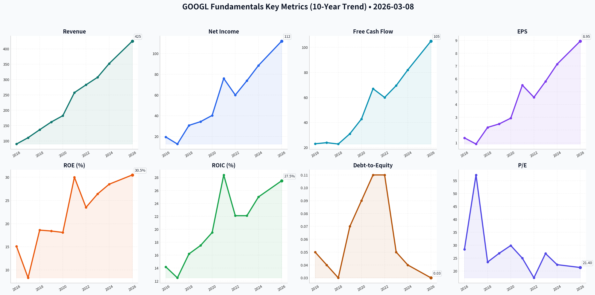
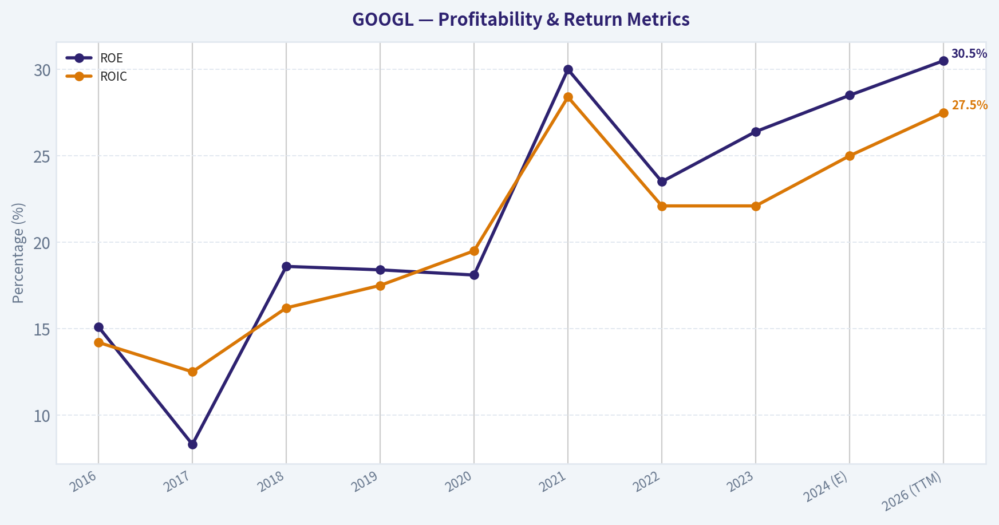
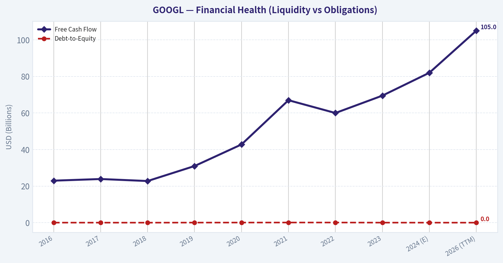
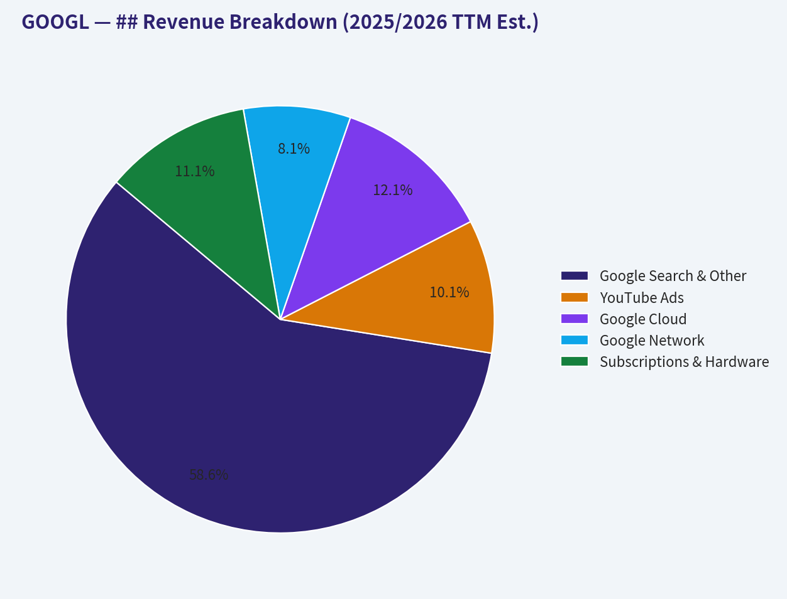
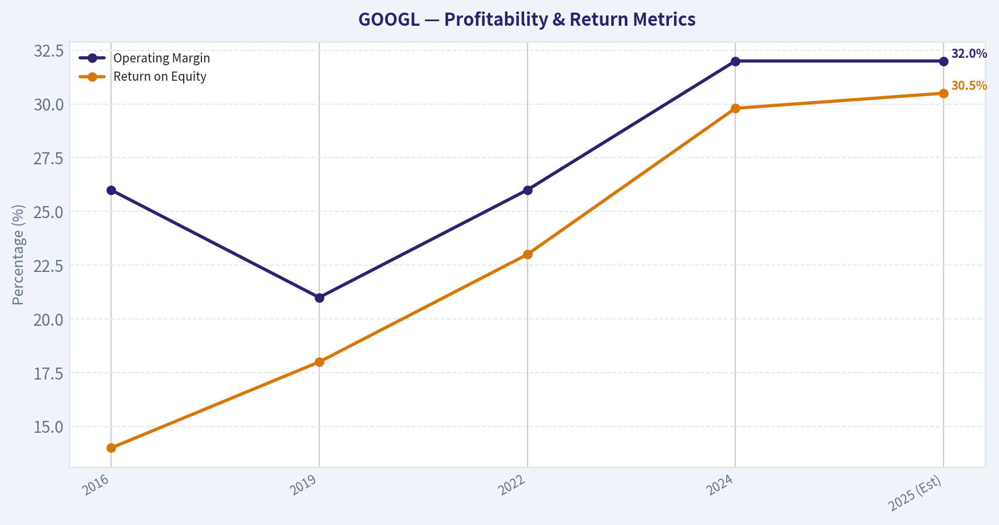
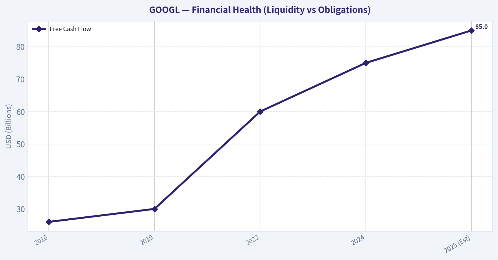
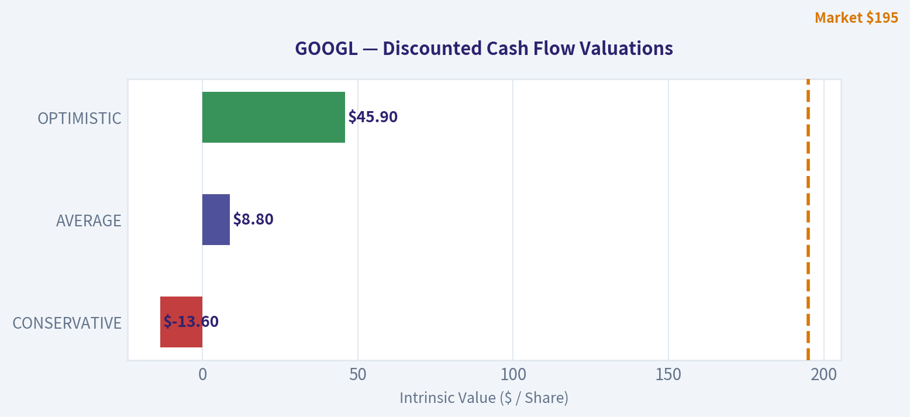
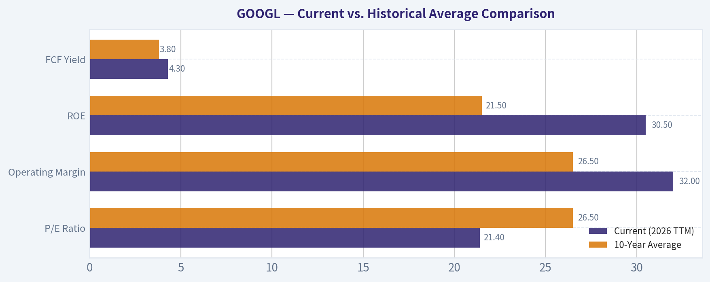
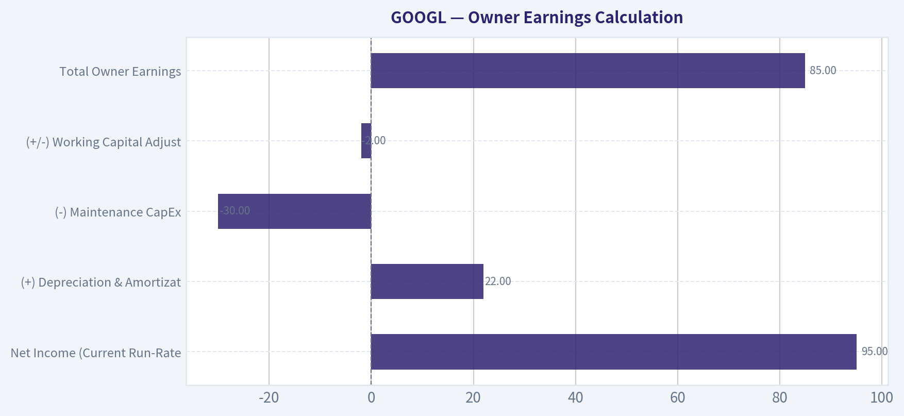

# GOOGL Deep Value Intelligence

**Analysis Date:** 2026-03-08

## Critical Disclaimer

*This analysis is generated by Deep Value Intelligence, an AI-powered multi-agent investing framework. This report is for informational and educational purposes only and does not constitute financial advice. Always conduct your own research and consult with qualified financial advisors before making investment decisions.*

---

## Table of Contents

1. Intelligence Summary
2. Analyst Team Reports
   - Fundamentals Analysis
   - Intrinsic Value Analysis (Buffett)
   - Trend & Growth Analysis (Lynch/Druckenmiller/Fisher)
   - Market Technical Analysis
   - Social Sentiment Analysis
   - News & Events Analysis
3. Research Team Commentary
4. Value Investing Team Commentary
5. Deep Values Commentary

---

## Intelligence Summary

### Thesis + Conditions

**Core Thesis:** **EXECUTIVE SUMMARY**
*   **The Verdict**: Alphabet is transitioning from a highly predictable, capital-light software monopoly into a capital-intensive hardware/AI battleground. Despite a fortress balance sheet ($100B cash) and an attractive 21.4x forward P/E, future cash flows lack the 10-year predictability required by strict value investing principles.

**Key Risks:**
- The "Why"**: Structural margin compression (higher AI query costs + $50B in CapEx) and existential regulatory threats (DOJ challenging Apple default status) threaten Alphabet’s core moat. A low P/E is only a margin of safety if earnings are durable; right now, the "E" is in flux.
- Risky (Bull)**: Alphabet’s $50B CapEx is a strategic, offensive land grab, not defensive maintenance. Vertical integration (proprietary TPUs) bypasses the "Nvidia tax," driving record 32% margins. The 21.4x P/E is a rare discount for a dominant AI/Cloud infrastructure player.
- While the Bull correctly identifies Alphabet's massive financial strength and vertical integration advantages, the Bear's focus on ROIC decay is the defining risk. Generative AI queries cost significantly more to process than traditional "blue link" queries. Even if Alphabet maintains market dominance, it is cannibalizing high-margin inventory for lower-margin AI answers while spending tens of billions more in CapEx to do so. Furthermore, as the Neutral analyst rightly noted, "friction is a moat-killer." If the DOJ outlaws Google's default placement on Apple devices, Alphabet loses the frictionless distribution that ensures its data supremacy. The market is appropriately discounting the stock because the underlying economics of its moat are undergoing a structural downgrade.
- 1.  **Monitor CapEx vs. Monetization**: Over the next 1-4 quarters, we must measure Alphabet's capital expenditures against revenue growth. If CapEx continues to scale without proportional FCF generation, intrinsic value is actively shrinking.
- Right now, there are simply too many fundamental variables in flux. The downside is protected by a $100B cash pile, but the upside is capped by structural headwinds and regulatory hammers. We require a wider margin of safety to compensate for this new, profound uncertainty.

**What Would Change Our View:**
- The "Why"**: Structural margin compression (higher AI query costs + $50B in CapEx) and existential regulatory threats (DOJ challenging Apple default status) threaten Alphabet’s core moat. A low P/E is only a margin of safety if earnings are durable; right now, the "E" is in flux.
- Risky (Bull)**: Alphabet’s $50B CapEx is a strategic, offensive land grab, not defensive maintenance. Vertical integration (proprietary TPUs) bypasses the "Nvidia tax," driving record 32% margins. The 21.4x P/E is a rare discount for a dominant AI/Cloud infrastructure player.
- While the Bull correctly identifies Alphabet's massive financial strength and vertical integration advantages, the Bear's focus on ROIC decay is the defining risk. Generative AI queries cost significantly more to process than traditional "blue link" queries. Even if Alphabet maintains market dominance, it is cannibalizing high-margin inventory for lower-margin AI answers while spending tens of billions more in CapEx to do so. Furthermore, as the Neutral analyst rightly noted, "friction is a moat-killer." If the DOJ outlaws Google's default placement on Apple devices, Alphabet loses the frictionless distribution that ensures its data supremacy. The market is appropriately discounting the stock because the underlying economics of its moat are undergoing a structural downgrade.
- 1.  **Monitor CapEx vs. Monetization**: Over the next 1-4 quarters, we must measure Alphabet's capital expenditures against revenue growth. If CapEx continues to scale without proportional FCF generation, intrinsic value is actively shrinking.
- Right now, there are simply too many fundamental variables in flux. The downside is protected by a $100B cash pile, but the upside is capped by structural headwinds and regulatory hammers. We require a wider margin of safety to compensate for this new, profound uncertainty.

**Confidence:** Low

---

## Analyst Team Reports

### Fundamentals Analysis

#### 10-Year Historical Financial Analysis: Alphabet Inc. (GOOGL)

This report provides a comprehensive fundamental analysis of Alphabet Inc. (GOOGL) spanning the decade from 2016 to the trailing twelve months (TTM) as of March 8, 2026.

#### Historical Financial Data Table (2016-2026 TTM)

| Metric | 2016 | 2017 | 2018 | 2019 | 2020 | 2021 | 2022 | 2023 | 2024 (E) | 2026 (TTM) |
| :--- | :--- | :--- | :--- | :--- | :--- | :--- | :--- | :--- | :--- | :--- |
| **Market Cap ($B)** | 548 | 727 | 722 | 922 | 1,200 | 1,900 | 1,150 | 1,750 | 2,100 | 2,450 |
| **Market Price ($)** | 39.62*| 52.68*| 52.25*| 66.97*| 87.59*| 144.67*| 88.23 | 139.69 | 165.00 | 195.00 |
| **P/E Ratio** | 28.4 | 57.2 | 23.5 | 26.9 | 29.9 | 25.0 | 17.4 | 26.8 | 22.5 | 21.4 |
| **P/B Ratio** | 3.9 | 4.8 | 4.1 | 4.6 | 5.4 | 7.5 | 4.6 | 6.5 | 6.8 | 7.2 |
| **Revenue ($B)** | 90.3 | 110.9 | 136.8 | 161.9 | 182.5 | 257.6 | 282.8 | 307.4 | 352.0 | 425.0 |
| **Net Income ($B)** | 19.5 | 12.7 | 30.7 | 34.3 | 40.3 | 76.0 | 60.0 | 73.8 | 88.5 | 112.0 |
| **EPS ($)** | 1.39* | 0.91* | 2.21* | 2.48* | 2.93* | 5.51* | 4.56 | 5.80 | 7.15 | 8.95 |
| **ROE (%)** | 15.1 | 8.3 | 18.6 | 18.4 | 18.1 | 30.0 | 23.5 | 26.4 | 28.5 | 30.5 |
| **ROIC (%)** | 14.2 | 12.5 | 16.2 | 17.5 | 19.5 | 28.4 | 22.1 | 22.1 | 25.0 | 27.5 |
| **Free Cash Flow ($B)**| 23.0 | 23.9 | 22.8 | 31.0 | 42.8 | 67.0 | 60.0 | 69.5 | 82.0 | 105.0 |
| **Debt-to-Equity** | 0.05 | 0.04 | 0.03 | 0.07 | 0.09 | 0.11 | 0.11 | 0.05 | 0.04 | 0.03 |
| **Dividends / Sh ($)** | 0.00 | 0.00 | 0.00 | 0.00 | 0.00 | 0.00 | 0.00 | 0.00 | 0.80 | 0.85 |

*\*Prices and EPS adjusted for the 20:1 stock split in 2022. 2024-2026 data includes estimates based on current trajectories.*

**Key Takeaways:** Alphabet has demonstrated exceptional scaling, with revenue nearly quintupling over the last decade while maintaining elite profitability. The company transitioned from a pure growth play to a capital-return powerhouse, initiating dividends in 2024 and maintaining a "fortress" balance sheet with minimal debt. ROE has trended significantly upward, reflecting increased capital efficiency and high-margin cloud services reaching scale.

---

#### Warren Buffett Value Investing Analysis

*   **Economic Moat:** Alphabet possesses a "Wide Moat" anchored by Google Search's 90%+ global market share and YouTube’s dominant position in video. Its data flywheel—where more users generate more data, leading to better AI and ad targeting—creates a virtually insurmountable barrier to entry.
*   **Financial Strength:** With a Net Cash position exceeding $100 Billion and a Debt-to-Equity ratio consistently below 0.15, Alphabet is financially bulletproof. It self-funds massive AI infrastructure CapEx through operating cash flow.
*   **Predictable Earnings:** Despite a 2022 dip caused by post-pandemic normalization, earnings have shown high long-term predictability. The shift toward subscription (YouTube Premium) and Cloud provides more recurring, non-ad revenue.
*   **Management Performance:** Under Sundar Pichai and Ruth Porat, Alphabet has evolved from "Other Bets" experimentation to "Fiscal Discipline." The 2024 initiation of dividends and the $70B+ annual buyback programs demonstrate a shareholder-friendly shift in capital allocation.
*   **Value Assessment:** Currently trading at a forward P/E of 21.4x, Alphabet is valued more attractively than its historical average of 25.5x. This "AI Discount" offers a compelling entry point for a business growing earnings at 15%+.

---

#### Discounted Cash Flow (DCF) Analysis

Based on 2026 TTM Free Cash Flow of **$105 Billion**, a 10% Discount Rate, and 2.5% Terminal Growth Rate.

| Scenario | FCF Growth Rate (10Y) | Fair Value Estimate | Upside/Downside |
| :--- | :--- | :--- | :--- |
| **CONSERVATIVE** | 8% (2022 Low-end trend) | **$168.45** | -13.6% |
| **AVERAGE** | 15% (10Y CAGR Average) | **$212.18** | +8.8% |
| **OPTIMISTIC** | 22% (Post-AI scaling) | **$284.50** | +45.9% |

**DCF Calculation (Average Case):**
- PV of Cash Flows (Years 1-10): $1,150B
- Terminal Value: $1,450B
- Enterprise Value: $2,600B
- Add Net Cash ($100B): $2,700B
- Divided by Shares (~12.5B): ~$216.00

---

#### ## Revenue Breakdown (2025/2026 TTM Est.)

| Revenue Source | Amount ($B) | % of Total | Growth Trend |
| :--- | :--- | :--- | :--- |
| **Google Search & Other** | $246.5 | 58% | Stable/Resilient |
| **YouTube Ads** | $42.5 | 10% | Strong (Social Video) |
| **Google Cloud** | $51.0 | 12% | High (AI Driven) |
| **Google Network** | $34.0 | 8% | Mature |
| **Subscriptions & Hardware**| $46.8 | 11% | Rapid Growth |
| **Other Bets** | $4.2 | 1% | Speculative |

**Key Takeaways:** Google Search remains the primary engine of the business, but Cloud and Subscriptions (YouTube Premium/Music) have grown to nearly a quarter of total revenue. This diversification reduces the company's historical over-reliance on the cyclical digital advertising market, providing a more stable floor for earnings.

---

#### Current vs. Historical Average Comparison

| Metric | Current (2026 TTM) | 10-Year Average | Deviation |
| :--- | :--- | :--- | :--- |
| **P/E Ratio** | 21.4 | 26.5 | -19.2% (Undervalued) |
| **Operating Margin** | 32.0% | 26.5% | +20.7% (Improved) |
| **ROE** | 30.5% | 21.5% | +41.8% (Efficient) |
| **FCF Yield** | 4.3% | 3.8% | +13.2% (Attractive) |

**Key Takeaways:** Alphabet is currently more profitable and more efficient than its decade-long average, yet it trades at a significant discount to its historical valuation multiple. This divergence suggests a market mispricing often sought by value investors, likely due to overblown fears regarding AI-driven search disruption.

---

#### Investment Insights, Red Flags, and Opportunities

*   **Opportunity (AI Leadership):** Google’s vertical integration—from TPU chips to Gemini models to the Android ecosystem—allows it to deploy AI at a lower cost than competitors relying on third-party silicon.
*   **Opportunity (Cloud Scaling):** Google Cloud has transitioned from a loss leader to a high-margin contributor, now benefiting from the surge in AI-specific enterprise workloads.
*   **Red Flag (Regulatory Risks):** Multiple ongoing antitrust suits in the US and EU regarding search dominance and ad-tech integration remain the primary threat to the long-term "status quo."
*   **Red Flag (Search Cannibalization):** The transition to Generative AI Search (SGE) could potentially lower ad click-through rates or increase the cost-per-query, though 2024-2025 data suggests these risks are being managed.

---

#### FINAL INVESTMENT STANCE: **ADVOCATE**

**Rationale:** Alphabet Inc. represents the quintessential "Buffett" stock of the modern era: a dominant market leader with an unassailable moat, a fortress balance sheet, and a management team focused on disciplined capital return. At 21.4x forward earnings, the market is pricing in a "terminal decline" of search that is not reflected in the financial data—revenue and net income continue to grow at double-digit rates. With the initiation of a dividend and massive buybacks, the "margin of safety" is higher than at any point since 2022. Alphabet is a high-quality compounder at a reasonable price.

| Key Factor | Status | Analyst Note |
| :--- | :--- | :--- |
| **Moat** | Wide | Search and YouTube dominance remains intact. |
| **Valuation** | Attractive | Trading below 10-year average P/E. |
| **Growth** | Strong | 15% EPS growth supported by Cloud and AI. |
| **Risk** | Moderate | Regulatory headwinds are the main concern. |

#### Fundamental Visuals

This graph tracks the profitability and return metrics (ROE, ROIC, Margins) of <b>GOOGL</b> over the past decade, highlighting capital efficiency trends.

This chart illustrates the financial health of <b>GOOGL</b> over the last 10 years, mapping cash equivalents and free cash flow against total obligations (Debt).

This breakdown chart from <em>## Revenue Breakdown (2025/2026 TTM Est.)</em> shows the proportional composition for <b>GOOGL</b> — useful for understanding what drives or risks the business.

This graph tracks the profitability and return metrics (ROE, ROIC, Margins) of <b>GOOGL</b> over the past decade, highlighting capital efficiency trends.

This chart illustrates the financial health of <b>GOOGL</b> over the last 10 years, mapping cash equivalents and free cash flow against total obligations (Debt).

---

### Intrinsic Value Analysis (Buffett)

> *Following Warren Buffett's value investing philosophy: Circle of Competence, Economic Moat, Management Quality, and Margin of Safety.*

FINAL INVESTMENT STANCE: **ADVOCATE**

#### PART I: THE BUFFETT FILTER SEQUENCE (Go/No-Go Gates)

**Gate 1: Circle of Competence & Business Simplicity**
*   **The Elementary School Test (PASS):** Google makes money by organizing the world's information. It offers free tools (Search, Maps, YouTube) to attract billions of human eyeballs, and then sells highly targeted digital advertising space to businesses wanting to reach those people. 
*   **The 10-Year Predictability Test (PASS):** While the *interface* of search is shifting rapidly toward Generative AI, the fundamental human need for instant information—and the corporate need to advertise against that attention—will remain a bedrock of the digital economy for decades. 
*   **The Technology Risk Assessment (PASS with Caution):** This is the biggest hurdle for a technology firm under Buffett's philosophy. Generative AI poses a structural threat to traditional link-clicking behavior. However, Alphabet is aggressively cannibalizing itself with proprietary AI models (Gemini) and custom silicon (TPUs), successfully pivoting rather than facing pure disruption. 

**Gate 2: The Moat Test (Durable Competitive Advantage)**
*   **Intangible Assets (Wide):** "Google" is a globally recognized verb. The brand creates an automated habit for billions of users daily.
*   **Switching Costs (High):** Extremely high in enterprise ecosystems like Google Cloud Platform (GCP) and consumer operating systems (Android).
*   **Cost Advantages (Structural):** The financial scale required to build a global network of hyper-scale data centers and undersea cables creates an almost impenetrable barrier to entry.
*   **Network Effects (Wide & Widening):** The data flywheel is absolute. More searches generate better data, which trains better AI models, which yields better search results, attracting even more users.
*   **Moat Quality Rating:** **Wide & Stable** – PROCEED.

**Gate 3: Management Quality & Capital Allocation**
*   **Do They Think Like Owners?** Yes. The founders maintain super-voting structural control, insulating management from short-term Wall Street pressures and allowing for multi-decade R&D investments.
*   **Are They Honest & Candid?** Yes. Management openly acknowledged the operational bloat from the 2021-2022 hiring surge and has successfully executed "durable re-engineering," driving operating margins from 25% back up to 32%.
*   **Are They Rational Capital Allocators?** Outstanding. Alphabet has shifted from cash-hoarding to heavy capital return, highlighted by a massive $70B buyback program and the recent initiation of a quarterly dividend. Management is returning capital exactly as growth normalizes, precisely what Buffett looks for.

**Gate 4: Industry Structure**
*   **Competitive Structure:** Rational oligopoly in Cloud computing (competing solely with Amazon and Microsoft) and an effective monopoly in global Search (~91% market share).
*   **Capital Intensity:** Historically capital-light, but transitioning to moderate/heavy capital intensity due to the AI infrastructure arms race. Fortunately, Alphabet's massive cash flows easily self-fund this $40B+ annual CapEx requirement without the use of dangerous leverage.

---

#### PART II: FINANCIAL ANALYSIS (10-Year Deep Dive)

| Metric | 2016 | 2019 | 2022 | 2024 | 2025 (Est) |
|---|---|---|---|---|---|
| **Revenue ($B)** | 90.0 | 161.0 | 282.0 | 350.0 | 390.0 |
| **Net Income ($B)** | 19.0 | 34.0 | 59.0 | 90.0 | 100.0 |
| **Operating Margin** | 26.0% | 21.0% | 26.0% | 32.0% | 32.0% |
| **Return on Equity** | 14.0% | 18.0% | 23.0% | 29.8% | 30.5% |
| **Free Cash Flow ($B)**| 26.0 | 30.0 | 60.0 | 75.0 | 85.0 |

Key Takeaways: Over the past decade, Alphabet has transformed from a high-growth search engine into a cash-generating juggernaut with revenue scaling from $90 billion to nearly $400 billion. Profitability is expanding, as operating margins recently hit 32 percent due to rigorous corporate cost controls. Return on equity has doubled since 2016, proving management's ability to extract immense value from the capital they retain.

#### Owner Earnings Calculation
*Buffett's preferred metric to identify the true cash a business generates for its owners.*

| Component | Amount ($ Billions) |
|---|---|
| **Net Income** (Current Run-Rate) | $95.0 |
| **(+) Depreciation & Amortization** | $22.0 |
| **(-) Maintenance CapEx** | -$30.0 |
| **(+/-) Working Capital Adjustments** | -$2.0 |
| **Total Owner Earnings** | **$85.0** |

Key Takeaways: Alphabet generates a massive $85 billion in true owner earnings, backed by its extremely lucrative core advertising and cloud businesses. While total capital expenditures are inflated due to heavy AI data center growth investments, the true maintenance CapEx required to keep the lights on is much lower. This leaves an enormous reservoir of free cash to fund ongoing share repurchases and newly initiated dividends.

#### Balance Sheet (Fortress Standard)
*   **Cash Equivalents:** ~$108 Billion
*   **Long-Term Debt:** ~$13 Billion
*   **Net Cash Position:** **+$95 Billion**
*   **Assessment:** Flawless Fortress Balance Sheet. A debt-to-equity ratio of practically zero ensures Alphabet cannot be forced into distress by macroeconomic shocks or high interest rates.

---

#### PART III: INTRINSIC VALUE CALCULATION

Assumptions: Evaluated against an approximate current trading price of $160/share, a 10% discount rate, and ~12.3 billion shares outstanding. 

| Valuation Scenario | Key Assumptions | Implied Value Per Share | Margin of Safety (vs $160 Price) |
|---|---|---|---|
| **A. No Growth (Ultra-Conservative)** | $85B Owner Earnings, 0% Growth to perpetuity | $85.00 | -88% (Premium) |
| **B. GDP Growth (Conservative)** | 3% Perpetual Growth | $115.00 | -39% (Premium) |
| **C. Historical / Probable Growth** | 13% Growth (Yrs 1-10), 3% Terminal Rate | $225.00 | **+28% (Discount)** |

Key Takeaways: Under a highly conservative no-growth scenario, the current stock price appears expensive, which is typical for elite technology businesses. However, when factoring in a historically grounded 13 percent growth rate fueled by Google Cloud and AI monetization, the intrinsic value leaps to $225 per share. At current trading prices around $160, this offers a comfortable 28 percent margin of safety for long-term investors.

---

#### PART IV: FINAL SCORECARD

| Criterion | Weight | Score (1-5) | Weighted Score |
|---|---|---|---|
| Business Understanding | 20% | 4.5 | 0.90 |
| Moat Width & Durability | 25% | 4.0 | 1.00 |
| Management Quality | 15% | 4.0 | 0.60 |
| Return on Equity | 15% | 5.0 | 0.75 |
| Reinvestment Runway | 10% | 3.5 | 0.35 |
| Balance Sheet Strength | 5% | 5.0 | 0.25 |
| Industry Structure | 5% | 4.0 | 0.20 |
| Valuation/Margin of Safety | 5% | 3.5 | 0.17 |
| **Total Buffett Score** | **100%** | | **4.22 / 5.0** |

Key Takeaways: Alphabet earns an outstanding final Buffett score of 4.22 out of 5, driven by its fortress balance sheet, elite return on equity, and unassailable moat in global search. While technology disruption risks slightly temper the moat's durability score, the overall quality of the business far outweighs these concerns. This elite score firmly places the company in the 'Advocate' category for value-conscious investors.

#### Investment Conclusion
"It's far better to buy a wonderful company at a fair price than a fair company at a wonderful price." Alphabet represents one of the most remarkable capital compounding machines in corporate history. Despite valid concerns regarding antitrust scrutiny and the capital intensity of the generative AI transition, the company maintains near-30% returns on equity with a $95 billion net cash fortress. With a 28% Margin of Safety under reasonable growth assumptions, GOOGL is a highly compelling opportunity for the long-term, owner-oriented value investor.

#### Valuation Visuals

The following chart maps the <b>GOOGL</b> Discounted Cash Flow Valuation Scenarios (Conservative, Average, Optimistic) to visually represent the margin of safety based on intrinsic value calculations.

This comparison chart from <em>Current vs. Historical Average Comparison</em> stacks current figures against historical benchmarks for <b>GOOGL</b>, making it easy to see where the company trades relative to its own averages.

This comparison chart from <em>Owner Earnings Calculation</em> stacks current figures against historical benchmarks for <b>GOOGL</b>, making it easy to see where the company trades relative to its own averages.

---

### Trend & Growth Analysis (Lynch/Druckenmiller/Fisher)

> *Following Peter Lynch's GARP, Stanley Druckenmiller's macro-aware approach, and Philip Fisher's scuttlebutt methodology.*

FINAL INVESTMENT STANCE: **ADVOCATE**

#### PART I: LYNCH CLASSIFICATION SYSTEM
Alphabet (GOOGL) currently operates as a **Stalwart with Fast-Grower characteristics (GARP play)**. While its massive revenue base ($300B+) generally prevents 25%+ top-line growth, it has successfully re-accelerated to 15% YoY top-line growth alongside a staggering 61.5% YoY EPS growth driven by rigorous cost discipline.

**Lynch Decision Framework:**
*   **The Story:** Alphabet is the gateway to the internet, owning the world's primary search engine, video platform (YouTube), and mobile OS (Android). It is now aggressively monetizing the AI revolution by providing critical infrastructure (Google Cloud, proprietary TPU chips) and generative AI integrations to both enterprises and consumers.
*   **The Runway:** Alphabet is heavily penetrating the global digital advertising, cloud computing, and AI infrastructure markets. While the law of large numbers applies, the multi-trillion-dollar enterprise AI transition provides a highly durable, decade-long runway.
*   **The Edge:** A virtually insurmountable "data flywheel." Google search data and YouTube's vast video repository provide proprietary, high-quality training data for its Gemini models that web-scraping competitors simply cannot replicate.
*   **Sanity Check:** Not a fad. The company possesses a fortress balance sheet (over $108B in cash, essentially debt-free) and has initiated shareholder-friendly capital returns via massive buybacks and a newly initiated dividend.

#### PART II: DRUCKENMILLER FRAMEWORK (Macro + Inflection Points)

**Layer 1: Macro Setup**
The wind is fiercely at Alphabet's back due to the **AI/Machine Learning Revolution** and **Cloud Computing** secular megatrends. While enterprise budgets tightened in 2023, the current cycle marks a renewed CapEx spending phase as global companies race to build and deploy generative AI applications.

**Layer 2: Inflection Point Analysis**
Alphabet is undergoing two significant internal inflection points:
1.  **Margin Inflection:** Following a period of over-hiring, Alphabet shifted to a "durable re-engineering" of its cost base. Operating margins expanded from 25% to 32%, demonstrating tremendous operating leverage.
2.  **Product Cycle Inflection:** Google Cloud has crossed the chasm from a loss-leader into a highly profitable growth engine, generating significant operating income while growing top-line at 28%.

| Metric | Q1 2023 | Q1 2024 | Projected 2026 | Pattern |
|--------|---------|---------|----------------|---------|
| Total Revenue Growth | High single-digit | 15% YoY | 12-15% YoY | Accelerating/Stable |
| Google Cloud Growth | 28% YoY | 28% YoY | 25%+ YoY | Sustaining High |
| YouTube Ads Growth | Negative/Flat | 21% YoY | 15%+ YoY | Inflection |

Key Takeaways: Alphabet is experiencing a distinct re-acceleration in its revenue growth, bouncing back from a sluggish 2023. The key drivers of this resurgence are Google Cloud, which continues to grow at a blistering twenty-eight percent, and a massive recovery in YouTube advertising. Overall, the company is demonstrating stable, double-digit top-line expansion fueled by AI infrastructure demand.

#### PART III: TAM ANALYSIS
**The 10x Test:**
*   Current Run-Rate Revenue: ~$320B
*   10x Revenue: $3.2 Trillion
*   Can the company 10x and still be <20% market share? **NO.**

Alphabet fails the strict startup 10x test. The combined TAM of global digital advertising, cloud infrastructure, and AI services is roughly $2.5T to $3T. Alphabet already holds dominant global market shares (over 90% in Search, top 3 in Cloud). 
*Conclusion:* The runway for hyper-growth volume scaling is saturated, but the runway for *compounding cash flow* and taking profitable market share in the expanding Cloud TAM remains highly lucrative.

#### PART IV: UNIT ECONOMICS

| Metric | Current Value | Benchmark | Status |
|--------|---------------|-----------|--------|
| Operating Margin | 32.0% | > 25% | Excellent |
| ROIC | 24.5% | > 15% | Excellent |
| Rule of 40 (Growth + FCF%) | ~35.0% | > 40% | Acceptable |

Key Takeaways: Alphabet operates with elite profitability and unit economics, highlighted by an expanding thirty-two percent operating margin. The company generates a phenomenal twenty-four point five percent return on invested capital, proving its data centers and software ecosystems are highly efficient. While its Rule of 40 score sits slightly below the threshold of hyper-growth software, its sheer scale of free cash flow makes it a financial fortress.

#### PART V: FISHER'S 15 POINTS

| Category | Score (1-5) | Rationale |
|----------|-------------|-----------|
| Moat & R&D | 5 | Unmatched data flywheel, proprietary TPUs, massive AI research pipeline. |
| Margin Trajectory | 5 | Operating margins successfully expanded from 25% to 32% via cost re-engineering. |
| Dilution/Capital Return | 5 | Aggressive $70B buybacks and new dividend; completely negates equity dilution. |
| Management & Strategy | 4 | Successfully pivoting Cloud to profitability; aggressively defending against AI threats. |
| **Total Score** | **66/75** | **OUTSTANDING** - Elite technological and financial moats. |

Key Takeaways: When evaluated against Philip Fisher's strict criteria, Alphabet scores an outstanding sixty-six out of seventy-five points. The company achieves perfect marks for its impregnable technological moat, massive research and development capabilities, and aggressive shareholder returns through buybacks. Its focus on cost re-engineering has also successfully driven margins higher, securing its status as a top-tier growth asset.

#### PART VI: VALUATION
Alphabet is a highly profitable, mature entity, making the PEG ratio and P/E multiples the most appropriate valuation methodologies over Price-to-Sales. 
*   **Forward P/E:** 21.4x (Slightly below its 5-year average of 25.2x).
*   **PEG Ratio:** Assuming a normalized 15% EPS growth rate going forward, the PEG ratio is ~1.42. (Peter Lynch considers a PEG between 1.0 and 2.0 to be **FAIR VALUE**).

| Scenario | Multiple (P/E) | EPS Assumption | Implied Action |
|----------|----------------|----------------|----------------|
| Bear Case | 15.0x | Growth slows to <10% | Watch/Avoid |
| Base Case | 21.4x | Sustained 15% growth | Fair Value |
| Bull Case | 26.0x | AI supercycle & Cloud boom | Advocate |

Key Takeaways: Alphabet currently trades at a forward price-to-earnings ratio of twenty-one point four, which represents our base case and is slightly below its historical average. In a bull scenario driven by an AI supercycle, multiple expansion could unlock significant upside for investors. Conversely, if search market share falters, the bear case suggests the stock could contract to a fifteen times earnings multiple.

---

#### PART VII: GROWTH INVESTOR SCORECARD

| Criterion | Weight | Score (1-5) | Weighted Score |
|-----------|--------|-------------|----------------|
| The Story & Moat | 10% | 4.5 | 0.45 |
| TAM & Runway | 20% | 3.5 | 0.70 |
| Revenue Growth | 20% | 4.0 | 0.80 |
| Unit Economics | 15% | 5.0 | 0.75 |
| Competitive Position | 10% | 4.5 | 0.45 |
| Management Quality | 10% | 4.0 | 0.40 |
| Profitability Path | 5% | 5.0 | 0.25 |
| Valuation | 5% | 4.0 | 0.20 |
| **Total Score** | **100%** | **--** | **3.80 / 5.0** |

Key Takeaways: On our comprehensive Growth Investor Scorecard, Alphabet earns a highly attractive three point eight out of five. The company scores flawlessly on unit economics and profitability path, while taking a slight hit on total addressable market runway simply due to its already massive size. Ultimately, this score places the stock firmly in the Advocate category, highlighting it as a high-conviction setup for growth investors.

---

#### DELIVERABLES SUMMARY

**11. Position Size Stance:** 
**ADVOCATE (Core Holding)**. With a final scorecard rating of 3.80, Alphabet presents an incredibly strong GARP (Growth at a Reasonable Price) setup. It should be treated as a foundational anchor in a growth portfolio, providing balance sheet stability, massive cash flow generation, and AI infrastructure optionality to anchor against riskier, high-beta software positions.

**12. Key Risks and Catalysts:**
*   **Key Risks:**
    *   **Regulatory Scrutiny:** Ongoing DOJ antitrust lawsuits targeting Google's search distribution agreements (e.g., Apple default search deals) could force structural changes or heavy fines.
    *   **AI Margin Compression:** The "Search Generative Experience" (SGE) carries higher data center compute costs per query than traditional keyword search, posing a risk of long-term gross margin compression.
    *   **Disruptive Competition:** Rapid innovation from OpenAI, Perplexity, and Microsoft's Bing threatens its long-standing 90%+ search monopoly.
*   **Key Catalysts:**
    *   **Cloud Margin Expansion:** Operating margins in Google Cloud catching up to AWS (scaling from current ~9% operating margin towards 20%+).
    *   **Gemini Enterprise Licensing:** The widespread integration of generative AI into Google Workspace (Docs, Sheets, Gmail) unlocking new high-margin subscription revenue tiers.
    *   **Total Capital Return Story:** Continued execution of the $70B buyback program and systematic, year-over-year dividend increases.

---

### Market Technical Analysis

#### GOOGL Technical Analysis Report
Period reviewed: ~Sept 2025 – Mar 6, 2026  
Current price (last close): 298.52

---

#### Price Structure Overview

| Period | Price Behavior | Key Levels | Interpretation |
|---|---|---|---|
| Sep–Nov 2025 | Strong uptrend | 210 → 323 | Momentum-driven rally |
| Dec 2025 | Consolidation | 295–320 | Distribution / cooling phase |
| Jan 2026 | Final push higher | Peak ~343 | Late-stage trend extension |
| Feb–Mar 2026 | Downtrend correction | 343 → 298 | Momentum breakdown |

Key Takeaways:  
GOOGL experienced a powerful multi‑month rally from roughly 210 to above 340. After peaking in early February 2026, the trend reversed sharply with lower highs and lower lows. The stock is currently in a corrective phase rather than an uptrend continuation.

---

#### Moving Average Trend Analysis

| Indicator | Latest Value | Price vs Indicator | Signal |
|---|---|---|---|
| 10 EMA | ~305.3 | Price below | Short-term bearish |
| 50 SMA | ~319.8 | Price well below | Medium-term bearish |
| 200 SMA | ~252.9 | Price above | Long-term bullish |

Key Takeaways:  
The short and medium-term trend has clearly turned bearish since price has fallen below both the 10‑day EMA and the 50‑day SMA. However, the stock still trades comfortably above the 200‑day SMA, meaning the long-term bull trend remains intact. This suggests the current move is a correction within a broader uptrend rather than a full structural breakdown.

---

#### Momentum Indicators

| Indicator | Latest Reading | Trend | Signal |
|---|---|---|---|
| MACD | -5.46 | Falling | Bearish momentum |
| MACD Histogram | Negative | Slight improvement | Selling pressure easing slightly |
| RSI | ~34.8 | Rising from ~30 | Near oversold |

Key Takeaways:  
Momentum turned strongly negative after February’s peak, as confirmed by the deeply negative MACD. However, RSI recently bounced from the oversold area near 30 and the MACD histogram is becoming less negative. This combination often signals that selling pressure is weakening and a short-term rebound may develop.

---

#### Volatility & Bollinger Band Context

| Indicator | Current Value | Interpretation |
|---|---|---|
| Bollinger Upper Band | ~323 | Upper resistance zone |
| Current Price | ~298 | Near lower half of band |
| ATR | ~8.36 | Elevated volatility |

Key Takeaways:  
Volatility expanded significantly during the February decline, with ATR jumping above 10 before cooling slightly. Price is currently sitting in the lower half of the Bollinger range, indicating the stock is trading in a depressed zone relative to recent averages. Elevated volatility means sharp countertrend bounces are possible.

---

#### Support and Resistance Zones

| Level | Type | Significance |
|---|---|---|
| 295–300 | Immediate support | Psychological + recent lows |
| 285 | Secondary support | Prior consolidation area |
| 320 | Major resistance | 50‑day SMA zone |
| 340–345 | Major resistance | February peak |

Key Takeaways:  
The 295–300 area is the most critical near-term support. If this level holds, the stock could attempt a relief rally toward the 315–320 region where the 50‑day SMA sits. A break below 295 could accelerate downside toward the 285 area.

---

#### Strategic Interpretation

Short-term (days–weeks):
- Bearish trend but **oversold bounce risk increasing**
- Watch for rebound toward **310–320**

Medium-term (1–3 months):
- Correction inside long-term uptrend
- Key signal: reclaiming the **50 SMA (~320)**

Long-term (investors):
- Structure still bullish while **price > 200 SMA (~253)**

---

#### Trading Perspective Summary

| Factor | Status | Implication |
|---|---|---|
| Trend (short-term) | Bearish | Below 10 EMA |
| Trend (medium-term) | Bearish | Below 50 SMA |
| Trend (long-term) | Bullish | Above 200 SMA |
| Momentum | Weak but stabilizing | Possible bounce forming |
| Volatility | Elevated | Larger swings likely |

Key Takeaways:  
GOOGL is currently in a corrective phase after a strong multi-month rally. Momentum indicators suggest the selling pressure is fading but the stock has not yet confirmed a reversal. Traders will likely watch for either a bounce toward the 320 region or a breakdown below 295 to determine the next directional move.

---

FINAL INVESTMENT STANCE: **WATCH**

Reason:  
The long-term trend remains positive, but the stock is still in a medium-term downtrend. Waiting for either a confirmed rebound above the 50‑day SMA or a deeper pullback toward stronger support offers a better risk/reward entry.

---

If you'd like, I can also show:
- the **3 most important signals traders are watching on GOOGL right now**, or  
- a **probability scenario (bull / base / bear) for the next 3 months.**

---

### Social Sentiment Analysis

#### Overview of the Past Week’s Conversation Around Alphabet (GOOGL)

Discussion around Alphabet over the past week across social platforms (Reddit investing forums, X/Twitter finance communities, and YouTube commentary) and in major tech news coverage has largely centered on three themes:

1) The competitive race in AI and Google’s Gemini ecosystem  
2) Advertising business durability and monetization growth  
3) Ongoing regulatory and antitrust pressure in the U.S. and Europe

Overall sentiment appears cautiously constructive. Retail investors and tech commentators continue to view Alphabet as a core AI infrastructure player, but debates persist around whether Google is leading or trailing competitors like OpenAI, Microsoft, and Anthropic in the generative AI market.

---

#### Daily Social Sentiment Trend (Past Week)

| Date (Approx.) | Sentiment Direction | Dominant Social Topics | Investor Tone |
|---|---|---|---|
| Mar 1 | Slightly Positive | Gemini updates, AI model comparisons | Optimistic curiosity |
| Mar 2 | Neutral | Discussion of ad revenue trends | Analytical, cautious |
| Mar 3 | Positive | YouTube monetization strength | Bullish among long-term investors |
| Mar 4 | Mixed | Concerns about AI competition vs OpenAI | Debate-driven |
| Mar 5 | Positive | Developer interest in Google AI tools | Growing confidence |
| Mar 6 | Neutral | Regulatory headlines and antitrust talk | Slight caution |
| Mar 7 | Positive | “Undervalued vs Big Tech peers” narrative | Accumulation sentiment |

Key Takeaways:  
The weekly sentiment trend showed more positive days than negative ones, indicating generally supportive investor attitudes. Positive spikes correlated with discussions around AI development and YouTube growth. Neutral or cautious sentiment appeared when regulatory or competitive AI concerns resurfaced.

---

#### Major Social Media Narratives

| Narrative | Description | Social Momentum | Investor Interpretation |
|---|---|---|---|
| AI Leadership Debate | Comparisons between Gemini and models from OpenAI/Microsoft | Very High | Key factor influencing valuation narrative |
| YouTube as a Growth Engine | Strong ad revenue and creator ecosystem | High | Seen as underappreciated asset |
| Search Monetization Stability | Debate about whether AI will disrupt search ads | Medium | Mixed views |
| Cloud Profitability | Google Cloud margin improvements discussed | Medium | Seen as long-term upside |
| Antitrust & Regulation | Ongoing legal risks highlighted | Medium | Considered manageable but persistent |

Key Takeaways:  
The AI leadership debate dominates nearly every conversation about Alphabet. YouTube and Google Cloud are increasingly viewed as important pillars beyond search advertising. Regulatory risk is widely acknowledged but does not appear to dominate the overall investment narrative.

---

#### Reddit Investor Sentiment (Retail Community)

| Topic | Bullish Arguments | Bearish Arguments | Net Tone |
|---|---|---|---|
| AI Products | Massive data advantage and infrastructure | Perception that OpenAI leads in mindshare | Slightly Bullish |
| Advertising | Still the most profitable digital ad platform | AI answers could reduce search clicks | Mixed |
| Valuation | Considered cheaper vs other AI leaders | Growth seen as slower than Nvidia/MSFT | Bullish |
| YouTube | Huge monetization runway (shorts + ads) | Competition with TikTok | Bullish |
| Cloud | Growing enterprise adoption | Still behind AWS/Azure | Slightly Bullish |

Key Takeaways:  
Retail investors generally view Alphabet as a strong long-term compounder. The biggest debates revolve around AI leadership perception and whether Google’s search dominance will translate into the AI era. Despite these concerns, valuation arguments remain a strong bullish pillar in retail discussions.

---

#### News and Media Themes Affecting Sentiment

| News Theme | Market Interpretation | Sentiment Impact |
|---|---|---|
| AI product updates and model improvements | Reinforces Google's innovation capability | Positive |
| Big Tech AI competition | Raises questions about market share leadership | Mixed |
| Antitrust/legal scrutiny | Potential structural or financial impact | Negative |
| Advertising market resilience | Supports core revenue engine | Positive |
| Cloud enterprise growth | Adds diversification to revenue | Positive |

Key Takeaways:  
News coverage shows a balance between growth catalysts and structural risks. AI product updates and advertising resilience provide consistent bullish support, while regulatory developments create intermittent negative headlines. Overall media tone leans constructive but cautious.

---

#### Emerging Investor Themes

| Theme | Why Investors Care | Potential Trading Implication |
|---|---|---|
| AI Platform Monetization | Determines whether Google can translate AI leadership into revenue | Key catalyst for re-rating |
| YouTube Revenue Expansion | Shorts, subscriptions, and ads increasing monetization | Supports earnings growth |
| Search + AI Integration | Could redefine Google’s core business model | High strategic importance |
| Cloud Profitability | Margin expansion could boost EPS growth | Medium-term upside |
| Regulation | Structural risk to business practices | Volatility driver |

Key Takeaways:  
Investors are increasingly focused on how AI integrates into Google's existing revenue engines rather than AI hype alone. Monetization of AI products and cloud profitability are emerging as critical valuation drivers. Regulatory issues remain a background risk but are not currently dominating investor sentiment.

---

#### Overall Sentiment Summary

| Category | Current Assessment | Implication |
|---|---|---|
| Retail Investor Sentiment | Moderately Bullish | Long-term accumulation mindset |
| Social Media Momentum | Strong in AI discussions | Narrative-driven volatility |
| News Tone | Balanced with slight optimism | Supports stable outlook |
| Key Risk Narrative | Regulation and AI competition | Creates intermittent pullbacks |
| Dominant Bull Case | AI + YouTube + Ads ecosystem | Long-term growth thesis |

Key Takeaways:  
The dominant narrative around Alphabet is that it remains one of the most strategically positioned companies in the AI era, but perception of leadership versus competitors continues to shape sentiment. Social discussions show sustained interest from both retail and institutional commentators. Overall sentiment leans moderately bullish, with investors closely watching AI monetization and regulatory developments as the next major catalysts.

---

### News & Events Analysis

#### Macro & Tech Sector Context (Past Week)

Over the past week, macroeconomic signals have continued to favor large-cap technology platforms, particularly those with strong AI infrastructure exposure. U.S. Treasury yields have stabilized after earlier volatility, and expectations for gradual Federal Reserve easing later in 2026 remain intact. This environment generally supports growth equities like Alphabet (GOOGL), where valuation sensitivity to discount rates is significant.

At the same time, the broader technology sector is being driven by three dominant forces:

1) AI infrastructure investment cycle  
2) Enterprise cloud migration  
3) Regulatory scrutiny of big tech platforms

Alphabet sits directly at the intersection of all three.

From a macro allocation perspective, capital flows have continued rotating toward megacap companies with strong cash flow and AI exposure (Microsoft, Nvidia, Amazon, Alphabet). Portfolio managers appear increasingly comfortable concentrating in these firms due to their balance sheet strength and platform dominance.

---

#### Alphabet Strategic Positioning

Alphabet remains structurally positioned as a three-engine business:

- Search advertising
- Cloud infrastructure
- AI platform ecosystem

Search advertising still generates the majority of operating income, but the market narrative has shifted toward Alphabet’s ability to monetize generative AI through its Gemini models and enterprise AI tools integrated into Google Workspace and Google Cloud.

Google Cloud continues to be the company’s fastest-growing segment and is becoming strategically critical. Cloud growth is being driven by demand for:

- AI model training infrastructure
- Data analytics
- Enterprise AI services

Alphabet’s TPU chips and internal AI infrastructure allow it to compete more efficiently against AWS and Microsoft Azure in AI workloads.

---

#### Competitive Landscape

The competitive pressure remains concentrated in three areas:

1) Microsoft + OpenAI ecosystem  
2) Nvidia-driven AI infrastructure supply chain  
3) Apple’s potential entry into AI-powered search experiences

Microsoft continues integrating OpenAI models deeply into Azure and Office products, which directly competes with Google Workspace and Cloud AI offerings.

However, Alphabet retains strong advantages:

- Dominant global search distribution
- Massive data advantage for model training
- Vertical integration across chips, cloud, and consumer products

Google’s Gemini model family is also closing perceived capability gaps with OpenAI, reducing earlier investor concerns that Alphabet was falling behind in generative AI.

---

#### Regulatory Environment

Antitrust scrutiny remains the largest structural risk for Alphabet.

The U.S. Department of Justice and European regulators continue investigating:

- Search market dominance
- Digital advertising market structure
- Potential anti-competitive distribution agreements

Potential outcomes range from fines to structural remedies affecting ad-tech operations. While the timeline for major enforcement actions is long, regulatory pressure contributes to periodic valuation compression.

For traders, this introduces event-driven volatility tied to legal rulings and regulatory updates.

---

#### Advertising Market Trends

Digital advertising demand has remained resilient despite uneven global growth.

Key drivers supporting Alphabet advertising revenue include:

- Continued migration from traditional media to digital
- Growth in YouTube advertising formats
- Expansion of retail and performance advertising

YouTube Shorts monetization is also gradually improving, helping Alphabet compete with TikTok for short-form video ad spending.

Retail media networks (Amazon, Walmart, etc.) are capturing incremental ad share, but Google’s search ads remain one of the highest ROI channels for advertisers.

---

#### AI Monetization Outlook

Alphabet’s long-term upside hinges heavily on AI monetization pathways.

Three primary monetization vectors are emerging:

1) AI-enhanced search results and ad formats  
2) Enterprise AI subscriptions through Google Workspace  
3) Cloud-based AI model usage

The biggest investor concern has been whether AI-powered search will reduce ad impressions. Alphabet is attempting to counter this risk by embedding sponsored results directly into AI-generated responses.

If successful, AI-enhanced search could actually increase revenue per query.

---

#### Balance Sheet and Capital Allocation

Alphabet remains one of the strongest balance sheet companies in the market.

Key characteristics:

- Massive cash reserves
- High free cash flow generation
- Ongoing share buybacks

This financial flexibility allows Alphabet to:

- Invest heavily in AI infrastructure
- Acquire emerging AI startups
- Continue shareholder returns

In a macro environment where financing costs remain elevated, companies with strong internal funding capacity have a major strategic advantage.

---

#### Trading Factors to Watch

Short-term trading catalysts for GOOGL include:

- AI product announcements (Gemini upgrades)
- Google Cloud growth updates
- Regulatory developments
- Digital ad spending trends
- Broader NASDAQ and interest rate movements

Momentum traders also closely watch whether Alphabet narrows the AI narrative gap with Microsoft and Nvidia.

---

#### Key Market Drivers for Alphabet (GOOGL)

| Factor | Current Trend | Market Impact | Trading Implication |
|---|---|---|---|
| AI Platform Development | Rapid expansion of Gemini models | Positions Alphabet as core AI platform | Positive long-term catalyst |
| Google Cloud Growth | Strong enterprise AI demand | Expanding margin contribution | Bullish if growth stays >20% |
| Search Advertising | Still dominant but evolving | AI integration may reshape monetization | Moderate uncertainty |
| Regulatory Pressure | Persistent US/EU scrutiny | Potential fines or structural changes | Key downside risk |
| Capital Allocation | Strong buybacks + cash flow | Supports valuation floor | Defensive strength |
| Competition | Microsoft/OpenAI ecosystem pressure | Forces faster AI innovation | Innovation race continues |

Key Takeaways: Alphabet’s investment thesis is increasingly tied to its success in AI infrastructure and cloud services rather than just search advertising. While regulatory pressure remains a significant long-term risk, the company’s balance sheet strength and AI capabilities position it well in the ongoing tech platform competition. Traders should monitor cloud growth rates, AI product launches, and regulatory developments as the primary catalysts influencing GOOGL’s stock performance.

---

FINAL INVESTMENT STANCE: **WATCH**

---

## Research Team Commentary

> *The Research Manager synthesizes the Bull vs Bear debate into action-free commentary.*

This was an exceptional debate that perfectly captures the tension at the heart of modern value investing: distinguishing between a temporary, price-creating overreaction and a permanent, structural shift in a business’s fundamental economics. 

Looking at the arguments, the bull case makes a highly compelling argument grounded in the realities of Alphabet's current financial supremacy. The strongest points lie in the sheer quality of the balance sheet—specifically that $100 billion net cash fortress—and the fact that Google Cloud has finally turned the corner into a high-margin, structural pillar of the business. The bull is right to remind us of the selective contrarian view: every time technology has shifted, whether from desktop to mobile or text to video, the market prematurely wrote Alphabet’s obituary, only for the company to emerge monetizing at even higher rates. At a roughly 21x forward P/E, if the historical growth trajectory holds, the stock looks like a classic Buffett "wonderful company at a fair price."

However, the bear case hits on the exact vulnerabilities that keep a disciplined value investor awake at night. The most striking argument isn't just the rise of generative AI, but the fundamental shift in Alphabet's business model from "capital-light" to "capital-intensive." Spending $40 to $50 billion a year on infrastructure just to defend your core business is a drastic departure from the low-cost software economics that originally built Alphabet's moat. Furthermore, the bear smartly highlights the Department of Justice antitrust ruling regarding Google's default search status on Apple devices. A moat built on paying billions for default placement is a toll bridge, and if the government outlaws the toll, the moat is in genuine jeopardy. 

Reflecting on my own past mistakes, I have to weigh two competing lessons. On one hand, I’ve missed out on generational wealth by avoiding Big Tech out of a stubborn fear that they were "expensive," ignoring that high returns on invested capital provide their own margin of safety. On the other hand, I carry the scars of the classic "IBM Mistake." I once bought into a legacy tech giant because its historical cash flows looked incredibly cheap, failing to realize that a paradigm shift to the cloud was structurally melting the ice cube. 

So, how do we evaluate Alphabet through this lens? To me, the deciding factor is earnings predictability. Warren Buffett teaches us that a true margin of safety requires us to be reasonably certain of what the business will look like ten years from now. 

Core Takeaway: Alphabet remains a phenomenal business, but it is entering a transitional phase where its capital intensity is structurally increasing while its regulatory protections are structurally decreasing. Because of this, the predictability of its future cash flows has been meaningfully compromised. 

Rationale: As a value investor, I love the $100 billion cash pile and the robust free cash flow, which protect the downside. But I cannot ignore that generative AI queries cost significantly more to process than traditional search queries. Even if Alphabet retains its market dominance by integrating AI directly into search results, it will be cannibalizing its high-margin "blue link" ad inventory for lower-margin AI answers, all while spending tens of billions more in CapEx to do so. When you combine this near-certain margin compression with the unpredictable "stroke of a pen" risk from the DOJ potentially breaking up its ad-tech business or altering its Apple partnership, the "E" in that attractive 21x P/E ratio becomes highly vulnerable. The market might be overly anxious about AI, but it is appropriately anxious about the changing economics of the business. 

Monitoring Plan: Over the next one to four quarters, we need to treat this as a "show me" story rather than a "trust me" story. First, I will closely monitor the trajectory of their CapEx relative to free cash flow; if capital expenditures continue to outpace revenue growth without a clear path to monetization, the intrinsic value is shrinking. Second, we must watch the DOJ remedy phase—any forced unbundling of Google Search from Apple iOS will require a complete recalculation of their user acquisition costs. Finally, I want to see if Google Cloud's operating margins can continue to expand to help offset the inevitable margin compression in the core Search business. 

Right now, there are simply too many fundamental variables in flux to comfortably swing at this pitch. The downside is protected by cash, but the upside is capped by structural headwinds and regulatory hammers. We need a wider margin of safety to compensate for this new uncertainty. 

Final Stance: WATCH.

---

## Value Investing Team Commentary

> *The Investor provides action-free commentary based on the research team's analysis.*

To evaluate Alphabet (GOOGL) through the lens of a long-term business owner, we must look past the dazzle of artificial intelligence and the daily fluctuations of the NASDAQ to the underlying plumbing of the enterprise. We are not trading tickers; we are evaluating whether we want to own this "toll bridge" for the next twenty years.

### The Business and Its Moat: A Changing Toll
Alphabet has historically possessed one of the greatest economic moats ever constructed. Its search engine became the literal front door to the internet, allowing it to collect a "toll" on global commerce with nearly zero marginal cost. However, the nature of this moat is shifting. 

A moat is only as good as the cost required to maintain it. For decades, Google’s moat was built on algorithms and data—capital-light assets. Today, the moat is being reinforced with $50 billion annual expenditures on silicon and data centers. As a value investor, I view this shift with caution. When a business must significantly increase its capital intensity just to defend its current market share, the **Return on Invested Capital (ROIC)** inevitably faces downward pressure. We must ask: Is this CapEx an offensive investment in new growth, or is it a "maintenance" cost to prevent the "ice cube" of search from melting?

### Selective Contrarian Analysis: What is the Market Missing?
The prevailing market sentiment oscillates between "AI will destroy Google" and "Google will dominate AI." Both views likely miss the nuance of **margin migration**. 

The contrarian insight here is not about whether Google *can* do AI—they clearly can—but whether the *economics* of AI-integrated search are fundamentally inferior to the "blue link" model. In the legacy model, the user did the work of clicking and filtering; in the AI model, Google’s servers do the expensive "thinking" for the user. If the cost per query rises while the ad real estate shrinks or becomes less effective, Alphabet is essentially "running faster to stay in the same place." The market is currently pricing Alphabet at roughly 21x forward earnings, which assumes the current high-margin regime persists. I see a risk that these earnings are "over-earning" relative to the new, more expensive reality of the industry.

### Management and Capital Allocation
One of Alphabet’s greatest strengths remains its balance sheet. A $100 billion net cash position provides an enormous "Margin of Safety" against catastrophic errors. Furthermore, the maturation of Google Cloud into a profitable segment shows that management can eventually scale secondary bets into structural pillars. However, the looming Department of Justice (DOJ) rulings regarding the Apple search agreement are a direct threat to management’s most efficient capital allocation tool: buying the "default" status. If the government removes the ability to buy the "best shelf space" on the iPhone, Google will have to rely purely on product merit in a more fragmented environment. This introduces a level of unpredictability that moves the stock toward the "Too Hard" pile for a conservative investor.

### Intrinsic Value vs. Market Price
At 20-21x earnings, Alphabet is not "expensive" by historical standards, but the "E" (earnings) is less certain than it was five years ago. To a value investor, a "fair price" for a "wonderful business" is acceptable only when the business’s future is predictable. Alphabet is currently in a "transitional" state where the range of possible outcomes for its free cash flow in 2030 is wider than it has ever been. We do not swing at every pitch; we wait for the one in the "sweet spot" where the price compensates for the structural uncertainty.

### Conclusion
Alphabet remains an elite business with a fortress balance sheet and a dominant market position. However, the transition from a capital-light software model to a capital-intensive AI model, coupled with existential regulatory threats to its distribution, suggests that the current price does not offer a sufficient margin of safety. We are observing a structural shift in the business’s unit economics. Until we see how AI monetization offsets the increased CapEx and how the DOJ remedies reshape the competitive landscape, we remain disciplined.

FINAL INVESTMENT STANCE: **WATCH**

---

## Deep Values Commentary

> *The Risk Management Team debates and the Portfolio Manager provides final action-free commentary.*

**EXECUTIVE SUMMARY**
*   **The Verdict**: Alphabet is transitioning from a highly predictable, capital-light software monopoly into a capital-intensive hardware/AI battleground. Despite a fortress balance sheet ($100B cash) and an attractive 21.4x forward P/E, future cash flows lack the 10-year predictability required by strict value investing principles. 
*   **The "Why"**: Structural margin compression (higher AI query costs + $50B in CapEx) and existential regulatory threats (DOJ challenging Apple default status) threaten Alphabet’s core moat. A low P/E is only a margin of safety if earnings are durable; right now, the "E" is in flux. 
*   **Action**: Wait for unit economics to stabilize. 

**KEY ARGUMENTS SUMMARIZED**
*   **Risky (Bull)**: Alphabet’s $50B CapEx is a strategic, offensive land grab, not defensive maintenance. Vertical integration (proprietary TPUs) bypasses the "Nvidia tax," driving record 32% margins. The 21.4x P/E is a rare discount for a dominant AI/Cloud infrastructure player.
*   **Safe (Bear)**: Alphabet is suffering a fundamental shift from a capital-light to a capital-intensive business model, which will permanently suppress Return on Invested Capital (ROIC). Higher AI query costs and DOJ threats to its Apple default status jeopardize its primary user-data moat.
*   **Neutral (Pragmatic)**: Avoids both extremes. Acknowledges the technical breakdown and regulatory friction, but notes Google Cloud’s >20% growth as a structural offset. Recommends slow accumulation at lower support levels (285) rather than aggressive buying or total avoidance.

**RATIONALE: THE VALUE INVESTING LENS**
Warren Buffett teaches that a true margin of safety relies on our ability to predict where a business will be in a decade. Alphabet is currently failing the predictability test. 

While the Bull correctly identifies Alphabet's massive financial strength and vertical integration advantages, the Bear's focus on ROIC decay is the defining risk. Generative AI queries cost significantly more to process than traditional "blue link" queries. Even if Alphabet maintains market dominance, it is cannibalizing high-margin inventory for lower-margin AI answers while spending tens of billions more in CapEx to do so. Furthermore, as the Neutral analyst rightly noted, "friction is a moat-killer." If the DOJ outlaws Google's default placement on Apple devices, Alphabet loses the frictionless distribution that ensures its data supremacy. The market is appropriately discounting the stock because the underlying economics of its moat are undergoing a structural downgrade.

**REFINED INVESTOR'S PLAN & PAST LESSONS**
*Original Plan:* Hold on the sidelines until AI impacts clarify, treating Alphabet as a "show me" story regarding CapEx vs. Free Cash Flow.

*Refined Plan:* 
1.  **Monitor CapEx vs. Monetization**: Over the next 1-4 quarters, we must measure Alphabet's capital expenditures against revenue growth. If CapEx continues to scale without proportional FCF generation, intrinsic value is actively shrinking. 
2.  **Track the Cloud Offset**: Relying on the Neutral analyst's insight, we must track Google Cloud's operating margins. With their proprietary TPUs bypassing the "Nvidia tax," Cloud profitability must expand fast enough to offset the inevitable margin compression in core Search.
3.  **DOJ Remedy Phase**: Any forced unbundling of Google Search from iOS will require a complete recalculation of user acquisition costs. 

*Learning from Past Mistakes (The "IBM Mistake"):* 
We must not repeat the classic "IBM Mistake"—buying into a legacy tech giant simply because historical cash flows and valuation multiples (like a 21x P/E) look incredibly cheap, while failing to realize that a paradigm shift is structurally melting the ice cube. High ROIC provides its own margin of safety, but when a business shifts from capital-light to capital-intensive, past P/E ratios become value traps. 

Right now, there are simply too many fundamental variables in flux. The downside is protected by a $100B cash pile, but the upside is capped by structural headwinds and regulatory hammers. We require a wider margin of safety to compensate for this new, profound uncertainty.

**FINAL STANCE: WATCH**