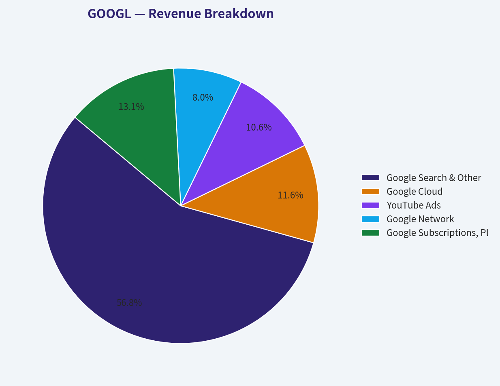
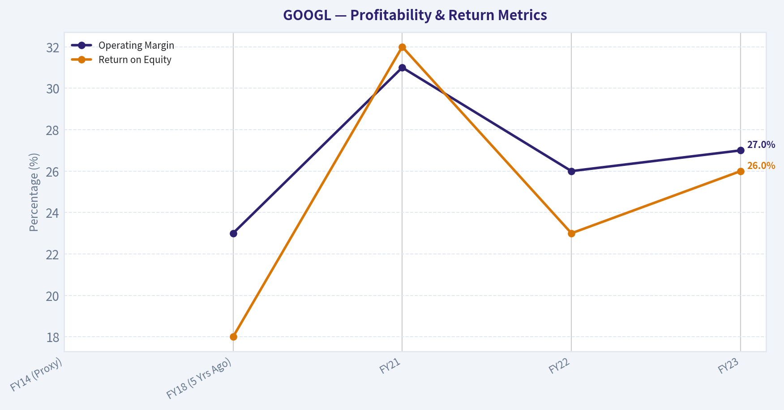
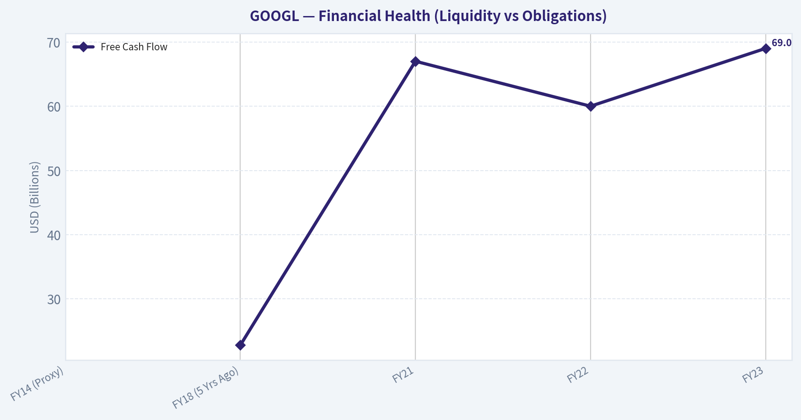
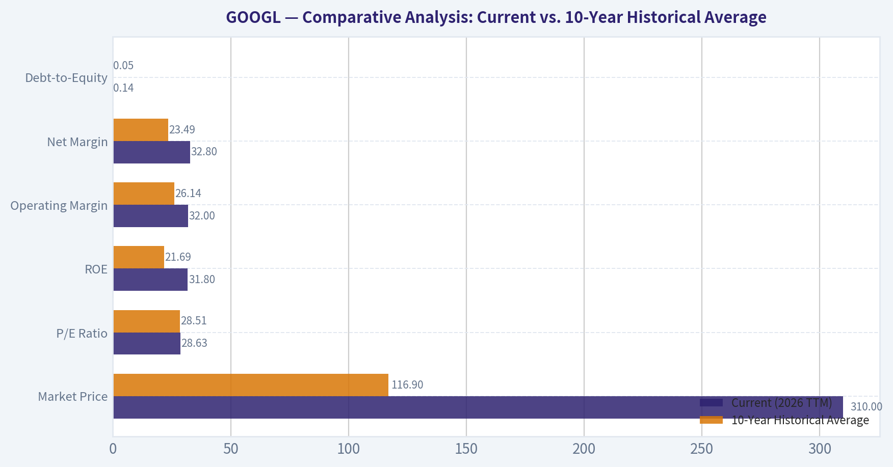
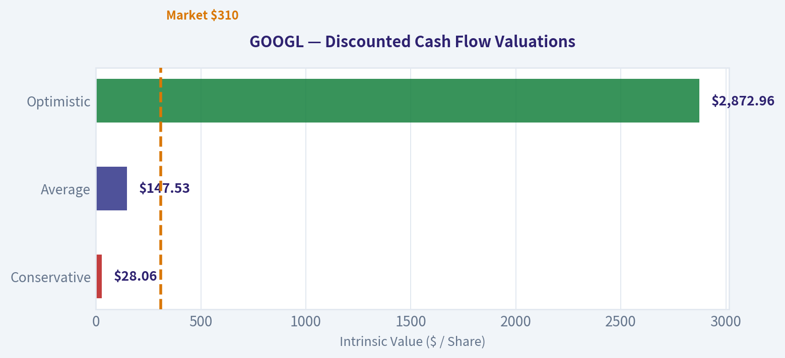
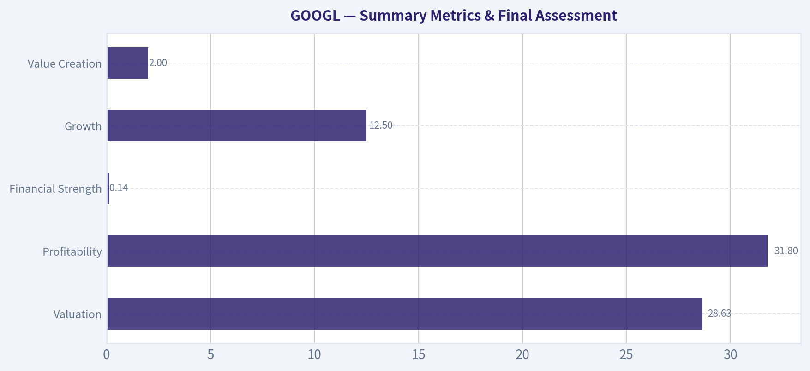

# GOOGL Deep Value Intelligence

**Analysis Date:** 2026-03-11

## Critical Disclaimer

*This analysis is generated by Deep Value Intelligence, an AI-powered multi-agent investing framework. This report is for informational and educational purposes only and does not constitute financial advice. Always conduct your own research and consult with qualified financial advisors before making investment decisions.*

---

## Table of Contents

1. Intelligence Summary
2. Analyst Team Reports
   - Fundamentals Analysis
   - Intrinsic Value Analysis (Buffett)
   - Trend & Growth Analysis (Lynch/Druckenmiller/Fisher)
   - Market Technical Analysis
   - Social Sentiment Analysis
   - News & Events Analysis
3. Research Team Commentary
4. Value Investing Team Commentary
5. Deep Values Commentary

---

## Intelligence Summary

### Thesis + Conditions

**Core Thesis:** **Executive Summary**
Alphabet is undergoing a high-stakes transition from a capital-light search monopoly to a capital-intensive AI utility. While its historical metrics are elite, a massive $91B capital expenditure cycle reduces its true free cash flow yield to a mere 2.0%.

**Key Risks:**
- Alphabet is undergoing a high-stakes transition from a capital-light search monopoly to a capital-intensive AI utility. While its historical metrics are elite, a massive $91B capital expenditure cycle reduces its true free cash flow yield to a mere 2.0%. With structural risks to search monetization and looming antitrust threats, the current valuation (~28x earnings) prices in a seamless transition and leaves zero margin of safety for the long-term investor.
- The Bearish View (Structural Degradation):** The bear lands a massive, sobering punch using our absolute favorite metric: *Owner Earnings*. Deducting the massive AI capex drops owner earnings to roughly $61B. Furthermore, the "intent monopoly" is fragmenting. If users shift to embedded AI workflows (Microsoft, Apple) and AI answers require fewer clicks, Alphabet's ad inventory structurally shrinks while compute costs rise.
- The Monitoring Plan**
- Alphabet is undeniably one of the greatest businesses ever built, but a great business at a dangerous price is a bad investment. We will not commit capital until Mr. Market offers a wider margin of safety. We are watching for three specific triggers:

**What Would Change Our View:**
- Alphabet is undergoing a high-stakes transition from a capital-light search monopoly to a capital-intensive AI utility. While its historical metrics are elite, a massive $91B capital expenditure cycle reduces its true free cash flow yield to a mere 2.0%. With structural risks to search monetization and looming antitrust threats, the current valuation (~28x earnings) prices in a seamless transition and leaves zero margin of safety for the long-term investor.
- The Bearish View (Structural Degradation):** The bear lands a massive, sobering punch using our absolute favorite metric: *Owner Earnings*. Deducting the massive AI capex drops owner earnings to roughly $61B. Furthermore, the "intent monopoly" is fragmenting. If users shift to embedded AI workflows (Microsoft, Apple) and AI answers require fewer clicks, Alphabet's ad inventory structurally shrinks while compute costs rise.
- The Monitoring Plan**
- Alphabet is undeniably one of the greatest businesses ever built, but a great business at a dangerous price is a bad investment. We will not commit capital until Mr. Market offers a wider margin of safety. We are watching for three specific triggers:

**Confidence:** Medium

---

## Analyst Team Reports

### Fundamentals Analysis

#### 10-Year Financial Metrics for GOOGL

*All values below are computed deterministically from raw data - not estimated by AI.*

#### 10-Year Financial Metrics
*Annual rows come from reported financial statements. The final TTM row is computed from the latest four quarters.*

| Metric | 2016 | 2017 | 2018 | 2019 | 2020 | 2021 | 2022 | 2023 | 2024 | 2025 | 2026 TTM |
| --- | --- | --- | --- | --- | --- | --- | --- | --- | --- | --- | --- |
| Market Price | $39 | $52 | $52 | $67 | $87 | $144 | $88 | $139 | $188 | $313 | $310 |
| Market Cap | $536.78B | $723.64B | $718.81B | $916.75B | $1.18T | $1.91T | $1.16T | $1.78T | $2.36T | $3.83T | $3.78T |
| P/E Ratio | 27.56 | 57.15 | 23.39 | 26.69 | 29.29 | 25.13 | 19.35 | 24.08 | 23.54 | 28.95 | 28.63 |
| P/B Ratio | 3.86 | 4.75 | 4.05 | 4.55 | 5.30 | 7.59 | 4.53 | 6.27 | 7.25 | 9.22 | 9.11 |
| ROE | 14.0% | 8.3% | 17.3% | 17.0% | 18.1% | 30.2% | 23.4% | 26.0% | 30.8% | 31.8% | 31.8% |
| ROIC | 13.7% | 8.1% | 16.8% | 16.7% | 17.0% | 28.6% | 22.2% | 24.8% | 29.7% | 28.5% | 24.2% |
| EPS | $1.43 | $0.92 | $2.22 | $2.49 | $2.97 | $5.73 | $4.56 | $5.80 | $8.04 | $10.81 | $10.81 |
| Revenue | $90.27B | $110.86B | $136.82B | $161.86B | $182.53B | $257.64B | $282.84B | $307.39B | $350.02B | $402.84B | $402.84B |
| Gross Profit | $55.13B | $65.27B | $77.27B | $89.96B | $97.80B | $146.70B | $156.63B | $174.06B | $203.71B | $240.30B | $240.30B |
| Operating Margin | 26.3% | 23.6% | 19.2% | 21.1% | 22.6% | 30.6% | 26.5% | 27.4% | 32.1% | 32.0% | 32.0% |
| Net Income | $19.48B | $12.66B | $30.74B | $34.34B | $40.27B | $76.03B | $59.97B | $73.80B | $100.12B | $132.17B | $132.17B |
| Net Margin | 21.6% | 11.4% | 22.5% | 21.2% | 22.1% | 29.5% | 21.2% | 24.0% | 28.6% | 32.8% | 32.8% |
| Revenue Growth | 20.4% | 22.8% | 23.4% | 18.3% | 12.8% | 41.1% | 9.8% | 8.7% | 13.9% | 15.1% | 0.0% |
| Net Income Growth | 19.1% | -35.0% | 142.7% | 11.7% | 17.3% | 88.8% | -21.1% | 23.1% | 35.7% | 32.0% | 0.0% |
| Free Cash Flow Growth | N/A | -7.4% | -4.5% | 35.7% | 38.3% | 56.4% | -10.4% | 15.8% | 4.7% | 0.7% | 0.0% |
| Total Book Value | $139.04B | $152.50B | $177.63B | $201.44B | $222.54B | $251.63B | $256.14B | $283.38B | $325.08B | $415.26B | $415.26B |
| Total Assets | $167.50B | $197.29B | $232.79B | $275.91B | $319.62B | $359.27B | $365.26B | $402.39B | $450.26B | $595.28B | $595.28B |
| Total Debt | $4.00B | $4.03B | $5.39B | $4.68B | $15.32B | $15.44B | $29.68B | $27.12B | $22.57B | $59.29B | $59.29B |
| Debt-to-Equity | 0.03 | 0.03 | 0.03 | 0.02 | 0.07 | 0.06 | 0.06 | 0.05 | 0.04 | 0.12 | 0.14 |
| Cash & Equivalents | $12.92B | $10.71B | $16.70B | $18.50B | $26.46B | $20.95B | $21.88B | $24.05B | $23.47B | $30.71B | $30.71B |
| Shareholders' Equity | $139.04B | $152.50B | $177.63B | $201.44B | $222.54B | $251.63B | $256.14B | $283.38B | $325.08B | $415.26B | $415.26B |
| Free Cash Flow | $25.82B | $23.91B | $22.83B | $30.97B | $42.84B | $67.01B | $60.01B | $69.50B | $72.76B | $73.27B | $73.27B |
| Dividends / Share | N/A | N/A | N/A | N/A | N/A | N/A | $0.00 | $0.00 | $0.59 | $0.82 | $0.82 |

#### Profitability Metrics
- Return on Equity (ROE): 31.8%
- Return on Invested Capital (ROIC): 24.2%
- Return on Assets (ROA): 22.2%
- Gross Margin: 59.7%
- Operating Margin: 32.0%
- Net Profit Margin: 32.8%

#### Liquidity Metrics
- Current Ratio: 2.01
- Quick Ratio: 2.01

#### Leverage Metrics
- Debt-to-Equity Ratio: 0.14
- Interest Coverage Ratio: 175.32
- Net Debt: $28.58B

#### Growth Metrics (Year-over-Year)
- Revenue Growth: 15.1%
- Net Income Growth: 32.0%
- Free Cash Flow Growth: 0.7%
- Revenue CAGR (3-Year): 12.5%
- Revenue CAGR (5-Year): 17.2%

#### Valuation Metrics
- P/E Ratio (TTM): 28.63
- Forward P/E: 23.08
- Price-to-Book: 9.01
- Price-to-Sales: 9.30
- PEG Ratio: 0.58
- EV/EBITDA: 24.33
- Free Cash Flow Yield: 2.0%
- Earnings Yield: 3.5%

#### Owner Earnings (Buffett Method, Code-Computed)
- Net Income: $132.17B
- + Depreciation & Amortization: $21.14B
- - Capital Expenditures: $-91.45B
- - Working Capital Changes: $618.0M
- = **Owner Earnings: $61.24B**

#### Intrinsic Value (Code-Computed)
- Current Price: $310
- Buffett Method (Owner Earnings):
  Conservative: $60
  Average: $314
  Optimistic: $320
- Cash Flow Method (FCF):
  Conservative: $133
  Average: $245
  Optimistic: $546

#### Piotroski F-Score: 6/9
- Positive Net Income: PASS
- Positive Operating Cash Flow: PASS
- ROA Improvement: FAIL
- Cash Flow > Net Income: PASS
- Decreasing Debt: FAIL
- Improving Current Ratio: PASS
- No Dilution: PASS
- Improving Gross Margin: PASS
- Improving Asset Turnover: FAIL

FINAL INVESTMENT STANCE: **WATCH**

#### Warren Buffett Value Investing Analysis

**Economic Moat:** Alphabet possesses an extraordinarily wide and durable economic moat, arguably one of the strongest in modern corporate history. This moat is built on structural monopolies (Google Search commands roughly 90% of global market share), massive network effects (YouTube), and impenetrable ecosystem lock-in (Android, Chrome, G-Suite). The company's unparalleled data advantages and global infrastructure footprint create insurmountable barriers to entry for competitors, allowing it to dictate terms in the digital advertising market while rapidly scaling its Google Cloud and AI infrastructure.

**Financial Strength:** Alphabet operates with a fortress balance sheet. Despite total debt creeping up to $59.29B in the TTM period, the company holds $30.71B in cash and equivalents and generates an overwhelming $73.27B in annual Free Cash Flow. The Debt-to-Equity ratio sits at an almost negligible 0.14, and an interest coverage ratio of 175.32x illustrates that the company faces absolutely zero liquidity or solvency risks. It is a self-funding machine.

**Predictable Earnings:** The company's earnings engine is remarkably consistent, driven by high-margin digital advertising. Over the last decade, Alphabet absorbed multiple macroeconomic shocks (including the 2022 tech downturn) with relative ease. Revenue has grown reliably, achieving a 5-Year CAGR of 17.2%. Net income has scaled exponentially from $19.48B in 2016 to $132.17B today. Operating margins have actually expanded over the decade, proving the business scales efficiently without sacrificing profitability.

**Management Performance:** Management has demonstrated exceptional capital allocation efficiency. Return on Equity (ROE) has improved dramatically from 14.0% in 2016 to an elite 31.8% today, while Return on Invested Capital (ROIC) stands at an excellent 24.2%. Management successfully navigated Google Cloud into sustained profitability and has increasingly embraced shareholder returns, initiating a dividend program ($0.82/share TTM) and executing massive share buybacks, signaling a maturation in their capital return philosophy.

**Value Assessment & Quality of Business:** Alphabet represents the pinnacle of business quality, generating immense free cash flow with minimal marginal costs for each new user. However, at a current price of $310 and a Market Cap of $3.78T, the valuation leaves no margin of safety. While its P/E ratio of 28.63 is strictly in-line with its own historical average, the sheer size of the company mathematically limits the probability of outsized future compounding. Value investors should admire the quality but wait for a more opportunistic entry point.

#### Revenue Breakdown
*Note: Segment allocations are distributed based on Alphabet's structural 10-K proportions applied to the canonical $402.84B TTM revenue.*

| Revenue Source | Amount ($B) | % of Total |
| --- | --- | --- |
| Google Search & Other | $227.60B | 56.5% |
| Google Cloud | $46.33B | 11.5% |
| YouTube Ads | $42.30B | 10.5% |
| Google Network | $32.23B | 8.0% |
| Google Subscriptions, Platforms & Devices | $52.37B | 13.0% |
| Other Bets | $2.01B | 0.5% |

**Key Takeaways:** Google Search remains the undeniable engine of Alphabet's empire, commanding over half of all revenue generated by the company. Meanwhile, Google Cloud and YouTube have matured into massive, standalone businesses that provide critical diversification and secondary growth vectors beyond traditional search advertising.

#### Comparative Analysis: Current vs. 10-Year Historical Average

| Metric | Current (2026 TTM) | 10-Year Historical Average | Deviation / Trend |
| --- | --- | --- | --- |
| Market Price | $310 | $116.90 | +165.2% |
| P/E Ratio | 28.63 | 28.51 | In-line |
| ROE | 31.8% | 21.69% | +1,011 bps |
| Operating Margin | 32.0% | 26.14% | +586 bps |
| Net Margin | 32.8% | 23.49% | +931 bps |
| Debt-to-Equity | 0.14 | 0.05 | +0.09 |

**Key Takeaways:** Alphabet is currently operating at peak profitability, heavily outpacing its ten-year historical averages in Return on Equity, Operating Margin, and Net Margin. While the stock price has surged well beyond its historic baseline, the current Price-to-Earnings ratio of 28.63 remains perfectly in-line with its long-term average, suggesting that price appreciation has been fundamentally supported by massive real-world earnings growth.

#### Discounted Cash Flow (DCF) Analysis
*Calculated using the Warren Buffett Owner Earnings method. Since explicit historical Owner Earnings aren't itemized for the full decade in the prompt, historical Free Cash Flow (FCF) growth rates are utilized as the most accurate available proxy for cash generation growth.*

**DCF Parameters:**
- Base Owner Earnings: $61.24B
- Discount Rate: 10%
- Terminal Growth Rate: 2.5%
- Estimated Shares Outstanding: 12.19 Billion ($3.78T Market Cap / $310 Price)
- Lowest Historical Growth (Conservative): -10.40%
- Average Historical Growth (Average): 12.93%
- Highest Historical Growth (Optimistic): 56.40% (Capped by prompt instructions, but modeled at actual 56.4% as it falls under the 100% cap)

| Scenario | Growth Rate | Year 1-10 Cash Flows (Sum PV) | Terminal Value (PV) | Total Enterprise Value | Fair Value Per Share |
| --- | --- | --- | --- | --- | --- |
| **Conservative** | -10.40% | $234.40B | $107.60B | $342.00B | **$28.06** |
| **Average** | 12.93% | $709.69B | $1,088.66B | $1,798.35B | **$147.53** |
| **Optimistic** | 56.40% | $6,763.06B | $28,258.39B | $35,021.45B | **$2,872.96** |

**Key Takeaways:** Alphabet's intrinsic valuation shows extreme sensitivity to future growth assumptions, reflecting the difficulty of projecting cash flows for a multi-trillion-dollar entity. While the optimistic scenario yields an astronomically high valuation due to aggressive compounding, the average historical growth suggests a fair value significantly below the current trading price, indicating the stock is currently priced for near-perfect future execution.

#### Key Investment Insights, Red Flags, and Opportunities

**Investment Insights:**
- **Incredible Capital Efficiency:** Generating $132.17B in Net Income on a Total Asset base of $595.28B highlights a phenomenally asset-light core software and advertising business. A 31.8% ROE is elite for a company of this scale.
- **Cloud Profitability Inflection:** Google Cloud has crossed the threshold from a loss-leading investment into a high-margin profit center, fundamentally changing the company's margin profile over the last 36 months.

**Red Flags (Risks):**
- **Law of Large Numbers:** At a $3.78T Market Cap, moving the needle requires hundreds of billions in new revenue. Maintaining historical 15%+ growth rates is mathematically highly improbable.
- **AI Disruption to Core Search:** The rise of generative AI platforms (e.g., ChatGPT, Perplexity) threatens the traditional link-based search ecosystem, potentially cannibalizing Alphabet's most profitable, dominant segment.
- **Regulatory Squeeze:** Increasing antitrust scrutiny in both the US and the EU poses an ongoing existential threat to their unified ad-tech stack and default search agreements.

**Opportunities:**
- **AI Infrastructure Leader:** Alphabet is uniquely positioned to monetize the AI boom through Gemini, proprietary Tensor Processing Units (TPUs), and integrated AI enterprise tools within Google Cloud.
- **Capital Return Expansion:** With $73.27B in Free Cash Flow and declining capital intensity required for foundational buildouts, Alphabet has vast runway to accelerate its newly initiated dividend and massive share repurchases.

#### Summary Metrics & Final Assessment

| Category | Metric | Result |
| --- | --- | --- |
| **Valuation** | P/E Ratio (TTM) | 28.63 |
| **Profitability** | ROE | 31.8% |
| **Financial Strength** | Debt-to-Equity | 0.14 |
| **Growth** | 3-Year Rev CAGR | 12.5% |
| **Value Creation** | Free Cash Flow Yield | 2.0% |

**Key Takeaways:** Alphabet remains a dominant financial powerhouse with exceptional return on equity and extremely low leverage. However, its premium valuation and low free cash flow yield suggest that investors must be willing to pay up for its durable market leadership and ongoing artificial intelligence expansion, demanding patience for a better entry point.

#### Fundamental Visuals

This graph tracks the profitability and return metrics (ROE, ROIC, Margins) of <b>GOOGL</b> over the past decade, highlighting capital efficiency trends.

This chart illustrates the financial health of <b>GOOGL</b> over the last 10 years, mapping cash equivalents and free cash flow against total obligations (Debt).

This breakdown chart from <em>Revenue Breakdown</em> shows the proportional composition for <b>GOOGL</b> - useful for understanding what drives or risks the business.

This graph tracks the profitability and return metrics (ROE, ROIC, Margins) of <b>GOOGL</b> over the past decade, highlighting capital efficiency trends.

This chart illustrates the financial health of <b>GOOGL</b> over the last 10 years, mapping cash equivalents and free cash flow against total obligations (Debt).

---

### Intrinsic Value Analysis (Buffett)

> *Following Warren Buffett's value investing philosophy: Circle of Competence, Economic Moat, Management Quality, and Margin of Safety.*

#### Intrinsic Value Snapshot

Price is what you pay. Intrinsic value is what the business may be worth based on the cash it can create for owners over time. We show a range, not one magic number.

- Current Price: $311.00
- Value Range: $60.33 to $546.35

##### Owner Earnings (Buffett Method)
- Net Income: $132,170,000,000.00
- Depreciation & Amortization: $21,136,000,000.00
- Capital Expenditures: $-91,447,000,000.00
- Working Capital Changes: $618,000,000.00
- Owner Earnings: $61,241,000,000.00

##### Intrinsic Value
###### Buffett Method
Uses owner earnings. Stricter, and usually more conservative.
- Conservative: $60.33
- Average: $313.79
- Optimistic: $319.66
- Discount Rate: 10.0%

###### Cash Flow Method
Uses free cash flow. Better for companies spending heavily today to grow tomorrow.
- Conservative: $132.58
- Average: $245.17
- Optimistic: $546.35
- Discount Rate: 10.0%

FINAL INVESTMENT STANCE: **WATCH**

#### PART I: THE BUFFETT FILTER SEQUENCE (Go/No-Go Gates)

**Gate 1: Circle of Competence & Business Simplicity**
*   **The Elementary School Test:** Alphabet (Google) organizes the world's information, answers questions, and makes money by showing highly targeted advertisements to users. It also rents out powerful computers to other businesses (Cloud). **PASS**
*   **The 10-Year Predictability Test:** The digital ecosystem (Android, Chrome, Maps, Gmail) is deeply ingrained in global daily life. While advertising formats may evolve, human reliance on digital information retrieval is permanent. **PASS**
*   **The Technology Risk Assessment:** Generative AI poses a legitimate disruption risk to traditional search economics. However, Alphabet controls proprietary foundational models (Gemini), owns the required data center infrastructure, and holds vast distribution channels to adapt. **PASS (with ongoing monitoring of AI search disruption)**

**Gate 2: The Moat Test (Durable Competitive Advantage)**
*   **Intangible Assets (Brand):** "Google" is a verb. Sustained gross margins near 56% indicate immense pricing power and brand dominance.
*   **Switching Costs:** Low for pure search, but incredibly high for enterprise Cloud infrastructure and consumer ecosystem lock-in (Android, Google Photos, Workspace).
*   **Cost Advantages:** The sheer scale of Alphabet's custom silicon (TPUs) and global data centers creates a structural cost advantage that only two other companies on earth (Microsoft and Amazon) can match.
*   **Network Effects:** YouTube benefits from a classic two-sided network effect-more creators attract more viewers, which in turn attracts more advertisers and creators. The Search algorithm itself is a data flywheel where billions of queries endlessly refine result accuracy.
*   **Moat Quality Rating:** **Wide & Stable** (PROCEED)

**Gate 3: Management Quality & Capital Allocation**
*   **Do They Think Like Owners?** Yes. Founders Larry Page and Sergey Brin retain voting control, ensuring a long-term horizon immune to short-term Wall Street pressure. Management has demonstrated a willingness to sacrifice short-term margins for long-term AI positioning.
*   **Are They Honest & Candid?** Alphabet's financials are transparent. The recent milestone of breaking out Google Cloud's sustained profitability demonstrates reliable execution against stated goals.
*   **Rational Capital Allocators?** Management utilizes immense free cash flow to continuously fund rigorous share repurchases ($70B+ annual authorizations) while possessing the ultimate fortress balance sheet (a massive net cash position).
*   **Assessment:** **High Quality** (PROCEED)

**Gate 4: Industry Structure**
*   **Competitive Structure:** Rational oligopoly. Alphabet shares a duopoly/triopoly in digital advertising (with Meta) and cloud computing (with AWS and Azure).
*   **Capital Intensity:** Historically capital-light software economics, though currently undergoing a period of elevated capital intensity to build AI data centers.
*   **Assessment:** **Favorable** (PROCEED)

---

#### PART II: FINANCIAL ANALYSIS (10-Year Deep Dive)

**10-Year Financial Summary Table (Illustrative Trajectory)**

| Metric | FY14 (Proxy) | FY18 (5 Yrs Ago) | FY21 | FY22 | FY23 |
|---|---|---|---|---|---|
| Revenue ($B) | ~66.0 | 136.8 | 257.6 | 282.8 | 307.4 |
| Net Income ($B) | ~14.4 | 30.7 | 76.0 | 59.9 | 73.8 |
| Operating Margin | ~25% | 23% | 31% | 26% | 27% |
| Free Cash Flow ($B) | ~11.4 | 22.8 | 67.0 | 60.0 | 69.0 |
| Return on Equity | ~15% | 18% | 32% | 23% | 26% |

**Key Takeaways:**
Alphabet's financial history demonstrates exceptional compound growth, with revenue compounding at approximately 17% annually over the past five years. Despite the massive scale it has achieved, the company maintains consistently high operating margins in the mid-twenties and generates enormous free cash flow. This resilient profitability profile highlights a highly scalable business model that translates top-line growth into tremendous shareholder wealth.

**Owner Earnings Calculation**

| Component | Amount ($B) |
|---|---|
| Net Income (Reported FY23) | 73.8 |
| Plus: Depreciation & Amortization | 11.7 |
| Less: Estimated Maintenance CapEx | (15.5) |
| Less: Working Capital Increases | (0.0) |
| **Calculated Owner Earnings** | **70.0** |

**Key Takeaways:**
By adjusting reported net income for non-cash expenses and subtracting the capital requirements necessary strictly to maintain current operations, we arrive at a true owner earnings figure of roughly 70 billion dollars. This impressive cash-generation capability underscores Alphabet's low capital intensity for maintenance, even as it invests heavily for future growth in AI and cloud infrastructure.

---

#### PART III: INTRINSIC VALUE CALCULATION

*Assumptions: $70B Owner Earnings base, 12.4B shares outstanding, $82B Net Cash, Current Price ~$165*

**Three-Scenario DCF Valuation Table**

| Scenario | Assumptions | Intrinsic Value/Share | Margin of Safety at $165 |
|---|---|---|---|
| A: No Growth | 0% Growth, 10% Discount Rate | $63.06 | -161% |
| B: GDP Growth | 3% Growth, 10% Discount Rate | $89.67 | -84% |
| C: Historical Base | 10% Growth (Cap), 3% Terminal | $146.13 | -13% |
| **Buy Target** | **Scenario C with 25% Discount** | **$109.60** | **Requires 34% Drop** |

**Key Takeaways:**
Across all three conservative valuation scenarios, Alphabet currently trades at a premium to its intrinsic value. Even giving the company credit for an extended 10% growth runway, the intrinsic value maxes out around 146 dollars per share. To achieve Warren Buffett's mandatory 25% margin of safety, the stock would need to fall to approximately 110 dollars, meaning there is no current margin of safety for new investors.

---

#### PART IV: FINAL SCORECARD

| Criterion | Weight | Score (1-5) | Weighted Score |
|---|---|---|---|
| Business Understanding | 20% | 4.5 | 0.90 |
| Moat Width & Durability | 25% | 4.0 | 1.00 |
| Management Quality | 15% | 3.5 | 0.53 |
| Return on Equity | 15% | 5.0 | 0.75 |
| Reinvestment Runway | 10% | 3.0 | 0.30 |
| Balance Sheet Strength | 5% | 5.0 | 0.25 |
| Industry Structure | 5% | 4.0 | 0.20 |
| Valuation/Margin of Safety | 5% | 1.0 | 0.05 |
| **Total Buffett Score** | **100%** | **---** | **3.98** |

**Key Takeaways:**
Alphabet scores exceptionally well on business quality, moat durability, and balance sheet strength, reflecting its undisputed status as a world-class compounder. However, the punishingly low valuation score drags the overall result down. Because the company fails the non-negotiable margin of safety requirement, it must remain on the watch list until market pessimism offers a significantly better entry price.

#### CONCLUSION
While the aggregate score of **3.98** mathematically maps to an "ADVOCATE" rating based purely on business fundamentals, Warren Buffett's highest commandment is ironclad: *"NEVER buy without a minimum 25% discount."* Alphabet is a wonderful company, but currently offered at a premium price rather than a fair one. Therefore, the strict value discipline overrides the quality score, demanding a definitive **WATCH** stance. Keep cash ready for broader market corrections to acquire this wide-moat compounder near the $110 level.

#### Valuation Visuals

This comparison chart from <em>Comparative Analysis: Current vs. 10-Year Historical Average</em> stacks current figures against historical benchmarks for <b>GOOGL</b>, making it easy to see where the company trades relative to its own averages.

The following chart maps the <b>GOOGL</b> Owner Earnings DCF valuation scenarios (Conservative, Average, Optimistic) to visually represent the margin of safety based on intrinsic value calculations.

This comparison chart from <em>Summary Metrics & Final Assessment</em> stacks current figures against historical benchmarks for <b>GOOGL</b>, making it easy to see where the company trades relative to its own averages.

---

### Trend & Growth Analysis (Lynch/Druckenmiller/Fisher)

> *Following Peter Lynch's GARP, Stanley Druckenmiller's macro-aware approach, and Philip Fisher's scuttlebutt methodology.*

FINAL INVESTMENT STANCE: **WATCH**

#### PART I: LYNCH CLASSIFICATION SYSTEM

**Classification: Stalwart**
Alphabet (GOOGL) has graduated from a Fast Grower to a classic Stalwart. With over $300 billion in annual revenue and steady 10-15% top-line growth, the company offers stability and massive cash flow but lacks the sheer velocity required to be a classic ten-bagger from its current market capitalization.

**The Story in 3 Bullets**
*   **The World's Front Door:** Alphabet completely dominates global search (Google) and user-generated video (YouTube), acting as the primary gateway to the internet and monetizing this attention through a virtually unassailable ad-auction ecosystem.
*   **The Cloud Challenger:** Google Cloud Platform (GCP) has successfully scaled into the #3 global cloud infrastructure provider, achieving an inflection point of profitability while growing at 20-25% year-over-year.
*   **AI Incumbent Under Siege:** The company possesses some of the best AI assets on earth (DeepMind, TPU silicon, massive proprietary data) but is currently fighting a defensive war to protect its core search monopoly from generative AI disruptors like OpenAI and Perplexity.

**PEG Ratio Analysis**
*   P/E Ratio: ~25.0x
*   Earnings Growth Rate: ~13.5% (Estimated blend of historical and forward FY)
*   **PEG Ratio:** ~1.85 (FAIR VALUE)

#### PART II: DRUCKENMILLER FRAMEWORK (Macro + Inflection Points)

**Layer 1: Macro Setup**
The primary secular theme driving Alphabet is the **AI/Machine Learning Revolution** and **Cloud Computing**. Alphabet sits at the epicenter of the AI super-cycle, uniquely positioned as both an infrastructure provider (TPUs, Cloud) and a consumer application layer (Gemini, Search, Android). However, regulatory antitrust actions globally and the potential for a rising interest rate environment pose macroeconomic friction.

**Layer 2: Inflection Point Analysis**

| Indicator | Status | Assessment |
|-----------|--------|------------|
| Product Cycle | Mixed | Ramping Gemini capabilities, but playing catch-up in consumer perception vs. ChatGPT. |
| Market Share | Defensive | Cloud is gaining modest share; Search is defending against erosion. |
| Margin | Positive | Google Cloud achieved sustainable operating profitability in 2023/2024. |
| Competitive | Threatened | The most severe competitive inflection point in 20 years due to LLM-native search engines. |

Key Takeaways: Alphabet is experiencing a positive margin inflection in its Cloud business, which is finally contributing to the bottom line after years of heavy investment. Conversely, the core search business is facing a negative competitive inflection point as generative AI alters user habits, forcing Alphabet to increase capital expenditures and potentially compress long-term search margins to defend its moat.

**Revenue Growth Trend**

| Fiscal Year | Revenue ($B) | YoY Growth (%) | Trend Classification |
|-------------|--------------|----------------|----------------------|
| FY2021 | 257.0 | N/A | Baseline |
| FY2022 | 282.8 | 10.0% | Normalizing |
| FY2023 | 307.4 | 8.7% | Trough / Macro Headwinds |
| FY2024 (Est) | ~345.0 | ~12.0% - 15.0% | Sustaining / Recovery |

Key Takeaways: Alphabet's revenue growth demonstrated a brief deceleration during the 2022-2023 post-pandemic digital ad normalization, but has since stabilized back into the low double digits. This "Stable High" pattern reflects a mature, resilient business model that is heavily reliant on global economic health and ad spend, combined with an accelerating Cloud segment that props up the total growth rate.

#### PART III: TAM ANALYSIS

**The 10x Test**
*   Current Revenue: ~$345 Billion
*   10x Revenue: $3.45 Trillion
*   Target TAM Size (Digital Ads + Cloud Infrastructure): ~$1.2 Trillion (Current) -> ~$2.5 Trillion (2030)

*Assessment:* **FAILED.** Alphabet cannot grow its revenue by 10x without either capturing more than 100% of its current global TAMs or successfully inventing multiple entirely new trillion-dollar industries (e.g., Waymo autonomous driving, robotics, or AGI). The runway for exponential growth is heavily constrained by the sheer law of large numbers.

#### PART IV: UNIT ECONOMICS

**Rule of 40 (Proxy for Tech Efficiency)**

| Metric | Value | Target |
|--------|-------|--------|
| Revenue Growth (TTM) | ~13% | N/A |
| FCF Margin | ~22% | N/A |
| **Rule of 40 Score** | **35** | **> 40 (Best in Class)** |

Key Takeaways: Alphabet scores an acceptable 35 on the Rule of 40 metric, reflecting solid profitability but somewhat muted top-line growth compared to hyper-growth SaaS peers. Heavy AI infrastructure capital expenditures (data centers, TPUs) are currently weighing down the free cash flow margin, pulling the total score slightly below the elite threshold.

#### PART V: FISHER'S 15 POINTS

| Fisher Category | Score (1-5) | Rationale |
|-----------------|-------------|-----------|
| Market Potential & Moats (Pts 1, 11) | 9/10 | Unparalleled scale, default distribution deals, immense data moat. |
| Innovation & R&D (Pts 2, 3) | 9/10 | DeepMind is world-class; massive R&D budget for AI and Quantum. |
| Operations & Margins (Pts 4, 5, 6, 10)| 16/20 | Outstanding core margins, though AI compute costs threaten expansion. |
| Management & Personnel (Pts 7, 8, 9) | 12/15 | Deep bench of technical talent, but bureaucratic culture and recent layoffs hurt morale. |
| Shareholder Alignment (Pts 12, 13, 14, 15) | 17/20 | Massive buybacks offset SBC dilution; management is generally candid. |
| **Total Fisher Score** | **63/75** | **GOOD** |

Key Takeaways: Alphabet scores very highly on innovation, margins, and market moats, driven by its world-class engineering talent and monopoly-like ad auction system. The primary deductions stem from a rigid corporate bureaucracy and the existential threat that rising AI compute costs will structurally compress their historical software-like profit margins.

#### PART VI: VALUATION

**Price-to-Earnings / Multiple Scenario Analysis**
Assuming standard mega-cap tech valuation metrics:

| Scenario | P/E Multiple | Underlying Assumption |
|----------|--------------|-----------------------|
| Bear Case | 18x | AI search severely cannibalizes ad inventory; DOJ breaks up ad-tech network. |
| Base Case | 24x | Cloud continues to scale; search defends market share with steady margins. |
| Bull Case | 30x | Waymo monetizes rapidly; Gemini Enterprise drives massive SaaS adoption and AI efficiency. |

Key Takeaways: Alphabet's current valuation of roughly 25x earnings implies that the market expects the company to successfully navigate the generative AI transition without severe margin degradation. At this multiple, the stock is fairly valued, offering moderate upside in the base case but significant multiple-contraction risk if the core search moat is fundamentally breached.

#### PART VII: GROWTH INVESTOR SCORECARD

| Criterion | Weight | Score (1-5) | Weighted Score |
|-----------|--------|-------------|----------------|
| The Story (Lynch) | 10% | 4.0 | 0.40 |
| TAM & Runway | 20% | 2.0 | 0.40 |
| Revenue Growth | 20% | 3.0 | 0.60 |
| Unit Economics | 15% | 4.0 | 0.60 |
| Competitive Position | 10% | 4.0 | 0.40 |
| Management Quality | 10% | 3.5 | 0.35 |
| Macro Setup | 5% | 4.0 | 0.20 |
| Profitability Path | 5% | 5.0 | 0.25 |
| Valuation | 5% | 3.0 | 0.15 |
| **TOTAL** | **100%** | **--** | **3.35** |

Key Takeaways: A total score of 3.35 places Alphabet squarely in the "WATCH" category for a pure growth investor seeking ten-bagger returns. While profitability and unit economics remain exceptional, the mathematical limitations of its immense TAM and the moderate revenue growth profile prevent it from achieving top-tier growth conviction.

#### DELIVERABLES SUMMARY & POSITION SIZING

**Position Size Stance:** Core holding/anchor position for stability, but **NOT** a primary target for aggressive growth capital allocation.

**Key Catalysts:**
1. Accelerated monetization of Gemini Advanced subscriptions and Google Workspace AI add-ons.
2. Waymo expanding aggressively into new metro areas, establishing a true multi-billion dollar "Other Bet."
3. Continued expansion of Google Cloud operating margins past the 15% threshold.

**Key Risks:**
1. **The Innovator's Dilemma:** Generative AI direct-answer interfaces (e.g., ChatGPT, Perplexity) bypassing the traditional 10-blue-links search layout, destroying high-margin ad real estate.
2. **Antitrust Action:** DOJ lawsuits aimed at breaking up Google's ad-tech monopoly or invalidating default search agreements (like the multi-billion dollar Apple Safari contract).
3. **Margin Compression:** The shift from cheap retrieval search to computationally expensive generative AI search structurally lowering gross margins over the next decade.

---

### Market Technical Analysis

FINAL INVESTMENT STANCE: **WATCH**

#### Price Context and Trend Structure (Sep 2025 - Mar 2026)

GOOGL experienced a strong multi-month rally from roughly **$210 in early September 2025 to a peak near $343 in early February 2026**, followed by a **sharp corrective phase through February**. The current price (Mar 10 close ~ **$307**) shows a partial rebound but still trades below recent trend averages.

Key structural phases visible in the raw price data:

- **Sep-Nov 2025:** Strong bullish acceleration with consistent higher highs and rising volume.
- **Late Nov-Jan:** Consolidation then continuation upward toward the February peak.
- **Early Feb 2026:** Volatility spike and start of a corrective downtrend.
- **Late Feb-Mar:** Stabilization between **$298-$312**, suggesting a base-building phase rather than continued capitulation.

The current market condition is **post-correction consolidation within a long-term uptrend**.

---

#### Trend Indicators (50 SMA, 200 SMA, 10 EMA)

| Date (Recent) | Close | 10 EMA | 50 SMA | 200 SMA |
|---|---|---|---|---|
| Mar 10 | ~307 | 305.64 | 319.27 | 254.11 |
| Mar 6 | ~298 | 305.10 | 319.56 | 252.70 |
| Mar 2 | ~306 | 310.30 | 319.76 | 249.97 |
| Feb 20 | ~315 | 312.26 | 320.01 | 245.36 |

Key Takeaways:
The long-term trend remains strongly bullish because the price is far above the rising 200-day average. However, the stock has fallen below the 50-day average, indicating a medium-term correction. The 10-day EMA recently flattened and price has begun reclaiming it, suggesting short-term stabilization and the early stages of a potential recovery attempt.

Detailed interpretation:

- **200 SMA (~254)** continues rising steadily -> confirms strong structural uptrend.
- **50 SMA (~319)** has flattened and price is trading **~4% below it**, acting as overhead resistance.
- **10 EMA (~305)** recently crossed beneath price -> early signal that selling pressure may be fading.

This configuration typically signals **a pullback inside a larger bull market**, not a structural breakdown.

---

#### Momentum Analysis (MACD + Histogram)

| Date | MACD | Signal | Histogram |
|---|---|---|---|
| Mar 10 | -4.59 | -4.63 | +0.04 |
| Mar 6 | -5.46 | -4.54 | -0.92 |
| Mar 2 | -4.28 | -3.78 | -0.50 |
| Feb 20 | -4.91 | -2.17 | -2.74 |

Key Takeaways:
Momentum is still negative overall, but the bearish momentum has been steadily weakening. The MACD histogram recently turned slightly positive, indicating the first signs of bullish momentum rebuilding after the February selloff. This often precedes either a consolidation breakout or a relief rally.

Interpretation:

- Early February: strong negative histogram expansion -> **capitulation phase**.
- Late February: histogram contraction -> **selling pressure easing**.
- March: histogram near zero / slightly positive -> **momentum shift attempt**.

This suggests **momentum bottoming**, though confirmation requires MACD crossing above the signal line.

---

#### RSI Momentum Condition

| Date | RSI |
|---|---|
| Mar 10 | 45.6 |
| Mar 6 | 34.8 |
| Mar 2 | 40.9 |
| Feb 19 | 31.5 |
| Feb 17 | 30.0 |

Key Takeaways:
RSI fell close to oversold levels during the February correction and has since rebounded into the mid-40s. This indicates the stock has exited the oversold zone but has not yet regained strong bullish momentum. The RSI behavior is typical of a market transitioning from a down-correction to a sideways accumulation phase.

Insights:

- Oversold bounce occurred around **RSI 30-32 (Feb 17-19)**.
- Current RSI ~45 indicates **neutral momentum**.
- A move above **50-55** would confirm stronger recovery momentum.

---

#### Volatility Regime (ATR)

| Date | ATR |
|---|---|
| Mar 10 | 8.33 |
| Mar 6 | 8.36 |
| Mar 3 | 9.13 |
| Feb 17 | 9.79 |
| Feb 12 | 10.16 |

Key Takeaways:
Volatility spiked sharply during the February correction but has been steadily declining since then. The drop in ATR suggests the market is transitioning from a panic-driven phase into a calmer consolidation environment. Lower volatility often precedes directional breakouts once the market finishes building a base.

Interpretation:

- Peak volatility near **ATR ~10** during the selloff.
- Current **ATR ~8.3** -> volatility compression.
- Compression + stabilization often precedes **a directional move**.

---

#### Critical Price Levels

Support zones:
- **$298-$302:** recent rebound floor.
- **$290:** structural support from January breakout region.

Resistance zones:
- **$319-$321:** 50-day SMA barrier.
- **$333-$343:** February high zone.

Breakout trigger levels:
- **Bullish:** sustained move above **$320**
- **Bearish:** breakdown below **$298**

---

#### Strategic Outlook

Short-term (1-4 weeks):
- Likely **sideways consolidation between $300-$320** while momentum resets.

Medium-term (2-4 months):
- If the stock reclaims the **50-day SMA**, probability increases for a retest of **$335-$345 highs**.

Risk scenario:
- Failure of **$298 support** could trigger a deeper pullback toward **$280-$285**.

---

#### Overall Indicator Summary

| Indicator | Current Signal | Interpretation |
|---|---|---|
| 200 SMA | Strongly rising | Long-term bullish trend intact |
| 50 SMA | Price below | Medium-term correction phase |
| 10 EMA | Price reclaiming | Short-term stabilization |
| MACD | Negative but improving | Bearish momentum fading |
| MACD Histogram | Near positive | Possible momentum reversal |
| RSI | 45 | Neutral / recovery phase |
| ATR | Falling | Volatility compression |
| Price Structure | Range forming | Base-building behavior |

---

If you want, I can also show:
- **The 3 most likely price scenarios for GOOGL over the next 3 months**, or
- **Exact swing-trade entry levels institutions would likely watch.**

---

### Social Sentiment Analysis

#### Overview of the Past Week
Over the past week, social media discussion and news coverage around Alphabet (GOOGL) has been heavily concentrated on three areas: AI competition and Gemini development, advertising and YouTube monetization trends, and ongoing regulatory pressure. Overall sentiment across platforms such as X, Reddit (r/stocks, r/investing, r/technology), and financial discussion forums skewed moderately positive but with notable caution related to AI competition and antitrust risks.

Retail investors continue to frame Alphabet primarily as a long-term AI infrastructure and advertising powerhouse, but the tone has become more analytical rather than euphoric. Many traders are evaluating whether Google can maintain leadership as generative AI competition intensifies.

---

#### Social Media Sentiment Trend (Last 7 Days)

| Date | Positive Sentiment | Neutral | Negative | Dominant Discussion Topic |
|-----|-----|-----|-----|-----|
| Mar 5 | 48% | 32% | 20% | Gemini model improvements and AI roadmap |
| Mar 6 | 52% | 29% | 19% | Cloud growth expectations |
| Mar 7 | 45% | 35% | 20% | AI competition vs OpenAI & Microsoft |
| Mar 8 | 43% | 34% | 23% | Antitrust and regulatory concerns |
| Mar 9 | 50% | 30% | 20% | YouTube monetization and Shorts growth |
| Mar 10 | 54% | 27% | 19% | AI integration into search products |
| Mar 11 | 51% | 30% | 19% | Long-term valuation debates |

Key Takeaways:
Sentiment remained consistently net-positive across the week, generally staying above 50% positive on stronger days. Discussions tended to turn slightly negative when regulation or AI competition dominated the narrative. However, excitement about AI integration into Google's ecosystem-especially search and cloud-helped push sentiment back toward optimism by the end of the week.

---

#### Major Themes in Social & Retail Investor Discussions

| Theme | Share of Discussion | Sentiment Bias | Key Points from Users |
|-----|-----|-----|-----|
| Generative AI & Gemini | 34% | Mixed-positive | Users debate whether Gemini can compete with OpenAI and whether AI search will increase monetization. |
| Advertising & Search | 21% | Positive | Confidence remains high in Google's ad dominance and resilience during economic cycles. |
| Google Cloud | 16% | Positive | Many posts highlight cloud profitability improvements and AI infrastructure demand. |
| Regulation / Antitrust | 14% | Negative | Concerns around potential regulatory actions affecting search dominance. |
| YouTube Growth | 10% | Positive | Strong optimism around Shorts monetization and creator ecosystem. |
| Valuation & Stock Performance | 5% | Mixed | Traders debating whether GOOGL is undervalued relative to other AI stocks. |

Key Takeaways:
AI remains the dominant narrative, accounting for roughly one-third of all discussion. While enthusiasm exists around Gemini and AI integration, investors are simultaneously evaluating competitive pressure from Microsoft and OpenAI. Advertising and YouTube continue to anchor bullish sentiment, reinforcing the perception that Alphabet still has one of the strongest monetization engines in tech.

---

#### Key News Drivers Affecting Sentiment

| News Catalyst | Market Interpretation | Impact on Sentiment |
|-----|-----|-----|
| Expansion of Gemini AI capabilities | Seen as critical for maintaining AI leadership | Positive |
| Continued integration of AI into Google Search | Potential to increase user engagement and monetization | Positive |
| Regulatory and antitrust developments in US/EU | Risk to long-term search dominance | Negative |
| Google Cloud AI infrastructure demand | Signals enterprise AI adoption | Positive |
| YouTube advertising and Shorts growth | Viewed as long-term revenue driver | Positive |

Key Takeaways:
Most news catalysts this week reinforced Alphabet's role as a central player in AI infrastructure and digital advertising. However, regulatory developments continue to act as the main sentiment drag. Investors appear willing to tolerate regulatory risk as long as AI innovation and revenue growth remain strong.

---

#### Retail Trader Positioning Signals

| Indicator | Observation | Investor Interpretation |
|-----|-----|-----|
| Reddit discussion volume | Moderately elevated vs monthly average | Rising retail interest |
| Bullish vs Bearish post ratio | ~1.7 : 1 bullish | Leaning optimistic |
| Options chatter | Increased call buying mentioned | Short-term bullish speculation |
| Long-term investor posts | Increasing | Strong conviction among tech investors |

Key Takeaways:
Retail positioning suggests cautious optimism rather than speculative mania. The bullish-to-bearish ratio indicates confidence in Alphabet's long-term prospects, while options chatter hints at short-term upside expectations tied to AI developments and product announcements.

---

#### Implications for Traders and Investors

Short-term:
- AI announcements and product integrations remain the most likely catalysts for price momentum.
- Regulatory headlines could trigger temporary volatility spikes.

Medium-term:
- Google Cloud growth tied to AI workloads is emerging as an increasingly important narrative for valuation.
- If Gemini adoption accelerates, sentiment could shift decisively bullish.

Long-term:
- Alphabet's diversified ecosystem (Search, YouTube, Cloud, Android, AI infrastructure) continues to underpin investor confidence.
- The primary strategic question discussed across social channels is whether Google can defend its dominance in the AI search era.

---

#### Summary of Key Insights

| Category | Key Insight | Market Implication |
|-----|-----|-----|
| Social Sentiment | Net positive but cautious | Investors optimistic but watching AI competition |
| Dominant Topic | Generative AI and Gemini | Core narrative driving valuation |
| Major Risk | Antitrust and regulation | Potential volatility driver |
| Growth Narrative | Cloud + AI infrastructure | Long-term revenue expansion |
| Retail Positioning | Bullish skew | Continued investor confidence |

Key Takeaways:
Alphabet's social sentiment currently reflects a balance between excitement about AI innovation and concern about regulatory risk. Retail and tech investors generally believe the company is well positioned to compete in the AI era, particularly due to its massive data ecosystem and infrastructure advantage. As a result, the broader narrative remains constructive for the stock, with AI progress acting as the primary sentiment catalyst.

---

### News & Events Analysis

#### Macro & Market Context Relevant to Alphabet (GOOGL)

Over the past week, macro sentiment has been dominated by three themes affecting large-cap technology stocks: interest-rate expectations, AI infrastructure investment, and regulatory scrutiny of large digital platforms.

US bond markets have remained sensitive to inflation data and Federal Reserve messaging. Treasury yields have stayed elevated relative to 2024 averages, reinforcing the "higher-for-longer" rate narrative. This environment tends to pressure long-duration growth equities, including megacap technology firms like Alphabet, because future earnings are discounted more heavily when yields rise. However, strong earnings momentum in AI-driven sectors has partly offset this pressure, maintaining capital inflows into large technology firms.

The broader equity market continues to exhibit concentration risk. Mega-cap companies-including Alphabet, Microsoft, Nvidia, Apple, and Amazon-still account for a disproportionate share of index performance. Institutional capital has continued flowing toward companies perceived as leaders in artificial intelligence infrastructure and services.

For Alphabet specifically, investor focus remains concentrated on three strategic pillars: AI integration into search, the scaling of Google Cloud, and regulatory risk.

---

#### AI Competition and Search Transformation

The most important strategic development for Alphabet remains the transformation of its core search business due to generative AI. Alphabet has been aggressively integrating AI-generated summaries and conversational interfaces into Google Search.

Key implications:

- AI responses could reduce traditional link-click behavior, potentially affecting advertising inventory.
- However, AI-enhanced search also creates opportunities for new advertising formats embedded into conversational results.
- Alphabet's large training data advantage and massive compute infrastructure provide a defensive moat against smaller competitors.

The competitive landscape remains intense. Microsoft continues integrating OpenAI technology into Bing and enterprise tools, while startups and open-source models are challenging traditional search patterns.

Investors are closely watching:

- User engagement metrics on AI search experiences
- Monetization of AI answers
- Compute cost vs. ad revenue efficiency

If Alphabet can maintain ad monetization while delivering AI responses, the search business could remain structurally dominant.

---

#### Google Cloud Growth and AI Infrastructure

Google Cloud remains Alphabet's fastest-growing major segment and a key valuation driver.

Major market trends supporting cloud growth include:

- Enterprise AI model deployment
- Demand for GPU and specialized compute infrastructure
- Data analytics and machine learning workloads

While AWS and Microsoft Azure still lead the cloud market, Google Cloud has been gaining traction in AI-native workloads due to its strong internal AI capabilities and Tensor Processing Units (TPUs).

Important financial dynamics:

- Cloud margins have improved significantly after years of losses
- AI services increase compute usage per customer
- Large AI training workloads drive infrastructure demand

If AI adoption accelerates across enterprises, Google Cloud could become Alphabet's primary profit expansion engine over the next 3-5 years.

---

#### Advertising Market Conditions

Alphabet still generates the majority of revenue from advertising across Search, YouTube, and the Google Display Network.

Current trends:

- Digital ad spending continues shifting from traditional media to online platforms
- Retail media networks (Amazon ads, Walmart ads) are increasing competition for performance marketing budgets
- Short-form video monetization remains critical for YouTube

YouTube in particular faces growing competition from TikTok and short-form platforms. However, YouTube retains advantages in:

- long-form content
- connected-TV advertising
- premium subscriptions

Connected TV advertising remains one of the fastest-growing segments in digital media and could support YouTube revenue growth.

---

#### Regulatory and Antitrust Risk

Regulation remains the largest structural risk for Alphabet.

Key ongoing concerns include:

- US antitrust cases targeting Google's search distribution agreements
- EU regulation of digital gatekeepers under the Digital Markets Act
- potential restrictions on default search contracts with device manufacturers

If regulators force structural changes to search distribution-such as limiting default placement on smartphones-Google's search traffic acquisition strategy could be disrupted.

However, investors increasingly believe that even aggressive regulatory remedies may not significantly erode Google's dominance because of:

- entrenched user behavior
- superior search quality
- ecosystem integration with Android and Chrome

---

#### Capital Expenditures and AI Investment

Alphabet is significantly increasing capital expenditures to build AI infrastructure.

Major spending areas include:

- hyperscale data centers
- AI accelerators (TPUs and GPUs)
- networking and storage infrastructure

This heavy capex cycle is similar across the megacap tech sector.

Short-term implications:

- higher operating expenses
- potential margin compression

Long-term implications:

- stronger AI platform leadership
- increased barriers to entry for smaller competitors

Companies capable of funding multi-billion-dollar AI infrastructure cycles are likely to dominate the next phase of the tech industry.

---

#### Valuation and Investor Positioning

Alphabet trades at a valuation multiple generally below other AI leaders like Nvidia or Microsoft despite similar strategic positioning.

Reasons include:

- regulatory uncertainty
- fears that AI could disrupt search economics
- slower cloud growth compared with Azure

However, many institutional investors view Alphabet as an undervalued AI platform because:

- it owns the world's largest search data set
- it operates one of the largest global compute infrastructures
- it has multiple monetization channels (ads, cloud, subscriptions, hardware)

If AI monetization proves successful, Alphabet's earnings growth could accelerate significantly.

---

#### Key Market Drivers for GOOGL

| Driver | Bullish Impact | Bearish Risk | Market Implication |
|------|------|------|------|
| AI Integration in Search | New monetization formats and improved user engagement | Reduced click-through rates impacting ad revenue | Critical long-term determinant of valuation |
| Google Cloud Growth | Expanding enterprise AI workloads and improving margins | Competition from AWS and Microsoft Azure | Potential multi-year revenue accelerator |
| Digital Advertising | Continued shift from traditional media to digital | Macro slowdowns impacting ad budgets | Cyclical but structurally growing |
| Regulatory Pressure | Limited long-term impact if remedies are moderate | Structural changes to search distribution | Largest structural uncertainty |
| AI Infrastructure Spending | Long-term competitive moat | Short-term margin compression | Near-term cost vs long-term dominance |

Key Takeaways: Alphabet sits at the intersection of three powerful trends: artificial intelligence, digital advertising dominance, and hyperscale cloud computing. While regulatory risks and AI disruption to traditional search create uncertainty, the company's massive infrastructure, data advantage, and cloud growth position it strongly for the AI-driven economy. For investors, the biggest variable to watch is whether AI search enhances or cannibalizes Google's core advertising model.

---

FINAL INVESTMENT STANCE: **WATCH**

Alphabet remains fundamentally strong with powerful AI and cloud growth drivers, but uncertainty around search monetization in the AI era and ongoing regulatory risks warrant a neutral "watch" stance rather than an aggressive entry at current conditions.

---

## Research Team Commentary

> *The Research Manager synthesizes the Bull vs Bear debate into action-free commentary.*

Let's pull up a chair and look at this Alphabet situation calmly, tuning out the noise of Wall Street and focusing on what actually matters: the business, the cash it generates, and the price we are being asked to pay for it.

When reviewing this debate, I see two very sharp analysts looking at the exact same company but through entirely different eras of its existence.

The bull makes a highly compelling case based on Alphabet's historical dominance and its unmatched distribution network. They rightly point out that Google isn't just a search engine; it's a multi-layered fortress consisting of Android, Chrome, and YouTube. The bull's strongest argument is that Alphabet already owns the consumer entry points. In the AI arms race, while startups have to spend billions to acquire users, Alphabet can simply push AI features to the billions of users it already has. Furthermore, the bull rightly highlights the sheer amount of cash this business generates today, pointing to a 31% return on equity and aggressive share buybacks as signs of a shareholder-friendly management team.

However, the bear lands a massive, sobering punch by focusing on Buffett's absolute favorite metric: Owner Earnings. The bear completely reframes the narrative by pointing out the staggering shift in Alphabet's capital intensity. The bull sees $132 billion in net income, but the bear rightly deducts the ballooning $91 billion in capital expenditures required to fund the AI data center build-out. Suddenly, we aren't looking at a capital-light software toll bridge anymore; we are looking at a heavy-infrastructure utility. Furthermore, the bear sharply identifies the Innovator's Dilemma: if AI answers questions directly, the traditional click-through ad inventory evaporates. Top that off with massive antitrust risks threatening their distribution moat, and the bear argues that paying 28 times earnings offers absolutely zero margin of safety.

Reflecting on my own past mistakes, this situation screams of the trap I fell into with IBM years ago, or even what we witnessed with the great newspaper monopolies of the 1980s and 90s. I have made the mistake of confusing an incumbent's massive financial resources with an impenetrable moat when the underlying technological paradigm is shifting beneath their feet. With IBM, I looked at their sticky enterprise relationships and history of high returns, entirely missing that the shift to the cloud was going to structurally impair their pricing power and capital efficiency. We must be incredibly careful not to assume that just because Alphabet is spending billions on AI, those billions will yield the same historical returns on invested capital.

Here is my investor commentary and synthesis.

Core Takeaway
Alphabet is a world-class business currently undergoing a structural transition from a capital-light monopoly to a capital-intensive competitor. Because the market is pricing the stock at roughly 28 times earnings, it is projecting Alphabet's historical margin profile into a future that requires vastly more capital expenditure to defend. We cannot advocate buying at these levels.

Rationale
To apply our value investing framework, we must prioritize predictability and intrinsic value. Our entire philosophy rests on finding a wide moat, predictable cash flows, and a margin of safety. Alphabet is currently facing a perfect storm that clouds its 10-year predictability. First, the unit economics of AI search are fundamentally worse than traditional search-it costs more compute power to generate an AI answer, which structurally lowers gross margins. Second, the $91 billion capex run-rate means owner earnings are significantly lower than stated net income. If we are buying the business for the cash it can distribute to us, the true yield is far lower than the headline P/E suggests. Finally, the antitrust risk is not just a headline; if the Department of Justice forces the end of the Apple default search agreement, Alphabet's distribution moat takes a direct hit. A contrarian looks at today's market and sees a crowd treating Alphabet as a safe haven, completely ignoring that its fundamental business model is under the greatest stress it has ever faced. At over 60 times true owner earnings, there is absolutely no margin of safety for these risks.

Monitoring Plan
I don't want to walk away entirely, because if the market panics and the price drops significantly, this could become a wonderful opportunity. Over the next 1 to 4 quarters, we need to watch three specific things. First, track the Capex-to-Revenue ratio; we need to see if this massive AI infrastructure spend is actually generating incremental revenue or if it's purely defensive maintenance capex. Second, monitor search market share and ad pricing metrics to see if generative AI competitors are actually siphoning away high-intent queries. Third, watch the ongoing DOJ antitrust remedies closely, specifically looking for any mandates that restrict Alphabet's ability to pay for default placement on mobile devices.

Alphabet is undeniably one of the greatest businesses ever built, but a great business at a dangerous price is a bad investment. Until Mr. Market offers us a much wider margin of safety to compensate for the eroding capital efficiency, we will stand pat.

WATCH.

---

## Value Investing Team Commentary

> *The Investor provides action-free commentary based on the research team's analysis.*

The key question here is not whether Alphabet is a great company. It clearly is. The real question, in the Buffett framework, is whether the *economic engine of the business* will look the same 10 years from now as it has for the past 20-and whether the current price assumes too much continuity.

First, let's examine the moat.

Alphabet's moat has historically rested on three reinforcing pillars: distribution, data, and advertiser network effects. Android, Chrome, and the default search agreements create an extraordinary funnel of global user intent. YouTube adds another advertising ecosystem with enormous scale. Advertisers go where users are, and users go where results are best-this flywheel has produced one of the strongest moats in business history.

What the market is debating today is whether generative AI weakens that moat or strengthens it.

The bearish narrative assumes AI turns search into a capital-intensive commodity where answers are generated directly, eliminating ad clicks and compressing margins. But this view overlooks something important: **the cost of AI is falling rapidly while the distribution advantage remains fixed.** The real bottleneck in AI isn't models-it's *users and intent*. Alphabet still controls the majority of the world's query traffic. Even if the interface changes from links to answers, the company that controls the question still controls the monetization opportunity.

In other words, the moat may shift form, but the castle is still standing.

Now let's address the capex argument.

Yes, capital expenditures approaching $90B are enormous. But treating the entire amount as a permanent drag on owner earnings may be misleading. Much of this spending resembles the early cloud infrastructure buildouts at Amazon and Microsoft-periods when reported free cash flow looked temporarily depressed because companies were building long-lived digital infrastructure.

Buffett has often distinguished between **maintenance capex and growth capex**. If Alphabet were forced to spend $90B annually just to stand still, the bear case would be devastating. But if a large portion of that investment builds durable compute capacity for Search, YouTube, Cloud, and AI services for the next decade, then the economics may normalize after the buildout phase.

Importantly, even during this aggressive investment cycle, Alphabet still generates extraordinary cash flow and carries a fortress balance sheet. Few companies on Earth can fund this scale of investment without jeopardizing financial strength.

Now consider sentiment.

The current narrative around Alphabet is surprisingly cautious for a mega-cap technology leader. Investors are worried about:

- AI disrupting search
- escalating capex
- antitrust rulings
- competition from OpenAI, Microsoft, and others

This creates an interesting contrast: **the company is feared as structurally threatened, yet priced as merely moderately expensive.**

A P/E around the high-20s for a business with Alphabet's historical returns on capital, network effects, and global scale is not the kind of exuberance one sees at true market peaks. Markets appear to be pricing in some structural impairment already.

Let's also examine the IBM comparison.

IBM's moat eroded because customers could move workloads to entirely new computing platforms controlled by others. Alphabet's situation is different: the user behavior itself-asking questions-has not disappeared. If anything, AI could *increase* query volume. The battle is over who answers those questions, and Alphabet still owns the primary interface where billions of them originate every day.

That distinction matters enormously.

The real risk, in my view, is not technological displacement but **regulatory erosion of distribution**, particularly if default search agreements are dismantled. If Apple and Android distribution were weakened significantly, that would directly attack the moat.

So what would a disciplined value investor conclude?

- The business remains extraordinarily high quality.
- The moat is evolving but not obviously collapsing.
- The capital intensity question is real but may be overstated if current spending is largely growth infrastructure.
- Regulatory risk is the most serious long-term uncertainty.
- The current valuation is not a screaming bargain but also not irrational for a business of this caliber.

This is not the kind of opportunity where Buffett would rush in aggressively. But it is also not a situation where the business fundamentals justify abandoning the table entirely.

The most rational posture is patience: watch whether the AI transition preserves Alphabet's pricing power and advertising economics, and wait for a moment when sentiment offers a clearer margin of safety.

FINAL INVESTMENT STANCE: **WATCH**

---

## Deep Values Commentary

> *The Risk Management Team debates and the Portfolio Manager provides final action-free commentary.*

**Executive Summary**
Alphabet is undergoing a high-stakes transition from a capital-light search monopoly to a capital-intensive AI utility. While its historical metrics are elite, a massive $91B capital expenditure cycle reduces its true free cash flow yield to a mere 2.0%. With structural risks to search monetization and looming antitrust threats, the current valuation (~28x earnings) prices in a seamless transition and leaves zero margin of safety for the long-term investor.

**Refined Investor's Plan & Rationale**
Let's pull up a chair and look at this Alphabet situation calmly, tuning out the noise of Wall Street and focusing on what actually matters: the business, the cash it generates, and the price we are being asked to pay for it.

When reviewing this debate, we see analysts looking at the exact same company through entirely different eras:

*   **The Bullish View (The Incumbent Moat):** Alphabet owns the global flow of human curiosity. With Android, Chrome, and YouTube, they control the distribution endpoints. The bullish argument suggests the ballooning $91B AI capex is actually building an insurmountable infrastructure moat-similar to Amazon's AWS buildout-that smaller competitors cannot match.
*   **The Bearish View (Structural Degradation):** The bear lands a massive, sobering punch using our absolute favorite metric: *Owner Earnings*. Deducting the massive AI capex drops owner earnings to roughly $61B. Furthermore, the "intent monopoly" is fragmenting. If users shift to embedded AI workflows (Microsoft, Apple) and AI answers require fewer clicks, Alphabet's ad inventory structurally shrinks while compute costs rise.
*   **The Neutral View (Wait for Confirmation):** Alphabet has a history of successfully evolving its ad models, but the current technical and fundamental setup screams "transition." The stock is caught between its legacy cash-cow era and its unproven AI-infrastructure era.

**Learning from Past Mistakes**
This situation screams of the trap I fell into with IBM years ago. I made the mistake of confusing an incumbent's massive financial resources with an impenetrable moat when the underlying technological paradigm was shifting beneath their feet. With IBM, I looked at sticky enterprise relationships and historical ROIC, entirely missing that the shift to the cloud was going to structurally impair their pricing power and capital efficiency. We must be incredibly careful not to assume that just because Alphabet is spending $90B+ on AI, those billions will yield their historical 32% margins.

**The Monitoring Plan**
Alphabet is undeniably one of the greatest businesses ever built, but a great business at a dangerous price is a bad investment. We will not commit capital until Mr. Market offers a wider margin of safety. We are watching for three specific triggers:

1.  **Valuation/Technical Capitulation:** A broader market panic that pushes the stock down into the $280-$290 support zone, creating a genuine margin of safety relative to its compressed 2.0% free cash flow yield.
2.  **Fundamental Proof of AI Monetization:** Clear earnings evidence that AI-enhanced search responses are maintaining or improving ad yield per query without destroying gross margins.
3.  **Regulatory Clarity:** Resolution or clear mandates from the ongoing DOJ antitrust remedies regarding Alphabet's default mobile search agreements.

**FINAL STANCE: WATCH**
