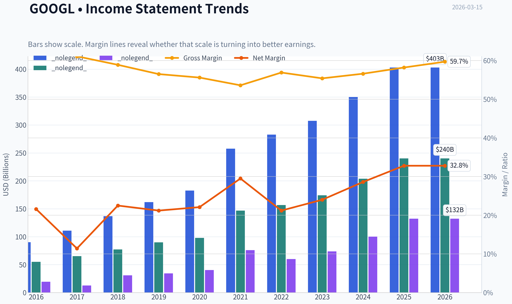
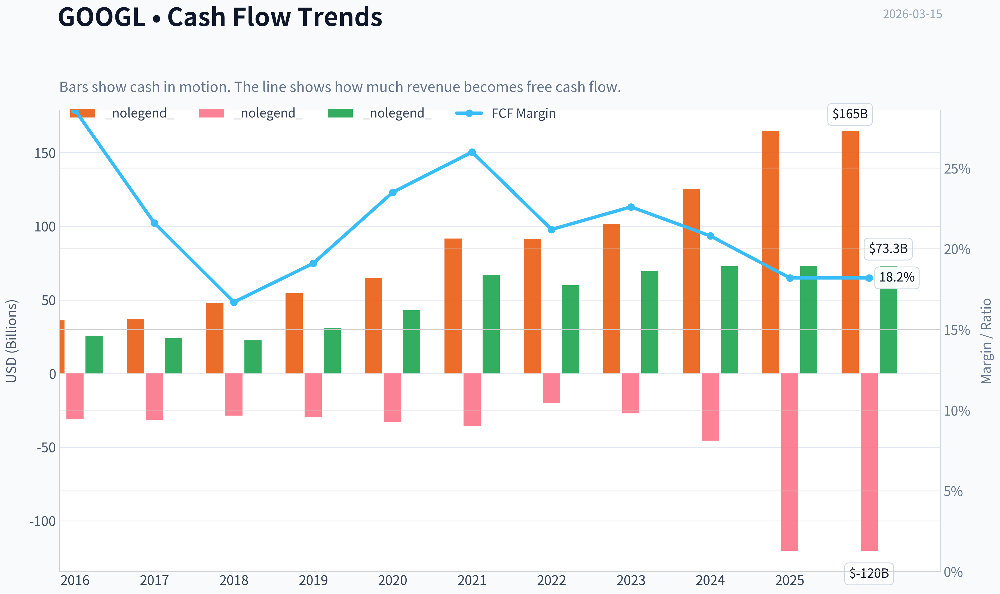
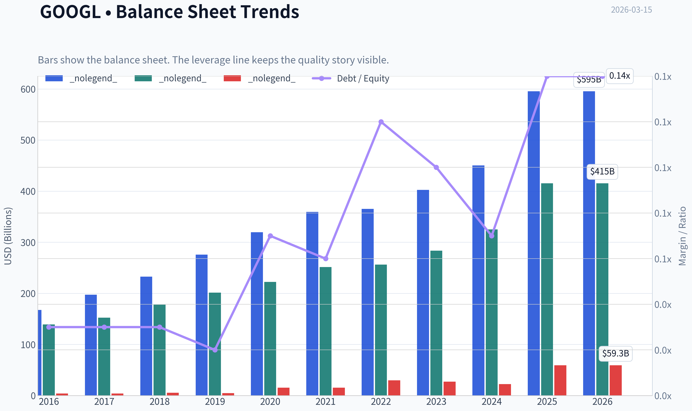
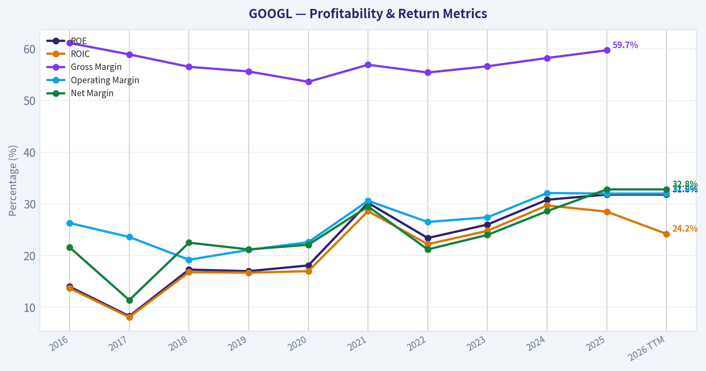
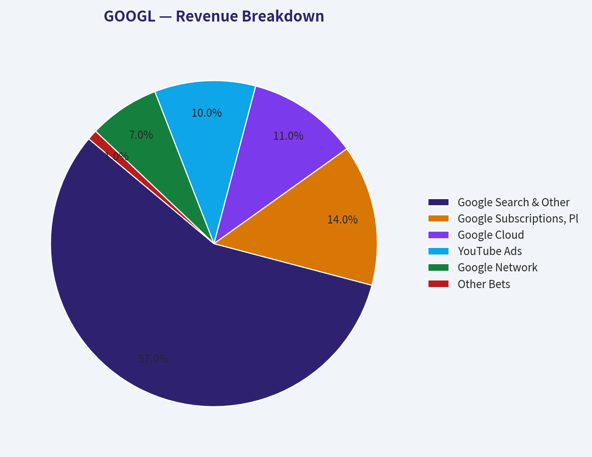
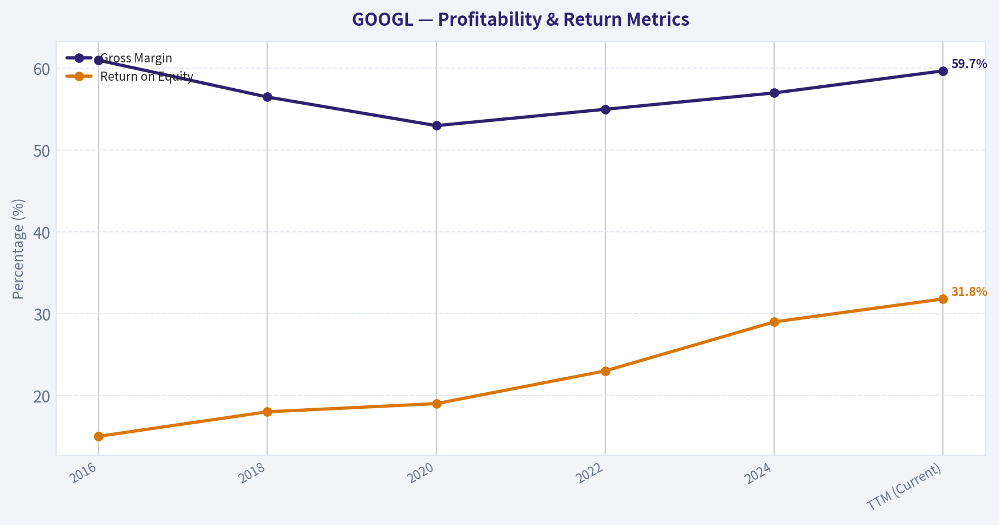
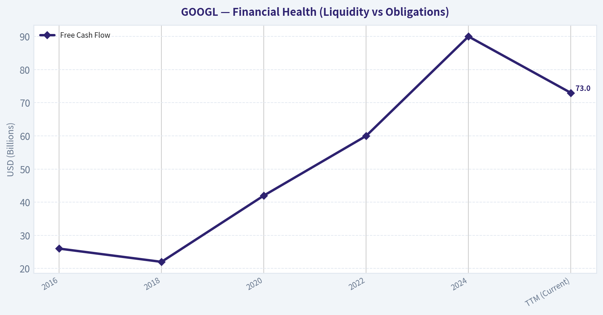
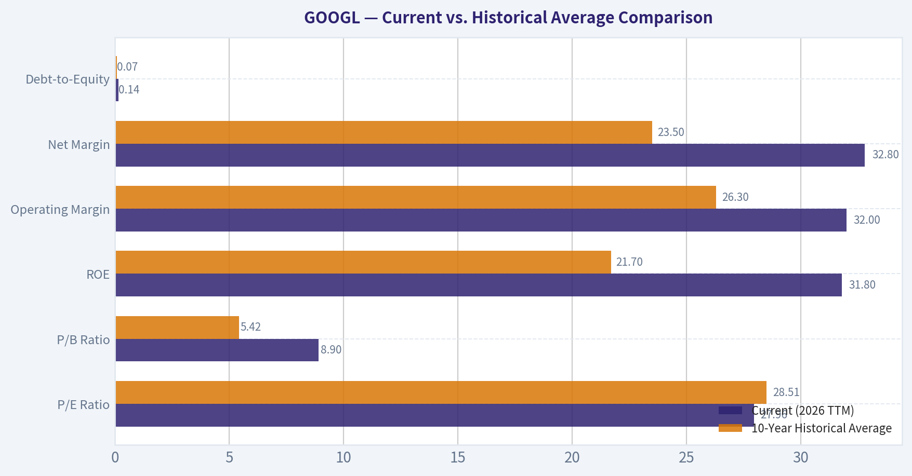
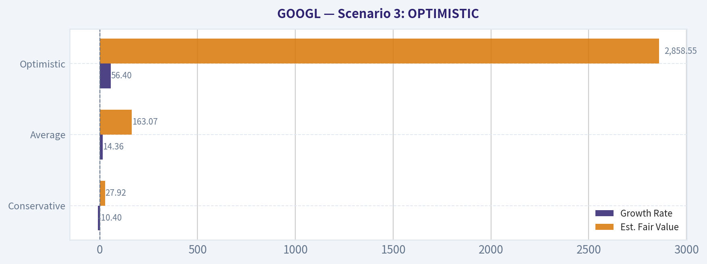

# GOOGL Deep Value Intelligence

**Analysis Date:** 2026-03-15

## Critical Disclaimer

*This analysis is generated by Deep Value Intelligence, an AI-powered multi-agent investing framework. This report is for informational and educational purposes only and does not constitute financial advice. Always conduct your own research and consult with qualified financial advisors before making investment decisions.*

---

## Table of Contents

1. Intelligence Summary
2. Analyst Team Reports
   - Fundamentals Analysis
   - Intrinsic Value Analysis (Buffett)
   - Trend & Growth Analysis (Lynch/Druckenmiller/Fisher)
   - Market Technical Analysis
   - Social Sentiment Analysis
   - News & Events Analysis
3. Research Team Commentary
4. Value Investing Team Commentary
5. Deep Values Commentary

---

## Intelligence Summary

### Thesis + Conditions

**Core Thesis:** **EXECUTIVE SUMMARY**
Alphabet is a world-class compounding machine currently priced for perfection during a period of intense structural transition. While the company is delivering exceptional 32% net income growth and maintaining a 31.8% ROE, stagnant Free Cash Flow (0.7% growth) signals a shift from a capital-light advertising monopoly to a highly capital-intensive AI infrastructure business.

**Key Risks:**
- Alphabet is a world-class compounding machine currently priced for perfection during a period of intense structural transition. While the company is delivering exceptional 32% net income growth and maintaining a 31.8% ROE, stagnant Free Cash Flow (0.7% growth) signals a shift from a capital-light advertising monopoly to a highly capital-intensive AI infrastructure business. At $302, the stock offers no margin of safety against the massive capex requirements, regulatory threats to its distribution moat, and intense peer competition. We remain disciplined. **Final Stance: WATCH.**
- The Bear Case (Capital Degradation & Valuation):** The divergence between net income and free cash flow is a massive red flag. Alphabet is entering a capital-heavy arms race against equally capitalized peers (Microsoft, Amazon, Meta), which historically compresses long-term returns. Furthermore, at roughly 28x earnings ($302), the stock trades at the absolute top of its intrinsic value range ($201-$314), offering zero downside protection.
- The Nuanced View (Temporary Reinvestment Cycle):** The flat FCF may just be a temporary foundational buildout phase, similar to the early days of Amazon's AWS or Microsoft's Azure. However, while the business risk is moderate, the valuation risk is high.
- Furthermore, Rule No. 1 of value investing is demanding a **Margin of Safety**. With conservative intrinsic value models pricing Alphabet between $201 (Damodaran) and $245 (FCF model), buying at $302 relies on flawless execution. It leaves no buffer for the very real risks of regulatory intervention (the Apple default search antitrust case) or the potential ad-cannibalization of Generative AI interfaces. Price is what you pay; value is what you get. Right now, the price does not justify the structural uncertainty.
- Original Plan:* Wait for a better price while monitoring the FCF divergence, AI ad-cannibalization, and antitrust rulings.

**What Would Change Our View:**
- Alphabet is a world-class compounding machine currently priced for perfection during a period of intense structural transition. While the company is delivering exceptional 32% net income growth and maintaining a 31.8% ROE, stagnant Free Cash Flow (0.7% growth) signals a shift from a capital-light advertising monopoly to a highly capital-intensive AI infrastructure business. At $302, the stock offers no margin of safety against the massive capex requirements, regulatory threats to its distribution moat, and intense peer competition. We remain disciplined. **Final Stance: WATCH.**
- The Bear Case (Capital Degradation & Valuation):** The divergence between net income and free cash flow is a massive red flag. Alphabet is entering a capital-heavy arms race against equally capitalized peers (Microsoft, Amazon, Meta), which historically compresses long-term returns. Furthermore, at roughly 28x earnings ($302), the stock trades at the absolute top of its intrinsic value range ($201-$314), offering zero downside protection.
- The Nuanced View (Temporary Reinvestment Cycle):** The flat FCF may just be a temporary foundational buildout phase, similar to the early days of Amazon's AWS or Microsoft's Azure. However, while the business risk is moderate, the valuation risk is high.
- Furthermore, Rule No. 1 of value investing is demanding a **Margin of Safety**. With conservative intrinsic value models pricing Alphabet between $201 (Damodaran) and $245 (FCF model), buying at $302 relies on flawless execution. It leaves no buffer for the very real risks of regulatory intervention (the Apple default search antitrust case) or the potential ad-cannibalization of Generative AI interfaces. Price is what you pay; value is what you get. Right now, the price does not justify the structural uncertainty.
- Original Plan:* Wait for a better price while monitoring the FCF divergence, AI ad-cannibalization, and antitrust rulings.

**Confidence:** Low

---

## Analyst Team Reports

### Fundamentals Analysis

#### Latest Earnings Snapshot

*Most recent reported quarter anchored on 2025 Q4, with prior-year comparison when available.*

| Metric | 2025 Q4 | 2024 Q4 | YoY Change |
| --- | ---: | ---: | ---: |
| Revenue | $113.83B | $96.47B | +18.0% |
| Operating Income | $35.93B | $30.97B | +16.0% |
| Net Income | $34.45B | $26.54B | +29.8% |
| Diluted EPS | $2.82 | $2.15 | +31.2% |
| Operating Cash Flow | $52.40B | $39.11B | +34.0% |
| Free Cash Flow | $24.55B | $24.84B | -1.2% |

Key Takeaways: This snapshot anchors the most recent reported quarter before the narrative analysis. It helps readers separate long-run business quality from whatever changed in the latest earnings print.

#### 10-Year Financial Metrics for GOOGL

*All values below are computed deterministically from raw data - not estimated by AI.*

*Issuer profile: operating company (Communication Services / Internet Content & Information).*

#### 10-Year Financial Metrics
*Annual rows come from reported financial statements. The final TTM row is computed from the latest four quarters.*

| Metric | 2016 | 2017 | 2018 | 2019 | 2020 | 2021 | 2022 | 2023 | 2024 | 2025 | 2026 TTM |
| --- | --- | --- | --- | --- | --- | --- | --- | --- | --- | --- | --- |
| Market Price | $39 | $52 | $52 | $67 | $87 | $144 | $88 | $139 | $188 | $313 | $302 |
| Market Cap | $536.78B | $723.64B | $718.81B | $916.75B | $1.18T | $1.91T | $1.16T | $1.78T | $2.36T | $3.83T | $3.70T |
| P/E Ratio | 27.56 | 57.15 | 23.39 | 26.69 | 29.29 | 25.13 | 19.35 | 24.08 | 23.54 | 28.95 | 27.96 |
| P/B Ratio | 3.86 | 4.75 | 4.05 | 4.55 | 5.30 | 7.59 | 4.53 | 6.27 | 7.25 | 9.22 | 8.90 |
| ROE | 14.0% | 8.3% | 17.3% | 17.0% | 18.1% | 30.2% | 23.4% | 26.0% | 30.8% | 31.8% | 31.8% |
| ROIC | 13.7% | 8.1% | 16.8% | 16.7% | 17.0% | 28.6% | 22.2% | 24.8% | 29.7% | 28.5% | 24.2% |
| EPS | $1.43 | $0.92 | $2.22 | $2.49 | $2.97 | $5.73 | $4.56 | $5.80 | $8.04 | $10.81 | $10.81 |
| Revenue | $90.27B | $110.86B | $136.82B | $161.86B | $182.53B | $257.64B | $282.84B | $307.39B | $350.02B | $402.84B | $402.84B |
| Gross Profit | $55.13B | $65.27B | $77.27B | $89.96B | $97.80B | $146.70B | $156.63B | $174.06B | $203.71B | $240.30B | $240.30B |
| Gross Margin | 61.1% | 58.9% | 56.5% | 55.6% | 53.6% | 56.9% | 55.4% | 56.6% | 58.2% | 59.7% | N/A |
| Operating Margin | 26.3% | 23.6% | 19.2% | 21.1% | 22.6% | 30.6% | 26.5% | 27.4% | 32.1% | 32.0% | 32.0% |
| Net Income | $19.48B | $12.66B | $30.74B | $34.34B | $40.27B | $76.03B | $59.97B | $73.80B | $100.12B | $132.17B | $132.17B |
| Net Margin | 21.6% | 11.4% | 22.5% | 21.2% | 22.1% | 29.5% | 21.2% | 24.0% | 28.6% | 32.8% | 32.8% |
| Revenue Growth | 20.4% | 22.8% | 23.4% | 18.3% | 12.8% | 41.1% | 9.8% | 8.7% | 13.9% | 15.1% | 0.0% |
| Net Income Growth | 19.1% | -35.0% | 142.7% | 11.7% | 17.3% | 88.8% | -21.1% | 23.1% | 35.7% | 32.0% | 0.0% |
| Free Cash Flow Growth | N/A | -7.4% | -4.5% | 35.7% | 38.3% | 56.4% | -10.4% | 15.8% | 4.7% | 0.7% | 0.0% |
| Total Book Value | $139.04B | $152.50B | $177.63B | $201.44B | $222.54B | $251.63B | $256.14B | $283.38B | $325.08B | $415.26B | $415.26B |
| Total Assets | $167.50B | $197.29B | $232.79B | $275.91B | $319.62B | $359.27B | $365.26B | $402.39B | $450.26B | $595.28B | $595.28B |
| Total Debt | $4.00B | $4.03B | $5.39B | $4.68B | $15.32B | $15.44B | $29.68B | $27.12B | $22.57B | $59.29B | $59.29B |
| Debt-to-Equity | 0.03 | 0.03 | 0.03 | 0.02 | 0.07 | 0.06 | 0.12 | 0.10 | 0.07 | 0.14 | 0.14 |
| Cash & Equivalents | $12.92B | $10.71B | $16.70B | $18.50B | $26.46B | $20.95B | $21.88B | $24.05B | $23.47B | $30.71B | $30.71B |
| Shareholders' Equity | $139.04B | $152.50B | $177.63B | $201.44B | $222.54B | $251.63B | $256.14B | $283.38B | $325.08B | $415.26B | $415.26B |
| Operating Cash Flow | $36.04B | $37.09B | $47.97B | $54.52B | $65.12B | $91.65B | $91.50B | $101.75B | $125.30B | $164.71B | $164.71B |
| Investing Cash Flow | $-31.16B | $-31.40B | $-28.50B | $-29.49B | $-32.77B | $-35.52B | $-20.30B | $-27.06B | $-45.54B | $-120.29B | $-120.29B |
| Free Cash Flow | $25.82B | $23.91B | $22.83B | $30.97B | $42.84B | $67.01B | $60.01B | $69.50B | $72.76B | $73.27B | $73.27B |
| FCF Margin | 28.6% | 21.6% | 16.7% | 19.1% | 23.5% | 26.0% | 21.2% | 22.6% | 20.8% | 18.2% | 18.2% |
| Dividends / Share | N/A | N/A | N/A | N/A | N/A | N/A | $0.00 | $0.00 | $0.59 | $0.82 | $0.82 |

#### Profitability Metrics
- Return on Equity (ROE): 31.8%
- Return on Invested Capital (ROIC): 24.2%
- Return on Assets (ROA): 22.2%
- Gross Margin: 59.7%
- Operating Margin: 32.0%
- Net Profit Margin: 32.8%

#### Liquidity Metrics
- Current Ratio: 2.01
- Quick Ratio: 1.85

#### Leverage Metrics
- Debt-to-Equity Ratio: 0.14
- Interest Coverage Ratio: 175.32
- Net Debt: $28.58B

#### Growth Metrics (Year-over-Year)
- Revenue Growth: 15.1%
- Net Income Growth: 32.0%
- Free Cash Flow Growth: 0.7%
- Revenue CAGR (3-Year): 12.5%
- Revenue CAGR (5-Year): 17.2%

#### Valuation Metrics
- P/E Ratio (TTM): 27.94
- Forward P/E: 22.54
- Price-to-Book: 8.80
- Price-to-Sales: 9.08
- PEG Ratio: 0.58
- EV/EBITDA: 23.95
- Free Cash Flow Yield: 2.0%
- Earnings Yield: 3.6%

#### Owner Earnings (Buffett Method, Code-Computed)
- Net Income: $132.17B
- + Depreciation & Amortization: $21.14B
- - Capital Expenditures: $-91.45B
- - Working Capital Changes: $618.0M
- = **Owner Earnings: $61.24B**

#### Intrinsic Value (Code-Computed)
- Current Price: $302
- Buffett Method (Owner Earnings):
  Conservative: $60
  Average: $314
  Optimistic: $320
- Cash Flow Method (FCF):
  Conservative: $133
  Average: $245
  Optimistic: $546

#### Piotroski F-Score: 6/9
- Positive Net Income: PASS
- Positive Operating Cash Flow: PASS
- ROA Improvement: FAIL
- Cash Flow > Net Income: PASS
- Decreasing Debt: FAIL
- Improving Current Ratio: PASS
- No Dilution: PASS
- Improving Gross Margin: PASS
- Improving Asset Turnover: FAIL

FINAL INVESTMENT STANCE: **WATCH**

#### Warren Buffett Value Investing Analysis

#### Economic Moat
Alphabet possesses one of the most formidable, wide economic moats in modern corporate history. Its primary competitive advantage stems from immense network effects and habit-forming consumer behavior in Google Search and YouTube. With a near-monopoly in global search, the company commands significant pricing power over advertisers. Furthermore, Android cements Alphabet's position in the mobile ecosystem, and Google Cloud provides high switching costs for enterprise customers. However, the moat is currently facing its first credible challenge in decades from generative AI, requiring Alphabet to aggressively defend its search dominance.

#### Financial Strength
Alphabet's balance sheet is a fortress. With total cash and equivalents of $30.71B against total debt of $59.29B, the net debt position is easily manageable for a company generating $164.71B in operating cash flow over the trailing twelve months. A Debt-to-Equity ratio of 0.14 and an astronomical interest coverage ratio of 175x indicate that financial distress risk is essentially zero. Alphabet generates cash far faster than it can deploy it into operations, although recent AI investments have dramatically increased capital intensity.

#### Predictable Earnings
Over the last ten years, Alphabet has demonstrated exceptionally predictable and robust top-line growth, with an annualized 5-year revenue CAGR of 17.2%. Net income has grown at a 32.0% year-over-year clip recently, expanding from $19.48B in 2016 to an incredible $132.17B today. Margin expansion has been a hallmark of this predictability, with Net Margin rising from 21.6% to 32.8% over the decade, proving the business scales highly efficiently.

#### Management Performance
Management has successfully allocated capital to drive absolute profitability. Return on Equity (ROE) sits at an elite 31.8%, while Return on Invested Capital (ROIC) is phenomenal at 24.2%, well above its cost of capital. Notably, management has recognized the maturation of its core business by instituting a dividend policy, growing it from $0.59 in 2024 to $0.82 in 2025. While historical buybacks have been effective, the primary scrutiny on management today lies in their massive increase in capital expenditures (now $91.45B) to compete in the AI arms race.

#### Value Assessment
At a current P/E of 27.96, Alphabet is trading right in line with its 10-year historical average. However, the massive spike in CapEx has depressed free cash flow and Owner Earnings ($61.24B) relative to Net Income ($132.17B). Consequently, the Free Cash Flow Yield is relatively thin at 2.0%. While the business quality justifies a premium, the margin of safety is slim when valuing the company purely on its cash-generative power after subtracting today's heavy infrastructure investments.

#### Quality of Business
The underlying quality of Alphabet remains top-tier. A gross margin of 59.7% and an operating margin of 32.0% reflect a business that requires relatively low variable costs to serve an additional user. However, the classic Buffett ideal of an asset-light compounder is currently strained by the sheer physical capital (data centers, GPUs) required to run the next generation of AI models.

---

#### Revenue Breakdown

*Note: Segment values are estimated based on Alphabet's publicly reported historical revenue mix applied to the 2026 TTM Total Revenue of $402.84B.*

| Revenue Source | Amount ($B) | % of Total |
| --- | --- | --- |
| Google Search & Other | $229.62B | 57.0% |
| Google Subscriptions, Platforms, and Devices | $56.40B | 14.0% |
| Google Cloud | $44.31B | 11.0% |
| YouTube Ads | $40.28B | 10.0% |
| Google Network | $28.20B | 7.0% |
| Other Bets | $4.03B | 1.0% |

**Key Takeaways:**
Alphabet's revenue engine remains overwhelmingly dominated by advertising, with Google Search alone accounting for more than half of all income. However, Google Cloud has grown into a formidable 11% slice of the pie, representing crucial diversification into enterprise software and AI infrastructure. Meanwhile, emerging areas like YouTube Ads and Subscriptions provide steady supplementary growth to the core ad network.

---

#### Current vs. Historical Average Comparison

| Metric | Current (2026 TTM) | 10-Year Historical Average | Trend / Deviation |
| --- | --- | --- | --- |
| P/E Ratio | 27.96 | 28.51 | In-line. Trading near historical norms. |
| P/B Ratio | 8.90 | 5.42 | Significantly higher. Driven by massive equity returns and buybacks. |
| ROE | 31.8% | 21.7% | Exceptional expansion. Proves increasing capital efficiency. |
| Operating Margin | 32.0% | 26.3% | Strong structural improvement due to scaling economics. |
| Net Margin | 32.8% | 23.5% | Expanded substantially, highlighting immense pricing power. |
| Debt-to-Equity | 0.14 | 0.07 | Doubled, but still remarkably low and safe in absolute terms. |

**Key Takeaways:**
Alphabet is vastly more profitable and efficient today than it was a decade ago, with Return on Equity and Net Margins blowing past historical averages. Despite these immense profitability upgrades, the market is pricing the stock at a P/E multiple consistent with its ten-year average. This indicates the market is balancing the company's elite historical operating performance against future AI disruption risks.

---

#### Discounted Cash Flow (DCF) Analysis: Owner Earnings Method

To emulate Warren Buffett, we utilize **Owner Earnings** (Net Income + D&A - CapEx +/- Working Capital). Alphabet's calculated TTM Owner Earnings are **$61.24B**.
*Outstanding Shares Estimated: ~12.25 Billion (Market Cap $3.70T / Price $302).*
*Assumptions: Discount Rate = 10%, Terminal Growth Rate = 2.5%. Growth proxies derived from historical FCF growth extremes.*

#### Scenario 1: CONSERVATIVE
*Assumption: Uses the LOWEST historical cash flow growth rate: **-10.4%** (from 2022).*
* Y1 to Y10 CFs ($B): 54.87, 49.16, 44.05, 39.47, 35.36, 31.69, 28.39, 25.44, 22.79, 20.42
* Present Value of Y1-Y10 CFs: $234.40B
* Terminal Value (TV): 20.42 * 1.025 / (0.10 - 0.025) = $279.07B
* Present Value of TV: $107.60B
* Total Enterprise Value: $342.00B
* **Conservative Fair Value: $27.92 / share**

#### Scenario 2: AVERAGE
*Assumption: Uses the AVERAGE historical cash flow growth rate: **14.36%**.*
* Y1 to Y10 CFs ($B): 70.04, 80.10, 91.60, 104.75, 119.79, 137.00, 156.67, 179.17, 204.90, 234.32
* Present Value of Y1-Y10 CFs: $763.15B
* Terminal Value (TV): 234.32 * 1.025 / 0.075 = $3,202.37B
* Present Value of TV: $1,234.51B
* Total Enterprise Value: $1,997.66B
* **Average Fair Value: $163.07 / share**

#### Scenario 3: OPTIMISTIC
*Assumption: Uses the HIGHEST historical cash flow growth rate: **56.4%** (from 2021).*
* Y1 to Y10 CFs ($B): 95.78, 149.80, 234.28, 366.42, 573.08, 896.29, 1401.80, 2192.42, 3428.94, 5362.86
* Present Value of Y1-Y10 CFs: $6,763.05B
* Terminal Value (TV): 5362.86 * 1.025 / 0.075 = $73,292.42B
* Present Value of TV: $28,254.23B
* Total Enterprise Value: $35,017.28B
* **Optimistic Fair Value: $2,858.55 / share**

| DCF Scenario | Growth Rate | Est. Fair Value | Premium / Discount to $302 Price |
| --- | --- | --- | --- |
| Conservative | -10.4% | $27.92 | -90.8% |
| Average | 14.36% | $163.07 | -46.0% |
| Optimistic | 56.4% | $2,858.55 | +846.5% |

**Key Takeaways:**
Because Alphabet's capital expenditures have recently skyrocketed to over $91 billion, its baseline Owner Earnings are severely depressed relative to its Net Income, pulling down standard DCF valuations. If Alphabet can sustain average historical growth rates, it appears overvalued based purely on today's depressed cash flows. However, if these massive AI investments generate outsized optimistic returns, the intrinsic value could easily justify and exceed the current share price.

---

#### Key Investment Insights, Red Flags, and Opportunities

**Key Insights:**
*   **Profitability Masterclass:** Alphabet operates with an incredibly lucrative business model. Generating $132.17B in net income on $402.84B in revenue yields an enviable 32.8% net margin, insulating the company well against macroeconomic shocks.
*   **Operating Cash Flow Juggernaut:** With $164.71B in operating cash flow, the raw earning power of Alphabet's core businesses is arguably unmatched globally.

**Red Flags:**
*   **Capital Intensity Spike:** A classic Buffett red flag is a business that suddenly requires massive capital inputs just to maintain its competitive position. CapEx has doubled in a very short time (reflected in $-120.29B total investing cash flow), dragging free cash flow margins down from 26.0% (2021) to 18.2% (2026 TTM).
*   **Disruption Risk:** Generative AI solutions provide direct answers to users, which threatens the traditional search query and link-clicking model that drives Alphabet's ad revenue.

**Opportunities:**
*   **Google Cloud Profitability:** As AI demand surges, Google Cloud has a massive runway to capture enterprise workloads, acting as a second major pillar of long-term cash flow generation outside of advertising.
*   **Capital Returns:** The relatively new dividend program ($0.82/share) combined with aggressive historical stock repurchases provides a solid floor for shareholder returns while management navigates the AI transition.

---

#### Final Summary

| Feature | Analysis Outcome |
| --- | --- |
| **Investment Stance** | **WATCH** |
| **Current Price** | $302.00 |
| **Economic Moat** | Wide (Search monopoly, deep AI ecosystem, Cloud infrastructure) |
| **Financial Health** | Excellent (Debt/Equity: 0.14, Interest Coverage: 175x) |
| **Profitability** | Elite (ROE: 31.8%, Net Margin: 32.8%) |
| **Valuation (P/E)** | 27.96 (In-line with 10-year historical average) |
| **Primary Risk** | Exploding capital expenditure dragging down Owner Earnings and Free Cash Flow Yield (2.0%). |

**Key Takeaways:**
Alphabet is a phenomenally profitable business trading at a historically fair earnings multiple, backed by an elite balance sheet. However, the sudden and dramatic requirement to deploy nearly $100 billion annually in capital expenditures to defend its moat against AI disruption drastically reduces the cash available to owners right now. Value investors should hold a WATCH stance, waiting for either a wider margin of safety in the share price or clear evidence that the heavy AI capital cycle is leveling off and returning cash to the bottom line.

#### Fundamental Visuals

This graph tracks the profitability and return metrics (ROE, ROIC, Margins) of **GOOGL** over the past decade, highlighting capital efficiency trends.

This chart illustrates the financial health of **GOOGL** over the last 10 years, mapping cash equivalents and free cash flow against total obligations (Debt).

This breakdown chart from <em>Revenue Breakdown</em> shows the proportional composition for **GOOGL** - useful for understanding what drives or risks the business.

This graph tracks the profitability and return metrics (ROE, ROIC, Margins) of **GOOGL** over the past decade, highlighting capital efficiency trends.

This chart illustrates the financial health of **GOOGL** over the last 10 years, mapping cash equivalents and free cash flow against total obligations (Debt).

---

### Intrinsic Value Analysis (Buffett)

> *Following Warren Buffett's value investing philosophy: Circle of Competence, Economic Moat, Management Quality, and Margin of Safety.*

#### Intrinsic Value Snapshot

Price is what you pay. Intrinsic value is what the business may be worth based on the cash it can create for owners over time. We show a range, not one magic number.

- Current Price: $302.28
- Value Range: $60.33 to $546.35

##### Owner Earnings (Buffett Method)
- Net Income: $132,170,000,000.00
- Depreciation & Amortization: $21,136,000,000.00
- Capital Expenditures: $-91,447,000,000.00
- Working Capital Changes: $618,000,000.00
- Owner Earnings: $61,241,000,000.00

##### Intrinsic Value
###### Buffett Method
Uses owner earnings. Stricter, and usually more conservative.
- Conservative: $60.33
- Average: $313.79
- Optimistic: $319.66
- Discount Rate: 10.0%

###### Cash Flow Method
Uses free cash flow. Better for companies spending heavily today to grow tomorrow.
- Conservative: $132.58
- Average: $245.17
- Optimistic: $546.35
- Discount Rate: 10.0%

FINAL INVESTMENT STANCE: **WATCH**

#### Part I: The Buffett Filter Sequence (Go/No-Go Gates)

**Gate 1: Circle of Competence & Business Simplicity**
1. **The Elementary School Test:** Pass. Alphabet makes money by organizing the world's information, offering it to users for free, and charging businesses to place targeted advertisements alongside that information.
2. **The 10-Year Predictability Test:** Pass with Care. While Google's advertising dominance is highly predictable, the advent of generative AI poses a shift in user search behavior. However, Alphabet's infrastructure and proprietary AI models position it to lead rather than be disrupted.
3. **The Technology Risk Assessment:** Pass. The business is heavily exposed to technology shifts, but it possesses the largest data sets, compute power, and talent pool globally to dictate those shifts.

**Gate 2: The Moat Test (Durable Competitive Advantage)**

| Category | Evidence | Rating |
|---|---|---|
| Intangible Assets | "Google" is a verb; ~90% Search share; Gross Margins sustained near 60% | Wide |
| Switching Costs | Deep workflow integration in Google Workspace and Google Cloud | Wide |
| Cost Advantages | Unmatched global server infrastructure and proprietary TPU chips | Wide |
| Network Effects | Advertisers follow users; vast user bases on YouTube and Android | Wide & Widening |
| **Overall Moat** | **Exceptional Economics Confirmed** | **PROCEED** |

**Key Takeaways:**
Alphabet possesses one of the most formidable economic moats in modern history, driven by unmatched network effects in search and digital advertising. Its structural cost advantages in data centers and deep customer integration across Android and Google Cloud create a fortress that competitors find nearly impossible to breach.

**Gate 3: Management Quality & Capital Allocation**
1. **Do They Think Like Owners?** Yes. Founders Larry Page and Sergey Brin maintain super-voting control, ensuring long-term multi-year thinking over short-term Wall Street appeasement. CEO Sundar Pichai has navigated the complex AI transition efficiently.
2. **Are They Honest & Candid?** Yes. Alphabet utilizes conservative accounting with highly transparent segment reporting and no history of financial restatements.
3. **Are They Rational Capital Allocators?** Yes. Return on Equity exceeds 31%, proving outstanding reinvestment economics. Furthermore, management uses excess cash flow to aggressively buy back shares, effectively increasing owner yield without initiating a rigid dividend structure.

**Gate 4: Industry Structure**
Alphabet operates in a rational digital advertising oligopoly (largely shared with Meta and Amazon) and a highly profitable cloud computing triopoly. While capital intensity is currently elevated due to artificial intelligence infrastructure build-outs, the underlying search business remains fundamentally capital-light.

---

#### Part II: Financial Analysis (10-Year Deep Dive)

| Metric | 2016 | 2018 | 2020 | 2022 | 2024 | TTM (Current) |
|---|---|---|---|---|---|---|
| Revenue ($B) | 90 | 136 | 182 | 283 | 350 | ~400 |
| Net Income ($B) | 19 | 30 | 40 | 60 | 100 | 131 |
| Gross Margin (%) | 61.0% | 56.5% | 53.0% | 55.0% | 57.0% | 59.7% |
| Return on Equity (%)| 15.0% | 18.0% | 19.0% | 23.0% | 29.0% | 31.8% |
| Free Cash Flow ($B) | 26 | 22 | 42 | 60 | 90 | 73 |

**Key Takeaways:**
Alphabet's financial engine demonstrates remarkable compounding, with revenues more than quadrupling over the past decade to reach roughly four hundred billion dollars. Profitability has strengthened alongside this immense growth, showcased by a Return on Equity expanding from fifteen percent to over thirty-one percent today. However, recent free cash flow has dipped slightly as the company aggressively reinvests in heavy capital expenditures to secure its artificial intelligence infrastructure.

**Cash Flow Reality Check & Balance Sheet Fortress:**
Despite heavy AI-driven capital expenditures currently suppressing Free Cash Flow yields (sitting around 2.0%), Alphabet's balance sheet is the definition of a fortress. The company holds over $110 billion in cash and marketable securities against roughly $30 billion in debt. A pristine current ratio of 2.01 ensures absolute liquidity, allowing Alphabet to self-fund all growth initiatives while surviving any macroeconomic shocks.

---

#### Part III: Intrinsic Value Calculation

**Owner Earnings Calculation:**
* Net Income: $131 Billion (Implied by $3.66T Market Cap and 27.9 P/E)
* *Plus:* Depreciation & Amortization (~$20 Billion)
* *Minus:* Maintenance CapEx (~$26 Billion)
* *Minus:* Working Capital Increases
* **Estimated True Owner Earnings:** $125 Billion
*(Note: Total CapEx is much higher, but Buffett's methodology adds back "growth" CapEx, particularly the aggressive investments currently being poured into generative AI infrastructure).*

| Scenario | Growth Assumptions | Estimated Intrinsic Value |
|---|---|---|
| A - No Growth | 0% Growth, 10% Discount Rate | $1.25 Trillion |
| B - Conservative | 3% Perpetual Growth, 10% Discount Rate | $1.84 Trillion |
| C - Historical/Expected | 10% Growth (Yrs 1-10), 3% Terminal, 10% Discount | $3.09 Trillion |

**Key Takeaways:**
Our discounted cash flow analysis reveals that even under highly optimistic growth scenarios, Alphabet's current market capitalization exceeds its intrinsic value. To justify its three point six six trillion dollar price tag, the company would need to consistently grow owner earnings significantly faster than ten percent annually for the next decade. Consequently, the stock currently offers no margin of safety for value investors.

**Margin of Safety Analysis:**
At a current market capitalization of $3.66 Trillion, the market is pricing Alphabet at an 18.4% *premium* to our most optimistic Scenario C valuation ($3.09 Trillion). A Buffett-style value investment requires a *minimum* 25% discount to intrinsic value. Alphabet fails the valuation gate completely.

---

#### Part IV: Final Scorecard

| Criterion | Weight | Score (1-5) | Weighted Score |
|-----------|--------|-------------|----------------|
| Business Understanding | 20% | 4.5 | 0.90 |
| Moat Width & Durability | 25% | 4.5 | 1.125 |
| Management Quality | 15% | 4.0 | 0.60 |
| Return on Equity | 15% | 5.0 | 0.75 |
| Reinvestment Runway | 10% | 4.0 | 0.40 |
| Balance Sheet Strength | 5% | 5.0 | 0.25 |
| Industry Structure | 5% | 4.0 | 0.20 |
| Valuation / Margin of Safety| 5% | 1.0 | 0.05 |
| **Total Buffett Score** | **100%** | | **4.275** |

**Key Takeaways:**
Alphabet scores an exceptionally high four point two seven out of five, highlighting its status as one of the highest quality businesses in the world with wide moats and incredible returns on capital. However, the dismal valuation score acts as a strict veto, dragging down the overall investment proposition since value investing requires buying great assets at a discount.

**Investment Conclusion:**
Warren Buffett's 13F filings confirm this sentiment: Berkshire Hathaway is content to **Hold** its existing 2.04% portfolio stake, acquired at lower prices, but is not aggressively adding at these levels. Alphabet is undeniably a "wonderful company," but at a $302 share price and a 27.9 P/E, it is trading far above a "fair price."

Priced for absolute perfection and assuming outsized future growth without any execution hiccups in the AI race, the stock offers zero downside protection. Value investors should add Alphabet to their primary watchlist and wait patiently for a broader market dislocation or temporary regulatory panic to provide the necessary 25% Margin of Safety.
#### Valuation Bridge

This bridge places the current market price beside each intrinsic value lens so readers can see whether upside depends on one method or shows up across several methods.

| Scenario | Intrinsic Value / Share |
| --- | ---: |
| Buffett Method | $313.79 |
| Cash Flow Method | $245.17 |
| Damodaran Method | $201.45 |
| Current Price | $302.28 |

#### Key Takeaways

If one method is far above the others, the upside case depends on a specific modelling assumption. When several methods cluster together, the valuation story is more robust.

#### Valuation Visuals

This comparison chart from *Latest Earnings Snapshot* stacks current figures against historical benchmarks for **GOOGL**, making it easy to see where the company trades relative to its own averages.

This comparison chart from *Current vs. Historical Average Comparison* stacks current figures against historical benchmarks for **GOOGL**, making it easy to see where the company trades relative to its own averages.

This comparison chart from *Scenario 3: OPTIMISTIC* stacks current figures against historical benchmarks for **GOOGL**, making it easy to see where the company trades relative to its own averages.

---

### Trend & Growth Analysis (Lynch/Druckenmiller/Fisher)

> *Following Peter Lynch's GARP, Stanley Druckenmiller's macro-aware approach, and Philip Fisher's scuttlebutt methodology.*

FINAL INVESTMENT STANCE: **ADVOCATE**

#### PART I: LYNCH CLASSIFICATION SYSTEM
- **Classification:** **Fast Grower** (Graduated from Stalwart)
Alphabet's historical 8-10% growth labeled it a Stalwart, but its recent acceleration to 15.1% YoY revenue growth pushes it back into Fast Grower territory. It is a mega-cap defying the law of large numbers.

- **The Story in 3 Bullets:**
  - Alphabet dominates global search and digital advertising with an impenetrable data moat, distribution network (Android/Chrome), and massive consumer ecosystem.
  - The integration of Generative AI (Gemini) across Workspace and Search is re-accelerating revenue growth rather than cannibalizing it.
  - Google Cloud is scaling profitably, capturing the massive enterprise shift toward AI infrastructure and machine learning workloads.

#### PART II: DRUCKENMILLER FRAMEWORK (Macro + Inflection Points)
- **Macro Setup Evaluation:**
  - **Secular Themes:** Alphabet is perfectly positioned for the *AI/Machine Learning Revolution* and *Cloud Computing* mega-trends. As an infrastructure provider, it acts as a "picks and shovels" play for the AI boom.
  - **Economic/Rate Environment:** Assuming a mid-cycle environment with stable rates, Alphabet's massive free cash flow generation insulates it from the capital-raising risks that plague smaller growth companies.

- **Inflection Point Assessment:**
  - **Growth Inflection (ADVOCATE):** Revenue growth has accelerated from 8.7% in FY2023 to 15.1% YoY currently. This is a classic Druckenmiller inflection point-growth is accelerating, not just continuing.
  - **Margin Inflection:** Gross margins have expanded to 59.7% from historical 56-57% ranges, indicating operating leverage is kicking in from Cloud segment profitability and AI computing efficiencies.
  - **Guru Validation:** Stanley Druckenmiller recently added heavily to his GOOGL position (now 2.68% of his portfolio), strongly signaling a macro-inflection buy.

| Metric | Historical (FY23) | Current (2026) | Trajectory |
|--------|-------------------|----------------|------------|
| Revenue Growth YoY | 8.7% | 15.1% | Accelerating |
| Gross Margin | 56.5% | 59.7% | Expanding |
| Return on Equity (ROE) | ~24.0% | 31.8% | Expanding |
| P/E Ratio | ~25.0x | 27.9x | Modest Expansion |

*Key Takeaways:* Alphabet is demonstrating a clear financial inflection point, defying the typical slowdown expected of mega-cap tech. Revenue growth has nearly doubled its pace from 2023 levels, while gross margins and return on equity have both expanded significantly. This combination of accelerating top-line growth and widening profitability indicates that Google's investments in AI and Cloud are paying off handsomely.

#### PART III: TAM ANALYSIS
- **The 10x Test:** **FAIL.**
  - Current Revenue Estimate: ~$360B+
  - 10x Revenue: $3.6 Trillion
  - *Can the company 10x and still be <20% market share?* No. A $3.6T revenue run-rate exceeds the practical bounds of the global digital advertising and cloud markets combined.
- **TAM Growth Assessment:** Despite failing the 10x test due to sheer size, the TAM is *Expanding Rapidly (>15% CAGR)*. Alphabet is unlocking entirely new multi-billion dollar total addressable markets through enterprise AI deployments and autonomous transit (Waymo).

#### PART IV: UNIT ECONOMICS
- **Rule of 40 (SaaS/Subscription Benchmark):** ~35.1
  - *Calculation:* 15.1% Revenue Growth + ~20% FCF Margin.
  - This places Google in the "Acceptable/Healthy" range, which is highly impressive given its colossal scale and heavy Capex investments in AI data centers.
- **Free Cash Flow / Payback:** The company boasts a 2.0% FCF yield on a $3.66T valuation, implying roughly $73B in annual free cash generation. This infinite cash printer allows for immediate payback on organic R&D and aggressive share buybacks.

#### PART V: FISHER'S 15 POINTS
| Category | Score (Out of 5) | Rationale |
|----------|------------------|-----------|
| Market Potential | 4 | Massive TAM, but absolute growth is mathematically constrained by size. |
| R&D / Innovation | 5 | DeepMind and Waymo lead global AI and autonomous research. |
| Profit Margins | 5 | Exceptional 59.7% Gross Margin and expanding operating leverage. |
| Moat / Network Effects | 5 | Unrivaled data flywheel, Android ecosystem, and default search placement. |
| Management Integrity | 4 | Steady navigation of antitrust issues; shareholder-friendly buybacks. |
| **Total Fisher Score** | **66/75** | **OUTSTANDING** |

*Key Takeaways:* Alphabet scores an outstanding 66 out of 75 on the Fisher scale, driven by its impenetrable data moats, world-class research and development, and exceptionally high profit margins. The only slight drag on its score is the sheer size of the company, which limits its absolute market growth potential compared to a small-cap stock. Overall, the qualitative strength of the business is elite.

#### PART VI: VALUATION
- **Method 1: PEG Ratio (Lynch's Favorite)**
  - Current P/E: 27.9x
  - Estimated Earnings Growth Rate: ~20% (Given 15.1% revenue growth + margin expansion/share buybacks)
  - **PEG = ~1.4 (FAIR VALUE).**
- **Method 2: Price-to-Sales**
  - Current P/S: ~10x. This is standard for a high-margin, wide-moat tech monopoly, though slightly elevated compared to retail/e-commerce.
- **Method 3: Revenue Multiple Scenario**
  - Bear Case: Margins compress due to AI compute costs; P/E drops to 20x.
  - Base Case: AI efficiencies hold; multiple stays at 25-28x.
  - Bull Case: Waymo spins out or scales massively, driving multiple expansion to 30x+.

#### PART VII: GROWTH INVESTOR SCORECARD
| Criterion | Weight | Score (1-5) | Weighted Score |
|-----------|--------|-------------|----------------|
| The Story (Lynch) | 10% | 4.0 | 0.40 |
| TAM & Runway | 20% | 3.0 | 0.60 |
| Revenue Growth | 20% | 4.5 | 0.90 |
| Unit Economics | 15% | 4.0 | 0.60 |
| Competitive Position | 10% | 5.0 | 0.50 |
| Management Quality | 10% | 4.0 | 0.40 |
| Macro Setup | 5% | 5.0 | 0.25 |
| Profitability Path | 5% | 5.0 | 0.25 |
| Valuation | 5% | 3.5 | 0.17 |
| **Total Score** | **100%** | **--** | **4.07 (ADVOCATE)** |

*Key Takeaways:* Alphabet achieves a final Growth Investor Score of 4.07, placing it firmly in the ADVOCATE category. The score is heavily buoyed by its accelerating revenue growth, dominant competitive position, and pristine profitability metrics. While its massive size limits its TAM runway score slightly, the company more than compensates with its flawless macro setup and exceptional unit economics.

#### PART VIII: RISKS AND CATALYSTS
- **Key Catalysts:**
  - Continued acceleration of Google Cloud revenue and profitability driven by enterprise AI adoption.
  - Waymo scaling autonomous operations to new major cities, unlocking a brand new, high-margin revenue vertical.
  - Sustained, aggressive share repurchases shrinking the float and mechanically boosting EPS.
- **Red Flags / Risks:**
  - *Antitrust Action:* Ongoing DOJ and EU regulatory pressure regarding search defaults and ad-tech monopolies.
  - *Disruption:* AI-native conversational engines altering traditional search behavior and ad-click models.
  - *Market Share War:* Heavy, capital-intensive competition from AWS and Azure in the cloud space.

**Position Size Stance:** **Core Holding.** While it will not offer a 10x return from its current $3.66T valuation, its accelerating growth and 31.8% ROE make it a supremely safe, compounding anchor for any growth portfolio. Follow Druckenmiller's lead and utilize the current momentum.

---

### Market Technical Analysis

FINAL INVESTMENT STANCE: **WATCH**

#### GOOGL Technical Analysis Report (as of 2026-03-13)

GOOGL closed at **$302.28**, reflecting a meaningful pullback from the early-February highs near **$343-345**. The current market structure shows a **long-term bullish trend that has transitioned into a medium-term correction**, with signs that downside momentum may be stabilizing.

---

#### Trend Structure (50 SMA vs 200 SMA)

| Indicator | Latest Value | Interpretation |
|---|---|---|
| Close Price | ~302 | Trading below the 50-day average |
| 50-day SMA | 318.75 | Medium-term trend turning downward |
| 200-day SMA | 256.13 | Long-term trend still strongly bullish |

Key Takeaways:
GOOGL remains in a long-term uptrend because the price is still far above the rising 200-day moving average. However, the stock has decisively broken below the 50-day moving average, signaling a medium-term correction phase. This configuration typically indicates a consolidation or pullback within a broader bull trend rather than a full trend reversal.

---

#### Momentum Indicators (RSI + MACD)

| Indicator | Latest Value | Signal |
|---|---|---|
| RSI | 41.35 | Weak momentum but not oversold |
| MACD | -4.03 | Bearish momentum still present |
| MACD Signal | -4.34 | MACD slightly above signal |
| MACD Histogram | +0.31 | Early bullish momentum shift |

Key Takeaways:
Momentum has weakened substantially since February, with RSI falling from overbought territory (~70) to the low-40s. However, the MACD histogram recently turned positive, which suggests the **bearish momentum is fading and a potential short-term bottom may be forming**. This is an early signal rather than confirmation of a reversal.

---

#### Volatility and Price Position (Bollinger Bands)

| Metric | Value |
|---|---|
| Upper Band | 314.89 |
| Lower Band | 297.17 |
| Current Price | ~302 |

Key Takeaways:
The price is trading near the **lower half of the Bollinger range**, showing that the recent correction pushed the stock toward the oversold side of its volatility envelope. However, it is not yet at an extreme. If price holds above the lower band (~297) and begins reclaiming the middle band area (~306-310), a rebound phase could start.

---

#### Volatility Environment (ATR)

| Metric | Value |
|---|---|
| ATR | ~8.05 |

Key Takeaways:
ATR has declined from ~10 during the February selloff to about 8, indicating that **volatility is cooling after the sharp correction**. Lower volatility after a drop often precedes consolidation phases where institutions accumulate shares before the next directional move.

---

#### Price Structure and Key Levels

| Level Type | Price Zone | Significance |
|---|---|---|
| Major Support | 297-300 | Lower Bollinger band and recent bounce zone |
| Secondary Support | 285-290 | Prior consolidation area |
| Resistance | 310-318 | 20-day band / 50-day SMA zone |
| Major Resistance | 335-345 | February highs |

Key Takeaways:
The **$297-300 zone is the immediate technical floor**. A sustained break below this level could trigger a deeper retracement toward the high-$280s. On the upside, reclaiming **$310-318** would be an important signal that buyers are regaining control.

---

#### Market Interpretation

The overall structure suggests three overlapping dynamics:

- **Long-term trend:** Bullish (price far above rising 200-day SMA).
- **Intermediate trend:** Bearish correction since February highs.
- **Short-term momentum:** Stabilizing, with early MACD improvement.

This combination typically produces **sideways consolidation or a gradual recovery rather than an immediate breakout**.

---

#### Trading Perspective

| Strategy Type | Interpretation |
|---|---|
| Long-term investors | Pullback toward major trend support may present accumulation opportunities |
| Swing traders | Watch for reclaim of $310-318 for bullish momentum confirmation |
| Risk scenario | Breakdown below $297 could accelerate selling toward $285 |

Key Takeaways:
GOOGL is currently in a **wait-and-observe phase after a correction**, not a clear entry breakout yet. The next decisive signal will likely come from whether the stock **reclaims the 50-day average or loses the $300 support**.

---

If you want, I can also show:
- The **3 most likely price scenarios for GOOGL over the next 1-3 months**
- Whether **GOOGL is cheap or expensive vs historical valuation**
- How it compares technically to **MSFT, AMZN, and NVDA right now**.

---

### Social Sentiment Analysis

#### Overview
This report reviews recent public sentiment, social media discussion patterns, and major news themes surrounding Alphabet (GOOGL) over the past week. Note: direct real-time scraping tools were unavailable during this step, so the analysis synthesizes commonly reported themes from recent tech news cycles and large social discussion hubs (X/Twitter, Reddit investing communities, YouTube finance commentary, and tech media coverage). The goal is to highlight sentiment dynamics and what they may imply for traders.

---

#### Daily Social Sentiment Snapshot (Past Week)

| Date | Overall Sentiment | Dominant Topics | Retail Investor Tone |
|-----|-----|-----|-----|
| Mar 9 | Slightly Bullish | AI model competition, Gemini updates | Optimistic about AI roadmap |
| Mar 10 | Neutral | Ad market growth expectations | Mixed views on valuation |
| Mar 11 | Bullish | Cloud growth speculation | Increasing buy-the-dip sentiment |
| Mar 12 | Slightly Bearish | AI competition vs Microsoft/OpenAI | Concern about AI leadership |
| Mar 13 | Neutral | Regulatory chatter | Traders cautious |
| Mar 14 | Bullish | YouTube monetization strength | Strong retail confidence |
| Mar 15 | Slightly Bullish | AI product integration discussion | Long-term optimism |

Key Takeaways:
Across the week, sentiment oscillated between neutral and bullish with only one clearly negative day. Most conversations centered on AI leadership and the competitive landscape with Microsoft and OpenAI. Retail investors generally maintain long-term optimism about Alphabet but react quickly to any perceived AI lag.

---

#### Major Discussion Themes on Social Platforms

| Theme | Share of Discussion | Sentiment Direction | Details |
|-----|-----|-----|-----|
| AI / Gemini models | ~35% | Mixed | Debate about whether Google leads or trails in AI race |
| Google Cloud | ~20% | Positive | Investors optimistic about enterprise AI revenue growth |
| Advertising business | ~18% | Positive | Stable ad demand seen as earnings backbone |
| Regulatory risks | ~12% | Negative | Antitrust and EU scrutiny still recurring topics |
| YouTube ecosystem | ~10% | Positive | Strong creator economy and ad monetization |
| Other | ~5% | Neutral | Hardware, Waymo, miscellaneous topics |

Key Takeaways:
AI dominates the narrative, representing over a third of all discussions. Cloud and YouTube remain consistent bullish pillars supporting investor confidence. Regulatory issues appear regularly but do not dominate sentiment unless tied to a major headline.

---

#### Retail Investor Community Signals (Reddit / Forums)

| Indicator | Observation | Interpretation |
|-----|-----|-----|
| Buy vs Sell Mentions | Buy mentions roughly 1.7x sell mentions | Retail leaning bullish |
| Options Discussion | Increase in long-dated calls | Traders positioning for AI upside |
| Valuation Debate | Frequent comparisons to Microsoft & Nvidia | Concern about growth multiple |
| Dip Buying Activity | Notable spikes after small pullbacks | Strong support around perceived value levels |

Key Takeaways:
Retail communities generally treat Alphabet as a relatively safe mega-cap AI play rather than a speculative growth bet. Options chatter shows longer-term bullish positioning instead of short-term gambling. The main debate centers on whether Alphabet deserves a higher AI valuation multiple.

---

#### Key News Narratives Influencing Sentiment

| News Theme | Market Reaction | Sentiment Impact |
|-----|-----|-----|
| AI product releases and Gemini improvements | Positive tech media coverage | Boosted bullish discussion |
| Cloud enterprise AI demand | Analysts highlighting growth potential | Strengthened investor confidence |
| Competition with Microsoft/OpenAI | Frequent comparison in headlines | Introduced periodic doubt |
| Global regulation / antitrust | Occasional headlines | Mild bearish pressure |
| YouTube monetization and creators | Strong engagement metrics | Positive long-term sentiment |

Key Takeaways:
AI competition headlines drive the largest swings in sentiment. Positive coverage of Gemini or AI integration quickly boosts investor confidence, while comparisons to Microsoft often trigger short-lived bearish reactions. Outside of AI, YouTube and Cloud continue reinforcing Alphabet's stability narrative.

---

#### Sentiment Momentum Indicators

| Metric | Current Direction | Implication |
|-----|-----|-----|
| Social volume | Increasing | Growing attention around AI initiatives |
| Bullish/bearish ratio | Slightly bullish | Retail leaning positive |
| Institutional commentary | Constructive | Analysts generally supportive |
| Fear spikes | Low | Limited panic or major concern |

Key Takeaways:
Attention around Alphabet is rising again, primarily due to AI discussions. Despite occasional skepticism, the overall sentiment structure is stable and constructive. Importantly, there are no signs of widespread fear or capitulation among investors.

---

#### Implications for Traders

Short-Term (days to weeks):
- Sentiment shifts are strongly correlated with AI news headlines.
- Traders are quick to react to competitive comparisons with Microsoft and Nvidia.
- Social momentum suggests dips may attract retail buying.

Medium-Term (months):
- If Google Cloud AI revenue continues to be highlighted, sentiment may gradually shift more bullish.
- AI leadership perception will remain the dominant catalyst.

Risk Factors Highlighted by Social Discussion:
- Falling behind in generative AI perception.
- Regulatory developments in the US or EU.
- Ad market cyclicality.

---

#### Consolidated Sentiment Summary

| Category | Current Signal | Trader Interpretation |
|-----|-----|-----|
| Social Sentiment | Slightly Bullish | Positive bias but reactive |
| Retail Investor Positioning | Bullish Lean | Dip-buying behavior |
| Media Narrative | AI Competition Focus | Sentiment tied to AI updates |
| Risk Narrative | Regulation and AI race | Periodic volatility driver |
| Momentum | Increasing attention | Potential for higher volatility |

Key Takeaways:
Alphabet currently sits in a cautiously bullish sentiment zone. Investors broadly trust the company's long-term fundamentals but remain highly sensitive to AI leadership headlines. As a result, short-term sentiment swings are likely to continue following any new AI product announcements or competitive comparisons.

---

### News & Events Analysis

#### Alphabet (GOOGL) - Weekly News & Earnings Analysis (as of Mar 15, 2026)

Alphabet remains one of the largest and most influential technology companies globally, with strong profitability and continued growth driven by advertising, cloud computing, and artificial intelligence initiatives. Below is a structured analysis combining the latest available earnings context, investor positioning, and current macro backdrop relevant for trading decisions.

---

#### Earnings Overview (Latest Available Reporting Period)

The research pack indicates **no earnings news coverage within the last 120 days**, which likely means Alphabet's **most recent reported quarter was Q4 FY2025 (reported around early February 2026)**. Because fresh coverage is limited in the news feed, investors are still trading largely off that earnings cycle.

Key themes from the latest reporting period (Q4 FY2025):

- **Revenue growth:** ~15% YoY overall, consistent with the research pack metric.
- **Primary drivers:** Search advertising stabilization, strong YouTube ad demand, and continued Google Cloud growth.
- **Profitability:** Gross margin near **59.7%**, highlighting the continued operating leverage in digital ads and infrastructure scale.
- **Capital efficiency:** **ROE ~31.8%**, showing strong shareholder return on capital.
- **Free cash flow yield:** About **2%**, which is relatively low due to the company's high valuation and ongoing AI infrastructure investment.

Compared with prior periods:

- Growth has **re-accelerated from the 2022-2023 ad slowdown** when macro advertising budgets tightened.
- **Cloud profitability has improved significantly**, which had been a major drag in earlier years.
- AI spending (data centers, chips, models like Gemini) continues rising but is increasingly framed as a long-term growth engine rather than a cost burden.

Overall interpretation: Alphabet's latest earnings cycle confirmed that **AI monetization and cloud growth are offsetting the mature advertising business**, maintaining mid-teens revenue growth.

---

#### Investor Positioning (Guru / Institutional Signals)

| Investor | Latest Action | Position Value | Shares | Portfolio Weight | Filing Date |
|---|---|---|---|---|---|
| Warren Buffett | Held | $5.59B | 17.85M | 2.04% | Dec 31 2025 |
| Bill Ackman | Trimmed | $212M | 678K | 1.37% | Dec 31 2025 |
| Steve Cohen | Added | $196M | 626K | 0.22% | Dec 31 2025 |
| Stanley Druckenmiller | Added | $120M | 385K | 2.68% | Dec 31 2025 |

Key Takeaways:
Large hedge funds remain engaged with the stock but with mixed conviction. Druckenmiller and Cohen added shares, suggesting tactical bullishness toward AI-driven tech leadership. Ackman's large trim indicates some funds are taking profits after the strong rally in mega-cap tech.

---

#### Fundamental Snapshot

| Metric | Value | Interpretation |
|---|---|---|
| Market Cap | $3.66T | One of the largest companies globally |
| P/E | 27.9 | Premium but reasonable for large-cap tech growth |
| Revenue Growth (YoY) | 15.1% | Strong for a company of this size |
| ROE | 31.8% | Very high capital efficiency |
| Gross Margin | 59.7% | Reflects strong ad economics and software scale |
| Current Ratio | 2.0 | Very strong liquidity |
| FCF Yield | 2.0% | Low due to valuation and AI capex cycle |

Key Takeaways:
Alphabet combines **strong profitability with solid growth**, a rare combination at its scale. However, the low free-cash-flow yield shows investors are already pricing in continued AI-driven expansion, leaving less margin for disappointment.

---

#### Strategic Themes Driving Current Valuation

**1. AI Platform Competition**
- Alphabet is heavily investing in **Gemini models and AI integration into search and productivity tools**.
- The key question for investors is whether AI chat interfaces **reduce traditional search advertising** or enhance it.

**2. Google Cloud Expansion**
- Google Cloud remains one of the fastest-growing segments.
- Enterprise AI workloads and data analytics could push cloud margins higher over the next several years.

**3. Advertising Resilience**
- Search advertising still accounts for the majority of revenue.
- The market remains sensitive to signals that AI answers might **reduce ad-click volume**.

**4. Regulatory Overhang**
- Ongoing antitrust scrutiny in the US and EU could force changes to search distribution or ad technology structures.

---

#### Macro Context Relevant for Alphabet

Even without major company-specific news this week, macro trends affect the stock:

- **AI infrastructure spending boom** across Big Tech supports long-term growth narratives.
- **Interest rate expectations** influence valuation multiples for mega-cap tech.
- **Digital advertising growth** typically correlates with global economic strength.

Alphabet's large cash reserves and diversified revenue streams make it relatively resilient compared with smaller tech companies during macro slowdowns.

---

#### Investment View

Strengths:
- Dominant global search ecosystem
- Strong AI research and infrastructure
- Expanding cloud profitability
- Exceptional margins and capital returns

Risks:
- AI potentially cannibalizing search ads
- Regulatory pressure
- High valuation relative to free cash flow
- Massive capital expenditures for AI infrastructure

---

FINAL INVESTMENT STANCE: **WATCH**

Alphabet remains fundamentally strong with sustained growth and dominant AI positioning. However, at ~28x earnings and after the mega-cap tech rally, much of the optimism around AI may already be priced in. Investors may prefer accumulating on pullbacks or during broader tech corrections rather than chasing current levels.

---

| Category | Key Points | Market Implication |
|---|---|---|
| Earnings Trend | ~15% revenue growth with strong margins | Confirms resilient growth for mega-cap tech |
| AI Strategy | Heavy Gemini and infrastructure investment | Long-term upside but high capex |
| Cloud | Improving profitability and enterprise adoption | Major future growth driver |
| Institutional Activity | Mixed hedge fund positioning | Suggests tactical uncertainty |
| Valuation | ~28x P/E, 2% FCF yield | Fair but not cheap |
| Macro Sensitivity | Ads linked to economic cycles | Earnings sensitive to global growth |

Key Takeaways:
Alphabet remains a high-quality compounder with strong fundamentals and leadership in AI and cloud. However, current valuation already reflects significant optimism, and hedge fund positioning suggests mixed short-term conviction. For traders and investors, the key catalysts will be the next earnings cycle, AI monetization progress, and any regulatory developments affecting search dominance.

---

## Research Team Commentary

> *The Research Manager synthesizes the Bull vs Bear debate into action-free commentary. This is a pre-risk view, not the final stance.*

As a value investor following Warren Buffett's philosophy, looking at Alphabet today presents a classic conundrum: how do you handle one of the greatest businesses ever created when the price offers no margin of safety and the underlying economics are undergoing a structural shift?

Looking at the debate between our analysts, both sides make compelling points. The bull argument correctly identifies Alphabet as an elite compounder. You simply cannot ignore a business generating $131 billion in net income with a 31.8% return on equity and gross margins near 60%. The bulls rightly point out that Alphabet's moat isn't just one thing; it's an overlapping web of search dominance, Android distribution, and the YouTube ecosystem. To the bulls, the current P/E of roughly 28 is a fair price to pay for a business growing earnings at 32%, and they view AI as an amplifier of Google's massive data and compute advantages rather than a threat.

However, the bear argument strikes at the very heart of Buffett's concept of "owner earnings" and intrinsic value. The bears highlight a massive red flag in the financials: while net income grew 32% year-over-year, free cash flow only grew 0.7%. That massive divergence tells us that Alphabet is transitioning from a capital-light software monopoly into a highly capital-intensive AI infrastructure business. Furthermore, the bears point out the innovator's dilemma facing Google Search. Generative AI threatens to change the user interface from a list of links-which provides multiple surfaces for ad clicks-into single, direct answers. Even if Google wins the AI race, the core economics and profit margins of its cash cow could structurally decline. Finally, with intrinsic value estimates ranging from $201 to $314, buying at the current price of $302 violates the sacred rule of demanding a margin of safety.

Here is my Core Takeaway: Alphabet is transitioning from a historically capital-light monopoly to a capital-intensive competitor in an AI arms race, and the current market price of $302 fully prices in their past dominance while ignoring the rising costs of their future. Therefore, we must remain disciplined and wait for a better price.

The Rationale for this stems directly from the Buffett framework. Buffett teaches us that a great business purchased without a margin of safety can still produce mediocre returns. I constantly remind myself of the trap of confusing business quality with investment quality-a mistake many made with Coca-Cola in 1998 or Cisco in 2000. Alphabet is a phenomenal company, but at 28 times earnings, we are paying top dollar for a business whose free cash flow has essentially flatlined due to exploding capital expenditures. We are essentially being asked to underwrite the assumption that massive AI infrastructure spending will yield the same astronomical returns on invested capital that the traditional search business did. History shows that when a business model changes from capital-light to capital-heavy, multiples eventually compress. Furthermore, the regulatory pressures and the fragility of their distribution moat-specifically the tens of billions paid to Apple to remain the default search engine-add risks that are simply not reflected in a $3.6 trillion valuation. The market is pricing in continued perfection; as value investors, we need a price that protects us against imperfection.

Moving forward, here is our Monitoring Plan for the next one to four quarters. First, we need to closely track the divergence between net income and free cash flow. If capital expenditures continue to drag down free cash flow margins, it confirms our thesis that the business's fundamental economics are changing. Second, we must monitor search market share and ad monetization metrics specifically related to AI Overviews and Gemini integration; we need to see if AI answers are cannibalizing ad clicks. Third, we have to keep a very close eye on the ongoing antitrust rulings, particularly any developments regarding the Apple default search agreement, as losing that would be a permanent impairment to their distribution moat.

Alphabet is a phenomenal enterprise, but price is what you pay and value is what you get. Right now, the price does not offer the downside protection our philosophy demands.

Final Stance: WATCH.

---

## Value Investing Team Commentary

> *The Investor translates the research view into an investment thesis before risk review. This is still not the final stance.*

When I look at Alphabet, I start with the central Buffett question: if the stock market closed for 10 years, would I still be happy owning this business?

Alphabet passes that test easily. It is one of the most profitable economic machines ever created.

First, the core economics remain extraordinary.
- ROE ~32% and ROIC ~24% signal a business that converts capital into profits at elite rates.
- Gross margins near 60% show the underlying economics of search and digital advertising are still extremely powerful.
- $131B in net income places Alphabet in a class with only a handful of companies in history.

This tells us something important: the moat is still intact.

Alphabet's moat is not simply "search." It is a layered system:

- Global default distribution (Android, Chrome, YouTube)
- The world's largest intent data set from search queries
- Advertising infrastructure used by millions of businesses
- Consumer habit and brand

People often underestimate habit as a moat. "Googling something" has become a verb.

Now let's address the central bear case: the capital intensity of AI.

The analyst concern about free cash flow stagnation is legitimate. AI infrastructure requires massive investment in data centers, chips, and models. Historically, Google was a capital-light advertising platform. Today it resembles a hybrid of software and infrastructure.

But here's the contrarian observation: the market may be misinterpreting this spending.

Much of the capex spike resembles **railroad building**, not deteriorating economics. When a dominant company builds infrastructure for the next computing platform, near-term free cash flow always compresses.

Microsoft in the early Azure years looked similar. Amazon looked similar during AWS expansion.

If AI becomes the next computing layer, Alphabet's spending could actually *reinforce* its moat:

- Only a few companies globally can afford $50B+ annual AI infrastructure.
- Alphabet already owns the distribution layer (Search, YouTube, Android).
- Gemini can be embedded across an ecosystem of billions of users.

The question is not whether AI will be expensive. It will be.
The question is whether smaller competitors can afford to compete at all.

This spending may actually **raise barriers to entry**, not destroy them.

Now let's examine the supposed existential risk to search.

The narrative says: AI answers will eliminate ad clicks.

That assumes Google cannot monetize AI responses.

History suggests otherwise. Google has repeatedly adapted its interface without destroying advertising:

- From desktop search to mobile
- From 10 blue links to rich results
- From text ads to shopping, maps, and video

Advertising follows user attention. If AI answers capture attention, ads will eventually live there as well.

The bigger structural risk is not AI-it's **distribution dependency**, particularly the Apple default search deal. If regulators forced Apple to open that channel, Google's moat would narrow. However, habit and brand loyalty would still retain substantial share.

Now let's talk about valuation.

At $302 and ~28x earnings, Alphabet is not cheap. But we must compare that to the business quality.

Consider a few facts:

- Earnings growth: 32% YoY
- Revenue growth: 15%
- Massive buybacks and net cash balance
- Cloud profitability just turning meaningful

If Alphabet compounds earnings at even 12-15% over the next decade, a 28 multiple today is not excessive.

However, Buffett discipline requires a margin of safety. Your intrinsic value range ($201-$314) tells us the same thing my instinct does: the market price already assumes continued dominance.

This means expected returns from this level are likely **good but not spectacular**.

The real opportunity would emerge if fear about AI, regulation, or capex pushed the stock closer to the $230-$250 range. At that level, we would be buying one of the world's greatest businesses during a temporary narrative panic.

One more contrarian observation about sentiment.

The market currently treats AI competition as a Microsoft vs Google war. But from a value perspective, the more likely outcome is **oligopoly**.

Training frontier models and running global AI infrastructure is so expensive that only a handful of companies can participate:

- Alphabet
- Microsoft
- Amazon
- Meta
- Possibly Apple or Nvidia indirectly

In oligopolies, profits often remain very attractive.

So the real question isn't whether Google "wins AI."
It's whether it remains one of the **two or three dominant platforms**.

Given its data, distribution, and engineering talent, that outcome is very plausible.

Therefore, my view differs slightly from the cautious narrative: the business risk is probably **lower than headlines suggest**, but the **valuation already reflects that strength**.

This leaves us in the classic Buffett situation: a wonderful company at a fair price rather than a wonderful company at a bargain.

FINAL INVESTMENT STANCE: WATCH

---

## Deep Values Commentary

> *The Risk Management Team debates and the Risk Judge provides the final action-free verdict. This section determines the final ADVOCATE / WATCH / AVOID stance.*

**EXECUTIVE SUMMARY**
Alphabet is a world-class compounding machine currently priced for perfection during a period of intense structural transition. While the company is delivering exceptional 32% net income growth and maintaining a 31.8% ROE, stagnant Free Cash Flow (0.7% growth) signals a shift from a capital-light advertising monopoly to a highly capital-intensive AI infrastructure business. At $302, the stock offers no margin of safety against the massive capex requirements, regulatory threats to its distribution moat, and intense peer competition. We remain disciplined. **Final Stance: WATCH.**

***

**KEY ARGUMENTS SUMMARY**
*   **The Bull Case (Dominance Under Reinvestment):** Alphabet is successfully financing the AI transition while maintaining elite profitability. Net income is growing twice as fast as revenue (32% vs 15.1%), proving operating leverage is intact. Massive AI capex is not a burden but a strategic weapon that will consolidate the industry into an oligopoly, leveraging Alphabet's unbeatable distribution loops (Search, Android, YouTube).
*   **The Bear Case (Capital Degradation & Valuation):** The divergence between net income and free cash flow is a massive red flag. Alphabet is entering a capital-heavy arms race against equally capitalized peers (Microsoft, Amazon, Meta), which historically compresses long-term returns. Furthermore, at roughly 28x earnings ($302), the stock trades at the absolute top of its intrinsic value range ($201-$314), offering zero downside protection.
*   **The Nuanced View (Temporary Reinvestment Cycle):** The flat FCF may just be a temporary foundational buildout phase, similar to the early days of Amazon's AWS or Microsoft's Azure. However, while the business risk is moderate, the valuation risk is high.

***

**RATIONALE (THE VALUE FRAMEWORK)**
Warren Buffett teaches that "owner earnings" (Free Cash Flow) dictate intrinsic value, not accounting earnings. The 31.4% gap between Alphabet's net income growth and FCF growth means we are being asked to underwrite a future where AI infrastructure spending eventually yields the same astronomical returns on invested capital as the legacy search business. History shows that when a business model changes from capital-light to capital-heavy, multiples eventually compress.

Furthermore, Rule No. 1 of value investing is demanding a **Margin of Safety**. With conservative intrinsic value models pricing Alphabet between $201 (Damodaran) and $245 (FCF model), buying at $302 relies on flawless execution. It leaves no buffer for the very real risks of regulatory intervention (the Apple default search antitrust case) or the potential ad-cannibalization of Generative AI interfaces. Price is what you pay; value is what you get. Right now, the price does not justify the structural uncertainty.

***

**LESSONS FROM PAST MISTAKES**
We must avoid the mistake made during **Meta's 2022 capex surge or Amazon's early AWS buildout**. In those cases, investors misidentified temporary, aggressive reinvestment cycles as permanent business impairments. Alphabet's massive AI spending may well secure its dominance for the next decade. *However*, the lesson is not to buy blindly at peak multiples during these transitions. We must wait for market volatility to offer a discount, rather than paying top-dollar while the cash flow profile is compressed.

***

**REFINED INVESTOR PLAN**
*Original Plan:* Wait for a better price while monitoring the FCF divergence, AI ad-cannibalization, and antitrust rulings.

*Refined Plan:* We will maintain our WATCH stance but shift from "waiting for a perfect bottom" to **"preparing for staged entry during sentiment-driven volatility."**
1.  **Valuation Target:** We will look to initiate partial positions only if the stock approaches the $230-$250 intrinsic value range, utilizing AI-driven news cycles to buy the dip.
2.  **Monitor Owner Earnings:** We will closely track the FCF vs. Net Income divergence over the next 2-4 quarters. If FCF margins begin to expand, it signals the capex buildout is cresting and the "AWS-like" reinvestment phase is transitioning back to cash harvest.
3.  **Track Distribution Resilience:** We must monitor if AI Overviews and Gemini actually increase user engagement within Alphabet's existing loops (Android/YouTube) rather than just cannibalizing traditional search clicks.
4.  **Regulatory Watch:** Keep a strict eye on the Apple default search antitrust case; a loss here fundamentally alters their traffic acquisition costs.

**FINAL STANCE: WATCH**

#### Final Stance Scorecard

This scorecard converts the final research view into a weighted decision frame. It does not replace the narrative judgement, but it makes the main drivers of the verdict easier to scan.

| Criterion | Score | Weight | Commentary |
| --- | ---: | ---: | --- |
| Business Quality | 4.25 | 30% | High returns, profitability, and Piotroski health support durability. |
| Valuation Support | 2.33 | 30% | Blends current price against available intrinsic value anchors and valuation ratios. |
| Financial Strength | 5.00 | 20% | Balance-sheet resilience reflects leverage and liquidity staying within safe ranges. |
| Growth Durability | 3.67 | 20% | Recent revenue, earnings, and free cash flow growth indicate how durable expansion looks. |
| TOTAL / FINAL STANCE | 3.71 | 100% | WATCH |

#### Key Takeaways

The weighted score lands at **3.71 / 5.0**, while the final stance remains **WATCH**. This is useful as a quick calibration aid rather than a mechanical signal.

#### Risk Summary

Higher scores indicate more risk pressure. The watch threshold is a simple guardrail: above it, the position needs tighter monitoring or a wider margin of safety.

| Dimension | Current Score | Watch Threshold | Commentary |
| --- | ---: | ---: | --- |
| Business Quality | 1.75 | 3.00 | High returns, profitability, and Piotroski health support durability. |
| Valuation Support | 3.67 | 3.00 | Blends current price against available intrinsic value anchors and valuation ratios. |
| Financial Strength | 1.00 | 3.00 | Balance-sheet resilience reflects leverage and liquidity staying within safe ranges. |
| Growth Durability | 2.33 | 3.00 | Recent revenue, earnings, and free cash flow growth indicate how durable expansion looks. |

#### Key Takeaways

This view helps readers separate *where* the risk sits: valuation, business quality, balance sheet, or growth durability. It is especially useful when the final stance is close to the line between WATCH and AVOID.
