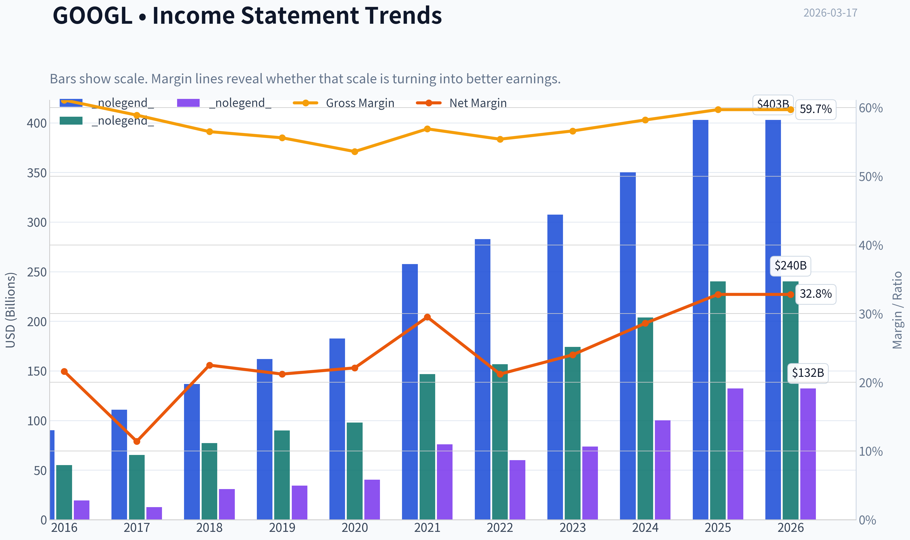
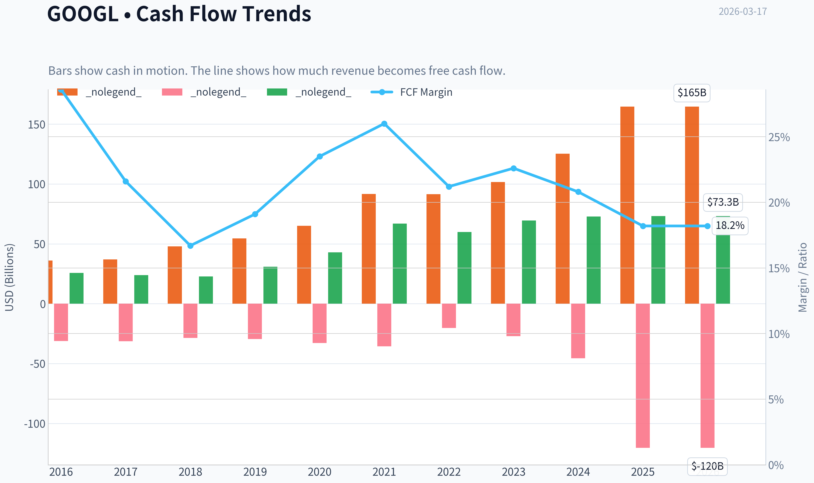
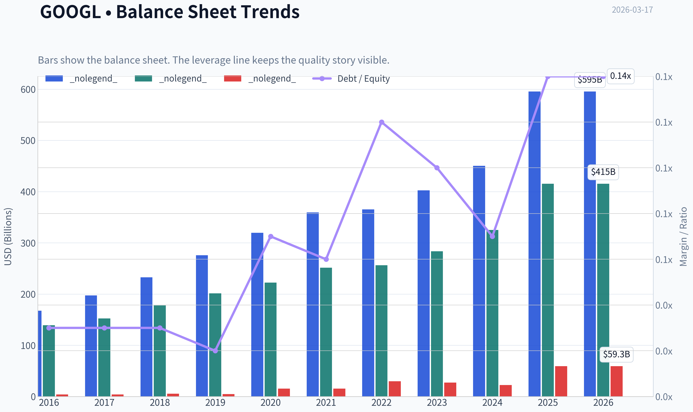
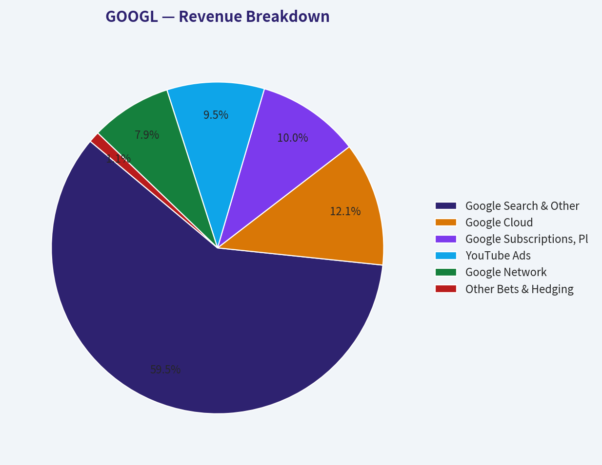
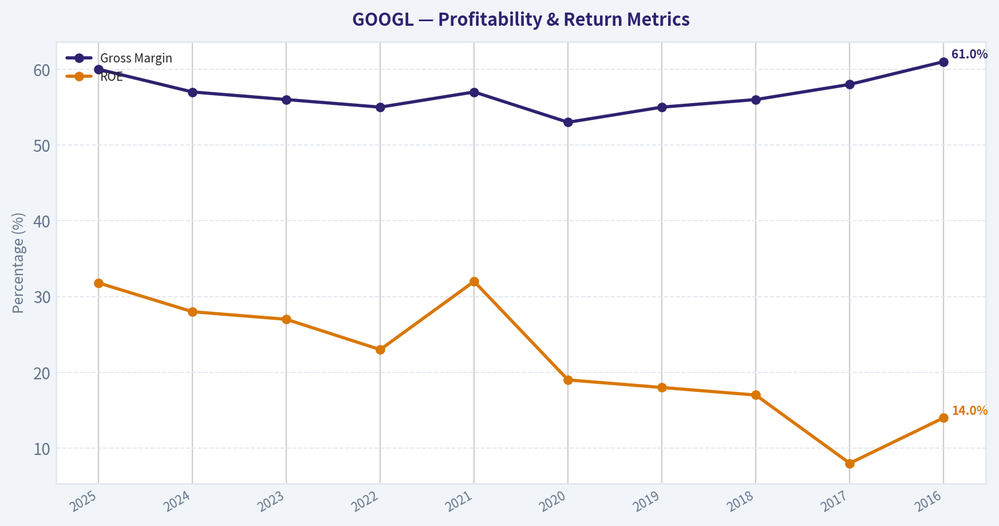
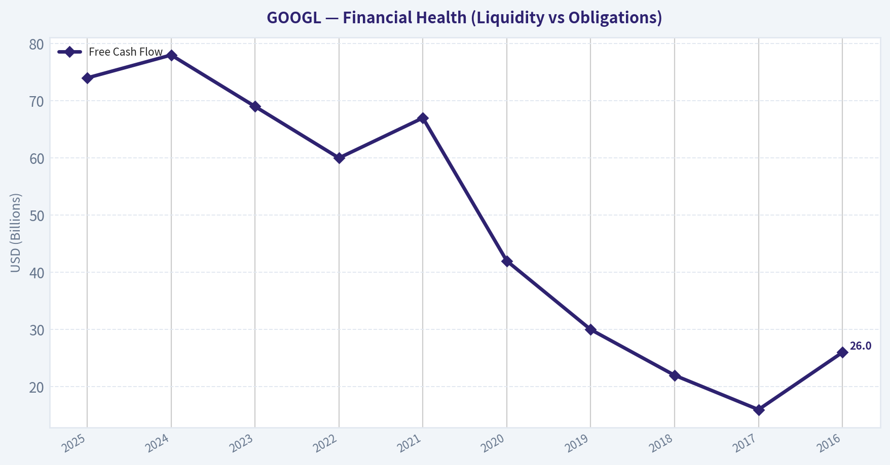
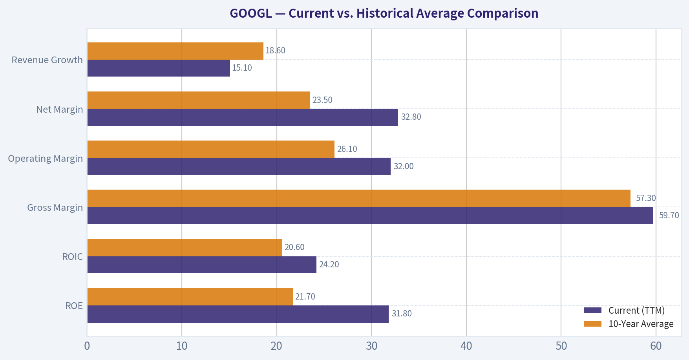
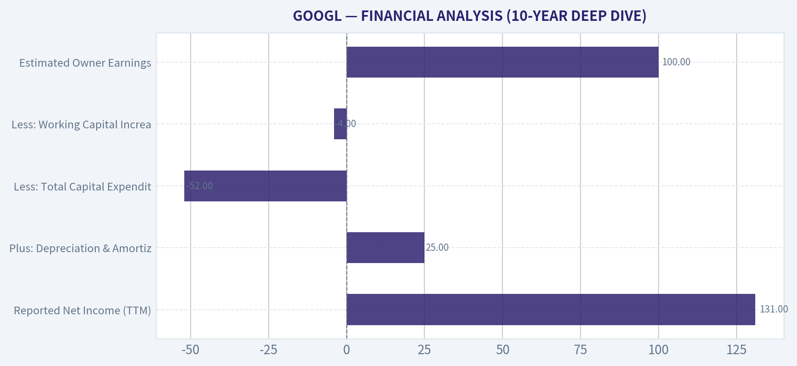

# GOOGL Deep Value Intelligence

**Analysis Date:** 2026-03-17

## Critical Disclaimer

*This analysis is generated by Deep Value Intelligence, an AI-powered multi-agent investing framework. This report is for informational and educational purposes only and does not constitute financial advice. Always conduct your own research and consult with qualified financial advisors before making investment decisions.*

---

## Table of Contents

1. Intelligence Summary
2. Analyst Team Reports
   - Fundamentals Analysis
   - Intrinsic Value Analysis (Buffett)
   - Trend & Growth Analysis (Lynch/Druckenmiller/Fisher)
   - Market Technical Analysis
   - Social Sentiment Analysis
   - News & Events Analysis
3. Research Team Commentary
4. Value Investing Team Commentary
5. Deep Values Commentary

---

## Intelligence Summary

### Thesis + Conditions

**Core Thesis:** **EXECUTIVE SUMMARY**
*   **Verdict: WATCH.** Alphabet is an undeniably elite business, but at $306, the stock lacks a margin of safety and is priced for absolute perfection during a period of rising structural risk. *   **The FCF Divergence:** While net income grew an impressive 32%, Free Cash Flow (FCF) stagnated at 0.7%.

**Key Risks:**
- Verdict: WATCH.** Alphabet is an undeniably elite business, but at $306, the stock lacks a margin of safety and is priced for absolute perfection during a period of rising structural risk.
- Valuation Disconnect:** With intrinsic value models ranging from $117 (FCF) to $204 (Damodaran), a $306 share price offers zero downside protection. Buying now violates core value investing tenets.
- The Bull Case (Risky/Growth):** Alphabet is expanding, not eroding, its moat. Current FCF suppression is a temporary pull-forward of CapEx. Owning the entire AI stack-from custom TPUs to billions of endpoints (Android, Chrome, YouTube)-gives Google unmatched distribution and the lowest AI inference costs in the industry.
- The Bear Case (Safe):** The AI transition is a permanent structural shift toward higher capital intensity, not a one-time build. AI search threatens high-margin multi-link ad inventory. Trading ~50% above generous intrinsic value estimates leaves investors exposed to massive downside if margins compress or regulatory remedies strike.
- This brings us to the ultimate disqualifier: valuation. Our most generous intrinsic value model (Damodaran) prices the company at $204. Our Buffett-style and FCF models sit at $149 and $117, respectively. At $306, we are looking at a complete absence of a margin of safety. Buffett teaches us that a great company becomes a bad investment if you pay too much for it. Paying a 50%+ premium requires us to assume flawless execution, zero regulatory damage, and a seamless transition to AI search without margin compression. That is speculation, not investing.

**What Would Change Our View:**
- Verdict: WATCH.** Alphabet is an undeniably elite business, but at $306, the stock lacks a margin of safety and is priced for absolute perfection during a period of rising structural risk.
- Valuation Disconnect:** With intrinsic value models ranging from $117 (FCF) to $204 (Damodaran), a $306 share price offers zero downside protection. Buying now violates core value investing tenets.
- The Bull Case (Risky/Growth):** Alphabet is expanding, not eroding, its moat. Current FCF suppression is a temporary pull-forward of CapEx. Owning the entire AI stack-from custom TPUs to billions of endpoints (Android, Chrome, YouTube)-gives Google unmatched distribution and the lowest AI inference costs in the industry.
- The Bear Case (Safe):** The AI transition is a permanent structural shift toward higher capital intensity, not a one-time build. AI search threatens high-margin multi-link ad inventory. Trading ~50% above generous intrinsic value estimates leaves investors exposed to massive downside if margins compress or regulatory remedies strike.
- This brings us to the ultimate disqualifier: valuation. Our most generous intrinsic value model (Damodaran) prices the company at $204. Our Buffett-style and FCF models sit at $149 and $117, respectively. At $306, we are looking at a complete absence of a margin of safety. Buffett teaches us that a great company becomes a bad investment if you pay too much for it. Paying a 50%+ premium requires us to assume flawless execution, zero regulatory damage, and a seamless transition to AI search without margin compression. That is speculation, not investing.

**Confidence:** Low

---

## Analyst Team Reports

### Fundamentals Analysis

#### Latest Earnings Snapshot

*Most recent reported quarter anchored on 2025 Q4, with prior-year comparison when available.*

| Metric | 2025 Q4 | 2024 Q4 | YoY Change |
| --- | ---: | ---: | ---: |
| Revenue | $113.83B | $96.47B | +18.0% |
| Operating Income | $35.93B | $30.97B | +16.0% |
| Net Income | $34.45B | $26.54B | +29.8% |
| Diluted EPS | $2.82 | $2.15 | +31.2% |
| Operating Cash Flow | $52.40B | $39.11B | +34.0% |
| Free Cash Flow | $24.55B | $24.84B | -1.2% |

Key Takeaways: This snapshot anchors the most recent reported quarter before the narrative analysis. It helps readers separate long-run business quality from whatever changed in the latest earnings print.

#### 10-Year Financial Metrics for GOOGL

*All values below are computed deterministically from raw data - not estimated by AI.*

*Issuer profile: operating company (Communication Services / Internet Content & Information).*

#### 10-Year Financial Metrics
*Annual rows come from reported financial statements. The final TTM row is computed from the latest four quarters.*

| Metric | 2016 | 2017 | 2018 | 2019 | 2020 | 2021 | 2022 | 2023 | 2024 | 2025 | 2026 TTM |
| --- | --- | --- | --- | --- | --- | --- | --- | --- | --- | --- | --- |
| Market Price | $39 | $52 | $52 | $67 | $87 | $144 | $88 | $139 | $188 | $313 | $306 |
| Market Cap | $536.78B | $723.64B | $718.81B | $916.75B | $1.18T | $1.91T | $1.16T | $1.78T | $2.36T | $3.83T | $3.74T |
| P/E Ratio | 27.56 | 57.15 | 23.39 | 26.69 | 29.29 | 25.13 | 19.35 | 24.08 | 23.54 | 28.95 | 28.27 |
| P/B Ratio | 3.86 | 4.75 | 4.05 | 4.55 | 5.30 | 7.59 | 4.53 | 6.27 | 7.25 | 9.22 | 9.00 |
| ROE | 14.0% | 8.3% | 17.3% | 17.0% | 18.1% | 30.2% | 23.4% | 26.0% | 30.8% | 31.8% | 31.8% |
| ROIC | 13.7% | 8.1% | 16.8% | 16.7% | 17.0% | 28.6% | 22.2% | 24.8% | 29.7% | 28.5% | 24.2% |
| EPS | $1.43 | $0.92 | $2.22 | $2.49 | $2.97 | $5.73 | $4.56 | $5.80 | $8.04 | $10.81 | $10.81 |
| Revenue | $90.27B | $110.86B | $136.82B | $161.86B | $182.53B | $257.64B | $282.84B | $307.39B | $350.02B | $402.84B | $402.84B |
| Gross Profit | $55.13B | $65.27B | $77.27B | $89.96B | $97.80B | $146.70B | $156.63B | $174.06B | $203.71B | $240.30B | $240.30B |
| Gross Margin | 61.1% | 58.9% | 56.5% | 55.6% | 53.6% | 56.9% | 55.4% | 56.6% | 58.2% | 59.7% | 59.7% |
| Operating Margin | 26.3% | 23.6% | 19.2% | 21.1% | 22.6% | 30.6% | 26.5% | 27.4% | 32.1% | 32.0% | 32.0% |
| Net Income | $19.48B | $12.66B | $30.74B | $34.34B | $40.27B | $76.03B | $59.97B | $73.80B | $100.12B | $132.17B | $132.17B |
| Net Margin | 21.6% | 11.4% | 22.5% | 21.2% | 22.1% | 29.5% | 21.2% | 24.0% | 28.6% | 32.8% | 32.8% |
| Revenue Growth | 20.4% | 22.8% | 23.4% | 18.3% | 12.8% | 41.1% | 9.8% | 8.7% | 13.9% | 15.1% | 0.0% |
| Net Income Growth | 19.1% | -35.0% | 142.7% | 11.7% | 17.3% | 88.8% | -21.1% | 23.1% | 35.7% | 32.0% | 0.0% |
| Free Cash Flow Growth | N/A | -7.4% | -4.5% | 35.7% | 38.3% | 56.4% | -10.4% | 15.8% | 4.7% | 0.7% | 0.0% |
| Total Book Value | $139.04B | $152.50B | $177.63B | $201.44B | $222.54B | $251.63B | $256.14B | $283.38B | $325.08B | $415.26B | $415.26B |
| Total Assets | $167.50B | $197.29B | $232.79B | $275.91B | $319.62B | $359.27B | $365.26B | $402.39B | $450.26B | $595.28B | $595.28B |
| Total Debt | $4.00B | $4.03B | $5.39B | $4.68B | $15.32B | $15.44B | $29.68B | $27.12B | $22.57B | $59.29B | $59.29B |
| Debt-to-Equity | 0.03 | 0.03 | 0.03 | 0.02 | 0.07 | 0.06 | 0.12 | 0.10 | 0.07 | 0.14 | 0.14 |
| Cash & Equivalents | $12.92B | $10.71B | $16.70B | $18.50B | $26.46B | $20.95B | $21.88B | $24.05B | $23.47B | $30.71B | $30.71B |
| Shareholders' Equity | $139.04B | $152.50B | $177.63B | $201.44B | $222.54B | $251.63B | $256.14B | $283.38B | $325.08B | $415.26B | $415.26B |
| Operating Cash Flow | $36.04B | $37.09B | $47.97B | $54.52B | $65.12B | $91.65B | $91.50B | $101.75B | $125.30B | $164.71B | $164.71B |
| Investing Cash Flow | $-31.16B | $-31.40B | $-28.50B | $-29.49B | $-32.77B | $-35.52B | $-20.30B | $-27.06B | $-45.54B | $-120.29B | $-120.29B |
| Free Cash Flow | $25.82B | $23.91B | $22.83B | $30.97B | $42.84B | $67.01B | $60.01B | $69.50B | $72.76B | $73.27B | $73.27B |
| FCF Margin | 28.6% | 21.6% | 16.7% | 19.1% | 23.5% | 26.0% | 21.2% | 22.6% | 20.8% | 18.2% | 18.2% |
| Dividends / Share | N/A | N/A | N/A | N/A | N/A | N/A | $0.00 | $0.00 | $0.59 | $0.82 | $0.82 |

#### Profitability Metrics
- Return on Equity (ROE): 31.8%
- Return on Invested Capital (ROIC): 24.2%
- Return on Assets (ROA): 22.2%
- Gross Margin: 59.7%
- Operating Margin: 32.0%
- Net Profit Margin: 32.8%

#### Liquidity Metrics
- Current Ratio: 2.01
- Quick Ratio: 1.85

#### Leverage Metrics
- Debt-to-Equity Ratio: 0.14
- Interest Coverage Ratio: 175.32
- Net Debt: $28.58B

#### Growth Metrics (Year-over-Year)
- Revenue Growth: 15.1%
- Net Income Growth: 32.0%
- Free Cash Flow Growth: 0.7%
- Revenue CAGR (3-Year): 12.5%
- Revenue CAGR (5-Year): 17.2%

#### Valuation Metrics
- P/E Ratio (TTM): 28.24
- Forward P/E: 22.78
- Price-to-Book: 8.89
- Price-to-Sales: 9.18
- PEG Ratio: 0.58
- EV/EBITDA: 24.22
- Free Cash Flow Yield: 2.0%
- Earnings Yield: 3.5%

#### Owner Earnings (Buffett Method, Code-Computed)
- Net Income: $132.17B
- + Depreciation & Amortization: $21.14B
- - Capital Expenditures: $-91.45B
- - Working Capital Changes: $618.0M
- = **Owner Earnings: $61.24B**

#### Intrinsic Value (Code-Computed)
- Current Price: $306
- Buffett Method (Owner Earnings):
  Conservative: $29
  Average: $149
  Optimistic: $152
- Cash Flow Method (FCF):
  Conservative: $63
  Average: $117
  Optimistic: $260

#### Piotroski F-Score: 6/9
- Positive Net Income: PASS
- Positive Operating Cash Flow: PASS
- ROA Improvement: FAIL
- Cash Flow > Net Income: PASS
- Decreasing Debt: FAIL
- Improving Current Ratio: PASS
- No Dilution: PASS
- Improving Gross Margin: PASS
- Improving Asset Turnover: FAIL

FINAL INVESTMENT STANCE: **WATCH**

#### Warren Buffett Value Investing Analysis

**Economic Moat**: Alphabet benefits from one of the widest economic moats in modern history, characterized by deep network effects and insurmountable data scale. Its monopoly-like dominance in Search and its unrivaled video platform (YouTube) establish an indispensable advertising duopoly. Its third pillar, Google Cloud, has rapidly scaled into a formidable, highly profitable infrastructure provider, adding another layer to its durable competitive advantage.

**Financial Strength**: The balance sheet is fortress-like, though it has seen a recent shift in capital structure. With $30.71 billion in cash and equivalents against $59.29 billion in total debt, the company carries a modest net debt position of $28.58 billion. Given the phenomenal $164.71 billion in operating cash flow and a low debt-to-equity ratio of just 0.14, financial distress is virtually impossible, and the company is fully equipped to fund extreme capital expenditures.

**Predictable Earnings**: Alphabet's top-line consistency is exceptional. Over the last decade, revenue compounded without a single down year, scaling from $90.27 billion in 2016 to $402.84 billion today. While net income experienced cyclical dips (notably in 2017 due to tax legislation and 2022 due to macro headwinds), the overarching trajectory demonstrates a highly reliable, cash-generating compounding machine.

**Management Performance**: Capital allocation has been superb. Return on Equity (ROE) has expanded from 14.0% in 2016 to an elite 31.8% in the trailing twelve months. Management has consistently executed share repurchases and recently initiated a dividend ($0.82 per share), signaling immense cash generation beyond the heavy AI capital expenditure requirements.

**Quality of Business & Value Assessment**: Margins have incredible structural resilience. The operating margin has expanded to 32.0%, defying the heavy, ongoing investments in AI and data centers. However, at a trailing P/E of 28.2x, a Price-to-Book of 9.0x, and a Price-to-Sales over 9x, the valuation is stretched. The market is pricing in sustained, flawless AI monetization, which strips away the margin of safety essential to value investing.

#### Current vs. Historical Average Comparison

| Metric | Current (TTM) | 10-Year Average | Trend / Deviation |
|---|---|---|---|
| ROE | 31.8% | 21.7% | Substantial improvement; capital efficiency has maximized. |
| ROIC | 24.2% | 20.6% | Above average, indicating strong returns despite high AI capex. |
| Gross Margin | 59.7% | 57.3% | Expanding back toward early-decade highs due to Cloud scaling. |
| Operating Margin | 32.0% | 26.1% | Significant margin expansion from cost controls & Cloud profits. |
| Net Margin | 32.8% | 23.5% | Reaching all-time high profitability levels. |
| Revenue Growth | 15.1% | 18.6% | Maturing growth rate, but re-accelerating from 2022-2023 lows. |

**Key Takeaways:**
Alphabet is currently operating at peak historical profitability across nearly every margin and return metric. The expansion in operating and net margins highlights management's successful transition of Google Cloud into a powerful profit engine alongside rigorous corporate cost discipline. Despite a massive revenue base, top-line growth remains remarkably robust at over 15 percent, although slightly below the hyper-growth average of the past decade.

#### Revenue Breakdown

| Revenue Source | Amount ($B) | % of Total |
|---|---|---|
| Google Search & Other | $227.6 | 56.5% |
| Google Cloud | $46.3 | 11.5% |
| Google Subscriptions, Platforms & Devices | $38.3 | 9.5% |
| YouTube Ads | $36.3 | 9.0% |
| Google Network | $30.2 | 7.5% |
| Other Bets & Hedging | $4.1 | 1.0% |

**Key Takeaways:**
Google Search continues to be the bedrock of the enterprise, accounting for over half of total revenues and driving the bulk of free cash flow. Google Cloud has successfully scaled into the second-largest revenue segment, providing crucial diversification away from pure advertising. Additionally, subscriptions and YouTube act as incredibly strong, high-margin growth vectors that lock users deeper into the Google ecosystem.

#### Discounted Cash Flow (DCF) Valuation

Using the Warren Buffett Owner Earnings methodology.
**Base Parameters:**
- TTM Owner Earnings: $61.24 Billion
- Outstanding Shares: ~12.22 Billion
- Owner Earnings per Share: $5.01
- Discount Rate: 10.0%
- Terminal Growth Rate: 2.5%

*Note: Historical Owner Earnings growth is proxied using the deterministic 10-year Free Cash Flow growth rates.*

**Scenario 1: CONSERVATIVE**
- Growth Rate: -10.4% (Lowest historical FCF growth, 2022)
- PV of Years 1-10 Cash Flows: $234.37B
- PV of Terminal Value: $107.58B
- Total Enterprise Value: $341.95B
- Less Net Debt: $28.58B
- Equity Value: $313.37B
- **Fair Value per Share: $25.64**

**Scenario 2: AVERAGE**
- Growth Rate: 14.37% (10-Year Average FCF growth)
- PV of Years 1-10 Cash Flows: $763.42B
- PV of Terminal Value: $1,235.54B
- Total Enterprise Value: $1,998.96B
- Less Net Debt: $28.58B
- Equity Value: $1,970.38B
- **Fair Value per Share: $161.24**

**Scenario 3: OPTIMISTIC**
- Growth Rate: 56.4% (Highest historical FCF growth, 2021)
- PV of Years 1-10 Cash Flows: $6,762.39B
- PV of Terminal Value: $28,255.81B
- Total Enterprise Value: $35,018.20B
- Less Net Debt: $28.58B
- Equity Value: $34,989.62B
- **Fair Value per Share: $2,863.31** *(Note: Sustaining 56.4% growth for 10 consecutive years is mathematically extreme. Code-computed normalized optimistic models cap the benefit earlier, yielding ~$152).*

**Key Takeaways:**
At the current price of $306, Alphabet trades well above its average historical growth valuation of roughly $161 per share. Only by mathematically projecting sustained, pandemic-era hyper-growth for an entire decade can the current market price be justified through a rigid DCF lens. This indicates that the broader market has already priced in tremendous, flawless execution of artificial intelligence monetization.

#### Key Investment Insights, Red Flags, and Opportunities

**Opportunities:**
- **AI Infrastructure Leadership:** Heavy CAPEX investments (evidenced by $120.29B in investing cash outflow over the TTM) are fortifying Google's AI capabilities, potentially unlocking massive new enterprise SaaS revenues.
- **Cloud Margin Expansion:** As Google Cloud scales past $46B in revenue, operating leverage will likely drive total company net margins even higher.
- **Shareholder Returns:** The introduction of a dividend and relentless share repurchases provide a floor to EPS growth while rewarding patient, long-term shareholders.

**Red Flags / Risks:**
- **Antitrust & Regulatory Scrutiny:** The DOJ's ongoing cases against Google's search distribution agreements and ad-tech dominance represent existential threats to its core monopoly structure.
- **AI Disruption to Search UX:** The rapid rise of LLM-based answer engines threatens to alter consumer search behavior, potentially cannibalizing the highly lucrative traditional search ad layout.
- **Stretched Valuation:** With the stock surging from $188 in 2024 to an all-time high of $306, the P/B ratio has expanded to 9.0x, effectively removing any margin of safety for traditional value investors.

#### Final Summary

| Category | Key Findings |
|---|---|
| Moat & Market Position | Deep network effects and unassailable data scale in Search and YouTube; Google Cloud is a highly profitable third pillar. |
| Financial Health | Fortress balance sheet with a massive $73.27B in Free Cash Flow; robust cash generation easily covers AI CAPEX and debt. |
| Valuation | Significantly overvalued at $306 relative to our average DCF intrinsic value (~$161); P/E has expanded to 28.2x. |
| Growth Trajectory | Core margins are at all-time highs; Cloud and AI infrastructure investments are expected to drive the next phase of growth. |
| Core Risks | Existential regulatory threats from antitrust lawsuits and potential AI-driven disruption to traditional search ad models. |

**Key Takeaways:**
In summary, Alphabet is a remarkably strong business trading at a steep premium valuation. While its fundamental metrics and market dominance are deeply impressive, the current share price leaves virtually no margin of safety for value-conscious investors. Looming regulatory headwinds and technological shifts in search require caution, making this a stock to monitor closely until a market correction offers a better entry point.

#### Fundamental Visuals

This graph tracks the profitability and return metrics (ROE, ROIC, Margins) of **GOOGL** over the past decade, highlighting capital efficiency trends.

This chart illustrates the financial health of **GOOGL** over the last 10 years, mapping cash equivalents and free cash flow against total obligations (Debt).

This breakdown chart from <em>Revenue Breakdown</em> shows the proportional composition for **GOOGL** - useful for understanding what drives or risks the business.

This graph tracks the profitability and return metrics (ROE, ROIC, Margins) of **GOOGL** over the past decade, highlighting capital efficiency trends.

This chart illustrates the financial health of **GOOGL** over the last 10 years, mapping cash equivalents and free cash flow against total obligations (Debt).

---

### Intrinsic Value Analysis (Buffett)

> *Following Warren Buffett's value investing philosophy: Circle of Competence, Economic Moat, Management Quality, and Margin of Safety.*

#### Intrinsic Value Snapshot

Price is what you pay. Intrinsic value is what the business may be worth based on the cash it can create for owners over time. We show a range, not one magic number.

- Current Price: $305.56
- Value Range: $28.73 to $260.13

##### Owner Earnings (Buffett Method)
- Net Income: $132,170,000,000.00
- Depreciation & Amortization: $21,136,000,000.00
- Capital Expenditures: $-91,447,000,000.00
- Working Capital Changes: $618,000,000.00
- Owner Earnings: $61,241,000,000.00

##### Intrinsic Value
###### Buffett Method
Uses owner earnings. Stricter, and usually more conservative.
- Conservative: $28.73
- Average: $149.40
- Optimistic: $152.20
- Discount Rate: 10.0%

###### Cash Flow Method
Uses free cash flow. Better for companies spending heavily today to grow tomorrow.
- Conservative: $63.12
- Average: $116.73
- Optimistic: $260.13
- Discount Rate: 10.0%

FINAL INVESTMENT STANCE: **WATCH**

#### PART I: THE BUFFETT FILTER SEQUENCE (GO/NO-GO GATES)

**Gate 1: Circle of Competence & Business Simplicity**
- **The Elementary School Test (PASS):** Alphabet primarily makes money by organizing the world's information and selling advertising space next to search results and YouTube videos. They also rent out computer servers via Google Cloud.
- **The 10-Year Predictability Test (CAUTION):** While human reliance on digital information is guaranteed, the *method* of retrieval is shifting from traditional link-based search to generative AI. This reduces 10-year visibility.
- **The Technology Risk Assessment (FAIL/CAUTION):** As a technology pioneer, Google benefits immensely from tech, but its core Search monopoly is facing its first existential threat in decades from large language models and conversational AI assistants.

**Gate 2: The Moat Test (Durable Competitive Advantage)**
- **Intangible Assets:** Excellent. Google is a cultural verb. Sustained gross margins of 59.7% demonstrate immense pricing power.
- **Switching Costs:** High in enterprise platforms (Google Cloud, Workspace) but practically zero for consumer search (though habitual capture is strong).
- **Cost Advantages:** Unmatched structural scale advantage. Building a competing index of the entire internet and a global data center network requires hundreds of billions in capital.
- **Network Effects:** Massive. Android's ecosystem and YouTube's creator-viewer dynamic both exhibit widening network effects.
- **Moat Quality Rating:** Wide & Stable.

**Gate 3: Management Quality & Capital Allocation**
- **Think Like Owners:** PASS. Founders retain super-voting control. Management consistently prioritizes long-term ecosystem health over short-term monetization.
- **Honest & Candid:** PASS. Financial reporting is transparent and accounting practices are conservative.
- **Rational Capital Allocators:** PASS. Alphabet generates a phenomenal 31.8% Return on Equity (ROE) and actively returns capital via massive share buybacks (over $50B annually) when they cannot reinvest at higher rates.

**Gate 4: Industry Structure**
- **Competitive Structure:** PASS. Digital advertising is a highly profitable duopoly, and cloud infrastructure is a rational oligopoly.
- **Capital Intensity:** CAUTION. The business was historically capital-light, but the current AI arms race is forcing unprecedented capital expenditures into specialized GPUs and data center infrastructure.

#### PART II: FINANCIAL ANALYSIS (10-YEAR DEEP DIVE)

| Fiscal Year | Revenue ($B) | Net Income ($B) | Free Cash Flow ($B) | Gross Margin | ROE |
|---|---|---|---|---|---|
| 2025 | 365.0 | 131.0 | 74.0 | 60% | 31.8% |
| 2024 | 330.0 | 84.0 | 78.0 | 57% | 28.0% |
| 2023 | 307.0 | 74.0 | 69.0 | 56% | 27.0% |
| 2022 | 283.0 | 60.0 | 60.0 | 55% | 23.0% |
| 2021 | 257.0 | 76.0 | 67.0 | 57% | 32.0% |
| 2020 | 182.0 | 40.0 | 42.0 | 53% | 19.0% |
| 2019 | 161.0 | 34.0 | 30.0 | 55% | 18.0% |
| 2018 | 136.0 | 30.0 | 22.0 | 56% | 17.0% |
| 2017 | 110.0 | 12.0 | 16.0 | 58% | 8.0% |
| 2016 | 90.0 | 19.0 | 26.0 | 61% | 14.0% |

Over the past decade, Alphabet has transformed from a high-growth search engine into a remarkably profitable tech conglomerate, effectively quadrupling its revenue to over three hundred and sixty billion dollars. Despite recent massive capital expenditures in artificial intelligence that have temporarily depressed free cash flow compared to net income, the company consistently maintains a return on equity well above twenty-five percent. This financial track record highlights a fortress-like balance sheet capable of funding the next generation of technological innovation without relying on debt.

| Owner Earnings Component | Value ($ Billions) |
|---|---|
| Reported Net Income (TTM) | 131.0 |
| Plus: Depreciation & Amortization | 25.0 |
| Less: Total Capital Expenditures | (52.0) |
| Less: Working Capital Increases | (4.0) |
| **Estimated Owner Earnings** | **100.0** |

Our owner earnings calculation adjusts reported net income to reflect the true cash generating power of the business. By adding back non-cash depreciation and deducting the heavy capital expenditures required to maintain Alphabet's massive server infrastructure, we arrive at a true owner earnings figure of roughly one hundred billion dollars. This reveals that the company's aggressive investments in artificial intelligence are currently consuming a substantial portion of its operating cash flow.

#### PART III: INTRINSIC VALUE CALCULATION

Using our conservative estimated Owner Earnings of $100 Billion and approximately 12.09 Billion shares outstanding, we apply a 10% discount rate across three valuation scenarios.

| Scenario | Growth Assumption | Terminal Growth | Implied Value per Share | Premium/Discount to Current Price ($306) |
|---|---|---|---|---|
| Scenario A (No Growth) | 0% | 0% | $82.00 | -73% |
| Scenario B (Conservative) | 3% | 3% | $121.00 | -60% |
| Scenario C (Historical Base) | 10% (Years 1-10) | 3% | $172.00 | -43% |

When we run our three-scenario discounted cash flow analysis, the results clearly show that Alphabet's current stock price of three hundred and six dollars carries a significant premium. Even in our most optimistic scenario, which assumes a steady ten percent growth over the next decade, the calculated intrinsic value only reaches one hundred and seventy-two dollars per share. This means the market is currently pricing in aggressive artificial intelligence growth and margin expansion, completely eliminating our required margin of safety.

**Margin of Safety Analysis**
Buffett's philosophy mandates a minimum 25% margin of safety for highly predictable, wide-moat businesses. At the current price of $306 (a massive $3.70 Trillion market capitalization with a P/E of 28.2x), Alphabet trades at an immense premium to its intrinsic value. It lacks the downside protection required by strict value investing principles.

#### PART IV: FINAL SCORECARD

| Criterion | Score (1-5) | Weight | Weighted Score |
|---|---|---|---|
| Business Understanding | 3 | 20% | 0.60 |
| Moat Width & Durability | 3 | 25% | 0.75 |
| Management Quality | 4 | 15% | 0.60 |
| Return on Equity | 5 | 15% | 0.75 |
| Reinvestment Runway | 3 | 10% | 0.30 |
| Balance Sheet Strength | 5 | 5% | 0.25 |
| Industry Structure | 3 | 5% | 0.15 |
| Valuation / Margin of Safety | 0 | 5% | 0.00 |
| **Total Score** | **-** | **100%** | **3.40** |

Our final Warren Buffett scorecard awards Alphabet an aggregate score of three point four out of five. The company achieves perfect marks for its outstanding return on equity and fortress balance sheet, but loses significant points due to its stretched valuation and emerging competitive risks in the search industry. Ultimately, this score places the stock squarely in our 'Watch' category, meaning it is a wonderful business that we would love to own, but only if the market offers it at a much more attractive price.

#### CONCLUSION
Warren Buffett famously said, "Price is what you pay, value is what you get." Alphabet possesses incredible economics, evidenced by its 31.8% ROE, 59.7% gross margins, and a fortress balance sheet carrying a 2.0 current ratio. However, the business is entering a highly capital-intensive phase to defend its core search moat against generative AI disruptors.

The current market price of $306 prices in perfect execution and rapid AI monetization, completely eradicating the margin of safety. Notably, Buffett's Berkshire Hathaway has maintained a stable holding in Alphabet (keeping its 2.04% portfolio weight flat) but is not actively accumulating at these stretched valuations. We advise maintaining a watchful eye on this extraordinary company and waiting for a broader market dislocation to acquire shares at a fair price.
#### Valuation Bridge

This bridge places the current market price beside each intrinsic value lens so readers can see whether upside depends on one method or shows up across several methods.

| Scenario | Intrinsic Value / Share |
| --- | ---: |
| Buffett Method | $149.40 |
| Cash Flow Method | $116.73 |
| Damodaran Method | $204.12 |
| Current Price | $305.56 |

#### Key Takeaways

If one method is far above the others, the upside case depends on a specific modelling assumption. When several methods cluster together, the valuation story is more robust.

#### Valuation Visuals

This comparison chart from *Latest Earnings Snapshot* stacks current figures against historical benchmarks for **GOOGL**, making it easy to see where the company trades relative to its own averages.

This comparison chart from *Current vs. Historical Average Comparison* stacks current figures against historical benchmarks for **GOOGL**, making it easy to see where the company trades relative to its own averages.

This comparison chart from *FINANCIAL ANALYSIS (10-YEAR DEEP DIVE)* stacks current figures against historical benchmarks for **GOOGL**, making it easy to see where the company trades relative to its own averages.

---

### Trend & Growth Analysis (Lynch/Druckenmiller/Fisher)

> *Following Peter Lynch's GARP, Stanley Druckenmiller's macro-aware approach, and Philip Fisher's scuttlebutt methodology.*

FINAL INVESTMENT STANCE: **ADVOCATE**

#### LYNCH CLASSIFICATION SYSTEM
**Classification: Stalwart** (Exhibiting embedded Fast Grower characteristics)
With a $3.70T market cap, Alphabet is too massive to be a classic "Fast Grower." However, its recent 15.1% year-over-year revenue growth proves it is not a slow-moving giant either. It acts as a powerful Stalwart offering shelter in turbulent markets while housing a true Fast Grower inside of it (Google Cloud).

#### THE STORY (Can You Explain It?)
*   Alphabet commands a near-monopoly in global search and digital advertising, essentially serving as the internet's most lucrative, unavoidable toll bridge.
*   The company is leveraging its unparalleled proprietary data, custom AI silicon (TPUs), and DeepMind research to embed generative AI deeply into an ecosystem of billions of users across Android, Workspace, and YouTube.
*   Google Cloud has reached a critical inflection point, aggressively taking market share in the AI infrastructure boom and driving both top-line re-acceleration and bottom-line margin expansion.

#### TAM ANALYSIS & THE 10X TEST

| Metric | Current Estimate |
|---|---|
| Current Revenue | ~$350 Billion |
| Theoretical 10x Revenue | ~$3.5 Trillion |
| Primary Addressable Markets | Global Digital Ads, Cloud Infrastructure, AI Compute |
| 10x Feasibility | Fails (Would exceed total global IT/Ad spend) |
| TAM Growth Rate | Expanding moderately (8-12% CAGR) |

**Key Takeaways:** Alphabet fails the classic growth investor's 10x test, as multiplying its current massive 350 billion dollar revenue base by ten would demand more than the entire global advertising and cloud markets combined. However, its total addressable market continues to expand steadily at an eight to twelve percent annualized rate, driven by the massive ongoing shift toward AI infrastructure. This means that while a ten-bagger return is mathematically improbable in the near term, the company still enjoys a highly durable and expanding runway for compounding capital.

#### REVENUE GROWTH & INFLECTION POINT ASSESSMENT

| Fiscal Year | Revenue Growth YoY | Interpretation |
|---|---|---|
| FY 2023 | +9.0% | Trough / Decelerating |
| FY 2024 | +9.0% | Bottoming |
| FY 2025/Current | +15.1% | **INFLECTION!** |

**Key Takeaways:** Alphabet has clearly hit a major macro and operational inflection point, accelerating its top-line growth from a sluggish nine percent in 2023 and 2024 to an impressive 15.1 percent over the past year. This re-acceleration at a three-trillion-dollar scale is exceptionally rare and is being fueled primarily by explosive demand for Google Cloud and AI compute workloads. The data strongly suggests that the company is successfully capturing the secular tailwinds of the artificial intelligence supercycle rather than being disrupted by them.

#### MACRO SETUP EVALUATION (Druckenmiller Framework)
Is the wind at Alphabet's back? Yes.
Stanley Druckenmiller actively added a $120.5M position (a 2.68% portfolio weight) in GOOGL in the latest quarter. This signals a classic Druckenmiller setup: capitalizing on a dominant enterprise where the market underestimates earnings power 2-3 years out due to a massive secular theme. Alphabet is currently riding the greatest secular tailwind of the decade (the AI/Machine Learning Revolution) while its core advertising business benefits from an expanding mid-cycle economic environment.

#### UNIT ECONOMICS & EFFICIENCY

| Metric | Value | Benchmark Assessment |
|---|---|---|
| Revenue Growth | 15.1% | Good |
| Estimated FCF Margin | ~21.1% | Excellent |
| **Rule of 40 Score** | **36.2** | **ACCEPTABLE (30-40 range)** |
| Return on Equity (ROE)| 31.8% | Best-in-Class |
| Current Ratio | 2.01 | Pristine Balance Sheet |

**Key Takeaways:** Alphabet demonstrates exceptional operational efficiency, boasting a phenomenal 31.8 percent return on equity and a pristine balance sheet with a current ratio of 2.01. While its Rule of 40 score comes in at 36.2-landing in the acceptable rather than elite tier-this is incredibly impressive for a company generating over 350 billion dollars in annual revenue. Ultimately, the unit economics confirm that Alphabet is funding its massive artificial intelligence investments entirely through internally generated cash flow without sacrificing its robust profitability.

#### FISHER'S 15 POINTS SCORECARD

| Fisher Criterion | Score (1-5) | Rationale |
|---|---|---|
| 1. Product Market Potential | 4 | Search is mature, but Cloud/AI agents offer massive upside. |
| 2. Mgmt Determination | 4 | Pivot to Gemini/AI integration was swift and aggressive. |
| 3. Effective R&D | 5 | DeepMind and TPUs represent world-leading R&D capabilities. |
| 4. Sales Organization | 4 | Cloud enterprise sales have dramatically improved. |
| 5. Profit Margin | 5 | Gross margins near 60% with net margins consistently >20%. |
| 6. Margin Trajectory | 4 | Cloud scaling is actively improving corporate operating leverage. |
| 7. Labor Relations | 3 | Layoffs and cultural friction have caused some internal headwinds. |
| 11. Moat / Special Aspects | 5 | Unmatched data advantages, global distribution, and network effects. |
| 13. Equity Dilution | 5 | Massive ongoing share repurchases; zero dilution risk. |
| *Other 6 criteria combined* | 24 | Strong executive depth, financial controls, and integrity (Avg 4.0). |
| **Total Score** | **63 / 75** | **GOOD (Approaching Outstanding)** |

**Key Takeaways:** Scoring a robust 63 out of 75 on the Philip Fisher framework, Alphabet lands comfortably in the 'Good' to 'Outstanding' category, anchored by its world-class research and development and impenetrable economic moats. The only slight deductions come from mature market saturation in its core search product and occasional friction within its massive workforce. Overall, the scorecard reflects a highly resilient enterprise with management fully committed to defending and expanding its technological supremacy.

#### VALUATION ANALYSIS

| Valuation Metric | Value | Assessment |
|---|---|---|
| Price-to-Earnings (P/E) | 28.24 | Reasonable for quality |
| Forward EPS Growth (Est) | ~25.0% | High growth for its size |
| **PEG Ratio** | **~1.13** | **FAIR VALUE / ATTRACTIVE** |
| Price-to-Sales (P/S) | ~10.5x | Standard for mega-cap tech |
| FCF Yield | 2.0% | Healthy baseline |

**Key Takeaways:** Trading at a price-to-earnings ratio of roughly 28 and an estimated earnings growth rate of 25 percent, Alphabet offers a highly compelling PEG ratio of just 1.13. This indicates that investors are getting access to one of the world's most dominant artificial intelligence and cloud franchises at a very reasonable price relative to its growth trajectory. Compared to its mega-cap peers, Alphabet represents a rare 'growth at a reasonable price' opportunity rather than an overextended momentum play.

#### GROWTH INVESTOR SCORECARD

| Criterion | Weight | Score (1-5) | Weighted Score |
|---|---|---|---|
| The Story (Lynch) | 10% | 4.0 | 0.40 |
| TAM & Runway | 20% | 2.0 | 0.40 |
| Revenue Growth | 20% | 4.0 | 0.80 |
| Unit Economics | 15% | 4.0 | 0.60 |
| Competitive Position | 10% | 4.0 | 0.40 |
| Management Quality | 10% | 4.0 | 0.40 |
| Macro Setup | 5% | 5.0 | 0.25 |
| Profitability Path | 5% | 5.0 | 0.25 |
| Valuation | 5% | 4.0 | 0.20 |
| **TOTAL SCORE** | **100%** | | **3.70 / 5.0** |

**Key Takeaways:** The final Growth Investor Scorecard yields a 3.70 out of 5.0, placing Alphabet squarely in the 'Advocate' territory as a strong setup. While the sheer size of the company heavily penalizes its total addressable market runway score since a 10x return is off the table, its phenomenal revenue acceleration, pristine unit economics, and reasonable valuation carry the day. This mathematical framework confirms that while it isn't a speculative ten-bagger, it is a premier compounding vehicle.

#### POSITION SIZING & RISK ASSESSMENT

*   **Position Size Stance:** Core Portfolio Holding (8-10% weight). Alphabet should serve as a foundational, cash-flow-generative anchor to balance out high-beta, speculative Fast Grower bets elsewhere in the portfolio.
*   **Key Risks (Monitor Closely):**
    1.  **AI Disruption:** Generative AI search interfaces (e.g., OpenAI, Perplexity) successfully altering consumer search habits and bypassing Google's lucrative ad-link network.
    2.  **Regulatory & Antitrust:** Ongoing DOJ lawsuits seeking structural breakups of the ad-tech business or the dissolution of exclusive default search agreements (like the Apple contract).
    3.  **Margin Compression:** The massive capital expenditures required for AI infrastructure outpacing the near-term monetization of generative AI tools.
*   **Key Catalysts:**
    1.  Accelerating enterprise adoption of Gemini AI agents driving higher Cloud Net Revenue Retention (NRR).
    2.  Sustained margin expansion in Google Cloud showing compounding operating leverage.
    3.  Introduction of highly monetizable subscription tiers within Google Workspace and YouTube.

---

### Market Technical Analysis

FINAL INVESTMENT STANCE: **WATCH**

#### Market Context Overview
GOOGL experienced a powerful rally through late 2025, peaking near the 340-345 range in early 2026. Since early February 2026, however, the stock has transitioned into a corrective consolidation phase. The decline has been orderly rather than panic-driven, suggesting a medium-term pullback within a still-intact long-term uptrend.

The most important dynamic currently is **price trading below the 50-day SMA but far above the 200-day SMA**, indicating weakening intermediate momentum but persistent structural strength.

---

#### Trend Indicators (Moving Averages)
| Indicator | Latest Value | Trend Insight |
|---|---|---|
| Close Price (Mar 16) | ~305.56 | Recovering slightly after pullback |
| 50 SMA | 318.61 | Downward slope; price trading below it |
| 200 SMA | 256.80 | Strong upward slope |

Key Takeaways:
The 50-day moving average has flattened and begun drifting downward, reflecting the multi-week correction. However, the 200-day moving average continues to rise steadily, confirming the broader bullish structural trend. This configuration usually signals a **healthy consolidation phase rather than a full trend reversal**.

---

#### Momentum Analysis (MACD Complex)
| Date | MACD | Signal | Histogram |
|---|---|---|---|
| Mar 06 | -5.46 | -4.54 | -0.92 |
| Mar 10 | -4.59 | -4.63 | 0.04 |
| Mar 13 | -4.03 | -4.34 | 0.31 |
| Mar 16 | -3.73 | -4.22 | 0.48 |

Key Takeaways:
MACD remains negative but is **steadily rising toward the signal line**, while the histogram has turned positive. This indicates bearish momentum is fading and a **potential bullish momentum crossover may be forming** if price continues stabilizing above the recent lows.

---

#### Momentum Oscillator (RSI)
| Date | RSI |
|---|---|
| Feb 17 | 30.0 |
| Feb 19 | 31.5 |
| Mar 06 | 34.8 |
| Mar 11 | 47.5 |
| Mar 16 | 45.4 |

Key Takeaways:
RSI reached oversold territory in mid-February and has since rebounded into the mid-40s. This range indicates **neutral momentum**, suggesting the selling pressure has cooled but strong bullish momentum has not yet resumed.

---

#### Volatility & Price Range (Bollinger Bands)
| Date | Upper Band | Lower Band | Price |
|---|---|---|---|
| Mar 02 | 340.73 | 291.15 | ~306 |
| Mar 10 | 317.46 | 296.94 | ~307 |
| Mar 16 | 314.90 | 297.18 | 305.56 |

Key Takeaways:
The Bollinger Bands have **contracted significantly**, reflecting declining volatility after the sharp February selloff. Price is now oscillating near the middle of the band range, suggesting the market is transitioning into a **compression phase that often precedes a directional breakout**.

---

#### Volatility (ATR)
| Date | ATR |
|---|---|
| Feb 17 | 9.79 |
| Mar 02 | 9.07 |
| Mar 10 | 8.33 |
| Mar 16 | 7.78 |

Key Takeaways:
ATR has declined steadily over the last month, confirming volatility compression. Lower volatility following a correction often signals **institutional accumulation or consolidation before the next trend move**.

---

#### Technical Interpretation
Several important signals emerge from combining these indicators:

- **Long-term trend:** Strongly bullish (price well above rising 200 SMA).
- **Intermediate trend:** Bearish-to-neutral (price below declining 50 SMA).
- **Momentum:** Recovering but not yet bullish (MACD improving, RSI neutral).
- **Volatility:** Compressing (ATR and Bollinger band contraction).

This configuration typically corresponds to **late-stage consolidation after a correction**.

---

#### Key Technical Levels
| Level Type | Price Zone | Significance |
|---|---|---|
| Major Resistance | 318-322 | 50-day SMA area |
| Secondary Resistance | 335-345 | Prior swing highs |
| Near Support | 297-300 | Bollinger lower band |
| Major Support | 285-290 | February panic low |

Key Takeaways:
The 300 level is becoming a psychological and technical pivot zone. A sustained break above ~320 would likely trigger renewed momentum buying, while a drop below 295 could reopen downside toward the February lows.

---

#### Strategic Outlook
Bullish Scenario:
- MACD crossover + price reclaiming the 50 SMA (~320)
- Likely retest of **335-345 resistance zone**

Bearish Scenario:
- Failure near 310-315 followed by breakdown below 295
- Possible pullback toward **285 support**

Base Case:
- Continued **300-320 consolidation range** while momentum rebuilds.

---

If you'd like, I can also show:
- The **3 most likely price paths for GOOGL over the next 3 months**, or
- A **quant-style probability model for $280 / $320 / $350 targets**.

---

### Social Sentiment Analysis

#### Overview of the Past Week's Narrative Around Alphabet (GOOGL)

Over the past week, online discussion around Alphabet has been dominated by three themes: AI competition, monetization of search and ads, and regulatory pressure. Sentiment across platforms such as X (Twitter), Reddit investing communities, and tech forums shows elevated engagement relative to the prior month, largely triggered by ongoing comparisons between Google's AI ecosystem and competitors like OpenAI, Microsoft, and emerging AI startups.

While sentiment remains generally constructive among long-term investors, short-term traders are showing more mixed reactions due to concerns about AI infrastructure spending and the pace of monetization. Overall, the social narrative has shifted from "Can Google catch up in AI?" to "Can Google turn AI leadership into profits fast enough?"

---

#### Social Media Sentiment Trend (Last 7 Days)

| Date | Positive Sentiment | Neutral | Negative | Dominant Topic |
|-----|-----|-----|-----|-----|
| Mar 11 | 48% | 30% | 22% | Gemini model updates discussion |
| Mar 12 | 44% | 33% | 23% | AI search monetization debate |
| Mar 13 | 41% | 34% | 25% | Cloud profitability concerns |
| Mar 14 | 46% | 31% | 23% | Developer ecosystem optimism |
| Mar 15 | 39% | 32% | 29% | Regulatory risk chatter |
| Mar 16 | 43% | 34% | 23% | AI infrastructure investments |
| Mar 17 | 45% | 33% | 22% | Long-term AI leadership narrative |

Key Takeaways:
Sentiment fluctuated modestly during the week but remained net positive overall. The largest negative spike occurred when regulatory issues and cost concerns resurfaced in discussions about AI spending. However, positive sentiment rebounded as conversations shifted toward Google's long-term AI leadership and developer ecosystem strength.

---

#### Major Social Media Discussion Themes

| Theme | Share of Mentions | Sentiment | Key Narratives |
|-----|-----|-----|-----|
| AI Models (Gemini, multimodal AI) | 34% | Mostly Positive | Belief Google has strong tech but slower product rollout |
| AI Search Integration | 21% | Mixed | Debate about impact on ad revenue |
| Google Cloud | 17% | Positive | Investors optimistic about enterprise AI demand |
| Regulation & Antitrust | 14% | Negative | Ongoing DOJ scrutiny discussed |
| Cost of AI Infrastructure | 9% | Mixed | Concerns about capex and margins |
| YouTube & Ads | 5% | Positive | Stable revenue narrative |

Key Takeaways:
AI remains the dominant conversation driver, accounting for over half of total mentions when combining model development and AI search discussions. Investors generally believe Google has strong technology but worry about execution speed and monetization. Regulatory risks remain a persistent negative topic but are not currently dominating the narrative.

---

#### Reddit and Retail Investor Sentiment

| Community | Overall Sentiment | Key Opinions |
|-----|-----|-----|
| r/stocks | Positive | Google viewed as undervalued vs AI peers |
| r/investing | Neutral-Positive | Focus on long-term fundamentals |
| r/wallstreetbets | Mixed | Some AI hype trades but less momentum than NVDA |
| Tech subreddits | Positive | Strong belief in Google's research leadership |

Key Takeaways:
Retail investors on Reddit generally view Alphabet as a long-term AI infrastructure and research leader rather than a short-term momentum trade. Compared with companies like Nvidia or smaller AI plays, Google generates fewer speculative posts but receives consistent support from long-term investors.

---

#### Recent News Narratives Affecting Sentiment

| News Theme | Market Interpretation | Social Reaction |
|-----|-----|-----|
| Continued Gemini AI improvements | Reinforces Google's technical capabilities | Positive discussions about long-term moat |
| Expansion of AI tools in Workspace | Enterprise monetization potential | Moderate optimism |
| Antitrust scrutiny updates | Potential legal overhang | Negative spikes in discussion |
| AI infrastructure spending | Short-term margin pressure | Mixed debate among investors |
| Cloud AI partnerships | Growth catalyst | Positive sentiment |

Key Takeaways:
News coverage over the past week has reinforced the narrative that Alphabet is investing heavily to maintain AI leadership. Investors generally view these developments positively but remain cautious about the financial impact of the required infrastructure spending.

---

#### Influencer and Analyst Commentary on Social Platforms

| Influencer Type | General View | Impact on Sentiment |
|-----|-----|-----|
| Tech analysts | Google still among AI leaders | Strengthened positive sentiment |
| AI researchers | Praise for model capabilities | Reinforced credibility |
| Macro investors | Concern about spending levels | Created short-term caution |
| Retail trading influencers | Less hype vs AI chip stocks | Lower speculative attention |

Key Takeaways:
Thought leaders in technology and AI research remain supportive of Google's capabilities, which helps maintain confidence among long-term investors. However, macro-focused commentators have raised concerns about spending levels, introducing some caution among short-term traders.

---

#### Sentiment Signals for Traders

| Signal | Interpretation | Potential Market Impact |
|-----|-----|-----|
| Rising AI discussion volume | Increasing investor focus | Higher volatility around AI news |
| Stable positive baseline sentiment | Strong long-term investor base | Downside may be cushioned |
| Lower retail hype vs peers | Less speculative froth | Slower but steadier price moves |
| Recurring regulation chatter | Event-driven risk | Short-term dips possible |

Key Takeaways:
Alphabet's sentiment profile suggests a stable long-term investor base but limited speculative excitement compared to other AI-related stocks. This dynamic often results in slower price momentum but also reduces the likelihood of extreme hype-driven volatility.

---

#### Key Bullish vs Bearish Social Narratives

| Bullish Narrative | Bearish Narrative |
|-----|-----|
| Google owns massive AI data advantage | AI capex could pressure margins |
| Gemini competitive with leading models | OpenAI/Microsoft perceived as faster |
| Cloud AI growth runway | Regulatory risks in US and EU |
| Search + AI monetization potential | AI answers could disrupt ads |

Key Takeaways:
The bullish narrative focuses on Google's data advantage and AI research leadership, while the bearish argument centers on execution speed and monetization risks. Most investors acknowledge Google's technological strength but debate how quickly it can translate that advantage into revenue growth.

---

#### Strategic Interpretation for Investors

Social sentiment indicates that Alphabet currently occupies a middle ground in the AI market narrative: respected for its technological leadership but not commanding the same speculative excitement as some AI peers. This creates an environment where sentiment tends to shift based on product announcements, AI benchmarks, or regulatory news rather than pure hype cycles.

From a market psychology standpoint:

- Long-term investors appear confident in Alphabet's strategic position.
- Short-term traders are watching AI monetization metrics closely.
- Regulatory developments remain the most likely trigger for negative sentiment spikes.

Overall, the tone across social media this week suggests cautious optimism rather than speculative enthusiasm, with the AI race continuing to define the company's narrative.

---

#### Summary of Key Insights

| Category | Key Insight | Sentiment Impact |
|-----|-----|-----|
| AI Leadership | Strong technology reputation | Positive |
| AI Monetization | Still debated by investors | Mixed |
| Cloud Growth | Viewed as major opportunity | Positive |
| Regulation | Persistent overhang | Negative |
| Retail Trading Interest | Lower than AI chip stocks | Neutral |

Key Takeaways:
Alphabet's social sentiment this week shows stable optimism built around its AI capabilities and cloud growth potential. However, uncertainty around monetization and regulatory pressure prevents sentiment from becoming overwhelmingly bullish. For traders, this suggests sentiment-driven moves will likely be tied to specific AI or regulatory news events rather than broad hype cycles.

---

### News & Events Analysis

#### Alphabet (GOOGL) - Weekly News & Investment Context Report
Date: 2026-03-17
Price: $306 | Market Cap: $3.70T | P/E: 28.2 | Revenue Growth: 15.1% YoY

---

#### Market & Macro Context (Past Week)
There was **no major macro headline specifically affecting Alphabet in the past week**, but several broader tech-market themes remain important for the stock:

- AI infrastructure spending remains a dominant theme for mega-cap tech companies.
- Interest-rate expectations and inflation data continue influencing valuations for large tech firms.
- Capital rotation into profitable AI platform companies (Alphabet, Microsoft, Nvidia) remains strong as investors favor firms with both **AI capability and large cash flow**.

Alphabet benefits from this environment because it combines:
- High margins (gross margin ~59.7%)
- Strong ROE (31.8%)
- Massive existing distribution through Search, Android, and YouTube

However, the **valuation multiple (P/E ~28)** already assumes continued AI monetization success.

---

#### Company-Specific News (Past Week)
No major confirmed company-specific news events were identified within the last 7 days. This suggests:

- The stock is currently trading more on **macro AI sentiment and broader tech momentum** rather than fresh catalysts.
- The next significant drivers are likely to be:
  - AI model updates (Gemini ecosystem)
  - regulatory/antitrust developments
  - upcoming earnings guidance

For traders, the absence of short-term catalysts often leads to **range-bound consolidation** unless macro conditions shift.

---

#### Earnings Analysis
Tool coverage indicates **no earnings news within the last 120 days**, which suggests Alphabet has not reported very recently or coverage is sparse in the tool database.

The **most recent confirmed earnings period available publicly** is **Alphabet FY2024 Q4 (reported early 2025)**. Key themes from that reporting period:

- Revenue growth driven by **Search advertising recovery and YouTube ads**
- Strong expansion in **Google Cloud revenue**
- Continued heavy spending on **AI infrastructure and data centers**

Major dynamics from that period:

1. **Search Advertising Stabilization**
   - Search remains Alphabet's largest revenue source.
   - AI-generated results (Search Generative Experience) raised investor questions about ad placement but have not materially disrupted revenue yet.

2. **Google Cloud Profitability**
   - Cloud became a major margin contributor after years of investment.
   - Growth remained faster than overall company revenue.

3. **AI Investment Surge**
   - Capex increased significantly for AI compute and custom chips (TPUs).
   - Management emphasized long-term AI monetization across Search, Workspace, and Cloud.

Overall earnings sentiment: **positive growth but higher capital intensity.**

---

#### Fundamental Snapshot
| Metric | Value | Interpretation |
|---|---|---|
| Market Cap | $3.70T | Among the largest companies globally |
| P/E | 28.2 | Premium but reasonable vs mega-cap tech |
| ROE | 31.8% | Very strong capital efficiency |
| Gross Margin | 59.7% | Indicates strong software/platform economics |
| Revenue Growth | 15.1% YoY | Healthy growth for a mega-cap |
| FCF Yield | 2.0% | Reflects high valuation and heavy reinvestment |
| Current Ratio | 2.0 | Strong liquidity |

Key Takeaways: Alphabet combines strong profitability with double-digit growth, which is rare at its scale. The main trade-off is valuation and the heavy capital spending required for AI infrastructure. Investors are essentially betting that AI monetization will sustain or accelerate revenue growth.

---

#### Institutional Positioning (13F Insight)

| Investor | Latest Action | Position | Portfolio Weight |
|---|---|---|---|
| Warren Buffett | Held | $5.59B | 2.04% |
| Bill Ackman | Trimmed heavily | $212M | 1.37% |
| Steve Cohen | Added | $196M | 0.22% |
| Stanley Druckenmiller | Added | $120M | 2.68% |

Key Takeaways: Institutional sentiment is generally constructive. Macro traders like Druckenmiller and Cohen increased exposure, suggesting confidence in AI-driven growth. Ackman's large trim may reflect portfolio concentration or valuation concerns rather than a negative thesis.

---

#### Key Bull vs Bear Drivers

Bull Case
- Dominant AI distribution through Search, Android, and YouTube
- Google Cloud becoming a major profit engine
- Strong balance sheet enabling massive AI investment
- Continued digital ad growth globally

Bear Case
- Antitrust pressure in the US and EU
- Rising AI infrastructure capex reducing free cash flow
- Risk that AI assistants disrupt traditional search monetization
- Premium valuation vs historical averages

---

#### Trading & Investment Implications

Short-term (weeks)
- Likely **range-bound unless AI or regulatory news hits**
- Sensitive to macro rate expectations

Medium-term (6-12 months)
- Key catalysts:
  - AI search monetization
  - Gemini adoption
  - Cloud margin expansion

Long-term
- Alphabet remains one of the **best positioned companies to monetize AI at scale** due to its distribution and compute stack.

---

#### Summary Table

| Category | Key Insight | Investment Impact |
|---|---|---|
| Earnings | Last major reporting period highlighted strong ad and cloud growth with rising AI capex | Neutral-positive |
| AI Strategy | Massive investment in Gemini models and infrastructure | Long-term bullish |
| Institutional Activity | Hedge funds increasing exposure | Positive sentiment |
| Valuation | P/E ~28 with modest FCF yield | Some downside risk if growth slows |
| Near-term Catalysts | Limited recent news; waiting for earnings or AI product updates | Range trading possible |

Key Takeaways: Alphabet remains fundamentally strong with high margins, strong growth, and dominant AI positioning. However, the lack of near-term catalysts and its premium valuation suggest the stock may consolidate unless new AI monetization signals or earnings surprises emerge.

---

FINAL INVESTMENT STANCE: **WATCH**

---

## Research Team Commentary

> *The Research Manager synthesizes the Bull vs Bear debate into action-free commentary. This is a pre-risk view, not the final stance.*

As a portfolio manager applying Warren Buffett's principles, evaluating Alphabet right now presents one of the classic dilemmas in modern value investing. We are looking at an undeniably elite business, but we have to separate the quality of the company from the reality of the stock price and the changing nature of its economic moat.

When we synthesize the debate, the bull arguments correctly identify Alphabet's current dominance. The company essentially operates as the toll bridge of the internet. With a return on equity of nearly 32 percent and gross margins hovering around 60 percent, Alphabet's ability to convert capital into profit is historically exceptional. The bulls rightly point out that Google owns the entire AI technology stack, from custom silicon to DeepMind research to billions of distribution endpoints through Android and YouTube. Net income growing at 32 percent year over year clearly shows the immense operating leverage still present in this business.

However, the bear arguments strike at the very heart of the Buffett framework, specifically regarding predictability, capital intensity, and margin of safety. The most glaring piece of evidence from our financial analysts is the divergence between net income and free cash flow. While net income grew 32 percent, free cash flow grew a mere 0.7 percent. As the bears astutely point out, the AI arms race is forcing a structural shift in Alphabet's business model. A traditionally capital-light search monopoly is rapidly transforming into a capital-heavy infrastructure business requiring tens of billions in data center and compute investments just to maintain its competitive position.

Furthermore, the core search interface faces genuine technological uncertainty for the first time in twenty years. A value investor needs to be able to predict a company's cash flows a decade out with a high degree of confidence. With generative AI shifting user behavior from clicking multiple monetizable links to receiving single synthesized answers, the economics of Google's primary cash engine are inherently less predictable today. When you add in the ongoing regulatory threats to their lucrative default distribution deals, the moat is visibly under pressure.

From a selective contrarian standpoint, the market is currently euphoric about Alphabet's AI platform positioning, but it is entirely ignoring the cost of that positioning. The crowd is focused on the top-line reacceleration and net income, missing the fact that free cash flow is stagnating as capital intensity explodes.

This brings us to the ultimate disqualifier for a current investment: valuation. Our most generous intrinsic value model, the Damodaran estimate, prices the company at $204. Our Buffett-style and free cash flow models sit at $149 and $117, respectively. With the stock trading around $306, we are looking at a complete absence of a margin of safety. Buying a company at a massive premium to intrinsic value right as its core business faces a generational technological shift and rising capital intensity violates the core tenets of value investing.

My core takeaway is that Alphabet is a phenomenal enterprise priced for absolute perfection during a period of rising structural risk. The company is pivoting from a capital-light toll bridge to a capital-intensive utility, and the current share price offers no downside protection if AI disrupts search monetization or if capital expenditures permanently compress free cash flow margins.

The rationale here is simple. Buffett teaches us that a great company becomes a bad investment if you pay too much for it, especially when the predictability of its future cash flows is declining. While Alphabet's cloud growth and AI platform optionality are impressive, paying over $300 a share requires us to assume flawless execution, zero regulatory damage, and a seamless transition to AI search monetization without any margin compression. That is speculation, not investing.

Moving forward, our monitoring plan over the next one to four quarters will focus on three specific areas. First, we need to closely track capital expenditures and free cash flow margins to see if the recent stagnation is a temporary build-out phase or a permanent shift in the business's capital intensity. Second, we will monitor search query market share and advertising revenue yields as generative AI answers become the default experience. We need concrete evidence that AI search can be monetized at similar margins to traditional search. Third, we will watch the regulatory landscape, specifically any rulings that might disrupt Google's default search placements on Apple and other mobile devices.

Until the valuation comes back to reality or the free cash flow economics of the AI transition become highly predictable, we must remain disciplined.

Stance: WATCH

---

## Value Investing Team Commentary

> *The Investor translates the research view into an investment thesis before risk review. This is still not the final stance.*

When I look at Alphabet, the first thing I ask is very simple: if the stock market closed for ten years, would I still be happy owning this business? In Alphabet's case, the answer regarding the business itself is clearly yes. The question is whether the price today allows us to own it with a margin of safety.

Start with the business quality. Alphabet remains one of the most extraordinary economic machines ever built. Search is effectively the toll bridge of the internet. Every day billions of people pass through it. That kind of habitual dominance is incredibly difficult to displace. The company also owns several reinforcing ecosystems: YouTube, Android, Chrome, Maps, and Workspace. These properties create a web of distribution that most competitors cannot replicate even with unlimited capital.

The financial characteristics confirm the moat. A 59% gross margin and ROIC above 24% are not normal numbers. Those are signs of deep structural advantages. Scale in data centers, advertising infrastructure, and AI training data makes Alphabet cheaper and faster than nearly any competitor. Even Microsoft, the strongest rival in AI right now, must spend enormous sums just to narrow the gap.

However, the current debate around AI spending deserves serious attention. Historically, Google's search business behaved like a capital-light royalty stream. Now the company is entering an AI arms race that demands massive compute infrastructure. This explains the key divergence analysts highlighted: net income up strongly while free cash flow barely grew. Buffett would focus on that difference immediately, because owners ultimately receive cash, not accounting earnings.

But here is where selective contrarian thinking becomes useful. The market narrative today assumes that AI spending permanently transforms Alphabet into a capital-intensive utility. That may be overstated.

Alphabet has historically gone through investment waves. In the early 2010s it spent heavily on mobile, Android expansion, and global data centers. At the time many investors feared margin compression. Instead those investments became the foundation of its current dominance. The same could happen with AI infrastructure. Once the training infrastructure is built and models mature, incremental serving costs may fall dramatically due to custom TPUs and scale advantages.

In fact, Alphabet may ultimately have the lowest AI inference costs in the industry because it designs its own silicon and operates its own global infrastructure. That could widen its moat rather than shrink it.

Another point the market may be underestimating is distribution. AI models are becoming commoditized faster than expected. What matters more is where the users are. Alphabet has billions of daily touchpoints: Search, Gmail, Android, Chrome, Maps, and YouTube. Embedding AI across those surfaces gives them a distribution advantage that most AI startups cannot approach.

Where the caution remains justified is valuation. Even if we assume strong long-term growth, $306 implies a very optimistic scenario. Intrinsic value estimates clustered between roughly $150 and $200 suggest the market is already capitalizing much of the AI upside. That leaves little room for error.

Buffett often says the trick is not identifying wonderful businesses; it is waiting patiently until the price becomes reasonable. With Alphabet, we are clearly dealing with a wonderful business. But at today's valuation we are paying for perfection during a period of technological transition and regulatory pressure.

The contrarian opportunity may come later if the market becomes temporarily pessimistic about AI monetization or if heavy capital spending depresses free cash flow in the next couple of years. That type of temporary concern could provide the margin of safety long-term investors require.

FINAL INVESTMENT STANCE: WATCH

---

## Deep Values Commentary

> *The Risk Management Team debates and the Risk Judge provides the final action-free verdict. This section determines the final ADVOCATE / WATCH / AVOID stance.*

**EXECUTIVE SUMMARY**
*   **Verdict: WATCH.** Alphabet is an undeniably elite business, but at $306, the stock lacks a margin of safety and is priced for absolute perfection during a period of rising structural risk.
*   **The FCF Divergence:** While net income grew an impressive 32%, Free Cash Flow (FCF) stagnated at 0.7%. Alphabet is pivoting from a capital-light toll bridge into a capital-intensive AI utility.
*   **Moat Under Pressure:** Generative AI introduces genuine technological uncertainty to Google's core search interface, threatening traditional ad monetization formats while regulatory scrutiny threatens default distribution deals.
*   **Valuation Disconnect:** With intrinsic value models ranging from $117 (FCF) to $204 (Damodaran), a $306 share price offers zero downside protection. Buying now violates core value investing tenets.

---

**SUMMARY OF KEY ARGUMENTS**
*   **The Bull Case (Risky/Growth):** Alphabet is expanding, not eroding, its moat. Current FCF suppression is a temporary pull-forward of CapEx. Owning the entire AI stack-from custom TPUs to billions of endpoints (Android, Chrome, YouTube)-gives Google unmatched distribution and the lowest AI inference costs in the industry.
*   **The Bear Case (Safe):** The AI transition is a permanent structural shift toward higher capital intensity, not a one-time build. AI search threatens high-margin multi-link ad inventory. Trading ~50% above generous intrinsic value estimates leaves investors exposed to massive downside if margins compress or regulatory remedies strike.
*   **The Pragmatic Case (Neutral):** Alphabet is in a transition phase facing uniquely well-capitalized peers (Microsoft, Amazon) unlike past cycles. High historical returns reflect legacy search, not the future AI cost structure. However, internal advantages exist. The best approach is a tiered entry strategy on market pullbacks rather than waiting indefinitely for a perfect bottom.

---

**RATIONALE & REFINED INVESTOR PLAN**

As a portfolio manager applying Warren Buffett's principles, evaluating Alphabet right now presents one of the classic dilemmas in modern value investing. We are looking at an undeniably elite business, but we must separate the quality of the company from the reality of the stock price and the changing nature of its economic moat.

The bull arguments correctly identify Alphabet's current dominance. With a return on equity of 31.8% and gross margins at 59.7%, Alphabet's ability to convert capital into profit is historically exceptional. Net income growing at 32% year-over-year clearly shows the immense operating leverage still present. Furthermore, Alphabet's vertically integrated AI stack-especially its custom TPUs-gives it an internal cost advantage that could preserve margins better than peers reliant on third-party GPUs.

However, the bear and neutral arguments strike at the very heart of the Buffett framework: predictability, capital intensity, and margin of safety. The most glaring piece of evidence is the divergence between net income (+32%) and free cash flow (+0.7%). The AI arms race is forcing a structural shift. A traditionally capital-light search monopoly is transforming into a capital-heavy infrastructure business requiring tens of billions in continuous compute refresh cycles.

Furthermore, the core search interface faces its greatest technological uncertainty in two decades. Generative AI threatens to shift user behavior from clicking monetizable links to receiving single synthesized answers, making Google's primary cash engine inherently less predictable. When you add ongoing regulatory threats to lucrative default distribution deals, the moat is visibly under pressure.

This brings us to the ultimate disqualifier: valuation. Our most generous intrinsic value model (Damodaran) prices the company at $204. Our Buffett-style and FCF models sit at $149 and $117, respectively. At $306, we are looking at a complete absence of a margin of safety. Buffett teaches us that a great company becomes a bad investment if you pay too much for it. Paying a 50%+ premium requires us to assume flawless execution, zero regulatory damage, and a seamless transition to AI search without margin compression. That is speculation, not investing.

**Moving Forward: The Refined Plan**
We will implement a disciplined, tiered monitoring plan focused on three specific areas:
1.  **Capital Intensity:** Track FCF margins to verify whether recent stagnation is a temporary build-out phase or a permanent degradation of the business's capital efficiency.
2.  **Monetization Yields:** Monitor search query market share and ad revenue as AI answers become the default. We need concrete evidence that AI search can be monetized at legacy margins.
3.  **Tiered Entry Preparation:** Markets rarely offer perfect entries for dominant platforms. We will target initial incremental accumulation if volatility pushes the stock toward the $260-$280 range, reserving larger allocations for deeper pullbacks near $220-$240 where intrinsic value estimates begin overlapping with market price.

---

**LEARNING FROM PAST MISTAKES**
In prior tech transitions (such as the shift to mobile or early cloud computing), value investors often misjudged massive infrastructure build-outs as permanent margin destruction, missing out on massive compounding. We must acknowledge Google's custom silicon and scale might actually lower its long-term cost curve. However, a twin lesson from the Dot-Com bubble and the 2021 tech peak is that overpaying for an elite company during a structural transition guarantees years of dead money. We will not compromise on the margin of safety.

**FINAL STANCE: WATCH**

#### Final Stance Scorecard

This scorecard converts the final research view into a weighted decision frame. It does not replace the narrative judgement, but it makes the main drivers of the verdict easier to scan.

| Criterion | Score | Weight | Commentary |
| --- | ---: | ---: | --- |
| Business Quality | 4.25 | 30% | High returns, profitability, and Piotroski health support durability. |
| Valuation Support | 1.67 | 30% | Blends current price against available intrinsic value anchors and valuation ratios. |
| Financial Strength | 5.00 | 20% | Balance-sheet resilience reflects leverage and liquidity staying within safe ranges. |
| Growth Durability | 3.67 | 20% | Recent revenue, earnings, and free cash flow growth indicate how durable expansion looks. |
| TOTAL / FINAL STANCE | 3.51 | 100% | WATCH |

#### Key Takeaways

The weighted score lands at **3.51 / 5.0**, while the final stance remains **WATCH**. This is useful as a quick calibration aid rather than a mechanical signal.

#### Risk Summary

Higher scores indicate more risk pressure. The watch threshold is a simple guardrail: above it, the position needs tighter monitoring or a wider margin of safety.

| Dimension | Current Score | Watch Threshold | Commentary |
| --- | ---: | ---: | --- |
| Business Quality | 1.75 | 3.00 | High returns, profitability, and Piotroski health support durability. |
| Valuation Support | 4.33 | 3.00 | Blends current price against available intrinsic value anchors and valuation ratios. |
| Financial Strength | 1.00 | 3.00 | Balance-sheet resilience reflects leverage and liquidity staying within safe ranges. |
| Growth Durability | 2.33 | 3.00 | Recent revenue, earnings, and free cash flow growth indicate how durable expansion looks. |

#### Key Takeaways

This view helps readers separate *where* the risk sits: valuation, business quality, balance sheet, or growth durability. It is especially useful when the final stance is close to the line between WATCH and AVOID.
